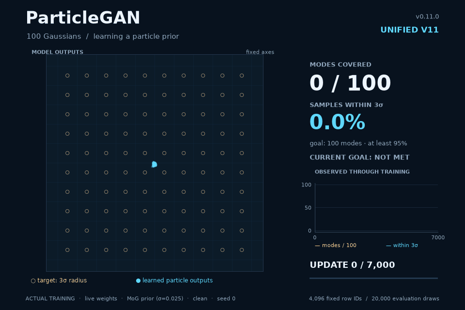

# ParticleGAN


[](https://github.com/HyperGAN/ParticleGAN/actions/workflows/tests.yml)

**GANs with a learnable particle prior, for PyTorch.**

A GAN usually draws its latent code from a fixed Gaussian. ParticleGAN replaces that
noise with a table of learnable latent vectors (*particles*), optimized together with
the generator, so that the prior itself can move toward the data's modes. You write an
ordinary PyTorch GAN loop, or call `GANTrainer`, and a *recipe* builds the optimizers,
critic penalty and prior regularizer.

## Install

Requires Python 3.11+. PyTorch and NumPy are installed as dependencies.

```bash
python -m pip install particlegan           # the library (0.13.1)
```

To run the examples, experiments and tests, install from source with the extras you need:

```bash
git clone https://github.com/HyperGAN/ParticleGAN.git
cd ParticleGAN
python -m pip install -e '.[dev,experiments]'   # tests plus examples/experiments (the toy100 CI job)
python -m pip install -e '.[dev,experiments,images,lunar]'   # what the main CI test job installs
```

| Extra | Adds | Needed for |
| --- | --- | --- |
| `dev` | pytest | the test suite |
| `experiments` | NumPy, Matplotlib, Pillow, PyYAML, POT, SciPy | examples, `python -m experiments.forge` and the toy benchmarks |
| `images` | torchvision, Pillow, torch-fidelity, SciPy <1.18, tqdm | CIFAR and other image experiments, FID |
| `mog` | SciPy | faster exact nearest-neighbour calibration of mixture-of-Gaussians priors (falls back to Torch without it) |
| `gym` | Gymnasium with Box2D | Gym control experiments |
| `lunar` | the `gym` extra plus rich, Pillow and imageio | the Lunar Lander world model and controllers |

Version pins live in [`pyproject.toml`](pyproject.toml). For CUDA, install a
torch/torchvision build that matches your driver before installing the extras.

## Train a GAN

You supply ordinary PyTorch modules. `GANTrainer` binds the recipe's optimizers,
critic penalty and prior regularizer:

```python
import torch
from torch import nn
from particlegan import GANTrainer, get_recipe, init

def real_batch(n):  # replace with your DataLoader: 8 Gaussians on a ring
    angle = torch.randint(8, (n, 1)) * torch.pi / 4
    return torch.cat([angle.cos(), angle.sin()], 1) + 0.05 * torch.randn(n, 2)

recipe = get_recipe(total_steps=2000)
G = nn.Sequential(nn.Linear(recipe.z_dim, 128), nn.LeakyReLU(0.2), nn.Linear(128, 2))
D = nn.Sequential(nn.Linear(2, 128), nn.LeakyReLU(0.2), nn.Linear(128, 1))
init.deterministic_orthogonal_(G, seed=0)
init.deterministic_orthogonal_(D, seed=1)
prior = init.deterministic_orthogonal_(recipe.make_prior())
trainer = GANTrainer(recipe, G, D, prior=prior, seed=0)
for _ in range(recipe.total_steps):
    trainer.step(real_batch(recipe.batch_size))
samples = trainer.sample(1024)
```

`get_recipe()` returns the default recipe, **Axiom** (`DEFAULT_RECIPE = "axiom"` in
[particlegan/recipes.py](particlegan/recipes.py), matching `axiom-v5`).
It is our clean-slate, readable PEP-8 Four-Laws core (`particlegan/_axiom/`, zero sibling imports;
LOC caps are heuristics, not hard gates) with strictly **zero `torch.autograd.grad`, zero SVD,
zero `eigh`, zero `pinv`, and strictly clock-free dynamics** across `axiom`, `unified_v15`, and
`minimal`, pairing: for Law 1, `AxiomPriorRegularizer` (exact mass/LTV Laguerre pullback with
central finite-offset isometry, `prior_reg = 0.02`); for Law 2, `AxiomCriticPenalty` (strictly
zero-`autograd.grad` 3-regime dispatch: `fwad_exact` batched identity-basis `fwAD` for low-D
`d <= 16`, `fwad_debiased` native multi-probe `fwAD` covering Conv2d/BatchNorm/GroupNorm/LayerNorm
and `EmulatedLinear.jvp`, and `secant_debiased` 1st-order central-secant probes for
Attention/SDPA/Softmax/non-JVP ops, with zero-mean logit gauge); for Law 3, `AxiomGANLoss` /
`AxiomTransportLoss` (conformal local horizons, deconflicted chart & atomic matching, and a
zero-`eigh` conditional fiber bank); and for Law 4, `AxiomOptimizer` (genuine `0.0 B/param`
architecture-agnostic DCGAN optimizer state with special BatchNorm `bn_net`/`m_u` branching
removed and unconditional odd-stride / `ndim >= 2` step-cosine sketching, zero-state 4D Conv2d
Frobenius-MP, compound-pathology Critic NS fast path, verified batch-RMS trust, zero-`pinv`
analytic `direction_blend`, `optimizer_smoothing = 0.05`, and `bf16_channels_last` conv training
at constant rates; fresh GPU re-verification on `bn_dcgan_rgb32` is pending).
Explicit `get_recipe("unified_v15")` (highest-coverage Unified Four-Laws preset, `74/79` recorded
pre-remediation receipts, `16/16` Occam), `get_recipe("unified_v12")` (0.12.0 default),
`get_recipe("unified_v11")` (0.11.x preset), `get_recipe("minimal")` (compact, un-minified
zero-Newton-Schulz fast core), `get_recipe("empf")` (`empf-v8`), `get_recipe("rhbi_optimized")`
(`rhbi-v12`), `get_recipe("rhbi")` and `get_recipe("bispf_optimized")` retain named presets. See
**[The Four Laws of Adversarial Generative Learning](docs/four-laws.md)** for the
solution-agnostic statement of the evolving laws (subject to revision as research progresses),
**[Explore by Laws](reports/forge/LAWS_HUB.md)** and the **[Experiment Catalog](reports/forge/experiments/README.md)**
for dedicated per-experiment pages, target schematics, and law-to-family cross-links, the
[research glossary](RESEARCH_GLOSSARY.md#acronyms-and-short-names) for acronyms, and the
[recipe settings and evidence](docs/api.md#recipes-and-defaults) for configuration details.

Without `prior=`, the trainer builds a randomly drawn particle table. Networks
and device placement belong to the caller. The trainer does not reinitialize
supplied modules, so load pretrained weights before constructing it and
initialize only fresh parameters. Optimizers exclude frozen parameters while
retaining gradients through frozen modules to trainable inputs.

Caller-owned loops use the recipe's role-named factories, including
`make_optimizers`, `make_critic_penalty` and `make_prior_regularizer`.
Save the resolved `recipe.to_dict()` and the complete `trainer.state_dict()`
for continuation; restore the recipe with `Recipe.from_dict(saved_fields)`.
Changing the current default does not migrate an old run. Bare or partial `Recipe(...)` calls raise
an error: use `get_recipe()` to select the current public recipe for new runs.
See the [API reference](docs/api.md#recipes-and-defaults) for component ownership
and optimizer contracts.

For categorical data and wide continuous feature vectors, see the
[BISPF input-domain walkthrough](docs/bispf-input-domains.md). It includes a
checked numerical example and a runnable four-category GAN with training GIF,
quality metrics and checkpoint continuation.

## Results and status

Explore the live research and benchmark evidence across three synchronized views:

- **[Research Portal (GitHub Pages)](https://hypergan.github.io/ParticleGAN/)** — searchable documentation portal with interactive leaderboard, NVML energy Pareto scatter, evolving laws, family narratives, and dedicated per-experiment pages.
- **[Interactive Leaderboard Space (Hugging Face)](https://huggingface.co/spaces/HyperGAN/particlegan-leaderboard)** — live receipt explorer, Laws × Family matrix, Experiment Deep-Dive schematics, and side-by-side training GIFs streamed from [`HyperGAN/particlegan-forge-evidence`](https://huggingface.co/datasets/HyperGAN/particlegan-forge-evidence).
- **[Technique Inventory (GitHub)](reports/forge/technique-inventory.md)** — the single canonical status page in Git, alongside **[Explore by Laws](reports/forge/LAWS_HUB.md)** and the **[Experiment Catalog](reports/forge/experiments/README.md)**. Other report pages are historical records.

What the evidence does and does not show today:

- **The default is a research selection, not a qualified winner.** In the
  [technique inventory](reports/forge/technique-inventory.md) and
  [RTX A6000 energy study](reports/forge/studies/rtx-a6000-v14-v15-axiom-v5-energy-benchmark.json)
  (recorded `v0.13.0`/`v0.13.1` pre-remediation snapshots; fresh post-remediation GPU
  re-verification after removing `autograd.grad`, special BatchNorm `bn_net`/`m_u` state, and
  benchmark-fingerprinting solvers is pending), the promoted **`axiom`** default
  (`DEFAULT_RECIPE = "axiom"`, matching `axiom-v5`, clean-slate Four-Laws core) reaches
  **`45 PASS / 2 FAIL / 12 not measured`** on the 59-task fixed suite, **`102/115` counted view
  requirements** (`27/27` Tier 1, `75/78` Tier 2; **Screening Tier 2** on the Rev-9 comparison
  projection), **`53/70` stretch assignments**, and **`6/6` `dcgan_performance`** at
  **`32.84 ms/step` / `8.25 J/step`** solo idle RTX A6000 NVML (`34.39 ms/step` Forge, genuine
  `0.0 B/param` architecture-agnostic DCGAN optimizer state — **`16%` faster / `-27%` J/step**
  vs `unified-v12` and **`26%` faster / `-34%` J/step** vs `unified-v15`, plus **`3,511.6 J`**
  `grid100` J-to-first-PASS and **`556.4 J`** `ring16`). Explicit
  **`get_recipe("unified_v15")`** leads broad pre-remediation receipt coverage at **`44/59`**
  fixed suite, **`103/115`** counted view requirements (`27/27` Tier 1, `76/78` Tier 2),
  **`16/16`** Occam, and **`74/79` (`93.7%`)** measured receipts at `44.35 ms/step` /
  `12.47 J/step` (`4,135.0 J` `grid100`), ahead of `rhbi_optimized` (`rhbi-v12`, `83/115`),
  `empf` (`empf-v8`, `83/115`), and `bispf_optimized` (`81/115`), while `get_recipe("minimal")`
  offers a compact, un-minified zero-Newton-Schulz fast core and `get_recipe("unified_v12")`
  retains the 0.12.0 default. Source-bound scope corrections in
  [`reports/forge/evidence-corrections-2026-11-08.json`](reports/forge/evidence-corrections-2026-11-08.json)
  and [`reports/forge/evidence-corrections-2026-11-26.json`](reports/forge/evidence-corrections-2026-11-26.json)
  mark archived `grid100_res16_scaled_tanh` (`preserve_latent_norm=True` identity lock; replaced
  for new runs by clean `grid100_res16_scaled_tanh_v2`) and v1 DDGAN observations as
  `archived_contract_diagnostic` without rewriting historical receipts.
  See the [Axiom family report](reports/forge/families/axiom.md),
  [Unified family report](reports/forge/families/unified.md), and
  [Axiom comparative study](reports/axiom/axiom-study.md). Forge's screening calibration remains
  provisional (`BLOCKED` under `criteria-v1.json`; see
  [r3-calibration-holdout](reports/forge/studies/r3-calibration-holdout.md)), Tier 2/3 full-tier
  qualification is incomplete, and remaining `axiom-v5` non-passes (`66/78` all measured receipts,
  `15/16` Occam via `zero_tanh_rail_escape`, drift adaptation tasks `ring_hold` / `ring_extension` /
  `target_shift_recovery`, DDGAN chain tasks `model_ddgan_bimodal_chain` / `model_ae_ddgan_gaussian_chain`,
  `grid100_res16_tanh`, `bytegan_bigan_dictionary`, and Law 1A–1B tasks deferred to `axiom-v6`)
  stay visible.
- **Controlled prior comparison** ([matched prior ablation, 2026-10-25](reports/prior-ablation-2026-10-25/README.md)).
  Each arm changes only the prior policy. Architecture, data, budget, seed 0 and
  the initial table are the same. These are one-seed diagnostics with no
  qualification credit.

  | Prior | Toy tests passed (15 graded in all arms) | Ring16 high-quality fraction | CIFAR-10 DDGAN FID50k ↓ |
  | --- | ---: | ---: | ---: |
  | Learned particle table (default) | 7 | 0.95 | 79.7 |
  | Frozen table | 5 | 0.61 | 108.5* |
  | Fresh N(0, I) latent | 5 | 0.53 | 82.7 |

  \* Final checkpoint only; the same run scored 80.8 FID5k at step 7500, so this
  is most likely a bad excursion. All FIDs are single point estimates.

  On the toy suite the learned table buys sample precision at seed 0: it alone
  passes `ring16_acquisition` and `mode_hold` (2 of the 15 matched tests, both at
  a +0.00 margin with no recorded noise floor). The fixed priors cover the 100-mode grids
  more evenly but less precisely, and every arm fails those grids. On CIFAR the
  gaps are inside the run's own checkpoint-to-checkpoint and rerun noise
  (up to 9.4 FID5k between same-config reruns), so no image-scale prior effect is
  established.
- **BISPF shape/step-gate ablation (`bispf_shape_gates=False`).** In the same
  [2026-10-25 ablation study](reports/prior-ablation-2026-10-25/README.md) (Arm A4,
  `bispf-pure-global-v1`), disabling all 10 shape/step gates in `BISPFGates` drops
  full-suite passes from **19/49 to 13/49** (and from **7/15 to 5/15** on the matched
  sampled-latent subset), losing `ring16_acquisition` (reaches `hq = 0.958` at the
  endpoint but only 2/5 consecutive stable checks), `mode_hold` (7/8 modes),
  `ring_extension` and `img_stripes2`. For wide continuous vectors (`dim >= 170`) where
  only the automatic categorical simplex heuristic is unwanted, pass
  `penalty_options={"input_domain": "continuous"}` to `GANTrainer` (or
  `recipe.make_critic_penalty(opt_d, input_domain="continuous")`) as documented in
  [BISPF input domains](docs/bispf-input-domains.md).
- **Headline numbers below are single runs** without error bars, unless a linked
  report says otherwise.

### The 100-Gaussian animations

The lead [`100gaussians.gif`](100gaussians.gif) retains its recorded **0.11.0** Unified (`get_recipe("unified_v11")`) training run on the Forge `grid100` `MoGParticlePrior(20000, σ=0.025, standardize=False)` cohort; the other two animations retain their archived 0.9.1 and opt-in E22 identities.

| Animation | Recipe | What it shows | Pass/fail metric | Result |
| --- | --- | --- | --- | --- |
| [`100gaussians.gif`](100gaussians.gif) | **Archived 0.11.0 default** (`get_recipe("unified_v11")`) with the Forge `grid100` task prior (`MoGParticlePrior(20000, σ=0.025, standardize=False)`). | 100-Gaussian grid, public deterministic initialization, protocol seed 0, 7,000 updates (live weights, clean sampling, 260.5 s on RTX A6000). | All 100 modes with ≥10 samples within 3σ, **and** `hq` (share of samples within 3σ) ≥ 0.95, at each of 5 terminal checks. | **PASS**: 100/100 modes, `hq` 98.52% (5/5 terminal checks 98.52%–99.39%), Mode TV `0.04555`, Sliced W1 `0.08353`, core width ratio `0.957` ([receipt](reports/readme-100gaussians/README.md#current-default); archived 0.9.0 `ParticlePrior` FAIL retained [here](reports/readme-100gaussians/README.md#archived-090-default-particleprior-cohort)) |
| [stripes GIF](reports/forge/bispf-throughput/media/bispf-throughput-v1/img_stripes2.gif) | **Archived 0.9.1 default** (`get_recipe("bispf_optimized")`, batched SVD, BF16/channels-last) | Fixed 600-update `img_stripes2` image task | The task's declared Forge gate, including all required modes | **PASS** ([readout](reports/forge/bispf-throughput/README.md)) |
| [E22 GIF](https://huggingface.co/datasets/HyperGAN/particlegan-forge-evidence/resolve/496272b90f1c06483db8ff1846ca5f07186d859d/media/e22-animation/e22-100gaussians.gif) | **Not the default.** Opt-in preset `get_recipe("e22", ...)` with an identity `nn.Linear(2, 2)` generator, a 20,000-row table, batch 2,048 and seed 1234 | Grid, rotated and staggered 100-Gaussian layouts, 7,000 updates each | Native gates: worst live precision over the last 5 checks ≥ 0.97 and worst centre error ≤ 0.20σ | **PASS** on all three layouts (precision .9822–.9851); the animation draws reach `hq` 98.3–98.6% ([E22 results](docs/e22.md#results), [animation](reports/e22-animation/README.md)). In the Forge suite, E22 is 0/115: its policy cohort is blocked or incompatible with the current task definitions. |




The E22 run uses a different generator, table size, batch and seed, so it is not
a matched comparison with the default's animation.

## Releases, Forge and throughput

**Running experiments or proposing ideas:** start with
[ParticleGAN Forge — read before running ideas](EXPERIMENTATION.md). The
[research attempt catalog](reports/forge/research-catalog/README.md) lists source-bound
results, reusable lessons, failures and publication links. The
[experiments by tier](reports/forge/EXPERIMENTS_BY_TIER.md) page shows goals and
training GIFs. The [experiment memory](reports/forge/EXPERIMENT_MEMORY.md) explains the
hypotheses, comparisons and recommendations behind the recorded results. These views
are regenerated as experiments change. Release selection requires completed Forge
qualification and review of the winner. The
[0.10 Forge requirements](reports/forge/convergence-policy-010/README.md) make accurate
acquisition, settling, endurance and recovery required again.

**Changing the default.** A promotion changes one line in
[particlegan/recipes.py](particlegan/recipes.py): `DEFAULT_RECIPE = "axiom"`.
All model-family factories inherit that trainer preset. Explicit presets such as
`get_recipe("unified_v15")`, `get_recipe("unified_v12")`, `get_recipe("unified_v11")`, `get_recipe("minimal")`, `get_recipe("empf")`, `get_recipe("rhbi_optimized")`,
`get_recipe("rhbi")`, `get_recipe("bispf_optimized")` and
`get_recipe("ka2")` remain available. This is the owner-selected research default;
Forge calibration remains provisional (`BLOCKED`), Tier 2/3 qualification is incomplete,
and untouched multi-seed/natural-image confirmation remains open.

**0.9.1 throughput.** Version 0.9.1 made the faster BISPF execution policy the
default, and kept explicit historical settings and saved-recipe restoration (see the
[changelog](CHANGELOG.md) for compatibility limits). Batched convolution updates and
BF16/channels-last training accelerate supported CUDA image networks. Weights,
optimizer arithmetic and sampling stay FP32. CPU and nonconvolutional networks keep
their previous execution. The [throughput readout](reports/forge/bispf-throughput/README.md)
preserves 19 passing and 11 failing task verdicts. It measures 2.15× faster 256×256
DCGAN updates and about 2.3× faster small image updates than 0.9.0. Across all six
DCGAN workloads, speedups range from 1.02× to 2.15×. These results do not establish
natural-image convergence or a universal architecture guarantee.

## Repeatable initialization

The recipe never touches your weights: networks train from whatever they are
built with. `particlegan.init` is optional tooling in the spirit of
`torch.nn.init`, and the examples use it:

```python
from particlegan import init

init.deterministic_orthogonal_(G, seed=0)   # G, D and an encoder get different seeds
init.deterministic_orthogonal_(D, seed=1)
prior = init.deterministic_orthogonal_(recipe.make_prior())
```

It writes orthogonal matrices at PyTorch's default scale, patterned biases and
an evenly spread particle table, derived from `seed` alone: the same seed and
architecture give the same weights, and no random state is used. Call it on
fresh networks, before loading weights or building optimizers. A custom layer
it does not know raises an error until you declare it with `init.register`.
Values depend on each parameter's position in the module you pass, so
initialize whole networks: a submodule initialized on its own gets different
values. Projects with custom layers can guard this with a one-line test that
`init.declarations(net)` has no `None` entries
([example](docs/api.md#declarationsmodule)).
See the [API reference](docs/api.md#initialization) and the
[math and architecture guide](docs/initialization.md).

## Model families

`get_recipe(name)` selects a model family or an E22 policy preset.

| Name | Model |
| --- | --- |
| `gan` (default) | GAN with a learnable particle prior |
| `e22` | Scalar particle GAN with stationarity control, row evidence, birth/death, learned noise and served averages |
| `e22_routed` | Conditional dense-bank adaptation with paired row evidence and guarded birth/death |
| `mog` | GAN with a mixture-of-Gaussians particle prior |
| `ddgan` | Denoising-diffusion GAN with a UCD (class-conditional) critic |
| `ddgan_mog` | `ddgan` with a mixture-of-Gaussians prior |
| `ae_gan` | Autoencoder GAN: an encoder routes data to particles |
| `vae_gan` | Variational variant of `ae_gan` |
| `ae_ddgan` | Autoencoder denoising-diffusion GAN |

Any field can be overridden: `get_recipe("mog", total_steps=20_000)`.
For E22, set the task's dimensions and output noise explicitly:
`get_recipe("e22", num_particles=20_000, z_dim=2, batch_size=2048, output_noise_std=.029)`.
[`E22Policy`](docs/e22.md) exposes the same controls used by `GANTrainer` for
caller-owned backward passes and optimizer steps, with checkpointing and served snapshots.
For conditional softmax blends, use `get_recipe("e22_routed", ...)` with the
explicit [`RoutedRows` contract](docs/e22_routed.md). This adaptation measures
the whole conditional forward and validates row moves on separate guard
contexts. Frozen BF16 modules can accompany FP32 trainable parameters and tables.
Multiple token routing sites can share one bank and controller through the
[full-model routing contract](docs/e22_routed_sites.md). Candidate checks rerun
the complete model, including downstream sites and the final paired output.
`RoutedRows(probe_interval=20)` schedules expensive row probes separately from
per-update gradient evidence and saves its clock in checkpoints. The optional
`output_error_guard=True` bounds clean paired-output MSE on guard contexts;
it does not establish repair of the noisy adversarial game. Split rows
transport their parent's Adam history at half mass.

## Learn more

- [Axiom 4-Law family](reports/axiom/axiom-study.md): **historical `axiom-v4` (`758b397a5`)** comparative Forge study (superseded by `axiom-v5` and post-remediation `develop`; archived `axiom-v4` readouts recorded `18/18` `t3-holdout`, `40/47` Tiers 1–2 `disc-stab` [`16/17` T1], `34.86 ms` / `805.8 MiB` / `7.307 J/step` solo idle `r256`, `2/2` ByteGAN `rms=0.00471`, `2/2` `t3_iso` `eig=0.5447`, `3/3` `t4-nash`, `5/5` `shift-diagnostic`, `5/7` `t4-arch`, `22/33` `four-laws-adherence-v1`), [design spec](reports/axiom/design-spec.md), and [Four-Laws benchmark](reports/axiom/four-laws-benchmark.md) (**original `9/9 PASS vs 0/9` table retracted** due to mismatched competitor ground-truth formulas in Suite 4A, hardcoded mocks in Suites 3B/5B/5C, targeted tail indices in Suite 3C, and omitted `torch.nonzero` sync counting in Suite 5D; `scripts/axiom_four_laws_benchmark.py` has been repaired and fresh benchmark runs are pending)
- [Optimized BISPF settings and measured behavior](reports/forge/bispf-optimized/README.md)
- [BISPF continuous vs. categorical input domains](docs/bispf-input-domains.md): explicit penalty domain declarations (`input_domain="continuous"` or `"categorical"`) for wide continuous vectors (`dim >= 170`) and categorical codebooks
- [Historical KA2 formulation](docs/ka2.md), including several critics and conditional critics
- [E22](docs/e22.md): a schedule-free configuration for the native 100-Gaussian problems with no data-space statistics
- [ParticleGAN Atlas](docs/atlas.md): illustrated E22 comparison, local population corrections and automatic backend selection
- [Routed paired E22](docs/e22_routed.md): conditional row evidence, guarded moves and clean serving
- [Shared-bank routing sites](docs/e22_routed_sites.md): sequential token routing and a matched spatial comparison
- [Whole-model checkpoint replay](docs/e22_routed_sites.md#activation-checkpointed-whole-model-replay): per-site DV12 without repeated training draws or diagnostics
- [Routed noisy-game qualification](docs/e22_routed_game.md): token penalty units, mass invariance and matched longer training
- [Many-site synchronization](docs/e22_routed_readbacks.md): deferred DV12 diagnostics and batched routing validation
- [API reference](docs/api.md) and a [minimal DDGAN + UCD loop](docs/api.md#a-minimal-ddgan--ucd-loop)
- Examples: [`quickstart_gan.py`](examples/quickstart_gan.py) (GANTrainer with checkpoints),
  [`e22_external_loop.py`](examples/e22_external_loop.py) (E22 in a caller-owned loop),
  [`e22_routed_paired.py`](examples/e22_routed_paired.py) (source/time-conditioned paired-error training),
  [`e22_routed_sites.py`](examples/e22_routed_sites.py) (sequential shared-bank routing and spatial ablations),
  [`pytorch_loop.py`](examples/pytorch_loop.py) (the full update in your own loop),
  [`100gaussians.py`](examples/100gaussians.py) (the benchmark above),
  [`particle_autoencoder.py`](examples/particle_autoencoder.py) (AE/VAE-GAN),
  [`fast_lander.py`](examples/fast_lander.py) (world model and controllers for Lunar Lander)
- [Changelog](CHANGELOG.md) · [Releasing](docs/releasing.md)

## Citation

```bibtex
@software{particlegan2025,
  author = {Martyn Garcia},
  title = {ParticleGAN: Learnable Priors for Stable GANs},
  year = {2025},
  url = {https://github.com/HyperGAN/ParticleGAN}
}
```

## License

MIT
