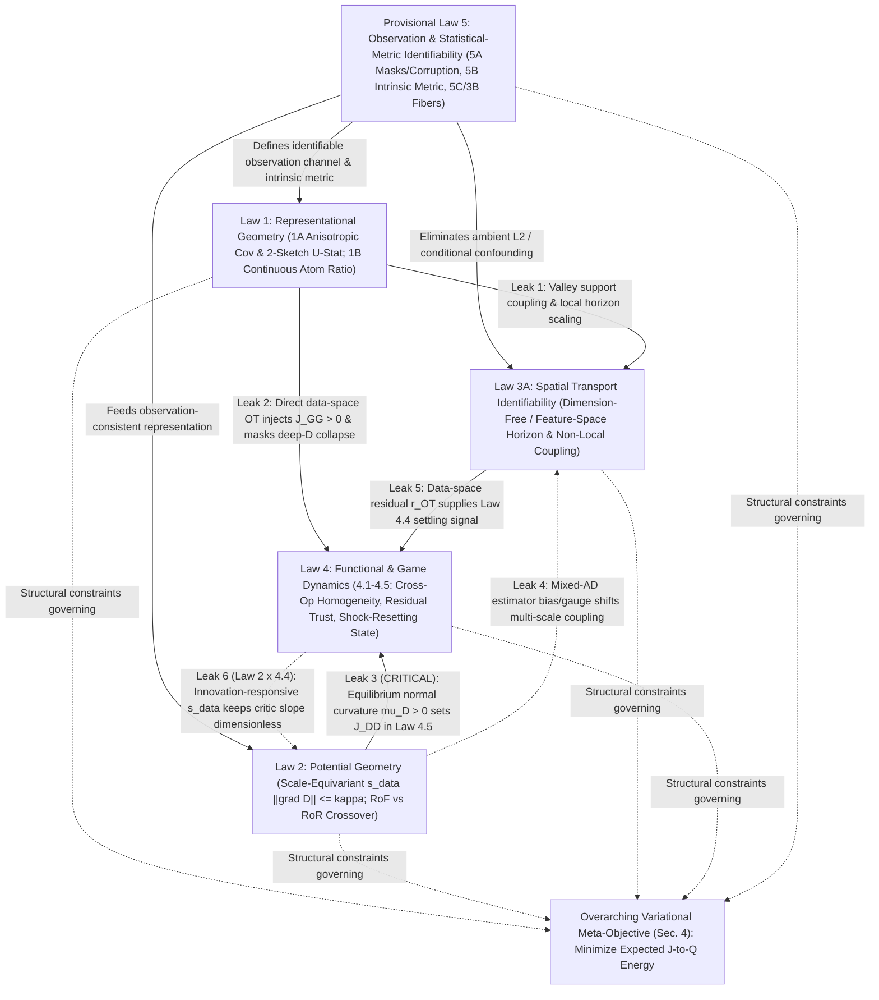

# The Four Laws of Adversarial Generative Learning

> *"Our goal is not to preserve the four laws. Our goal is to discover the laws of learning, even if doing so ultimately requires abandoning the current four."*

---

## 1. Preamble, Scope, and Epistemic Governance

### 1.1 Purpose and Intended Audience

This document serves as the canonical, implementation-independent theoretical bedrock for adversarial generative learning in ParticleGAN. It synthesizes mathematical theorems, information-theoretic obstructions, controlled counterexamples, prior literature, and empirical findings audited across ten adversarial investigation tracks ([`p0`–`p10`](../reports/four-laws-audit/README.md)), the [Axiom-v4 Failure Analysis](../reports/axiom/axiom-v4-failure-analysis.md), and concurrent repository studies.

It is written for two audiences:
1. **A researcher unfamiliar with ParticleGAN** should be able to read this document from start to finish and understand the fundamental mathematical problems of adversarial generative learning, the exact evidence supporting our conclusions, where those conclusions fail or break down, and precisely how to falsify or supersede them.
2. **An algorithm engineer designing a new generative learning family** should be able to reason directly from the laws, failure mechanisms, and energy decompositions below *without* first reading thousands of lines of existing codebase implementation — and without inheriting any specific engineering mechanism as dogma.

Accordingly, **every law is strictly decoupled from concrete solutions**. A law describes an underlying mathematical, statistical, or dynamical problem; concrete algorithm families and engineering mechanisms live separately in the [Technique Inventory](../reports/forge/technique-inventory.md), per-family reports (`reports/forge/families/`), and the archived [Evidence Ledger & Mechanism Catalog](../reports/four-laws-audit/evidence-ledger-and-revisions.md).

### 1.2 Epistemic Status, Scope, and Governance Caveats

Moving a finding into a canonical document never strengthens its epistemic status. Every theoretical and empirical claim in this document is governed by the following explicit boundaries (audited in full in [`evidence-ledger-and-revisions.md`](../reports/four-laws-audit/evidence-ledger-and-revisions.md) and [`p8-qualification-audit.md`](../reports/four-laws-audit/p8-qualification-audit.md)):

- **Strict separation of proof from empirical evidence:** Proven mathematical theorems and information-theoretic obstructions are separated explicitly from empirically supported causal mechanisms, empirical observations, engineering heuristics, conjectures, falsified claims, and open questions. Passing an operational benchmark gate never proves a mathematical property.
- **Single-seed screening protocol (`seed = 0`):** Forge screening studies referenced by the audit tracks execute through the public API under protocol seed `0`, `deterministic_orthogonal` initialization, live scoring weights, one unchanged global configuration per candidate, and **1:1 alternating critic-then-generator updates** ([`particlegan/training.py:678–696`](../particlegan/training.py#L678-L696)), primarily on `NVIDIA RTX A6000` GPUs. Single-seed screening provides no statistical estimate of cross-seed pass probability (`1/1` PASS has a Clopper–Pearson 95% lower bound of `0.025`).
- **Synthetic distributions and architecture dependence:** Most empirical screening evidence comes from low-dimensional synthetic mixtures, structured conditional diffusion chains, small discrete visual tasks, or mock-noise throughput benchmarks (`dcgan_performance_r256` trains on `Uniform[-1, 1]` noise with no image-quality gate). Real natural-image FID/Recall-to-energy confirmation remains open, and cross-GPU/architecture transfers demonstrate non-trivial sensitivity.
- **Adaptive selection budget & holdout overlap:** Iterative screening on a fixed seed-0 benchmark suite can induce measurable overfitting even when using a single global configuration per candidate (`68` declared cards / `78.27` GPU-hours across the main historical lineage; `13/18` tasks in `r3-tier3-long-horizon-holdout-v1` overlap active screening views, `14/18` including shift recovery).
- **Screening calibration remains `BLOCKED`:** Under [`configs/forge/calibration/criteria-v1.json`](../configs/forge/calibration/criteria-v1.json) (audited in [`r3-calibration-holdout.md`](../reports/forge/studies/r3-calibration-holdout.md) and [`r3-calibration-holdout.json`](../reports/forge/calibration/r3-calibration-holdout.json)), screening calibration is arithmetically **`BLOCKED`**. **No recipe in this repository is declared scientifically qualified.**
- **Open, evolving Forge environment:** This document **does NOT freeze Forge** (benchmark suites, pass thresholds, and seeds remain open to scientific improvement and new challenge tasks) and does not mutate any historical Forge receipt (`reports/forge/records/*.json`).

### 1.3 Overview of the Four Laws (and Provisional Law 5)

The registry ([`configs/forge/laws.json`](../configs/forge/laws.json)) tracks **four active structural laws** (incorporating concrete falsifiable refinements `1A/1B`, `2 × 4.4`, `3A`, and `4.2–4.4`) plus **one provisional fifth law** (`status: "provisional"`) that passed the strict oracle-independence test against Laws 1–4. [Section 4](#4-overarching-objective-energy-optimal-learning) preserves **Energy-Optimal Learning (`J-to-Q`)** in its exact mathematical role as the **overarching variational meta-objective** minimized subject to these structural constraints, rather than a fifth failure-obstruction law.

| Law | Status | Domain Level | Fundamental Question | Core Mathematical Tension | What Satisfying It Does *Not* Guarantee | Primary Audit Tracks |
| :--- | :--- | :--- | :--- | :--- | :--- | :--- |
| **Law 1** *(1A & 1B)* | `active` | **Representational Geometry** | *Can the system represent the required probability measure efficiently and faithfully?* | Continuous pushforward regularity ($`\lVert J_G \rVert_\infty`$), anisotropic local covariance $`\Sigma_k`$ & unbiased 2-sketch U-statistics (1A), and continuous discrete–continuous phase ratio $`\rho_{\text{atom}}`$ (1B) vs. disconnected support & adaptive prior overhead | Useful critic forces (Law 2), transport identifiability (Law 3), observation identifiability (Law 5), or stable game dynamics (Law 4) | [P7](../reports/four-laws-audit/p7-law1-topology-audit.md), [Axiom-v4 Analysis](../reports/axiom/axiom-v4-failure-analysis.md#61-proposed-falsifiable-amendments-to-laws-14) |
| **Law 2** *(2 × 4.4)* | `active` | **Potential Geometry** | *Does the critic communicate useful learning forces with appropriate geometric control and computational efficiency?* | Dimensionless whitened-coordinate slope regularity ($`s_{\text{data}}\lVert \nabla_x D \rVert_2 \le \kappa`$) & gauge vs. mixed 2nd-order AD cost (`RoF` vs. `RoR`) & estimator bias–variance | Global 1-Lip certification from median chords, $`W_1`$ scale identifiability (Law 3A), observation injectivity (Law 5), or game contraction without $`\mu_D > 0`$ / game-contractive updates (Law 4.5) | [P6](../reports/four-laws-audit/p6-law2-autodiff-audit.md), [P2](../reports/four-laws-audit/p2-law3-identifiability.md), [P3](../reports/four-laws-audit/p3-game-dynamics-counterexample.md), [Axiom-v4 Analysis](../reports/axiom/axiom-v4-failure-analysis.md#61-proposed-falsifiable-amendments-to-laws-14) |
| **Law 3** *(3A & 3B)* | `active` | **Transport Identifiability** | *Does the learning system possess enough information to determine appropriate transport?* | Observation-channel identifiability: **(3A)** static/local $W_1$ ray-length & dimension-free / feature-space screening continuity; **(3B)** conditional drift–variance confounding & sparse-stratum tail starvation *(unifies with Provisional Law 5)* | Ability of an optimizer to act on that information (Law 4), smooth generator representation (Law 1), or partial-observation injectivity (Law 5A) | [P2](../reports/four-laws-audit/p2-law3-identifiability.md), [Axiom-v4 Analysis](../reports/axiom/axiom-v4-failure-analysis.md#61-proposed-falsifiable-amendments-to-laws-14) |
| **Law 4** *(4.1–4.5)* | `active` | **Functional and Game Dynamics** | *Can the learning system realize useful functional changes and exhibit appropriate coupled learning dynamics?* | Functional realization, cross-operator uniform damping & pathology-witnessed conditioning (4.2), residual-normalized / decoupled trust & Kreiss control (4.3), strictly homogeneous shock-resetting state (4.4), and coupled minimax contraction (4.5) | Representational compatibility (Law 1), unbiased transport targets (Law 3), observation identifiability (Law 5), or global nonlinear convergence without additional assumptions | [P0](../reports/four-laws-audit/p0-law43-rank-audit.md), [P1](../reports/four-laws-audit/p1-law42-scale-settling.md), [P3](../reports/four-laws-audit/p3-game-dynamics-counterexample.md), [P4](../reports/four-laws-audit/p4-function-space-generality.md), [P5](../reports/four-laws-audit/p5-optimizer-asymmetry.md), [Axiom-v4 Analysis](../reports/axiom/axiom-v4-failure-analysis.md#61-proposed-falsifiable-amendments-to-laws-14) |
| **Law 5** *(5A, 5B, 5C)* | `provisional` | **Observation & Statistical-Metric Identifiability** | *Is the target probability measure identifiable through the observation channel and statistical metric from finite batches?* | Non-injective / partial observation operators ($`\mathcal{A}_\# P_X = \mathcal{A}_\# P_Y \not\Rightarrow P_X = P_Y`$) & realizable finite-batch independent-mask expected-$`L_2^2`$ shrinkage ($`X^\star = p\,\mathbb{E}[Y]`$) (5A); intrinsic vs. ambient metric geometry ($`d_{\text{amb}} \gg d_{\text{int}}`$) (5B); conditional fiber deconfounding (5C, unifying Law 3B) | Smooth pushforward topology (Law 1), bounded critic slope (Law 2), $`W_1`$ ray/horizon identifiability (Law 3A), or stable game dynamics (Law 4) | [P2](../reports/four-laws-audit/p2-law3-identifiability.md), [Axiom-v4 Analysis](../reports/axiom/axiom-v4-failure-analysis.md#62-rigorous-evaluation-of-candidate-5th-laws-independence-vs-corollary) |

---

## 2. The Four Laws (and Provisional Law 5)

Each law below is presented using an identical eight-part scientific structure: *Statement*, *Motivation*, *Mathematical Formulation*, *Established Results* (separating prior literature from controlled audit results), *Demonstrated Failure Mechanisms*, *Operational Criteria*, *Falsification Criteria*, and *Open Questions*. Concrete family implementations, mechanism catalogs, and benchmark receipts are deliberately separated into [Section 5](#5-concrete-family-implementations--evidence) and the per-family documentation.

---

### Law 1 — Representational Geometry

*Fundamental question: Can the system represent the required probability measure efficiently and faithfully?*

#### Statement

Whenever a generative system represents a target probability measure $P_Y$ by pushing a latent measure $P_Z$ through a continuous map $`G_\theta`$, the topological and metric mismatch between $\mathrm{supp}(P_Z)$ and $\mathrm{supp}(P_Y)$ imposes a sharp, GAN-independent trade-off between valley probability mass ("ghost" samples), transport approximation error, and generator Jacobian magnitude $`\lVert J_G\rVert_\infty`$. Efficient, faithful representation requires balancing the geometric and computational burden carried by $`G_\theta`$ against the statistical, memory, and synchronization burden carried by $P_Z$ — separating *where* separated probability mass resides from *how* local geometry is transformed when $P_Y$ exhibits multi-component valleys, while recognizing that unimodal continuous priors remain natural and often superior on single connected smooth manifolds.

Two concrete falsifiable refinements sharpen Law 1's local metric and support-regime boundaries ([Axiom-v4 Failure Analysis](../reports/axiom/axiom-v4-failure-analysis.md#61-proposed-falsifiable-amendments-to-laws-14)):
- **Law 1A — Anisotropic Local Metric & Unbiased Stochastic Sketching:** Local pushforward regularization must preserve **full or low-rank local covariance** $`\Sigma_k`$ ($`\kappa_k \gg 1`$) rather than collapsing local geometry onto a scalar trace $`v_k I_D`$. Whenever stochastic Jacobian-covariance matching operates with fewer probe directions than latent dimension ($`d_z > n_{\text{dirs}}`$), the loss must use an **unbiased two-independent-sketch U-statistic** (or exact Gram trace identity) rather than a single-sketch squared Frobenius norm, eliminating quadratic Jensen shrinkage bias.
- **Law 1B — Discrete-Continuous Phase Continuity:** Representational switching between discrete atomic codebooks and smooth continuous manifolds must be governed by a **continuous annular-gap ratio** $`\rho_{\text{atom}} := \sigma_{\text{intra}} / \Delta_{\text{inter}} \in [0, 1]`$ rather than a binary duplicate-purity threshold (such as $`\tau_0 = 10^{-6}`$), preventing discontinuous cliffs under small observation noise.

#### Motivation

Generative models are commonly built from a fixed isotropic Gaussian prior $`P_Z = \mathcal{N}(0, I_{d_z})`$ and a continuous neural generator $`G_\theta`$. On separated multimodal targets, forcing a single connected latent space to jump across low-density valleys compels $`G_\theta`$ to concentrate extreme local stretching along thin latent boundaries. That stretching inflates gradient norms, destabilizes optimization, wastes generator capacity, and leaves visible probability mass in empty space between modes.

At the same time, adaptive or multimodal priors are **not free**. Maintaining a streaming prior introduces its own computational overhead (prototype bookkeeping, assignment solvers, synchronization points, memory footprint, and high-dimensional distance scaling), finite-batch variance when minibatch size $`B`$ is smaller than mode count $`M`$, and granularity artifacts on smooth continuous manifolds. Equally, oversimplified isotropic local variance trackers ($`v_k I_D`$), single-sketch quadratic pullback estimators in $`d_z > n_{\text{dirs}}`$, and binary zero-radius duplicate switches all introduce distinct representational failures on anisotropic ellipses, high-dimensional clusters, and noisy codebooks. Law 1 therefore frames representation as a **division-of-labor, local-metric faithfulness, phase-continuity, and total-cost problem**, not an unconditional mandate for disconnected priors.

#### Mathematical Formulation

Let $(Z, P_Z)$ be a latent probability space with full topological support $\mathrm{supp}(P_Z) = Z$, let $`G_\theta: Z \to \mathbb{R}^d`$ be a continuous map with global Lipschitz constant $`L := \sup_{z \neq z'} \lVert G_\theta(z) - G_\theta(z')\rVert_2 / \lVert z - z'\rVert_2`$ ($= \sup_z \lVert J_G(z)\rVert_2$ for $C^1$ maps), and let $`P_G := (G_\theta)_\# P_Z`$ be the pushforward measure.

Let $`P_Y = \sum_{m=1}^M w_m P_m`$ ($`w_m > 0, \sum_{m=1}^M w_m = 1`$) be a target measure whose high-probability mode cores $K_1, \dots, K_M \subset \mathbb{R}^d$ have pairwise separation $`\Delta := \min_{i \neq j} \mathrm{dist}(K_i, K_j) > 0`$, defining the inter-mode valley $`V := \mathbb{R}^d \setminus \bigcup_{m=1}^M K_m`$ and valley bridge mass $`p_{\text{bridge}} := P_G(V)`$. The key representational quantities are:
- **Exact topological support:** $`\mathrm{supp}(P_G) = \overline{G_\theta(Z)}`$ and reverse KL divergence $`D_{\mathrm{KL}}(P_G \Vert P_Y)`$.
- **Metric approximation errors:** Wasserstein distances $W_1(P_G, P_Y)$, $W_2(P_G, P_Y)$, total variation $\mathrm{TV}(P_G, P_Y)$, maximum mean discrepancy $`\mathrm{MMD}_k(P_G, P_Y)`$, and bridge mass $`p_{\text{bridge}}`$.
- **Anisotropic local pushforward metric & unbiased stochastic sketching (Law 1A):** Local pushforward covariance $`\Sigma_{\text{push}}(z) = J_G(z)\Sigma_Z(z) J_G(z)^\top`$ must match full ($`d \le 16`$) or low-rank-plus-diagonal local target covariance $`\Sigma_k`$ ($`\kappa_k = \lambda_{\max}(\Sigma_k)/\lambda_{\min}(\Sigma_k) \gg 1`$), not scalar $`v_k I_D`$. When approximating $`\Sigma := \Sigma_{\text{push}}`$ via a rank-$`n_{\text{dirs}}`$ orthonormal sketch $`\hat\Sigma_U = \frac{d_z}{n_{\text{dirs}}}\sum_{a=1}^{n_{\text{dirs}}} (J_G u_a)(J_G u_a)^\top`$ with $`n_{\text{dirs}} < d_z`$, minimizing a *single* sketch's squared Frobenius error incurs exact quadratic Jensen bias under Haar-orthonormal $`U`$ for general PSD $`\Sigma`$:

$$
\mathbb{E}_U\left[\lVert\hat\Sigma_U - v I_{d_z}\rVert_F^2\right] \enspace = \enspace \lVert\Sigma - v I_{d_z}\rVert_F^2 \enspace + \enspace \frac{d_z - n_{\text{dirs}}}{n_{\text{dirs}}(d_z - 1)(d_z + 2)}\left[(d_z - 2) \thinspace \mathrm{tr}(\Sigma^2) + d_z \thinspace (\mathrm{tr} \thinspace \Sigma)^2\right],
$$

  which reduces deterministically on any isotropic $`\Sigma = c I_{d_z}`$ (for every rank-$`n_{\text{dirs}}`$ orthonormal sketch, including Hadamard-sign sketches) to $`\lVert\Sigma - v I_{d_z}\rVert_F^2 + \frac{d_z - n_{\text{dirs}}}{n_{\text{dirs}}}\,\mathrm{tr}(\Sigma^2)`$. In both cases the exact global minimizer is **$`\Sigma^\star = \frac{n_{\text{dirs}}}{d_z}\,v I_{d_z}`$** (a $`4\times`$ eigenvalue collapse when $`d_z = 32, n_{\text{dirs}} = 8`$). Unbiased stochastic covariance matching requires a **two-independent-sketch U-statistic** ($`U_1 \perp U_2`$):

$$
\mathcal{L}_{\text{U-cov}}(\Sigma; \Sigma_k) \enspace = \enspace \mathbb{E}_{U_1 \perp U_2}\left[\langle \hat\Sigma_{U_1} - \Sigma_k, \enspace \hat\Sigma_{U_2} - \Sigma_k \rangle_F\right] \enspace = \enspace \lVert\Sigma - \Sigma_k\rVert_F^2,
$$

  whose unique minimizer is $`\Sigma^\star = \Sigma_k`$ for all $`n_{\text{dirs}} \ge 1`$.
- **Continuous discrete–continuous phase parameter (Law 1B):** Define the **annular-gap ratio** $`\rho_{\text{atom}} := \sigma_{\text{intra}} / \Delta_{\text{inter}} \in [0, 1]`$, comparing intra-cluster dispersion $`\sigma_{\text{intra}}`$ against nearest inter-cluster spacing $`\Delta_{\text{inter}}`$. Exact atomic codebooks satisfy $`\rho_{\text{atom}} = 0`$, noisy discrete codebooks occupy $`0 < \rho_{\text{atom}} \ll 1`$, and smooth continuous manifolds satisfy $`\rho_{\text{atom}} \sim 1`$; representational coupling must vary smoothly in $`\rho_{\text{atom}}`$ with no hard discontinuity at $`\tau_0 = 10^{-6}`$.
- **Finite-batch mass accounting:** Exact mass conservation $`\sum_{k=1}^K w_k = 1`$ ($w_k \ge 0$) on streaming representations when minibatch size $`B < M`$ and discrete mode weights $w_m$ are unequal.

#### Established Results

- **Prior Literature:**
  - *Gaussian isoperimetry & continuous-pushforward cliffs:* Borell (1975) and Sudakov–Tsirelson established the sharp Gaussian isoperimetric inequality $`\gamma_{d_z}(A^r) \ge \Phi(\Phi^{-1}(\gamma_{d_z}(A)) + r)`$. Tanielian et al. (ICML 2020) derived the resulting bimodal precision–recall / Lipschitz bound for continuous pushforwards of $`\mathcal{N}(0, I_{d_z})`$. Cornish et al. (ICML 2020) proved bi-Lipschitz blowup of continuous bijective normalizing flows on disconnected supports.
  - *Multimodal priors:* Gurumurthy et al. (DeLiGAN, CVPR 2017) and Khayatkhoei et al. (NeurIPS 2018) demonstrated empirically that mixture priors / disconnected generators alleviate mode-bridging failures on separated targets.
  - *Macroscopic spread lower bound:* By the Gaussian Poincaré inequality, $`\lambda_{\max}(\mathrm{Cov}(G(Z))) \le \mathbb{E}[\lVert J_G(Z)\rVert_2^2] \le L^2`$ even when valleys are ignored.
- **Established within ParticleGAN ([`p7-law1-topology-audit.md`](../reports/four-laws-audit/p7-law1-topology-audit.md), [`test_p7_law1_topology.py`](../tests/four_laws_audit/test_p7_law1_topology.py), [`axiom-v4-failure-analysis.md`](../reports/axiom/axiom-v4-failure-analysis.md#52-per-benchmark-mechanistic-root-cause-theories-all-valid-keep-failures)):**
  - *Exact support impossibility vs. connected-support Gaussian mixtures (P7 Theorem 1):* On compact disconnected targets ($`\mathrm{supp}(P_Y) = \bigcup_{m=1}^M K_m, \Delta > 0`$), $`\mathrm{supp}(G_\# P_Z) = \overline{G(Z)}`$ is connected, forcing $`G_\# P_Z \neq P_Y`$ and $`D_{\mathrm{KL}}(G_\# P_Z \Vert P_Y) = +\infty`$ identically for every mode-covering continuous $G$. Crucially, **Gaussian mixtures (`grid100`, `ring16`, `vector_*`) have connected support $`\mathbb{R}^d`$**, so Theorem 1 does *not* forbid exact $C^\infty$ pushforwards on them; instead they suffer a super-exponential quantitative Brenier slope cliff (on `grid100` adjacent modes separated by $33.3\sigma$, exact 1D Brenier midpoint slope is $G'(0) = 6.25 \times 10^{58}$).
  - *Arbitrary metric approximation IS achievable (P7 Theorem 2):* Even on strictly disconnected compact supports, continuous pushforwards approximate $P_Y$ arbitrarily accurately in $W_1, W_2, \mathrm{TV}, \mathrm{MMD}$, and $`p_{\text{bridge}} \le \alpha`$ for every $`\alpha > 0`$ (constructively attained by the 2-ReLU ramp $`G_\delta(z_1) = \mathrm{clamp}(\frac{\Delta}{2\delta} z_1, -\frac{\Delta}{2}, \frac{\Delta}{2})`$ down to $W_1 = 5.0\times 10^{-5}, W_2 = 5.77\times 10^{-3}, \mathrm{TV} = 10^{-4}$).
  - *Sharp dimension-free multi-mode Borell–TIS bounds (P7 Theorem 3, $`\forall d_z \ge 1`$):* Covering $M$ equal-mass separated cores with bridge mass $`p_{\text{bridge}} \le \alpha`$ requires $`\lVert J_G\rVert_\infty \ge \frac{\Delta}{2(\Phi^{-1}(1/M) - \Phi^{-1}((1-\alpha)/M))} \sim \frac{\sqrt{2\ln M}}{2\ln(1/(1-\alpha))}\,\Delta`$ ($M \to \infty$, fixed $\alpha$), reducing for $M = 2$ to $L \ge \Delta / [2\Phi^{-1}((1+\alpha)/2)]$, alongside exact attained minimax metric bounds $W_1 \gtrsim \frac{\Delta^2}{4\sqrt{2\pi}L}$ ($`L = \Omega(\Delta^2/\varepsilon)`$) and $W_2^2 \gtrsim \frac{\Delta^3}{12\sqrt{2\pi}L}$ ($`L = \Omega(\Delta^3/\varepsilon^2)`$). On `grid100` ($`M=100, \sigma=0.03, \Delta_{3.5\sigma}=0.79`$), achieving `precision >= 0.99` ($\alpha=0.01$) forces $L \ge 104.82$ in *any* latent dimension $d_z$ (`2,224.65` in $d_z = 1$; Gaussian Poincaré floor `2.8724`), compared with exact constant $L = 0.03/0.025 = 1.20$ for a matched adaptive MoG prior.
  - *GAN-independent division of labor (P7 Exp 3, zero discriminator):* Training solely with debiased Sinkhorn divergence $`S_\varepsilon`$ (**zero critic, zero minimax game**) on a 16-mode disconnected anisotropic, $3\times$ unequal-width, $4\times$ unequal-mass mixture: an **`82`-parameter generator** paired with an adaptive Laguerre MoG prior achieves `p_bridge = 0.74%` (**`111×` lower** than a `33,666`-parameter generator on $\mathcal{N}(0, I_2)$ at `82.10%`), `16/16` modes (vs. `2/16`), $\max\lVert J_G\rVert_2 = 1.81$ (`9.2×` lower than `16.72`), and `cond_p95 = 1.93` (`70.2×` better than `135.44`). A fixed *mismatched* 4-mode prior performs even worse (`p_bridge = 94.30%`, `0/16` modes).
  - *Exact single-sketch quadratic Jensen shrinkage (Law 1A):* Proven analytically in [Axiom-v4 Failure Analysis §5.3](../reports/axiom/axiom-v4-failure-analysis.md#53-genuine-recipe-weaknesses-exposed-inside-recalibrated--split-benchmarks): single-sketch covariance matching with $`n_{\text{dirs}} = 8 < d_z = 32`$ minimizes at $`\Sigma^\star = \frac{n_{\text{dirs}}}{d_z} v I_{32} = 0.25\,v I_{32}`$, directly explaining the nullspace eigenvalue collapse (`core_eig_min ~ 9e-4`) on `fl_law3_highd_orphan_d32` while a two-independent-sketch U-statistic restores exact unbiasedness.

#### Demonstrated Failure Mechanisms

- **Unimodal continuous cliff & mismatched fixed priors (P7 Exp 3):** Both fixed unimodal (`82.1%` valley mass) and fixed mismatched 4-mode (`94.3%` valley mass) priors fail separated 16-mode recovery even without adversarial instability.
- **Cross-valley barycentric averaging when $`B < M`$:** Soft transport couplings average mass across empty space between discrete modes (`img_bars4` collapsing to `2/4` modes in `empf-v8` and `rhbi-v12`).
- **Adaptive-prior granularity on continuous manifolds:** Discrete prototype atlases underperform smooth continuous transport on manifold interpolation tasks (`interp_saddle_barycentric`: `unified-v12` `bhq = 0.7027 < 0.78` vs. `rhbi-v12` `0.8358`; `interp_img_patch_shift`: genuine numerical double-exposure ghosting `interp_peak = 0.4915 < 0.78, finite_fraction = 1.0` in [`readout-b51ab67c`](../reports/forge/records/readout-b51ab67c4d97526186e23651.json)).
- **High-dimensional discrete atomic collapse without atomic-support coupling:** On the unseen 8D `256`-mode hypercube (`ByteGAN`, [`reports/forge/bytegan-stretch/summary.json`](../reports/forge/bytegan-stretch/summary.json)), `unified-v12` collapsed to `139/256` valid unique bytes on `bytegan_hypercube8` and `170/256` valid unique bytes with `0/256` exact reconstructions on `bytegan_bigan_dictionary`.
- **Anisotropic collapse under scalar-trace coalescence & pullback (P7 Invariant 2B, Law 1A):** Collapsing a coalesced covariance to $v I_D$ incurs exact $D=2$ relative Frobenius error $\frac{\kappa^2-1}{\sqrt{2(\kappa^4+1)}}$ (`62.5%–67.8%` at $\kappa = 3..5$) and disconnects completely above $`\kappa^*(2) = 8.665`$. On 10:1 rotated ellipses (`fl_law1_aniso_unequal_modes`, `0/14` repo passers; [`readout-9066cb43`](../reports/forge/records/readout-9066cb4353eb435be7819b0c.json)), isotropic local regularization inflates the narrow axis (`max_cov_eig_ratio = 3.85–4.58 > 2.20`) across every scalar-variance family.
- **Rank-deficient single-sketch Jacobian-covariance collapse (Law 1A):** At $`d_z = 32, n_{\text{dirs}} = 8`$ (`fl_law3_highd_orphan_d32`, [`readout-9066cb43`](../reports/forge/records/readout-9066cb4353eb435be7819b0c.json)), single-sketch Frobenius matching biases $`\Sigma^\star = 0.25\,v I_{32}`$ while coordinate-diagonal regularizers are blind in Haar-rotated $`O(32)`$, collapsing `core_eig_min` to `0.00091 < 0.25`.
- **Binary duplicate-purity cliff under small noise (Law 1B):** On `fl_law1_noisy_atomic_codebook` ($\sigma/\Delta = 0.02$, `0/14` repo passers) and `img_blobs4` (`noise_std = 0.01`), binary duplicate-purity gating ($\tau_0 = 10^{-6}$) abruptly zeroes out discrete atomic transport.

#### Operational Criteria

Measurable empirical proxies for representational geometry include:
- Valley bridge mass $`p_{\text{bridge}}`$ (fraction of generated samples outside target mode cores) and discrete mode coverage / mode-mass total variation (`mass_tv`).
- Empirical generator Jacobian spectrum ($`\max_z \lVert J_G(z)\rVert_2`$, 95th-percentile condition number $`\kappa(J_G)`$) and local per-mode covariance error — specifically verifying **Law 1A** on 10:1 rotated ellipses (`fl_law1_aniso_unequal_modes`: `max_cov_eig_ratio <= 2.2` without inflating valley mass) and unbiased high-D sketching ($`d_z = 32, n_{\text{dirs}} = 8`$: $`\lambda_{\min}(\Sigma_{\text{push}})/\lambda_{\min}(\Sigma_Y) \ge 0.5`$, falsifying single-sketch $`0.25\times`$ collapse).
- Smooth **Law 1B** phase continuity across noisy atomic sweeps ($\sigma / \Delta \in [0, 0.05]$) with no catastrophic recall cliff or discontinuous transport mode switch.
- Exact mass conservation error $|\sum_k w_k - 1|$ verified across *both* real-support trackers and paired fake-occupancy trackers during splits, merges, and revivals.
- Continuous manifold interpolation sharpness (e.g., `interp_saddle_barycentric`, `interp_img_patch_shift`) to detect discrete-atlas over-granularity.
- Explicit prior-side computational accounting: per-step wall time, memory footprint, and GPU–CPU synchronization count of prior maintenance relative to neural backbone cost.

> **Epistemic warning:** Passing an operational proxy (for example, `precision >= 0.99` on `grid100` at seed `0`) does **not** prove exact support matching, manifold fidelity, or high-dimensional scalability.

#### Falsification Criteria

Law 1 (or any specific claim derived from it) would be falsified or narrowed by any of the following:
- **Requirement unnecessary:** A target family whose support is a single connected, well-conditioned smooth manifold (where unimodal priors incur no Borell–TIS cliff and discrete/adaptive priors degrade interpolation), OR a non-pushforward generative paradigm (e.g., discrete autoregressive models or unconstrained continuous-time score/flow ODEs whose reverse drift is not Lipschitz-bounded) that bypasses continuous pushforward topology altogether.
- **Mechanism insufficient:** An adaptive multimodal prior with anisotropic covariance $`\Sigma_k`$, unbiased 2-sketch U-statistic matching, continuous $`\rho_{\text{atom}}`$, exact mass conservation, and $`\lVert J_G\rVert = O(1)`$ that still fails convergence because critic slopes blow up or lose scale equivariance (Law 2), $`W_1`$ ray-length ambiguity collapses wide modes (Law 3A), observations are non-injective (Law 5), or minimax dynamics oscillate (Law 4.5).
- **Formulation too broad:** Any claim that disconnected priors are universally required across all generative problems, or that Gaussian mixtures suffer *topological* impossibility rather than a *quantitative* Lipschitz cliff (already falsified by P7 Theorems 1–2), or that Discrete-Continuous Phase Continuity requires a separate 5th law rather than refining Law 1 (`Law 1B`).
- **Effect belongs to another law:** Mode collapse driven by deep-generator spectral contraction (`grid100_mlp16`, Law 4.2), beyond-horizon $W_1$ screening (Law 3A), overpowered-generator Kreiss blowup (`548×` Nash, Law 4.3), or partial-observation non-injectivity (Law 5A), where the latent prior is already topologically compatible.

#### Open Questions

1. What are the tight non-asymptotic Gaussian Voronoi packing constants for $`M`$-mode lattices in $d_z \ge 2$ (bridging P7's dimension-free union bound `104.82` and 1D packing `2,224.65` on `grid100`)?
2. Can a hybrid continuous-manifold + discrete-component prior preserve `111×` ghost-mass reduction on disconnected mixtures *without* degrading continuous manifold interpolation (`interp_saddle_barycentric`, `interp_img_patch_shift`)?
3. How should adaptive anisotropic representational priors ($\Sigma_k$, Law 1A) scale to high-dimensional natural-image manifolds ($d \sim 10^5$) where ambient Euclidean prototype atlases fail (interfacing with Provisional Law 5B)?
4. What minimal low-variance estimator of the continuous annular-gap ratio $`\rho_{\text{atom}} = \sigma_{\text{intra}} / \Delta_{\text{inter}}`$ (Law 1B) maintains clean recall across unequal-weight Zipf noisy codebooks ($`\sigma/\Delta \in [0, 0.05]`$) without merging rare adjacent atoms?

---

### Law 2 — Potential Geometry

*Fundamental question: Does the critic communicate useful learning forces with appropriate geometric control and computational efficiency?*

#### Statement

Adversarial transport relies on a critic potential $`D_\psi: \mathbb{R}^d \to \mathbb{R}`$ whose spatial force field $`\nabla_x D_\psi(x)`$ remains simultaneously **informative** (non-collapsed direction and magnitude on active regions) and **geometrically controlled** under an anchored logit gauge removing additive freedom ($`D_\psi \mapsto D_\psi + c`$). **Law 2 × 4.4 Amendment (Scale-Equivariant Potential Regularization):** Because an unscaled spatial slope bound $`\lVert\nabla_x D_\psi(x)\rVert_2 \le \kappa`$ collapses logit separation to $`\Delta D = O(s_{\text{data}})`$ on tiny-scale targets ($`s_{\text{data}} \ll 1`$) and overflows on huge-scale targets ($`s_{\text{data}} \gg 1`$), geometric slope regularity must be stated in **dimensionless whitened coordinates**:

$$
s_{\text{data}} \thinspace \lVert\nabla_x D_\psi(x)\rVert_2 \le \kappa,
$$

anchoring logit separation $`\Delta D = O(1)`$ across arbitrary coordinate rescalings $`s_{\text{data}} \in [10^{-6}, 10^{+6}]`$. Enforcing any smooth spatial slope regularizer $`\Phi(s_{\text{data}}^2 \lVert\nabla_x D_\psi(x)\rVert_2^2)`$ with respect to $`\psi`$ **mathematically requires mixed second-order derivatives** $`\frac{\partial^2 D_\psi}{\partial \psi\,\partial x}\nabla_x D_\psi`$; computational efficiency therefore depends on matching the differentiation mode — reverse-over-forward (`fwAD`) versus reverse-over-reverse (`create_graph=True`) versus structural Lipschitz architectures — to the hardware and architectural regime while controlling estimator bias and variance.

**Critical separation from Law 4.5:** Law 2 governs the **scale-equivariant geometric regularity and informativeness of the force field** $`\nabla_x D_\psi`$, whereas **equilibrium rotational dissipation** ($`\mu_D > 0`$ along directions normal to the data manifold) is a **dynamical stability function belonging to Law 4.5**. Concrete penalties such as zero-centered R1/R2 or concave Born–Infeld contribute simultaneously to *both* Law 2 and Law 4.5 — which is a property of those multi-law mechanisms, not an identity between the two laws.

#### Motivation

In adversarial learning, the generator does not observe $`D_\psi(x)`$ directly; it moves along the spatial gradient $`\nabla_x D_\psi(G_\theta(z))`$. If $`s_{\text{data}}\lVert\nabla_x D_\psi\rVert`$ explodes near support boundaries, generator updates become violent impulses; if it vanishes across separated supports, is crushed by an unscaled cap $`\lVert\nabla_x D_\psi\rVert_2 \le 1`$ when data lives at $`s_{\text{data}} = 10^{-5}`$, or contracts through deep unnormalized layers, transport stalls; if the additive logit constant drifts unchecked, saturating losses lose sensitivity.

Regularizing $`s_{\text{data}}\lVert\nabla_x D_\psi\rVert_2`$ naively via reverse-over-reverse (`create_graph=True`) double-backpropagation creates a severe compute, memory, and energy bottleneck on high-resolution convolutional critics ($\ge 128^2$). Yet replacing exact differentiation with naive finite-difference micro-secants or uncalibrated stochastic probes introduces catastrophic numerical collapse in low precision (BF16), piecewise-linear kink impulses, variance blowup, and opposite-signed Jensen bias. Distinguishing *eliminating reverse-over-reverse graphs* from *eliminating second-order derivatives* clarifies both the math and the systems crossover.

#### Mathematical Formulation

Let $`D_\psi: \mathbb{R}^d \to \mathbb{R}`$ be a differentiable (or almost-everywhere differentiable piecewise-linear) potential with spatial force field $`g(x) := \nabla_x D_\psi(x)`$, characteristic data coordinate scale $`s_{\text{data}} > 0`$ (e.g., robust dispersion scale of $`P_Y`$), and global Lipschitz constant $`\mathrm{Lip}(D_\psi) := \sup_{x \neq y} |D_\psi(x) - D_\psi(y)| / \lVert x - y\rVert_2`$ ($`= \sup_{x} \lVert g(x)\rVert_2`$ when smooth).
- **Scale-equivariant whitened-coordinate slope regularity (Law 2 × 4.4):** Under coordinate rescaling $`x \mapsto s_{\text{data}} \tilde{x}`$, setting $`\tilde{D}_\psi(\tilde{x}) := D_\psi(s_{\text{data}}\tilde{x})`$ yields $`\nabla_{\tilde{x}}\tilde{D}_\psi(\tilde{x}) = s_{\text{data}}\nabla_x D_\psi(x)`$. Enforcing $`s_{\text{data}}\lVert\nabla_x D_\psi(x)\rVert_2 \le \kappa`$ (with innovation-responsive shock-resetting $`s_{\text{data}}`$ tracking, Law 4.4) keeps logit differences $`|\Delta D| = |D_\psi(x_1) - D_\psi(x_2)| \le \kappa\,\lVert x_1 - x_2\rVert_2 / s_{\text{data}} = O(1)`$ invariant across $`s_{\text{data}} \in [10^{-6}, 10^{+6}]`$.
- **Gauge freedom:** Since $`D_\psi + c`$ induces identical spatial gradients and identical relativistic differences $D(x_r) - D(x_f)$, an explicit gauge anchor (e.g., $`\frac{\gamma}{2}(\mathbb{E}[D_\psi])^2`$) fixes the constant offset $c$ without affecting spatial slopes.
- **Exact mixed second-order derivative of any smooth slope regularizer:** For $`\mathcal{R}(\psi) = \mathbb{E}_x[\Phi(s_{\text{data}}^2\lVert\nabla_x D_\psi(x)\rVert_2^2)]`$ with $C^1$ outer map $`\Phi: \mathbb{R}_{\ge 0} \to \mathbb{R}`$ and mixed Hessian $`H_{\psi x}(x) := \frac{\partial^2 D_\psi(x)}{\partial \psi\,\partial x} \in \mathbb{R}^{P \times d}`$, $`\nabla_\psi \mathcal{R}(\psi) = 2 s_{\text{data}}^2\,\mathbb{E}_x\!\left[\Phi'\!\big(s_{\text{data}}^2\lVert\nabla_x D_\psi(x)\rVert_2^2\big)\,H_{\psi x}(x)\,\nabla_x D_\psi(x)\right]`$.
- **Directional reverse-over-forward (RoF) estimator:** Evaluating primal and directional tangent $`(D_\psi(x), \tau(\psi, x; u))`$ with $`\tau = \langle \nabla_x D_\psi(x), u \rangle`$ via forward-mode dual arithmetic (`fwAD.dual_level()`) and backpropagating $`\Phi(s_{\text{data}}^2\hat{s})`$ with $`\hat{s} = \frac{d}{K}\sum_{k=1}^K \tau(\psi, x; u_k)^2`$ computes exact mixed second-order contractions $`H_{\psi x} u_k`$ at the exact primal activation mask.
- **Interface with Law 4.5 (normal-direction interior curvature):** Near equilibrium $`D^* \equiv 0`$, the Hessian block along directions normal to the data manifold is $`\mu_D := \lambda_{\min}(\nabla^2_{\psi\psi}\mathcal{R}\big|_{D=0, \ker(\Sigma_Y)})`$. Pure upper-bound caps inactive on $`s_{\text{data}}\lVert\nabla_x D\rVert < \kappa`$ have $\mu_D = 0$ (satisfying Law 2's slope bound while supplying zero Law 4.5 rotational dissipation).

#### Established Results

- **Prior Literature:**
  - *Lipschitz critics & global verification:* Arjovsky et al. (2017) WGAN; Gulrajani et al. (2017) WGAN-GP; Miyato et al. (2018) Spectral Normalization; Anil et al. (2019) GroupSort 1-Lipschitz networks; Fazlyab et al. (2019) LipSDP (showing local sampled gradients cannot certify global Lipschitz constants).
  - *Equilibrium normal-direction curvature:* Mescheder et al. (ICML 2018) proved that logistic GAN losses supply intrinsic curvature only along tangent directions of the data manifold ($`\mathrm{range}(\Sigma_Y)`$), leaving normal directions $\ker(\Sigma_Y)$ undamped unless regularized (e.g., R1/R2).
  - *Mixed-derivative automatic differentiation & stochastic trace estimation:* Pearlmutter (1994) and Griewank & Walther (2008, *Evaluating Derivatives*) established exact reverse-over-forward (RoF) mixed second-order derivatives and the Cheap Gradient Principle (RoR cost is $O(1)$ in input dimension $d$, whereas full-basis RoF scales as $`O(d)`$); Hutchinson (1989) characterized quadratic-form trace estimation variance.
- **Established within ParticleGAN ([`p6-law2-autodiff-audit.md`](../reports/four-laws-audit/p6-law2-autodiff-audit.md), [`p2-law3-identifiability.md`](../reports/four-laws-audit/p2-law3-identifiability.md), [`p3-game-dynamics-counterexample.md`](../reports/four-laws-audit/p3-game-dynamics-counterexample.md), [`test_p6_law2_autodiff.py`](../tests/four_laws_audit/test_p6_law2_autodiff.py)):**
  - *Exact mixed 2nd-order derivative identity (P6 Theorem 1):* `fwAD.dual_level()` + `.backward()` is **reverse-over-forward (RoF) mixed second-order differentiation**, *not* first-order differentiation. On smooth `Tanh`/`SiLU` networks it literally evaluates $\sigma''(z)$ (`rel_l2 = 1.94e-16–2.55e-16`, `cos = 1.000000000000` vs. analytical formula); on piecewise-linear `ReLU`/`LeakyReLU` networks where $`H_{xx} = 0`$ a.e., the mixed Hessian remains large ($`\lVert H_{\psi x}\nabla_x D\rVert = 21.14\text{–}30.93`$) and exact-basis RoF matches RoR `create_graph=True` to `3.94e-16–5.62e-16` FP64 (`2.40e-7–3.16e-7` FP32) at the exact primal activation mask (`0` kink flips). What RoF eliminates is **reverse-over-reverse (`create_graph=True`) double-backward graph retention**, not mathematical derivative order.
  - *Finite-difference kinks & BF16 micro-secant collapse (P6 Theorem 2):* Both forward and central finite differences straddling ReLU/LeakyReLU hyperplanes inject unbounded $O(1/\delta)$ parameter-gradient impulses. Whenever per-pixel perturbation $`\delta/\sqrt{d} < \frac{1}{2}\mathrm{ULP}(x)`$, perturbations round away: at `256×256×3` BF16, `t2_secant` (`delta = 0.02`) loses **`95.2%`** of pixels, flips `11,881` LeakyReLUs, and collapses to **`grad_cos = -0.0017` (`87,478×` norm explosion)**; `minimal` (`secant_eps = 1e-5`) loses `100%` of $|x| \ge 0.5$ pixels even in FP32 and **`99.99%`** in BF16 (`6.74×10^{10}×` spikes at `r256`).
  - *Opposite-signed Jensen bias (P6 Theorem 3):* Composing an unbiased stochastic $`K`$-probe estimator $\hat{s}$ with nonlinear $\Phi(\hat{s})$ induces large opposite-signed bias: strictly concave Born–Infeld $\frac{\sqrt{1+\beta s}-1}{\beta}$ incurs strict **negative** loss (`-14.8%..-21.8%`) and expected gradient (`-20.4%..-23.3%`, asymptotic $\sqrt{2/\pi} \approx 0.798$ dense, $2/\pi \approx 0.637$ rank-1 sep.) bias plus `13.30°` Rademacher directional rotation; convex-on-cap squared softplus EBI ($`r > r^\star \approx 1/(2\beta)`$) incurs strict **positive** over-penalization (**`1,015×` penalty / `275.8×` gradient false triggering** at true slope $`r = 0.8 < \kappa = 1.0`$) while logged `mean_grad_norm` under-reports `-20.2%`.
  - *Separable Rademacher variance & Householder bias (P6 Theorem 4A–B):* 2-way separable Rademacher probes inflate variance as $`(2 + 6/r_{\text{eff},2}(G))\lVert G\rVert_F^4`$ — **`3.78×–4×` blowup** on rank-1 stripe gradients — while `minimal`'s 3-way probe inflates **`8.31×–13×`** with `|cos| = 1.000` batch-wide collinearity. Chained 2-Householder $Q = H_2 H_1$ fixes a $`(d-2)`$-subspace and incurs `rel_l2 = 0.341–0.415` nonlinear spatial-mixing error.
  - *Macro-chord failures (P6 Theorem 5):* Symmetric-flank chords cancel identically ($S = 0$ as $\lVert\nabla D\rVert \to \infty$), oscillatory functions average out, and unscaled high-D chords attenuate by $\Theta(d^{-1/2})$ (`452.6×` at `256×256×3`).
  - *Architecture-dependent RoF vs. RoR scaling crossover (P6 Exp 4, RTX A6000):* Interleaved 1-probe RoF (`fwAD1i`) delivers a major, verified win on **compute-bound high-resolution Conv2d (`128²–256²`, $K=1$)** — cutting `256²` BF16 `DCGANCritic` penalty latency **`3.63×–3.64×`** (`45.15 -> 12.40 ms`), peak VRAM **`-33.1%`** (`861.7 -> 576.5 MiB`), and hardware NVML energy **`-66.4%`** (`11,301 -> 3,799 mJ/iter`, decomposed into `1.30×` `BN.eval()` × `1.41×` pure RoF/RoR × `1.98×` half-batch interleaving) with `0` LeakyReLU flips and `grad_cos = 0.987–0.996`. Conversely, **exact RoR beats `fwAD`** on **all GPU MLPs** (`d = 2..1024`: `1.66×–2.05×` vs. 1-probe, `125.4×` vs. exact basis), **low-res Conv2d (`32²–64²`, `1.6×–1.9×`)**, **`ResNet+GroupNorm` (`1.32×–1.78×` faster, `2.09×–2.62×` less VRAM)**, **multi-probe $K \ge 4$ at `256²`** (`49.6` vs. `45.2 ms`), **`SDPBackend.MATH` attention** (`fwAD` crashes on in-place `Exp` during `.backward()`), and **`EmulatedLinear` MXFP8/NVFP4** (missing `jvp`).

#### Demonstrated Failure Mechanisms

- **Median-chord Lipschitz illusion (P2-C4):** Evaluating only the median slope across `128` interpolation chords (`critic_grad_med <= 1.0`) passes an analytic $C^\infty$ critic at `med = 0.05` while $\max\lVert\nabla D\rVert = 1000.05$, passes `SmoothSiLUCritic` at `0.206` with `ref_max = 136.36`, passes live 200-step `bcap`/`rgdt` fixtures at `0.697`/`0.635` while `grid_max = 1.521`/`1.448`, and passes dead critics (`1.1e-7..7.2e-7`) delivering no transport signal.
- **One-sided upper cap cannot rescue lower depth contraction (P5 Exp 3a):** On a 16-layer skip-free critic whose Jacobian contracts to $\lVert\nabla_x D\rVert \approx 4.94\times 10^{-7}$, both concave BI and EBI are `< 1e-10` and strictly downward-pulling; Law 2 bounds *upper* slope explosion but cannot replace spectral conditioning (Law 4.2).
- **Pure upper-bound cap ($\mu_D = 0$) leaves rotational limit cycles (P3):** `GradientPenalty(arm="b_cap")` ($\mu_D = 0.0$) and `UnifiedV11CriticPenalty(lambda_floor=0)` ($\mu_D = 6.46\times 10^{-7}$) satisfy Law 2's slope bound yet supply zero normal-direction rotational dissipation, causing zero-momentum games to orbit indefinitely unless Law 4.5 provides contraction another way.
- **High-resolution floor dilution & remaining `r256` bottleneck (P3, P9):** In `_unified_v11/penalty.py:682–687`, `self.lambda_floor` (`0.005`) gates an image branch whose effective hardcoded image floor `0.0005 / dim` shrinks to `2.54 × 10^{-9}` at `256×256×3`; meanwhile `d_penalty` remains the `#1` non-backbone `r256` compute cost (`5.37 ms`, `13.3%` of total step, `55.4%` of non-backbone time).
- **Scale-blind slope cap blinding critics on rescaled supports (Law 2 × 4.4):** On `fl_law44_highd_sparse_prior_and_shock` Part B ($`s_{\text{data}} = 10^{-5}`$, [Axiom-v4 Failure Analysis §5.3](../reports/axiom/axiom-v4-failure-analysis.md#53-genuine-recipe-weaknesses-exposed-inside-recalibrated--split-benchmarks)), enforcing unscaled $`\lVert\nabla_x D(x)\rVert_2 \le 1.0`$ caps critic logit separation across the entire support to $`\le 3 \times 10^{-5}`$, while log-clamped `ema_data_scale` stalls for ~266 steps after a $`10^4\times`$ scale shock. Similarly, dispatching 1-probe `fwAD` onto `32²` `ResNet+GroupNorm` (`fl_law2_groupnorm_and_vit_sprites`) violates P6's RoF/RoR crossover regime.

#### Operational Criteria

Measurable proxies for potential geometry include:
- **Multi-quantile dimensionless spatial slope diagnostics:** Sampled `max`, `p99`, and `median` of $`s_{\text{data}}\lVert\nabla_x D_\psi(x)\rVert_2`$ evaluated across real samples, generated samples, interpolation chords, and local grid/noise perturbations — supplemented by spectral-product or analytical upper bounds where tractable.
- **Scale-equivariance invariance check (Law 2 × 4.4):** Critic logit separation $`\Delta D = O(1)`$ and convergence trajectories remain invariant across coordinate rescalings $`s_{\text{data}} \in [10^{-6}, 10^{+6}]`$.
- **Informativeness lower check:** Tracking non-vanishing gradient norm on mismatched supports so dead (`~1e-7`) critics are never mistaken for well-regularized critics.
- **Gauge drift:** $`|\mathbb{E}[D_\psi(x_{\text{real}})] + \mathbb{E}[D_\psi(x_{\text{fake}})]| / 2`$ anchored near `0`.
- **Differentiation faithfulness:** Parameter-gradient cosine vs. exact RoR in target precision (`>= 0.95` in BF16/FP32) plus documented Jensen bias and probe variance budget.
- **Regime-matched efficiency:** Matched-precision latency, peak VRAM, and hardware NVML energy comparing the chosen regularizer against exact RoR on the target architecture.

> **Epistemic warning:** Finite sampled gradient norms — especially medians — **never** certify a global Lipschitz constant $`\mathrm{Lip}(D_\psi) \le \kappa`$, and satisfying Law 2's slope cap does not prove minimax convergence.

#### Falsification Criteria

- **Requirement unnecessary:** Non-adversarial generative models (exact likelihood, Sinkhorn OT, flow matching) that do not use a learned adversarial critic potential; or architectures with built-in structural 1-Lipschitz guarantees (e.g., orthogonal + GroupSort layers) that maintain bounded, informative gradients without an explicit input-gradient penalty (provided Law 4.5 contraction is satisfied independently).
- **Mechanism insufficient:** A provably globally `0.25`-Lipschitz zero-mean critic (`G = Id`, P2 Exps A–C) still failing multi-scale width recovery and beyond-horizon orphan transport (Law 3A), or a provably 1-Lipschitz critic with $\mu_D = 0$ orbiting forever under zero-momentum updates (Law 4.5, P3 `A1–A3`).
- **Formulation too broad:** Claiming `fwAD` eliminates second-order derivatives (falsified by P6 Theorem 1), claiming `fwAD` universally dominates RoR across all architectures/dimensions/probe counts (falsified by P6 Exp 4 on MLPs, `32²–64²`, `ResNet+GN`, $K \ge 4$, SDPA), or claiming BF16 micro-secants give faithful slope control on high-res Conv2d (falsified by P6 Theorem 2).
- **Effect belongs to another law:** Attributing equilibrium rotational stabilization ($`\mu_D > 0`$, Law 4.5) purely to Law 2's spatial slope cap, or attributing deep-critic vanishing gradients (Law 4.2) to Law 2.

#### Open Questions

1. Can a $K=1$ or $K=2$ debiased mixed-derivative estimator preserve RoF's `3.64×` `256²` Conv2d speedup while eliminating convex-EBI's `1,015×` false triggering below $\kappa$?
2. How much of a high-resolution critic penalty's runtime can lazy amortization (`reg_every = 2..4`) reclaim without hurting real-image FID or equilibrium stability?
3. Does vanishingly small normal-direction quadratic dissipation ($\mu_D \sim 10^{-9}$) on high-resolution ($256^2$) image critics allow slow normal-direction limit cycles over `50k+` updates when auxiliary low-dimensional transport terms are inactive?
4. How does the RoF vs. RoR crossover shift under `torch.compile`, Hopper/Blackwell Tensor Cores, and native `jvp` kernels for Flash/Math attention and FP8/FP4 layers?

---

### Law 3 — Transport Identifiability

*Fundamental question: Does the learning system possess enough information to determine appropriate transport?*

#### Statement

Even when representational topology is removed completely ($G = \mathrm{Id}$) and critic regularity holds globally ($`s_{\text{data}}\sup_{x \in \mathbb{R}^d} \lVert\nabla_x D(x)\rVert_2 \le 1`$, zero-mean gauge), **transport identifiability depends strictly on the observation channel and operator class**. We never claim that scalar potentials are inherently insufficient (unconstrained $W_2$ Brenier scalar potentials uniquely determine transport distance and local scale!). Rather, two mathematically distinct, provable identifiability obstructions arise under common adversarial and conditional channels:
- **Law 3A — Spatial Metric, Feature-Space Continuity, and Non-Local Coupling Identifiability:** A static or locally observed **1-Lipschitz ($W_1$) Kantorovich potential** encodes unit transport ray direction only, leaving local component scale, mass split, transport step length, and orthogonal beyond-horizon orphan subspaces mathematically non-identifiable; pairing it with a single fixed global Euclidean screening horizon couples multi-scale local variance collapse and beyond-horizon orphan stranding across the exact same screening cutoff. Resolving 3A requires supplying scale-invariant local support geometry and non-local deficit coupling (or leaving the fixed-horizon static 1-Lip channel via unconstrained $W_2$ potentials or global non-local LPs). **Law 3A Amendment (Dimension-Free / Feature-Space Transport Continuity):** Local conformal screening and non-local macro orphan rescue must avoid hardcoded ambient-dimension cliffs (`dim > 16`, `dim > 1024`) by operating in an **energy-preserving projected or critic-feature space** with a continuous screening-to-macro handoff across spatial resolutions.
- **Law 3B — Conditional Fiber Drift–Variance Deconfounding and Sparse-Stratum Sample Complexity *(Unifies with Provisional Law 5)*:** Independently of Law 3A (persisting even under an exact non-adversarial $W_2$ Brenier oracle per batch!), stratified conditional generation suffers (i) base-manifold mean-drift confounding into apparent fiber variance under unresidualized local context smoothing, and (ii) outer-quantile tail leverage starvation whenever per-stratum batch count $n_t \approx B/T$ satisfies $\alpha B / T \lesssim 1$. Resolving 3B requires paired-context equal-weight midpoint residualization and cross-batch statistical aggregation. *(Retained here as `law3b` for backward compatibility with existing task contracts while [Law 5](#law-5--observation--statistical-metric-identifiability) is `provisional`, where it unifies with partial-observation and intrinsic-metric identifiability as Law 5C.)*

**Critical separation from Law 4:** Law 3 asks whether the learning signal **contains sufficient information** to specify the desired transport; Law 4 asks whether the optimization dynamics **can realize and stabilize** that transport in parameter/function space.

#### Motivation

When a GAN fails on an $8\times$ unequal-width mixture, leaves newly shifted orphan modes stranded across an empty valley, or inflates variance along a conditional reverse-diffusion chain, practitioners frequently blame optimizer tuning or critic capacity. Yet if the observation channel maps two distinct target distributions to the *exact same* potential and gradient everywhere on the generator's support, no memoryless step-size tweak can distinguish them. Conversely, conflating distinct identifiability failures into a vague "scalar critics lack geometry" slogan misdiagnoses both $W_2$ potentials and conditional regression failures. Precise channel-level analysis reveals the minimum additional information needed to break each ambiguity.

#### Mathematical Formulation

Let $\mathcal{O}(P_G, P_Y)$ denote the observation channel available to the generator/particle update at step $t$.

1. **Contrast of Dual Scalar Potentials (Law 3A):**
   - *Unconstrained $`W_2`$ Brenier channel:* The optimal convex potential $\psi(x) = \frac{1}{2}\lVert x\rVert_2^2 - \varphi(x)$ gives $T^\star(x) = x - \nabla\varphi(x)$, so $\lVert\nabla\varphi(x)\rVert_2 = \lVert x - T^\star(x)\rVert_2$ directly encodes exact transport distance and local covariance — precisely because $\mathrm{Lip}(\varphi)$ is unconstrained ($`\sup\lVert\nabla\varphi\rVert > 1`$).
   - *Static/local 1-Lipschitz ($`W_1`$) channel $`\mathcal{O}_{\text{1-Lip}}`$:* Any optimal Kantorovich potential satisfies $\mathrm{Lip}(D^\star) \le 1$ and $\lVert\nabla D^\star(x)\rVert_2 = 1$ along transport rays, erasing ray length and local spread.
   - *Fixed-horizon screened transport $`\mathcal{O}_{\text{loc}}(\ell, \rho)`$:* Unbalanced Sinkhorn / Born–Infeld transport with global Euclidean length scale $\ell$ and reach $\rho$ suppresses pairs exceeding normalized cost $`\hat{c}_{ij} > c_{\text{screen}}`$, yielding screening radius $`r_{\text{screen}} = \ell\sqrt{(c_{\text{screen}}+1)^2 - 1}`$. When a mixture has component widths $`\sigma_{\min} \ll \sigma_{\max}`$ and inter-mode separation $`\Delta \gg r_{\text{screen}}`$, a single global $\ell$ cannot simultaneously keep broad intra-mode pairs inside $`r_{\text{screen}}`$ without merging narrow modes across valleys or screening beyond-horizon orphans to zero active mass.

2. **Conditional Fiber Geometry & Midpoint Identity (Law 3B):**
   - For conditional law $Y \mid c \sim \mathcal{N}(Ac, \Sigma_0)$ with base drift $A \neq 0$, smoothing with any local context kernel $w_j(c_0)$ having zero first moment and context covariance $V_w \succ 0$ produces apparent covariance $`\mathrm{Cov}_{\text{smooth}}(Y \mid c_0) = \Sigma_0 + A V_w A^\top`$, making $(A, \Sigma_0)$ indistinguishable from a drift-free inflated-variance target $(0, \Sigma_0 + A V_w A^\top)$.
   - Under $T$ discrete strata with total batch size $B$ ($n_t \approx B/T$), outer-$`\alpha`$ radial tails receive $`\mathbb{E}[n_{t,\alpha}] \approx \alpha B/T`$ samples per batch, incurring $\Omega(p/n_t)$ single-batch regression leverage variance when $\alpha B/T \lesssim 1$.
   - For paired conditional draws $(X, Y)$ at identical context $c$ with conditional means $m_X(c), m_Y(c)$ ($\Delta := m_X - m_Y$) and covariances $\Sigma_X(c), \Sigma_Y(c)$, any deterministic centering estimate $m(c)$ with midpoint error $\delta_m := \frac{1}{2}(m_X + m_Y) - m$ satisfies the exact identity $`\mathbb{E}\!\left[(X - m)(X - m)^\top - (Y - m)(Y - m)^\top \mid c\right] = (\Sigma_X - \Sigma_Y) + \delta_m \Delta^\top + \Delta \delta_m^\top`$, whose cross-term vanishes identically for all $\Delta$ if and only if $m = \frac{1}{2}(m_X + m_Y)$ (equal-weight midpoint). For an in-sample linear smoother $`\hat{m}_{\text{pool}} = \frac{1}{2}H(X + Y)`$, the exact expectation at point $j$ is $`(1 - h_{jj})(\Sigma_{X,j} - \Sigma_{Y,j}) + \delta_{m,j}\Delta_j^\top + \Delta_j\delta_{m,j}^\top`$ (zero equilibrium bias at $\Sigma_X = \Sigma_Y$).

#### Established Results

- **Prior Literature:**
  - *Optimal transport duality & ray degeneracy:* Brenier (1991), McCann (1995), Villani (2009) ($W_2$ scalar potential sufficiency); Kantorovich–Rubinstein duality, Evans & Gangbo (1999), Ambrosio (2003), Santambrogio (2015) ($W_1$ transport-ray non-uniqueness of transport density); Stanczuk et al. (2021) (WGAN vs. exact $W_1$).
  - *Unbalanced & self-tuning local transport:* Chizat et al. (2018) unbalanced OT screening; Feydy et al. (2019) Sinkhorn divergences; Zelnik-Manor & Perona (2004) local $`k`$-NN scale; Weed & Bach (2019) $O(n^{-1/d})$ empirical Wasserstein curse of dimensionality.
  - *Conditional regression & diffusion GANs:* Fan & Gijbels (1996) local linear deconfounding; Hoaglin & Welsch (1978) hat-matrix leverage; Song et al. (2009) conditional kernel embeddings; Xiao et al. (2022) DDGAN.
- **Established within ParticleGAN ([`p2-law3-identifiability.md`](../reports/four-laws-audit/p2-law3-identifiability.md), [`test_p2_law3_identifiability.py`](../tests/four_laws_audit/test_p2_law3_identifiability.py)):**
  - *Refutation of broad "scalar potentials are insufficient" claim (P2 Prop 0 & Exp A):* Exact $W_2$ Brenier scalar potential recovers $8\times$ mode widths in 1 step (`rel_std_err = 0.0013`, $`\sup\lVert\nabla\varphi\rVert = 2.27 > 1`$). Dynamically re-solved global empirical $W_1$ LP + per-particle Adam ($\sup\lVert\nabla D\rVert_2 \le 0.999977$) passes `t3_iso_scale_mass_8x` (`core_eig_min = 0.6778`), and dynamic batch $W_1$ LP SGD ($\sup\lVert\nabla D\rVert_2 \le 0.999961$) passes `t3_iso_horizon_saddle_shift` (`4/4` modes, `hq = 0.9766`) — proving the obstruction is strictly channel- and operator-specific.
  - *Exact $`W_1`$ ray-length & beyond-horizon orphan non-identifiability (P2 Theorems 1–2):* Identical zero-mean globally 1-Lip $D^\star(x) = x_1 + 0.5$ achieves HiGHS LP duality gap $\le 1.11\times 10^{-16}$ across narrow (`0.04`), $`8\times`$-wide (`0.32`), and $`25\%`$-mass/distance-$`4`$ targets (`0` bits in $D^\star$; fixed-step $W_1$ LP SGD fails `core_eig_min` across a $10\times$ LR sweep). In $\mathbb{R}^d$ ($d \ge 3$), a single $`v`$-independent 1-Lip $D^\star$ achieves `0.0` LP gap for all orthogonal orphan planes $v \perp e_1$, smooth symmetric $D_v^{\text{sym}}$ has exact `0.0` orthogonal gradient along the $`e_1`$-axis, and fixed-horizon Sinkhorn screens `100%` of orphans (`active_mass = 0.0`, `min_c_hat = 36.03`).
  - *Exact conditional drift–variance inflation & generalized midpoint law (P2 Theorems 3–4):* Analytic 2D witness verifies `3.478×` eigenvalue inflation; generalized midpoint bias $\delta_m\Delta^\top + \Delta\delta_m^\top$ verifies to `<= 4.44e-16` across $\alpha \in [0, 1]$ and misspecification; in-sample hat attenuation $`(1 - h_{jj})(\Sigma_X - \Sigma_Y)`$ verifies to `0.0014` MC with zero equilibrium bias.
  - *Generator-free (`G = Id`) provably globally `0.25`-Lipschitz causal isolation (P2 Exps A–C):* Under closed-form analytical critics provably satisfying $\sup_x \lVert\nabla D\rVert_2 \le 0.25$ (eliminating neural-critic Lipschitz and dead-critic confounds): (Exp A) global $\ell$ collapses (`core_eig_min = 0.0019` FAIL) while conformal local horizon + $k=4$ `r_loc` passes (`0.6243`, **`329.5×` recovery**, `hq = 0.9668`, `mass_tv = 0.0252`); (Exp B) no-macro DualNorm fails (`2/4` modes) while macro orphan rescue + unit-row DualNorm passes (`4/4` modes, `hq = 0.9609`, `mass_tv = 0.0234`); (Exp C, $\text{Lip} \le 0.245$) cross-batch `CondFiberBank` cuts outer-5% tail inflation from `eig_max = 1.967` (unresidualized) and `1.663` (single-batch tangent) down to `1.112` (`mean_err 0.654 -> 0.335`).
  - *Refutation of "3×3 triple dissociation" & proof of the 3A / 3B split (P2-C6):* Verbatim audit of [`readout-efdd1af5`](../reports/forge/records/readout-efdd1af5aaae12be96acbc7a.json), [`readout-e3f9c013`](../reports/forge/records/readout-e3f9c013a59970d13ee2c46a.json), [`readout-8d2fa268`](../reports/forge/records/readout-8d2fa268bcc8c0d356135699.json), and [`readout-b72ef358`](../reports/forge/records/readout-b72ef35814c763323f8a50af.json) proves Pillars 1 and 2 **couple antagonistically** across the shared screening boundary (removing Pillar 1 flips `vector_anisotropic` `FAIL -> PASS` and halves saddle `mass_tv`; removing Pillar 2 improves `vector_unequal_width` covariance `4.00 -> 1.20` while worsening `vector_anisotropic` `mass_tv` `10×`), Pillar 3 failed/timed out on `rgdt-v3`, and Pillar 3's apparent independence in `_t3_dynamics/loss.py` was a software `if has_cont_cond: return` branch. Mathematically, Law 3 factors cleanly into **two** orthogonal parts: **3A** and **3B**.

#### Demonstrated Failure Mechanisms

- **Fixed-horizon $`W_1`$/screened-OT collapse:** `bcap-pure-v1` ([`readout-18e9fbb0`](../reports/forge/records/readout-18e9fbb07a4d8c24ba8e924b.json)), `empf-v8` ([`readout-7e0c3159`](../reports/forge/records/readout-7e0c315962234ea1c2c2ba3f.json)), and `rhbi-v12` ([`readout-8a63e947`](../reports/forge/records/readout-8a63e947313fcb7d2e62a8d2.json)) all score `0/2` on `t3_causal_isolation_stretch`.
- **Screening-to-macro handoff dead zone (`1.73×–2.41×`, P2-C9):** In `_t3_dynamics/metric.py:301–310` and `_t1_coupling/primitive.py:446–472`, `g_prox` shuts off macro rescue at $\hat{c} = 8.40$ well outside Sinkhorn's zero-critic screening cutoff ($\hat{c} = 4.50$ in `metric.py`, `3.00`/`3.89` in `primitive.py`), stranding Adam-optimized particles in P2 Exp B (`modes = 2, hq = 0.6562`).
- **Sparse-stratum conditional tail failure & cross-cohort bimodal fragility:** Single-batch conditional tangents fail/timeout on `model_ddgan_*` (`rgdt-v3`); on PR #644's current Python `3.15.0`/PyTorch `2.15.0` RTX A6000 cohort, both matched live `unified-v12` and `unified-v13` fail `model_ddgan_bimodal_chain` (`4.6961 > 4.5`) and `model_ae_ddgan_bimodal_chain` (`2.0592 > 2.05`) identically (`0.000e+00` diff) where prior cohort [`readout-b51ab67c`](../reports/forge/records/readout-b51ab67c4d97526186e23651.json) passed, and `model_ae_ddgan_gaussian_chain` times out (`180.3s`) on NVIDIA L4.
- **High-dimensional ambient wall & hardcoded dimension cliffs (`dim > 16`, `dim > 1024`; P2-C10, Law 3A Amendment):** Ambient $`k`$-NN ratios concentrate in high dimensions; `unified_v11`/`v12` hard-disable macro rescue for `dim > 16` ([`_unified_v11/loss.py:923`](../particlegan/_unified_v11/loss.py#L923)), `rgdt` disables ambient OT for `dim > 512`, and `axiom-v4` skips transport completely for `dim > 1024` — shutting off all conformal screening, orphan rescue, and thermal settling on `32×32×3 = 3072` RGB sprites (`fl_law2_groupnorm_and_vit_sprites`, [Axiom-v4 Failure Analysis §5.3](../reports/axiom/axiom-v4-failure-analysis.md#53-genuine-recipe-weaknesses-exposed-inside-recalibrated--split-benchmarks)) even when an energy-preserving $8\times 8\times 3 = 192$ spatial projection is well within tractable dimension.

#### Operational Criteria

- Generator-free (`G = Id`) isolation probes paired with **provably globally 1-Lipschitz analytical critics** ($\sup \lVert\nabla D\rVert_2 \le 0.25$), testing multi-scale `core_min_eigen_ratio` (frozen threshold `>= 0.45`, `t3_iso_scale_mass_8x`), equidistant beyond-horizon orphan rescue (`t3_iso_horizon_saddle_shift`), and outer-$`\alpha`$ conditional tail covariance eigenvalues (`t1_q0`, `t1_q1`).
- **Dimension-free / feature-space continuity check (Law 3A Amendment):** Zero performance discontinuity across input spatial resolution $8^2 \to 32^2 \to 256^2$ when intrinsic mode complexity is held fixed, evaluating local screening and macro orphan rescue in energy-preserving projected or critic-feature space rather than switching off at arbitrary ambient `dim > 16` / `dim > 1024` thresholds.
- Screening-to-macro boundary continuity checks verifying zero handoff dead zone across the screening radius.
- Explicit scale-invariance and orthogonal-rotation sweeps (e.g., embedding 2D multi-scale targets into $\mathbb{R}^8$ via $`Q \in O(8)`$).

> **Epistemic warning:** Passing low-dimensional (`d <= 4`) generator-free isolation gates at seed `0` does **not** prove identifiability in high-dimensional ($d \gg 16$) or shared-neural-generator regimes.

#### Falsification Criteria

- **Requirement unnecessary:** Replacing the 1-Lipschitz ($W_1$) channel with an unconstrained $W_2$ Brenier potential or explicit conditional score field (resolving 3A without conformal/macro modules); solving $O(B^3)$ global batch $W_1$ LPs + per-particle adaptive memory (resolving fixed-horizon ambiguity at higher compute); or unconditional / high-$`B/T`$ tasks with $A = 0$ (where 3B vanishes).
- **Mechanism insufficient:** Providing exact Law-3A/3B information while deep-network spectral collapse (Law 4.2) or game oscillation (Law 4.5) prevents the parameters from realizing the transport, or stranding rescued clusters inside a Law-3/Law-4 handoff dead zone (P2 Exp B under Adam).
- **Formulation too broad:** Claiming "scalar potentials are inherently insufficient" (falsified by $W_2$ Brenier) or claiming Law 3 comprises three mathematically independent mechanisms (falsified by P2's factorial coupling audit).
- **Effect belongs to another law:** Attributing `law4-energy-v10`'s failure on `t3_iso_scale_mass_8x` (`0.3375 < 0.45`, actually Law 4.2's Frobenius–Spectral Dilemma on generator-free critics, P5) or Arm 7's `t3_iso` flip (Law 2's RoR vs. `fwAD` kernel/gauge difference, P6) solely to Law 3.

#### Open Questions

1. How can multi-scale local covariance and beyond-horizon orphan modes be identified in high-dimensional spaces ($d \gg 16$, e.g., natural RGB images) via learned feature manifolds without incurring ambient $O(n^{-1/d})$ sample complexity or feature collapse?
2. Does a shared neural generator $`G_\theta`$ under dynamically re-solved batch $W_1$ LPs + adaptive moment updates replicate P2 Exp A's generator-free scale recovery, or does parameter sharing re-introduce scale ambiguity?
3. What minimal boundary formulation closes the `1.73×–2.41×` local-screening-to-macro-rescue dead zone without re-introducing antagonistic coupling on anisotropic mixtures?
4. Why do bimodal conditional diffusion chains exhibit cross-cohort numerical sensitivity across runtime versions, and what conditional fiber estimator remains robust across hardware and runtime cohorts?

---

### Law 4 — Functional and Game Dynamics

*Fundamental question: Can the learning system realize useful functional changes and exhibit appropriate coupled learning dynamics?*

#### Statement

Adversarial generative learning optimizes over probability measures and potential functions while executing discrete steps in parameter coordinates ($\Delta\theta, \Delta\psi$). Because the map from parameter steps to realized function-space changes and coupled two-player trajectories can be arbitrarily distorted, spectrally collapsed, non-normal, mis-scaled, or purely rotational, stable and efficient learning requires satisfying five distinct dynamical subprinciples:

1. **Law 4.1 — Functional Realization:** Parameter updates must be reasoned about through the **functional and distributional change they actually realize** ($`\Delta f \approx J_\theta f\,\Delta\theta`$ plus nonlinear remainder with gap ratio $`\Gamma = \delta_{\text{real}}/\delta_{\text{lin}}`$), accounting separately for internal homogeneous layer reparameterizations ($\alpha$) and external output-gain scaling ($\gamma$).
2. **Law 4.2 — Spectral Conditioning & Cross-Operator Homogeneity:** Matrix updates must amplify poorly conditioned, rotated subdominant singular directions **along their true singular basis without off-basis distortion** whenever architectural depth/contraction collapses effective rank ($`r_{\text{stable}} \to 1`$), while avoiding redundant spectral whitening and spatial force-field jitter on already-diverse or healthy low-effective-rank layers. Conditioning need is governed by **spectral and architectural pathology, NOT inherent generator-versus-critic role**. **Law 4.2 Amendment (Cross-Operator Homogeneity & Pathology-Witnessed Critic NS):** Equilibrium damping and gauge normalization must apply **uniformly across heterogeneous operator families** (`Linear`, `Conv`, `Attention`, `Bias`) rather than splitting damping floors by tensor shape, and Critic Newton–Schulz must be **strictly pathology-witnessed** (requiring a compound pathology witness — *never* unconditional Critic NS and *never* naive $`r_{\text{stable}} < 1.25`$ gating). *(Cross-Operator Architectural Symmetry is a direct corollary of Laws 4.1–4.2, not an independent 5th law.)*
3. **Law 4.3 — Update Control & Residual-Normalized Trust:** In non-Lyapunov games where monotone loss backtracking is unavailable, verified function-space displacement control is required to prevent destructive nonlinear jumps ($`\Gamma \gg 1`$) and finite-time non-normal Kreiss transient blowups ($`\sup_k \lVert M^k\rVert_2 = \Theta(\rho)`$) without suppressing legitimate learning — while recognizing that **bounded functional displacement guarantees boundedness, NOT asymptotic convergence**. **Law 4.3 Amendment (Residual-Normalized / Per-Sample Decoupled Trust):** Displacement trust must normalize per-sample steps by local transport residual — $`\lVert\Delta y_i\rVert / \max(s_{\text{coord}},\, c \cdot r_i)`$ — or apply per-sample capping decoupled from global generator gain, preventing legitimate 1% rare-mode rail-escape jumps from triggering global backtracking and throttling the entire generator.
4. **Law 4.4 — Scale, Strictly Homogeneous State, and Shock-Resetting Settling:** Clock-free learning across wide gradient-magnitude spans ($10^{-12}$ to $10^{+2}$) cannot be solved by any memoryless scale-invariant operator (discontinuous at $0$) or fixed additive floor $`\varepsilon > 0`$ (crossover impossibility band). Temporal state enables trajectory degree-0 conditioning, yet **stateful gradient-magnitude mechanisms alone cannot distinguish genuine convergence from time-varying objective rescaling, transient spikes, or pure rotation** without an auxiliary non-magnitude equilibrium channel. **Law 4.4 Amendment (Strictly Homogeneous & Shock-Resetting State):** All optimizer, prior, and critic-scale state must be **strictly homogeneous** (zero unscaled additive constants such as `+0.5`, `+1e-5`, or `+1e-8`), decouple slow reference-scale decay from equilibrium smoothing floors so damping never drops to zero at steady state, and apply **shock-triggered fast reset across *all* second-order statistics** (prototype variances, coordinate scale EMAs, dual caps, and optimizer scale trackers).
5. **Law 4.5 — Coupled Game Dynamics:** Because minimax vector fields $`F(\theta, \psi) = (\nabla_\theta \mathcal{L}_G, \nabla_\psi \mathcal{L}_D)`$ (for zero-sum games $`\mathcal{L}_D = -\mathcal{L}_G + \mathcal{R}(D)`$, equivalently $`F = (\nabla_\theta \mathcal{L}, -\nabla_\psi \mathcal{L} + \nabla_\psi \mathcal{R})`$) possess skew-symmetric rotational components ($J_F = S + A$), local asymptotic convergence requires an explicit discrete-time game-contraction mechanism — whether via normal-direction equilibrium dissipation ($`\mu_D > 0`$) paired with appropriate update ordering (e.g., 1:1 alternation) and zero/negative momentum, OR via explicit game-contractive update rules (extragradient, $\lambda=1$ OGDA, consensus optimization, negative momentum, or non-adversarial coupling). No single mechanism (such as R1) is uniquely required.

##### Subprinciple Numbering Crosswalk (Audit Traceability)

Because Phase-1 audit tracks (`P0–P10`) used an earlier numbering of Law 4's sub-laws, the crosswalk below preserves exact 1-to-1 traceability:

| Revised Canonical Subprinciple (This Document) | Earlier Phase-1 Audit Numbering (`P0–P10`) | Core Scope | Primary Audit Tracks |
| :--- | :--- | :--- | :--- |
| **4.1 Functional Realization** | Earlier `4.1` *(reparameterization / JVP vs. realized half)* | $\Delta f$ vs. $`J_\theta f\,\Delta\theta`$, $\Gamma \gg 1$, internal $\alpha$ vs. external $\gamma$ gauge | [P4](../reports/four-laws-audit/p4-function-space-generality.md) |
| **4.2 Spectral Conditioning** | Earlier `4.3` *(rank/NS)* + Earlier `4.4` *(asymmetry)* | Exact vs. stable/effective rank, basis-aligned equalization, pathology-driven asymmetry, Frobenius–Spectral Dilemma | [P0](../reports/four-laws-audit/p0-law43-rank-audit.md), [P5](../reports/four-laws-audit/p5-optimizer-asymmetry.md) |
| **4.3 Update Control** | Earlier `4.1` *(Kreiss & displacement trust-band half)* | Kreiss transient control, verified nonlinear trust backtracking, probe blind spots | [P3](../reports/four-laws-audit/p3-game-dynamics-counterexample.md), [P4](../reports/four-laws-audit/p4-function-space-generality.md) |
| **4.4 Scale and Settling** | Earlier `4.2` *(scale invariance vs. settling)* | Memoryless impossibility, fixed-$`\varepsilon`$ band, trajectory degree-0, non-magnitude settling channels | [P1](../reports/four-laws-audit/p1-law42-scale-settling.md) |
| **4.5 Coupled Game Dynamics** | Earlier `4.5` *(zero-momentum / game contraction)* | Minimax $J_F$, $`\mu_D > 0`$ vs. OGDA/EG/alternation, Schur–Cohn momentum ceiling, stability regimes | [P3](../reports/four-laws-audit/p3-game-dynamics-counterexample.md) |

#### Motivation

Parameter-space optimizers treat all weight coordinates as living in an isotropic Euclidean space with a scalar Lyapunov objective. Adversarial neural networks violate all five premises simultaneously: rescaling weights or output gains alters realized displacement by orders of magnitude; deep skip-free layers collapse gradients onto rotated rank-1 cones while shallow critics amplify orthogonal perturbations directly into the generator's force field; `>500×` capacity mismatches inflate finite-time transients hundreds of times even when asymptotic eigenvalues contract; saturation rails span twelve decades of gradient norm where no single learning rate or additive $\varepsilon$ works; and zero-sum coupling turns gradient descent into rotating orbits that positive momentum destabilizes.

#### Mathematical Formulation

**1. Functional Realization (4.1) & Update Control (4.3):**
For network $`f_\theta: \mathcal{X} \to \mathbb{R}^{d_{\text{out}}}`$ ($\theta \in \mathbb{R}^P$) and probe batch $X$ of size $B_p$, define the first-order linearized JVP semi-norm $`\delta_{\text{lin}}(\Delta\theta; X) := \lVert J_\theta f_\theta \Delta\theta\rVert_{L_2(\hat\mu_X)}`$ and the realized nonlinear displacement $`\delta_{\text{real}}(\Delta\theta; X) := \lVert f_{\theta + \Delta\theta} - f_\theta\rVert_{L_2(\hat\mu_X)}`$, with nonlinearity gap ratio $`\Gamma(\Delta\theta; X) := \delta_{\text{real}} / \delta_{\text{lin}}`$. Under homogeneous reparameterization $W_1' = \alpha W_1, W_2' = \alpha^{-1} W_2$ and external output gain $f' = \gamma f$, raw parameter steps distort both total magnitude and intra-network layer balance. Under coupled player capacity/gain ratio $\rho \gg 1$, the linearized discrete update matrix $M$ has departure from normality $\lVert J_F J_F^\top - J_F^\top J_F\rVert_F = \Theta(\rho^2)$ and finite-time transient amplification governed by the **Kreiss Matrix Theorem**:

$$
\mathcal{K}(M) \enspace\le\enspace \sup_{k \ge 0} \lVert M^k\rVert_2 \enspace\le\enspace e\thinspace n\thinspace\mathcal{K}(M), \qquad \mathcal{K}(M) := \sup_{|z| > 1} (|z| - 1)\lVert(zI - M)^{-1}\rVert_2.
$$

For any finite probe set $`X_{\text{probe}}`$, minority modes of mass $p$ are missed with probability $(1 - p)^{B_p}$, unweighted RMS dilutes single-mode spikes by $1/\sqrt{B_p}$, and overparameterized models ($`P > B_p d_{\text{out}}`$) possess a probe-Jacobian nullspace $`\dim\ker(J_{\text{probe}}) \ge P - B_p d_{\text{out}}`$.

**2. Spectral Conditioning (4.2):**
For nonzero $G \in \mathbb{R}^{m \times n}$ with singular values $`\sigma_1 \ge \dots \ge \sigma_r > 0`$, $p_i = \sigma_i / \sum_j \sigma_j$, and $q_i = \sigma_i^2 / \sum_j \sigma_j^2$, four distinct rank quantities obey the strict chain:

$$
1 \enspace\le\enspace \underbrace{\frac{\lVert G\rVert_F^2}{\sigma_1^2}}_{r_{\text{stable}}(G)} \enspace\le\enspace \underbrace{\frac{\lVert G\rVert_F^4}{\lVert G G^\top\rVert_F^2}}_{\mathrm{PR}(G)} \enspace\le\enspace \exp(H_1(q)) \enspace\le\enspace \underbrace{\exp(H_1(p))}_{\mathrm{erank}_{\text{RV}}(G)} \enspace\le\enspace \mathrm{rank}(G) \enspace\le\enspace \min(m, n).
$$

- *Exact-rank algebra (exact arithmetic):* Invertible separable scaling $D_L G D_R$, invertible Kronecker scaling $L G R$ (including 1-step Shampoo $(G G^\top + s^2 I)^{-1/4} G (G^\top G + s^2 I)^{-1/4} \equiv G(G^\top G + s^2 I)^{-1/2}$), and odd-polynomial / fused Tikhonov $Z = [X, Y]$ Newton–Schulz all preserve subspaces ($\mathrm{Col}(X_k) \subseteq \mathrm{Col}(G)$, $`\mathrm{rank}(X_k) \le \mathrm{rank}(G)`$). Conversely, arbitrary non-separable Hadamard scaling $S \odot G$ (Adam with $`\varepsilon > 0`$ or EMA $V_t$, Smooth SignSGD, Exact SignSGD on rank $\ge 2$) **breaks exact rank**.
- *Irreducible Frobenius–Spectral Dilemma:* Any scalar-rescaled update $\Delta W^{(\alpha)} = -\alpha G$ locks $`\lVert\Delta W^{(\alpha)}\rVert_F / \lVert\Delta W^{(\alpha)}\rVert_2 \equiv \sqrt{r_{\text{stable}}(G)}`$, whereas polar orthogonalization gives $\sqrt{\mathrm{rank}(G)}$. Thus when $`r_{\text{stable}} \ll m`$, no scalar factor can simultaneously match both operator norm and Frobenius norm.

**3. Scale and Settling (4.4):**
Distinguish **memoryless positive 0-homogeneity** ($`U(cg) = U(g)\;\forall c > 0`$), **causal stateful trajectory positive 0-homogeneity** ($`U_t(cg_1, \dots, cg_t) = U_t(g_1, \dots, g_t)`$), and **time-varying positive 0-homogeneity** ($`U_t(c_1 g_1, \dots, c_t g_t) = U_t(g_1, \dots, g_t)`$).

**4. Coupled Game Dynamics (4.5):**
Near a stationary point $`x^* = (\theta^*, \psi^*)`$ of $`F(\theta, \psi) = (\nabla_\theta \mathcal{L}_G, \nabla_\psi \mathcal{L}_D)`$ (for zero-sum games, $`\mathcal{L}_D = -\mathcal{L}_G + \mathcal{R}(D)`$), the linearized game Jacobian and its canonical 2D block take the form:

$$
J_F = \begin{pmatrix} J_{GG} & J_{GD} \\ J_{DG} & J_{DD} \end{pmatrix} = S + A, \qquad J_F(\mu_D, \omega, \rho) = \begin{pmatrix} 0 & -\omega\rho \\ \omega/\rho & \mu_D \end{pmatrix}.
$$

Under 1:1 alternating D-then-G updates, $`\det(M_{\text{alt}}) = 1 - \eta_D \mu_D`$ identically. Under simultaneous Heavy-Ball momentum $\beta_1 \in (-1, 1)$ on mode $\lambda = \gamma \pm i\omega$, the exact Schur–Cohn stability ceiling is:

$$
\eta_{\max}(\beta_1; \gamma, \omega) \enspace=\enspace \frac{2\gamma(1 + \beta_1)(1 - \beta_1)^2}{\gamma^2(1 - \beta_1)^2 + \omega^2(1 + \beta_1)^2}.
$$

Under simultaneous OGDA $`x_{k+1} = x_k - \eta((1+\lambda)F(x_k) - \lambda F(x_{k-1}))`$ at $\mu_D = 0$, the dominant root satisfies $|z_1|^2 = 1 + (1 - 2\lambda)\eta^2\omega^2 + O(\eta^4)$.

##### Explicit Distinction of Dynamical Regimes

Clear reasoning requires separating five dynamical notions that are frequently conflated:

| Dynamical Property | Mathematical Meaning | When Expected Under Revised Theory | What Does *Not* Imply It |
| :--- | :--- | :--- | :--- |
| **Boundedness** | Iterates stay in a compact set ($`\sup_t \lVert x_t \rVert < \infty`$) | Enforced by verified function-space displacement control (4.3) or compact constraints, even at $\mu_D = 0$ | Does **not** imply convergence (P3 `A1–A3` orbit forever inside bounded sets) |
| **Local Stability (Lyapunov)** | Trajectories starting near $`x^*`$ remain near $`x^*`$ ($\rho(M) \le 1$, no unstable Jordan blocks) | Neutral 1:1 alternation at $\mu_D = 0$ ($\rho = 1$), or contracting $`\rho(M) < 1`$ | Neutral stability ($\rho = 1$) does not contract; $`\rho(M) < 1`$ alone does not rule out $\Theta(\rho)$ Kreiss transients |
| **Local Asymptotic Convergence** | Trajectories in a neighborhood of $`x^*`$ satisfy $`x_t \to x^*`$ ($`\rho(M) < 1`$) | Smooth local games with strict game contraction (e.g., $`\mu_D > 0`$ + 1:1 alternation + $\beta_1 \le 0$, OR $\lambda=1$ OGDA / extragradient / consensus / $`\beta_1 < 0`$) + decaying/controlled variance | Bounded displacement (4.3) alone; memoryless degree-0 updates (4.4, $\Omega(\eta)$ chatter) |
| **Global Convergence** | Convergence to $P_G = P_Y$ from arbitrary initialization across nonlinear neural architectures | **NOT guaranteed by Laws 1–4**; requires global non-convex geometry, absence of spurious equilibria, and coupled nonlinear contraction (open!) | Local Jacobian contraction ($`\rho(M) < 1`$) or seed-0 empirical passes |
| **Non-Stationary Tracking** | Continuous recovery under distribution shifts, spikes, or moving targets $P_Y^{(t)}$ | Requires non-freezing scale memory (4.4) + non-local orphan detection (Law 3A) + bounded displacement (4.3); trades off directly against monotonic `peak_rms` settling | Monotonic $\gamma=1$ `peak_rms` settling (which permanently freezes after spikes/scale drops) |

#### Established Results

- **Prior Literature:**
  - *Function-space & layerwise scaling:* Amari (1998) Natural Gradient; Martens & Grosse (2015) K-FAC; Schulman et al. (2015) TRPO (realized nonlinear KL backtracking); Benjamin et al. (2019), Sun et al. (2019), Rudner et al. (2022) function-space regularization & measurement-set OOD blind spots; You et al. (2017, 2020) LARS/LAMB; Yang et al. (2021–2022) muP; Armijo (1966) line search.
  - *Spectral preconditioning & deep collapse:* Higham (2008) polar decomposition & Newton–Schulz; Gupta et al. (2018) Shampoo; Bernstein & Newhouse (2024) Modular Duality; Jordan et al. (2024) Muon; Daneshmand et al. (2020) deep positive-cone alignment.
  - *Scale-free online learning & floating-point numerics:* Orabona & Pál (2018), Cutkosky & Orabona (2018), Ivgi et al. (2023, DoG); LAPACK `SLASSQ` / Blue's algorithm for underflow-safe norm scaling.
  - *Minimax game dynamics & non-normality:* Trefethen & Embree (2005) Kreiss Matrix Theorem & pseudospectra; Polyak (1964) Heavy-Ball momentum; Mescheder et al. (ICML 2018); Balduzzi et al. (ICML 2018) symplectic game decomposition; Daskalakis et al. (ICLR 2018) OGDA; Gidel et al. (ICLR 2019) negative momentum & alternation; Bailey et al. (2020).
- **Established within ParticleGAN ([`p0`](../reports/four-laws-audit/p0-law43-rank-audit.md), [`p1`](../reports/four-laws-audit/p1-law42-scale-settling.md), [`p3`](../reports/four-laws-audit/p3-game-dynamics-counterexample.md), [`p4`](../reports/four-laws-audit/p4-function-space-generality.md), [`p5`](../reports/four-laws-audit/p5-optimizer-asymmetry.md); [`test_p0`–`test_p5`](../tests/four_laws_audit/)):**
  - *4.1 Functional Realization (P4 Theorem 1 & Exps 1–3):* Homogeneous $`H`$-unit ReLU networks satisfy $`\mathrm{rank}(J) \le P - H < P`$ (breaking strict $\alpha^0$ invariance of undamped `pinv(J)` while `LARS` remains exact $`\alpha^0`$-invariant in both displacement and layer ratio). Global scalar realized trust bounds $`\lVert\Delta f\rVert \le \delta_{\max}`$ across $\alpha, \gamma$ yet freezes $W_1'$ (`W1/W2` collapses to `0.0..9.7e-7` at $\alpha = 1000$, `18×–23×` worse MSE). External gain $\gamma$ explodes raw SGD as $\Theta(\gamma^5)$ realized (`6.82 × 10^9` at $\gamma=1000$) and `Adam`/`LARS`/`Muon-NS` as $\Theta(\gamma)$, whereas `LARS + realized_trust` is simultaneously $`\alpha^0`$-invariant and $`O(\gamma^0)`$-bounded. Realized nonlinear probing catches $\Gamma \gg 1$ jumps missed by first-order JVP (`4,144×` 16L MLP, `2,309×` bilinear saddle, `96,399×` saturated `tanh` rail jump, `5,803×` attention softmax argmax flip).
  - *4.2 Spectral Conditioning (P0 Theorems 1–4 & P5 Theorems 1–3):*
    - Exact-rank corrections (P0): 1-step Adam ($`\delta > 0`$, $`\det < 0`$), multi-step Adam ($\varepsilon=0, \beta_1=0$), Smooth SignSGD, Exact SignSGD on rank $\ge 2$ ($|\det| = 2^{n-1}$), and ParticleGAN `law4_adafactor_mp` all **break** exact rank; invertible separable $D_L G D_R$, invertible Kronecker $L G R$ (1-step Shampoo $\equiv$ exact Tikhonov polar to `7.82e-9`, rescuing rotated $\kappa=10^4$ `s_rk: 1.000 -> 15.999`), and standard / fused `Z=[X,Y]` NS **preserve** $\mathrm{rank} \le \mathrm{rank}(G)$ in exact arithmetic (5-step gain ceiling `492.75`; CUDA BF16 `s=0` `77.8%–86.8%` orthogonal leakage is numerical rounding noise, NOT algebra).
    - True mechanism on `grid100_mlp16` (`rank(1e-12) = 123–128`, `s_rk = 1.00`, `norm_skew = 27,170×`): FP32 / Tikhonov NS puts `66.9%–92.4%` of update energy onto true subdominant singular modes (`0%` off-basis), whereas Adam/SignSGD stay trapped at `s_rk = 1.06–1.17` with `1.5%–6.1%` subdominant energy and **`45.3%–68.9%` off-basis distortion**.
    - **Pathology-driven (NOT role-intrinsic) asymmetry (P5):** Swapping the 16-layer skip-free MLP onto the critic in a pure adversarial RpGAN + Law 2 BI game (`Regime B1a`: `3L G + 16L D`) completely reverses ordering (`G-only` FAILS `7/8, hq = 0.3701`, `Neither` collapses `0.2861`, while `D-only` `8/8, 0.7947`, `Adaptive` `0.8110`, and `Both` `0.9055` rescue training; even after fixing `v12`'s `11.31×` $\sqrt{r}$ distortion in `Regime B1b`, `D-only 0.9482 > G-only 0.7285`; standalone 16L critic `0.6396` vs. `1.0000`). Three exact theorems explain the genuine secondary nuances: **(Thm 1)** linear scalar ($`d_{\text{out}}=1`$) critics have exact $`\mathrm{rank}(G_{W_\ell}) \le 1`$ even with Law 2 penalties and nonzero biases; **(Thm 2)** contrastive `real - fake` cancellation slashes positive-cone skew `4,567×` without curing deep `net.24..30` collapse (`s2/s1 = 2.85e-5`); **(Thm 3)** the **Irreducible Frobenius–Spectral Dilemma** locks $`\lVert\Delta W\rVert_F / \lVert\Delta W\rVert_2 = \sqrt{r_{\text{stable}}}`$ (`v12`'s $\sqrt{r}$ overshoots $\sigma_1$ by `11.31×` on collapsed $128^2$ critics, while `G/sigma_1` starves Frobenius budget and fails `t3_iso_scale_mass_8x` `0.3885 < 0.45`). Additionally, orthogonal Critic NS perturbs spatial force fields $\nabla_x D$ **`2.9×–7.8×`** more strongly than scalar logits $D(x)$, explaining why dropping NS on *healthy shallow* critics cuts generator agitation.
  - *4.3 Update Control (P3 Kreiss & P4 Theorem 2):* At constant contracting $`\rho(M) = 0.9798 < 1`$, capacity ratio $\rho = 500$ inflates $\kappa(V) = 516.4$ and finite-time Kreiss transient peak to **`381.42×`** at step `14`; impedance matching eliminates the transient blowup. Realized function-space trust's true comparative niche is **non-Lyapunov** optimization (on supervised spiral, Transformer, and pendulum tasks, Armijo/GradClip match or beat it with `+35%–+61%` less overhead). Iterative backtracking gives `0` trust violations where ParticleGAN's one-shot `_band_scale` (non-$`C^1`$, shifted kink) violates $`\delta_{\max}`$ by `2.65×–6.37×` on saturating maps and `14.17×` on superlinear amplification (`839×` on a missed 1% rare mode!).
  - *4.4 Scale and Settling (P1 Theorems 1–4):*
    - **Theorem 1 (Memoryless Degree-0 Impossibility):** Every nontrivial memoryless positive 0-homogeneous $U(cg) = U(g)$ is discontinuous at $0$ ($`\liminf_{c\to 0^+}\lVert U(cg)\rVert > 0`$) and chatters in an $\Omega(\eta)$ limit cycle.
    - **Theorem 2 (Fixed-$`\varepsilon`$ Impossibility Band):** Whenever $`g_{\text{rail}}/g_{\text{eq}} < \phi^{-1}(1-\delta)/\phi^{-1}(\tau)`$, no fixed $`\varepsilon > 0`$ simultaneously achieves $(1-\delta)$ rail escape and $\le\tau$ equilibrium settling.
    - **Theorem 3 (Stateful Trajectory Degree-0 Compatibility & Trade-Offs):** Causal positive 1-homogeneous $(F_t, S_t)$ reconciles static trajectory degree-0 invariance across `[1e-12, 1e12]` (`5.96e-8` parity) with rail-escape-then-settling — *but* monotonic peak ($\gamma=1$) permanently freezes on spikes/shifts, decaying peak ($\gamma=0.9995$) anti-settles on all $t^{-p}$ rates while stalling `18,417` steps on a $10^4\times$ spike, sliding windows never settle on smooth decay, and fixed-$`\beta_1`$ momentum coherence converges to strictly positive floors $\sqrt{(1-\beta_1)/(1+\beta_1)}$ (`0.333` i.i.d.) and $(1-\beta_1)/(1+\beta_1)$ (`0.111` flip), approaching `1.0` on slow rotation.
    - **Theorem 4 (Information-Theoretic Obstructions):** Every first-order trajectory-degree-0 operator suffers an inevitable step-1 near-equilibrium kick (`9,999×–37,203×` at $W_0 = 10^{-6}$), and **no gradient-only causal operator can be invariant to time-varying rescalings $`c_t > 0`$ while settling on $`g_t = \lambda^t e_1 \to 0`$**. Resolving spikes, shifts, and rotation requires non-magnitude channels (unit-gradient sign flips, $(\Delta\theta, \Delta g)$ secants, or data-space transport residuals).
  - *4.5 Coupled Game Dynamics (P3 Theorems 1–3 & Counterexamples `A1–A3, B`):*
    - **Sufficiency falsified:** Counterexamples `A1` (bounded 1-Lip Dirac-GAN), `A2` (codimension-1 manifold under `non_saturating`), `A3` (full-support Gaussian under `hinge`), and `B` (nonlinear 2D MLPs under actual `UnifiedV12Optimizer`) satisfy every operational requirement of the original Four Laws yet enter persistent limit cycles (`A1 r_tail = 0.205`, `B ptp = 0.716`), exposing hidden $`\mu_D > 0`$ in ParticleGAN's code (`minimal` BI `1.08`, `v11`/`v12` `lambda_floor = 0.005 -> 0.01`, plus low-D `t1c` $`J_{GG} \succ 0`$).
    - **Update order, momentum & OGDA:** 1:1 alternation ($`\det M_{\text{alt}} = 1 - \eta_D\mu_D`$) converts weak $\mu_D = 0.01$ from simultaneous divergence ($\rho = 1.000042$) into strict contraction ($\rho = 0.999895$). Exact Schur–Cohn ceiling $`\eta_{\max}`$ shrinks **`82.2×`** at $\beta_1 = 0.85$ and **`190×`** at $\beta_1 = 0.90$ on underdamped rotational modes, while negative momentum ($\beta_1 = -0.5$) expands it `4.5×`. Forge's tested OGDA $\lambda = 0.5$ sits on the exact $O(\eta^2)$ neutral boundary ($1 - 2\lambda = 0$, $\rho = 1.000002$ at $\mu_D = 0$), whereas classical $\lambda = 1.0$ OGDA strictly contracts even at $\mu_D = 0$ (`r_tail = 0.0085` vs. `0.246`) at $5\times$ i.i.d. noise variance.

#### Demonstrated Failure Mechanisms

- **Reparameterization, probe blind spots & global quantile throttling (P4, Law 4.3 Amendment):** Scalar trust freezes $W_1'$ under $\alpha = 1000$; `b_p = 2` image prefix probes miss heavy-tail spikes on `90.0%` of steps (`p95 = 542×`) and miss 1% rare modes `98.0%` of the time (`839×` violation under `delta_g_min`); probe nullspace yields `127×` OOD jumps (`7.0×` natural Adam); 1-step trust on Lorenz-63 still amplifies `21.7×` over 80 rollout steps. Conversely, coupling raw batch-`p95` displacement backtracking to a single global generator gain (`fl_law41_trust_rare1pct_tanh`, [Axiom-v4 Failure Analysis §5.2](../reports/axiom/axiom-v4-failure-analysis.md#52-per-benchmark-mechanistic-root-cause-theories-all-valid-keep-failures)) lets 1% rare-mode rail-escape jumps trigger `55` global backtracks and a `7.7×` global LR collapse (`_ema_func_gain: 1.0 -> 0.130`).
- **Spectral collapse, cross-operator damping splits & unconditional Critic NS (P0, P5, Law 4.2 Amendment):** Dropping 2D NS collapses `grid100_mlp16` (`prec: 0.9929 -> 0.0244`, [`readout-690dd40a`](../reports/forge/records/readout-690dd40a4221b390d8680e43.json)); dropping Critic NS collapses `3L G + 16L D` PureAdv (`hq: 0.9055 -> 0.3701`) and `t3_iso_scale_mass_8x` (`law4-energy-v10`: `0.3375 < 0.45`, [`readout-a0e3e7f6`](../reports/forge/records/readout-a0e3e7f6620e7476c9599d67.json)); `v11_quintic_2d(s=0)` BF16 casts leak `77.8%` orthogonal noise and `target_frob = sqrt(m)` blows up $\sigma_1 \to 11.31$ on rank-1 $128^2$ matrices; naive `r_stable < 1.25` gating false-triggers on `83.6%` of healthy shallow critic steps (P5 Exp 2). Equally, running unconditional 5-step Critic NS while splitting equilibrium smoothing across operator shapes (`d2_it` omitting `s_eq_base`, 1D scalar output bias receiving `10.4×` larger step factor `fac = 1.0` than Conv2d) drives late-window oscillation on `vector_spiral`, sigmoid-rail saddle trapping on `img_blobs4`, and Conv-vs-ViT split instability on `fl_law2_groupnorm_and_vit_sprites` ([Axiom-v4 Failure Analysis §5.1](../reports/axiom/axiom-v4-failure-analysis.md#51-core-implementation-bugs-in-particlegan_axiom-explaining-80-of-valid-failures)).
- **Scale-invariance, unscaled additive floors & partial shock-reset failures (P1, Law 4.4 Amendment):** Capped `min(s_base, c * peak_rms)` breaks trajectory degree-0 invariance above `0.0122` (`v12`) / `0.0203` (`v11`); `p_dec = 1.0` permanently freezes `UnifiedV12Optimizer` after a $`10^4\times`$ spike (`err = 3.024`) or $`1000\times`$ shift (`3.767`) below `0.0122`; unscaled `+ eps = 1e-8` deadlocks `Minimal` and `NashV3` on `sech^2(14) = 2.76e-12` rails; `v11` raw `gf.norm()` underflows at `1e-25` and 1D `clamp_min(1e-8)` crushes `1e-12` by `6,600×`; `0/14` tested gradient-only optimizers pass all 5 P1 regimes simultaneously. In `axiom-v4` on `fl_law44` Part B ($`s_{\text{data}} = 10^{-5}`$ with $`10^4\times`$ spike), unscaled `+0.5` in `psi_cap`, unscaled `+1e-5` in row-Adam, and unreset `proto_var` / log-clamped `ema_data_scale` corrupt state for $`> 100`$ steps post-shock.
- **Undamped rotation & chaotic margin cliffs (P3, P8):** Pure adversarial $\mu_D = 0$ games orbit forever under `UnifiedV12Optimizer`; `grid100_res16_tanh` flips from `PASS` ([`readout-c1ee5c3b`](../reports/forge/records/readout-c1ee5c3bb7ac4f432532da63.json)) to `FAIL` under a 1-ULP scalar change or NVIDIA L4 transfer.

#### Operational Criteria

- *4.1 & 4.3:* Realized-to-JVP ratio $\Gamma$, post-backtracking violation count (`0` required), $`\alpha`$-reparameterization layer balance, $`\gamma`$-external-gain bound, Kreiss-imbalance recovery (`t4_imbalance_nash_stretch`), and **residual-normalized / per-sample decoupled trust** verifying zero global LR collapse (`_ema_func_gain > 0.7`) during 1% tail escape (`fl_law41_trust_rare1pct_tanh`).
- *4.2:* Per-layer $`r_{\text{stable}}`$, $`\mathrm{erank}_{\text{RV}}`$, true subdominant singular-mode cosine, off-basis energy share, spatial force-field jitter $\Delta(\nabla_x D)/\Delta D$, **swapped-pathology symmetry** (`16L G + 3L D` AND `3L G + 16L D` PureAdv + `t3_iso` Frobenius–Spectral test), and **cross-operator damping parity** across heterogeneous `GN+ViT`, `ResBN+1×1`, and Conv+scalar-bias stacks with strictly pathology-witnessed Critic NS.
- *4.4:* Multi-decade trajectory invariance parity (`1e-12..1e12`), deep `sech^2(14)` rail escape, P1's 5-regime rescaling / rail / $`t^{-p}`$ decay / $`10^4\times`$ spike-shift / rotation benchmark, zero unscaled additive constants (`+0.5`/`+1e-5`/`+1e-8`), and **$`< 50`$-step full-state recovery** across *all* second-order statistics after a $`10^4\times`$ scale shock at $`s_{\text{data}} = 10^{-5}`$.
- *4.5:* Pure-adversarial zero-auxiliary rotational contraction controls (`p3_game_dynamics.py`), local game-Jacobian spectral radius $\rho(M)$, and explicit declaration of update order and dissipation/game-contraction mechanism.

> **Epistemic warning:** Bounded functional displacement, zero-NaN stability, or a seed-0 Forge pass does **not** prove global nonlinear convergence or cross-architecture robustness.

#### Falsification Criteria

- **Requirement unnecessary:** Single-objective smooth Lyapunov minimization ($\omega = 0$: positive Polyak momentum helps, Armijo backtracking outperforms output-space trust, game contraction is irrelevant); shallow, skip-connected, or BatchNorm-regularized layers with diverse spectra (spectral whitening wastes energy and adds jitter).
- **Mechanism insufficient:** Bounding $`\delta_{\text{real}} \le \delta_{\max}`$ alone without game contraction (P3 `A1–A3`); global scalar trust alone without layerwise gauge equilibration (P4 Exp 1); magnitude-only trajectory state without non-magnitude equilibrium channels (P1 Thm 4.2); naive $`r_{\text{stable}} < 1.25`$ gating alone without contraction witness (P5 Exp 2).
- **Formulation too broad:** Claiming role-intrinsic G-vs-D spectral asymmetry (falsified by P5 `Regime B1`), claiming NS increases exact rank or Hadamard preserves exact rank (falsified by P0), claiming memoryless degree-0 continuous settling exists (falsified by P1 Thm 1), claiming realized trust supersedes Armijo/Natural Gradient in supervised learning (falsified by P4), or elevating R1 / quadratic critic curvature $`\mu_D > 0`$ into a universal law when extragradient, $\lambda = 1$ OGDA, consensus optimization, negative momentum, or non-adversarial coupling achieve game contraction without R1 (P3).
- **Effect belongs to another law:** Blaming Law 4 for disconnected-mode ghost mass (Law 1) or $W_1$ ray ambiguity (Law 3A), or misattributing Forge's `Regime B2` deep-critic pass to Law 4 when Law 1/3's direct OT loss masked critic collapse (P5).

#### Open Questions

1. Can a compound pathology detector (combining $`r_{\text{stable}} < 1.05`$ with inter-layer contraction/skew witnesses and bounded Frobenius–spectral interpolation) eliminate naive stable-rank false triggers (`83.6%` on healthy shallow critics) while covering deep-G, deep-D, balanced, imbalanced-Nash, and generator-free regimes simultaneously?
2. Do deep skip-free Conv2d networks *without* BatchNorm require spectral conditioning on both $G$ and $D$, testing whether convolutional stability is driven by 4D tensor geometry or merely by BatchNorm and shallow/residual depth?
3. What minimal $O(P)$ clock-free settling rule coupling an outlier-robust scale reference with a non-magnitude channel passes all five P1 regimes (24-decade rescaling, $10^{-12}$ rail, $t^{-p}$ decay, $10^4\times$ spikes/shifts, and rotation)?
4. Does low-precision (BF16) rounding noise inside unregularized Newton–Schulz hurt or accidentally aid deep-MLP escape, and can negative momentum $\beta_1 \in [-0.3, -0.1]$ stabilize high-resolution games at minimal variance cost?
5. What nonlinear global convergence guarantees exist when adaptive multimodal priors, piecewise-linear critics, and verified iterative function-space trust interact?

---

### Law 5 — Observation & Statistical-Metric Identifiability

> [!NOTE]
> **Status: Provisional** (`status: "provisional"` in [`configs/forge/laws.json`](../configs/forge/laws.json)). Formalized after passing the strict oracle-independence test against Laws 1–4 in [Axiom-v4 Failure Analysis §6.2](../reports/axiom/axiom-v4-failure-analysis.md#62-rigorous-evaluation-of-candidate-5th-laws-independence-vs-corollary). Subject to falsification, refinement, promotion to `active`, or merger under new evidence.

*Fundamental question: Is the target probability measure identifiable through the observation channel and statistical metric from finite batches?*

#### Statement

Laws 1, 2, 3A, and 4 all implicitly assume **complete, uncorrupted, well-scaled Euclidean ambient observations** ($`y_{\text{obs}} = y`$). Whenever the learner observes samples through a partial or corrupted observation operator $`\mathcal{A}`$ (random coordinate masking, block dropout, additive noise, scale-erasing normalizers, or non-invertible projections), evaluates discrepancies in an ambient space whose dimension vastly exceeds intrinsic support dimension ($`d_{\text{amb}} \gg d_{\text{int}}`$), or estimates conditional fibers across drifting contexts, **recovery of $`P_Y`$ can fail completely even when Laws 1, 2, 3A, and 4 are satisfied by an exact oracle**. Distribution recovery therefore requires three coupled observation- and metric-level identifiability conditions:

- **Law 5A — Partial & Corrupted Observation Injectivity:** Recovering $`P_Y`$ from observed samples $`\mathcal{A}(Y, \omega)`$ requires both (i) **population-level injectivity** of the pushforward observation operator $`\mathcal{A}_\#`$ on the model class $`\mathcal{P}`$ (supplying mask/observation metadata explicitly to critics and transport modules and avoiding scale-erasing or zero-conflating normalizers), and (ii) **finite-batch observation-consistent coupling** that avoids the independent-mask expected-$`L_2^2`$ shrinkage collapse $`X^\star = p\,\mathbb{E}[Y]`$.
- **Law 5B — Intrinsic & Feature-Space Metric Geometry:** When $`d_{\text{amb}} \gg d_{\text{int}}`$ (e.g., high-resolution images or rotated/sparse high-D embeddings), raw ambient Euclidean $`L_2`$ distances concentrate, amplify nuisance directions, and suffer $`O(n^{-1/d_{\text{amb}}})`$ empirical sample complexity; critic and transport discrepancies must instead be evaluated in an **observation-consistent, whitening-invariant intrinsic or learned feature metric** that preserves injectivity on $`\mathcal{P}`$.
- **Law 5C — Conditional Fiber & Stratum Deconfounding *(Unifies Law 3B)*:** Independently of adversarial pushforward geometry (persisting even under an exact non-adversarial $W_2$ Brenier oracle per batch), conditional generation requires paired-context equal-weight midpoint residualization and cross-batch statistical aggregation to defeat base-manifold drift–variance confounding ($\Sigma_0 + A V_w A^\top$) and sparse-stratum outer-quantile leverage starvation ($\alpha B / T \lesssim 1$). *(While Law 5 remains `provisional`, `law3b` stays retained under Law 3 in [`configs/forge/laws.json`](../configs/forge/laws.json) for backward compatibility with existing task contracts.)*

#### Motivation

Forensic analysis of `0/14` universal failures across ParticleGAN exposed a class of obstructions that **cannot** be fixed by better priors (Law 1), better critic slope caps (Law 2), better $W_1$ ray/horizon transport (Law 3A), or better optimizers (Law 4):
- On `fl_law44_highd_sparse_prior_and_shock` Part A (10%-masked $\mathbb{R}^{512}$), every family fails `mode_recall = 0` (`axiom-v4` satisfies marginal `sw1 = 0.137 <= 0.14` while shrinking to `var_ratio = 0.491`; `unified` collapses to `var_ratio = 0.012`), because fake and real minibatches receive independent random masks while the critic (`HighDRMSNormCritic`) never observes the mask and divides out surviving-coordinate scale.
- On high-resolution image tasks (`fl_law2_groupnorm_and_vit_sprites`, $32 \times 32 \times 3 = 3072$) and Haar-rotated high-dimensional mixtures (`fl_law3_highd_orphan_d32`), raw ambient $L_2$ and coordinate-aligned regularizers either concentrate or hit hardcoded ambient-dimension cutoffs (`dim > 16`, `dim > 1024`).
- In the Forge roadmap, 12 planned Tier-4 tasks (`misgan_*`, `infogan_*`, `cyclegan_*`, `alice_*`, `pacgan_*`) specifically probe missing-data imputation, unpaired/partial observation channels, and structured latent recovery that live natively at this level.

#### Mathematical Formulation

Provisional Law 5 passes a strict **two-level oracle-independence test** showing provable obstructions that survive even when Laws 1, 2, 3A, and 4 are solved by an exact oracle:

1. **Exact Population-Oracle Obstructions (Law 5A & 5C / 3B):**
   - *Observation-channel non-injectivity:* Let $`\mathcal{A}: \mathcal{Y} \times \Omega \to \mathcal{Y}_{\text{obs}}`$ be a (possibly stochastic) observation operator inducing the forward map $`\mathcal{A}_\#: P \mapsto \mathcal{A}_\# P`$ on probability measures. Whenever $`\mathcal{A}_\#`$ is **non-injective** on the model class $`\mathcal{P}`$ — i.e., there exists $`P_X \neq P_Y`$ in $`\mathcal{P}`$ with $`\mathcal{A}_\# P_X = \mathcal{A}_\# P_Y`$ — **zero population divergence** ($`W_2(\mathcal{A}_\# P_X, \mathcal{A}_\# P_Y) = 0`$ under an exact oracle) fails to identify $`P_Y`$. Concrete realizations include hidden-mask zero-imputation when $`P_Y`$ places mass at $`0`$, scale-erasing normalizers (e.g., `HighDRMSNormCritic` dividing masked inputs by their surviving-entry RMS without observing the mask), non-invertible block dropout, and underdetermined noisy linear projections.
   - *Conditional drift–variance confounding (Law 5C / 3B):* As proved in P2 Theorem 3 ([Law 3](#law-3--transport-identifiability)), under $`Y \mid c \sim \mathcal{N}(Ac, \Sigma_0)`$, any unresidualized local context kernel $`w_j(c_0)`$ with context covariance $`V_w \succ 0`$ produces $`\mathrm{Cov}_{\text{smooth}}(Y \mid c_0) = \Sigma_0 + A V_w A^\top`$, rendering $`(A, \Sigma_0)`$ indistinguishable from $`(0, \Sigma_0 + A V_w A^\top)`$ even under an exact non-adversarial $`W_2`$ Brenier oracle per batch.

2. **Realizable Finite-Batch Independent-Mask Shrinkage Obstruction (Law 5A):**
   - **Exact population vs. finite-batch distinction (critical):** Let $`M_1, M_2 \stackrel{\text{i.i.d.}}{\sim} \mathrm{Bernoulli}(p)^{\otimes D}`$ be random masks independent of $`(X, Y)`$ with $`M_1 \stackrel{d}{=} M_2`$. At the **population** level, $`X \stackrel{d}{=} Y \implies M_1 \odot X \stackrel{d}{=} M_2 \odot Y`$, so **population $`W_2^2(M_1 \odot X, M_2 \odot Y) = 0`$ is minimized at $`X \stackrel{d}{=} Y`$ — NOT at $`p\,\mathbb{E}[Y]`$**.
   - However, in any **realizable finite-batch** OT or prototype coupling whenever batch size $B \ll \binom{D}{pD}$ (for $D = 512, p = 0.10$: $B = 256 \ll \binom{512}{51} \approx 10^{71}$), paired samples almost never share a mask pattern and instead face **independent** masks $M_1 \perp M_2$ overlapping on only $p^2$ (`1%`) of coordinates. Taking the expectation of the pairwise squared ambient Euclidean cost across independent masks yields the exact identity:

$$
\mathbb{E}_{M_1 \perp M_2}\left[\lVert M_1 \odot X - M_2 \odot Y\rVert_2^2 \mid X, Y\right] \enspace = \enspace p \thinspace \lVert X\rVert_2^2 + p \thinspace \lVert Y\rVert_2^2 - 2 p^2 \langle X, Y\rangle \enspace = \enspace p \thinspace \lVert X - pY\rVert_2^2 + p(1 - p^2)\lVert Y\rVert_2^2.
$$

     Its unique minimizer over $`X`$ is **$`X^\star = p\,\mathbb{E}[Y]`$** (shrinking every mode center by $`p = 0.10`$ and collapsing variance by $`p^2`$!). Equivalently, comparing same-mode pairs ($`X, Y \approx c_k`$) against inter-mode pairs ($`c_k, c_\ell`$), independent-mask mismatch noise $`2p(1-p)\lVert c_k\rVert_2^2`$ overwhelms overlapping inter-mode signal $`p^2\lVert c_k - c_\ell\rVert_2^2`$ with per-unit-norm coefficient ratio $`p^2 / [2p(1-p)] = 0.0556`$ (`-12.6 dB`, or `0.111` / `-9.5 dB` for orthogonal zero-mean modes where $`\lVert c_k - c_\ell\rVert_2^2 \approx 2\lVert c_k\rVert_2^2`$).

3. **Intrinsic vs. Ambient Statistical-Metric Geometry (Law 5B):**
   - For measures supported near a $`d_{\text{int}}`$-dimensional manifold embedded in $`\mathbb{R}^{d_{\text{amb}}}`$ ($`d_{\text{amb}} \gg d_{\text{int}}`$), raw ambient empirical $`W_p`$ convergence degrades toward $`O(n^{-1/d_{\text{amb}}})`$ under ambient nuisance variance and loses local $`k`$-NN contrast. Evaluating transport and critic discrepancies through an observation-consistent, whitening-invariant representation $`\phi: \mathcal{Y}_{\text{obs}} \to \mathbb{R}^k`$ ($`k = O(d_{\text{int}})`$) recovers intrinsic-dimension sample complexity $`O(n^{-1/d_{\text{int}}})`$ *provided* $`\phi_\#`$ remains injective on $`\mathcal{P}`$.

#### Established Results

- **Prior Literature:**
  - *Generative modeling under partial/corrupted observations:* Bora et al. (ICLR 2018, AmbientGAN) established pushforward injectivity $`\mathcal{A}_\# P_X = \mathcal{A}_\# P_Y \Rightarrow P_X = P_Y`$ as the identifiability condition for learning from corrupted measurements; Li et al. (ICLR 2019, MisGAN) formalized mask-aware joint $`(x, m)`$ adversarial generation and imputation under MCAR and block missingness.
  - *Intrinsic-dimension Wasserstein & projected/feature metrics:* Weed & Bach (2019) and Niles-Weed & Rigollet (2022) established sharp $`O(n^{-1/d_{\text{int}}})`$ vs. $`O(n^{-1/d_{\text{amb}}})`$ empirical Wasserstein rates and minimax-optimal projected/sliced discrepancy rates.
  - *Conditional nonparametric regression:* Fan & Gijbels (1996) and Hoaglin & Welsch (1978) (connecting directly to P2's Law 3B results).
- **Established within ParticleGAN ([`axiom-v4-failure-analysis.md`](../reports/axiom/axiom-v4-failure-analysis.md#62-rigorous-evaluation-of-candidate-5th-laws-independence-vs-corollary), [`p2-law3-identifiability.md`](../reports/four-laws-audit/p2-law3-identifiability.md)):**
  - *Independent-mask ambient $`L_2^2`$ shrinkage & hidden-mask non-injectivity:* On `fl_law44_highd_sparse_prior_and_shock` Part A (`0/14` repo passers, [`readout-9066cb43`](../reports/forge/records/readout-9066cb4353eb435be7819b0c.json)), pairing unmasked coordinates with masked zeros `9×` more frequently than unmasked-to-unmasked pairs pulls finite-batch transport toward $`X^\star = 0.10\,c_k`$, while `HighDRMSNormCritic` omits the mask and erases surviving-coordinate scale.
  - *Conditional fiber deconfounding independence (P2 Theorems 3–4, Exp C):* Analytic `3.478×` drift–variance inflation and outer-5% tail leverage starvation persist under an exact non-adversarial $W_2$ Brenier oracle, confirming statistical-estimation independence from Laws 1, 2, 3A, and 4.

#### Demonstrated Failure Mechanisms

- **Independent-mask finite-batch shrinkage (`fl_law44` Part A):** Ambient pairwise $L_2^2$ coupling across independent 10% masks collapses mode recall to `0.0` (`var_ratio = 0.491` in `axiom-v4`, `0.012` in `unified`) even when marginal sliced $W_1$ appears small (`sw1 = 0.137`).
- **Hidden-mask / scale-erasing critic non-injectivity:** Zero-imputing missing entries without passing mask indicators to $`D`$, or applying RMSNorm across masked vectors, destroys injectivity of $`\mathcal{A}_\#`$.
- **Ambient-space metric concentration & dimension cliffs:** Raw ambient Euclidean transport and coordinate-aligned regularizers break on `32×32×3` RGB sprites (`fl_law2_groupnorm_and_vit_sprites`) and Haar-rotated $\mathbb{R}^{32}$ (`fl_law3_highd_orphan_d32`).
- **Conditional fiber drift–variance confounding & tail starvation (Law 5C / 3B):** Unresidualized smoothing inflates conditional fiber eigenvalues `3.478×` and single-batch tangents fail outer-5% tails on `model_ddgan_*`.

#### Operational Criteria

- **Observation-operator injectivity & mask consistency (Law 5A):** Verify injectivity of $`\mathcal{A}_\#`$ on the model class, pass observation masks/operators explicitly into critic and transport channels, and measure observed-coordinate-only / mask-consistent discrepancies so variance recovery does not shrink toward $`p\,\mathbb{E}[Y]`$ under MCAR ($`p = 0.10..0.50`$) or block missingness.
- **Whitening- and rotation-invariant intrinsic feature geometry (Law 5B):** Maintain consistent distributional recovery under orthogonal ambient embeddings $`Q \in O(d_{\text{amb}})`$ and increasing ambient resolution ($`d_{\text{amb}} \in [32, 3072+]`$) at fixed intrinsic complexity without ambient-dimension cutoffs.
- **Conditional fiber residualization & tail calibration (Law 5C / 3B):** Equal-weight midpoint residualization and cross-batch outer-quantile tail eigenvalues (`t1_q0`, `t1_q1`).

> **Epistemic warning:** Passing low-dimensional complete-observation tasks ($`\mathcal{A} = \mathrm{Id}, d_{\text{amb}} = d_{\text{int}} \le 4`$) provides **zero** evidence for Law 5A/5B partial-observation or high-dimensional intrinsic-metric identifiability.

#### Falsification Criteria

- **Requirement unnecessary:** Complete, uncorrupted, low-dimensional ($`d_{\text{amb}} \approx d_{\text{int}}`$) unconditional generation where $`\mathcal{A} = \mathrm{Id}`$ and ambient Euclidean geometry is already statistically well-conditioned.
- **Mechanism insufficient:** A fully injective observation channel ($\mathcal{A} = \mathrm{Id}$) evaluated in an ideal intrinsic metric that still fails due to disconnected-support ghost mass (Law 1), scale-blind or unbounded critic slopes (Law 2), $W_1$ ray/horizon ambiguity (Law 3A), or unstable minimax dynamics (Law 4).
- **Formulation too broad:** Claiming that **population** $`W_2^2(M_1 \odot X, M_2 \odot Y)`$ is minimized at $`p\,\mathbb{E}[Y]`$ (FALSE — population $`W_2^2`$ vanishes at $`X \stackrel{d}{=} Y`$; the $`p\,\mathbb{E}[Y]`$ pull is specifically a *realizable finite-batch independent-mask expected-$`L_2^2`$* obstruction!), OR assuming any learned feature map $`\phi_\psi`$ preserves identifiability without checking $`\phi_\#`$ injectivity (feature collapse destroys Law 5B!).
- **Effect belongs to another law:** Confusing finite-horizon step starvation (`5.34` nonzero updates per particle-coordinate at `steps = 400` in `fl_law44`), unscaled critic slope caps (`Law 2 × 4.4`), or unreset shock statistics (`Law 4.4`) with observation non-injectivity.

#### Open Questions

1. What minimal mask-consistent transport discrepancy (e.g., overlap-normalized partial-observation Sinkhorn or MisGAN-style joint $(x, m)$ adversarial-plus-transport coupling) achieves unbiased mode and variance recovery under $p = 0.10$ MCAR and block masking without leaking ground-truth statistics?
2. How can a learned critic-feature metric $`\phi_\psi`$ remain injective and well-conditioned for Law 5B/3A transport on high-resolution natural images ($`d_{\text{amb}} \sim 10^5`$) without collapsing onto low-rank discriminative shortcuts?
3. Once public mask-aware Forge adapters exist for the Tier-4 `misgan_*`, `infogan_*`, and `cyclegan_*` backlog and Provisional Law 5 is empirically stress-tested, should `law3b` formally migrate from Law 3 into Law 5 (`active`), completing the clean four-geometric + one-statistical/observation split?

---

## 3. Relationships Between the Laws

### 3.1 Five-Level Hierarchy and Unifying Theme (vs. Honest Limits)

Across Laws 1, 2, 3A, and 4, a genuine geometric theme emerges: **the Pullback/Pushforward Metric and Observation-Locality Mismatch**. Adversarial generative learning operates in global measure, potential, and game space, yet standard formulations observe and step through coordinate-local, isotropic, static proxies (connected latent charts, scalar isotropic covariances, unscaled upper-bound local slopes, static unit-norm $W_1$ rays / fixed ambient Euclidean horizons, and raw parameter coordinates). Whenever the pullback/pushforward map between local coordinates and global geometry becomes singular, scale-breaking, non-identifiable, non-normal, or nondissipative, learning breaks.

**Provisional Law 5 (Observation & Statistical-Metric Identifiability)** directly resolves what previously did *not* unify cleanly under that geometric theme:
- **Partial/corrupted observations (5A), ambient-vs-intrinsic metric concentration (5B), and conditional fiber estimation (5C / Law 3B)** are statistical-identifiability and observation-channel obstructions that persist even under an exact non-adversarial $W_2$ Brenier oracle — they sit *upstream* of Laws 1–4 by determining whether the observed empirical law and discrepancy metric identify $P_Y$ at all.
- **Autodiff scaling crossovers (Law 2 RoF vs. RoR)**, **host–device synchronization stalls**, and **IEEE-754 floating-point numerics ($10^{-38}$ rescaling, BF16 ULP underflow)** remain computational-complexity and hardware-arithmetic constraints, not measure-theoretic laws of probability distributions.

### 3.2 Cross-Law Couplings, Compensation, and Multi-Law Mechanisms

The five levels are **not** hermetically sealed, orthogonal axioms. Our audits proved **six explicit cross-law couplings/leaks** (detailed in [`p10-synthesis-and-ledger.md`](../reports/four-laws-audit/p10-synthesis-and-ledger.md#1-unifying-geometric-investigation-four-level-hierarchy-vs-deeper-principle-vs-real-cross-law-leaks) and [`axiom-v4-failure-analysis.md`](../reports/axiom/axiom-v4-failure-analysis.md#62-rigorous-evaluation-of-candidate-5th-laws-independence-vs-corollary)):

- **Cross-law compensation (and its danger as an experimental confounder):** Strong mechanisms at one level can mask catastrophic failures at another. In P5's `Regime B2` (`3L G + 16L D` on `ring16`), a direct data-space OT pullback (`Law 1 / 3A`) bypassed the collapsed 16-layer critic completely, producing `16/16, hq = 0.979–0.986` across all five optimizer arms (`0.007` spread) — completely hiding the `0.619` spread exposed once the direct-OT crutch was removed in pure adversarial `Regime B1a`! Similarly, low-dimensional direct transport terms inject $`J_{GG} \succ 0`$ into Law 4.5, masking weak critic dissipation on low-D benchmarks while leaving high-D image training unassisted.
- **Multi-law mechanisms:** Single engineering mechanisms routinely serve multiple laws simultaneously — scale-equivariant zero-centered quadratic or concave gradient penalties supply both Law 2 spatial regularity, Law 4.4 scale equivariance, *and* Law 4.5 equilibrium dissipation $`\mu_D > 0`$; adaptive prototype or discrete-atomic transport couplings simultaneously affect Law 1 support topology, Law 3A non-local valley coupling, and Law 4.4 data-space settling. Confusing a multi-law mechanism with a single law is a primary source of false theoretical attribution.

### 3.3 Constraints, Failure Modes, or Design Principles — and Is "Four" the Right Number?

The Laws are best understood as **isolatable mathematical failure modes and design principles** — each capturing a partial necessary condition *under stated architectural, observation-channel, and algorithmic assumptions* — **NOT** as independent, universally sufficient axioms.

**Is four the right number? (Strict Oracle-Independence Evaluation):** Honoring the epigraph at the top of this document, [Axiom-v4 Failure Analysis §6.2](../reports/axiom/axiom-v4-failure-analysis.md#62-rigorous-evaluation-of-candidate-5th-laws-independence-vs-corollary) tested four candidate fifth laws against a strict **oracle-independence criterion**: *does a provable mathematical obstruction survive even when Laws 1, 2, 3A, and 4 are satisfied by an exact oracle?*

| Candidate 5th Law | Independence Verdict | Disposition in This Framework |
| :--- | :--- | :--- |
| **Observation & Statistical-Metric Identifiability** *(Partial/corrupted support, intrinsic/feature geometry, Law 3B conditional fibers)* | **YES — Genuinely Independent** *(both exact population-oracle non-injectivity / Law 3B drift–variance confounding AND realizable finite-batch independent-mask shrinkage $`X^\star = p\,\mathbb{E}[Y]`$ survive exact oracles for Laws 1–4)* | **Elevated as Provisional Law 5** (`status: "provisional"` in [`configs/forge/laws.json`](../configs/forge/laws.json)), cleanly resolving §3.3's earlier `3A / 3B` taxonomy tension. |
| **Energy-Optimal Learning / Finite-Horizon Action (`J-to-Q`)** | **Overarching Cost Functional** *(host-sync overhead is systems engineering; spike plasticity is Law 4.4; integrated Joules $`\mathcal{E}(Q)`$ is the variational objective, not a failure obstruction)* | **Preserved as [Section 4](#4-overarching-objective-energy-optimal-learning) Overarching Variational Meta-Objective** — never inflated into a 5th structural law. |
| **Cross-Operator Architectural Symmetry** *(hybrid `GN+ViT`, `Conv`+`Bias`, `ResBN+1×1`)* | **NO — Corollary** *(already entailed by Law 4.1 layerwise $`\alpha`$-gauge invariance + Law 4.2 pathology-driven spectral conditioning)* | **Recorded as Law 4.2 Amendment**, not a separate law. |
| **Discrete-Continuous Phase Continuity** *(noisy atomic codebooks, `noise = 0.01`)* | **NO — Extension** *(refines representational support geometry directly via $`\rho_{\text{atom}} = \sigma_{\text{intra}} / \Delta_{\text{inter}}`$)* | **Recorded as Law 1B**, not a separate law. |

Accordingly, this living framework now comprises **four active structural laws (Laws 1–4) plus one provisional fifth law (Law 5)** — all governed by [Section 4](#4-overarching-objective-energy-optimal-learning)'s overarching variational meta-objective (`J-to-Q`). If future theory unifies Levels 1, 2, 3A, and 4 into a single variational minimax mirror flow or falsifies Law 5's separation, the registry should be revised again without hesitation.

### 3.4 What Additional Assumptions Would Be Required for Sufficiency?

We explicitly **do NOT claim or manufacture a sufficiency theorem**. Even when Laws 1–4 and Provisional Law 5 are satisfied operationally, global convergence of adversarial neural training remains unproved. Bridging from local stability / isolated obstructions to true sufficiency would additionally require at least:
1. **Global non-convex optimization geometry:** Absence of spurious local Nash equilibria, saddle traps, and mode-permutation deadlocks in deep non-convex parameterizations $`(G_\theta, D_\psi)`$.
2. **Non-asymptotic finite-sample statistical consistency under learned features:** Quantitative guarantees ensuring learned feature metrics $`\phi_\psi`$ remain injective without collapsing onto discriminative shortcuts while achieving intrinsic $`O(n^{-1/d_{\text{int}}})`$ rates (Provisional Law 5B).
3. **Coupled nonlinear contraction across interacting components:** A joint Lyapunov or monotone-operator proof encompassing simultaneous adaptive anisotropic prior updates $(C_k, w_k, \Sigma_k, \psi_k)$, non-smooth piecewise-linear neural networks, finite-sample stochastic variance, and iterative nonlinear trust control.
4. **Guaranteed probe support coverage:** Ruling out rare-mode and $`\ker(J_{\text{probe}})`$ OOD blind spots throughout training.

---

## 4. Overarching Objective: Energy-Optimal Learning

### 4.1 Formal Statement

Raw speed (`ms/step`) or raw per-step energy (`J/step`) is a deeply flawed optimization objective: a dead, frozen, or nonconvergent algorithm can achieve the lowest `J/step` while accomplishing zero learning. The **Overarching Variational Meta-Objective** of generative learning is **energy-optimal learning to a declared quality target and reliability level** — the physical cost functional minimized *subject to* the structural failure-obstruction constraints of Laws 1–4 and Provisional Law 5 (deliberately preserved here as the variational meta-objective rather than conflated into a 5th failure-obstruction law; see [§3.3](#33-constraints-failure-modes-or-design-principles--and-is-four-the-right-number)):

$$
\min_{A \in \mathcal{A}} \enspace\mathbb{E}\left[\mathcal{E}(A, \mathcal{T};\thinspace Q, \delta)\right] \qquad \text{subject to} \qquad \mathbb{P}\left(\text{Quality}(A, \mathcal{T}) \ge Q\right) \ge 1 - \delta,
$$

where $\mathcal{E}(A, \mathcal{T}; Q, \delta)$ measures total integrated hardware energy (in Joules, measured via hardware counters such as NVML under controlled idle baselines) required by algorithm $A$ on task distribution $\mathcal{T}$ to reach and sustain target quality $Q$ with reliability at least $1 - \delta$, **explicitly amortizing failed/divergent runs and non-stationary shift recovery**:

$$
\mathbb{E}\left[\mathcal{E}_{\text{total}}\right] \enspace=\enspace \mathcal{E}_{\text{converge}}(Q) \enspace+\enspace \frac{p_{\text{fail}}}{1 - p_{\text{fail}}}\thinspace\mathcal{E}_{\text{fail}} \enspace+\enspace \mathcal{E}_{\text{shift/recover}} \enspace+\enspace \mathcal{E}_{\text{retune}}.
$$

An algorithm that saves `10%` `J/step` while failing `20%` of seeds, requiring `30%` more steps to reach $Q$, or breaking on GPU/architecture transfer is **strictly worse** under this objective.

### 4.2 Nine-Category Energy Decomposition

To reason concretely about where energy is actually spent — and where naive savings backfire — total learning energy decomposes into nine operational categories:

| # | Energy Category | Physical / Algorithmic Source | Concrete Audit Evidence (`P0–P9` & PR #644) |
| :-: | :--- | :--- | :--- |
| **1** | **Per-iteration compute & memory movement** | Neural forward/backward FLOPs, activation traffic, static board idle power vs. dynamic active power (`J/step`) | On idle RTX A6000 `r256`, `unified-v12` uses `11.20 J/st` total (`8.34 J/st` dyn) vs. `18.86 J/st` (`11.45 J` dyn) for `v11`; switching `rhbi-v12` `FP32 -> BF16 CL` alone cuts `-26.6%` J/st (`87.24 -> 64.05 J/st`). Across the Phase-2 benchmark, board idle power drifted `68.15–116.74 W` (`68.15 W` on `v12` vs. `70.92 W` on `law4-energy-v10`), and subtracting idle power inverted the total-vs-dynamic ranking (`v12`: `11.37` tot / `8.68` dyn vs. `v10`: `11.68` tot / `8.45` dyn, P9). |
| **2** | **Energy to equivalent quality (`J-to-Q`)** | Total integrated Joules until sustained quality threshold $Q$ (`J-to-PASS` / `J-to-FID`) | Lower `r256` `J/step` does **not** guarantee lower `J-to-Q`: `unified-v12` wins `4.72×` on `five_word_joint_smoke` (`1,399` vs. `6,602 J`) and `-36.3%` on `grid100`, yet spends **more** `J-to-PASS` than `v11` on `grid100_mlp16` (`12,781` vs. `9,808 J`) and more than `law4-energy-v10` on `staggered100` (`10,743` vs. `8,681 J`) (P9). On `bytegan_hypercube8`, `unified-v13` cuts energy `3.39×` vs. failing `v12` (`15,432` vs. `52,355 J`, PR #644). |
| **3** | **Unstable-dynamics waste** | Limit-cycle orbiting, Kreiss transient overshoots, momentum-amplified divergence, equilibrium chatter | Positive momentum ($\beta_1 = 0.85..0.90$) shrinks stable step size `82×–190×` on rotational modes; $\rho=500$ Kreiss transients amplify `381×` before contraction acts (P3). |
| **4** | **Representational compensation waste** | Over-parameterized generators fighting a topologically mismatched unimodal prior | `82`-param $G$ + adaptive Laguerre MoG beats `33,666`-param unimodal $G$ (`410×` more params) by `111×` ghost mass & faster convergence (step `400`, P7 Exp 3). |
| **5** | **Missing-transport-information acquisition** | Blind search steps under $W_1$ ray/orphan non-identifiability or slow sparse-stratum conditional tail convergence | Fixed-horizon `G = Id` transport never converges on `t3_iso` (`∞` J-to-Q), whereas conformal+`r_loc` / macro / `CondFiberBank` converge in hundreds of steps (P2). |
| **6** | **Conditioning healthy directions** | Running expensive spectral matmuls or double-backprop on already well-conditioned layers/critics | Dropping redundant 4D Conv2d NS + unfused copies collapsed `opt_d + opt_g` **`16.2×`** on `r256` (`39.81 -> 2.45 ms`, `51.0% -> 6.1%` of step); dropping unnecessary shallow-critic NS removes `2.9×–7.8×` spatial force-field jitter (P5, P9). |
| **7** | **Auxiliary, prior & particle state overhead** | Prototype atlases, pairwise $O(BKD)$ distances, host–device sync stalls, fiber banks, displacement probe forwards | `_unified_v11/prior.py` still incurs `8` pullback-only (`10` full-step) GPU–CPU syncs/step (down `5×–6×` from `v4`, P7); `d_penalty` takes `5.37 ms` (`13.3%`, `#1` non-backbone `r256` cost, P9); benign supervised function-space probes add `+35%–+61%` wall tax for zero gain (P4). |
| **8** | **Shift maintenance & recovery energy** | Detecting and recovering from distribution shifts, spikes, or scale drops without dead-zone stalls or freezing | Decaying `peak_rms` ($\gamma = 0.9995$) stalls `18,417` steps after a $10^4\times$ spike; monotonic `p_dec = 1.0` freezes permanently (`∞` recovery energy, P1); `1.73×–2.41×` screening dead zone stalls Adam rescue (P2). |
| **9** | **Failed-attempt & retuning waste** | Catastrophic divergence, hardware/architecture transfer failures, 1-ULP cliffs, and unamortized hyperparameter/recipe search | `78.27` GPU-h across `68` cards of Forge selection history; `unified-v12` `0/2` unseen `ByteGAN`, L4 timeouts (`180.3s`), and `grid100_res16_tanh` 1-ULP cliff (P8). |

### 4.3 Do the Four Laws Decompose the Computational Work of Learning?

**Partially, as a diagnostic map of major waste channels — NOT as a proven universal energy lower bound.** Laws 1–4 cleanly explain why algorithmic waste concentrates in representation (Category 4 vs. 7), derivative regularization (Category 1 vs. 6), information acquisition (Category 5), and dynamical realization/stability (Categories 3, 6, 8, 9). However, we explicitly **do NOT claim a universal information-theoretic energy lower bound** from the Four Laws: hardware memory hierarchy, kernel fusion, low-precision arithmetic (`BF16`/`FP8`/`FP4`), compiler scheduling, and architectural inductive bias change physical Joules by orders of magnitude orthogonally to the four mathematical laws.

### 4.4 Reframing Regularization and Conditioning Elimination

A recurring misconception in generative-modeling practice is treating the removal of expensive primitives ("zero `autograd.grad`", "zero Newton–Schulz", "zero R1") as an end in itself. Under energy-optimal learning, **the goal is never to eliminate a mechanism at all costs — it is to identify the exact mathematical function that mechanism serves, and select the minimum-energy mechanism that fulfills that function in the active regime**:
- **Critic regularization (`RoF` vs. `RoR` vs. structural Lipschitzness):** The functions are (i) spatial slope regularity (Law 2) and (ii) normal-direction equilibrium dissipation $`\mu_D > 0`$ when no other game-contraction mechanism is present (Law 4.5). On compute-bound high-resolution Conv2d ($\ge 128^2$, $K=1$), interleaved RoF saves substantial energy over RoR; on GPU MLPs, `32²–64²` Conv2d, `ResNet+GN`, and $K \ge 4$, **exact RoR is the minimum-energy mechanism** (P6).
- **Spectral conditioning (polar / Newton–Schulz / Kronecker vs. scalar normalization):** The function is rescuing rotated effective-rank collapse (Law 4.2) without violating the Frobenius–Spectral Dilemma. Paying iterative spectral-equalization energy is necessary on collapsed deep skip-free MLPs (whether $G$ **or** $D$, P5), whereas paying it on well-conditioned BatchNorm convolutional stacks or healthy shallow critics wastes energy and adds spatial force-field jitter.

---

## 5. Concrete Family Implementations & Evidence

By design, this document states **problems, mathematical obstructions, failure mechanisms, and falsifiable criteria** — it does **not** prescribe concrete algorithm recipes, default configurations, or family-specific workarounds. All concrete trainer families, their law-by-law engineering mechanisms, audited defects, benchmark scoreboards, and immutable `readout-*.json` provenance live in dedicated family and audit documentation:

- **[Technique Inventory (Current Canonical Leaderboard)](../reports/forge/technique-inventory.md)** — single current status page comparing active and historical trainer families under unified Forge evaluation protocols, energy-to-quality trade-offs, and selection status.
- **[Explore by Laws (`reports/forge/LAWS_HUB.md`)](../reports/forge/LAWS_HUB.md)** — cross-index connecting each law and sub-law to its Forge benchmark probes, target schematics, and implementing trainer families (generated by the Forge experiment documentation pipeline).
- **Individual Family Reports (`reports/forge/families/`):** self-contained formulations, design choices, law-by-law mechanisms, audited limits, and evidence links for each trainer family:
  - Core & active lineages: [`axiom.md`](../reports/forge/families/axiom.md), [`unified.md`](../reports/forge/families/unified.md), [`rhbi.md`](../reports/forge/families/rhbi.md), [`empf.md`](../reports/forge/families/empf.md), [`bispf.md`](../reports/forge/families/bispf.md), [`bcap-pure.md`](../reports/forge/families/bcap-pure.md), [`bcap-dualnorm.md`](../reports/forge/families/bcap-dualnorm.md), [`bcap.md`](../reports/forge/families/bcap.md), [`r1r2.md`](../reports/forge/families/r1r2.md)
  - Specialized & historical families: [`atlas.md`](../reports/forge/families/atlas.md), [`e22.md`](../reports/forge/families/e22.md), [`k3p.md`](../reports/forge/families/k3p.md), [`ka2.md`](../reports/forge/families/ka2.md), [`release07-gan-v3.md`](../reports/forge/families/release07-gan-v3.md)
- **[Canonical Evidence Ledger, Claim Revision Record & Mechanism Catalog](../reports/four-laws-audit/evidence-ledger-and-revisions.md)** — complete archived mapping from concrete ParticleGAN mechanisms to the Four Laws, full 10-category epistemic classification ledger, claim revision history, code-complexity/governance disclosures, and verified historical `readout-*.json` provenance.

---

## 6. Evidence Ledger, Research Backlog, and Open Forge Environment

Forge remains an **open, evolving research discovery environment**. Neither benchmark membership, pass thresholds, nor seed protocols are frozen by this document, difficult tests are never removed to manufacture passes, and no current recipe is declared scientifically qualified. Conceptual designs for future post-freeze validation (such as `FUSQP-v1`, outlined in [`p8-qualification-audit.md`](../reports/four-laws-audit/p8-qualification-audit.md) and [`research-backlog-and-forge-proposals.md`](../reports/four-laws-audit/research-backlog-and-forge-proposals.md)) remain strictly advisory until a candidate is explicitly frozen for independent confirmation.

### Companion Bedrock Documents (Phase 2 Integration & Law-5 Revision)

- **[Axiom-v4 Failure Analysis & Four-Laws / Law-5 Theory Review (`axiom-v4-failure-analysis.md`)](../reports/axiom/axiom-v4-failure-analysis.md)** — Forensic audit across J-to-PASS efficiency, Tier N qualification, and `LAWS_HUB` dynamical probes grounding the Law 1A–1B, Law 2 × 4.4, Law 3A, and Laws 4.2–4.4 amendments plus the oracle-independence formalization of Provisional Law 5 (`status: "provisional"`).
- **[Concluding Integration Report (`integration-report.md`)](../reports/four-laws-audit/integration-report.md)** — Executive synthesis answering what we now know, what we were wrong about, what remains conjectural, falsifiable predictions, and guidance for designing a new algorithm family.
- **[Canonical Evidence Ledger, Claim Revision Record & Mechanism Catalog (`evidence-ledger-and-revisions.md`)](../reports/four-laws-audit/evidence-ledger-and-revisions.md)** — Full 10-category epistemic ledger, side-by-side record of every corrected/narrowed/abandoned/introduced claim, epistemic limitations matrix, and deep mechanism-to-law catalog.
- **[Prioritized Research/Defect Backlog & Open-Forge Test Proposals (`research-backlog-and-forge-proposals.md`)](../reports/four-laws-audit/research-backlog-and-forge-proposals.md)** — Prioritized discriminating experiments, decoupled `file:line` code-defect backlog, sharper observables (`J-to-Q`, sampled max Lipschitz, $\Gamma$, stable rank, auxiliary share), and proposed new open-Forge stress tests derived directly from the revised theory.
- **[CI Parity & Cross-Report Consistency Audit (`ci-and-consistency-check.md`)](../reports/four-laws-audit/ci-and-consistency-check.md)** — Reconciliation with concurrent `develop`, cross-report contradiction log, and CPU-only CI verification.

### Primary Audit Tracks and Repository References

- **[Phase-1 Master Audit Synthesis (`p10-synthesis-and-ledger.md`)](../reports/four-laws-audit/p10-synthesis-and-ledger.md)** and **[Complete Audit Index (`reports/four-laws-audit/README.md`)](../reports/four-laws-audit/README.md)** (linking all ten domain tracks [`p0`](../reports/four-laws-audit/p0-law43-rank-audit.md)–[`p9`](../reports/four-laws-audit/p9-receipts-efficiency-audit.md), reproducible scripts, and automated tests).
- [Technique Inventory (Current Canonical Leaderboard)](../reports/forge/technique-inventory.md)
- [API Reference & Recipe Defaults (`docs/api.md`)](api.md#recipes-and-defaults)
- [Research Glossary & Ownership Rules (`RESEARCH_GLOSSARY.md`)](../RESEARCH_GLOSSARY.md)
- [Round-3 Calibration & Holdout Audit](../reports/forge/studies/r3-calibration-holdout.md)
