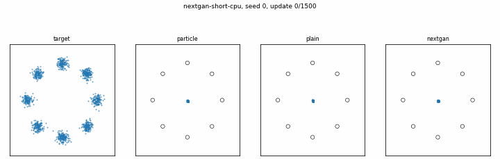

# Paper watch: NextGAN field-regression critic (arXiv:2611.06270) — diagnostic cohort

Test: [`tests/test_paperwatch_nextgan_critic.py`](../../../tests/test_paperwatch_nextgan_critic.py).
Scope: diagnostic/assisted cohort, not qualification evidence. The NextGAN arm
replaces the recipe's critic phase with a caller-owned loop; field regression
is not a declared `critic_formulation`.

| cohort | budget | device | runs in CI |
|---|---|---|---|
| full (verdict: PARTIAL) | 15K updates × 3 arms × seeds 0/1/2 | CUDA | no (`-m cuda`) |
| `nextgan-short-cpu` | 1,500 updates × 3 arms, seed 0 | CPU, 1 thread | yes |

Short variant measured: N_eff particle 7.91 / plain 7.95 / nextgan 7.98;
captured 0.61 / 0.57 / 0.50; Naeem coverage 0.075 / 0.586 / 0.068. The arms do
not separate at this budget, so this variant makes no transfer claim.

Actual training, seed 0: target vs each arm every 100 updates. Regenerate with
`PAPERWATCH_GIF_DIR=<dir> python -m pytest tests/test_paperwatch_nextgan_critic.py`.
