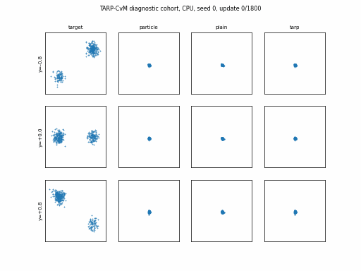

# Paper watch: TARP-CvM (arXiv:2611.15829) — diagnostic cohort

Test: [`tests/test_paperwatch_tarp_cvm.py`](../../../tests/test_paperwatch_tarp_cvm.py).
Scope: diagnostic/assisted cohort, not qualification evidence. The conditional
training loop and the TARP-CvM term are caller-owned (hinge + Adam host); the
`ka2` recipe supplies only the particle prior. TARP is not a declared recipe
capability.

CPU cohort, state B (DEVICE=cpu, 1 intra-op thread, 1,800 steps, batch 128,
seeds 0/1/2; this workstation and some CI runners):

| metric | particle | plain | tarp |
|---|---|---|---|
| coverage ↑ | 0.321 | 0.446 | **0.818** |
| dispersion (1.0 ideal) | 0.652 | 1.282 | **1.089** |
| mode-mass err ↓ | 0.250 | 0.245 | **0.071** |
| held-out TARP stat ↓ | 0.062 | 0.036 | **0.0036** |

Verdict: PARTIAL and partly hardware-dependent. Other CI runners reproduce a
different state (A) of the same pinned run (tarp-plain coverage margin 0.157,
tarp loses mode-mass to plain in all seeds). The results that hold in both
states are TARP's per-seed coverage wins over both controls, its per-seed
consistency, and its held-out-statistic win over particle. Claims against the
plain control are not established on CPU (non-strict xfails). Two claims fail
in both states (strict xfails). See the claims block in the test.

Actual training, seed 0: target vs each arm at y = −0.8 / 0 / +0.8, every
150 updates. Regenerate with
`PAPERWATCH_GIF_DIR=<dir> python -m pytest tests/test_paperwatch_tarp_cvm.py`.
