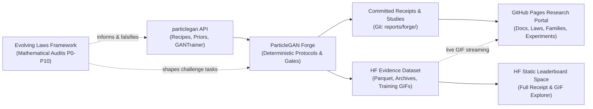

<section class="portal-hero">
<div class="portal-hero-grid">
  <div class="portal-hero-copy">
    <div class="portal-eyebrow">
      <span class="portal-pill portal-pill-accent">PyTorch 2.6+</span>
      <span class="portal-pill">MIT License</span>
      <span class="portal-pill">Forge Reproducible Research</span>
    </div>
    <h1 class="portal-hero-title">ParticleGAN Research Portal</h1>
    <p class="portal-hero-lead">
      <strong>Learnable particle priors, composable GAN/DDGAN recipes, and an evolving scientific framework for stable, energy-optimal adversarial learning.</strong>
    </p>
    <p class="portal-hero-sub">
      Replace fixed Gaussian latent noise with a learnable table of latent particles optimized alongside your PyTorch generator, evaluated across matched deterministic Forge protocols with hardware NVML energy telemetry and streamed training media.
    </p>
    <div class="portal-cta-row">
      <a class="md-button md-button--primary" href="leaderboard/">Interactive Leaderboard &amp; Pareto</a>
      <a class="md-button" href="laws/">Explore Evolving Laws</a>
      <a class="md-button" href="https://huggingface.co/spaces/HyperGAN/particlegan-leaderboard" target="_blank" rel="noopener">HF Leaderboard Space ↗</a>
    </div>
  </div>
  <div class="portal-hero-media">
    <figure class="portal-hero-figure">
      
      <figcaption>Learnable latent particles organizing into distinct target modes under constant learning rates.</figcaption>
    </figure>
  </div>
</div>
</section>

## Start Exploring

<div class="portal-card-grid">
  <a class="portal-card" href="leaderboard/">
    <div class="portal-card-kicker">Benchmarks &amp; Telemetry</div>
    <h3>Interactive Leaderboard &amp; Energy Pareto</h3>
    <p>Sortable family scores across the 71-test full suite and 115 view requirements, NVML <code>J-to-PASS</code> Pareto scatter plots, Law coverage heatmap, and side-by-side training GIFs streamed from Hugging Face.</p>
    <span class="portal-card-link">Open Leaderboard →</span>
  </a>

  <a class="portal-card" href="laws/">
    <div class="portal-card-kicker">Living Theoretical Framework</div>
    <h3>Evolving Laws of GAN Learning</h3>
    <p>Implementation-independent formalization of Representational Geometry, Potential Geometry, Transport Identifiability, and Functional &amp; Game Dynamics — backed by ten adversarial mathematical audits (P0–P10).</p>
    <span class="portal-card-link">Read the Laws Hub →</span>
  </a>

  <a class="portal-card" href="families/">
    <div class="portal-card-kicker">Formulations &amp; Receipts</div>
    <h3>Family Formulations</h3>
    <p>Mathematical equations, update-loop diagrams, law-mechanism tables, and per-task receipts across Unified, Axiom, Minimal, RHBI, EMPF, BISPF, BCAP, Atlas, E22, K3P, KA2, R1/R2, and historical baselines.</p>
    <span class="portal-card-link">Compare Families →</span>
  </a>

  <a class="portal-card" href="experiments/">
    <div class="portal-card-kicker">Protocols &amp; Failure Modes</div>
    <h3>Experiment Atlas &amp; Studies</h3>
    <p>Per-experiment target-geometry schematics, protocol diagrams, exact numerical pass/fail gates, unresolved problems, and controlled ablation studies (including Occam's Razor and Law-4 energy studies).</p>
    <span class="portal-card-link">Browse Experiments →</span>
  </a>
</div>

## 10-Line PyTorch Quickstart

Supply ordinary `torch.nn.Module` networks. `GANTrainer` binds the recipe's optimizers, critic regularizer, and particle-prior update rule without mutating your architecture or weights.

=== "PyTorch Training Loop"

    ```python
    import torch
    from torch import nn
    from particlegan import GANTrainer, get_recipe, init

    def real_batch(n):  # replace with your DataLoader: 8 Gaussians on a ring
        angle = torch.randint(8, (n, 1)) * torch.pi / 4
        return torch.cat([angle.cos(), angle.sin()], 1) + 0.05 * torch.randn(n, 2)

    recipe = get_recipe(total_steps=2000)  # default: "unified_v12" (research preview)
    G = nn.Sequential(nn.Linear(recipe.z_dim, 128), nn.LeakyReLU(0.2), nn.Linear(128, 2))
    D = nn.Sequential(nn.Linear(2, 128), nn.LeakyReLU(0.2), nn.Linear(128, 1))
    init.deterministic_orthogonal_(G, seed=0)
    init.deterministic_orthogonal_(D, seed=1)
    prior = init.deterministic_orthogonal_(recipe.make_prior())
    trainer = GANTrainer(recipe, G, D, prior=prior, seed=0)
    for _ in range(recipe.total_steps):
        trainer.step(real_batch(recipe.batch_size))
    samples = trainer.sample(1024)
    ```

=== "Install"

    ```bash
    # Core PyTorch library (Python 3.11+, PyTorch 2.6+)
    python -m pip install particlegan

    # From source with experiment & benchmark tooling
    git clone https://github.com/HyperGAN/ParticleGAN.git
    cd ParticleGAN
    python -m pip install -e '.[dev,experiments]'
    ```

=== "Named Presets"

    ```python
    from particlegan import get_recipe

    default = get_recipe()                # unified_v12 (zero autograd.grad / SVD / eigh / pinv)
    axiom = get_recipe("axiom")           # clean-slate 4-Law opt-in family (<=2,500 LOC, lowest r256 energy)
    fast_core = get_recipe("minimal")     # <900-LOC zero-Newton-Schulz fast core
    v11 = get_recipe("unified_v11")       # pinned 0.11.x screening cohort
    rhbi = get_recipe("rhbi_optimized")   # Relativistic Hellinger-Born-Infeld transport
    empf = get_recipe("empf")             # Exponential Moving Prototype Flow
    bispf = get_recipe("bispf_optimized") # Born-Infeld Sinkhorn Particle Flow
    ```

## How the Research Ecosystem Connects



!!! important "Scientific Governance & Provisional Evidence"
    - **Research-preview default, not a qualified winner:** `DEFAULT_RECIPE = "unified_v12"` is the current research-preview default. Screening calibration under `configs/forge/calibration/criteria-v1.json` remains **`BLOCKED`**, and **no recipe in this repository is declared scientifically qualified**.
    - **Single-seed screening disclosure:** Forge screening runs use protocol `seed = 0` with deterministic orthogonal initialization across synthetic distributions, discrete visual benchmarks, and mock-noise DCGAN speed/energy workloads. Multi-seed and natural-image FID/Recall confirmation remain open.
    - **Failures and gaps remain visible:** Numerical `FAIL`, `BLOCKED`, `INCOMPATIBLE`, and `NOT MEASURED` outcomes stay distinct and are never dropped from fixed full-suite denominators. Tuning budgets and adaptive selection lineage are disclosed on every leaderboard row.
    - **Canonical source of truth:** See the [Canonical Forge Leaderboard](technique-inventory.md), [Unresolved Problems](studies/problems.md), and the [Interactive HF Leaderboard Space](https://huggingface.co/spaces/HyperGAN/particlegan-leaderboard).
