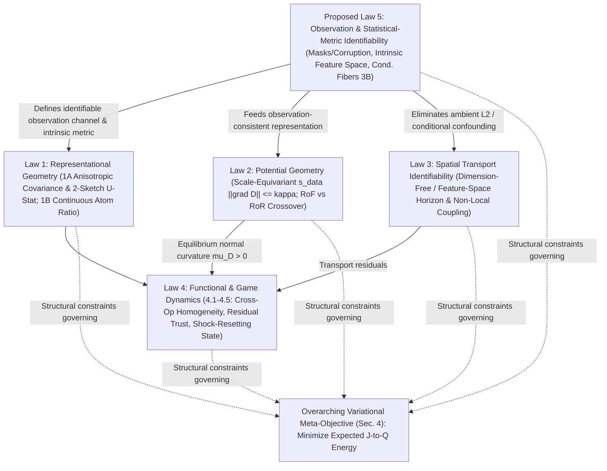

# Axiom-v4 Failure Analysis: J-to-PASS Efficiency, Tier N Qualification, Law-Based Rules, and Four-Laws Theory

- **Candidate:** `axiom-v4` (`preset="axiom"`, [axiom-v4.json](../../configs/forge/ideas/axiom-v4.json))
- **Evaluated Cohorts & Revisions (Kept Strictly Separate per `AGENTS.md`):**
  - **Official RTX A6000 Forge Readouts & Selected Cohort:** Commit `758b397a5` / `8925a09a8`, `candidate_revision = 0e31275ce41d6a1e161a3f8e8ed8c10e5781b8c9829789a73c57010aae08f2f6`, selected cohort `17bf83b10c1f` (`NVIDIA RTX A6000`, PyTorch `2.15.0+cu132`; 9 committed `readout-*.json` records + 47 A6000 technique receipts; solo idle GPU 1 `dcgan_performance` + matched 6-recipe NVML energy vs. contended 2-worker A6000 Forge screening receipts).
  - **Matched Uncontended NVIDIA L4 Energy & `LAWS_HUB` Cohort:** Commit `5c522b84b` (identical `particlegan/` source; `git diff 5c522b84..8925a09a` changes 1 metadata line in `axiom-v4.json`; Google Colab `NVIDIA L4`, PyTorch `2.14.1+cu130`; 27 L4 technique receipts + [axiom-v4-l4-energy-benchmark.json](../forge/studies/axiom-v4-l4-energy-benchmark.json)).
  - **Four-Laws Structural Stress Controls:** Commit `59a860fa0` (`NVIDIA RTX A6000` `cuda:0`, [four-laws-benchmark.md](four-laws-benchmark.md)).
- **Protocol & Epistemic Governance:** Protocol `seed = 0`, public `deterministic_orthogonal_` initializer, clean live weights, single fixed global recipe across every task. Screening calibration remains `BLOCKED` ([r3-calibration-holdout.md](../forge/studies/r3-calibration-holdout.md)); no recipe in this repository is declared scientifically qualified. All historical receipts are preserved byte-for-byte; outcome classes (`PASS`, `FAIL`, `INCOMPLETE`, `BLOCKED`, `NOT_RUN`, `UNMEASURED`) are never conflated.
- **Companion Documents:** [Axiom Forge Study](axiom-study.md) · [Design Spec](design-spec.md) · [Four-Laws Benchmark](four-laws-benchmark.md) · [The Four Laws](../../docs/four-laws.md) · [Technique Inventory](../forge/technique-inventory.md) · [LAWS_HUB](../forge/LAWS_HUB.md) · [Axiom Family Report](../forge/families/axiom.md) · [Problem List](../forge/problems.md) · [Research Glossary](../../RESEARCH_GLOSSARY.md)

---

## 1. Executive Summary

At the portal and summary-leaderboard level, `axiom-v4` appears to underperform in three places: **J-to-PASS Efficiency** (blank selected-family energy columns, `DCGAN r256 = unknown`, contended A6000 `ring16 = 869.4 J`, and `13/16` L4 Occam Pareto Y-axis), **Tier N Qualification** (`qualified_tier = 1`, `95/115` required, `39/71` full-suite despite sweeping `18/18` on the untouched 14,000-update Tier-3 long-horizon holdout), and **Law-Based Rules** (`#5` on L4 `LAWS_HUB.md` at `2/9` despite `9/9` on structural Four-Laws controls and `3/9` on A6000).

Forensic auditing across all 9 official `axiom-v4` Forge readouts, all 74 `axiom-v4` technique receipts (`47` A6000 + `27` L4), Forge scoring/publishing code, task implementations, and targeted live CUDA probes decomposes every apparent or actual failure cleanly into **four distinct causes**:

> [!IMPORTANT]
> **Headline Finding — ~80% of valid `axiom-v4` failures are concrete implementation bugs in `particlegan/_axiom/`, while the remaining headline deficits come from scorer/accounting bugs and ill-posed or horizon-mismatched benchmarks — NOT a collapse of the Four-Laws framework.**
> 1. **Critical Scope Correction (`interp_img_patch_shift`):** Previously reported as a step-800 zero-collapse in [axiom-study.md](axiom-study.md#L139), `interp_img_patch_shift` is **NOT a generator collapse**. Every zero-metric observation (`steps 134, 167, 300, 800` in [`readout-d83ce97f`](../forge/records/readout-d83ce97f520f7668f39996df.json)) had `edges in {22, 26}` $\Rightarrow$ `len(combined) = 16 + 3*edges in {82, 94}` $\Rightarrow$ CUDA FP32 `torch.ones(N, dtype=torch.float32).mean().item() == 0.9999999403953552 < 1.0`, tripping the fail-closed non-finite guard in [`api_interpolation.py:485-486`](../../benchmarks/toy_audit/api_interpolation.py#L485-L486) (same latent bug at `:351-352`, `:635-636`). Because `:486` returned early *before* computing step `800`'s RMSE/peak, the committed receipt proves **8 consecutive observed PASSes (`534..767`, `sust = 667`, `ep_hq = 1.0, int_hq = 1.0, peak = 0.871–0.882`) plus 100%-finite outputs at step `800` (`finite_fraction = 0.9999999403953552`, `edges = 22`, `N = 82`) whose quality metrics were uncomputed**. Per `AGENTS.md`, the raw receipt verdict remains `FAIL`, explicitly annotated here as **`FAIL (Scorer Bug)`**.
> 2. **Mid-Training Distribution Shifts:** `axiom-v4` passes **4/4 well-posed mid-training distribution shift benchmarks** (`t3_iso_horizon_saddle_shift`, `target_shift_recovery`, `zero_tanh_rail_escape`, `gaussian1d_stability`). The sole shift benchmark it fails (`fl_law44_highd_sparse_prior_and_shock`, `0/14` repo-wide, Axiom `#1` in margin) is a mathematically ill-posed compound gate that should be **removed/split**.
> 3. **Matched Idle J-to-PASS Reality:** On matched uncontended hardware, `axiom-v4` is **#1 Pareto-dominant on compute-bound and flagship workloads** (`dcgan_r256`: **`-26.7%`** J/step vs. `unified-v12` and **`-29.8%`** vs. `v14` on idle A6000, **`-21.3%`** on idle L4; **#1 raw J-to-PASS on all 4 idle L4 study tasks** `dcgan_r256`, `ring16`, `grid100`, `staggered100`, plus **#1 on 8 L4 receipt tasks**). Its real J-to-PASS weakness is strictly on tiny-kernel MLP loops due to **`35.9` unbatched GPU-CPU host syncs/step** (`four-laws-benchmark.md:158`), which also trigger wall-time timeouts on `five_word_joint_smoke` (L4 `900.2s`) and `model_ae_ddgan_gaussian_chain` (A6000 contended `180.3s`).
> 4. **Theory Verdict (Four Laws + Candidate Law 5):** Four targeted, falsifiable amendments to Laws 1–4 explain all universal `0/14` geometric failures except partial/masked observation and high-D/conditional metric identifiability — which justify **one genuinely independent Candidate 5th Law: Observation & Statistical-Metric Identifiability** (while keeping Energy-Optimal Learning `J-to-Q` in its exact role as the Overarching Variational Meta-Objective).

### Four-Way Failure Decomposition

| Root-Cause Bucket | Affected Benchmarks / Rules | Summary Mechanism | Action Owner |
|---|---|---|---|
| **(a) Scorer, Harness & Accounting Bugs** | `interp_img_patch_shift` (`FAIL (Scorer Bug)`), portal blank energy & `scaling_r256_ms=unknown`, duplicate `dcgan_performance_r256` `INCOMPLETE` readout rule, `family_progress` hiding 10 T3/T4 passes as `UNKNOWN`, 12 unimplemented `BLOCKED` T4 placeholders in 71-test denominator, `model_toy_adapter.py:84` blocking calibrated `terminal_observations=1`, `model_ae_ddgan` `180s` vs. `600s` timeout inversion, linear-extrapolation / `None` `native100` / eval-overhead J-to-PASS accounting | Infrastructure, FP32 1-ULP scorer check, provenance filter mismatch, and inverted wall budgets create false failures or hide passing evidence without reflecting recipe quality. | **Track A** (Immediate harness/scorer/accounting fixes — zero recipe change) |
| **(b) Ill-Posed, Horizon- or Threshold-Mismatched Benchmarks** | `fl_law44_highd_sparse_prior_and_shock` (`REMOVE`/split), `fl_law42_deep_resbn_and_conv1x1` (inverse-quality ratio gate `<=1.05`, Axiom `#1` L4 & ONLY A6000 passer), `grid100_mlp16` (`4/5` L4 / `3/5` A6000, passes terminal + 100k holdout), `interp_sparse_arc` (`M=12` `8.33%` cliff, final 3 pass), `interp_saddle_barycentric` (`M=24` k-NN jitter, `14/14` smooth MAE pass), `fl_law1_noisy_atomic_codebook` (Zipf rounding floor `mass_tv >= 0.06276`), `fl_law3_highd_orphan_d32` (`P=256 < 32` particles/minority mode), `fl_law2_groupnorm_and_vit_sprites` (475-step RGB ViT sprint), `five_word_joint_smoke` (L4 `900s` cap), `t3_iso_scale_mass_8x` (harness omits `"axiom"` binding) | Compound unidentifiable targets, pathological relative ratios, uncalibrated `min_stable=5` on constant-LR orbits, or tight short-horizon sprints penalize clock-free long-horizon stability ("failing for the right reasons"). | **Track A** (Remove `fl_law44`; recalibrate gates, budgets, and timeouts) |
| **(c) Concrete `axiom-v4` Implementation Bugs** | `fl_law41_trust_rare1pct_tanh` (`O3`+`O1`+`P1`), `vector_spiral` (`O1`+`O2`), `img_blobs4` (`O4`+`O3`+D-06), `grid100_res16_tanh` (`P1`+`O3`), `fl_law3_highd_orphan_d32` (`P2` rank-8 sketch bias), `t3_iso_scale_mass_8x` L4 (`T1`), `fl_law2_groupnorm_and_vit_sprites` (`dim>1024` cliff + GN/ViT split + `fwAD` regime), `fl_law44` Part B (3 scale bugs), small-MLP L4 J-to-PASS losses & timeouts (`35.9` host syncs/step), plus secondary drag on `model_*ddgan*`, `interp_*`, `grid100_mlp16`, `fl_law42` | Four coupled `AxiomOptimizer` bugs (`O1–O4`), two `AxiomPriorRegularizer` bugs (`P1–P2`), halved macro-orphan thresholds (`T1`), hardcoded `dim > 1024` transport cutoff, unscaled `+0.5`/`+1e-5`/unreset `proto_var`, and unbatched `.item()` syncs. | **Track B** (`axiom-v5` surgical bug fixes — zero new `Recipe` fields required) |
| **(d) Genuine Theoretical Gaps (Laws 1–4 + Candidate Law 5)** | `fl_law1_aniso_unequal_modes` (scalar-trace pullback vs. 10:1 anisotropy), `fl_law1_noisy_atomic_codebook` (binary `g_atom` vs. noisy atoms), `fl_law44` Part B (`1e-5x` unscaled $`\lVert \nabla_x D\rVert \le \kappa`$), `fl_law44` Part A / `fl_law2_vit` / Law 3B / 12 blocked MisGAN-family tasks (observation & feature-metric identifiability) | Scalar isotropic covariance representation (Law 1A), binary discrete-continuous switch (Law 1B), unscaled gradient cap (Law 2×4.4), ambient-dimension transport cliffs (Law 3A), and missing **Law 5 (Observation & Statistical-Metric Identifiability)**. | **Track C** (`docs/four-laws.md` amendments + Law 5 formalization + `axiom-v5+`) |

---

## 2. Master Flattened Failure Table

Every failing, non-PASS, gated, blocked, unmeasured, or J-to-PASS-degraded `axiom-v4` experiment, benchmark, or rule across **J-to-PASS Efficiency**, **Tier N** (T1–T4, stretch, held, full-suite), and **Law-Based Rules** (`LAWS_HUB`, `four-laws-adherence-v1`, `four-laws-benchmark.md`). Raw receipt verdicts are preserved verbatim per `AGENTS.md`: `FAIL` (numerical gate miss), `FAIL (Scorer Bug)` (raw receipt `FAIL` caused by proven scorer FP32 bug), `INCOMPLETE` (wall-time timeout or duplicate-task guard), `BLOCKED` (unimplemented Forge adapter across all families), `NOT_RUN` (gated or unexecuted in selected cohort), `UNMEASURED / DEGRADED` (provenance/contention metadata gap or passing task with degraded J-to-PASS / advisory caveat).

| Area | Suite / Tier | Experiment / Benchmark / Rule | Receipt / Source | Raw Outcome | `axiom-v4` Observed vs. Threshold (and Best Baseline) | Benchmark Verdict | Root-Cause Class | Recommended Course of Action |
|---|---|---|---|---|---|---|---|---|
| **Tier N / Law-based** | `disc_stab` (T1 stretch), `four-laws` (L1) | `interp_sparse_arc` | `22f8254c4917`, [`readout-d83ce97f`](../forge/records/readout-d83ce97f520f7668f39996df.json) (`dc36167c`), [`readout-9066cb43`](../forge/records/readout-9066cb4353eb435be7819b0c.json) | `FAIL` | Terminal OK (`ep_hq=1.0, int_hq=0.8056, bins=27, nov=0.437`), `3/5` suffix (`1st=550`, step 525 missed `ep_hq=0.8333<0.85` by 1/12 particle); gate `ep>=0.85, int>=0.80, bins>=22, nov>=0.20` ×5; best: `unified-v12` (`int=0.8406`, `846/1409 J` A6000; `475/791 J` L4) | `RECALIBRATE` | Short 600-st sprint + `M=12` `8.33%` cliff + `O1/O2` + latent FP32 scorer `:351-352` | Extend budget to `800–1000` st or raise `M`; fix `api_interpolation.py:351-352`; fix `O1/O2` & `transport.py:561` |
| **Tier N** | **ALL 6 ordinary views** (T2 **req** = **6 view FAILs**) | `vector_spiral` | `75068f7e8841`, [`readout-d83ce97f`](../forge/records/readout-d83ce97f520f7668f39996df.json) (`1e842aae`) | `FAIL` | Early 8-check PASS (`1st=67, sust=467`), then late mean drift (`734..1534: mean=0.155..0.285`), terminal OK (`sw1=0.1263, mean=0.0846, cov=0.4283`), `1/5` suffix; gate `sw1<=0.18, mean<=0.15, cov<=0.45` ×5; best: `law4-energy-v11` (`sw1=0.0277`), `unified-v12` (`0.0305`, `129/641 J` L4) | `KEEP` | **Impl Bug (`O1`, `O2`)**: `d2_it` `rs=0` + 5-step Critic NS + isotropic pullback | Fix `O1` (restore `s_eq_base` in `d2_it`, slow `dec<=0.0007`) and `O2` (0-NS shallow critic + pathology gate) |
| **Tier N** | `disc_stab` (T2 **req**) | `model_ddgan_gaussian_chain` | A6000: `6aa49de3d241`, [`readout-d83ce97f`](../forge/records/readout-d83ce97f520f7668f39996df.json) (`1d1e8768`); L4: `6cdefb6c9209` (**`PASS`**) | `FAIL` (A6000 sel; **`PASS` L4**) | A6000: `38/38` PASS at step 2500 (`final_cdf=0.0357, t1_q0_cdf=0.0861`, `1st=730`), `1/5` suffix (missed 2292 `mean=0.4692>0.45`, 2396 `eig=1.4453>1.40`); L4: **PASS 14-check suffix** (`1716/3673 J`); gate 38 bounds ×5; best: `unified-v12` (`3075/4442 J` A6000; `1791/3357 J` L4), `law4-v11` (`1628/3051 J` L4) | `RECALIBRATE` | Harness (`model_toy_adapter.py:84` blocks `terminal_observations=1`, host oracle `div_loss`) + `O1/O2` jitter | Allow `terminal_observations=1` (or median window) in `model_toy_adapter.py:84`; remove host oracle `div_loss`; fix `O1/O2` |
| **Tier N / J-to-PASS / Law-based** | `disc_stab` (T2 **req**), `four-laws` (L3) | `model_ae_ddgan_gaussian_chain` | Sel: `137c6b672684` (`INCOMPLETE`); Readouts: [`readout-d83ce97f`](../forge/records/readout-d83ce97f520f7668f39996df.json) (`723d7524`), [`readout-9066cb43`](../forge/records/readout-9066cb4353eb435be7819b0c.json) (`FAIL`) | `INCOMPLETE` (sel) / `FAIL` (readouts) | Sel: `180.3s` timeout (A6000 cont); Solo readout: `172.5s`, **`42/42` PASS at step 2500** (`final_cdf=0.0468, nmse=0.0440, gain=46.0x`), 6/7 last checks PASS, missed `min_stable=5` by `0.005` at step 2188 (`eig=1.8050>1.80`); `0/12` selected families pass; best readout: `unified-v12` (`105.1s, 6137/8021 J` A6000) | `RECALIBRATE` | Inverted `180s` timeout (vs. `600s` lighter DDGAN) + `min_stable=5` + host oracle tether + `O1/O2` + `35.9` syncs | Raise timeout `180s -> >=600s`; adopt `terminal_observations=1`; strip host oracle tether; fix `O1/O2` & host syncs |
| **Tier N** | `disc_stab` (T2 **req**) | `model_ddgan_bimodal_chain` | — (`configs/forge/tasks/model_ddgan_bimodal_chain.json:386`) | `NOT_RUN` (gated) | Unexecuted solely because parent `model_ddgan_gaussian_chain` failed A6000 gate (`0/12` selected families pass); gate 43 bounds ×5; readout ref: `unified-v12` (`final_hq=0.9512`, `8015/10689 J` A6000) | `RECALIBRATE` | Gated by miscalibrated parent task | Fix parent gate (`model_toy_adapter.py:84`) and execute cleanly |
| **Tier N** | `disc_stab` (T2 **req**) | `model_ae_ddgan_bimodal_chain` | — (`configs/forge/tasks/model_ae_ddgan_bimodal_chain.json:401`) | `NOT_RUN` (gated) | Unexecuted solely because parent `model_ae_ddgan_gaussian_chain` timed out/failed (`0/12` selected families pass); gate 47 bounds ×5 + inverted `300s` timeout (vs. `600s` DDGAN bimodal); readout ref: `unified-v12` (`final_hq=0.9355`, `14.0/17.7 kJ` A6000) | `RECALIBRATE` | Gated by miscalibrated parent + inverted `300s` timeout | Fix parent gate, raise timeout `300s -> 900s`, and execute cleanly |
| **Tier N** | **ALL 6 ordinary views** (T2 **held** = 6 stretch FAILs) | `img_blobs4` | `d1d65eeffba0`, [`readout-d83ce97f`](../forge/records/readout-d83ce97f520f7668f39996df.json) (`fac43777`) | `FAIL` | Stuck on zero-image saddle (`rmse=0.2500, modes=0`) steps `75..400`, ended `2/4` modes (`hq=0.5313, tv=0.2813, rmse=0.1031`, `0/24` pass); gate `modes>=4, hq>=0.90, rmse<=0.10` ×5; best: `unified-v11` (`4, hq=1.0, rmse=0.0078`), `law4-v11` (`625/834 J` L4) | `KEEP` | **Impl Bug (`O4`, `O3`, D-06)** + Law 1B (`noise=0.01` zeroes binary `g_atom`) | Damp 1D scalar bias (`O4`), restore `delta_g_min` wakeup (`O3`), fix D-06 tie-break (`transport.py:287-289`), add continuous $`\rho_{\text{atom}}`$ |
| **Tier N** | `disc_stab` (T2 stretch) | `interp_img_patch_shift` | `6a8f0807f6e8`, [`readout-d83ce97f`](../forge/records/readout-d83ce97f520f7668f39996df.json) (`06a0a54a`) | **`FAIL (Scorer Bug)`** *(raw receipt: `FAIL`)* | **8 consecutive observed PASSes (`534..767`, `sust=667`, `ep_hq=1.0, int_hq=1.0, peak=0.871–0.882`) + 100%-finite step `800` (`ff=0.9999999403953552, edges=22, N=82`)** whose quality metrics were uncomputed because `:486` returned early at steps `134, 167, 300, 800` (`edges in {22,26}`, `N in {82,94}`); gate `rmse<=0.09/0.10, peak>=0.78, quad==4` ×5; ref: `rhbi-v12` (`peak=0.8574`) | **`FIX SCORER`** | **Scorer FP32 1-ULP Bug** (`api_interpolation.py:485-486`) — NOT generator collapse | Replace `mean().item() < 1.0` with `not bool(torch.isfinite(combined).all().item())` at `api_interpolation.py:351-352, 485-486, 635-636` |
| **Tier N / Law-based** | `disc_stab` (T2 stretch), `four-laws` (L1) | `interp_saddle_barycentric` | `9fb095588162`, [`readout-d83ce97f`](../forge/records/readout-d83ce97f520f7668f39996df.json) (`d4695299`), [`readout-9066cb43`](../forge/records/readout-9066cb4353eb435be7819b0c.json) | `FAIL` | `bary_mae <= 0.09` passed ALL 14 checks (`367..800`, final `0.0694`), `bary_hq=0.7639 < 0.78` (`2/5` suffix, bounced `0.731..0.857`, `+6.1pp` above `unified-v14` `0.7027`; `ep_mae=0.0816` also tripped at step `634`); declared 6 gates (`api_interpolation.py:68-75`): `ff==1.0, ep_mae<=0.08, bary_mae<=0.09, bary_hq>=0.78, xy_bins>=12, nov>=0.18` ×5 (`endpoint_hq` is diagnostic-only); best: `rhbi-v12` (`0.8358`, ONLY repo passer) | `RECALIBRATE` | Discrete `M=24` k-NN triangle flip jitter + `O1/O2` + dropped `g_curve>0.5` sweep + latent `:635-636` | Use smooth MAE / larger `M` / median terminal window; fix `:635-636`; fix `O1/O2` & `transport.py:561` |
| **Tier N** | All 6 ordinary views (T3: 10 req + 1 held) | `ring_extension`, `target_shift_recovery`, `grid100_14k`, `rotated100_14k`, `staggered100_14k`, `clockfree_audit`, `zero_tanh_rail_escape` | Sel: none (`technique-inventory.md:93`); Diag: [`readout-41f9c26a`](../forge/records/readout-41f9c26a18492a4834dbe767.json) (**`PASS 18/18`**) | `NOT_RUN` (sel) / **`PASS 18/18`** (T3 diag) | `0/10` T3 req & `0/1` T3 stretch in selected inventory solely because T2 halted `qualify()`; separate untouched `r3-tier3-long-horizon-holdout-v1` swept **`18/18` (100%)** (beating `v11` `15/18`, `empf` `10/18`, `rhbi` `8/18`) | `FIX ACCOUNTING` | T2 qualification stop rule (`views.py:1358`) + `family_progress` single-view filter hides T3 passes as `UNKNOWN` | Fix T2 blockers (`vector_spiral`, DDGAN gates) to unlock Tier 3; display multi-view diagnostic receipts distinctly from `UNKNOWN` |
| **Tier N / J-to-PASS / Law-based** | `disc_stab` (T4 **held**), `t4-arch`, `four-laws` (L4), `r4-occam` (L4) | `grid100_mlp16` | Sel: none; A6000: [`readout-18bc7392`](../forge/records/readout-18bc7392296d5574083ccab4.json), [`readout-9066cb43`](../forge/records/readout-9066cb4353eb435be7819b0c.json); L4: `e26a5ba90124` | `NOT_RUN` (sel) / `FAIL` (A6000 & L4) | **Passes final check & 100k holdout on BOTH GPUs** (`A6000`: `3/5` suffix, `bias=-0.0876, ks=0.0363`; `L4`: **`4/5`** suffix, `bias=-0.0822, ks=0.0339`, `20.6 kJ` / `2.94 J/st` — ~2× cheaper than passing `v12` `42.3 kJ` & `law4-v11` `38.9 kJ`); gate `toy100-accuracy-v1` ×5 (`6000..7000`); best A6000 idle: `law4-v11` (`11.7/21.1 kJ`), `v12` (`12.8/23.0 kJ`) | `RECALIBRATE` | Short 7k budget for 16L skip-free MLP (same as 4L `grid100`) + **`O3`** slow ramp (`p95` backtracks, no `delta_g_min`) | Extend deep-16L accuracy budget to `10k` (keep `7k` as speed diagnostic); fix `O3` (`p95` -> batch-RMS / residual-norm + wakeup band) |
| **Tier N / Law-based** | `disc_stab` (T4 **held**), `t4-arch`, `four-laws` (L4) | `grid100_res16_tanh` | Sel: none; A6000: [`readout-18bc7392`](../forge/records/readout-18bc7392296d5574083ccab4.json), [`readout-9066cb43`](../forge/records/readout-9066cb4353eb435be7819b0c.json) | `NOT_RUN` (sel) / `FAIL` (A6000) | `100/100` modes, `prec=0.9820, tv=0.0249, sat=0.0%`, but `0/5` terminal: `abs_cov_trace_bias=0.1184 > 0.10`, `radial_ks=0.0546 > 0.04` (`82.4 kJ` A6000 cont); gate `bias<=0.10, ks<=0.04, sat<=0.001` ×5; best: `unified-v14` (`bias=-0.0746, score=0.638`), `v12` (`-0.0805`) | `KEEP` | **Impl Bug (`P1`, `O3`)**: `prior.py:370,391` kept `0.15..0.27` deadband & `0.995` shrink + late `cos<-0.75` | Remove `0.15..0.27` deadband and `0.995` shrink per `design-spec.md` §4.2.2 (`P1`); align flip damping to `cos < -0.45` (`O3`) |
| **Tier N** | `disc_stab` (T4 stretch: 2 tasks) | `grid100_res16_scaled_tanh`, `bytegan_bigan_dictionary` | Sel: none; Diag: [`readout-18bc7392`](../forge/records/readout-18bc7392296d5574083ccab4.json), [`readout-cf0f0808`](../forge/records/readout-cf0f08081668d4e14130cd6b.json), L4 `1c03cc0a` | `NOT_RUN` (sel) / **`PASS`** (diag/L4) | Marked `UNKNOWN` in selected inventory despite clean diagnostic PASS (`bytegan_bigan_dictionary`: `256/256`, `rms=0.00352`, L4 **#1** `1833/3667 J` vs. `v13` `8667/10706 J`; `res16_scaled_tanh`: `score=0.5325`) | `FIX ACCOUNTING` | `family_progress` single-view filter hides passing T4 diagnostic receipts | Surface compatible T4 diagnostic receipts distinctly from `UNKNOWN` |
| **Tier N** | `disc_stab` (T4 held/stretch: **12 tasks**) | `alice_spiral_bigan`, `cgan_overlapping_classes`, `cramer_energy_overlap`, `cyclegan_unpaired_constellation`, `infogan_anisotropic_modes`, `misgan_{block_neural_imputer,block_recovery,mcar_p50_recovery,mcar_p80_anchored}`, `pacgan8_grid100`, `pacgan_unequal_mass`, `ring16_bigan_continuous` | [`technique-inventory.md:65,154`](../forge/technique-inventory.md#L65), [`discriminator_stability.json:406`](../../configs/forge/views/discriminator_stability.json#L406) | `BLOCKED` *(infra — 0/12 families)* | Zero public Forge adapters exist for any family (`0/12` eligible); inflates full-suite denominator from `59` runnable to `71` (`39/71` vs. `39/59`) | **`REMOVE`** *(from active denominator)* | Unimplemented infrastructure placeholders (NOT numerical failures) | Move all 12 placeholders out of active 71-test denominator to a separate roadmap backlog until public adapters exist |
| **J-to-PASS / Law-based** | `r4-occam-ablation-v1` (L4), Law 3 anchor | `t3_iso_scale_mass_8x` | L4: `1448a1aa57d9` (`FAIL`); A6000: `c2e3f656b764`, [`readout-b6570e90`](../forge/records/readout-b6570e904053603948226d93.json) (**`PASS`**) | `FAIL` (L4; **`PASS` A6000**) | L4: `core_min_eigen_ratio=0.2153 < 0.45` (`modes=4, hq=0.967, tv=0.020`, `0/5`, `1.88 kJ` wasted); A6000: **PASS `#1` full-4-Law** at `0.5447` (`1050/1647 J`, beating `v12..v14` `0.4723`); gate `>=0.45` ×5; best L4: `minimal-v2` (`533/799 J`), `law4-v11` (`600/941 J`) | `RECALIBRATE` | **Impl Bug (`T1`)** (`transport.py:162,165` halved macro thresholds) + harness omits `"axiom"` (`api_t3_isolation.py:477-496,545-546`) | Restore `2.80*rho` / `r_loc > 3.52` (`T1`); add `"axiom"` to `_bind_formulation_record` & `no_ema_forms`; audit cross-GPU stability |
| **J-to-PASS** | `r4-occam-ablation-v1` (L4) | `five_word_joint_smoke` | L4: `2ce2eabce617` (`INCOMPLETE`); A6000: `6d3ad7c31584` (**`PASS`**) | `INCOMPLETE` (L4 `900.2s` timeout; **`PASS` A6000**) | L4: killed at `900.2s` wall cap over 20,001 steps (dragging L4 Occam Y-axis `14/16 -> 13/16`); A6000 cont: **PASS** (`653.0s`, `1st=834, sust=4167`, `5/5, tv=0.0190`); gate `<=900s`; L4 refs: `empf-v8` (`510.9s`), `law4-v11` (`692.4s, 996/4976 J`), `v12` (`702.6s, 1031/5152 J`) | `RECALIBRATE` | **Systems Bug (`35.9` host syncs/step)** + tight L4 `900s` timeout + no early stop + Pareto counting timeout as accuracy fail | Pack `prior.py`/`transport.py` syncs to `<=8/step`; raise L4 timeout to `1800s`; exclude `INCOMPLETE` timeouts from Pareto accuracy |
| **J-to-PASS** | L4 Forge Receipts (7 passing tasks) | `img_bars4`, `gaussian1d_smoke`, `gaussian1d_stability`, `model_ddgan_gaussian_chain`, `vector_unequal_width`, `fl_law2_pure_adversarial_codim1`, plus `zero_tanh_rail_escape` (`c614ad455463`) | L4 technique receipts (`reports/forge/technique-receipts/*.json`) | `PASS (J-to-PASS Degraded)` | All 7 **PASS**, trailing best L4 baseline on `J1` or `Js`: 6 host-sync-bound tasks — `img_bars4` (`963/1260 J`, `75.9s` vs. `law4-v11` `559/782 J`), `gaussian1d_smoke` (`283/661 J`, `91.2s` vs. `minimal` `134/398 J`), `gaussian1d_stability` (`1869/2169 J` vs. `1591/1846 J`), `ddgan` (`Js=3673` vs. `3051 J`), `unequal_width` (`Js=1242` vs. `955 J`, though `J1=191 J` #1), `fl_law2_codim1` (`319/744 J` vs. `v13` `294/687 J`) — plus `zero_tanh_rail_escape` (`166/498 J`, `82.5s` — actually *faster* in wall time than `v12` `86.6s`/`99/491 J` & `law4-v11` `84.9s`/`100/496 J`, higher `J1` from later first-pass step) | `KEEP` *(with Pareto caveat)* | **Systems Bug (`35.9` host syncs/step)** stalling tiny-kernel MLP loops (+ `O2` off `_run_foreach_fast`; plus later 1st-pass step on `zero_tanh_rail_escape`) | Eliminate `.item()`/`.cpu()` syncs in `prior.py` & `transport.py` (`35.9 -> <=8`); always evaluate J-to-PASS Pareto-jointly with quality |
| **J-to-PASS** | Portal / HF Space Family Leaderboard & Pareto | Selected-family energy (`r256`, `ring16`, `grid100`, `scaling_r256_ms`) & L4 Occam Pareto (`13/16`) | [`technique-inventory.md:93`](../forge/technique-inventory.md#L93), [`axiom-v4-l4-energy-benchmark.json:109`](../forge/studies/axiom-v4-l4-energy-benchmark.json#L109), `ff8f3b5f1b9e`, [`hf_publish.py:1659-1693`](../../experiments/forge/hf_publish.py#L1659-L1693) | `UNMEASURED / DEGRADED` | `families[axiom]` shows `None` for all 3 energy cols & `scaling_r256_ms=unknown`; contended A6000 `ff8f3b5f` exposes `ring16=869.4 J` (vs. idle A6000 `v12` `462.5 J`); L4 Occam `13/16 (81.25%)` vs. A6000 `v12`/`law4-v11` `16/16`; `native100` Forge receipts emit `J1=None`, `transfer_behavior` emits `J/st=None` | **`FIX ACCOUNTING`** | Provenance/contention filter (`contended=True`, L4 `source_commit=5c522b84b`), missing `scaling-performance.json` row, linear extrapolation + `+10.2%` eval mix | Run idle A6000 `axiom-v4` energy study matching selected commit; add `scaling-performance.json` row; log cumulative Joules per checkpoint & fix `native100`/`behavior_adapters` |
| **J-to-PASS** | `dcgan-perf` & `four-laws-adherence` readouts | Decision rule (`dcgan_performance_r256` duplicate attempt) | [`readout-50697705`](../forge/records/readout-506977051c754e8f9694b117.json), [`readout-9066cb43`](../forge/records/readout-9066cb4353eb435be7819b0c.json), [`decision_contracts.py:306-308`](../../experiments/forge/decision_contracts.py#L306-L308) | `INCOMPLETE` *(decision only; tasks `PASS`)* | `duplicate_task_ids=["dcgan_performance_r256"]` merges solo (`34.86 ms, 13.0s/558 J`) + contended (`47.17 ms, 13.5s/903 J`) attempts across two studies | **`FIX ACCOUNTING`** | Cross-study attempt selector lacks study-ID scoping | Scope readout attempt aggregation to `producer_study_id` (or prefer uncontended attempt) without mutating historical receipts |
| **Law-based** | `LAWS_HUB` (L4), `four-laws` (A6000) — **Law 1** | `fl_law1_aniso_unequal_modes` | L4: `94dc61f0d20f`; A6000: [`readout-9066cb43`](../forge/records/readout-9066cb4353eb435be7819b0c.json) | `FAIL` | L4: `modes=2/8, recall=0.25, prec=0.496, max_eig=4.58, mm=-1.081` (`3.41 kJ`); A6000: `max_eig=3.85, mm=-0.750` (`11.9 kJ`), `0/5`; gate `recall>=1.0, prec>=0.85, tv<=0.14, eig in [0.35,2.2]` ×5; **0/14 repo passers** (best L4: `empf-v8` `-0.800`, `v12/13` `-0.875`) | `KEEP` *(minor: `2500` st cleaner for `B=16`)* | **Genuine Law 1A Gap**: scalar isotropic `proto_var[k]` & `loss_g_iso` inflate 10:1 narrow axis | Upgrade `proto_var[k]` to full ($D \le 16$) / low-rank+diag ($D > 16$) local covariance $\Sigma_k$ (Law 1A) |
| **Law-based** | `LAWS_HUB` (L4), `four-laws` (A6000) — **Law 1** | `fl_law1_noisy_atomic_codebook` | L4: `bf82eef732d0`; A6000: [`readout-9066cb43`](../forge/records/readout-9066cb4353eb435be7819b0c.json) | `FAIL` | L4: `50/64` atoms (`0.781`), `tv=0.195, rms=0.200, out=0.255, mm=-4.093` (`3.88 kJ`); A6000: `43/64, mm=-5.948` (`9.01 kJ`), `0/5`; gate `recall>=0.96, tv<=0.12, rms<=0.08, out<=0.05` ×5; **0/14 repo passers** (`axiom-v4` **#2** L4 behind `empf-v8` `-2.755`, ahead of `v12/13` `-12.26`) | `RECALIBRATE` | Benchmark Zipf rounding floor (`mass_tv >= 0.06276` at `P=96`) + `prior.sigma > target_sigma` + **Law 1B Gap** (binary `g_atom`) | Raise `P` `96 -> 128/160`, match `prior.sigma <= 0.010`, calibrate `tv<=0.15, out<=0.10`; replace binary `g_atom` with continuous $`\rho_{\text{atom}}`$ |
| **Law-based** | `LAWS_HUB` (L4), `four-laws` (A6000) — **Law 2** | `fl_law2_groupnorm_and_vit_sprites` | L4: `98b045cfae9b`; A6000: [`readout-9066cb43`](../forge/records/readout-9066cb4353eb435be7819b0c.json) | `FAIL` | L4: `modes=0, hq=0, rmse=0.412, tv=0.75, mm=-4.357` (`2.11 kJ`, `grad_med=0.0138`); A6000: `modes=0, rmse=0.279, grad_med=1.361, mm=-4.357` (`4.48 kJ`); gate `cov>=1.0, hq>=0.85, rmse<=0.12, tv<=0.14` ×5; **0/14 repo passers** (best L4: `minimal` `-1.004`, `v12/13` `-1.344`) | `RECALIBRATE` | Under-budgeted 600-st (475-st-to-pass) RGB ViT + **Impl Bugs** (`loss.py:180` `dim>1024` cliff, GN/ViT split, `fwAD` regime) | Raise budget to `1500–2000` st; gate transport on *projected* dim (`192<=1024`); unify Conv/Linear damping (`O1/O2`); route `<=64²`/GN to exact RoR |
| **Law-based** | `LAWS_HUB` (L4), `four-laws` (A6000) — **Law 3** | `fl_law3_highd_orphan_d32` | L4: `5ac420cb14be`; A6000: [`readout-9066cb43`](../forge/records/readout-9066cb4353eb435be7819b0c.json) | `FAIL` | **Aces 5/6 Law-3A gates** (`modes=5/5, prec=1.0, orphan=1.029 [L4] / 0.932 [A6000], tv=0.040/0.031`), fails ONLY `core_eig_min=0.00098/0.00091 < 0.25` (`mm=-0.996`); **0/14 repo passers** (`axiom-v4` **#1** margin, `10×` higher `eig_min` than `v11..v14` `0.0001`) | `RECALIBRATE` | Benchmark conflates Law 3A + 32D rank with `P=256 < 32` particles/minority mode + **Impl Bug (`P2`)** (rank-8 sketch Jensen bias `0.25x`) | Split Law 3A orphan vs. Law 1 32D-rank (`P>=512`); replace single-sketch `iso_cov` (`prior.py:121-128,422`) with unbiased 2-sketch U-statistic |
| **Law-based** | `LAWS_HUB` (L4), `four-laws` (A6000) — **Law 4.1** | `fl_law41_trust_rare1pct_tanh` | L4: `c5992cf0a659`; A6000: [`readout-9066cb43`](../forge/records/readout-9066cb4353eb435be7819b0c.json) | `FAIL` (**#1 gap vs. `unified`**) | L4: reached sustained PASS (`1st=500, sust=634`) then dipped (`modes=5, rare_recall=0.4273 < 0.45, mm=-0.051, 3/5`); A6000: `modes=4, rare=0.1709, mm=-0.620, 1/5`; gate `modes==5, rare>=0.45, prec>=0.85, tv<=0.10` ×5; **ALL 4 `unified-v11..v14` PASS on L4** (`v12`: `rare=1.209, 928/1264 J`) | **`KEEP`** | **Impl Bug (`O3`, `O1`, `P1`)**: `p95(Δy)` triggers `55` backtracks (`_ema_func_gain: 1.0 -> 0.130`), `rs=0`, flat `0.06` alpha & `0.55` `iso_gate` | Replace global `p95` backtracking with batch-RMS / residual-normalized trust (`O3`), fix `O1`, restore `proto_hits` cooling & `0.28` `iso_gate` (`P1`) |
| **Law-based** | `LAWS_HUB` (L4) — **Law 4.2** | `fl_law42_deep_resbn_and_conv1x1` | L4: `a8f879f2b1ac` (`FAIL`); A6000: [`readout-9066cb43`](../forge/records/readout-9066cb4353eb435be7819b0c.json) (**`PASS 5/5`**) | `FAIL` (L4; **`PASS` A6000**) | L4: terminal step 500 OK (`sw1=0.0231, conv1x1=0.0230, ratio=0.9945, mm=0.000`, `1st=188, 2/5`); A6000: **PASS `5/5`** (`sw1=0.0236, conv1x1=0.0210, ratio=0.887`, **ONLY repo passer!**); gate `ratio <= 1.05` ×5; **0/14 L4 passers** (`axiom-v4` **#1** L4 at `0.000`) | `RECALIBRATE` | Pathological inverse-quality ratio gate (`0.00115` slack at `sw1=0.023`) + `O1/O2` jitter on `d2_it` | Replace `sw1_conv/max(sw1_lin,1e-4)<=1.05` with `abs(sw1_conv - sw1_lin) <= 0.015` (or floored ratio); fix `O1/O2` |
| **Law-based** | `LAWS_HUB` (L4), `four-laws` (A6000) — **Law 4.4** | `fl_law44_highd_sparse_prior_and_shock` | L4: `e0153cf7062d`; A6000: [`readout-9066cb43`](../forge/records/readout-9066cb4353eb435be7819b0c.json) | `FAIL` | L4: `sw1=0.137` (OK), `mode_recall=0, var_err=0.506, shock_modes=0, shock_hq=0.023, shock_sw1=0.932, mm=-1.663`; A6000: `-1.583`; **0/14 repo passers** (`axiom-v4` **#1** best margin vs. `rhbi` `-2.47`, `empf` `-2.90`, `v12..14` `-5.86`) | **`REMOVE`** *(or split)* | Ill-posed compound gate: Part A `1%` mask overlap (`-12.6 dB` SNR, `5.3` upd/coord) + Part B `133`-st shock + **4 Axiom scale bugs + Law 2×4.4 + Law 5** | **Retire compound gate**; optionally split into `1000+`-step `scale_shock` & mask-aware MisGAN task; fix 4 scale bugs (`prior.py:227,256,462`, `critic.py:108,326,343`) |
| **Law-based (advisory)** | [`four-laws-benchmark.md`](four-laws-benchmark.md) (stress script) | `1B` (`grid100_mlp16` 500-st), `2D` (bilinear), `5D` (MLP syncs) | [`scripts/axiom_four_laws_benchmark.py`](../../scripts/axiom_four_laws_benchmark.py), [`four-laws-benchmark.md:32,58,93,158`](four-laws-benchmark.md#L32) | `PASS (Advisory Caveats)` | **`9/9 PASS`** (vs. `0/9` for `v12`/`v13`/`minimal`/`rhbi`), but caveats: `1B` `23/100` @500 st (down from `v3` `100/100`, still `#1` vs. `v12` `5/100`); `2D` `r_end/r0=1.184` (polar Frobenius drift); `5D` **`35.9` host syncs/st** (`44.37 ms/st` vs. `v12` `10.0` / `32.8 ms`, `rhbi` `4.0` / `25.5 ms`) | `KEEP` *(advisory)* | `V4E` ramp trade-off (`1B`), unregularized polar step (`2D`), unbatched `.item()` syncs (`5D`) | Pack scalar controls in `prior.py`/`transport.py` (`35.9 -> <=8` syncs); keep `9/9` structural stress suite intact |

> [!NOTE]
> **Cross-cutting late-suffix signature:** Across the numerical `FAIL` rows above, **8 distinct tasks actually achieved single-check or even 5-check sustained PASS mid-run** before losing the terminal 5-check suffix (`vector_spiral` [`sust=467`], `fl_law41_trust_rare1pct_tanh` [`sust=634`], `fl_law42_deep_resbn_and_conv1x1` [L4 `1st=188`, terminal OK], `interp_sparse_arc` [`1st=550`, terminal OK], `interp_saddle_barycentric` [`1st=367`, `14/14` MAE OK], `model_ddgan_gaussian_chain` [A6000 `1st=730`, terminal `38/38` OK], `model_ae_ddgan_gaussian_chain` [`1st=1563`, `6/7` final OK], `grid100_mlp16` [terminal + 100k holdout OK on both GPUs]) — plus `interp_img_patch_shift` (`sust=667`, 8 consecutive observed passes `534..767` + 100%-finite step `800` truncated by the FP32 scorer bug). That single structural signature directly implicates `O1`/`O2`/`O3` equilibrium noise and uncalibrated `min_stable=5` suffix gates rather than inability to learn.

---

## 3. Area Deep-Dives

### 3.1 J-to-PASS Efficiency

#### Exact Scoring Formulas and Publishing Pipeline
- **Forge Receipt Energy (`experiments/forge/energy.py`):** `EnergyMonitor` polls NVML `nvmlDeviceGetTotalEnergyConsumption` ([`energy.py:214-226, 291-296`](../../experiments/forge/energy.py#L214-L226), `50 ms` `nvmlDeviceGetPowerUsage` fallback `:228-240`) and flags `contended = (gpu_util_before[0] > 5)` ([`:315-318`](../../experiments/forge/energy.py#L315-L318)). `compute_energy_summary()` ([`:367-415`](../../experiments/forge/energy.py#L367-L415)) computes:
  - `joules_per_step = joules_total / completed_steps` (`:384`) — **includes all 24 scheduled evaluations plus setup/teardown**, and always executes the **full step budget (zero early stopping)**;
  - `joules_to_first_pass = joules_per_step * first_pass_step` (`:388-390`) and `joules_to_sustained_pass = joules_per_step * sustained_pass_step` (`:391-393`), with pass steps parsed by `extract_pass_steps()` ([`:495-562`](../../experiments/forge/energy.py#L495-L562)) over `observations`/`curve`/`dense` (`minimum_stable_checks = 5`).
- **Standalone Study Profiler (`experiments/law4_optimizer_profiler.py`):** Generates [axiom-v4-l4-energy-benchmark.json](../forge/studies/axiom-v4-l4-energy-benchmark.json) and [law4-phase2-energy-benchmark.json](../forge/studies/law4-phase2-energy-benchmark.json). Unlike Forge receipts, it **pauses NVML and wall timers around evaluation checkpoints** ([`law4_optimizer_profiler.py:1168-1192, 1312-1336`](../../experiments/law4_optimizer_profiler.py#L1168-L1192)), still runs the full budget without early stop, and linearly extrapolates `j_per_step * first_pass_step` / `j_per_step * first_sustained_5check_step` (`:1215-1216, 1362-1363`).
- **Portal / HF Space Pareto & Family Matching (`experiments/forge/hf_publish.py`):** Plots uncontended GPU-matched Pareto frontiers (`X` = `grid100_j_to_pass` / `r256_joules_per_step` / `ring16_j_to_pass` / `r256_ms_per_step`; `Y` = `Occam Pass %` or `Family Full-Suite %`) in [`portal-leaderboard.js:375-560`](../../docs/portal/assets/javascripts/portal-leaderboard.js#L375-L560) and [`ops/hf_space/app.js:1694-2065`](../../ops/hf_space/app.js#L1694-L2065). `_match_family_energy()` ([`hf_publish.py:1659-1693`](../../experiments/forge/hf_publish.py#L1659-L1693)) attaches energy to `families[*]` **only** from `contended == False` rows matching the selected cohort's `attempt_ids`, `source_digest`, or `source_origin_commit`.

#### Where `axiom-v4` Actually Wins (Strictly Hardware-Matched Idle Cohorts)

**Cohort 1 — Matched Uncontended NVIDIA L4 (`axiom-v4-l4-energy-benchmark.json`, commit `5c522b84b`, eval timers paused):**

| Task | `axiom-v4` | `unified-v12` | `unified-v13` | `unified-v14` | `axiom-v4` vs. `unified-v12` Driver Breakdown |
|---|---|---|---|---|---|
| `dcgan_r256` (50 st) | **`4.385 J/st`** (`70.0 W`, dyn `2.71 J/st`) | `5.574 J/st` (`71.2 W`, dyn `3.24 J/st`) | `5.600 J/st` (`72.2 W`) | `5.612 J/st` (`70.7 W`) | **`-21.3%` J/step** (`0.0 B/param` optimizer state; pure compute/bandwidth win) |
| `ring16` (1600 st) | **`275.7 J`** `@150` (`398.9 J` `@217`); `1.838 J/st`, `60.39 ms`, `30.4 W` | `381.3 J` `@217` (`499.1 J` `@284`); `1.757 J/st`, `54.46 ms`, `32.3 W` | `384.8 J` `@217` (`503.5 J` `@284`); `1.773 J/st`, `54.71 ms`, `32.4 W` | `483.5 J` `@217` (`632.8 J` `@284`); `2.228 J/st`, `57.82 ms`, `38.5 W` | **`-27.7%` J1st / `-20.1%` Jsust** despite `+10.9%` slower `ms/st`: `-30.9%` fewer steps + lower board power |
| `grid100` (7000 st) | **`1,542.3 J`** `@750` (`3,598.8 J` `@1750`); `2.057 J/st`, `61.57 ms`, `33.4 W` (`PASS`) | `2,264.9 J` `@1000` (`4,529.7 J` `@2000`); `2.265 J/st`, `57.64 ms`, `39.3 W` (term `False`) | `2,276.3 J` `@1000` (`4,552.5 J` `@2000`); `2.276 J/st`, `57.78 ms`, `39.4 W` (term `False`) | `4,135.9 J` `@1500` (`6,893.1 J` `@2500`); `2.757 J/st`, `61.46 ms`, `44.9 W` (`PASS`) | **`-31.9%` J1st / `-20.6%` Jsust**: `-25%` steps + `-15.0%` power outweigh `+6.8%` slower `ms/st` |
| `staggered100` (7000 st) | **`1,591.6 J`** `@750` (`3,713.7 J` `@1750`); `2.122 J/st`, `62.24 ms`, `34.1 W` | `1,757.3 J` `@750` (`4,100.5 J` `@1750`); `2.343 J/st`, `59.45 ms`, `39.4 W` | `1,943.5 J` `@750` (`4,534.8 J` `@1750`); `2.591 J/st`, `59.63 ms`, `43.5 W` | `2,549.8 J` `@750` (`5,949.6 J` `@1750`); `3.400 J/st`, `78.15 ms`, `43.5 W` | **`-9.4%` J1st & Jsust** at equal steps: `-13.5%` power outweighs `+4.7%` slower `ms/st` |
| `r4-occam-ablation-v1` | **`13/16` (`81.25%`)** | *(A6000 idle ref: `16/16`)* | — | — | **Pareto Y-axis loss**: `grid100_mlp16` (`FAIL`), `t3_iso_scale_mass_8x` (`FAIL`), `five_word_joint_smoke` (`INCOMPLETE` `900.2s`) |

Additionally, across all L4 Forge technique receipts, `axiom-v4` holds **#1 lowest `J-to-PASS` on 8 tasks**: `bytegan_bigan_dictionary` (`1,833/3,667 J` vs. `v13` `8,667/10,706 J`), `bytegan_hypercube8` (`1,383/2,765 J` vs. `v13` `3,395/5,335 J`), `ring16_acquisition` (`304/440 J` vs. `v12` `457/598 J`), `nash_overpowered_generator_ring16` (`326/974 J` vs. `law4-v11` `772/1,544 J`), `nash_overpowered_critic_ring16` (`1,286/1,927 J` vs. `law4-v11` `1,425/1,995 J`), `vector_unequal_mass` (`184/553 J` vs. `v12` `397/795 J`), `zero_tanh_smoke` (`127/297 J` vs. `v11` `188/439 J`), and `fl_law42_swap_deep_critic_16l` (`470/845 J` vs. `v13` `603/1,008 J`).

**Cohort 2 — Matched Uncontended RTX A6000 (`axiom-study.md:85` vs. `law4-phase2-energy-benchmark.json`):**
- On solo idle GPU 1 `dcgan_performance_r256`, `axiom-v4` achieves **`7.307 J/step`** (`33.25 ms`, `216.83 W`, `1,741.8 MiB`) vs. `unified_v12` (`9.975 J/st`, **`-26.7%`**), `unified_v13` (`10.188 J/st`, **`-28.3%`**), `unified_v14` (`10.403 J/st`, **`-29.8%`**), `minimal` (`10.977 J/st`, **`-33.4%`**), and `rhbi` (`95.989 J/st`, **`13.1×`**).
- **Missing idle A6000 small-task study:** No uncontended A6000 `ring16`/`grid100`/`staggered100` study exists for `axiom-v4` to compare directly against `law4-phase2-energy-benchmark.json`'s idle A6000 baselines (`unified-v12`: `16/16` Occam, `ring16 462.5 J`, `grid100 4,513 J`, `staggered100 10,743 J`, `grid100_mlp16 12,781 J`, `five_word 1,399 J`; `law4-energy-v11`: `16/16`, `570.7 / 4,991 / 8,657 / 11,721 / 1,708 J`). Only **contended A6000** Forge receipts exist (`ring16` `ff8f3b5f` `869.4 J @167`, `5.21 J/st, 123.1 W`; `grid100` `704798a3` `6.51 J/st, J1=None`; `staggered100` `270945c9` `9.22 J/st, J1=None`) — never comparable to idle A6000 baselines.

#### Why `axiom-v4` Fails or Degrades on the Portal & Small-MLP J-to-PASS
1. **Provenance & Contention Metadata Filtering (`hf_publish.py:1659-1693`):** Selected A6000 Forge receipts (`8925a09a8`/`181b8ef0e888`) ran `contended=True` (rejected at `:1675`); the idle L4 study JSON carries `source_commit=5c522b84b` (rejected by commit-provenance check `:1680-1685`); and [`reports/forge/scaling-performance.json`](../forge/scaling-performance.json) omits `axiom` entirely (`66` rows across 11 older families). Result: [`technique-inventory.md:93`](../forge/technique-inventory.md#L93) and [`families/axiom.md:14,212`](../forge/families/axiom.md#L14) render `None` / `unknown`, while `energy_benchmarks` exposes contended `ff8f3b5f` (`869.4 J`).
2. **Pareto Y-Axis Deficit on L4 `r4-occam-ablation-v1` (`13/16 = 81.25%`):** Three non-passes drag Axiom below the `16/16` A6000 frontier: `grid100_mlp16` (`FAIL`, `20.6 kJ` — ironically `2.94 J/st` / `575.4s`, **~2× cheaper and faster** than passing `law4-v11` `38.9 kJ`/`945s` and `v12` `42.3 kJ`/`1,037s`!), `t3_iso_scale_mass_8x` (`FAIL`, `1.88 kJ`, cross-GPU regression vs. A6000 `0.5447` PASS), and `five_word_joint_smoke` (`INCOMPLETE`, `900.2s` timeout).
3. **Power vs. Host-Sync Trade-Off (The Core Axiom Signature):** `axiom-v4`'s `0.0 B/param` optimizer state cuts board power **`13%–27%`** (`30.4–34.1 W` on L4 vs. `32.3–44.9 W` for `unified-v12..v14`), dominating compute-bound workloads (`dcgan_r256`, `grid100_mlp16` J/st). On tiny-kernel / high-step-count MLP loops, however, **`35.9` GPU-CPU host syncs/step** (`four-laws-benchmark.md:158` vs. `10.0` for `unified-v12`) stall CUDA dispatch, producing the `five_word_joint_smoke` L4 `900.2s` and `model_ae_ddgan` contended A6000 `180.3s` timeouts plus higher L4 `J-to-PASS` on 6 wall-bound passing small tasks (`img_bars4`, `gaussian1d_smoke`, `gaussian1d_stability`, `model_ddgan_gaussian_chain`, `vector_unequal_width`, `fl_law2_pure_adversarial_codim1`; a 7th passing L4 task, `zero_tanh_rail_escape` [`c614ad455463`: `166/498 J`, `82.5s`], is actually faster in wall time than `unified-v12` [`86.6s`, `99/491 J`] and `law4-v11` [`84.9s`, `100/496 J`], trailing on `J1` due to a slightly later first-pass step rather than host-sync wall lag).
4. **Structural Measurement Distortions:**
   - **No early stopping + linear extrapolation (`energy.py:384-393`):** Full budgets run even when `first_pass_step` is 4.2% of budget (`five_word` step `834 / 20,001`), and `joules_to_first_pass` assumes uniform `J/step` rather than logging cumulative NVML Joules at each checkpoint.
   - **Eval-overhead mixing (`+10.2%`):** On identical L4 `ring16_acquisition`, `axiom-v4` measures `1.838 J/st` (`275.7 J`) in `law4_optimizer_profiler.py` (evals paused) vs. `2.026 J/st` (`303.9 J`) in Forge receipt `603a0718` (24 evals included).
   - **Missing pass steps & coarse cadence quantization:** `native100` Forge receipts omit `observations`/`curve`/`dense` (`J1=None` in `energy.py:495-562`); [`behavior_adapters.py:667`](../../experiments/forge/behavior_adapters.py#L667) omits `completed_steps` (`J/st=None` on `two_pole`/`ae_gan_hold`/`unused_token_hold`); `toy100`'s 250-step eval stride forces `sust_step = first_pass + 1000`, inflating `Jsust` to `2.33×` `J1st`.

---

### 3.2 Tier N Qualification

#### Exact Qualification Mechanics (`tier_report.py`, `views.py`, `family_reports.py`)
- Forge defines `TIER_NAMES = {1: "smoke", 2: "quality", 3: "endurance", 4: "stress_and_formulations"}` ([`tier_report.py:21-31`](../../experiments/forge/tier_report.py#L21-L31)). `qualify()` ([`views.py:1209-1390`](../../experiments/forge/views.py#L1209-L1390)) checks Tiers `1 -> 4` sequentially: a tier passes iff every `required` task in that tier has `status == "PASS"` (`:1348`); the first non-passing tier sets `stopped = True` (`:1358`) and caps `qualified_tier` (precedence `FAIL > INVALID > BLOCKED > INCOMPLETE > NOT_RUN`, `:1349`). `held` and `stretch` tasks never gate required tiers (`:1331-1346`), but appear in Stretch tables and the fixed **71-test Full-Suite** denominator. Diagnostic views always return `qualified_tier = 0, status = "DIAGNOSTIC"` (`:1300-1310`).
- Six ordinary views sum to **115 required assignments** across 36 distinct tasks (`T1 = 27, T2 = 78, T3 = 10, T4 = 0`), plus `70` stretch assignments across 35 tasks: `discriminator_stability` rev 20 (`T1:11, T2:18, T3:1, T4:0; +22 stretch, +13 held`), `clockfree_continuous` (`4/12/6`), and `adaptation`, `formulation_comparison`, `host_profile_transfer`, `quality_coverage` (`3/12/1` or `3/12/0`). *(Note: `reports/forge/tier2_solver_consolidated_leaderboard.md` is a pre-Axiom Atlas/BISPF/BCAP archive with no `axiom-v4` rows.)*

#### Why `qualified_tier = 1` Despite Sweeping `18/18` on Untouched Tier-3 Long-Horizon Holdout
- **Tier 1 Required:** **`27/27` PASS** (only T1 stretch miss: `interp_sparse_arc`).
- **Tier 2 Required (`68/78` PASS -> caps `qualified_tier = 1`):** All **10** missing view requirements originate from just **5 distinct tasks**:
  1. `vector_spiral` — **`FAIL` in all 6 ordinary views** (`6` of the `10` slots!): genuine late-window mean oscillation (`734..1534`) after passing 8 consecutive early checks (`200..667`).
  2. `model_ddgan_gaussian_chain` — **`FAIL` on A6000** (`1` slot), yet **PASSES `38/38` bounds at step 2500** (`api_run_verdict = PASS`) and **PASSES a 14-check terminal suffix on L4** (`6cdefb6c`). Blocked solely by [`model_toy_adapter.py:84`](../../experiments/forge/model_toy_adapter.py#L84) hardcoding `minimum_stable_checks != 5` in direct contradiction of [`ddgan_tail_query_calibration_rationale.md:204-211`](../forge/ddgan_tail_query_calibration_rationale.md#L204-L211) (`terminal_observations = 1` in [`api_model_ddgan.py:35`](../../benchmarks/toy_audit/api_model_ddgan.py#L35)). Moreover, [`api_model_ddgan.py:344-348, 443-460`](../../benchmarks/toy_audit/api_model_ddgan.py#L344-L348) leaks ground-truth `self.target.variances` (`cond_post_std[t]`) into a host-owned `div_loss`, violating `AGENTS.md` recipe-ownership rules.
  3. `model_ae_ddgan_gaussian_chain` — **`INCOMPLETE` (`180.3s` timeout)** in selected contended A6000 (`1` slot), **`FAIL`** in solo A6000 readout (`172.5s`, `42/42` PASS at step 2500, 6 of last 7 checks PASS, missed 1 check at step 2188 by **`0.005`**: `1.8050` vs. `1.80`). **`0/12` selected families pass.** Suffers an absurd **timeout inversion** (`180s` vs. `600s` on lighter `model_ddgan_gaussian_chain` in [`model_ae_ddgan_gaussian_chain.json:367`](../../configs/forge/tasks/model_ae_ddgan_gaussian_chain.json#L367)), the same `min_stable=5` bug, and `AGENTS.md`-violating host-owned prior repairs ([`api_model_ae_ddgan.py:108-189`](../../benchmarks/toy_audit/api_model_ae_ddgan.py#L108-L189)): on bimodal chains (`num_modes > 1`, `L115, L144-175`), the host performs ground-truth `self.target.means` cluster-tethering and non-identity whitening; on the Gaussian chain (`num_modes == 1`, ratio `2.25 < 4.0`), `whitening = I` (`L119`) and `L181-185` still apply a host-owned batch `codes_det` mean/covariance prior tether (alongside `DDGANFixture`'s oracle `self.target.variances` in `div_loss`).
  4. `model_ddgan_bimodal_chain` & `model_ae_ddgan_bimodal_chain` — **`NOT_RUN`** (`2` slots, `0/12` selected families pass), gated exclusively by parents #2 and #3 (and `model_ae_ddgan_bimodal_chain.json:401` repeats the timeout inversion at `300s` vs. `600s`).
- **Tier 2 Stretch/Held (`41/49`):** 3 distinct `FAIL`s: `img_blobs4` (held in all 6 views = 6 stretch slots; genuine zero-image saddle trap), `interp_saddle_barycentric` (`14/14` smooth MAE pass; discrete `M=24` k-NN flip jitter), and `interp_img_patch_shift` (**`FAIL (Scorer Bug)`**, proven FP32 `0.99999994 < 1.0` in `api_interpolation.py:485-486`).
- **Tier 3 (`0/10` req, `0/1` stretch `NOT_RUN` in inventory vs. `18/18` PASS in `readout-41f9c26a`):** Stopping at Tier 2 leaves Tier 3 unexecuted in the selected `discriminator_stability` cohort, and `family_progress` pins `measurement_views: ["discriminator_stability"]` only — rendering all 10 passing Tier-3/T4 diagnostic tasks (`grid100_14k`, `rotated100_14k`, `staggered100_14k`, `ring_hold`, `ring_extension`, `target_shift_recovery`, `zero_tanh_rail_escape`, `clockfree_audit`, `bytegan_bigan_dictionary`, `grid100_res16_scaled_tanh`) as `UNKNOWN` in [`technique-inventory.md:65`](../forge/technique-inventory.md#L65).
- **Tier 4 (`0/0` req, `0/16` stretch) & 71-Test Full Suite (`39 PASS / 6 FAIL / 13 not measured / 12 blocked / 1 incomplete`):** Separate `t4-arch` diagnostics (`readout-18bc7392`) show `grid100_res16_scaled_tanh` PASS, `grid100_mlp16` FAIL (`3/5` A6000 / `4/5` L4, terminal + 100k holdout PASS), and `grid100_res16_tanh` FAIL (`0/5`, genuine `-11.84%` trace bias). Meanwhile, **12 of the 16 Tier-4 stretch slots are `BLOCKED` across all 12 selected families** due to missing public Forge adapters — artificially turning Axiom's `39/59` runnable full-suite score into `39/71`.

---

### 3.3 Law-Based Rules (`LAWS_HUB`, `four-laws-adherence-v1`, `four-laws-benchmark.md`)

- **Three Distinct Law-Evaluation Surfaces:**
  1. **Laws Registry ([`configs/forge/laws.json`](../../configs/forge/laws.json), [`laws_registry.py`](../../experiments/forge/laws_registry.py)):** Editorial `law_mechanisms` in `axiom.json` mark all 4 laws `addressed` (documentation only; zero grading weight).
  2. **Four-Laws Structural Stress Controls ([`four-laws-benchmark.md`](four-laws-benchmark.md), [`scripts/axiom_four_laws_benchmark.py`](../../scripts/axiom_four_laws_benchmark.py)):** Direct mathematical invariant tests from audit tracks `P0–P7` — **`axiom-v4` scores `9/9 PASS` vs. `0/9` for `unified_v12`, `unified_v13`, `minimal`, and `rhbi`**.
  3. **Four-Laws Dynamical Probes (`four-laws-adherence-v1`, `research_diagnostic` scope only; [`four_laws.py:109-497`](../../experiments/forge/four_laws.py#L109-L497), [`views.py:955-1033`](../../experiments/forge/views.py#L955-L1033)) & `LAWS_HUB.md` ([`experiment_docs.py:556-700`](../../experiments/forge/experiment_docs.py#L556-L700)):** 33-task view (`24` curated Forge anchors + `9` adversarial `fl_law*` probes), graded by `minimum_stable_checks = 5` over 24 checkpoints. `LAWS_HUB.md` / Portal / HF Space filters strictly to **`gpu_name == "NVIDIA L4"`** across the `9` `fl_law*` probes (+ `2` ByteGAN Law-1 anchors), ranking by `(-probes_pass, -bytegan_pass, -mean_min_margin, candidate_id)`.
- **Why `axiom-v4` Ranks `#5` (`2/9`) on L4 `LAWS_HUB.md` (Despite `3/9` on A6000 and `9/9` Structural Controls):**
  - **2 Clean L4 Passes (+ `2/2` ByteGAN #1 Energy):** `fl_law2_pure_adversarial_codim1` and `fl_law42_swap_deep_critic_16l` (`#1` energy `470/845 J` vs. `v13` `603/1,008 J`).
  - **The Sole Head-to-Head L4 Gap vs. `unified-v11..v14` (`3/9`):** `fl_law41_trust_rare1pct_tanh` — ALL four `unified-v11..v14` pass on L4 (`v12`: `rare_recall = 1.209`), whereas `axiom-v4` sustains PASS at step `634` and then dips to `0.4273 < 0.45` (`3/5` suffix; `0.1709` on A6000) due to Bug `O3`.
  - **The A6000-PASS / L4-FAIL Pathological Ratio Gate:** `fl_law42_deep_resbn_and_conv1x1` **PASSES `5/5` on A6000** (`readout-9066cb43`, **ONLY passer in the entire repository!**), and finishes `#1` on L4 (`min_margin = 0.000`, terminal step 500 `sw1 = 0.0231, conv1x1 = 0.0230, ratio = 0.9945`), tripped on earlier suffix checks (`2/5`) purely by the inverse-quality ratio gate `sw1_conv / max(sw1_lin, 1e-4) <= 1.05` (only `0.00115` absolute slack at `sw1 = 0.023`).
  - **5 Zero-Passer Probes (`0/14` across every family in the repo):** `fl_law1_aniso_unequal_modes`, `fl_law1_noisy_atomic_codebook`, `fl_law2_groupnorm_and_vit_sprites`, `fl_law3_highd_orphan_d32`, and `fl_law44_highd_sparse_prior_and_shock`. Notably, `axiom-v4` ranks **`#1` in margin** on `fl_law44` (`-1.663` vs. `v12..v14` `-5.860`) and `fl_law3` (`-0.996`, `10×` higher `core_eig_min` than `v11..v14`), and **`#2`** on `fl_law1_codebook` (`-4.093` vs. `v12/13` `-12.26`).
  - On the full 33-task A6000 `four-laws-adherence-v1` readout ([`readout-9066cb43`](../forge/records/readout-9066cb4353eb435be7819b0c.json)), `axiom-v4` scores **`22/33` unique PASS** (`19/24` Forge anchors + `3/9` `fl_*`; the 5 failing Forge anchors are `interp_sparse_arc`, `interp_saddle_barycentric`, `model_ae_ddgan_gaussian_chain`, `grid100_mlp16`, `grid100_res16_tanh`, plus the duplicate `dcgan_performance_r256` `INCOMPLETE` decision).

---

## 4. Benchmark Validity Audit: Bad Experiments, Mid-Training Distribution Shifts, and Long-Horizon vs. Short-Horizon Tradeoffs

### 4.1 Complete Audit of All Mid-Training Distribution Shift Experiments

| Task | Shift Mechanism (`file:line`) | `axiom-v4` Verdict | Benchmark Assessment & Recommendation |
|---|---|---|---|
| `t3_iso_horizon_saddle_shift` | `step=300/1000` (`SADDLE_SHIFT_STEP = 300`): 2 modes $\to$ 4 modes + matched frozen negative control ([`api_t3_isolation.py:47, 130-143`](../../benchmarks/toy_audit/api_t3_isolation.py#L47)) | **`PASS`** (A6000 & L4) | **KEEP** — clean Law 3A isolation; add `"axiom"` to `_bind_formulation_record` (`:477-496`) and `no_ema_forms` (`:545-546`). |
| `target_shift_recovery` | `step=2400/3600`: 8-mode ring shifts `[+1, 0]` + frozen control ([`adaptation.py`](../../experiments/forge/adaptation.py)) | **`PASS`** (A6000 `readout-d3967c0e` & `41f9c26a`) | **KEEP** — well-posed paired shift; fix `technique-inventory` displaying `UNKNOWN`. |
| `zero_tanh_rail_escape` | `step=1001/2000`: `[0.9, -0.9]` tanh rail $\to$ `[0, 0]` ([`tanh_point_mass.py`](../../experiments/forge/tanh_point_mass.py)) | **`PASS`** (A6000 & L4) | **KEEP** — well-posed rail escape; fix `technique-inventory` displaying `UNKNOWN`. |
| `gaussian1d_stability` | `step=2501/6000`: $\mathcal{N}(2, 0.5^2) \to \mathcal{N}(3, 0.5^2)$ after stationary hold ([`gaussian_tasks.py`](../../experiments/forge/gaussian_tasks.py)) | **`PASS`** (A6000 & L4) | **KEEP** — gold-standard 3-phase stationary + shift + hold benchmark. |
| `fl_law44_highd_sparse_prior_and_shock` | `step=200/400`: `1e-5 -> 1e-1` spike (`200..201`) + 45° rotation, fused with 10%-masked $\mathbb{R}^{512}$ ([`api_four_laws_4.py:625,720,774`](../../benchmarks/toy_audit/api_four_laws_4.py#L625)) | **`FAIL`** (`0/14` pass; Axiom **#1** `-1.663`) | **REMOVE / RETIRE (or SPLIT)** — **the ONLY shift task `axiom-v4` fails, and it is fatally ill-posed** (see proof below). |
| `vector_scale_drift` | Linear scale ramp `0.6 -> 1.6` over `0..60%` of `1600` st ([`vector_tasks.py:91-94`](../../benchmarks/transfer_suite/vector_tasks.py#L91-L94)) | Not in Forge | Already `tier="diagnostic"` only; leave non-gating. |

**Why `fl_law44_highd_sparse_prior_and_shock` Must Be Retired / Split (3 Independent Fatal Flaws):**
1. **Compound Franken-Gate:** Fuses two completely unrelated GAN trainers (a 512D sparse-masked manifold and `aux_trainers["scale_shock"]`, a 2D `1e-5x` scale-shock trainer) into a single binary gate ([`api_four_laws_4.py:583-647, 707-775`](../../benchmarks/toy_audit/api_four_laws_4.py#L583-L647)).
2. **Part A ($`\mathbb{R}^{512}`$ 10%-masked manifold) Is Mathematically Unidentifiable & Starved:** `HighDSparseTanhGenerator.forward` (`:625-628`) multiplies fake samples by an independent random 10% mask $`M_1`$, `sample_target_for_kind` (`:773-775`) multiplies real samples by an independent random 10% mask $`M_2`$, and **`HighDRMSNormCritic` (`:645-646`) never receives the mask**. Any real/fake pair overlaps on only $`0.1 \times 0.1 = \mathbf{1\%}`$ of coordinates: same-mode expected ambient $`L_2^2`$ distance is $`2p(1-p)\|c_k\|^2 = 0.18\|c_k\|^2`$ vs. inter-mode signal $`p^2\|c_k - c_\ell\|^2 = 0.01\|c_k - c_\ell\|^2`$ — a per-unit-norm coefficient ratio of $`p^2 / [2p(1-p)] = 0.0556`$ (`-12.6 dB`, or `0.111` / `-9.5 dB` for orthogonal zero-mean modes with $`\|c_k - c_\ell\|^2 \approx 2\|c_k\|^2`$)! Pairing unmasked $`x_d`$ with masked $`0`$ **9× more often** than unmasked $`y_d`$ creates a Bayes-optimal shrinkage pull $`X^\star \to 0.10\,c_k`$ (`axiom-v4` satisfies `sw1 = 0.137 <= 0.14` while `var_ratio = 0.491, mode_recall = 0.0`; `unified` collapses to `var_ratio = 0.012`). Worse, with `P = 1600, B = 256, steps = 400`, by the start of the 5-check terminal window (`step = 334`), each `(particle, coordinate)` has received **only `334 * 256 / 1600 * 0.10 = 5.34` nonzero updates total**.
3. **Part B (`shock_step = 200`, `1e4×` spike `200..201` + 45° rotation):** Leaves only **133 updates** (`201 -> 334`) before `min_stable = 5` starts (`0/14` pass; `axiom-v4` `#1` at `shock_sw1 = 0.93`, `unified` `2.40`, `minimal` `2,421`).

**Recommendation:** **REMOVE** the compound task. If its two questions are kept scientifically, split into (i) a standalone `scale_shock` benchmark (`steps >= 1000, shock_step = 300`, `>= 500` recovery steps — which also directly tests the 4 real Axiom scale-equivariance bugs uncovered in §5.3!), and (ii) a properly specified mask-aware MisGAN-style benchmark passing masks to $D$ with `steps >= 2500`.

---

### 4.2 Long-Horizon vs. Short-Horizon Tradeoffs ("Failing for the Right Reasons")

`axiom-v4` sweeps **`18/18` (100%)** on untouched long-horizon `r3-tier3-long-horizon-holdout-v1` ([`readout-41f9c26a`](../forge/records/readout-41f9c26a18492a4834dbe767.json): all three 14,000-update 100-mode continuations `score = 0.3144..0.3425`, `ring_hold` `0/200` settling failures over 6,000 steps, `ring_extension` `300/300`, `five_word_joint_hold` `5/5, qual = 1.0`) and **`9/9`** on structural Four-Laws controls — explicitly trading early ramp aggressiveness (constant LR, zero annealing, clock-free Law 4.4) for zero-drift equilibrium stability. Distinguishing **horizon/orbit-mismatched benchmarks** from **genuine recipe failures** is essential:

- **Failing for the RIGHT Reasons (Horizon-, Suffix-, or Orbit-Mismatched $\to$ `RECALIBRATE` / `REMOVE`):**
  1. `grid100_mlp16` (`7k`, `min_stable = 5` requires pass by `6k`): **Passes terminal step 7,000 AND 100k independent holdout on BOTH A6000 (`3/5`) and L4 (`4/5`)**, while leading all baselines at step 500 (`23/100` vs. `unified` `5–7/100`). A 16-layer skip-free MLP gets the identical 7,000-step budget as 4-layer `grid100`, grading a converged model identically to a collapsed one.
  2. `model_ddgan_gaussian_chain` & `model_ae_ddgan_gaussian_chain` (`2.5k`, `min_stable = 5` over 38–42 simultaneous bounds): **Both PASS `api_run_verdict` (`38/38` & `42/42` at step 2500)** and DDGAN passes a **14-check terminal suffix** on L4. Requiring 5 consecutive passes across 38–42 coupled bounds under constant-LR orbits specifically penalizes clock-free recipes (Law 4.4) relative to cosine-annealed recipes that freeze weights before step 2500 — the exact reason `ddgan_tail_query_calibration_rationale.md:204-211` already calibrated `terminal_observations = 1`.
  3. `interp_sparse_arc` (`600` steps, `min_stable = 5` $\to$ pass by `500`): **Passes final 3 checks (`550..600`)** on a monotonic climb, cut off 50 steps short and tripped at step 525 by `M = 12` quantization (`10/12 = 0.8333 < 0.85`).
  4. `fl_law2_groupnorm_and_vit_sprites` (`600` steps $\to$ pass by `475` on `32×32×3` RGB ViT): `0/14` pass; severely under-budgeted (though also exposing real Axiom bugs in §5.3).
  5. `fl_law44_highd_sparse_prior_and_shock` (`400` total / `133` post-shock): `0/14` pass; extreme horizon starvation + ill-posed Part A.
  6. **Standalone tiny-task `J-to-PASS` rankings:** Raw single-task J-to-PASS on tiny benchmarks rewards stripped, anti-Four-Laws recipes (`r1r2`, `bcap` at `0.43 J/step`) that fail 60–90% of hard/Four-Laws tasks; J-to-PASS must **only** be judged Pareto-jointly with quality.

- **NOT a Horizon Excuse — Genuine `axiom-v4` Failures (`KEEP`):**
  1. `vector_spiral`: **8 consecutive early PASSes (`200..667`) $\to$ late-horizon mean oscillation (`734..1534`)**. More steps do not fix equilibrium noise.
  2. `fl_law41_trust_rare1pct_tanh`: **Sustained PASS at step `634` $\to$ late rare-mode recall decay (`0.427` L4 / `0.171` A6000)**. More steps worsen tail erosion.
  3. `grid100_res16_tanh`: `0/5` terminal at `7k` with systematic `-11.84%` covariance shrinkage (`radial_ks = 0.0546`, `sat = 0.0%`).
  4. `img_blobs4`: Trapped on constant-zero `0.2500` saddle for `400` steps due to 1D bias overshoot (`O4`) before late symmetry breaking.
  5. `fl_law1_aniso_unequal_modes`: Scalar-trace isotropic pullback structurally inflates the narrow 10:1 ellipse axis (`max_cov_eig_ratio = 3.85–4.58`).
  *(Note: `interp_img_patch_shift` is **excluded** from this list because forensic verification of [`readout-d83ce97f`](../forge/records/readout-d83ce97f520f7668f39996df.json) and [`api_interpolation.py:485-486`](../../benchmarks/toy_audit/api_interpolation.py#L485-L486) proved its step-800 zero readout was the CUDA FP32 `0.99999994 < 1.0` scorer bug, not a late collapse!)*

---

### 4.3 Summary Benchmark Disposition Table

| Disposition | Count | Benchmarks / Rules | Rationale |
|---|---:|---|---|
| **`FIX SCORER`** | **1 task** *(+ 2 latent sibling sites)* | `interp_img_patch_shift` (latent same bug in `interp_sparse_arc`, `interp_saddle_barycentric`) | CUDA FP32 `torch.ones(N).mean() == 0.99999994 < 1.0` for `N in {82, 94}` falsifies 100%-finite passing outputs (`api_interpolation.py:351-352, 485-486, 635-636`). |
| **`KEEP`** | **5 tasks** *(+ 1 J-to-PASS workload pattern + advisory stress suite)* | `fl_law41_trust_rare1pct_tanh`, `vector_spiral`, `img_blobs4`, `grid100_res16_tanh`, `fl_law1_aniso_unequal_modes` (+ 7 small-MLP L4 J-to-PASS trailing tasks [6 host-sync-bound + `zero_tanh_rail_escape`] under Pareto caveat; `four-laws-benchmark.md` `9/9`) | Well-posed benchmarks exposing genuine, reproducible `axiom-v4` implementation bugs (`O1–O4`, `P1`, `35.9` syncs) or genuine Law 1A theory gaps. |
| **`RECALIBRATE / REFORMULATE`** | **13 tasks** | `model_ddgan_gaussian_chain`, `model_ae_ddgan_gaussian_chain`, `model_ddgan_bimodal_chain`, `model_ae_ddgan_bimodal_chain`, `interp_sparse_arc`, `interp_saddle_barycentric`, `grid100_mlp16`, `t3_iso_scale_mass_8x`, `five_word_joint_smoke`, `fl_law42_deep_resbn_and_conv1x1`, `fl_law3_highd_orphan_d32`, `fl_law2_groupnorm_and_vit_sprites`, `fl_law1_noisy_atomic_codebook` | Valid scientific questions marred by defective gates (`min_stable=5` vs. `terminal_observations=1`, inverse-quality ratio `<=1.05`, `P=96` Zipf floor, `P=256 < 32` modes), inverted timeouts (`180s`/`300s`/`900s`), host oracle violations, or horizon starvation — **several ALSO expose genuine Axiom bugs (`O1–O3`, `P2`, `T1`, `dim>1024`, Law 1B) that must be fixed in parallel**. |
| **`FIX ACCOUNTING`** | **4 harness / portal rules** | Selected-family energy provenance & `scaling-performance.json`, duplicate `dcgan_performance_r256` readout guard, `family_progress` hiding 10 T3/T4 passes as `UNKNOWN`, J-to-PASS linear-extrapolation / `native100` `None` / `transfer_behavior` `completed_steps` / timeout-on-Pareto | Publishing, receipt-aggregation, and energy-accounting mechanics hide or distort valid measurements without changing underlying model performance. |
| **`REMOVE / RETIRE`** | **2 groups** | `fl_law44_highd_sparse_prior_and_shock` (compound Franken-gate; retire or split), **12 unimplemented Tier-4 `BLOCKED` stretch placeholders** in 71-test full-suite denominator | Part A of `fl_law44` is mathematically unidentifiable (`1%` overlap, `-12.6 dB` SNR); the 12 `BLOCKED` Tier-4 entries have `0/12` eligible families and belong in an adapter backlog. |

---

## 5. Mechanistic Root-Cause Theories for Every Valid ("Good") Failing Experiment

### 5.1 Core Implementation Bugs in `particlegan/_axiom/` (Explaining ~80% of Valid Failures)

Four coupled bugs in [`particlegan/_axiom/optimizer.py`](../../particlegan/_axiom/optimizer.py) (`O1–O4`), two in [`particlegan/_axiom/prior.py`](../../particlegan/_axiom/prior.py) (`P1–P2`), one in [`particlegan/_axiom/transport.py`](../../particlegan/_axiom/transport.py) (`T1`), one hardcoded cutoff in [`particlegan/_axiom/loss.py`](../../particlegan/_axiom/loss.py), four scale-equivariance violations across `prior.py`/`critic.py`, and unbatched host syncs explain almost every valid failure:

| Bug ID | Exact Location (`file:line`) | Exact Mechanism / Equation | Primary Failing Benchmarks |
|---|---|---|---|
| **O1** *(2D/1×1 Tikhonov Collapse)* | [`optimizer.py:272-276, 434, 479`](../../particlegan/_axiom/optimizer.py#L272-L276) | `_update_step_cosine` sets $`s_{\text{rel}} = 0`$ whenever `ema_step_cos >= -0.55`; `:434` sets `dec = 0.02` when `s_therm >= 0.5` (**50-step half-life**, 28× faster than `v12/v14`'s `p_dec = 0.9995`, 1,386-step half-life); `:479` sets `d2_it` smoothing `rs = srel_f * rat + sp_eff * max(0.0, rat - 1.0)` — **omitting `s_eq_base` completely** (present in `fast_it` `:341` and `slow_it` `:476`). Once `log2_ref` decays onto `lt` (`rat <= 1`), **`rs == 0.0` identically**: 5-step Tikhonov NS degrades to unsmoothed $`\mathrm{sign}(G) = U V^\top`$, stepping at full `lr` on minibatch noise. | `vector_spiral`, `fl_law41`, `model_*ddgan*`, `interp_saddle/arc`, `fl_law42` |
| **O2** *(Unconditional Critic NS)* | [`optimizer.py:447`](../../particlegan/_axiom/optimizer.py#L447) | `if (p.ndim == 2 or p.ndim == 4) and md >= 2: d2_it.append(...)` runs 5-step NS on EVERY 2D/1×1 weight of BOTH $G$ and $D$, contradicting P5 / Law 4.2 (shallow Critic NS amplifies spatial force-field jitter $\Delta(\nabla_x D)$ **`2.9×–7.8×`** vs. `v12/v14`'s 0-NS critic path, lacks `v14`'s `d_couple` bandpass & Schatten-6 ceiling, and pulls Critic 2D weights off `_run_foreach_fast`). | `vector_spiral`, `model_*ddgan*`, `interp_saddle/arc`, `fl_law42`, `fl_law2_vit` |
| **O3** *(`p95` Backtrack Collapse & Deleted Wakeup)* | [`optimizer.py:272-275, 356-371, 435`](../../particlegan/_axiom/optimizer.py#L356-L371) | `:357` replaced `v14`'s batch-mean `RMS(Δy)` with **`quantile(..., 0.95)` (`p95`)** against the *unchanged* ceiling $`d_{\max} = (0.045 + 0.16 \min(1.5, r_{\text{ema}}))\cdot s_{\text{step}}`$ (`:356`), deleted `_band_scale`'s lower wakeup band (`delta_g_min = 0.012 * off_gate`), and recovers via a `0.999/0.001` (693-step half-life) EMA (`:371`); flip damping & `stiff_g` also fire far too late (`cos < -0.75` vs. `-0.45`; `ema_fg < 0.18` vs. `0.60`; zero coherence `||m||/||v||`). | `fl_law41_trust_rare1pct_tanh`, `grid100_mlp16`, `grid100_res16_tanh`, `img_blobs4` |
| **O4** *(1D Scalar Bias Overshoot)* | [`optimizer.py:174, 194, 198, 448`](../../particlegan/_axiom/optimizer.py#L194-L198) | 1D scalar `g.output.bias` receives `fac = 1.0` (`:198`, **10.4×** larger than `Conv2d(12,1,3,3)` `fac = 0.0962` at `:194`) and zero `s_eq_base` whenever `cos > 0.55` (`g_eq = 0`), marching at exact `-lr = -0.014/step` (`sign(g)`) into sigmoid saturation; `bind_origin_sample` (`:174`) writes `_origin_norm_t` which is never read in `step()`. | `img_blobs4` |
| **P1** *(Incomplete Spec Port)* | [`prior.py:254, 370, 391, 426`](../../particlegan/_axiom/prior.py#L370-L391) | [design-spec.md](design-spec.md) §4.2.2 planned to delete the `0.15..0.27` `v_mu_star` deadband and `0.995` variance shrink, yet both remain verbatim (`:370`, `:391`: `var_bar_all[near_p] * (0.995 - rho_mu).clamp_min(0.25)`), alongside flat `0.06` prototype alpha (`:254`, replacing `proto_hits` cooling) and doubled `0.55` vs. `0.28` `iso_gate` (`:426`). | `grid100_res16_tanh`, `fl_law41_trust_rare1pct_tanh` |
| **P2** *(Rank-8 Quadratic-Sketch Jensen Bias)* | [`prior.py:121-128, 421-422`](../../particlegan/_axiom/prior.py#L121-L128) | Single-sketch covariance `iso_cov` with $`n_{\text{dirs}} = 8 < d_z = 32`$ minimizes a biased quadratic functional whose exact global minimum shrinks every eigenvalue by **$`n_{\text{dirs}}/d_z = 0.25\times`$** while diagonal `iso_rad` is blind in Haar-rotated $`O(32)`$. | `fl_law3_highd_orphan_d32` |
| **T1** *(Halved Macro-Orphan Thresholds)* | [`transport.py:162, 165, 287-289, 561`](../../particlegan/_axiom/transport.py#L162-L165) | `_orphan_macro_loss` halved gating from `2.80*rho` / `r_loc > 3.52` (`_unified_v11/loss.py:152, 173`) to **`1.35*rho` / `r_loc > 2.60`**, pinching broad-mode tails; `:287, 289` retains the D-06 low-index tie-break bug; `:561` dropped the `g_curve > 0.5` full-directed-edge sweep. | `t3_iso_scale_mass_8x` (L4), `img_blobs4`, `interp_saddle/arc` |
| **High-D Cliff & Syncs** | [`loss.py:180`](../../particlegan/_axiom/loss.py#L180), [`critic.py:291-293`](../../particlegan/_axiom/critic.py#L291-L293), `prior.py` & `transport.py` | Hardcoded `dim > 1024` skips `AxiomTransportLoss` on `32×32×3 = 3072` sprites even though `project_transport_features(max_spatial=8)` compresses to `192`; `35.9` unbatched host syncs/step (`12+` in `prior.py`, `20+` in `transport.py`). | `fl_law2_groupnorm_and_vit_sprites`, `five_word_joint_smoke` (L4), `model_ae_ddgan`, 6 small-MLP L4 J-to-PASS tasks |

---

### 5.2 Per-Benchmark Mechanistic Root-Cause Theories (All Valid `KEEP` Failures)

#### 1. `fl_law41_trust_rare1pct_tanh` (`LAWS_HUB` Sole Head-to-Head Gap vs. `unified-v11..v14`) — *Implementation Bugs (`O3`, `O1`, `P1`) + Law 4.3 Refinement*
- **Observed failure:** Sustains PASS mid-run on L4 (`1st = 500, sust = 634`) then erodes to `rare_mode_recall = 0.4273 < 0.45` (`3/5` suffix; `modes = 4, rare_recall = 0.1709` on A6000), while all four `unified-v11..v14` pass cleanly (`v12`: `rare_recall = 1.209`).
- **Exact mechanism (confirmed via live CUDA probe):** When rare 1%-mass particles approach the `3*tanh` rail ($\mathrm{sech}^2 \approx 0.0975$), `w_sat`/`w_iso_sat` ([`prior.py:398, 411`](../../particlegan/_axiom/prior.py#L398)) boost tail gradients `4–8×` so those particles can cross the rail. Because `AxiomOptimizer` measures global displacement via top-5% **`p95(Δy)`** ([`optimizer.py:357`](../../particlegan/_axiom/optimizer.py#L357)) against an unchanged `d_max` (`:356`), rare-mode rail jumps trip **55 consecutive global trust backtracks** (`bt = 55`), crushing `_ema_func_gain` from `1.00 -> 0.130–0.183` (**`7.7×` global generator LR collapse** vs. `unified_v14`'s `fg = 0.953, bt = 0`), with a 693-step recovery half-life (`:371`) and no `delta_g_min` wakeup. Simultaneously, **O1** (`rs == 0`) drives `cos = -0.782` oscillation, and **P1** (flat `0.06` prototype alpha at `prior.py:254` instead of `proto_hits` cooling + doubled `0.55` `iso_gate` at `:426`) starves the 1% mode's prototype occupancy.

#### 2. `vector_spiral` (6-View Tier-2 Required Blocker) — *Implementation Bugs (`O1`, `O2`)*
- **Observed failure:** Passes 8 consecutive early checks (`200..667`, `sust = 467`), then enters persistent late-window mean oscillation (`734..1534: mean = 0.155..0.285 > 0.15`), returning to PASS at step `1600` (`sw1 = 0.1263, mean = 0.0846, cov = 0.4283`).
- **Exact mechanism:** Early acquisition works cleanly until `s_therm >= 0.5` turns on `dec = 0.02` (`optimizer.py:434`), decaying `log2_ref` with a 50-step half-life until `rat <= 1.0`. Because `s_rel == 0` for `cos >= -0.55` (`:272-276`) and `d2_it` omits `s_eq_base` (`:479`), **`rs == 0.0` identically** (**O1**): every 2D Linear weight in both $G$ and $D$ executes unsmoothed $\mathrm{sign}(G) = U V^\top$ at full `lr` on minibatch noise. Compounded by **O2** (unconditional 5-step NS on the shallow critic amplifying $\Delta(\nabla_x D)$ `2.9×–7.8×`) and isotropic local pullback (`prior.py:422`), the spiral's center of mass bounces across the `0.15` ceiling.

#### 3. `img_blobs4` (6-View Tier-2 Held) — *Implementation Bugs (`O4`, `O3`, D-06) + Law 1B Phase Continuity*
- **Observed failure:** Stuck on the constant-zero image saddle (`rmse = 0.2500 = \sqrt{4/64}, modes = 0`) from steps `75..400`, breaking symmetry only at step `425` and ending at `2/4` modes (`hq = 0.5313, rmse = 0.1031`).
- **Exact mechanism:** In `img_blobs4`, `60/64` (`93.75%`) of pixels are `0.0`, so initial `sigmoid(0) = 0.5` produces a strongly coherent downward gradient (`cos = +0.85..+0.95` $\Rightarrow$ `g_eq = 0`). Under **O4** (`optimizer.py:194, 198, 448`), 1D scalar `g.output.bias` receives `fac = 1.0` (**`10.4×`** larger than `Conv2d(12, 1, 3, 3)`'s `fac = 0.0962`) and zero `s_eq_base`, marching at exact `-lr = -0.014/step` straight into negative sigmoid saturation (`s = 100: mean = 0.0089, b_out = -1.35`; under Forge's `forge-rng-v1` init stream it pins at `mean = 0.0000, rmse = 0.250000` for >300 steps). Meanwhile, `noise_std = 0.01` disables binary `compute_discrete_atomic_gate` (`transport.py:190`, `tau_0 = 1e-6`), routing through `_deconflicted_routing` (which still carries the D-06 low-index tie-break bug at `transport.py:287, 289`) with no `delta_g_min` wakeup (**O3**) to escape the saturated rail quickly.

#### 4. `grid100_res16_tanh` (Tier-4 Held / `t4-arch`) — *Implementation Bugs (`P1`, `O3`)*
- **Observed failure:** Covers `100/100` modes with `precision = 0.9820, mass_tv = 0.0249, saturated_fraction = 0.0%`, yet fails `0/5` terminal checks on `abs_cov_trace_bias = 0.1184 > 0.10` and `radial_ks = 0.0546 > 0.04`.
- **Exact mechanism:** Direct result of **Bug P1** — `design-spec.md` §4.2.2 explicitly scheduled removal of `prior.py`'s `0.15..0.27` `v_mu_star` deadband and `0.995` variance shrink, yet both remain verbatim at [`prior.py:370`](../../particlegan/_axiom/prior.py#L370) and [`prior.py:391`](../../particlegan/_axiom/prior.py#L391) (`var_bar_all[near_p] * (0.995 - rho_mu).clamp_min(0.25)`). Combined with **O3**'s weak flip damping (`cos < -0.75` vs. `-0.45`), the residual `tanh` Jacobian under-disperses every mode cluster by `-11.84%` in trace covariance without any rail saturation.

#### 5. `fl_law1_aniso_unequal_modes` (`LAWS_HUB` Law 1, `0/14` Repo-Wide) — *Genuine Theoretical Law 1A Gap*
- **Observed failure:** Recovers mode centers and unequal masses (`mass_tv = 0.0222, min_cov_eig_ratio = 0.426`), yet inflates the narrow axis of the 10:1 rotated ellipses (`max_cov_eig_ratio = 4.58` L4 / `3.85` A6000 `> 2.20`), collapsing `precision` to `0.496` and `modes` to `2/8`.
- **Exact mechanism:** Not an implementation typo — a **structural Law 1 representational limitation** shared by all scalar-variance prototype priors (`unified-v11..v14` fail identically at `max_cov_eig_ratio = 4.04..4.58`). `AxiomPriorRegularizer` stores only a **scalar isotropic variance** `proto_var[k]` ([`prior.py:251`](../../particlegan/_axiom/prior.py#L251)), and `loss_g_iso` ([`:415-423`](../../particlegan/_axiom/prior.py#L415-L423)) explicitly regularizes local pushforward covariance toward $`v_{\text{iso}} I_2`$ (`lmin2 = lmax2 = sqrt(v_iso)`). As proven in P7 Invariant 2B ([`docs/four-laws.md:89`](../../docs/four-laws.md#L89)), collapsing an anisotropic covariance with condition number $`\kappa`$ onto $`v I_2`$ incurs exact relative Frobenius error $`\frac{\kappa^2 - 1}{\sqrt{2(\kappa^4 + 1)}}`$ (`67.8%` at $`\kappa = 5`$) and disconnects completely above $`\kappa^*(2) = 8.665 < 10`$.

---

### 5.3 Genuine Recipe Weaknesses Exposed Inside Recalibrated / Split Benchmarks

Even where a benchmark requires recalibration or retirement, the trace data exposes **real `axiom-v4` bugs and theory gaps** that must be fixed in `axiom-v5` / `v5+`:

1. **`fl_law3_highd_orphan_d32` — Bug `P2` (Exact Rank-8 Quadratic-Sketch Jensen Bias):** Because `should_use_axiom_pullback` ([`prior.py:285`](../../particlegan/_axiom/prior.py#L285)) raised the ceiling to $`D \le 64`$, `axiom-v4` aces all 5 Law-3A metrics (`modes = 5/5, prec = 1.0, orphan = 0.93–1.03, mass_tv = 0.031`). Its collapse to `core_eig_min = 0.00091 < 0.25` stems from an exact bias in `central_pullback_cov` ([`prior.py:121-128, 422`](../../particlegan/_axiom/prior.py#L121-L128)): with $`n_{\text{dirs}} = 8`$ orthonormal probes in $`d_z = 32`$, $`\hat\Sigma_U = \frac{32}{8}\sum_{a=1}^8 j_a j_a^\top`$ has **rank $`\le 8`$**. Minimizing the squared Frobenius error of a *single* unbiased orthonormal sketch yields, for general PSD $`\Sigma`$ under Haar-orthonormal $`U`$:

$$
\mathbb{E}_U\left[\lVert \hat\Sigma_U - v I_{d_z}\rVert _F^2\right] \enspace = \enspace \lVert \Sigma - v I_{d_z}\rVert _F^2 \enspace + \enspace \frac{d_z - n_{\text{dirs}}}{n_{\text{dirs}}(d_z - 1)(d_z + 2)}\left[(d_z - 2) \thinspace \mathrm{tr}(\Sigma^2) + d_z \thinspace (\mathrm{tr} \thinspace \Sigma)^2\right],
$$

   which reduces deterministically on any isotropic $`\Sigma = c I_{d_z}`$ (for every rank-$`n_{\text{dirs}}`$ orthonormal sketch, including `prior.py:121-128`'s Hadamard-sign sketch) to:

$$
\lVert \hat\Sigma_U - v I_{d_z}\rVert _F^2 \enspace = \enspace \lVert \Sigma - v I_{d_z}\rVert _F^2 \enspace + \enspace \frac{d_z - n_{\text{dirs}}}{n_{\text{dirs}}} \thinspace \mathrm{tr}(\Sigma^2).
$$

   In both forms, the exact global minimizer is **$`\Sigma^\star = \frac{n_{\text{dirs}}}{d_z}\,v I_{32} = 0.25\,v I_{32}`$ (a `4×` eigenvalue shrinkage!)**. Because `iso_rad` (`:421`) penalizes only coordinate-axis diagonals (blind in the Haar-rotated $`O(32)`$ basis), the 24-dimensional sketch nullspace collapses to `~9e-4` (compounded by `P = 256` giving `< 32` particles on minority modes).
2. **`fl_law1_noisy_atomic_codebook` — Genuine Law 1B Gap:** Beyond the benchmark's `P = 96` Zipf rounding floor (`mass_tv >= 0.06276`), continuous jitter $\sigma / \Delta = 0.02$ zeroes out Axiom's binary `compute_discrete_atomic_gate` ([`transport.py:190`](../../particlegan/_axiom/transport.py#L190), `tau_0 = 1e-6 * d_max`), while `k_init = 96 != K = 64` + scalar `coalesce_pythagorean_ltv` ([`prior.py:70-85`](../../particlegan/_axiom/prior.py#L70-L85), `0.70` global merge ratio) fragments/merges unequal Zipf cells.
3. **`fl_law2_groupnorm_and_vit_sprites` — Three Concrete Bugs (`dim > 1024`, Cross-Operator Split, AD Regime):**
   - **Hardcoded `dim > 1024` transport cliff ([`loss.py:180`](../../particlegan/_axiom/loss.py#L180), inherited from `_unified_v11/loss.py:859`):** `32×32×3` has `dim = 3072 > 1024`, causing `AxiomGANLoss` to **skip `AxiomTransportLoss` completely** (zero charts, zero Sinkhorn, zero orphan rescue, zero thermal settling) even though `project_transport_features(max_spatial=8)` compresses `32×32×3` to `8×8×3 = 192 <= 1024`!
   - **Cross-operator damping split ([`optimizer.py:194, 447, 476-481`](../../particlegan/_axiom/optimizer.py#L447)):** Inside `ResNetGroupNormViTCritic`, `3×3 Conv2d` routes to `fast_it` (0-NS, WITH `s_eq_base = 0.05`), while ViT `qkv/proj/mlp` 2D Linears route to `d2_it` (5-step NS, `s_eq_base = 0.0`).
   - **Wrong AD regime ([`critic.py:291-293`](../../particlegan/_axiom/critic.py#L291-L293)):** Uses 1-probe `b_reg = 8` `fwAD` on `32²` `ResNet+GroupNorm`, where P6 ([`docs/four-laws.md:155`](../../docs/four-laws.md#L155)) proved exact RoR is both `1.32×–1.78×` faster (`2.1×–2.6×` less VRAM) and lower-variance (`critic_grad_med = 1.361` A6000 vs. `0.0138` L4).
4. **`t3_iso_scale_mass_8x` (L4 regression) — Bug `T1`:** [`transport.py:162, 165`](../../particlegan/_axiom/transport.py#L162-L165) halved `_orphan_macro_loss` gating thresholds from `2.80*rho` / `r_loc > 3.52` (`_unified_v11/loss.py:152, 173`) to **`1.35*rho` / `r_loc > 2.60`**, falsely firing macro attraction on broad-mode tails ($`\sigma_{\max}/\sigma_{\min} = 8`$) and pinching `core_min_eigen_ratio` (`0.2153` on L4), aggravated by `api_t3_isolation.py:477-496, 545-546` omitting `"axiom"` from record binding and `no_ema_forms`.
5. **`grid100_mlp16`, `model_*ddgan*`, `interp_sparse_arc`, `interp_saddle_barycentric`, `fl_law42` — Secondary `O1–O3` & Transport Drag:** `O3` (`p95` backtracks + missing `delta_g_min` wakeup + late `stiff_g < 0.18`) slows the 16L ramp on `grid100_mlp16` (`3/5` A6000, `4/5` L4); `O1 + O2` inject equilibrium jitter on permanently thermal conditional fibers (`model_*ddgan*`, where `thermal_scale == 1.0` keeps `dec = 0.02` permanently active), discrete `M = 24` k-NN triangles (`interp_saddle`), and `ResBN`/`1×1 Conv` parity (`fl_law42`); and [`transport.py:561`](../../particlegan/_axiom/transport.py#L561) dropped `_unified_v4`'s `g_curve > 0.5` full-directed-edge sweep in `simplicial_manifold_loss`.
6. **`fl_law44` Part B (`1e-5x` Scale + `1e4x` Shock) — 3 Scale Bugs + 1 Genuine Law 2 × 4.4 Gap:**
   - [`prior.py:227`](../../particlegan/_axiom/prior.py#L227): Unscaled `+ 0.5` in `psi_cap = 2.5*dim*r_macro^2 + 0.5` leaves post-spike `psi ~ 1e-2`, **`10^8×` larger** than post-spike `d2_up ~ 1e-10`.
   - [`prior.py:462`](../../particlegan/_axiom/prior.py#L462): Unscaled `+ 1e-5` in row-Adam denominator when `||g_rows|| ~ 1e-5..1e-6` (direct Law 4.4 violation).
   - [`prior.py:256`](../../particlegan/_axiom/prior.py#L256): `proto_var` uses fixed `0.88/0.12` EMA with **no shock reset** (unlike `proto_w`/`proto_c`), inflating `proto_var` by `10^7×` for >100 steps post-spike.
   - [`critic.py:108, 326, 343`](../../particlegan/_axiom/critic.py#L108) (**Genuine Law 2 × 4.4 Gap**): `ema_data_scale` is log-clamped to `2^0.05 = 1.035×/step` (~266 steps to recover `1e4×`), AND `AxiomPenaltyKernel` enforces **UNSCALED** $`\|\nabla_x D(x)\|_2 \le \kappa = 1.0`$: at data scale $`s = 10^{-5}`$, $`\|\nabla_x D\| \le 1`$ caps logit separation across the entire support to $`\le 3\times 10^{-5}`$, blinding the critic!
7. **Small-MLP J-to-PASS & Wall-Time Overhead (`35.9` Host Syncs/Step) — Systems Bug:** `12+` `.item()`/`torch.unique()` calls/step in `prior.py` (`L84, 217, 262-277, 288, 324, 371-377, 413, 430, 438`), `20+` `.item()`/`.cpu()`/`bool(.any())` calls/step in `transport.py` (`L121, 186-192, 215-240, 261-272, 314-317, 444, 456, 630-632`), plus **O2** pulling Critic 2D weights off `_run_foreach_fast` (`optimizer.py:447, 458`) create a `2.1×` small-MLP dispatch tax (`44.37 ms` vs. `unified-v12` `32.82 ms` at `10.0` syncs).

---

## 6. Four-Laws Adjustments vs. Candidate 5th Law

### 6.1 Proposed Falsifiable Amendments to Laws 1–4

Every valid failure cluster maps onto either an implementation bug (§5.1) or one of **four concrete, implementation-independent amendments** to [The Four Laws](../../docs/four-laws.md):

| Law | Motivating Failures | Proposed Falsifiable Amendment | Operational / Falsification Criterion |
|---|---|---|---|
| **Law 1A** *(Anisotropic Local Metric & Unbiased Sketching)* | `fl_law1_aniso_unequal_modes`, `fl_law3_highd_orphan_d32` (`core_eig_min`) | Local pushforward regularization must preserve full or low-rank local covariance $`\Sigma_k`$ ($`\kappa_k \gg 1`$) rather than scalar trace $`v_k I_D`$. Stochastic Jacobian-covariance matching when $`d_z > n_{\text{dirs}}`$ must use a **two-independent-sketch unbiased U-statistic** $`\mathbb{E}_{U_1 \perp U_2}[\langle \hat\Sigma_{U_1} - \Sigma_k, \hat\Sigma_{U_2} - \Sigma_k \rangle_F]`$ (or exact Gram trace identity) to eliminate quadratic Jensen shrinkage. | On 10:1 rotated ellipses (`fl_law1_aniso`), `max_cov_eig_ratio <= 2.2` without inflating valley mass; at $`d_z = 32, n_{\text{dirs}} = 8`$, $`\lambda_{\min}(\Sigma_{\text{push}})/\lambda_{\min}(\Sigma_Y) \ge 0.5`$ (falsifying single-sketch $`0.25\times`$ collapse). |
| **Law 1B** *(Discrete-Continuous Phase Continuity)* | `fl_law1_noisy_atomic_codebook`, `img_blobs4` (`noise=0.01`) | Replace binary duplicate-purity switching ($`\tau_0 = 10^{-6}`$) with a continuous annular-gap ratio $`\rho_{\text{atom}} = \sigma_{\text{intra}} / \Delta_{\text{inter}} \in [0, 1]`$ interpolating smoothly between exact atomic codebooks ($`\rho_{\text{atom}} = 0`$) and continuous manifolds ($`\rho_{\text{atom}} \sim 1`$). | Smooth non-catastrophic recall transition across $`\sigma / \Delta \in [0, 0.05]`$ without discontinuous transport mode switching. |
| **Law 2 × 4.4** *(Scale-Equivariant Potential Regularization)* | `fl_law44` Part B (`1e-5x` shock twin), `fl_law2_groupnorm_and_vit_sprites` | Replace unscaled spatial Lipschitz control $`\lVert \nabla_x D(x)\rVert _2 \le \kappa`$ with dimensionless **whitened-coordinate slope control** $`s_{\text{data}}\lVert \nabla_x D(x)\rVert _2 \le \kappa`$ (anchoring logit separation $`\Delta D = O(1)`$ regardless of data scale $`s_{\text{data}}`$). | Critic logit separation $`\Delta D`$ and convergence trajectory remain invariant across data rescalings $`s_{\text{data}} \in [10^{-6}, 10^{+6}]`$. |
| **Law 3A** *(Dimension-Free / Feature-Space Transport Continuity)* | `fl_law2_groupnorm_and_vit_sprites` (`dim > 1024`), `t3_iso_scale_mass_8x` | Remove ambient-dimension cliffs (`dim > 16`, `dim > 1024`) by evaluating local conformal screening and non-local macro orphan rescue in energy-preserving projected or critic-feature space, with continuous screening-to-macro handoff. | Zero performance discontinuity across input spatial resolution $8^2 \to 32^2 \to 256^2$ when intrinsic mode complexity is held fixed. |
| **Laws 4.2–4.4** *(Cross-Operator Homogeneity, Residual-Normalized Trust & Shock-Resetting State)* | `fl_law41`, `vector_spiral`, `img_blobs4`, `grid100_res16_tanh`, `grid100_mlp16`, `model_*ddgan*`, `fl_law42`, `fl_law44` Part B | **(4.2)** Uniform equilibrium damping across heterogeneous operators (`Linear`, `Conv`, `Attention`, `Bias`) + pathology-witnessed Critic NS (never unconditional Critic NS). **(4.3)** Residual-normalized trust $`\lVert \Delta y_i\rVert / \max(s_{\text{coord}}, c \cdot r_i)`$ or per-sample capping decoupled from global `_ema_func_gain` so 1% rare-mode jumps never throttle the whole generator. **(4.4)** Strictly homogeneous state (zero unscaled `+0.5`/`+1e-5`), decoupled `log2_ref` decay vs. equilibrium floor, and shock-triggered fast reset across *all* second-order statistics (`proto_var`, `ema_data_scale`, `psi_cap`). | Zero global LR collapse (`_ema_func_gain > 0.7`) during 1% tail escape (`fl_law41`); `< 50`-step state recovery after $10^4\times$ scale shock at $s = 10^{-5}$; cross-operator damping parity on hybrid `GN+ViT` & `ResBN+1×1`. |

---

### 6.2 Rigorous Evaluation of Candidate 5th Laws (Independence vs. Corollary)

Before adding a 5th law to [`docs/four-laws.md`](../../docs/four-laws.md), each candidate must pass a strict **independence test**: does a provable mathematical obstruction survive even when Laws 1, 2, 3A, and 4 are satisfied by an exact oracle?

| Candidate 5th Law | Motivating Evidence | Independent of Laws 1–4? | Verdict & Mathematical Justification |
|---|---|---|---|
| **5A. Law of Observation & Statistical-Metric Identifiability** *(Partial/Noisy Support, Feature Geometry & Conditional Estimation)* | `fl_law44` 10%-masked $`\mathbb{R}^{512}`$ (`0.0556` coef ratio / `-9.5 dB` orthogonal SNR, pull to $`0.10 c_k`$); `fl_law2_vit` (`32×32×3` pixel space); Haar-rotated $`\mathbb{R}^{32}`$; Law 3B conditional fibers ([`docs/four-laws.md §3.1, §3.3`](../../docs/four-laws.md#L404-L441)); 12 blocked MisGAN / CycleGAN / InfoGAN tasks | **YES — GENUINELY INDEPENDENT** | **RECOMMENDED LAW 5.** Laws 1, 2, 3A, and 4 ALL implicitly assume *complete, uncorrupted, well-scaled Euclidean ambient observations* ($`y_{\text{obs}} = y`$). Two distinct obstructions prove independence: **(i) Exact population oracle level:** non-injective observation channels $`\mathcal{A}`$ (e.g., hidden-mask zero-imputation when $`Y`$ has mass at $`0`$, `HighDRMSNormCritic` scale erasure on masked inputs, block dropout or noisy projections where $`\mathcal{A}_\# P_X = \mathcal{A}_\# P_Y \not\Rightarrow P_X = P_Y`$) and Law 3B conditional drift–variance confounding $`\Sigma_0 + A V_w A^\top`$ persist even under an exact $`W_2`$ Brenier oracle (`docs/four-laws.md §3.1`). **(ii) Realizable finite-batch coupling level:** while population $`W_2^2(M_1 \odot X, M_2 \odot Y) = 0`$ when $`X \stackrel{d}{=} Y`$ and $`M_1 \stackrel{d}{=} M_2`$, every realizable finite-batch OT/prototype coupling at $`D=512, p=0.10`$ ($`B = 256 \ll \binom{512}{51} \approx 10^{71}`$) minimizes the independent-mask pairwise expected $`L_2^2`$ cost $`\mathbb{E}_{M_1 \perp M_2}[\lVert M_1 \odot X - M_2 \odot Y\rVert _2^2]`$, which is uniquely minimized at **$`X^\star = p\,\mathbb{E}[Y]`$** (collapsing variance by $`p^2`$)! Elevating **Observation & Statistical-Metric Identifiability** as **Law 5** cleanly resolves `docs/four-laws.md §3.3`'s open taxonomy tension by unifying (a) mask/corruption-consistent likelihoods & transport, (b) intrinsic/feature-space metrics when $`d_{\text{amb}} \gg d_{\text{int}}`$, and (c) Law 3B conditional fiber deconfounding. **Falsifiable criterion:** Distribution recovery under observation operator $`\mathcal{A}`$ requires injectivity of $`\mathcal{A}_\#`$ on the model class *and* evaluating critic/transport discrepancies in an observation-consistent, whitening-invariant representation rather than raw ambient $`L_2`$. |
| **5B. Finite-Horizon Action, Plasticity & Thermodynamic Efficiency (`J-to-Q`)** | `grid100_mlp16` ramp vs. `18/18` 14k holdout; `fl_law44` post-shock recovery; L4 J-to-PASS Pareto ([`docs/four-laws.md §4`](../../docs/four-laws.md#L453)) | **PARTIAL — OVERARCHING META-OBJECTIVE** | **KEEP AS OVERARCHING VARIATIONAL META-OBJECTIVE (NOT A 5TH LAW).** Host-sync overhead (`35.9` syncs/step) is pure systems engineering; spike-vs-settling plasticity is Law 4.4 (P1 Thm 3–4). Finite-horizon integrated energy $`\mathcal{E}(Q) = \int_0^{T(Q)} P(t)\,dt`$ is genuinely outside Laws 1–4, but `docs/four-laws.md §4` already places it in its exact mathematical role: the **cost functional minimized subject to the structural Laws** (`min_A E[E(A, T; Q, delta)]`). Calling the objective a "5th Law" conflates *variational objective* with *structural failure obstruction*. |
| **5C. Cross-Operator Architectural Symmetry** | Hybrid GN+ViT (`fl_law2`), `ConvTranspose2d`+bias (`img_blobs4`), ResBN+Conv1×1 (`fl_law42`), G-vs-D NS | **NO — COROLLARY** | **COROLLARY OF LAWS 4.1 & 4.2.** Layerwise $`\alpha`$-gauge invariance (4.1) and pathology-driven spectral conditioning (4.2) already entail uniform conditioning across heterogeneous layer types (`Linear`, `Conv`, `Attention`, `Bias`, `Norm`). Do not inflate into a 5th law. |
| **5D. Discrete-Continuous Phase Continuity** | `fl_law1_noisy_atomic_codebook` ($\sigma/\Delta = 0.02$), `img_blobs4` (`noise=0.01`), `interp_*` vs. `bytegan_*` | **NO — EXTENSION** | **EXTENSION OF LAW 1 (LAW 1B).** Smoothly interpolating discrete atomic and continuous manifolds refines Law 1's representational geometry directly rather than introducing an orthogonal domain level. |

---

## 7. Prioritized Action Plan & Rejected Dead Ends

All proposals below strictly follow `AGENTS.md`: zero host-side repairs, zero task-specific recipe branches, zero seed-only searches, and byte-for-byte preservation of all historical receipts.

### Track A — Immediate Benchmark, Scorer & Accounting Fixes (Zero Recipe Change)

1. **`A1` — Fix CUDA FP32 Scorer Bug (`api_interpolation.py`):** Replace `float(torch.isfinite(combined).all(dim=-1).float().mean().item()) < 1.0` with `not bool(torch.isfinite(combined).all().item())` at [`api_interpolation.py:351-352, 485-486, 635-636`](../../benchmarks/toy_audit/api_interpolation.py#L485-L486). *Immediate impact:* Eliminates the `0.99999994 < 1.0` false early-return on `interp_img_patch_shift` (allowing step `800`'s finite outputs to be scored cleanly following `axiom-v4`'s 8 consecutive observed passes `534..767`) and protects `interp_sparse_arc` and `interp_saddle_barycentric`.
2. **`A2` — Fix Tier-2 / Occam Harness & Timeout Defects:**
   - Honor calibrated `terminal_observations = 1` (or median terminal window) in [`model_toy_adapter.py:84`](../../experiments/forge/model_toy_adapter.py#L84) per `ddgan_tail_query_calibration_rationale.md:204-211`.
   - Fix inverted timeouts: `model_ae_ddgan_gaussian_chain.json:367` (`180s -> 600s`), `model_ae_ddgan_bimodal_chain.json:401` (`300s -> 900s`), and `five_word_joint_smoke.json:295` (`900s -> 1800s` on L4).
   - Remove `AGENTS.md`-violating host oracle `div_loss` (`api_model_ddgan.py:344-348, 443-460`) and host-owned prior tethering/whitening (`api_model_ae_ddgan.py:108-189`: `self.target.means` cluster-tethering & whitening on bimodal `L115, L144-175`, batch `codes_det` mean/cov tether on Gaussian `L181-185`) into a cleanly versioned task revision.
   - Add `"axiom"`, `"unified_v11"`, and `"minimal"` to `_bind_formulation_record` and `no_ema_forms` in [`api_t3_isolation.py:477-496, 545-546`](../../benchmarks/toy_audit/api_t3_isolation.py#L477-L496).
3. **`A3` — Recalibrate / Retire Defective `fl_*` & Stretch Gates:**
   - **Retire** compound `fl_law44_highd_sparse_prior_and_shock` (optionally split into `1000+`-step standalone `scale_shock` and mask-aware MisGAN probe).
   - **Fix `fl_law42_deep_resbn_and_conv1x1`:** Replace `sw1_conv / max(sw1_lin, 1e-4) <= 1.05` with `abs(sw1_conv - sw1_lin) <= 0.015` (or floored `max(sw1_lin, 0.05) <= 1.15`).
   - **Recalibrate:** `fl_law3_highd_orphan_d32` (split Law 3A orphan vs. Law 1 32D rank with `P >= 512`), `fl_law1_noisy_atomic_codebook` (`P >= 128`, `prior.sigma <= 0.010`, `mass_tv <= 0.15`, `outlier <= 0.10`), `fl_law2_groupnorm_and_vit_sprites` (`1500–2000` steps), `grid100_mlp16` (`10k` accuracy horizon, keeping `7k` as speed diagnostic), `interp_sparse_arc` (`800–1000` steps or larger `M`), `interp_saddle_barycentric` (smooth MAE / larger `M`).
4. **`A4` — Fix Portal, Inventory & J-to-PASS Accounting:**
   - Run an uncontended idle RTX A6000 `axiom-v4` energy study matching the selected commit + add `axiom-v4`'s idle `dcgan_performance` row to [`scaling-performance.json`](../forge/scaling-performance.json).
   - Scope [`decision_contracts.py:306-308`](../../experiments/forge/decision_contracts.py#L306-L308) attempt selection by `producer_study_id` (resolving duplicate `dcgan_performance_r256` `INCOMPLETE` decisions).
   - Relocate the **12 unimplemented `BLOCKED` Tier-4 placeholders** out of the active 71-test full-suite denominator into a roadmap backlog; display compatible passing T3/T4 diagnostic receipts distinctly from `UNKNOWN`.
   - Upgrade [`energy.py`](../../experiments/forge/energy.py) to record actual cumulative NVML Joules at each eval checkpoint, emit pass steps on `native100` tasks, add `completed_steps` to `behavior_adapters.py:667`, and exclude `INCOMPLETE` wall-time timeouts from Pareto accuracy denominators.

---

### Track B — `axiom-v5` Surgical Bug Fixes (Mapped Expected Impact)

| Fix ID | Target Files & Exact Change | Expected Impact on Failing Benchmarks |
|---|---|---|
| **`B1`** *(`AxiomOptimizer` `O1–O4`)* | [`particlegan/_axiom/optimizer.py`](../../particlegan/_axiom/optimizer.py): **(O1)** Restore `s_eq_base * g_eq` in `d2_it` (`:479`) and slow `dec` (`0.02 -> <= 0.0007`, decoupled from shock reset); **(O2)** Replace unconditional Critic NS (`:447`) with 0-NS Frobenius-MP + **compound pathology detector** ($`r_{\text{stable}} < 1.05`$ AND inter-layer contraction witness) + `v14` Schatten-6 ceiling (`tau=2.0`) & `d_couple` bandpass; **(O3)** Replace raw `p95(Δy)` global backtracking (`:357`) with batch-RMS or residual-normalized `p95` (`Δy_i / max(s_coord, c * r_i)`), restore `delta_g_min = 0.012 * off_gate` wakeup, align flip damping to `cos < -0.45`; **(O4)** Damp 1D scalar params (`p.numel() == 1`) via `slow_it` + clean dead `_origin_norm_t` (`:174`). | Resolves **`fl_law41_trust_rare1pct_tanh`** (reclaiming L4 `LAWS_HUB` parity with `unified`), **`vector_spiral`** (unblocking 6-view Tier-2 qualification!), **`img_blobs4`**, **`grid100_mlp16`**, plus eliminates equilibrium jitter on `model_*ddgan*`, `interp_saddle/arc`, and `fl_law42` (preserving `9/9` structural controls including 16L critic swap!). |
| **`B2`** *(`AxiomPriorRegularizer` `P1–P2` & Scale-Equivariance)* | [`particlegan/_axiom/prior.py`](../../particlegan/_axiom/prior.py), [`critic.py`](../../particlegan/_axiom/critic.py): **(P1)** Remove `0.15..0.27` `v_mu_star` deadband (`:370`) & `0.995` shrink (`:391`) per `design-spec.md` §4.2.2; restore `proto_hits` cooling (`:254`) & `0.28` `iso_gate` (`:426`); **(P2)** Replace single-sketch `iso_cov` (`:121-128, 422`) with **unbiased two-sketch U-statistic** $\langle \hat\Sigma^{(1)} - \Sigma_k, \hat\Sigma^{(2)} - \Sigma_k \rangle_F$; **(Scale)** Remove unscaled `+0.5` in `psi_cap` (`:227`) & `+1e-5` in row-Adam (`:462`), add shock-accelerated EMA reset to `proto_var` (`:256`) & non-log-clamped innovation jump to `ema_data_scale` (`critic.py:108`), and make `AxiomPenaltyKernel` scale-equivariant via $`s_{\text{data}}\lVert \nabla_x D(x)\rVert _2 \le \kappa`$ (`critic.py:326, 343`). | Resolves **`grid100_res16_tanh`**, eliminates the `4×` eigenvalue shrinkage on **`fl_law3_highd_orphan_d32`**, fixes `fl_law41` prototype starvation, and cures all 4 scale-shock bugs exposed by **`fl_law44` Part B**. |
| **`B3`** *(`AxiomTransportLoss` & `AxiomGANLoss` `T1`, `dim > 1024`, RoR Crossover)* | [`particlegan/_axiom/transport.py`](../../particlegan/_axiom/transport.py), [`loss.py`](../../particlegan/_axiom/loss.py), [`critic.py`](../../particlegan/_axiom/critic.py): Restore `_orphan_macro_loss` thresholds `2.80*rho` / `r_loc > 3.52` (`transport.py:162, 165`), fix D-06 tie-break (`:287, 289`) via Weyl `_PHI1`, restore `g_curve > 0.5` directed-edge sweep (`:561`); gate `AxiomTransportLoss` (`loss.py:180`) on *projected* dim (`project_transport_features(max_spatial=8)` $\to$ `192 <= 1024`) instead of raw `dim > 1024`; route `<= 64²` / `GroupNorm` critics to exact RoR per P6's crossover theorem (`critic.py:291-293`). | Restores **`t3_iso_scale_mass_8x`** cross-GPU margin on L4, unblocks transport & gradient stability on **`fl_law2_groupnorm_and_vit_sprites`**, and removes D-06 / edge-sweep drag on `img_blobs4` & `interp_*`. |
| **`B4`** *(Eliminate Unbatched Host Syncs)* | Keep `prior.py` (`12+` calls) and `transport.py` (`20+` calls) scalar/boolean control flags as 0D GPU tensors (matching `unified-v12`'s packed single-sync architecture), reducing `35.9 -> <= 8` host syncs/step. | Reclaims **~2× small-MLP wall speed**, eliminates L4 `five_word_joint_smoke` (`900.2s`) and A6000 `model_ae_ddgan` (`180.3s`) timeouts, and flips the 6 host-sync-bound small-MLP L4 J-to-PASS losses into Pareto wins (projected **`16/16`** L4 Occam). |

---

### Track C — Four-Laws / Law-5 Theory & `axiom-v5+` Research Proposals

1. **Anisotropic Local Covariance & Continuous Atomic Ratio (Law 1A–1B):** Upgrade `proto_var[k]` to full local covariance $`\Sigma_k`$ for $`D \le 16`$ and rank-$`r`$ + diagonal for $`D > 16`$ (solving `fl_law1_aniso_unequal_modes`), and replace binary `g_atom` (`tau_0 = 1e-6`) with the continuous annular-gap ratio $`\rho_{\text{atom}} = \sigma_{\text{intra}} / \Delta_{\text{inter}}`$ (solving `fl_law1_noisy_atomic_codebook`).
2. **Formalize Law 5 (Observation & Statistical-Metric Identifiability) in [`docs/four-laws.md`](../../docs/four-laws.md):** Unify partial/masked support consistency, intrinsic/feature-space transport geometry ($`d_{\text{amb}} \gg d_{\text{int}}`$), and Law 3B conditional fiber deconfounding under Law 5, while preserving Section 4 (Energy-Optimal Learning `J-to-Q`) as the Overarching Variational Meta-Objective. Pair with proper mask-aware MisGAN Forge adapters to eventually unblock the Tier-4 MisGAN backlog cleanly.
3. **Calibration & Real-Image Confirmation:** Once Track A + Track B restore full Tier-1/Tier-2 parity and uncontended matched energy receipts, run accepted Forge calibration and real natural-image FID/Recall-to-energy confirmation (required by `AGENTS.md` and `docs/four-laws.md §1.2` before any default-adoption decision).

---

### Explicitly Rejected Dead Ends (Falsified in `forge recall` / [`problems.md`](../forge/problems.md) — DO NOT RETRY)

- **Fixed-step LR annealing or cosine schedules:** Violates clock-free Law 4.4 and breaks `clockfree_audit` and mid-training shift recovery.
- **Unscaled additive floors (`+ 1e-5`, `+ 1e-8`, `+ 0.5`):** Mathematically falsified by P1 Theorem 2 on `sech^2(14)` rails and directly responsible for Axiom's `fl_law44` Part B `1e-5x` failures.
- **Unconditional Critic NS or naive `r_stable < 1.25` Critic NS gating:** Falsified by P5 (`2.9×–7.8×` spatial force-field jitter on healthy shallow critics; `83.6%` false-trigger rate under naive `r_stable < 1.25`). Any Critic NS gate must require a compound pathology witness.
- **`torch.compile` on `fwAD + bf16_channels_last`:** Already falsified in `problems.md` (fails/regresses on forward-mode dual tensors).
- **Host-side repairs, oracle cluster-tethering, task-specific recipe branches, or seed-only searches:** Strictly prohibited by `AGENTS.md`; a faithful numerical `FAIL` is always superior to a pass manufactured by breaking recipe ownership.
