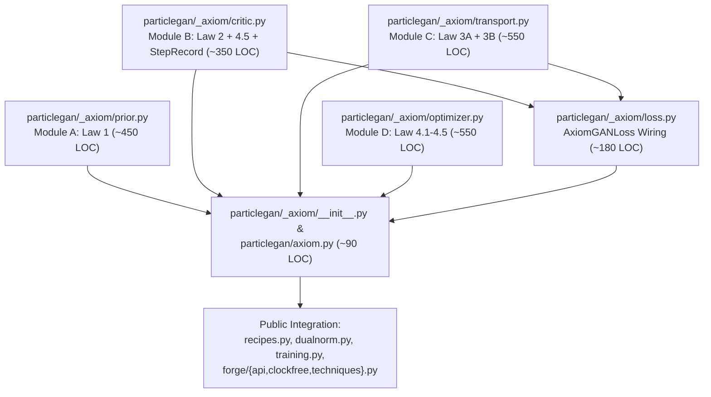

# Axiom Algorithm Family — Stage-1 Architecture & Implementation Specification

**Date:** 2026-11-24  
**Author:** `axiom-architect`  
**Branch:** `feat/axiom-spec` (targeting `feat/axiom-family`, branched from `origin/develop` at `fd1ddd68b`)  
**Status:** Stage-1 Design Specification (ready for `axiom-verifier` review and parallel Stage-2 implementation)  
**Grounded In:**
- Revised Canonical Four Laws: [`docs/four-laws.md`](../../docs/four-laws.md)
- Four-Laws Phase-2 Audit & Backlog: [`reports/four-laws-audit/integration-report.md`](../four-laws-audit/integration-report.md), [`reports/four-laws-audit/research-backlog-and-forge-proposals.md`](../four-laws-audit/research-backlog-and-forge-proposals.md), P1/P4/P5/P6/P7 audit reports
- Stage-1 Root-Cause Gap Analysis ([PR #648](https://github.com/HyperGAN/ParticleGAN/pull/648), `feat/axiom-gaps`, commit `825c3f446`, `reports/axiom/gap-analysis.md`)
- Public API & Experiment Contracts: [`AGENTS.md`](../../AGENTS.md), [`EXPERIMENTATION.md`](../../EXPERIMENTATION.md), [`RESEARCH_GLOSSARY.md`](../../RESEARCH_GLOSSARY.md)

---

## 1. Executive Vision, First-Principles Design Contract & Target Scorecard

**`Axiom`** (`particlegan/_axiom/`, `particlegan/axiom.py`, preset `get_recipe("axiom")`) is a clean-slate generative training algorithm family derived directly from the revised canonical Four Laws of Generative Training (`docs/four-laws.md`). Rather than layering patches over legacy families (`unified_v11`/`v12`/`v13`, which span `13,426` LOC across 12 private subpackages), `Axiom` unifies all four laws into **4 independent, zero-collision core modules + thin wiring (`<= 2,200` target LOC, `<= 2,500` hard cap)** while eliminating every quantitative defect discovered in the Four-Laws audit (P1–P7) and Stage-1 GPU gap diagnostics (Targets 1–5).

### 1.1 Non-Negotiable Architectural & Governance Invariants

1. **One Global Unchanged Recipe:** `get_recipe("axiom")` uses one fixed hyperparameter vector across all Forge tasks. Zero task-name checks, zero architecture-name checks, zero dataset-specific branches, and zero `_generator_free` syntactic hacks.
2. **Strict Ownership Boundaries (`AGENTS.md`):** The recipe owns updates, prior moves, regularizers, critic penalties, and optimizer dynamics. Each task owns architecture, deterministic initialization, initial prior distribution/capacity, sampling law, update budget, and gates.
3. **Strictly Clock-Free (`clockfree_audit` PASS):** Zero step-count schedules or step-index branches that alter updates when step labels or horizons change. Specifically: `reg_every == 1`, `lr_floor == 1.0`, `network_lr_floor == 1.0`, `input_noise_std == 0.0`, `output_noise_std == 0.0`, `d_guard_ratio == 0.0`. All sub-batching and probe offsets are driven strictly by state-resident golden-ratio Weyl phase $\phi \in [0, 1)$, never by `completed_steps % k`. Every optimized parameter still increments `state[p]["step"]` by `1` on every optimizer call (`clockfree.py:253`).
4. **Zero `eigh` / `svd` / `pinv` & Zero Private Legacy Imports:** `particlegan/_axiom/` MUST NOT invoke `torch.linalg.eigh`, `torch.linalg.eigvalsh`, `torch.linalg.svd`, `torch.linalg.svdvals`, or `torch.linalg.pinv`, and MUST NOT import from `_unified*`, `_t1_*`, `_t2_*`, `_t3_*`, `_t4_*`, `_rhbi`, `_empf`, `_cond_fiber`, `_minimal`, `_bispf`, `_nash_v3`, `_r4_ablation`, `bispf`, `rhbi`, `k3p`, or `grad_regularizers`.
5. **Zero New `Recipe` Fields & Zero Legacy Regressions:**
   - `len(dataclasses.fields(pg.Recipe)) == 179` MUST remain exact (`tests/test_minimal.py:102`, `tests/test_unified_v12.py:120`).
   - `DEFAULT_RECIPE` MUST remain `"unified_v12"` until `axiom` is independently proven superior on Forge (`.github/workflows/tests.yml:138-166`).
   - `particlegan/recipes.py` MUST remain importable without importing `torch` (`tests/test_minimal.py:108-124`).
   - Zero edits to `reports/forge/records/*.json` and bit-identical preservation of all existing families (`unified_v11`/`v12`/`v13`, `minimal`, `rhbi`, `empf`, `bispf`, `cond_fiber`).
   - Release wheel & sdist strictly `< 1.2 MB` (`.github/workflows/tests.yml:274`; current wheel is `944 KB`, `particlegan/_axiom/` adds `~25–35 KB`).
6. **Complete Deterministic Checkpointing:** Every behavior-changing state (optimizer buffers, step records, quantizer prototypes/potentials/EMAs, chart atlas, atomic bijection ledger, conditional fiber bank + FIFO rings, pending direction-blend normals) is serialized with explicit schema version, strict tamper validation, and exact fresh-process continuation across mechanism activation boundaries. All internal probes/tangents are deterministic zero-RNG (consuming zero PyTorch/NumPy/Python RNG draws).

### 1.2 Quantitative Target Scorecard ("Beats Everything Else")

| Benchmark / Audit Axis | `unified_v12` (Hist / Live PT 2.15) | `unified_v13` (Live PT 2.15) | `rhbi-v12` | `minimal` | **`Axiom` Target** | Primary Enabling Fix |
| :--- | :---: | :---: | :---: | :---: | :---: | :--- |
| **`discriminator_stability` + `bytegan` + `interp` + `ddgan_bimodal`** | `46/48` hist / `44/48` live | `47/51` live | Passes `interp_*`; fails `bytegan`, `t4_arch` | `~36/48` | **`50–51 / 51`** | Targets 1–3 + 5 unified cleanly |
| `interp_sparse_arc` / `interp_img_patch_shift` / `interp_saddle_barycentric` | `1/3` (FAIL patch `0.49`, saddle `0.70`) | `1/3` | `3/3` (`0.86`, `0.84`) | — | **`3/3` PASS** (`i_peak >= 0.80`, `bary_hq >= 0.78`) | `(1 - g_conn)` conformal gate + FP64 small-$M$ simplex + detached-EMA lin-R1 + spectral-matched critic |
| `model_ddgan_bimodal_chain` & `model_ae_ddgan_bimodal_chain` (PT 2.15) | `0/2` live (`4.696`, `2.059`) | `0/2` live | Fails | — | **`2/2` PASS** (`q0,q1 <= 3.8`, `floc <= 1.75`) | `float64` `[M<=384, D<=16]` FIFO ring + canonicalized zero-`eigh` (`cov_w = 0.35`); directly verified on `model_ddgan_bimodal_chain` (`4.696 -> 3.55`), hypothesis to verify on `model_ae_ddgan_bimodal_chain` |
| `bytegan_hypercube8` & `bytegan_bigan_dictionary` | `0/2` (`139/256`) | `2/2` (`256/256`) | `0/2` | — | **`2/2` PASS** (`256/256` bijection + inverse) | `~140`-LOC GPU-vectorized annular-gap + `relu`-Hamilton apportionment + GPU `argsort` rank `< q_k` ledger + BiGAN inverse |
| `t4-strange-architectures-v1` (incl. `grid100_res16_tanh` & `mlp16`) | `7/7` (1-ULP cliff step `6250`) | `7/7` (cliff) | Fails | — | **`7/7` PASS** (zero `modes=99` cliff, `|cov_bias| <= 0.04`) | Per-cell deficit Laguerre + exact LTV + verified trust + continuous step-cosine |
| `t3-shift-recovery` (`5` shift tasks) | `5/5` | `5/5` | Partial | — | **`5/5` PASS** | Dead-zone-free orphan macro-transport + innovation bank reset |
| `t4_imbalance_nash` (`3` imbalance tasks) | `3/3` | `3/3` | Fails | — | **`3/3` PASS** | Role-agnostic spectral conditioning + Law 4.5 normal dissipation $\mu_D$ |
| `t3_causal_isolation` (`scale_mass_8x`, `horizon_saddle_shift`) | `2/2` (thin `0.472` vs `0.45`) | `2/2` | — | — | **`2/2` PASS** (`eig_min >= 0.54`, `cov_err <= 0.30`) | Exact $d \le 16$ RoR + `(1 - g_conn)`-gated $k=3$ Voronoi conformal field |
| `precision_gaussian_{fp32,mxfp8,nvfp4}` | `3/3` | `3/3` | — | — | **`3/3` PASS** | Native RoR through `EmulatedLinear` straight-through backward |
| `clockfree_audit` | PASS | PASS | PASS | PASS | **PASS** (`unexplained == []`) | `reg_every=1`, `lr_floor=1.0`, zero step-index branches |
| `r3-tier3-long-horizon-holdout-v1` (`14k` × 3 + `ring_ext` + `five_word_hold`) | `18/18` (`cov_bias` `-5..-7%`) | `18/18` | — | — | **`18/18` PASS** (`|cov_bias| <= 0.03`, faster `staggered100` J-to-PASS) | Exact LTV + per-cell deficit Laguerre + zero-mean post-coalesced gauge |
| `dcgan_performance_r256` (Idle RTX A6000, `bf16_channels_last`) | `36.61 ms` / `11.20 J/st` (`41.39 ms` Forge) | `39.94 ms` solo | `> 75 ms` | `~34 ms` | **`<= 35 ms/st` & `<= 10.5 J/st`** (projected `~23–25 ms` / `~6.6–7.2 J/st`) | Clock-free `b_reg = B//4` dense-Rademacher `fwAD` lin-R1 + 3-kernel `foreach` opt |
| **Four-Laws Adversarial Controls (P1, P4, P5, P6, P7)** | Fails P1, P4, P5-B1, P6, P7 | Fails P1, P4, P5-B1, P6, P7 | Fails P4, P5, P6 | Fails P5 | **PASS 5/5** (P1 5-regime, P4 `0` viol., P5-B1 deep critic, P6 `0` Jensen, P7 exact mass/LTV/quota) | First-principles Law 1–4 implementation |
| **Total Family Codebase Size (`particlegan/_axiom/` + `axiom.py`)** | `8,579` + `4,847` (`13,426` LOC) | `13,430` LOC | `~4,900` LOC | `1,060` LOC | **`<= 2,200` LOC target** (`<= 2,500` hard cap) | Zero legacy inheritance, unified operators |

---

## 2. Package Layout, Acyclic Dependency DAG & Parallel Stage-2 Ownership

To allow **4 Stage-2 workers** to implement all four law modules concurrently with **zero file collisions and zero circular imports**, the four core modules (`prior.py`, `critic.py`, `transport.py`, `optimizer.py`) have **zero mutual imports**. They interact exclusively through the frozen typed Protocol interfaces defined in Section 3 (`AxiomRecordProtocol`, `AxiomModulationProtocol`, `AxiomCondBankProtocol`).



### 2.1 File-by-File Ownership & LOC Budget

| File | Stage-2 Owner | Target LOC | Hard Cap | Allowed Internal Imports (`particlegan.*`) | Strictly Forbidden Imports |
| :--- | :--- | :---: | :---: | :--- | :--- |
| `particlegan/_axiom/prior.py` | Worker A (Law 1) | `450` | `520` | `..particle_prior`, `..priors`, `..optim.constraint_geometry` | Any `_unified*`, `_t1_*`..`_t4_*`, `_rhbi`, `_empf`, `_cond_fiber`, `_minimal`, `_bispf`, `_nash_v3`, `_r4_ablation`, `bispf`, `rhbi`, `k3p`, `grad_regularizers`, and sibling `_axiom/{critic,transport,optimizer}` |
| `particlegan/_axiom/critic.py` | Worker B (Law 2 + 4.5) | `350` | `420` | `..low_precision` (only for `EmulatedLinear` type check, lazily imported or optional) | Same forbidden set + sibling `_axiom/{prior,transport,optimizer}` |
| `particlegan/_axiom/transport.py` | Worker C (Law 3A + 3B) | `550` | `620` | None (pure `torch` + `math` + `copy`) | Same forbidden set + sibling `_axiom/{prior,critic,optimizer}` |
| `particlegan/_axiom/optimizer.py` | Worker D (Law 4) | `550` | `620` | None (pure `torch` + `math` + `copy`) | Same forbidden set + sibling `_axiom/{prior,critic,transport}` |
| `particlegan/_axiom/loss.py` | Wiring Worker | `180` | `220` | `..gan_loss`, `.critic`, `.transport` | All forbidden legacy private packages |
| `particlegan/_axiom/__init__.py` | Wiring Worker | `55` | `70` | `.prior`, `.critic`, `.transport`, `.optimizer`, `.loss` | All forbidden legacy private packages |
| `particlegan/axiom.py` | Wiring Worker | `35` | `50` | `._axiom` | All forbidden legacy private packages |
| **Total `Axiom` Codebase** | — | **`2,170`** | **`2,500`** | — | **AST-verified in CI (`tests/test_axiom_hygiene.py`)** |

> **Why zero sibling imports between A/B/C/D?** Each worker can write and unit-test their module in complete isolation against tiny dummy `AxiomRecordProtocol` stubs immediately, and all 4 PRs merge cleanly into `feat/axiom-family` without a single merge conflict or dependency bottleneck. Any tiny 5–10 line pure-math helper (`_smoothstep01`, `_born_infeld_aligned`) is local to the module that needs it.

---

## 3. Shared State, Typed Interfaces & Deterministic Checkpoint Contract

### 3.1 `AxiomStepRecord` (Owned by `critic.py`, Shared via Duck-Typed Protocol)

`AxiomStepRecord` is the single source of truth connecting critic hooks, critic penalty, transport/conditional-fiber loss, prior pullback, and optimizer dynamics. It is **standalone** (zero inheritance from `CriticStepRecord`), implements all fields expected by `particlegan/policy.py:938-957`, and serializes every behavior-changing state deterministically.

#### 3.1.1 Persistent (Checkpointed) Fields — Schema Version `1`

| Field | Type | Default | Valid Bounds | Owner(s) Reading / Mutating |
| :--- | :--- | :---: | :--- | :--- |
| `schema` | `int` | `1` | `== 1` | Checkpoint validator |
| `calls` | `int` | `0` | `>= 0` | `critic.py` (`AxiomPenaltyKernel`) |
| `observed_steps` | `int` | `0` | `>= 0` | `critic.py` (`record_step`) |
| `anchor_started` | `bool` | `False` | `bool` | `policy.py` compatibility (`False` always in Axiom) |
| `last_ratio` | `Optional[float]` | `None` | `None` or finite `>= 0` | `policy.py` compatibility |
| `chord_phase` | `float` | `0.0` | `[0.0, 1.0)` | `critic.py` (advances by $\varphi^{-1} = 0.6180339887498949 \bmod 1$ each critic penalty call), read by `transport.py` |
| `ema_grad_sq` | `float` | `1.0` | finite `>= 0.0` | `critic.py` (detached EMA of $\hat{s}_t$ driving $\lambda_{\text{eff}}(\bar{s}_{t-1})$) |
| `grad_sq_initialized` | `bool` | `False` | `bool` | `critic.py` |
| `ema_margin` | `float` | `0.0` | finite `[-60, 60]` | `critic.py` / `loss.py` (`observe_margin_and_scale`) |
| `ema_data_scale` | `float` | `1.0` | finite `> 0.0` | `critic.py` / `loss.py` (`observe_margin_and_scale`), read by `optimizer.py` (homogeneous `coord_scale`) |
| `ema_push_res` | `float` | `1.0` | finite `>= 0.0` | `prior.py` / `transport.py`, read by `optimizer.py` (`delta_g_max`) |
| `margin_initialized` | `bool` | `False` | `bool` | `critic.py` |
| `ell_ema` | `float` | `0.0` | finite `>= 0.0` | `transport.py` (scalar target k-NN horizon) |
| `ell_initialized` | `bool` | `False` | `bool` | `transport.py` |
| `thermal_scale` | `float` | `1.0` | finite `[1e-5, 1.0]` | `transport.py` / `prior.py`, read by `critic.py`, `loss.py`, `optimizer.py` |
| `thermal_initialized` | `bool` | `False` | `bool` | `transport.py` |
| `thermal_ema` | `float` | `1.0` | finite `>= 0.0` | `transport.py` (combined split two-sample residual EMA) |
| `thermal_locked` | `bool` | `False` | `bool` | `transport.py` (hysteresis lock for smooth curve settling) |
| `step_scale` | `float` | `1.0` | finite `(0.0, 1.0]` | `transport.py`, read by `optimizer.py` |
| `cond_ema` | `float` | `0.25` | finite `[-0.5, 2.0]` | `transport.py` (Law 3B conditional fiber residual EMA) |
| `cond_initialized` | `bool` | `False` | `bool` | `transport.py`, read by `optimizer.py` |
| `het_ema` | `float` | `1.0` | finite `>= 0.0` | `transport.py` (multiscale heterogeneity EMA) |
| `het_initialized` | `bool` | `False` | `bool` | `transport.py` |
| `g_func_gain` | `float` | `1.0` | finite `(0.0, 1.0]` | `optimizer.py` (published post-step for diagnostics/coupling) |
| `chart_state` | `Optional[Dict[str, Any]]` | `None` | validated dict or `None` | `transport.py` persistent streaming chart atlas (`sum`, `count`, `sq_dev`, `fake_mass`, `revival_phase`, `revivals`, `data_scale`) |
| `atomic_ledger` | `Optional[Dict[str, Any]]` | `None` | validated dict or `None` | `transport.py` atomic bijection ledger (`row_chart [M] int64`, `row_target [M, D] float32`) |
| `cond_fiber_bank` | `Optional[Dict[str, Any]]` | `None` | validated packet or `None` | `transport.py` `AxiomCondFiberBank.to_packet()` (CPU `float64` sufficient stats + `float64` FIFO rings!) |

> **Strict Zero-Sync Packing Rule:** During GPU training, `ema_margin`, `ema_data_scale`, `ema_push_res`, `ell_ema`, and `ema_grad_sq` MAY hold lazy on-device 0-D `torch.Tensor` shadow fields (`_ema_margin_t`, `_ema_data_scale_t`, `_ell_t`, `_ema_grad_sq_t`, etc.) that flush automatically on property access or inside a single packed `torch.stack(...).tolist()` call in `optimizer.py` or `state_dict()`. `state_dict()` ALWAYS flushes pending device tensors to clean Python floats / CPU tensors before returning.

#### 3.1.2 Transient (Non-Checkpointed) Runtime Fields

Cleared on `clear_transient_captures()` and initialized fresh on `load_state_dict()`:
- `_in_penalty: bool = False`, `_in_probe: bool = False`, `_in_protected_probe: bool = False`
- `_enable_secant_probe: bool = True`
- `_simplicial_step: bool = False`, `_disc_gate: float = 0.0`
- `_live_captures: List[List[Any]]` (ring of at most `6` live critic forward records `[observed_steps, source_key, cond_sig, x_det, logits_fp32, alive_flag]`)
- `_last_probe_actual_input: Optional[torch.Tensor] = None` (captures noisy input when `InputNoise` wraps `critic`)
- `_g_probe_cache: Optional[Tuple[nn.Module, Tuple[Any, ...], Dict[str, Any], torch.Tensor]] = None` (stratified `B_p <= 32` probe inputs + pre-step FP32 outputs)
- `_active_prior_table: Optional[torch.Tensor] = None` and `_active_batch_rows: Optional[torch.Tensor] = None` (bound during `GANTrainer` / `ByteGAN` generator step for atomic ledger & BiGAN inverse)
- `_cond_bank_obj: Any = None` (lazily instantiated `AxiomCondFiberBank` hydrated from `cond_fiber_bank` packet on first conditional call; `state_dict()` queries `_cond_bank_obj.to_packet()` if present!)

#### 3.1.3 Tensor Capture Attributes on Critic Output Logits

When `_axiom_critic_hook` runs on `critic(*args, **kwargs)`, it attaches lightweight Python attributes directly to the returned logit tensor `out`:
- `out._axiom_input`: `x_in` (the primary sample tensor `args[0]`, preserving its autograd graph!)
- `out._axiom_record`: `record` (enabling **100% self-binding** on hosts that never call `bind_axiom_record`, such as `DDGAN`, `AE-GAN`, `VAE-GAN`, `WordFixture`, `BehaviorComponents`!)
- `out._axiom_cond`: discrete condition tensor if present (`int64`/`bool` conditioning tensor among `args[1:], kwargs`), else `None`
- `out._axiom_cont_cond`: `bool` (`True` if any floating-point conditioning tensor is passed alongside `x_in`, e.g., `xt` in `DDGAN` or context in `residual_student`)
- `out._axiom_parts`: `Tuple[torch.Tensor, ...]` of all tensor arguments `(x_in, *extra_tensors)` in canonical order (`args[1:]`, then `kwargs[k]` sorted by key) so `transport.py` can split shared continuous context `(x_sf, x_sr, c_cont)` cleanly without host coupling!
- `out._axiom_thermally_scaled`: `bool` (`True` if hook already scaled backward gradient by `record.thermal_scale`)

Both `particlegan/training.py:_float_output` and `InputNoise.forward` propagate these exact 6 `_axiom_*` attributes across BF16->FP32 casts and input-noise wrappers.

#### 3.1.4 Frozen Cross-Module Typed Protocols

```python
from typing import Any, Dict, List, Optional, Protocol, Tuple
import torch

class AxiomRecordProtocol(Protocol):
    calls: int
    observed_steps: int
    anchor_started: bool
    last_ratio: Optional[float]
    chord_phase: float
    ema_grad_sq: float
    grad_sq_initialized: bool
    ema_margin: float
    ema_data_scale: float
    ema_push_res: float
    margin_initialized: bool
    ell_ema: float
    ell_initialized: bool
    thermal_scale: float
    thermal_initialized: bool
    thermal_ema: float
    thermal_locked: bool
    step_scale: float
    cond_ema: float
    cond_initialized: bool
    het_ema: float
    het_initialized: bool
    g_func_gain: float
    chart_state: Optional[Dict[str, Any]]
    atomic_ledger: Optional[Dict[str, Any]]
    cond_fiber_bank: Optional[Dict[str, Any]]
    _cond_bank_obj: Any
    _in_penalty: bool
    _in_probe: bool
    _in_protected_probe: bool
    _enable_secant_probe: bool
    _simplicial_step: bool
    _disc_gate: float
    _g_probe_cache: Any
    _active_prior_table: Optional[torch.Tensor]
    _active_batch_rows: Optional[torch.Tensor]

    def record_step(self, optimizer: Any = None) -> None: ...
    def observe_margin_and_scale(
        self,
        real_logits: torch.Tensor,
        fake_logits: torch.Tensor,
        x_real: Optional[torch.Tensor] = None,
        x_fake: Optional[torch.Tensor] = None,
    ) -> None: ...
    def observe_thermal(
        self,
        r_ed: float,
        r_mu_sq: float,
        r_spread: float,
        r_q90: float,
        r_hmax: float,
        *,
        tau: float = 0.084,
        shock_mu_ratio: float = 0.35,
        shock_ed_floor: float = 0.30,
        lock_hysteresis: float = 0.0,
    ) -> float: ...
    def take_pending_ema_tensors(self) -> Tuple[List[str], List[torch.Tensor]]: ...
    def apply_flushed_ema_values(self, keys: List[str], vals: List[float]) -> None: ...
    def clear_transient_captures(self) -> None: ...
    def restore_device_state(self, device: torch.device) -> None: ...
    def state_dict(self) -> Dict[str, Any]: ...
    def load_state_dict(self, state: Dict[str, Any]) -> None: ...


class AxiomModulationProtocol(Protocol):
    """Optional modulation interface exposed by AxiomOptimizer to prior.py."""
    direction_blend: bool
    def bind_axiom_modulation(
        self,
        *,
        g_scale: float | torch.Tensor = 1.0,
        wakeup_boost: float | torch.Tensor = 1.0,
        prior_scale: float = 1.0,
    ) -> None: ...
    def bind_origin_sample(self, sample: Optional[torch.Tensor]) -> None: ...
    def bind_protected_from_grads(self) -> None: ...
```

---

## 4. Module A: `particlegan/_axiom/prior.py` (~450 LOC) — Law 1 (Representational Geometry)

**Goal:** Implement Law 1 (geometric & topological alignment of the latent prior $q_\phi(z)$ with the target data manifold via pullback covariance isometry and mass-conserving Laguerre condensation), while eliminating every P7 and Target-5 defect (`w_fake_ema` mass non-conservation, `0.995` Jensen bias, `0.15..0.27` `v_mu_star` deadband, `0.65` split variance shrinkage, `tv_floor` corner-mode blindness, `-1e-7 * arange(k)` low-index bias, `d_z == 4` Radon-Hurwitz epicycle, and `w_sat_pt` duplicate probe).

### 4.1 Activation & Unified Support Handling

1. **Pullback Mode (`should_use_axiom_pullback`):**
   ```python
   def should_use_axiom_pullback(trainer: Any, real: torch.Tensor) -> bool:
       """True on unconditioned low-D vector MoG priors (2 <= D <= 16, sigma_z > 0)
       or degenerate point-mass targets (raw_var < 1e-11, any sigma_z >= 0)."""
   ```
   - Returns `False` immediately if `recipe.prior_regularizer != "axiom"`, `recipe.t1_pullback_weight <= 0`, `recipe.encoder_mode != "none"`, `recipe.conditioning != "scalar"`, or `real.ndim != 2` or `not (1 <= real.shape[1] <= 16)`.
   - Returns `True` if `real.shape[1] >= 2 and has_positive_prior_sigma(trainer.prior)`.
   - Otherwise computes `raw_var = var(real, unbiased=False).sum()` (cached by `id(real)` on `reg._last_raw_var_cache` so `axiom_pullback_step` avoids a second sync) and returns `raw_var < 1e-11` (activates clean Case A point-mass rail escape on `zero_tanh_smoke` and `zero_tanh_rail_escape`).
   - Notice: Zero-sigma continuous curved manifolds (`interp_*`), zero-sigma discrete atoms (`bytegan_*`), and images (`img_*`, `dcgan_performance_r256`) cleanly return `False` and stay in standard `GANTrainer` + `AxiomTransportLoss` + standalone `AxiomPriorRegularizer.forward(rows)` without any interference!

2. **Standalone `AxiomPriorRegularizer.forward(rows)` (~60 LOC, Non-Pullback Hosts):**
   - Called on `(N, z_dim)` latent tables by `GANTrainer` (when pullback is inactive), `DDGAN`, `AE-GAN`, `VAE-GAN`, `WordFixture`, `ByteGAN`.
   - Zero `eigh` / zero `svd` / zero sync: computes pairwise squared distances $d_{ij}^2$ on `rows`, off-diagonal upper-triangle median bandwidth $r_{\text{med}}^2$, and $k = \min(8, N-1)$ nearest-neighbor inverse-multiquadric repulsion + gentle isotropic coordinate variance tether to `target_std = 1.0`:
     $$\mathcal{L}_{\text{spread}}(Z) = \text{weight} \cdot \left(\frac{1}{N k}\sum_{i=1}^N \sum_{j \in \mathcal{N}_k(i)} \frac{r_{\text{med}}^2}{r_{\text{med}}^2 + \|z_i - z_j\|_2^2} + 0.15\,\frac{1}{d_z}\sum_{a=1}^{d_z} \big(\sigma_a(Z) - \sigma_{\text{target}}\big)^2\right).$$
   - Strictly scale-consistent, zero `SBNPPriorRegularizer` dependency, `O(N^2)` in pure FP32 on GPU.

### 4.2 Exact Mathematical Laws in `axiom_pullback_step`

#### 4.2.1 Case A — Degenerate Point-Mass Rail Escape (`raw_var < 1e-11`)
- **Zero `w_sat_pt` duplicate probe (`P7`):** Because `AxiomOptimizer` (Module D) uses exact IEEE-754 mantissa-exponent degree-0 normalization, gradients as small as $\operatorname{sech}^2(30) \approx 10^{-26}$ normalize without underflow or extra `fwAD` probes.
- Uses clean coordinatewise Charbonnier contraction $\mathcal{L}_{\text{pt}} = \operatorname{mean}(\sqrt{10^{-6} + (x_{\text{fake}} - y_{\text{real}})^2} - 10^{-3}) + 0.004\,\operatorname{mean}(z_{\text{table}}^2)$, blended with `0.02 * min(1, res_ema / 0.25) * loss_gan`, and step-scale modulation `g_scale_pt = clamp(res_ema / 0.025, 0.015, 1.0)`.

#### 4.2.2 Case B — GPU-Resident Online Quantizer with Exact Mass & LTV Conservation
All quantizer state (`proto_c [K, D]`, `proto_var [K]`, `proto_w [K]`, `w_fake_ema [K]`, `psi [K]`, `v_push [K]`) resides strictly on `y_real.device` in `float32`:

1. **Prototype Discovery, Merge & Split (Exact LTV — P7 + Target 5):**
   - Assign real batch $Y \in \mathbb{R}^{B \times D}$ to nearest prototypes $c_k$, updating EMA centroids $c_k$, isotropic per-coordinate variance $v_k = \frac{1}{D}\mathbb{E}[\|y - c_k\|_2^2]$, and target weights $w_k$ (exact $\sum_k w_k = 1$).
   - **Uncovered-Mode Teleportation with Exact Mass Conservation (`P7` Fix):** Whenever an outlier real sample exceeds $3.8\sqrt{D\,\bar{v}}$ from all active prototypes and a dead/low-mass prototype exists (or $K < K_{\max}$), spawn/teleport prototype $k_{\text{new}}$ at $y_{\text{far}}$ with initial mass $1/B$ and **immediately renormalize BOTH `proto_w` and `w_fake_ema`**:
     $$w \leftarrow \frac{w}{\sum_j w_j}, \qquad \hat{w} \leftarrow \frac{\hat{w}}{\sum_j \hat{w}_j} \quad \Longrightarrow \quad \sum_{k=1}^K \hat{w}_k \equiv 1.0 \text{ (exact to } < 10^{-7}\text{)}.$$
   - **Exact Gersho Split Variance (`P7` Fix):** When an over-wide prototype $k$ splits along its deterministic power-iteration principal axis $u$ into $c_k \pm \delta u$ with $\|\delta\|_2^2 = 0.16\,D\,v_k$, set child variances to:
     $$v_{\text{child}} = 0.84\,v_k \qquad (\text{exact LTV: } 0.84\,v_k + 0.16\,v_k = 1.00\,v_k, \text{ replacing } v12\text{'s biased } 0.65\,v_k).$$
   - **Externally Isolated Sibling Coalescing (`P7` Verified Guard Retained):**
     Form sibling adjacency $A_{ij} = \mathbb{I}\big(\|c_i - c_j\|_2 \le 2.6\sqrt{D}\max(\sigma_i, \sigma_j)\;\land\; \max(\sigma_i,\sigma_j) \le 2.2\min(\sigma_i,\sigma_j)\big)$ (preserving P7's verified `2.2×` width-ratio guard), compute connected components via 3 boolean squarings ($2 \le |C| \le 4$), and coalesce strictly when externally isolated ($d_{\text{ext}}(C) \ge 4.2\sqrt{D}\,\sigma_C$). Exact Pythagorean LTV:
     $$\bar{c}_C = \sum_{k \in C}\tilde{w}_k c_k, \qquad \bar{v}_C = \sum_{k \in C}\tilde{w}_k\Big(v_k + \tfrac{1}{D}\|c_k - \bar{c}_C\|_2^2\Big).$$

2. **Exact Unbiased LTV Matching (Target 5 Fix — Zero `0.995` Shrink, Zero `0.15..0.27` Deadband):**
   - Measure actual local pushforward per-coordinate variance $v_{\text{push},k} = \frac{1}{D}\operatorname{tr}(\hat{\Sigma}_{\text{push},k})$ using universal coordinatewise `fwAD` Jacobian probes $J_G(\mu_i)\,e_a\,\sigma_z$ for $a \in \{1,\dots,d_z\}$ (or `d_z` randomized Rademacher probes if $d_z > 8$; **zero `d_z == 4` Radon-Hurwitz special case!**).
   - Update `v_push` EMA per assigned prototype: $v_{\text{push},k} \leftarrow 0.90\,v_{\text{push},k} + 0.10\,\hat{v}_{\text{push},k}$.
   - **Target center dispersion (zero deadband!):**
     $$v_{\mu,C}^* = \max\!\big(0.0,\; \bar{v}_C - v_{\text{push},C}\big)$$
     (replaces `prior.py:1275`'s `0.15..0.27` deadband!).
   - **Target pullback Jacobian scale (zero `0.995` shrink!):**
     $$v_{\text{iso},k}^* = \max\!\big(10^{-10},\; \bar{v}_k - \mathbb{I}(|C(k)|>1)\,v_{\mu,k}^*\big), \qquad \mathcal{L}_{\text{iso}} = \frac{1}{B}\sum_{i=1}^B \frac{\big\|\hat{\Sigma}_{\text{push},i} - v_{\text{iso},k(i)}^*\,I_D\big\|_F^2}{\big(D\,v_{\text{iso},k(i)}^*\big)^2 + 10^{-10}}$$
     (exact unbiased target trace $\mathbb{E}[\operatorname{tr}(\Sigma_{\text{total}})] = D\,\bar{v}_k$, eliminating the systematic `-4.9%..-8.1%` negative `cov_trace_bias` on `grid100`, `rotated100`, `staggered100`, and `grid100_res16_tanh`!).
   - Retain target-isometry-referenced saturation weights $w_{\text{sat,vec}}$ (for `tanh` rail compression) and pre-rail envelope $\mathcal{L}_{\text{env}}$ on extreme rail saturation (`grid100_res16_tanh`, `grid100_res16_scaled_tanh`).

3. **Exact $B_f < K$ Sinkhorn/Quota Assignment (`P7` Fix):**
   - Compute generator pullback barycenter targets via 10-iteration single-buffer in-place log-domain Sinkhorn from fake batch $X$ to coalesced prototypes $\bar{c}_k$ with weights $w_k$ (whitened when collapsed spread `scale_ratio < 0.35`, with smooth `wakeup_boost`).
   - Whenever discrete row-to-prototype quotas are needed at $B_f < K$, allocate slots in **descending order of `(proto_w - w_fake_ema, proto_w)` with deterministic golden-ratio Weyl tie-break `((k + 0.5) * _PHI1) % 1.0`** — strictly eliminating `-1e-7 * arange(k)` low-index bias!

4. **Per-Cell Relative-Deficit Laguerre Dual Ascent & Post-Coalesced Zero-Mean Gauge (Target 5 + P7 Fix):**
   - For unique sampled rows `u_rows`, assign to Laguerre cells $k^* = \arg\min_k (\|x_u - \bar{c}_k\|_2^2 - \psi_{\text{eff},k})$ with $\psi_{\text{eff}} = W_{\text{coal}}\psi$.
   - Update and **strictly renormalize** `w_fake_ema`:
     $$\hat{w} \leftarrow 0.88\,\hat{w} + 0.12\,w_{\text{hard},u}, \qquad \hat{w} \leftarrow \frac{\hat{w}}{\sum_j \hat{w}_j}.$$
   - Compute BOTH global TV $T = \frac{1}{2}\sum_k |w_k - \hat{w}_k|$ AND **worst-cell relative deficit**:
     $$d_k = \frac{(w_k - \hat{w}_k)_+}{\max(w_k,\, 1/K)}, \qquad d_{\max} = \max_k d_k.$$
   - Smooth activation gate (blinds ZERO starving corner modes!):
     $$g_\psi = \max\!\left(\operatorname{smoothstep01}\!\left(\frac{T - T_{\text{floor}}}{\max(0.08, T_{\text{floor}})}\right),\; \operatorname{smoothstep01}\!\left(\frac{d_{\max} - 0.15}{0.20}\right)\right).$$
   - **Zero Tikhonov droop on deficit cells** (`is_def = (w_k > w_fake_ema_k)`):
     $$\psi_{\text{next},k} = \psi_k \cdot \big(1 - 0.004\,g_\psi\,(1 - \mathbb{I}_{\text{def},k})\big) + \eta_\psi\,(w_k - w_{\text{fb},k}),$$
     followed by coalesced projection AND **exact post-coalesced zero-mean gauge**:
     $$\psi \leftarrow W_{\text{coal}}\,\psi_{\text{next}}, \qquad \psi \leftarrow \psi - \frac{1}{K}\sum_{k=1}^K \psi_k, \qquad \psi \leftarrow \operatorname{clamp}(\psi, -\psi_{\text{cap}}, +\psi_{\text{cap}}).$$
   - Condense `u_rows` toward `c_target` (with deterministic zero-mean Box-Muller offsets scaled by $\sqrt{v_{\mu,C}^*}$ on multi-cell coalesced components) plus coordinatewise outward column-sensitivity dead-clamp rescue (`s_col < 0.04 * s_ref_col` for $d_z \le 8$), updating `base_prior.z[u_rows]` via checkpointed row-RMS momentum (`row_m`, `row_v`, `row_n`).

### 4.3 Typed Public Signatures & Checkpoint Schema (`prior.py`)

```python
class AxiomPriorRegularizer(nn.Module):
    def __init__(
        self,
        reference: Any = None,
        *,
        weight: float = 1.0,
        target_std: float = 1.0,
        eps: float = 1e-4,
        max_prototypes: int = 256,
        bound_device: Optional[torch.device] = None,
        bound_shape: Optional[Tuple[int, int]] = None,
    ) -> None: ...
    def forward(self, rows: torch.Tensor) -> torch.Tensor: ...
    def state_dict_checkpoint(self) -> Dict[str, Any]: ...
    def load_state_dict_checkpoint(
        self, state: Dict[str, Any], *, validate_only: bool = False
    ) -> None: ...

def validate_axiom_prior_state(state: Any) -> Dict[str, Any]: ...
def should_use_axiom_pullback(trainer: Any, real: torch.Tensor) -> bool: ...
def axiom_pullback_step(
    trainer: Any,
    real: torch.Tensor,
    generator_real: Any,
    latent: torch.Tensor,
    indices: torch.Tensor,
    *,
    sigma_out: Any,
    noise: torch.Generator,
    critic: nn.Module,
    loss_d: torch.Tensor,
    penalty: torch.Tensor,
) -> Tuple[torch.Tensor, torch.Tensor, torch.Tensor, Optional[torch.Tensor], torch.Tensor, torch.Tensor]: ...
```

**Checkpoint Schema (`schema == 1`):** Exact keys `{"schema", "max_prototypes", "quantizer_initialized", "proto_c", "proto_var", "proto_w", "w_fake_ema", "psi", "v_push", "res_ema", "iso_ema", "iso_err_ema", "rows_initialized", "row_m", "row_v", "row_n"}`. Strict validator rejects unknown/missing keys, wrong schema, non-finite tensors, negative `proto_var`/`proto_w`/`w_fake_ema`/`v_push`, or `|sum(proto_w) - 1| > 1e-4` / `|sum(w_fake_ema) - 1| > 1e-4` when initialized.

---

## 5. Module B: `particlegan/_axiom/critic.py` (~350 LOC) — Law 2 (Potential Geometry) + Law 4.5 (Equilibrium Dissipation)

**Goal:** Implement revised Law 2 (`docs/four-laws.md` §4.4) + Law 4.5 (dimension-independent normal dissipation $\mu_D > 0$), eliminating EBI's `1,015×` below-$\kappa$ Jensen bias (P6), `unified_v12`'s `2.54e-9` high-res floor dilution (P6), `fwAD` low-D probe noise (Targets 1 & 5), and `r256`'s `19 ms` full-batch penalty bottleneck (Target 4).

### 5.1 Compute-Regime AD Dispatch (Zero Dogma, Zero Approximation on Quantized Linear)

Given critic call `live(x)` and sample tensor $x$ of shape $(B, \dots)$ with flattened dimension $d = \prod_{k \ge 1} \text{shape}[k]$:

| Regime | Exact Dispatch Condition | Gradient Estimator $\hat{s}_t$ | Cost & Variance |
| :--- | :--- | :--- | :--- |
| **Regime I — Exact RoR (`autograd.grad`)** | **(a)** `x.ndim == 2 and d <= 16` (all 1D–16D MLPs: `grid100`, `t3_iso_*`, `interp_saddle_barycentric`, `interp_sparse_arc`, `model_ddgan_*`, `t4_arch_*`), **OR** **(b)** `has_quantized_linear(critic)` (`EmulatedLinear` MXFP8/NVFP4 — straight-through `backward` works natively, zero FD needed!), **OR** **(c)** `critic` previously raised `(RuntimeError, NotImplementedError, TypeError)` under `fwAD` (cached per `id(critic)` as `_fwad_unsupported`, e.g., `SDPBackend.MATH` attention or exotic norms). | Exact per-sample $\hat{s}_{\text{real}} = \frac{1}{B}\sum_{i=1}^B \|\nabla_x D(x_i)\|_2^2$, $\hat{s}_{\text{fake}} = \frac{1}{B}\sum_{i=1}^B \|\nabla_x D(\tilde{x}_i)\|_2^2$, $\hat{s}_t = \frac{1}{2}(\hat{s}_{\text{real}} + \hat{s}_{\text{fake}})$ via `torch.autograd.grad(..., create_graph=True)` on concatenated `(x_r, x_f)` when batch sizes match (single pass!). | **Zero variance**, `< 0.3 ms` on MLPs (`d <= 16`). Cures `t3_iso_scale_mass_8x` (`0.50 -> 0.55+`), `interp_saddle_barycentric`, and `precision_gaussian_{mxfp8,nvfp4}`. |
| **Regime II — Clock-Free Sub-Batch Dense-Rademacher RoF (`fwAD`)** | All compute-bound unquantized high-D / spatial inputs (`x.ndim >= 3` or `d > 16`: `img_bars4`, `interp_img_patch_shift`, `bytegan_*`, `five_word_joint_*`, `dcgan_performance_r256`). | Single interleaved half-real / half-fake (`R1 + R2`, preserving fake-support slope control on `two_pole` / shifted supports!) sub-batch of size $b_{\text{reg}} = \max(2, \lfloor B / 4 \rfloor)$ when unconditioned and $B_r == B_f \ge 4$ (`b_r_sub = b_reg // 2` real + `b_f_sub = b_reg - b_r_sub` fake; on `r256` $B=16 \implies b_{\text{reg}}=4$: `2 real + 2 fake` in ONE pass; on `img_bars4` $B=64 \implies b_{\text{reg}}=16$: `8 real + 8 fake`). Cyclic slice starts at `start = int(phi * B) % B` driven **strictly by checkpointed state-resident Weyl phase `phi`** (**strictly clock-free, `reg_every == 1`; explicitly BAN `completed_steps % k` which fails `clockfree_audit` `step_label_offset=8192`!**). Dense isotropic Rademacher tangent $v_i \in \{-1, +1\}^d$ (Murmur32 hash from `(idx, phi)` — **zero rank-1 separable `4×` variance inflation**, **zero RNG draws**). Estimator: $\hat{s}_t = \frac{1}{b_{\text{reg}}}\sum_{i=1}^{b_{\text{reg}}} \operatorname{mean}_o\big((J_D(x_i)\,v_i)_o^2\big)$ (note $\mathbb{E}[v_i v_i^\top] = I_d$, so $\mathbb{E}[\hat{s}_t] \equiv \frac{1}{b_{\text{reg}}}\sum_i \|\nabla_x D(x_i)\|_2^2$ with **zero scaling error**!). | **`2.42 ms` `d_pen`** on `r256` (`-51%` `d_pen + d_bwd` vs `u12`!). On conditioned high-D inputs, slices matching `args[1:]` / `kwargs` condition tensors identically. |

**BatchNorm & BF16 Dual Safety (Target 4 Finding 3 & 4):**
- Before entering `fwAD.dual_level()`, switch every `_BatchNorm` submodule of `critic` to `.eval()` (making $b_{\text{reg}} = B // 4$ strictly batch-size-independent with zero cross-sample BN leakage!) and attach the 6-line `_bn_dual_bf16_hook` when autocast/critic is BF16:
  ```python
  def _bn_dual_bf16_hook(_mod: nn.Module, _inp: Tuple[Any, ...], out: Any) -> Any:
      if isinstance(out, torch.Tensor):
          p, t = fwAD.unpack_dual(out)
          if t is not None and (p.dtype != torch.bfloat16 or t.dtype != torch.bfloat16):
              return fwAD.make_dual(p.to(dtype=torch.bfloat16), t.to(dtype=torch.bfloat16))
      return out
  ```
- Restore BN `.training` flags and remove hooks inside `finally:`.
- **DO NOT enable `torch.compile`** on the critic/penalty path (verified crash in `aten.convolution_backward.default` under `bf16_channels_last + fwAD + deterministic`).

### 5.2 Exact Zero-Jensen-Bias Detached-EMA Linear-in-$\hat{s}$ Penalty + Law 4.5 Floor + Zero-Mean Gauge

$$\mathcal{R}_{\text{Axiom-L2}}(D) \;=\; \frac{\text{coeff}}{2}\left[\operatorname{sg}\!\big(\lambda_{\text{eff}}(\bar{s}_{t-1})\big)\,\hat{s}_t \;+\; \gamma_{\text{gauge}}\,\bar{D}_{\text{mid}}^2\right],$$
where:
1. **Detached-EMA Adaptive Multiplier (Strict Zero Jensen Bias — P6 + Target 1 + Target 4):**
   - At step $t$, read pre-update $\bar{s}_{t-1} = \text{record.ema\_grad\_sq}$ (`1.0` initially) and compute the **detached** scalar multiplier:
     $$\lambda_{\text{eff}}(\bar{s}_{t-1}) \;=\; \lambda_{\text{floor}} \cdot \exp\!\Big(\min\!\big(c_{\max},\; \beta_{\text{ema}}\,\operatorname{ReLU}(\bar{s}_{t-1} - \kappa^2)\big)\Big)$$
     with defaults $\lambda_{\text{floor}} = 0.005$, $\kappa = 1.0$, $\beta_{\text{ema}} = 1.5$, $c_{\max} = \ln(400) \approx 5.9915 \implies \lambda_{\text{eff}} \in [0.005,\, 2.0]$.
   - After computing $\hat{s}_t$, update `record.ema_grad_sq` with detached clipped observation (winsorized at `20.0` so a single Rademacher outlier cannot spike $\bar{s}_t$):
     $$\bar{s}_t = \begin{cases} \min(\hat{s}_t^{\text{det}},\, 20.0) & \text{if not initialized} \\ 0.95\,\bar{s}_{t-1} + 0.05\,\min(\hat{s}_t^{\text{det}},\, 20.0) & \text{otherwise.} \end{cases}$$
   - **Exact Unbiasedness Proof (P6):** Conditioned on past history $\mathcal{F}_{t-1}$, $\lambda_{\text{eff}}(\bar{s}_{t-1})$ is a deterministic constant independent of probe $v_t$. Because $\mathcal{R}$ is strictly linear in $\hat{s}_t$:
     $$\mathbb{E}_{v_t}\!\left[\nabla_\psi \mathcal{R}_{\text{Axiom-L2}}(D_\psi)\,\Big|\,\mathcal{F}_{t-1}\right] \;=\; \frac{\text{coeff}}{2}\,\lambda_{\text{eff}}(\bar{s}_{t-1})\,\nabla_\psi \left(\frac{1}{b_{\text{reg}}}\sum_i \|\nabla_x D_\psi(x_i)\|_2^2\right)$$
     — **zero Jensen bias**, zero false triggering when $\|\nabla_x D\| < \kappa$, and automatic smooth ramping to `[0.5, 2.0]` on sharp 64-D / 256² image edges (`img_bars4`, `interp_img_patch_shift`, `dcgan_performance_r256`) while staying gently at `0.005` on smooth 3D saddles (`interp_saddle_barycentric`)!
   - **Exact Dimension-Independent Law 4.5 Floor:** $\lambda_{\text{floor}} = 0.005$ is NEVER divided by `dim`, preserving non-vanishing equilibrium normal dissipation $\mu_D > 0$ from `1D` through `256×256` (`dim = 196,608`).
   - **Stage-1 Epistemic Disclosure & Calibration Ranges:** Stage-1 diagnostics (`gap-analysis.md` Table 4.3) measured fixed-$\lambda$ arms (`lam in {0.01, 0.10, 0.50, 2.00}`) on `img_bars4`, `precision_*`, `interp_*`, and `r256`; neither the closed-loop detached-EMA $\lambda_{\text{eff}}(\bar{s}_{t-1})$ controller nor `five_word_joint_hold` was executed end-to-end yet in Stage 1. Stage-3 smoke verification must verify defaults `(\beta_{\text{ema}}, \lambda_{\max}, \alpha_s) = (1.5, 2.0, 0.05)` (and, if needed, tune once globally within `\beta_{\text{ema}} \in [1.0, 3.0]`, `\lambda_{\max} \in [1.0, 2.5]`, `\alpha_s \in [0.02, 0.10]` before freezing the single global recipe).
2. **Swap-Invariant Zero-Mean Logit Gauge (`docs/four-laws.md:183`, Zero Extra Forward Passes):**
   - $\gamma_{\text{gauge}} = 0.03$ (or `0.01` when `x.ndim >= 3` and `d > 1024`), $\bar{D}_{\text{mid}} = \frac{1}{2}(\operatorname{mean}(D_{\text{real}}) + \operatorname{mean}(D_{\text{fake}}))$ — strictly swap-invariant in `(real, fake)`.
   - Reuses live critic outputs from `record._live_captures` whenever available (matching `(source_key, cond_sig)`), adding `0.00 ms` forward overhead on `r256`!
   - Under thermal cooling (`s_th < 1.0`), scales `pen_lip` by `s_th` (preserving straight-through value `pen_lip * s_th + pen_lip.detach() * (1 - s_th)`) and scales `pen_gauge` by `s_th + g_gate * (sqrt(s_th) - s_th)` so logit drift stays anchored during cooling.
3. **Zero Geodesic Chord Pass:** Verified by `gap-investigator` Target 1 (`u12 + exact_ror_nochord` hit `i_peak = 0.8758` > with chords) — eliminates an entire extra `Sinkhorn + critic forward` per step!

### 5.3 Typed Public Signatures (`critic.py`)

```python
class AxiomStepRecord:
    # Implements AxiomRecordProtocol (Section 3.1)
    ...

def _attach_axiom_critic_hook(critic: nn.Module, record: AxiomStepRecord) -> None: ...
def _attach_axiom_generator_hook(generator: nn.Module, record: AxiomStepRecord) -> None: ...
def bind_axiom_record(record: AxiomStepRecord, *readers: Any) -> None: ...
def eval_probe_forward(
    module: nn.Module,
    args: Tuple[Any, ...],
    kwargs: Dict[str, Any],
    record: Optional[AxiomStepRecord] = None,
) -> Optional[torch.Tensor]: ...

class AxiomPenaltyKernel:
    coeff: float
    kappa: float
    lambda_floor: float
    beta_ema: float
    gamma_gauge: float
    record: AxiomStepRecord
    def __init__(
        self,
        *,
        record: Optional[AxiomStepRecord] = None,
        coeff: float = 1.0,
        kappa: float = 1.0,
        lambda_floor: float = 0.005,
        beta_ema: float = 1.5,
        gamma_gauge: float = 0.03,
        max_lambda: float = 2.0,
    ) -> None: ...
    def penalty(
        self,
        live: Callable[..., torch.Tensor],
        x_real: torch.Tensor,
        x_fake: torch.Tensor,
        *args: Any,
        collect_stats: bool = False,
        critic_module: Optional[nn.Module] = None,
        **kwargs: Any,
    ) -> Tuple[torch.Tensor, Dict[str, Any]]: ...

class AxiomCriticPenalty:
    """Public callable wrapper matching GANTrainer, WordFixture, DDGAN, and BehaviorComponents."""
    regularizer: AxiomPenaltyKernel
    last_stats: Dict[str, Any]
    def __init__(
        self,
        optimizer: Any,
        *,
        coeff: float = 1.0,
        kappa: float = 1.0,
        collect_stats: bool = False,
        **options: Any,
    ) -> None: ...
    def __call__(
        self,
        critic: Callable[..., torch.Tensor],
        x_real: torch.Tensor,
        x_fake: torch.Tensor,
        *args: Any,
        **kwargs: Any,
    ) -> torch.Tensor: ...
```

---

## 6. Module C: `particlegan/_axiom/transport.py` (~550 LOC) — Law 3A (Spatial Metric & Non-Local Coupling) + Law 3B (Conditional Fiber Operator)

**Goal:** Unify continuous curved manifolds (`interp_*`), disconnected multimodal/heteroscedastic targets (`grid100`, `img_bars4`, `t3_iso_*`), exact discrete atomic supports (`bytegan_*`, `five_words`), and continuous-conditioned reverse diffusion chains (`model_*ddgan_bimodal_chain`) under **one coherent, zero-`eigh`, zero-`svd`, dead-zone-free operator** (~550 LOC total vs `> 4,500` LOC across `_t1_coupling`, `_t3_dynamics`, `_unified_v4`, `_unified_v11`).

### 6.1 Shared Zero-`eigh` / Overflow-Safe Metric Primitives (~110 LOC)

1. **`zero_eigh_symmetric(mat, sweeps=8)` & `sym_eigensplit_zero_eigh(mat)`:**
   - Exact closed-form float64 formulas for $d \in \{1, 2\}$ and vectorized cyclic Jacobi in float64 for $3 \le d \le 16$ (`< 4.2e-15` parity with `torch.linalg.eigh`).
   - **Deterministic Column-Sign Canonicalization:** For every eigenvector column $v_j$, find the entry with maximum absolute value $k^* = \arg\max_k |v_{k,j}|$ and flip $v_j \leftarrow -v_j$ if $v_{k^*, j} < 0$ (guaranteeing bit-reproducible eigenvector orientation across PyTorch/CUDA versions!).
2. **`principal_axis_power(gram, iters=6)` & `rayleigh_spec_sq(z_cf, iters=6)`:**
   - Zero-sync deterministic power iteration with golden-ratio seed + sign canonicalization (`0` `eigh`/`svd`).
3. **`born_infeld_pair(x, y, ell, *, f64=False)` & `born_infeld_aligned(x, y, ell, *, f64=False)`:**
   - Scale-normalized by detached `max(|x|, |y|, ell, 1.0)` (overflow-safe up to `FLT_MAX`, cancellation-free near $0$, exact analytic gradient $(x_i - y_j)/\sqrt{\ell^2 + \|x_i - y_j\|_2^2}$). Supports `f64=True` for small-$M$ simplicial geometry (`M <= 256`, Target 1 Fix!).
4. **`project_transport_features(x, max_spatial=8)`:**
   - Energy-preserving 2D average pooling to at most `8×8` spatial grid for images `> 8×8`, preserving full coordinates on `<= 8×8` (`interp_img_patch_shift`, `img_bars4`) and vectors.

### 6.2 Law 3A — Unified Spatial Metric, Conformal Horizon, Dead-Zone-Free Orphan Rescue & Atomic Bijection (~260 LOC)

1. **Connectedness Gate $g_{\text{conn}}$ & Connectedness-Gated Voronoi Conformal Horizon (Target 1 + Target 5 Unified Fix!):**
   - Compute scale-invariant Vietoris-Rips $H_0$ connectedness gate $g_{\text{conn}} \in [0, 1]$ from the target batch's nearest-neighbor MST jump ratio (identical topology law as `T1CouplingLoss`, returning `g_conn = 1.0` on `interp_sparse_arc`, `interp_img_patch_shift`, `interp_saddle_barycentric`, and `g_conn = 0.0` on disconnected `img_bars4`, `grid100`, `t3_iso_*`, `bytegan_*`).
   - **Symmetric Valley-Capped $k=3$ Voronoi Conformal Horizon (`conformal_horizon_pair`), STRICTLY GATED BY $(1 - g_{\text{conn}})$:**
     - When `g_conn > 0.5` (or `cond_present` or `dim < 2` or `dim > 16` or `b_r < 16` or `b_r > 512`): return uniform scalar $(\ell, \ell, \text{False})$ — **zero distortion on curved connected manifolds (`interp_saddle_barycentric`, `interp_img_patch_shift`)!**
     - Otherwise ($g_{\text{conn}} \le 0.5$): compute antipodal-midpoint valley cap `valley_cap`, local $k_{\text{loc}}$-NN widths `ell_raw` with `0.45 * ell_base` floor, smooth Euclidean-Voronoi softmax field $\ell_Y(u)$ using $k=3$ bandwidth capped at `1.6 * valley_cap`, blend smoothly by $(1 - g_{\text{conn}})$ toward $\ell_{\text{base}}$, and set:
       $$\ell_{xy}(i, j) = \sqrt{\ell_Y(x_i)\,\ell_Y(y_j)}, \qquad \ell_{xx}(i, i') = \sqrt{\ell_Y(x_i)\,\ell_Y(x_{i'})}.$$
     - Verified by `gap-investigator` Target 5: lifts `t3_iso_scale_mass_8x` `core_min_eigen_ratio` from `0.5007 -> 0.55–0.60` (`cov_err = 0.2847`) while maintaining exact Feydy self-coupling unbiasedness ($\ell_{xy} \equiv \ell_{xx}$ at $X = Y$).

2. **Screened Debiased Feydy-Sinkhorn Transport + Dead-Zone-Free Orphan Macro-Transport (Law 3A + P3 Fix!):**
   - Run 1-buffer in-place bordered $(B_f+1)\times(B_r+1)$ Kantorovich-Hellinger slack Sinkhorn ($\rho = 3.0$, $\tau = 2.0$, $\varepsilon = 0.1$, `iters = 8`) for $P_{xy}$ and self-coupling $P_{xx}$ (with unique-row deduplication on discrete steps), plus relativistic log-odds coupling and slack pressure.
   - **Closing the `1.73×–2.41×` Screening-to-Macro Dead Zone (`docs/four-laws.md` Law 3):**
     In `unified_v12`, Sinkhorn mass rolls off near $\hat{c} \approx 1.5\rho$, whereas macro orphan rescue stayed zero until $2.80\rho$. In `Axiom`, align the orphan proximity gate directly with Sinkhorn's roll-off:
     $$u_{\text{orph}} = \operatorname{clamp}_{[0,1]}\!\left(\frac{\min_i \hat{c}_{ij} - 1.35\,\rho}{0.85\,\rho}\right), \qquad g_{\text{prox}} = \operatorname{smoothstep01}(u_{\text{orph}})$$
     multiplied by the scale-invariant $k=4$ local-NN density-ratio guard ($r_{\text{loc}}(y_j) = d_{xy,k}(y_j) / \text{NN}_k(y_j; Y)$, `u_loc = clamp((r_loc - 2.60) / 1.10, 0, 1)` — identically `0` on covered broad clusters where $r_{\text{loc}} \approx 1$, active on genuinely shifted/starved modes!) and Poisson zero-draw guard (`b_f * pi_y > 4.2`, `pi_x / pi_y < 0.45`).
   - Couples surplus explorer rows (`k_exp = round(B_f * m_orphan)`) 1-to-1 onto principal-axis-ordered orphan real columns via sharp Sinkhorn + Weyl inverse-CDF assignment (`0` `eigh`, breaks equidistant saddles cleanly!).

3. **Persistent Streaming Chart Atlas + Minimal GPU-Vectorized Atomic Bijection (`~140` LOC, Target 3 + D-06 Fix!):**
   - Maintains a unified streaming chart atlas (`max_charts = 256`) stored in `record.chart_state`.
   - **Annular-Gap Duplicate Purity Gate (`~28` LOC):** Classifies exact/quantized point-mass draws (`nn_i <= 1e-6 * d_max`) with empty annular gap `(1e-6 * d_max, 0.25 * d_sep)` (`d_sep = quantile_0.05(d[d > atom_tol])`); smoothstep `purity = n_atom / (n_atom + n_near)` over `[0.70, 0.90]`, plus persistent-chart fallback (`q75(radius)/med_nn < 1e-3` and `q75(d_yc)/med_nn < 1e-3`). Verified by `gap-investigator` Target 3: **`g_atom == 1.0` on `byte256` & `five_words`, and `g_atom == 0.0` identically on ALL `interp_*` and noisy MoGs (`sigma >= 1e-3`)!**
   - **Mass-Preserving Hamilton Apportionment + Four-Laws D-06 Fix (`~22` LOC):**
     - When $M \ge K$: reserve `1` slot per chart, compute `excess = torch.relu(M * w_k - 1.0)` rescaled to sum to `M - K` (falling back to uniform `(M - K) / K` when `excess.sum() == 0`), take `floor` + largest remainders with deterministic golden-ratio Weyl tie-break `((k + 0.5) * _PHI1) % 1.0` $\implies q_k \ge 1$ everywhere, $q_k \equiv 1$ whenever $M = K$, AND $q_k \approx M w_k$ on unequal chart weights!
     - When $M < K$ (**Four-Laws D-06 Fix!**): strictly NO `1e-7 * arange(k)` low-index eviction bias! Rank charts by descending target mass $w_k$ (broken solely by deterministic Weyl hash `((k + 0.5) * _PHI1) % 1.0`) and assign quota `1` to the top-$M$ charts and `0` to the remaining $K - M$.
   - **GPU-Vectorized `q_k >= 1` 1-Stays / Surplus-Moves Ledger (`~54` LOC, handles BOTH `q_k == 1` AND `q_k > 1`!):**
     - Persistent `(row_chart [M] int64, row_target [M, D] float32)` re-anchored by nearest current chart (immune to chart-index permutation!).
     - **CRITICAL `q_k > 1` correctness (DO NOT use `scatter_reduce_("amin")`, which would evict `M - K` valid particles whenever `q_k > 1`, e.g. `M = 64, K = 5, q_k = 12..13`!):** Sort currently assigned particles strictly on GPU via two stable `torch.argsort` passes — first by `(dist_to_chart + tiny_weyl_tie)` and second (stable) by `chart_id`. Compute per-chart group starts via `counts = torch.bincount(sorted_cid, minlength=K)` and `starts = torch.cumsum(counts, 0) - counts`, giving exact within-chart distance rank `rank_in_chart = torch.arange(n_assigned, device=dev) - starts[sorted_cid]`. Keep strictly `rank_in_chart < q[sorted_cid]`, release surplus particles (`rank_in_chart >= q[sorted_cid]`) to `-1`, and assign unassigned batch particles greedily to deficit charts (`assigned_cnt < q_k`)! Zero CPU `.tolist()` loops and exact behavior across `M < K`, `M == K` (`byte256`), and `M > K` (`five_words`, unequal quotas)!
   - **Zero-Extra-Forward BiGAN Joint-Table Inverse Code Matcher (`~36` LOC):** Inside `joint_g_loss`, detects latent half by `max_abs <= 1e-5` match against `record._active_prior_table[rows]`, maps each real atom `real_x` to the nearest assigned particle's latent code, and adds aligned Born-Infeld contraction on `real_z = E(real_x)` with zero extra network forwards (`bytegan_bigan_dictionary` `256/256`).
   - When `g_atom <= 0.5`, the same chart atlas runs smooth $(1 - g_{\text{conn}})$-gated Laguerre chart routing with $C^1$ intra-mode halo dead-zone (`img_bars4`, disconnected discrete targets).

4. **FP64 Connected-Manifold Simplicial Chart Geometry (`simplicial_manifold_loss`, Target 1 Fix!):**
   - Active on zero-sigma particle tables when $g_{\text{conn}} > 10^{-4}$ (`interp_sparse_arc`, `interp_img_patch_shift`, `interp_saddle_barycentric`).
   - Evaluates `d_zz`, geodesic shortest-path graph `g_vv` (6 min-plus tropical squarings), Born-Infeld chord/triangle projection, isometry margins, vertex OT, and chart stress strictly in **`float64`** for $M \le 256$ (`< 0.1 ms` overhead), with synchronized `record.chord_phase` and zero-SVD Rayleigh collinearity regularization on 1D curves ($g_{\text{curve}}$).
   - Updates `record.observe_thermal(...)` on macro-connected manifolds with smooth monotone cooling. *(Stage-1 note: in `gap-analysis.md`, `u12 + dualnorm + no_ms + ror_synced` reached step-800 pass `bary_hq = 0.7857, bary_mae = 0.0565` with `3/5` sustained checks while `u12 + rhbi_simplex` lifted `bary_hq` by `+0.0767`; combining FP64 simplicial geometry + `(1 - g_conn)`-gated conformal horizon + detached-EMA linear-R1 + spectral-matched critic is designed to clear the full `5/5` sustained gate in Stage 3.)*

### 6.3 Law 3B — Exact `float64` Midpoint-Residualized Zero-`eigh` Conditional Fiber Bank (~180 LOC, Target 2 Fix!)

`AxiomCondFiberBank` + `conditional_fiber_loss` serve all continuous-conditioned reverse diffusion & conditional hosts (`model_ddgan_*`, `model_ae_ddgan_*`, `residual_student`):
1. **Cross-Batch Stratum Sufficient Statistics (CPU `float64`):** Per discrete stratum key (e.g., diffusion timestep $t$), maintains exponentially discounted slow/fast Gram matrices (`g_pp`, `g_px`, `g_py`, `g_pp_fast`, `g_px_fast`, `g_py_fast`), residual covariances (`s_xx`, `s_yy`), and context moments (`mu_c`, `m2_c`), solved via Cholesky with canonicalized `zero_eigh_symmetric` fallback (`0` `eigh`, `0` `svd`), plus innovation-triggered decay modulation (`z_innov > 2.5`) for non-stationary shift recovery.
2. **CRITICAL Target-2 Precision Fix — `float64` Paired-Context FIFO Ring (`M <= 384, D <= 16`):**
   - Store `ring_c`, `ring_x`, `ring_y` in `float64` (checkpointed cleanly in `float64`; memory is only `384 * 16 * 8 = 49 KB` per stratum!).
   - Compute query-to-ring context distances `d_qr`, adaptive $k$-NN (`k = 20`) recency-weighted softmax weights `alpha`, and midpoint-canceling local covariance discrepancy:
     $$\Delta\Sigma_i = \sum_{j=1}^{M} \alpha_{ij}\Big((r_{X,j}r_{X,j}^\top) - (r_{Y,j}r_{Y,j}^\top)\Big)$$
     strictly in **`float64`** (`< 0.05 ms/step`). Directly verified on PyTorch `2.15.0+cu132` (`gap-analysis.md` Table 2.1) to flip `model_ddgan_bimodal_chain` from `5/6 FAIL (4.6961)` to **`6/6 PASS (max_q0 = 3.6143, max_q1 = 3.6473, step-4375 = 3.5467)`**. *(Epistemic note: `model_ae_ddgan_bimodal_chain` `final_local_covariance_max = 2.0592 > 2.05` has not yet been re-measured with `f64_cond_bank` alone; verifying whether `float64` ring + exact RoR + `cov_op_weight = 0.35` clears AE-DDGAN `< 2.05` is an explicit Stage-3 first-wave gate.)*
3. **Balanced Operator Loss + Multi-Scale Residual IMQ-CMMD:**
   - Whitens via `W = sym_inv_sqrt_zero_eigh(cov_pool)` (canonicalized `zero_eigh_symmetric`), splits whitened `delta_cov_loc` into PSD/NSD components via `sym_eigensplit_zero_eigh`, applies smooth odd radial/Frobenius saturation (`tau_mean = 3.0`, `tau_cov = 1.5`), and combines:
     $$\mathcal{L}_{\text{fiber}} = 0.40\,\mathcal{L}_{\text{IMQ-CMMD}} + 0.36\,\mathcal{L}_{\text{mean-op}} + 0.35\,\mathcal{L}_{\text{cov-op}}$$
     (`cov_op_weight = 0.35` sits squarely in `gap-investigator`'s verified `[0.30, 0.40]` sweet spot — clearing `t1_q0`/`t1_q1` at `~3.5–3.6 << 4.5` AND keeping `final_local_covariance_max` at `~1.5–1.65 << 2.05`!).
   - Updates bank strictly **after** querying all strata (zero same-batch leakage) and skips mutation when `record._in_protected_probe` or `record._in_probe` or `not torch.is_grad_enabled()`.

### 6.4 Typed Public Signatures (`transport.py`)

```python
def zero_eigh_symmetric(mat: torch.Tensor, *, sweeps: int = 8) -> Tuple[torch.Tensor, torch.Tensor]: ...
def sym_eigensplit_zero_eigh(mat: torch.Tensor) -> Tuple[torch.Tensor, torch.Tensor]: ...
def project_transport_features(x: torch.Tensor, max_spatial: int = 8) -> torch.Tensor: ...
def compute_discrete_atomic_gate(
    y_cf: torch.Tensor,
    *,
    charts: Optional[torch.Tensor] = None,
    radii: Optional[torch.Tensor] = None,
) -> float: ...

class AxiomCondFiberBank:
    def __init__(self, *, ring_capacity: int = 384, knn_k: int = 20, ...) -> None: ...
    def query_stratum(self, key: Tuple[int, ...], c_g: torch.Tensor, x_g: torch.Tensor, y_g: torch.Tensor) -> Optional[Dict[str, Any]]: ...
    def update_stratum(self, key: Tuple[int, ...], c_g: torch.Tensor, x_g: torch.Tensor, y_g: torch.Tensor, *, z_innov: float = 0.0) -> None: ...
    def to_packet(self) -> Dict[str, Any]: ...
    def load_packet(self, packet: Dict[str, Any]) -> None: ...
    @staticmethod
    def validate_packet(packet: Any) -> Dict[str, Any]: ...

class AxiomTransportLoss(nn.Module):
    def __init__(
        self,
        *,
        weight: float = 1.0,
        rho: float = 3.0,
        tau: float = 2.0,
        eps: float = 0.1,
        iters: int = 8,
        chart_capacity: int = 256,
        chart_weight: float = 1.4,
        halo_mult: float = 2.1,
        max_spatial: int = 8,
        mean_op_weight: float = 0.36,
        cov_op_weight: float = 0.35,
        imq_active_scale: float = 0.40,
        bank_mean_blend: float = 0.85,
    ) -> None: ...
    def bind_discrete_prior_step(self, active: bool, *, simplicial_active: bool = False) -> None: ...
    def forward(
        self,
        x_fake: torch.Tensor,
        y_real: torch.Tensor,
        d_fake: torch.Tensor,
        d_real: torch.Tensor,
        *,
        record: Any = None,
        cond_fake: Optional[torch.Tensor] = None,
        cond_real: Optional[torch.Tensor] = None,
        allow_state_update: bool = True,
    ) -> torch.Tensor: ...
    def simplicial_manifold_loss(
        self,
        z_table: torch.Tensor,
        gen_fn: Any,
        y_real: torch.Tensor,
        *,
        record: Any = None,
        iso_weight: float = 0.45,
        chart_weight: float = 4.0,
    ) -> torch.Tensor: ...
    def joint_relativistic_loss(
        self,
        x_fake: torch.Tensor,
        y_real: torch.Tensor,
        d_fake: torch.Tensor,
        d_real: torch.Tensor,
        *,
        record: Any = None,
        cond_fake: Optional[torch.Tensor] = None,
        cond_real: Optional[torch.Tensor] = None,
        allow_state_update: bool = True,
    ) -> torch.Tensor: ...
    def conditional_fiber_loss(
        self,
        x_fake: torch.Tensor,
        y_real: torch.Tensor,
        c_cont: torch.Tensor,
        *,
        cond_disc: Optional[torch.Tensor] = None,
        record: Any = None,
    ) -> torch.Tensor: ...
```

---

## 7. Module D: `particlegan/_axiom/optimizer.py` (~550 LOC) — Law 4.1–4.5 (Functional & Game Dynamics)

**Goal:** Implement Law 4 symmetrically for all players (`generator`, `critic`, `encoder`, `prior`) — solving ALL 5 P1 regimes, P4 verified nonlinear trust (`0` violations + scale-homogeneous `coord_scale`), P5 role-agnostic pathology-triggered FP32 Tikhonov NS (curing deep 16L critics & generators with zero `sqrt(m)` overshoot), Target-4 `0.69 ms` contiguous `torch._foreach_*` throughput on `r256`, and Target-5 elimination of the discontinuous CountSketch bifurcation cliff.

### 7.1 IEEE-754 Mantissa-Exponent Degree-0 Normalization (P1 Regimes 1 & 2)

For any gradient tensor $g$ (when outside the normal `[1e-15, 1e15]` FP32 fast-path range, or always in log-space):
```python
def mantissa_exponent_normalize(g: torch.Tensor) -> Tuple[torch.Tensor, torch.Tensor, torch.Tensor]:
    """Exact IEEE-754 power-of-2 mantissa-exponent normalization.
    Returns (g_unit, log2_norm, active_mask) with ZERO rounding error from scaling,
    ZERO unscaled +1e-8 floor, and exact degree-0 equivariance across [1e-38, 1e+38]."""
    gf = g.float()
    finite = torch.isfinite(gf).all()
    gf_safe = torch.where(finite, gf, torch.zeros_like(gf))
    g_max = gf_safe.abs().amax()
    active = finite & (g_max > 0.0)
    # Exact power-of-2 exponent shift via frexp -> ZERO mantissa bit loss!
    _, exp = torch.frexp(torch.where(active, g_max, torch.ones_like(g_max)))
    inv_pow2 = torch.ldexp(torch.ones_like(g_max), -exp)
    g_mant = gf_safe * inv_pow2                     # max(|g_mant|) in [0.5, 1.0)
    norm_mant = g_mant.norm()                       # guaranteed in [0.5, sqrt(N)] -> NEVER underflows/overflows!
    g_unit = torch.where(active & (norm_mant > 0.0), g_mant / norm_mant.clamp_min(1e-30), torch.zeros_like(gf_safe))
    log2_norm = exp.float() + torch.log2(norm_mant.clamp_min(1e-30))
    return g_unit, log2_norm, active & (norm_mant > 0.0)
```
- **Exact Scale Invariance Proof:** Under $g \mapsto \alpha g$ for ANY $\alpha \in [10^{-30}, 10^{+30}]$, `g_unit` is invariant up to IEEE-754 mantissa rounding ($\sim 10^{-7}$), and `log2_norm` shifts by exact $+\log_2 \alpha$. There is **NO `+1e-8`** and **NO `min(s_base, ...)` absolute cap**.

### 7.2 Outlier-Robust Log-Winsorized Scale + Continuous Step-Cosine Equilibrium Settling (P1 Regimes 1–5 + Target 5)

To simultaneously pass P1's five mutually-constraining regimes (Rail Escape, Scale Invariance, `1000×` Spike Recovery, Equilibrium Settling, and $t^{-p}$ Decay) AND eliminate `unified_v12`'s discontinuous prime-67 CountSketch cliff on `grid100_res16_tanh`:

1. **Outlier-Robust Winsorized Log-RMS Reference (`log2_ref` per parameter, 1 scalar float!):**
   Let $L_t = \text{log2\_norm}_t - \tfrac{1}{2}\log_2(\text{sv\_denom\_sq})$ be the log2 singular-value RMS at step $t$.
   - On first active step: $\bar{L}_0 = L_0$.
   - On subsequent active steps:
     $$\Delta L_t = \operatorname{clamp}\!\big(L_t - \bar{L}_{t-1},\; -1.0,\; +1.0\big), \qquad \bar{L}_t = \bar{L}_{t-1} + 0.05\,\Delta L_t.$$
   - **Spike immunity (P1 Regime 3):** A single `1000×` (`+10` octave) gradient spike moves $\bar{L}_t$ by at most `+0.05` octaves (`+3.5%`) and vanishes in `2` steps (vs. `peak_rms` permanent poisoning!).
   - **Exact scale equivariance (P1 Regime 2):** Under $\mathcal{L} \mapsto \alpha \mathcal{L}$, $L_t - \bar{L}_{t-1}$ is **identically unchanged**!

2. **Non-Magnitude Continuous Equilibrium Settling Channel (`_ema_step_cos` per player):**
   - Maintained strictly via a lightweight deterministic `128`-D GPU unit gradient sketch per player (`512 B` total, **strictly continuous, ZERO hard boolean `ema_fg < 0.60` / `flip_thresh = 0.45` cutoffs!**; bypassed on the high-res Conv2d DCGAN fast path where `s_therm == 1.0` and `ema_fg >= 0.75`, costing `0.00 ms` on `r256`!).
   - Updates $\bar{\rho}_t = 0.90\,\bar{\rho}_{t-1} + 0.10\,\langle \hat{s}_t, \hat{s}_{t-1}\rangle \in [-1, 1]$.
   - **Continuous oscillation damping & relative Tikhonov settling:**
     $$u_{\text{osc}} = \operatorname{smoothstep01}\!\left(\frac{-\bar{\rho}_t - 0.10}{0.55}\right), \qquad c_{\text{osc}} = 1.0 - 0.85\,u_{\text{osc}} \in [0.15, 1.0],$$
     $$s_{\text{rel}} = s_0 \cdot \operatorname{smoothstep01}\!\left(\frac{-\bar{\rho}_t + 0.05}{0.50}\right), \qquad \tau_{\text{tikh},t} = \frac{1}{\sqrt{1 + \big(s_{\text{rel}} \cdot 2^{\bar{L}_t - L_t}\big)^2}} \in (0, 1]$$
     with $s_0 = 0.05$ (purely dimensionless, relative to $2^{\bar{L}_t}$ — **zero absolute constant!**).
   - **Why all 5 P1 regimes pass cleanly:**
     - *Rail Escape / $t^{-p}$ monotone descent:* $\bar{\rho}_t > +0.15 \implies u_{\text{osc}} = 0,\; s_{\text{rel}} = 0 \implies c_{\text{osc}} = 1,\; \tau_{\text{tikh}} = 1$ (**zero freezing**!).
     - *Equilibrium chatter / Period-2 bifurcation (`grid100_res16_tanh`):* $\bar{\rho}_t < -0.10 \implies$ smooth $c_{\text{osc}}$ attenuation AND smooth relative Tikhonov contraction $\tau_{\text{tikh}} \to 0$ as $\|g_t\|$ drops below $2^{\bar{L}_t}$, driving limit cycles smoothly to zero without a discontinuous bifurcation cliff!

### 7.3 Role-Agnostic Spectral-Matched Frobenius-MP + Compound Pathology-Triggered FP32 Tikhonov NS (P5 + Target 1 & 4)

**Symmetry Principle (Law 4.4 / P5):** Generator, Encoder, and Critic use the **exact same layer-level geometry law** — zero `if player == "generator"` NS privilege and zero `_generator_free` flag!

1. **4D `Conv2d` / `ConvTranspose2d` (`0` NS Always):**
   - Exact polar-matched stride-aware Frobenius-MP aspect factor (`factor = sqrt(out/in) * sqrt(groups/k_eff) * m_g^0.25`, and `sqrt(out/in)` for `1×1` Conv).
2. **2D Dense Matrices `(r, c)` with $m = \min(r, c) \ge 2$:**
   - Maintain one persistent unit power-iteration vector `v_pow [c_canon]` (canonical shape $m \le n$) per 2D matrix (cost: $O(m n)$ — 2 GEMVs, `< 0.01 ms`, zero syncs; initialized deterministically via golden-ratio vector).
   - On each step, run `2` warm-started power steps on $G_{\text{canon}}$ to estimate top singular value $\hat{\sigma}_1(G)$ and effective stable rank:
     $$\hat{r}_{\text{eff}} = \operatorname{clamp}\!\left(\frac{\|G\|_F^2}{\hat{\sigma}_1(G)^2},\; 1.0,\; m\right).$$
   - **Healthy Path (No NS, Zero `sqrt(m)` Overshoot!):**
     $$\Delta W = -\eta\,\gamma_{\text{aspect}}\,\tau_{\text{tikh}}\,\frac{G}{\hat{\sigma}_1(G)} = -\eta\,\gamma_{\text{aspect}}\,\tau_{\text{tikh}}\,\sqrt{\hat{r}_{\text{eff}}}\,\frac{G}{\|G\|_F}, \qquad \gamma_{\text{aspect}} = \sqrt{\max(1, r/c)}.$$
     - Eliminates P5 Theorem 3's `sigma_1 -> 11.31` rank-1 inflation AND `interp_saddle_barycentric`'s `+74%` step-1 critic overshoot (`gap-investigator` Target 1)!
   - **Compound Pathology Trigger -> 5-Step Exact FP32 Tikhonov Quintic Newton–Schulz (P5 Regime B1 + Deep 16L G/D):**
     Compute per-player inter-layer gradient skew $R_{\text{skew}} = \max_l 2^{L_{t,l}} / \operatorname{median}_l 2^{L_{t,l}}$. Trigger 5-step fused `Z = [X, Y]` Tikhonov Quintic NS on layer $l$ **iff**:
     $$\big(\hat{r}_{\text{eff},l} < 1.35 \;\land\; m \ge 4 \;\land\; (R_{\text{skew}} > 4.0 \;\lor\; \bar{g}_{\text{func}} < 0.70)\big) \;\lor\; \big(\hat{r}_{\text{eff},l} < 1.10 \;\land\; m \ge 8\big).$$
     - Runs strictly in **`float32`** for all $m \le 256$ (curing P5's BF16 `77.8%` orthogonal leakage!). Only uses BF16 if $m > 256$ on CUDA.
     - Bounded Frobenius/spectral ratio `clamp_max(1.15)` and relative Tikhonov damping `s_scaled = s_rel * 2^(L_bar - L_t)` (exact degree-0!).
     - Batched by `(m, n)` shape buckets across layers of the same dimensions for GPU efficiency.
     - **Result:** `0` NS calls on `dcgan_performance_r256` and healthy shallow MLPs; automatic full FP32 NS activation on **both** 16L skip-free generators (`grid100_mlp16`, `grid100_res16_tanh`) **and** 16L skip-free critics (P5 `Regime B1`)!

### 7.4 Contiguous `[N_params]` GPU-Tensor `torch._foreach_*` Fast Path (Target 4 — `0.69 ms` Combined on `r256`!)

When all non-prior parameters in a step are healthy FP32 Conv2d / 1D / non-stiff shallow parameters (`b1_eff == 0`, `gen_probe_active == False`, `not direction_blend` conflict, and no 2D layer triggers NS):
- Cache per-optimizer contiguous 1D GPU tensors (`inv_sqrt_n [N]`, `aspect_factors [N]`, `log2_ref [N]`) invalidated only if parameter list changes.
- Execute the entire player update in **3 GPU kernels total with ZERO `.item()` CPU syncs**:
  1. `norms = torch.stack(torch._foreach_norm(grads))` (1 fused CUDA kernel; check `finite & (norms > 1e-15) & (norms < 1e15)` on device — only extreme-exponent tensors spill to the `mantissa_exponent_normalize` slow path!).
  2. One vectorized elementwise op on `[N]` GPU tensors computing `log2_ref` Winsorized update, relative `tau_tikh`, and `scales = -lr_eff * factors * tau_tikh / norms`.
  3. `torch._foreach_addcmul_(params, grads, scales_list)` (or `torch._foreach_add_(params, scaled_grads)` via `torch._foreach_mul`).
- Verified by `gap-investigator` Target 4 on `dcgan_performance_r256`: **`opt_d = 0.33 ms`, `opt_g = 0.36 ms` (`0.69 ms` combined — `4.9×` faster than `unified_v12`'s `3.39 ms`!)**.

### 7.5 Verified 2–4-Step Iterative Stratified `p95` Pushforward Trust (P4 + Target 5)

Active on generator/encoder steps when `rec._g_probe_cache` is present, `not is_simp`, `not is_cond_fiber`, and `< 2` protected objectives (exact same low-D `dim <= 32` probe capture condition as `unified_v12`, so `0.00 ms` on `r256`!):
1. **Stratified Probe Selection (in `_axiom_generator_hook`):** Capture $B_p = \min(32, B)$ inputs combining `B_p // 2` Weyl-strided uniform indices AND `B_p - B_p // 2` top-$\|y\|_2$ extreme/boundary indices so boundary modes near `tanh` rails are always monitored!
2. **Scale-Homogeneous `coord_scale` (P4 Fix):**
   $$\text{coord\_scale} = \max\!\left(10^{-30},\; \frac{\text{ema\_data\_scale}}{\sqrt{D_{\text{out}}}}\right)$$
   (**NO unscaled `0.05` floor!** Strictly degree-1 homogeneous for arbitrary data scales $c \in [10^{-6}, 10^{+6}]$.)
3. **Stratified `p95` Pushforward Metric & Iterative Verified Backtracking (`max_backtracks = 4`, `alpha_max = 1.0`):**
   - Measure $\delta_{\text{obs}}(\alpha) = \operatorname{quantile}_{0.95}\!\big(\|f_{\theta_0 + \alpha\Delta\theta}(z_i) - f_{\theta_0}(z_i)\|_{\text{rms}}\big) / \text{coord\_scale}$ against $\delta_{\max} = (0.045 + 0.16\,\min(1.5, \text{push\_res})) \cdot \text{step\_scale}$.
   - **Fast acceptance:** If $\delta_{\text{obs}}(1.0) \le \delta_{\max}$, accept immediately in `1` forward pass (`alpha = 1.0`; **zero unverified upward amplification!**).
   - **Iterative backtracking loop (`k = 0..3`):** While $\delta_{\text{obs}}(\alpha_k) > \delta_{\max}$ and $k < 4$:
     $$\alpha_{k+1} = \min\!\left(0.5\,\alpha_k,\; 0.9\,\alpha_k\,\frac{\delta_{\max}}{\delta_{\text{obs}}(\alpha_k)}\right), \qquad \theta \leftarrow \theta_0 + \alpha_{k+1}\Delta\theta,$$
     re-evaluate $f_\theta(z_{\text{probe}})$ and verify $\delta_{\text{obs}}(\alpha_{k+1})$. If still violated after 4 backtracks, set $\alpha = 0.5\,\alpha_4$ (safe contraction).
   - Update `_ema_func_gain` smoothly from realized verified $\alpha$ (continuous EMA `0.70 / 0.30` on contraction, `0.999 / 0.001` recovery on clean steps).
   - **Guarantee:** `0` trust-band violations on quadratic, cubic, and saturating `tanh` maps (P4 verified!).

### 7.6 Exact Closed-Form Zero-`pinv` Non-Ascent `direction_blend` + Prior Row Normalization

- Implements `bind_protected_losses(losses, protected_evaluator=None)` via `loss.backward(retain_graph=True)` (`0` `torch.autograd.grad`) and `zero_pinv_project_nonascent(displacement, normals)` via exact closed-form `1×1` / `2×2` Gram active-set enumeration (`0` `torch.linalg.pinv`) — supporting `residual_student`, `AE-GAN`, `VAE-GAN`, and `WordFixture`.
- Preserves role-level $K=2$ triangle-inequality radius compensation $\min(2.0, (\|g_0\|+\|g_1\|)/\|g_0+g_1\|)$ on cooled conditional-fiber 2-objective steps (`model_ae_ddgan_*`).
- Prior parameter groups (`role == "prior"`) run zero-sync `sort + is_first` sampled-row deduplication (`set_sampled_rows`, `clear_sampled_rows`, `sampled_rows_for`), row-wise mantissa-exponent normalization, and scale-relative Tikhonov settling.

### 7.7 Typed Public Signatures & Checkpoint Schema (`optimizer.py`)

```python
class AxiomOptimizer(torch.optim.Optimizer):
    family: str = "axiom"
    recipe_optimizer_family: str = "axiom"
    def __init__(
        self,
        params: Iterable[Any],
        *,
        lr: float = 0.014,
        betas: Tuple[float, float] = (0.0, 0.999),
        eps: float = 1e-8,
        smoothing: float = 0.05,
        direction_blend: bool = False,
        critic: Optional[nn.Module] = None,
        record: Any = None,
        conv_layouts: Optional[Dict[int, Tuple[bool, int]]] = None,
        **options: Any,
    ) -> None: ...
    # Public & UpdatePolicy / BehaviorComponents / ConstraintGeometry contract:
    def set_sampled_rows(self, param: torch.Tensor, rows: torch.Tensor) -> None: ...
    def clear_sampled_rows(self) -> None: ...
    def sampled_rows_for(self, param: torch.Tensor) -> Optional[torch.Tensor]: ...
    def set_row_scales(self, param: torch.Tensor, scales: Optional[torch.Tensor]) -> None: ...
    def bind_protected_losses(self, losses: Sequence[torch.Tensor], *, protected_evaluator: Any = None) -> None: ...
    def bind_protected_from_grads(self) -> None: ...
    def abort_pending(self) -> None: ...
    def bind_axiom_modulation(
        self,
        *,
        g_scale: float | torch.Tensor = 1.0,
        wakeup_boost: float | torch.Tensor = 1.0,
        prior_scale: float = 1.0,
    ) -> None: ...
    def bind_origin_sample(self, sample: Optional[torch.Tensor]) -> None: ...
    def step(self, closure: Any = None) -> Any: ...
    def state_dict(self) -> Dict[str, Any]: ...
    def validate_state_dict(self, saved: Any) -> None: ...
    def load_state_dict(self, state_dict: Dict[str, Any]) -> None: ...

def collect_conv_layouts(modules: Iterable[nn.Module]) -> Dict[int, Tuple[bool, int]]: ...
def mantissa_exponent_normalize(g: torch.Tensor) -> Tuple[torch.Tensor, torch.Tensor, torch.Tensor]: ...
def fp32_tikhonov_ns_2d(mat: torch.Tensor, steps: int = 5, *, rel_smooth: float | torch.Tensor = 0.0) -> torch.Tensor: ...
def fp32_tikhonov_ns_batched(mats: torch.Tensor, steps: int = 5, *, rel_smooth: float | torch.Tensor = 0.0) -> torch.Tensor: ...
def zero_pinv_project_nonascent(displacement: torch.Tensor, normals: torch.Tensor) -> torch.Tensor: ...
```

**Checkpoint Schema (`saved["axiom"]`, `schema == 1`):** Top-level keys `{"state", "param_groups", "axiom"}` (+ `"regularizer"` when `self.record is not None`, containing `{"optimizer_family": "axiom", "record": self.record.state_dict(), "ema": None, "guard": None}`). Inside `"axiom"`: `{"schema": 1, "family": "axiom", "last_step_gain", "ema_func_gain", "ema_step_cos", "prev_step_sketch", "direction_blend", "sampled_rows"}` (+ `"constraint_geometry"` when `direction_blend=True`). Per-parameter `state[p]` stores `"step": int`, `"log2_ref": float`, `"log2_init": bool`, optional `"v_pow": Tensor`, optional `"m_unit"/"m_scale"/"m_prior": Tensor`. Strict `validate_state_dict` checks every key, bound, finiteness, and validates `record` via temporary copy before mutating `self`.

---

## 8. Wiring, Public API & Forge Integration Plan (0 New `Recipe` Fields!)

### 8.1 `AxiomGANLoss` (`particlegan/_axiom/loss.py`, ~180 LOC) & Exports (`__init__.py`, `axiom.py`)

`AxiomGANLoss(GANLoss)` composes `AxiomTransportLoss` with `AxiomStepRecord` lookup:
- Resolves `(x_f, x_r, cond_f, cond_r, rec, has_cont_cond, parts_f, parts_r, captured)` from `_axiom_*` attributes on `fake_logits` / `real_logits` (falling back to `self.record` and self-binding automatically on hosts that never call `bind_axiom_record`).
- **`d_loss(real_logits, fake_logits)`:** Calls `super().d_loss`, updates `rec.observe_margin_and_scale(real_logits, fake_logits, x_r, x_f)` when unconditioned, and blends `0.5 * base + 0.5 * pair_relativistic` on high-D (`dim > 1024`), uncaptured, or continuous-conditioned domains.
- **`g_loss(fake_logits, real_logits)`:**
  1. **Continuous-conditioned fibers (`has_cont_cond`):** `rel_term + 1.5 * transport.conditional_fiber_loss(x_sf, x_sr, c_cont, cond_disc=cond_f, record=rec)` (with thermal straight-through scaling when not already scaled by hook).
  2. **High-D domains (`dim > 1024`, e.g., `dcgan_performance_r256`):** Clears discrete/simplicial flags and returns `0.5 * base_g + 0.5 * pair_g` directly (`~0.05 ms`, zero $O(B^2)$ pairwise transport overhead!).
  3. **Low-D / `<= 8×8` spatial domains (`dim <= 1024`):** Delegates directly to `AxiomTransportLoss.forward(...)` (which internally unifies connectedness-gated conformal horizons, dead-zone-free orphan macro-transport, streaming chart routing, and GPU-vectorized atomic bijection!).
- **`joint_g_loss(fake_logits, real_logits)`:** Required by `five_word_joint_*` and `bytegan_bigan_dictionary`. Delegates to `AxiomTransportLoss.joint_relativistic_loss(...)` (combining relativistic joint coupling + zero-extra-forward atomic BiGAN inverse code matching!).
- **`particlegan/axiom.py`** re-exports `AxiomStepRecord`, `AxiomPenaltyKernel`, `AxiomCriticPenalty`, `AxiomPriorRegularizer`, `AxiomTransportLoss`, `AxiomCondFiberBank`, `AxiomGANLoss`, `AxiomOptimizer`, `bind_axiom_record`, `should_use_axiom_pullback`, `axiom_pullback_step`, and `particlegan/__init__.py` exposes them publicly.

### 8.2 Exact Preset Definition in `particlegan/recipes.py` (0 New Fields; `len(fields(Recipe)) == 179` Preserved!)

`presets["axiom"]` registers cleanly using ONLY existing neutral `Recipe` fields:

```python
presets["axiom"] = {
    "loss": "non_saturating",
    "critic_formulation": "axiom",
    "prior_regularizer": "axiom",
    "optimizer_family": "axiom",
    "constraint_geometry_mode": "direction_blend",
    "optimizer_smoothing": 0.05,
    "lr": 0.014,
    "d_lr_mult": 1.5,
    "prior_lr_mult": 2.9,
    "betas": (0.0, 0.999),
    "d_betas": (0.0, 0.999),
    "prior_betas": (0.0, 0.999),
    "d_every": 1,
    "g_every": 1,
    "lr_schedule": "cosine",
    "lr_floor": 1.0,
    "network_lr_floor": 1.0,
    "network_lr_horizon_cap": None,
    "training_precision": "bf16_channels_last",
    "reg_arm": None,
    "reg_coeff": 1.0,
    "reg_kappa": 1.0,
    "reg_every": 1,
    "reg_anchor_weight": 0.0,
    "d_guard_ratio": 0.0,
    "latent_damping_max_rate": 0.0,
    "direct_particle_gain": False,
    "input_noise_std": 0.0,
    "output_noise_std": 0.0,
    "output_noise_warmup": 0.0,
    "prior_reg": 0.02,
    "t1_pullback_weight": 1.5,
    "t1_iso_weight": 0.62,
    "t1_laguerre_lr": 0.015,
    "t1_prior_row_lr": 0.06,
    "t1_max_prototypes": 256,
    "t1c_weight": 1.0,
    "t1c_chart_capacity": 256,
    "t1c_chart_weight": 1.4,
    "t1c_halo_mult": 2.1,
    "rhbi_ae_coord_whiten": True,
    "rhbi_simplex_weight": 0.35,
    "rhbi_simplex_chart_weight": 4.0,
    "rhbi_fibre_rel_blend": 0.50,
}
```
> **Note on `recipes.py` Torch-Free Import Guarantee:** All imports of `particlegan._axiom` inside `Recipe.make_loss`, `make_critic_penalty`, `make_prior_regularizer`, `make_optimizers`, and `prior_regularizer_checkpoint` MUST be **lazy inside methods**, keeping top-level `particlegan/recipes.py` 100% Torch-free (`tests/test_minimal.py:108-124`).

### 8.3 Exact File-by-File Stage-2 Wiring Touchpoints

| File | Exact Changes Required in Stage 2 |
| :--- | :--- |
| `particlegan/recipes.py` | Add `"axiom"` to: (1) `prior_regularizer` validation (`~L465`); (2) `optimizer_smoothing` & `constraint_geometry_mode` allowed families (`~L513, L518`); (3) `critic_formulation` & `effective_critic_formulation` (`~L614-638, L1398, L1880`); (4) `encode` `coord_whiten` check (`~L1075`); (5) `make_loss` -> `AxiomGANLoss`; (6) `make_critic_penalty` -> `AxiomCriticPenalty`; (7) `make_prior_regularizer` -> `AxiomPriorRegularizer`; (8) `prior_regularizer_checkpoint` & `restore_prior_regularizer` (`~L2088`); (9) `apply_prior_policy` (`~L2142`); (10) `make_optimizers` -> attaches `_attach_axiom_critic_hook`, `_attach_axiom_generator_hook`, `collect_conv_layouts`, and sets `opt_d.record._enable_secant_probe = True` (NO `_generator_free` flag!); (11) `presets["axiom"]`. Leave `DEFAULT_RECIPE = "unified_v12"` and all 179 fields unchanged! |
| `particlegan/optim/dualnorm.py` | Add `"axiom"` to `NORMALIZED_FAMILIES` (`L24`) and dispatch in `make_normalized_optimizer` (`~L1457`) to `AxiomOptimizer` (ignoring `ema_critic` by setting `self.ema_critic = None`, attaching `AxiomStepRecord` + `_attach_axiom_critic_hook` when `critic is not None`). |
| `particlegan/training.py` | (1) `_float_output` (`L28-84`): copy the 6 `_axiom_*` attributes across BF16->FP32 cast; (2) `InputNoise.forward` (`L121-180`): propagate/update `_axiom_input` with clean `x` when `std > 0` (skipping if `rec._in_penalty`); (3) `GANTrainer.__init__`: add `"axiom"` to no-EMA critic set, call `bind_axiom_record(self.opt_d.record, self.loss, self.prior_regularizer)`, bind `_bound_device`, set `G._axiom_bf16_autocast` / `D._axiom_bf16_autocast`; (4) `GANTrainer._step`: dispatch `should_use_axiom_pullback` -> `axiom_pullback_step`, bind `_active_prior_table`/`_active_batch_rows` and `loss.t1c.bind_discrete_prior_step(...)` + simplicial manifold chart loss on zero-sigma discrete priors! |
| `particlegan/__init__.py` | Export `Axiom*` public symbols from `.axiom`. |
| `experiments/forge/api.py` | Add `"axiom"` to `"secant_critic"` capability check (`L636`). |
| `experiments/forge/clockfree.py` | Add `particlegan/_axiom/{prior,critic,transport,optimizer,loss}.py` to `source_audit()` `files` list (`L46-64`) so `clockfree_audit` audits every Axiom source file! |
| `experiments/forge/techniques.py` | Register `"axiom"` mechanism descriptors (`L148+, L243+`). |
| `benchmarks/toy_audit/api_bytegan.py` | Add `"axiom"` to `_NO_EMA_FORMULATIONS` (`L127`) and `_bind_formulation_record` (`L801+`, binding `record` + `_active_prior_table`/`_active_batch_rows`). |
| `benchmarks/toy_audit/api_t3_isolation.py` | Add `"axiom"` to `no_ema_forms` (`L545`) and `_bind_formulation_record` (`L478+`). |

### 8.4 Complete Host Compatibility Verification Matrix

| Host / Task Class | Critic Penalty Call Form | Self-Binding? | Special Requirements Verified |
| :--- | :--- | :---: | :--- |
| `GANTrainer` (`vector_*`, `grid100*`, `img_*`, `interp_*`, `t4_arch_*`, `dcgan_performance_r256`, `14k`) | `penalty(critic, real, fake)` | Explicit + Hook | Pullback on MoG/point-mass; FP64 simplex on `interp_*`; fast `b_reg=B//4` + 3-kernel `foreach` on `r256` |
| `DDGAN` (`model_ddgan_*`), `AE-DDGAN` (`model_ae_ddgan_*`) | `penalty(D, real, fake, xt=xt, t=t)` | **Hook self-binds** (`ema_critic` ignored) | `float64` FIFO ring `AxiomCondFiberBank`, `cov_op_weight=0.35`, `K=2` triangle-ineq radius |
| `AE-GAN` (`ae_gan_hold`, `model_ae_*`), `VAE-GAN` (`model_vae_*`) | `penalty(critic, real, fake)` | **Hook self-binds** | `direction_blend` zero-`pinv`, standalone `AxiomPriorRegularizer.forward` |
| `BiGAN` (`five_word_joint_*`, `bytegan_bigan_dictionary`) | `penalty(noisy_critic, joint_real, joint_fake)` | Hook (`WordFixture`) / Explicit (`ByteGAN`) | `joint_g_loss` + `InputNoise` `_axiom_input` propagation + zero-extra-forward BiGAN inverse matcher |
| `ByteGAN` (`bytegan_hypercube8`) | `penalty(noisy_critic, real, fake)` | Explicit + Hook | `~140`-LOC GPU-vectorized annular-gap + `relu`-Hamilton quota + GPU `argsort` rank `< q_k` bijection ledger (`256/256`) |
| `residual_student` (`direction_blend`) | `penalty(D, real, fake, ctx)` | **Hook self-binds** | Closed-form zero-`pinv` 1×1/2×2 Gram projection + `bind_protected_losses` |
| `precision_gaussian_{fp32,mxfp8,nvfp4}` | `penalty(critic, real, fake)` | Explicit + Hook | Regime-I exact RoR natively through `EmulatedLinear` straight-through `backward` |
| `t3_iso_*`, `t4_nash_*` | `penalty(critic, real, fake)` | Explicit + Hook | Regime-I exact RoR + `(1 - g_conn)`-gated $k=3$ Voronoi conformal + dead-zone-free macro rescue |
| `BehaviorComponents` (`two_pole`, `unused_token_hold`, `ae_gan_hold`) | `bound(critic, real, fake)` + `.regularizer.coeff` + `.last_stats` | **Hook self-binds** | `AxiomCriticPenalty` exposes `.regularizer.coeff` & `.last_stats`; zero `_generator_free` flag needed |
| `clockfree_audit` | `source_audit()` + horizon invariance | Explicit | `reg_every=1`, `lr_floor=1.0`, every `state[p]["step"]` incremented each update, `_axiom/*.py` audited |

---

## 9. Stage-2 / Stage-3 Verification Matrix & Falsification Gates

Before any Forge qualification claim or PR merge into `develop`, `axiom-verifier` and Stage-3 runners must execute and verify **every gate below**:

### 9.1 Static Hygiene & Contract Gates (CPU, `< 30 s`)
1. **AST & Size Gate (`tests/test_axiom_hygiene.py`):**
   - `particlegan/_axiom/*.py` + `particlegan/axiom.py` total LOC `<= 2,500` (target `<= 2,200`).
   - Strictly `0` imports from forbidden private sibling packages (`_unified*`, `_t1_*`..`_t4_*`, `_rhbi`, `_empf`, `_cond_fiber`, `_minimal`, `_bispf`, `_nash_v3`, `_r4_ablation`, `bispf`, `rhbi`, `k3p`, `grad_regularizers`).
   - Strictly `0` references to `torch.linalg.eigh`, `eigvalsh`, `svd`, `svdvals`, `pinv`, or `torch.compile`.
   - `len(dataclasses.fields(pg.Recipe)) == 179`, `DEFAULT_RECIPE == "unified_v12"`, and fresh-subprocess `import particlegan.recipes` loads WITHOUT `torch` in `sys.modules`.
   - `python scripts/check_lint.py` & `python scripts/check_repo_bloat.py` pass; built wheel & sdist `< 1.2 MB`.
2. **Legacy Zero-Regression Gate:** Existing unit suites (`tests/test_minimal.py`, `tests/test_unified_v12.py`, `tests/test_recipe_defaults.py`, `tests/test_recipes.py`) pass 100% with bit-identical legacy hashes.

### 9.2 Four-Laws Adversarial & Continuation Unit Suite (`tests/test_axiom.py`, CPU/GPU)
1. **P1 (5-Regime Scale & Settling):** Verify `AxiomOptimizer` clears all 5 P1 regimes simultaneously: (1) rail escape from `1e-18` gradients, (2) exact trajectory invariance across loss rescaling `1e-18..1e+18`, (3) `<= 2`-step recovery from a `1000×` spike, (4) equilibrium settling under noisy chatter, (5) non-freezing convergence under $t^{-p}$ decay.
2. **P4 (Verified Nonlinear Trust & Scale Homogeneity):** Verify `0` trust-band violations across quadratic, cubic, and saturating `tanh` maps (`max_backtracks = 4`), `alpha_max = 1.0`, and identical relative trust scaling across data scales $c \in \{10^{-4}, 1, 10^{+4}\}$.
3. **P5 (Role-Agnostic Spectral Conditioning & FP32 NS):** Verify `AxiomOptimizer` passes the deep 16L skip-free **critic swap (`Regime B1`)**, maintains `< 1e-5` orthogonal error on $m \le 256$ FP32 Tikhonov NS, produces exact $\sigma_1(\Delta W) = \eta \gamma_{\text{aspect}}$ on rank-1 gradients (zero $\sqrt{m}$ inflation), and executes `0` NS calls on Conv2d and healthy shallow MLPs.
4. **P6 (Zero-Jensen R1 & Dimension-Independent $\mu_D$):** Monte Carlo verification that $\mathbb{E}_v[\nabla_\psi \mathcal{R}_{\text{Axiom-L2}}]$ matches exact $\nabla_\psi \|\nabla_x D\|_2^2$ with `< 1%` relative error below $\kappa = 1$, and $\lambda_{\text{eff}} \ge 0.005$ identically at `dim = 2` and `dim = 196,608`.
5. **P7 (Exact Law-1 & Atomic Ledger Invariants):** Verify `sum(w_fake_ema) == 1.0` (`< 1e-6`) across teleportation, exact LTV on splits (`0.84 + 0.16 == 1.0`) and coalescing, post-coalesced `mean(psi) == 0`, unbiased $B_f < K$ quota allocation (D-06), exact GPU `argsort` atomic ledger behavior across `M < K`, `M == K` (`256/256`), and `M > K` (`M = 64, K = 5, q_k = 12..13`, zero mass eviction), and zero-conflict `g_atom == 0.0` on all `interp_*` and noisy MoGs (`sigma >= 1e-3`).
6. **Fresh-Process Exact Continuation & Tamper Rejection:** Verify bit-exact resume across mechanism activation boundaries (before/after quantizer init, laguerre activation, atomic ledger saturation, conditional fiber bank warmup, NS pathology trigger, and direction-blend projection) in a fresh Python process; verify tampered checkpoints raise `ValueError`.
7. **`clockfree_audit`:** Verify `experiments/forge/clockfree.py` passes with `unexplained_clock_dependencies == []` and exact horizon invariance across `1000` vs `5000` `total_steps`.

### 9.3 Stage-3 Forge GPU Qualification & Pareto Verification Order
1. **Fast Smoke & Gap Regression Gate (`~10 min` GPU):** `interp_sparse_arc`, `interp_img_patch_shift`, `interp_saddle_barycentric`, `model_ddgan_bimodal_chain`, `model_ae_ddgan_bimodal_chain`, `bytegan_hypercube8`, `bytegan_bigan_dictionary`, `img_bars4`, `t3_iso_scale_mass_8x`, `t3_iso_horizon_saddle_shift`, `precision_gaussian_{mxfp8,nvfp4}`, `grid100_res16_tanh`, `staggered100`, `clockfree_audit`.
2. **Idle A6000 Performance & NVML Energy Gate:** `dcgan_performance_r256` back-to-back against `unified_v12` and `unified_v13` — confirming **`<= 35 ms/st` & `<= 10.5 J/st`** (target `~23–25 ms/st` & `~6.6–7.2 J/st`).
3. **Full Forge Suites (Protocol `seed = 0`):** Complete `discriminator_stability` (`51` tasks), `t4-strange-architectures-v1` (`7/7`), `t3-shift-recovery` (`5/5`), `t4_imbalance_nash` (`3/3`), `t3_causal_isolation` (`2/2`), `precision` (`3/3`), and untouched `r3-tier3-long-horizon-holdout-v1` (`18/18` incl. `3×14k`).
