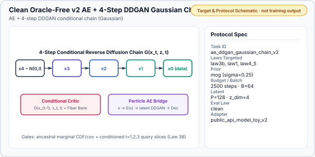

<!-- Generated Forge experiment page — do not edit manually; regenerate via `python -m experiments.forge.experiment_docs` -->

[← Leaderboard](../technique-inventory.md) · [Experiment Catalog](README.md) · [Explore by Laws](../LAWS_HUB.md) · [Research Portal](https://hypergan.github.io/ParticleGAN/)

# Clean Oracle-Free v2 AE + 4-Step DDGAN Gaussian Chain (`ae_ddgan_gaussian_chain_v2`)

| Field | Value |
| --- | --- |
| **Laws Tested** | [Law 3B](../LAWS_HUB.md#law3b) · [Law 1](../LAWS_HUB.md#law1) · [Law 4.5](../LAWS_HUB.md#law4_5) |
| **Edge Cases** | `conditional-chain` `latent-diffusion` `multi-objective-conflict` `oracle-free` |
| **Primary View (`discriminator_stability`)** | Not in `discriminator_stability` |
| **Four Laws Adherence Role** | — |
| **Fixed Full-Suite Denominator** | No (diagnostic / auxiliary cohort) |
| **Adapter / Domain** | `public_api_model_toy_v2` / `transfer_sustained` |
| **Prior** | `mog` (sigma=`0.25`, standardize=`False`) |
| **Update Budget** | `2500` steps |

## What This Experiment Tests

Clean oracle-free v2 AE-DDGAN Gaussian chain coupling a learned particle autoencoder with four public DDGAN reverse steps under terminal_observations=1 and zero host-owned whitening, target-mean cluster tethering, or div_loss.

> [!NOTE]
> **Protocol notes:** Four Laws Adherence v2 Law 3 anchor (2,500 updates, 600s timeout); preserves legacy model_ae_ddgan_gaussian_chain untouched.

## Laws & Edge Cases Targeted

- **[Law 3B: Conditional Fiber & Stratum Identifiability (Unifies with Provisional Law 5)](../LAWS_HUB.md#law3b)** ([Law 3B theory](../../../docs/four-laws.md#law-3--transport-identifiability)) — Does the learning system possess enough information to determine appropriate transport?
- **[Law 1: Representational Geometry](../LAWS_HUB.md#law1)** ([Law 1 theory](../../../docs/four-laws.md#law-1--representational-geometry)) — Can the system represent the required probability measure efficiently and faithfully?
- **[Law 4.5: Coupled Minimax Contraction](../LAWS_HUB.md#law4_5)** ([Law 4.5 theory](../../../docs/four-laws.md#law-4--functional-and-game-dynamics)) — Can the learning system realize useful functional changes and exhibit appropriate coupled learning dynamics?
- **Edge-case tags:** `conditional-chain`, `latent-diffusion`, `multi-objective-conflict`, `oracle-free`

## Common Failure Mode

Removing host-side cluster tethering exposes true AE-DDGAN coordinate drift: recipes must maintain faithful conditioned transition slices and ancestral distributions through the public API alone.

## Visual Schematic



*Target & Protocol Schematic · not training output — generated deterministically from the declared task contract.*

## Protocol & Architecture Diagram


## Task Contract & Numerical Gates

### Execution & Sampling Contract

| Contract Field | Declared Value |
| --- | --- |
| Initializer | `deterministic_orthogonal` |
| Prior | `mog` (sigma=`0.25`, standardize=`False`) |
| Update Budget | `2500` steps |
| Batch Size | `64` |
| Particles / Latent Dim | `P=128` / `z_dim=4` |
| Sampling Law | `task_model_kernel_and_posterior_without_serving_noise` |
| Evaluation Output Noise | `clean` |
| Scoring Weights | `live` |
| Integrity Guards | `finite_state`, `rng_isolation`, `optimizer_roles`, `exact_optimizer_updates`, `mechanism_exercised` |
| Assigned Views | `four-laws-adherence-v2` (T1 diagnostic) |

### Numerical Pass/Fail Thresholds

| Metric | Operator | Threshold |
| --- | :---: | ---: |
| `final_projection_cdf` | `<=` | `0.2` |
| `final_normalized_mean` | `<=` | `0.45` |
| `final_covariance_eigen_min` | `>=` | `0.65` |
| `final_covariance_eigen_max` | `<=` | `1.4` |
| `t1_q0_projection_cdf` | `<=` | `0.26` |
| `t1_q0_normalized_mean` | `<=` | `0.65` |
| `t1_q0_covariance_eigen_min` | `>=` | `0.4` |
| `t1_q0_covariance_eigen_max` | `<=` | `1.8` |
| `t1_q1_projection_cdf` | `<=` | `0.26` |
| `t1_q1_normalized_mean` | `<=` | `0.65` |
| `t1_q1_covariance_eigen_min` | `>=` | `0.4` |
| `t1_q1_covariance_eigen_max` | `<=` | `1.8` |
| `t2_q0_projection_cdf` | `<=` | `0.2` |
| `t2_q0_normalized_mean` | `<=` | `0.35` |
| `t2_q0_covariance_eigen_min` | `>=` | `0.6` |
| `t2_q0_covariance_eigen_max` | `<=` | `1.4` |
| `t2_q1_projection_cdf` | `<=` | `0.2` |
| `t2_q1_normalized_mean` | `<=` | `0.35` |
| `t2_q1_covariance_eigen_min` | `>=` | `0.6` |
| `t2_q1_covariance_eigen_max` | `<=` | `1.4` |
| `t3_q0_projection_cdf` | `<=` | `0.12` |
| `t3_q0_normalized_mean` | `<=` | `0.25` |
| `t3_q0_covariance_eigen_min` | `>=` | `0.65` |
| `t3_q0_covariance_eigen_max` | `<=` | `1.4` |
| `t3_q1_projection_cdf` | `<=` | `0.12` |
| `t3_q1_normalized_mean` | `<=` | `0.25` |
| `t3_q1_covariance_eigen_min` | `>=` | `0.65` |
| `t3_q1_covariance_eigen_max` | `<=` | `1.4` |
| `t4_q0_projection_cdf` | `<=` | `0.12` |
| `t4_q0_normalized_mean` | `<=` | `0.25` |
| `t4_q0_covariance_eigen_min` | `>=` | `0.65` |
| `t4_q0_covariance_eigen_max` | `<=` | `1.4` |
| `t4_q1_projection_cdf` | `<=` | `0.12` |
| `t4_q1_normalized_mean` | `<=` | `0.25` |
| `t4_q1_covariance_eigen_min` | `>=` | `0.65` |
| `t4_q1_covariance_eigen_max` | `<=` | `1.4` |
| `panel_count` | `==` | `8` |
| `samples_per_panel` | `>=` | `2048` |
| `paired_nmse` | `<=` | `0.1` |
| `paired_worst_axis_nrmse` | `<=` | `0.25` |
| `paired_shuffled_gain` | `>=` | `3.0` |
| `paired_reverse_steps` | `==` | `4` |

## Recorded Family Results

> [!IMPORTANT]
> Screening outcomes below come from recorded single-seed (`seed = 0`) Forge evidence. `NOT MEASURED`, `BLOCKED`, and `INCOMPATIBLE` are non-numerical states — not scientific failures — and confer no pass or qualification credit.

| Family | Selected Candidate | Outcome | Key Recorded Metrics | Family Report | Training Media |
| --- | --- | :---: | --- | --- | --- |
| **Atlas** | `atlas-particle-normal-v4` | `NOT MEASURED` | No recorded result for this selected configuration and source. | [Atlas](../families/atlas.md#cohort-cuda-daa283c8a640) | — |
| **Axiom** | `axiom-v4` | `NOT MEASURED` | No recorded result for this selected configuration and source. | [Axiom](../families/axiom.md#cohort-cuda-daa283c8a640) | [HF GIF](https://huggingface.co/datasets/HyperGAN/particlegan-forge-evidence/resolve/main/media/forge/leaderboard/axiom/axiom-v4/ae_ddgan_gaussian_chain_v2.gif) |
| **BCAP** | `recipe-prior-refactor-bcap-pure-v1` | `NOT MEASURED` | No recorded result for this selected configuration and source. | [BCAP](../families/bcap-pure.md#cohort-cuda-1bf9d7d34422) | [HF GIF](https://huggingface.co/datasets/HyperGAN/particlegan-forge-evidence/resolve/main/media/forge/leaderboard/bcap-pure/recipe-prior-refactor-bcap-pure-v1/ae_ddgan_gaussian_chain_v2.gif) |
| **BISPF** | `bispf-optimized-quintic-v1` | `NOT MEASURED` | No recorded result for this selected configuration and source. | [BISPF](../families/bispf.md#cohort-cuda-1bf9d7d34422) | [HF GIF](https://huggingface.co/datasets/HyperGAN/particlegan-forge-evidence/resolve/main/media/forge/leaderboard/bispf/bispf-optimized-quintic-v1/ae_ddgan_gaussian_chain_v2.gif) |
| **E22** | `e22` | `NOT MEASURED` | No recorded result for this selected configuration and source. | [E22](../families/e22.md#cohort-cuda-1bf9d7d34422) | — |
| **EMPF** | `empf-v8` | `NOT MEASURED` | No recorded result for this selected configuration and source. | [EMPF](../families/empf.md#cohort-cuda-23a94f16ca88) | [HF GIF](https://huggingface.co/datasets/HyperGAN/particlegan-forge-evidence/resolve/main/media/forge/leaderboard/empf/empf-v8/ae_ddgan_gaussian_chain_v2.gif) |
| **GAN v3 release 0.7** | `recipe-prior-refactor-release07-gan-v3-v1` | `NOT MEASURED` | No recorded result for this selected configuration and source. | [GAN v3 release 0.7](../families/release07-gan-v3.md#cohort-cuda-daa283c8a640) | [HF GIF](https://huggingface.co/datasets/HyperGAN/particlegan-forge-evidence/resolve/main/media/forge/leaderboard/release07-gan-v3/recipe-prior-refactor-release07-gan-v3-v1/ae_ddgan_gaussian_chain_v2.gif) |
| **K3P** | `recipe-prior-refactor-k3p-v1` | `NOT MEASURED` | No recorded result for this selected configuration and source. | [K3P](../families/k3p.md#cohort-cuda-daa283c8a640) | — |
| **KA2** | `recipe-prior-refactor-ka2-v1` | `NOT MEASURED` | No recorded result for this selected configuration and source. | [KA2](../families/ka2.md#cohort-cuda-daa283c8a640) | — |
| **R1/R2** | `recipe-prior-refactor-r1r2-v1` | `NOT MEASURED` | No recorded result for this selected configuration and source. | [R1/R2](../families/r1r2.md#cohort-cuda-daa283c8a640) | [HF GIF](https://huggingface.co/datasets/HyperGAN/particlegan-forge-evidence/resolve/main/media/forge/leaderboard/r1r2/recipe-prior-refactor-r1r2-v1/ae_ddgan_gaussian_chain_v2.gif) |
| **RHBI** | `rhbi-v12` | `NOT MEASURED` | No recorded result for this selected configuration and source. | [RHBI](../families/rhbi.md#cohort-cuda-23a94f16ca88) | [HF GIF](https://huggingface.co/datasets/HyperGAN/particlegan-forge-evidence/resolve/main/media/forge/leaderboard/rhbi/rhbi-v12/ae_ddgan_gaussian_chain_v2.gif) |
| **Unified** | `unified-v11` | `NOT MEASURED` | No recorded result for this selected configuration and source. | [Unified](../families/unified.md#cohort-cuda-42a130a78fc3) | [HF GIF](https://huggingface.co/datasets/HyperGAN/particlegan-forge-evidence/resolve/main/media/forge/leaderboard/unified/unified-v11/ae_ddgan_gaussian_chain_v2.gif) |

### Four Laws Adherence Diagnostic Receipts (Separate Cohort)

*Diagnostic readouts and Colab matched-GPU receipts for `four-laws-adherence-v1` (protocol seed `0`, unchanged recipes; research telemetry only — separate from ordinary selected-cohort qualification above and confers no qualification or default-adoption credit):*

| Candidate | Family | GPU | Outcome | `min_margin` | NVML Energy | Key Recorded Metrics | Receipt |
| --- | --- | --- | :---: | ---: | ---: | --- | --- |
| `unified-v11` | `unified` | NVIDIA L4 | **PASS** | — | 8.63 kJ (J-to-PASS) | final_covariance_eigen_max=0.9428, final_covariance_eigen_min=0.9265, final_normalized_mean=0.03915, final_projection_cdf=0.03377 | [42a1db892453480b9b8d2ef04b5bf574.json](../technique-receipts/42a1db892453480b9b8d2ef04b5bf574.json) |
| `unified-v15` | `unified` | NVIDIA L4 | **PASS** | — | 4.76 kJ (J-to-PASS) | final_covariance_eigen_max=0.9637, final_covariance_eigen_min=0.8821, final_normalized_mean=0.1277, final_projection_cdf=0.07552 | [fed6d5af4ec84942842840830ac0dcbe.json](../technique-receipts/fed6d5af4ec84942842840830ac0dcbe.json) |
| `axiom-v4` | `axiom` | NVIDIA L4 | **FAIL** | — | 7.54 kJ | final_covariance_eigen_max=0.9594, final_covariance_eigen_min=0.8659, final_normalized_mean=0.01502, final_projection_cdf=0.04216 | [f5e78f4d23834e75b3e9961aab87e101.json](../technique-receipts/f5e78f4d23834e75b3e9961aab87e101.json) |
| `axiom-v5` | `axiom` | NVIDIA L4 | **FAIL** | — | 7.56 kJ | final_covariance_eigen_max=0.9594, final_covariance_eigen_min=0.8659, final_normalized_mean=0.01502, final_projection_cdf=0.04216 | [28eefbb71e814737b532639c4ab0a194.json](../technique-receipts/28eefbb71e814737b532639c4ab0a194.json) |
| `bispf-optimized-quintic-v1` | `bispf` | NVIDIA L4 | **FAIL** | — | 4.46 kJ | final_covariance_eigen_max=0.9177, final_covariance_eigen_min=0.8697, final_normalized_mean=0.5547, final_projection_cdf=0.2151 | [8ab1d22063894748b0dfd39308a64bc7.json](../technique-receipts/8ab1d22063894748b0dfd39308a64bc7.json) |
| `empf-v8` | `empf` | NVIDIA L4 | **FAIL** | — | 4.06 kJ | final_covariance_eigen_max=0.9809, final_covariance_eigen_min=0.5678, final_normalized_mean=0.2326, final_projection_cdf=0.1583 | [49ede7701bce4303b21e09e1ea16498d.json](../technique-receipts/49ede7701bce4303b21e09e1ea16498d.json) |
| `recipe-prior-refactor-bcap-pure-v1` | `bcap-dualnorm` | NVIDIA L4 | **FAIL** | — | 3.27 kJ | final_covariance_eigen_max=1.324, final_covariance_eigen_min=0.6328, final_normalized_mean=0.6094, final_projection_cdf=0.2123 | [3d1dfef2c5df4807b5840ba35988cb64.json](../technique-receipts/3d1dfef2c5df4807b5840ba35988cb64.json) |
| `recipe-prior-refactor-r1r2-v1` | `r1r2` | NVIDIA L4 | **FAIL** | — | 2.25 kJ | final_covariance_eigen_max=1.072, final_covariance_eigen_min=0.7876, final_normalized_mean=0.524, final_projection_cdf=0.1962 | [f4d034c2258346cfa0ce2dbf7f790b66.json](../technique-receipts/f4d034c2258346cfa0ce2dbf7f790b66.json) |
| `recipe-prior-refactor-release07-gan-v3-v1` | `release07-gan-v3` | NVIDIA L4 | **FAIL** | — | 2.37 kJ | final_covariance_eigen_max=1.061, final_covariance_eigen_min=0.7316, final_normalized_mean=0.09696, final_projection_cdf=0.06021 | [d4a5c14e429f4e6a9cb10575cd652bdf.json](../technique-receipts/d4a5c14e429f4e6a9cb10575cd652bdf.json) |
| `rhbi-v12` | `rhbi` | NVIDIA L4 | **FAIL** | — | 5.04 kJ | final_covariance_eigen_max=0.8775, final_covariance_eigen_min=0.7038, final_normalized_mean=0.05992, final_projection_cdf=0.07545 | [67b2e0a196654240a71924220fb36258.json](../technique-receipts/67b2e0a196654240a71924220fb36258.json) |

## Reproduce This Experiment

```bash
# Validate this task declaration and inspect planned dependencies
python -m experiments.forge validate
python -m experiments.forge plan --view four-laws-adherence-v2 --candidate unified-v12 --tasks ae_ddgan_gaussian_chain_v2
```

**Declaration & Source Files:**

- Task contract: [configs/forge/tasks/ae_ddgan_gaussian_chain_v2.json](../../../configs/forge/tasks/ae_ddgan_gaussian_chain_v2.json)
- Source code: [benchmarks/toy_audit/api_model_ae_ddgan_v2.py](../../../benchmarks/toy_audit/api_model_ae_ddgan_v2.py)
- Source code: [benchmarks/toy_audit/api_contract.py](../../../benchmarks/toy_audit/api_contract.py)
- Source code: [benchmarks/toy_audit/api_model_ae_ddgan.py](../../../benchmarks/toy_audit/api_model_ae_ddgan.py)
- Source code: [benchmarks/toy_audit/api_model_ddgan.py](../../../benchmarks/toy_audit/api_model_ddgan.py)
- Source code: [benchmarks/toy_audit/api_model_ddgan_v2.py](../../../benchmarks/toy_audit/api_model_ddgan_v2.py)
- Source code: [benchmarks/toy_audit/api_run.py](../../../benchmarks/toy_audit/api_run.py)
- Source code: [benchmarks/toy_audit/reproducibility.py](../../../benchmarks/toy_audit/reproducibility.py)
- Source code: [experiments/forge/model_toy_v2_adapter.py](../../../experiments/forge/model_toy_v2_adapter.py)
- Source code: [particlegan/policy.py](../../../particlegan/policy.py)

## Annotation Provenance

This page was assembled read-only from the following versioned inputs without altering any task execution/evaluation fingerprint:

- **Task contract JSON:** [configs/forge/tasks/ae_ddgan_gaussian_chain_v2.json](../../../configs/forge/tasks/ae_ddgan_gaussian_chain_v2.json)
- **Editorial task documentation sidecar:** [configs/forge/task-documentation/ae_ddgan_gaussian_chain_v2.json](../../../configs/forge/task-documentation/ae_ddgan_gaussian_chain_v2.json)
- **Read-only Python AST source:** [benchmarks/toy_audit/api_model_ae_ddgan_v2.py](../../../benchmarks/toy_audit/api_model_ae_ddgan_v2.py) (AST symbols: `__doc__`)
- **Read-only Python AST source:** [benchmarks/toy_audit/api_contract.py](../../../benchmarks/toy_audit/api_contract.py) (AST symbols: `__doc__`)
- **Read-only Python AST source:** [benchmarks/toy_audit/api_model_ae_ddgan.py](../../../benchmarks/toy_audit/api_model_ae_ddgan.py) (AST symbols: `__doc__`)
- **Read-only Python AST source:** [benchmarks/toy_audit/api_model_ddgan.py](../../../benchmarks/toy_audit/api_model_ddgan.py) (AST symbols: `__doc__`)
- **Read-only Python AST source:** [benchmarks/toy_audit/api_model_ddgan_v2.py](../../../benchmarks/toy_audit/api_model_ddgan_v2.py) (AST symbols: `__doc__`)
- **Read-only Python AST source:** [benchmarks/toy_audit/api_run.py](../../../benchmarks/toy_audit/api_run.py) (AST symbols: `__doc__`)
- **Read-only Python AST source:** [benchmarks/toy_audit/reproducibility.py](../../../benchmarks/toy_audit/reproducibility.py) (AST symbols: `__doc__`)
- **Read-only Python AST source:** [experiments/forge/model_toy_v2_adapter.py](../../../experiments/forge/model_toy_v2_adapter.py) (AST symbols: `__doc__`)
- **Read-only Python AST source:** [particlegan/policy.py](../../../particlegan/policy.py) (AST symbols: `__doc__`)
