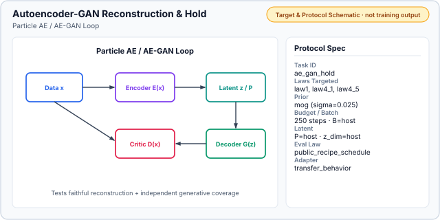
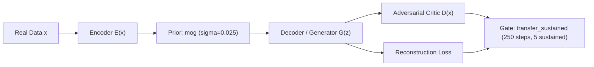

<!-- Generated Forge experiment page — do not edit manually; regenerate via `python -m experiments.forge.experiment_docs` -->

[← Leaderboard](../technique-inventory.md) · [Experiment Catalog](README.md) · [Explore by Laws](../LAWS_HUB.md) · [Research Portal](https://hypergan.github.io/ParticleGAN/)

# Autoencoder-GAN Reconstruction & Hold (`ae_gan_hold`)

| Field | Value |
| --- | --- |
| **Laws Tested** | [Law 1](../LAWS_HUB.md#law1) · [Law 4.1](../LAWS_HUB.md#law4_1) · [Law 4.5](../LAWS_HUB.md#law4_5) |
| **Edge Cases** | `multi-objective-conflict` `encoder-decoder-loop` `scheduled-output-noise` |
| **Primary View (`discriminator_stability`)** | Tier 1 (required) |
| **Four Laws Adherence Role** | — |
| **Fixed Full-Suite Denominator** | Yes (71-test fixed denominator) |
| **Adapter / Domain** | `transfer_behavior` / `transfer_sustained` |
| **Prior** | `mog` (sigma=`0.025`, standardize=`False`) |
| **Update Budget** | `250` steps |

## What This Experiment Tests

Jointly trains an encoder, learned particle prior, decoder/generator, and critic on a compact representation-holding task. It verifies that adversarial updates do not erode autoencoder reconstruction fidelity (recon_mse <= 0.05) or drift off the protected hold subspace (hold <= 0.35).

> [!NOTE]
> **Protocol notes:** Locked-shared 250-step behavioral host with public-recipe scheduled output noise; encoder receives only the original reconstruction objective.

## Laws & Edge Cases Targeted

- **[Law 1: Representational Geometry](../LAWS_HUB.md#law1)** ([Law 1 theory](../../../docs/four-laws.md#law-1--representational-geometry)) — Can the system represent the required probability measure efficiently and faithfully?
- **[Law 4.1: Functional Realization](../LAWS_HUB.md#law4_1)** ([Law 4.1 theory](../../../docs/four-laws.md#law-4--functional-and-game-dynamics)) — Can the learning system realize useful functional changes and exhibit appropriate coupled learning dynamics?
- **[Law 4.5: Coupled Minimax Contraction](../LAWS_HUB.md#law4_5)** ([Law 4.5 theory](../../../docs/four-laws.md#law-4--functional-and-game-dynamics)) — Can the learning system realize useful functional changes and exhibit appropriate coupled learning dynamics?
- **Edge-case tags:** `multi-objective-conflict`, `encoder-decoder-loop`, `scheduled-output-noise`

## Common Failure Mode

Naive adversarial gradients overwhelm the reconstruction objective, inflating recon_mse or causing the learned prior and decoder to drift away from the encoded data manifold.

## Visual Schematic



*Target & Protocol Schematic · not training output — generated deterministically from the declared task contract.*

## Protocol & Architecture Diagram



## Task Contract & Numerical Gates

### Execution & Sampling Contract

| Contract Field | Declared Value |
| --- | --- |
| Initializer | `deterministic_orthogonal` |
| Prior | `mog` (sigma=`0.025`, standardize=`False`) |
| Update Budget | `250` steps |
| Batch Size | `host-declared` |
| Particles / Latent Dim | `P=host` / `z_dim=host` |
| Sampling Law | `generated_and_reconstructed_prior_with_scheduled_output_noise` |
| Evaluation Output Noise | `public_recipe_schedule` |
| Scoring Weights | `live` |
| Integrity Guards | `finite_state`, `optimizer_roles`, `mechanism_exercised`, `rng_isolation` |
| Assigned Views | `adaptation` (T1 required), `bcap-projection-baseline-repair-diagnostic-v1` (T1 diagnostic), `clockfree_continuous` (T1 required), `discriminator_stability` (T1 required), `formulation_comparison` (T1 required), `host_profile_transfer` (T1 required), `lazy_cadence_coverage` (T1 diagnostic), `prior-ablation-full-suite-v1` (T1 diagnostic) (+3 more) |

### Numerical Pass/Fail Thresholds

| Metric | Operator | Threshold |
| --- | :---: | ---: |
| `recon_mse` | `<=` | `0.05` |
| `hold` | `<=` | `0.35` |

## Recorded Family Results

> [!IMPORTANT]
> Screening outcomes below come from recorded single-seed (`seed = 0`) Forge evidence. `NOT MEASURED`, `BLOCKED`, and `INCOMPATIBLE` are non-numerical states — not scientific failures — and confer no pass or qualification credit.

| Family | Selected Candidate | Outcome | Key Recorded Metrics | Family Report | Training Media |
| --- | --- | :---: | --- | --- | --- |
| **Atlas** | `atlas-particle-normal-v4` | **PASS** | recomputed complete live curve and terminal suffix | [Atlas](../families/atlas.md#cohort-cuda-bc3debd3fa5e) | — |
| **Axiom** | `axiom-v4` | **PASS** | recomputed complete live curve and terminal suffix | [Axiom](../families/axiom.md#cohort-cuda-daa283c8a640) | — |
| **BCAP** | `recipe-prior-refactor-bcap-pure-v1` | **PASS** | recomputed complete live curve and terminal suffix | [BCAP](../families/bcap-pure.md#cohort-cuda-1bf9d7d34422) | [HF GIF](https://huggingface.co/datasets/HyperGAN/particlegan-forge-evidence/resolve/main/media/forge/pure-bcap/media/5ea5bdbb2d71/ae_gan_hold.gif) |
| **BISPF** | `bispf-optimized-quintic-v1` | **PASS** | recomputed complete live curve and terminal suffix | [BISPF](../families/bispf.md#cohort-cuda-1bf9d7d34422) | — |
| **EMPF** | `empf-v8` | **PASS** | recomputed complete live curve and terminal suffix | [EMPF](../families/empf.md#cohort-cuda-23a94f16ca88) | — |
| **GAN v3 release 0.7** | `recipe-prior-refactor-release07-gan-v3-v1` | **PASS** | recomputed complete live curve and terminal suffix | [GAN v3 release 0.7](../families/release07-gan-v3.md#cohort-cuda-1bf9d7d34422) | [HF GIF](https://huggingface.co/datasets/HyperGAN/particlegan-forge-evidence/resolve/main/media/forge/tier1-completion/media/release07-gan-v3/13e60a31e9f24e429a72e95ee3bce070/ae_gan_hold.gif) |
| **K3P** | `recipe-prior-refactor-k3p-v1` | **PASS** | recomputed complete live curve and terminal suffix | [K3P](../families/k3p.md#cohort-cuda-1bf9d7d34422) | [HF GIF](https://huggingface.co/datasets/HyperGAN/particlegan-forge-evidence/resolve/main/media/forge/tier1-completion/media/k3p/b2e5ce07510342a3ae9b24f0e21449bb/ae_gan_hold.gif) |
| **KA2** | `recipe-prior-refactor-ka2-v1` | **PASS** | recomputed complete live curve and terminal suffix | [KA2](../families/ka2.md#cohort-cuda-1bf9d7d34422) | [HF GIF](https://huggingface.co/datasets/HyperGAN/particlegan-forge-evidence/resolve/main/media/forge/tier1-completion/media/ka2/bf6d669e859d4c00bda87284addca604/ae_gan_hold.gif) |
| **R1/R2** | `recipe-prior-refactor-r1r2-v1` | **PASS** | recomputed complete live curve and terminal suffix | [R1/R2](../families/r1r2.md#cohort-cuda-1bf9d7d34422) | [HF GIF](https://huggingface.co/datasets/HyperGAN/particlegan-forge-evidence/resolve/main/media/forge/tier1-completion/media/r1r2/d7e57ea425df4a55836a6994d83f686e/ae_gan_hold.gif) |
| **RHBI** | `rhbi-v12` | **PASS** | recomputed complete live curve and terminal suffix | [RHBI](../families/rhbi.md#cohort-cuda-23a94f16ca88) | — |
| **Unified** | `unified-v11` | **PASS** | recomputed complete live curve and terminal suffix | [Unified](../families/unified.md#cohort-cuda-42a130a78fc3) | — |
| **E22** | `e22` | `BLOCKED` | Skipped incompatible test: ae_gan_hold: public components has no declared policy-control e | [E22](../families/e22.md#cohort-cuda-1bf9d7d34422) | — |

## Reproduce This Experiment

```bash
# Validate this task declaration and inspect planned dependencies
python -m experiments.forge validate
python -m experiments.forge plan --view discriminator_stability --candidate unified-v12 --tasks ae_gan_hold
```

**Declaration & Source Files:**

- Task contract: [configs/forge/tasks/ae_gan_hold.json](../../../configs/forge/tasks/ae_gan_hold.json)
- Source code: [benchmarks/locked_shared/baseline.py](../../../benchmarks/locked_shared/baseline.py)
- Source code: [benchmarks/locked_shared/hosts/ae_gan_hold.py](../../../benchmarks/locked_shared/hosts/ae_gan_hold.py)
- Source code: [benchmarks/locked_shared/observation.py](../../../benchmarks/locked_shared/observation.py)
- Source code: [benchmarks/toy100/device.py](../../../benchmarks/toy100/device.py)
- Source code: [benchmarks/transfer_suite/protocol.py](../../../benchmarks/transfer_suite/protocol.py)
- Source code: [experiments/forge/behavior_adapters.py](../../../experiments/forge/behavior_adapters.py)
- Source code: [particlegan/conditional_transport.py](../../../particlegan/conditional_transport.py)
- Source code: [particlegan/kinetic_transport.py](../../../particlegan/kinetic_transport.py)

## Annotation Provenance

This page was assembled read-only from the following versioned inputs without altering any task execution/evaluation fingerprint:

- **Task contract JSON:** [configs/forge/tasks/ae_gan_hold.json](../../../configs/forge/tasks/ae_gan_hold.json)
- **Editorial task documentation sidecar:** [configs/forge/task-documentation/ae_gan_hold.json](../../../configs/forge/task-documentation/ae_gan_hold.json)
- **Read-only Python AST source:** [benchmarks/locked_shared/baseline.py](../../../benchmarks/locked_shared/baseline.py) (AST symbols: `__doc__`)
- **Read-only Python AST source:** [benchmarks/locked_shared/hosts/ae_gan_hold.py](../../../benchmarks/locked_shared/hosts/ae_gan_hold.py) (AST symbols: `__doc__`)
- **Read-only Python AST source:** [benchmarks/locked_shared/observation.py](../../../benchmarks/locked_shared/observation.py) (AST symbols: `__doc__`)
- **Read-only Python AST source:** [benchmarks/toy100/device.py](../../../benchmarks/toy100/device.py) (AST symbols: `__doc__`)
- **Read-only Python AST source:** [benchmarks/transfer_suite/protocol.py](../../../benchmarks/transfer_suite/protocol.py) (AST symbols: `__doc__`)
- **Read-only Python AST source:** [experiments/forge/behavior_adapters.py](../../../experiments/forge/behavior_adapters.py) (AST symbols: `__doc__`)
- **Read-only Python AST source:** [particlegan/conditional_transport.py](../../../particlegan/conditional_transport.py) (AST symbols: `__doc__`)
- **Read-only Python AST source:** [particlegan/kinetic_transport.py](../../../particlegan/kinetic_transport.py) (AST symbols: `__doc__`)
