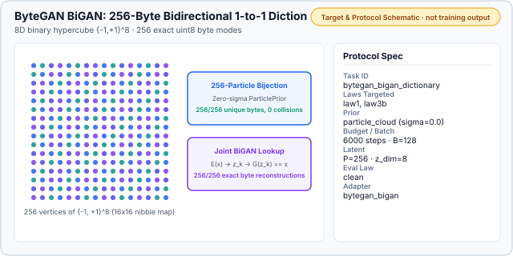
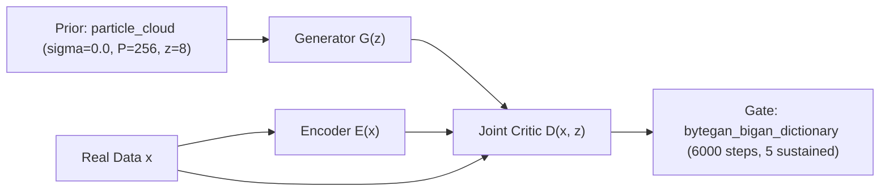

<!-- Generated Forge experiment page — do not edit manually; regenerate via `python -m experiments.forge.experiment_docs` -->

[← Leaderboard](../technique-inventory.md) · [Experiment Catalog](README.md) · [Explore by Laws](../LAWS_HUB.md) · [Research Portal](https://hypergan.github.io/ParticleGAN/)

# ByteGAN BiGAN: 256-Byte Bidirectional 1-to-1 Dictionary (`bytegan_bigan_dictionary`)

| Field | Value |
| --- | --- |
| **Laws Tested** | [Law 1](../LAWS_HUB.md#law1) · [Law 3B](../LAWS_HUB.md#law3b) |
| **Edge Cases** | `discrete-atomic` `8d-hypercube` `bidirectional-encoder` |
| **Primary View (`discriminator_stability`)** | Tier 4 (stretch) |
| **Four Laws Adherence Role** | law1 (anchor) |
| **Fixed Full-Suite Denominator** | Yes (71-test fixed denominator) |
| **Adapter / Domain** | `bytegan_bigan` / `bytegan_bigan_dictionary` |
| **Prior** | `particle_cloud` (sigma=`0.0`, standardize=`False`) |
| **Update Budget** | `6000` steps |

## What This Experiment Tests

Extends `bytegan_hypercube8` with a joint BiGAN encoder E(x) and joint critic D(x, z), requiring both 256/256 unique generated bytes AND 256/256 exact bidirectional dictionary reconstructions G(E(x)) == x.

> [!NOTE]
> **Protocol notes:** Tier-4 stretch task and Four Laws Adherence Law 1 anchor (6,000 updates).

## Laws & Edge Cases Targeted

- **[Law 1: Representational Geometry](../LAWS_HUB.md#law1)** ([Law 1 theory](../../../docs/four-laws.md#law-1--representational-geometry)) — Can the system represent the required probability measure efficiently and faithfully?
- **[Law 3B: Conditional Fiber & Stratum Identifiability](../LAWS_HUB.md#law3b)** ([Law 3B theory](../../../docs/four-laws.md#law-3--transport-identifiability)) — Does the learning system possess enough information to determine appropriate transport?
- **Edge-case tags:** `discrete-atomic`, `8d-hypercube`, `bidirectional-encoder`

## Common Failure Mode

Even partial generative coverage fails inverse lookup completely (0/256 exact reconstructions without joint atomic inverse codebook contraction).

**Historical audit diagnosis** (`reports/forge/problem-definitions.json`): Simultaneously satisfying exact 256-mode forward generation, exact identity-preserving byte reconstruction without permutation swaps, and 1-to-1 encoder-to-particle indexing (ruling out particle-cloud bypass) tests discrete joint BiGAN scalability 51x beyond `five_word_joint_smoke`. No ordinary selected-family full-budget CUDA measurement has been registered yet.

- *Recommended research focus:* Measure unchanged global family recipes on the `bytegan_stretch` diagnostic view under protocol seed 0 and separate forward codebook coverage failures from inverse reconstruction and encoder-particle alignment failures.

## Visual Schematic



*Target & Protocol Schematic · not training output — generated deterministically from the declared task contract.*

## Protocol & Architecture Diagram



## Task Contract & Numerical Gates

### Execution & Sampling Contract

| Contract Field | Declared Value |
| --- | --- |
| Initializer | `deterministic_orthogonal` |
| Prior | `particle_cloud` (sigma=`0.0`, standardize=`False`) |
| Update Budget | `6000` steps |
| Batch Size | `128` |
| Particles / Latent Dim | `P=256` / `z_dim=8` |
| Sampling Law | `generated_and_paired_reconstructed_prior_without_output_noise` |
| Evaluation Output Noise | `clean` |
| Scoring Weights | `live` |
| Architecture | `family=simple_mlp_bigan, hidden=128, layers=2, x_dim=8, z_dim=8, joint_in_dim=16, fourier=2` |
| Integrity Guards | `finite_state`, `optimizer_roles`, `exact_optimizer_updates`, `mechanism_exercised`, `rng_isolation` |
| Assigned Views | `bytegan_stretch` (T1 diagnostic), `discriminator_stability` (T4 stretch), `four-laws-adherence-v1` (T1 diagnostic) |

### Numerical Pass/Fail Thresholds

| Metric | Operator | Threshold |
| --- | :---: | ---: |
| `finite_fraction` | `==` | `1.0` |
| `valid_particle_fraction` | `==` | `1.0` |
| `valid_unique_bytes` | `==` | `256` |
| `rms_bit_error` | `<=` | `0.12` |
| `recon_valid_exact_bytes` | `==` | `256` |
| `recon_rms_bit_error` | `<=` | `0.12` |
| `encoder_particle_bijection_bytes` | `==` | `256` |

## Recorded Family Results

> [!IMPORTANT]
> Screening outcomes below come from recorded single-seed (`seed = 0`) Forge evidence. `NOT MEASURED`, `BLOCKED`, and `INCOMPATIBLE` are non-numerical states — not scientific failures — and confer no pass or qualification credit.

| Family | Selected Candidate | Outcome | Key Recorded Metrics | Family Report | Training Media |
| --- | --- | :---: | --- | --- | --- |
| **Atlas** | `atlas-particle-normal-v4` | `NOT MEASURED` | No recorded result for this selected configuration and source. | [Atlas](../families/atlas.md#cohort-cuda-bc3debd3fa5e) | — |
| **BCAP** | `recipe-prior-refactor-bcap-pure-v1` | `NOT MEASURED` | No recorded result for this selected configuration and source. | [BCAP](../families/bcap-pure.md#cohort-cuda-1bf9d7d34422) | — |
| **BISPF** | `bispf-optimized-quintic-v1` | `NOT MEASURED` | No recorded result for this selected configuration and source. | [BISPF](../families/bispf.md#cohort-cuda-1bf9d7d34422) | — |
| **E22** | `e22` | `NOT MEASURED` | No recorded result for this selected configuration and source. | [E22](../families/e22.md#cohort-cuda-1bf9d7d34422) | — |
| **EMPF** | `empf-v8` | `NOT MEASURED` | No recorded result for this selected configuration and source. | [EMPF](../families/empf.md#cohort-cuda-23a94f16ca88) | — |
| **GAN v3 release 0.7** | `recipe-prior-refactor-release07-gan-v3-v1` | `NOT MEASURED` | No recorded result for this selected configuration and source. | [GAN v3 release 0.7](../families/release07-gan-v3.md#cohort-cuda-1bf9d7d34422) | — |
| **K3P** | `recipe-prior-refactor-k3p-v1` | `NOT MEASURED` | No recorded result for this selected configuration and source. | [K3P](../families/k3p.md#cohort-cuda-1bf9d7d34422) | — |
| **KA2** | `recipe-prior-refactor-ka2-v1` | `NOT MEASURED` | No recorded result for this selected configuration and source. | [KA2](../families/ka2.md#cohort-cuda-1bf9d7d34422) | — |
| **R1/R2** | `recipe-prior-refactor-r1r2-v1` | `NOT MEASURED` | No recorded result for this selected configuration and source. | [R1/R2](../families/r1r2.md#cohort-cuda-1bf9d7d34422) | — |
| **RHBI** | `rhbi-v12` | `NOT MEASURED` | No recorded result for this selected configuration and source. | [RHBI](../families/rhbi.md#cohort-cuda-23a94f16ca88) | — |
| **Unified** | `unified-v11` | `NOT MEASURED` | No recorded result for this selected configuration and source. | [Unified](../families/unified.md#cohort-cuda-42a130a78fc3) | — |

## Reproduce This Experiment

```bash
# Validate this task declaration and inspect planned dependencies
python -m experiments.forge validate
python -m experiments.forge plan --view discriminator_stability --candidate unified-v12 --tasks bytegan_bigan_dictionary
```

**Declaration & Source Files:**

- Task contract: [configs/forge/tasks/bytegan_bigan_dictionary.json](../../../configs/forge/tasks/bytegan_bigan_dictionary.json)
- Source code: [benchmarks/toy_audit/api_bytegan.py](../../../benchmarks/toy_audit/api_bytegan.py)
- Source code: [experiments/forge/bytegan.py](../../../experiments/forge/bytegan.py)

## Annotation Provenance

This page was assembled read-only from the following versioned inputs without altering any task execution/evaluation fingerprint:

- **Task contract JSON:** [configs/forge/tasks/bytegan_bigan_dictionary.json](../../../configs/forge/tasks/bytegan_bigan_dictionary.json)
- **Editorial task documentation sidecar:** [configs/forge/task-documentation/bytegan_bigan_dictionary.json](../../../configs/forge/task-documentation/bytegan_bigan_dictionary.json)
- **Read-only Python AST source:** [benchmarks/toy_audit/api_bytegan.py](../../../benchmarks/toy_audit/api_bytegan.py) (AST symbols: `__doc__`, `THRESHOLDS`, `HOST_DEFINITIONS`)
- **Read-only Python AST source:** [experiments/forge/bytegan.py](../../../experiments/forge/bytegan.py) (AST symbols: `__doc__`)
