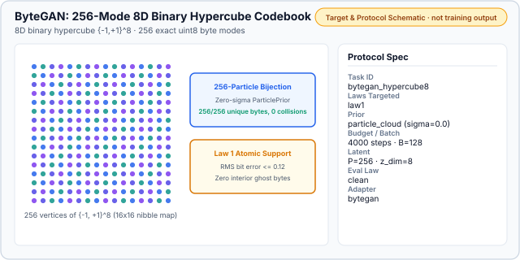
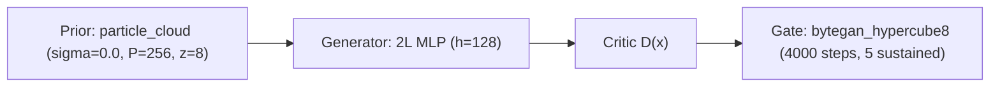

<!-- Generated Forge experiment page — do not edit manually; regenerate via `python -m experiments.forge.experiment_docs` -->

[← Leaderboard](../technique-inventory.md) · [Experiment Catalog](README.md) · [Explore by Laws](../LAWS_HUB.md) · [Research Portal](https://hypergan.github.io/ParticleGAN/)

# ByteGAN: 256-Mode 8D Binary Hypercube Codebook (`bytegan_hypercube8`)

| Field | Value |
| --- | --- |
| **Laws Tested** | [Law 1](../LAWS_HUB.md#law1) |
| **Edge Cases** | `discrete-atomic` `8d-hypercube` `exact-capacity-prior` |
| **Primary View (`discriminator_stability`)** | Tier 2 (stretch) |
| **Four Laws Adherence Role** | law1 (anchor) |
| **Fixed Full-Suite Denominator** | Yes (71-test fixed denominator) |
| **Adapter / Domain** | `bytegan` / `bytegan_hypercube8` |
| **Prior** | `particle_cloud` (sigma=`0.0`, standardize=`False`) |
| **Update Budget** | `4000` steps |

## What This Experiment Tests

Tests exact discrete atomic bijection on all 256 uniform uint8 bytes encoded at the corners of {-1, +1}^8 using an exact-capacity 256-particle zero-sigma prior: requires 256/256 unique valid bytes, zero collisions, and rms_bit_error <= 0.12.

> [!NOTE]
> **Protocol notes:** Tier-2 stretch task and Four Laws Adherence Law 1 anchor (4,000 updates, zero-sigma 256-particle prior).

## Laws & Edge Cases Targeted

- **[Law 1: Representational Geometry](../LAWS_HUB.md#law1)** ([Law 1 theory](../../../docs/four-laws.md#law-1--representational-geometry)) — Can the system represent the required probability measure efficiently and faithfully?
- **Edge-case tags:** `discrete-atomic`, `8d-hypercube`, `exact-capacity-prior`

## Common Failure Mode

Without atomic bijection support, streaming prototype priors suffer collisions and collapse to ~139/256 unique bytes (as historically observed on `unified-v12` before opt-in `feydy_atomic`).

**Historical audit diagnosis** (`reports/forge/problem-definitions.json`): Exact-capacity discrete codebook learning (256 particles for 256 equiprobable corners of an 8-dimensional hypercube) has zero slack for collisions, orphan corners, faint-sign barycentric ghosts, or amplitude blowup. No ordinary selected-family full-budget CUDA measurement has been registered yet.

- *Recommended research focus:* Measure unchanged global family recipes on the `bytegan_stretch` diagnostic view under protocol seed 0 and diagnose whether failures stem from particle collisions, orphan modes, or bit-amplitude drift.

## Visual Schematic



*Target & Protocol Schematic · not training output — generated deterministically from the declared task contract.*

## Protocol & Architecture Diagram



## Task Contract & Numerical Gates

### Execution & Sampling Contract

| Contract Field | Declared Value |
| --- | --- |
| Initializer | `deterministic_orthogonal` |
| Prior | `particle_cloud` (sigma=`0.0`, standardize=`False`) |
| Update Budget | `4000` steps |
| Batch Size | `128` |
| Particles / Latent Dim | `P=256` / `z_dim=8` |
| Sampling Law | `enumerated_prior_without_output_noise` |
| Evaluation Output Noise | `clean` |
| Scoring Weights | `live` |
| Architecture | `family=simple_mlp, hidden=128, layers=2, out_dim=8, fourier=2` |
| Integrity Guards | `finite_state`, `optimizer_roles`, `exact_optimizer_updates`, `mechanism_exercised`, `rng_isolation` |
| Assigned Views | `bytegan_stretch` (T1 diagnostic), `discriminator_stability` (T2 stretch), `four-laws-adherence-v1` (T1 diagnostic) |

### Numerical Pass/Fail Thresholds

| Metric | Operator | Threshold |
| --- | :---: | ---: |
| `finite_fraction` | `==` | `1.0` |
| `valid_particle_fraction` | `==` | `1.0` |
| `valid_unique_bytes` | `==` | `256` |
| `rms_bit_error` | `<=` | `0.12` |

## Recorded Family Results

> [!IMPORTANT]
> Screening outcomes below come from recorded single-seed (`seed = 0`) Forge evidence. `NOT MEASURED`, `BLOCKED`, and `INCOMPATIBLE` are non-numerical states — not scientific failures — and confer no pass or qualification credit.

| Family | Selected Candidate | Outcome | Key Recorded Metrics | Family Report | Training Media |
| --- | --- | :---: | --- | --- | --- |
| **Atlas** | `atlas-particle-normal-v4` | `NOT MEASURED` | No recorded result for this selected configuration and source. | [Atlas](../families/atlas.md#cohort-cuda-bc3debd3fa5e) | — |
| **BCAP** | `recipe-prior-refactor-bcap-pure-v1` | `NOT MEASURED` | No recorded result for this selected configuration and source. | [BCAP](../families/bcap-pure.md#cohort-cuda-1bf9d7d34422) | — |
| **BISPF** | `bispf-optimized-quintic-v1` | `NOT MEASURED` | No recorded result for this selected configuration and source. | [BISPF](../families/bispf.md#cohort-cuda-1bf9d7d34422) | — |
| **E22** | `e22` | `NOT MEASURED` | No recorded result for this selected configuration and source. | [E22](../families/e22.md#cohort-cuda-1bf9d7d34422) | — |
| **EMPF** | `empf-v8` | `NOT MEASURED` | No recorded result for this selected configuration and source. | [EMPF](../families/empf.md#cohort-cuda-23a94f16ca88) | — |
| **GAN v3 release 0.7** | `recipe-prior-refactor-release07-gan-v3-v1` | `NOT MEASURED` | No recorded result for this selected configuration and source. | [GAN v3 release 0.7](../families/release07-gan-v3.md#cohort-cuda-1bf9d7d34422) | — |
| **K3P** | `recipe-prior-refactor-k3p-v1` | `NOT MEASURED` | No recorded result for this selected configuration and source. | [K3P](../families/k3p.md#cohort-cuda-1bf9d7d34422) | — |
| **KA2** | `recipe-prior-refactor-ka2-v1` | `NOT MEASURED` | No recorded result for this selected configuration and source. | [KA2](../families/ka2.md#cohort-cuda-1bf9d7d34422) | — |
| **R1/R2** | `recipe-prior-refactor-r1r2-v1` | `NOT MEASURED` | No recorded result for this selected configuration and source. | [R1/R2](../families/r1r2.md#cohort-cuda-1bf9d7d34422) | — |
| **RHBI** | `rhbi-v12` | `NOT MEASURED` | No recorded result for this selected configuration and source. | [RHBI](../families/rhbi.md#cohort-cuda-23a94f16ca88) | — |
| **Unified** | `unified-v11` | `NOT MEASURED` | No recorded result for this selected configuration and source. | [Unified](../families/unified.md#cohort-cuda-42a130a78fc3) | — |

### Four Laws Adherence Diagnostic Receipts (Separate Cohort)

*Diagnostic readouts and Colab matched-GPU receipts for `four-laws-adherence-v1` (protocol seed `0`, unchanged recipes; research telemetry only — separate from ordinary selected-cohort qualification above and confers no qualification or default-adoption credit):*

| Candidate | Family | GPU | Outcome | `min_margin` | NVML Energy | Key Recorded Metrics | Receipt |
| --- | --- | --- | :---: | ---: | ---: | --- | --- |
| `unified-v13` | `unified` | NVIDIA L4 | **PASS** | — | 5.33 kJ (J-to-PASS) | collision_count=0, finite_fraction=1, latent_nn_hamming_mean=1.059, mass_tv=0 | [80dc3923025f41cab0e45b7caedc9f52.json](../technique-receipts/80dc3923025f41cab0e45b7caedc9f52.json) |
| `atlas-particle-normal-v4` | `atlas` | NVIDIA L4 | **FAIL** | — | 4.85 kJ | collision_count=251, finite_fraction=1, latent_nn_hamming_mean=0.02734, mass_tv=0.9512 | [29c63454d5264f249a9b3cdb9c3d3105.json](../technique-receipts/29c63454d5264f249a9b3cdb9c3d3105.json) |
| `bispf-optimized-quintic-v1` | `bispf` | NVIDIA L4 | **FAIL** | — | 6.30 kJ | collision_count=202, finite_fraction=1, latent_nn_hamming_mean=0.9844, mass_tv=0.7734 | [01d79df6167b485987a8b8c7b1c7ae11.json](../technique-receipts/01d79df6167b485987a8b8c7b1c7ae11.json) |
| `empf-v8` | `empf` | NVIDIA L4 | **FAIL** | — | 5.44 kJ | collision_count=220, finite_fraction=1, latent_nn_hamming_mean=0.07422, mass_tv=0.8555 | [2bd9f00c704e4427af5d39533bb5bb0d.json](../technique-receipts/2bd9f00c704e4427af5d39533bb5bb0d.json) |
| `minimal-v2` | `minimal` | NVIDIA L4 | **FAIL** | — | 7.91 kJ | collision_count=68, finite_fraction=1, latent_nn_hamming_mean=0.6641, mass_tv=0.3184 | [1e3d404cf45d4447976d18dafc3329d0.json](../technique-receipts/1e3d404cf45d4447976d18dafc3329d0.json) |
| `recipe-prior-refactor-bcap-pure-v1` | `bcap-dualnorm` | NVIDIA L4 | **FAIL** | — | 4.84 kJ | collision_count=172, finite_fraction=1, latent_nn_hamming_mean=0.2031, mass_tv=0.6777 | [9f51b50fba5547ff8047c402d6995ef5.json](../technique-receipts/9f51b50fba5547ff8047c402d6995ef5.json) |
| `recipe-prior-refactor-k3p-v1` | `k3p` | NVIDIA L4 | **FAIL** | — | 2.70 kJ | collision_count=180, finite_fraction=1, latent_nn_hamming_mean=0.2812, mass_tv=0.7031 | [d70e447e7f29442b9a1c089171293e50.json](../technique-receipts/d70e447e7f29442b9a1c089171293e50.json) |
| `recipe-prior-refactor-ka2-v1` | `ka2` | NVIDIA L4 | **FAIL** | — | 2.98 kJ | collision_count=182, finite_fraction=1, latent_nn_hamming_mean=0.3047, mass_tv=0.7168 | [eba0337fea974ce79b6014be5984db0b.json](../technique-receipts/eba0337fea974ce79b6014be5984db0b.json) |
| `recipe-prior-refactor-r1r2-v1` | `r1r2` | NVIDIA L4 | **FAIL** | — | 2.06 kJ | collision_count=203, finite_fraction=1, latent_nn_hamming_mean=0.1523, mass_tv=0.7773 | [603658014ba445d2936e6291ff5722f3.json](../technique-receipts/603658014ba445d2936e6291ff5722f3.json) |
| `recipe-prior-refactor-release07-gan-v3-v1` | `release07-gan-v3` | NVIDIA L4 | **FAIL** | — | 2.07 kJ | collision_count=202, finite_fraction=1, latent_nn_hamming_mean=0.2148, mass_tv=0.7031 | [db45cd86fb354b76899614af93ef1d83.json](../technique-receipts/db45cd86fb354b76899614af93ef1d83.json) |
| `rhbi-v12` | `rhbi` | NVIDIA L4 | **FAIL** | — | 15.10 kJ | collision_count=131, finite_fraction=1, latent_nn_hamming_mean=0.3398, mass_tv=0.4902 | [223f1f23f6c645638571613e8602c673.json](../technique-receipts/223f1f23f6c645638571613e8602c673.json) |
| `unified-v11` | `unified` | NVIDIA L4 | **FAIL** | — | 19.11 kJ | collision_count=111, finite_fraction=1, latent_nn_hamming_mean=0.2891, mass_tv=0.418 | [a6b4d33aba6943eda1e376b0bf5b844f.json](../technique-receipts/a6b4d33aba6943eda1e376b0bf5b844f.json) |
| `unified-v12` | `unified` | NVIDIA L4 | **FAIL** | — | 17.48 kJ | collision_count=101, finite_fraction=1, latent_nn_hamming_mean=0.3828, mass_tv=0.373 | [4cbcb43f206c4c668c381b268d433d50.json](../technique-receipts/4cbcb43f206c4c668c381b268d433d50.json) |

## Reproduce This Experiment

```bash
# Validate this task declaration and inspect planned dependencies
python -m experiments.forge validate
python -m experiments.forge plan --view discriminator_stability --candidate unified-v12 --tasks bytegan_hypercube8
```

**Declaration & Source Files:**

- Task contract: [configs/forge/tasks/bytegan_hypercube8.json](../../../configs/forge/tasks/bytegan_hypercube8.json)
- Source code: [benchmarks/toy_audit/api_bytegan.py](../../../benchmarks/toy_audit/api_bytegan.py)
- Source code: [experiments/forge/bytegan.py](../../../experiments/forge/bytegan.py)

## Annotation Provenance

This page was assembled read-only from the following versioned inputs without altering any task execution/evaluation fingerprint:

- **Task contract JSON:** [configs/forge/tasks/bytegan_hypercube8.json](../../../configs/forge/tasks/bytegan_hypercube8.json)
- **Editorial task documentation sidecar:** [configs/forge/task-documentation/bytegan_hypercube8.json](../../../configs/forge/task-documentation/bytegan_hypercube8.json)
- **Read-only Python AST source:** [benchmarks/toy_audit/api_bytegan.py](../../../benchmarks/toy_audit/api_bytegan.py) (AST symbols: `__doc__`, `THRESHOLDS`, `HOST_DEFINITIONS`)
- **Read-only Python AST source:** [experiments/forge/bytegan.py](../../../experiments/forge/bytegan.py) (AST symbols: `__doc__`)
