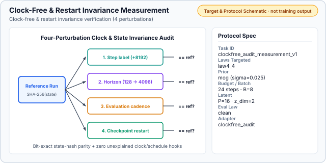
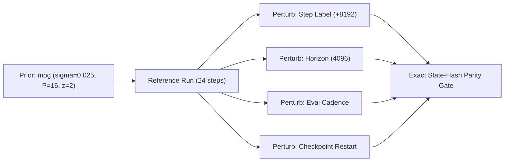

<!-- Generated Forge experiment page — do not edit manually; regenerate via `python -m experiments.forge.experiment_docs` -->

[← Leaderboard](../technique-inventory.md) · [Experiment Catalog](README.md) · [Explore by Laws](../LAWS_HUB.md) · [Research Portal](https://hypergan.github.io/ParticleGAN/)

# Clock-Free & Restart Invariance Measurement (`clockfree_audit_measurement_v1`)

| Field | Value |
| --- | --- |
| **Laws Tested** | [Law 4.4](../LAWS_HUB.md#law4_4) |
| **Edge Cases** | `clock-invariance` `restart-parity` `state-hygiene` |
| **Primary View (`discriminator_stability`)** | Tier 1 (diagnostic) |
| **Four Laws Adherence Role** | law4 (anchor) |
| **Fixed Full-Suite Denominator** | Yes (71-test fixed denominator) |
| **Adapter / Domain** | `clockfree_audit` / `clockfree_parity` |
| **Prior** | `mog` (sigma=`0.025`, standardize=`False`) |
| **Update Budget** | `24` steps |

## What This Experiment Tests

Diagnostic measurement version of `clockfree_audit` that executes all four clock/restart parity perturbations even on explicitly scheduled recipes so hidden clock dependencies are transparently measured rather than refused.

> [!NOTE]
> **Protocol notes:** Tier-1 diagnostic and Four Laws Adherence Law 4 anchor; pins `clockfree_audit.json` verbatim.

## Laws & Edge Cases Targeted

- **[Law 4.4: Trajectory Scale vs. Settling](../LAWS_HUB.md#law4_4)** ([Law 4.4 theory](../../../docs/four-laws.md#law-4--functional-and-game-dynamics)) — Can the learning system realize useful functional changes and exhibit appropriate coupled learning dynamics?
- **Edge-case tags:** `clock-invariance`, `restart-parity`, `state-hygiene`

## Common Failure Mode

Scheduled baselines (e.g., cosine decay or lazy penalty intervals) diverge across horizon and step-label perturbations, exposing non-stationary clock dependence.

**Historical audit diagnosis** (`reports/forge/problem-definitions.json`): The recorded scheduled K3P, KA2, R1/R2 and GAN v3 recipes depend on step or horizon through annealing. Good numerical fits do not satisfy this separate invariance requirement.

- *Recommended research focus:* Use saved internal state rather than external labels for adaptation, or explicitly version the desired policy. Do not silently treat an annealed recipe as clock-free.

## Visual Schematic



*Target & Protocol Schematic · not training output — generated deterministically from the declared task contract.*

## Protocol & Architecture Diagram



## Task Contract & Numerical Gates

### Execution & Sampling Contract

| Contract Field | Declared Value |
| --- | --- |
| Initializer | `deterministic_orthogonal` |
| Prior | `mog` (sigma=`0.025`, standardize=`False`) |
| Update Budget | `24` steps |
| Batch Size | `8` |
| Particles / Latent Dim | `P=16` / `z_dim=2` |
| Sampling Law | `public_prior_without_output_noise` |
| Evaluation Output Noise | `clean` |
| Scoring Weights | `live` |
| Architecture | `fourier=2, hidden=16, layers=2` |
| Assigned Views | `clockfree_continuous` (T1 required), `discriminator_stability` (T1 diagnostic), `four-laws-adherence-v1` (T1 diagnostic), `lazy_cadence_coverage` (T1 diagnostic), `prior-ablation-full-suite-v1` (T1 diagnostic), `t4-strange-architectures-v1` (T1 diagnostic) |

### Numerical Pass/Fail Thresholds

| Metric | Operator | Threshold |
| --- | :---: | ---: |
| `parity.step_label` | `==` | `exact state hash` |
| `parity.horizon` | `==` | `exact state hash` |
| `parity.evaluation_cadence` | `==` | `exact state hash` |
| `parity.restart` | `==` | `exact state hash` |

## Recorded Family Results

> [!IMPORTANT]
> Screening outcomes below come from recorded single-seed (`seed = 0`) Forge evidence. `NOT MEASURED`, `BLOCKED`, and `INCOMPATIBLE` are non-numerical states — not scientific failures — and confer no pass or qualification credit.

| Family | Selected Candidate | Outcome | Key Recorded Metrics | Family Report | Training Media |
| --- | --- | :---: | --- | --- | --- |
| **Atlas** | `atlas-particle-normal-v4` | **PASS** | declared state/horizon/cadence/restart comparisons agree; source audit bound | [Atlas](../families/atlas.md#cohort-cuda-bc3debd3fa5e) | — |
| **BCAP** | `recipe-prior-refactor-bcap-pure-v1` | **PASS** | declared state/horizon/cadence/restart comparisons agree; source audit bound | [BCAP](../families/bcap-pure.md#cohort-cuda-1bf9d7d34422) | [HF GIF](https://huggingface.co/datasets/HyperGAN/particlegan-forge-evidence/resolve/main/media/forge/pure-bcap/media/5ea5bdbb2d71/clockfree_audit_measurement_v1.gif) |
| **BISPF** | `bispf-optimized-quintic-v1` | **PASS** | declared state/horizon/cadence/restart comparisons agree; source audit bound | [BISPF](../families/bispf.md#cohort-cuda-1bf9d7d34422) | — |
| **EMPF** | `empf-v8` | **PASS** | declared state/horizon/cadence/restart comparisons agree; source audit bound | [EMPF](../families/empf.md#cohort-cuda-23a94f16ca88) | — |
| **RHBI** | `rhbi-v12` | **PASS** | declared state/horizon/cadence/restart comparisons agree; source audit bound | [RHBI](../families/rhbi.md#cohort-cuda-23a94f16ca88) | — |
| **Unified** | `unified-v11` | **PASS** | declared state/horizon/cadence/restart comparisons agree; source audit bound | [Unified](../families/unified.md#cohort-cuda-42a130a78fc3) | — |
| **E22** | `e22` | `BLOCKED` | Skipped incompatible test: clockfree_audit_measurement_v1: clean/live scoring has no decla | [E22](../families/e22.md#cohort-cuda-1bf9d7d34422) | — |
| **GAN v3 release 0.7** | `recipe-prior-refactor-release07-gan-v3-v1` | **FAIL** | step_label changed the update or common-prefix state | [GAN v3 release 0.7](../families/release07-gan-v3.md#cohort-cuda-1bf9d7d34422) | [HF GIF](https://huggingface.co/datasets/HyperGAN/particlegan-forge-evidence/resolve/main/media/forge/tier1-completion/media/release07-gan-v3/10087734b6b3445ea5db443693bf02a0/clockfree_audit_measurement_v1.gif) |
| **K3P** | `recipe-prior-refactor-k3p-v1` | **FAIL** | step_label changed the update or common-prefix state | [K3P](../families/k3p.md#cohort-cuda-1bf9d7d34422) | [HF GIF](https://huggingface.co/datasets/HyperGAN/particlegan-forge-evidence/resolve/main/media/forge/tier1-completion/media/k3p/eb7b95dbf5b34f69a0c41e97626df6cb/clockfree_audit_measurement_v1.gif) |
| **KA2** | `recipe-prior-refactor-ka2-v1` | **FAIL** | step_label changed the update or common-prefix state | [KA2](../families/ka2.md#cohort-cuda-1bf9d7d34422) | [HF GIF](https://huggingface.co/datasets/HyperGAN/particlegan-forge-evidence/resolve/main/media/forge/tier1-completion/media/ka2/ce6eec65990e41269dd54b438e68625c/clockfree_audit_measurement_v1.gif) |
| **R1/R2** | `recipe-prior-refactor-r1r2-v1` | **FAIL** | step_label changed the update or common-prefix state | [R1/R2](../families/r1r2.md#cohort-cuda-1bf9d7d34422) | [HF GIF](https://huggingface.co/datasets/HyperGAN/particlegan-forge-evidence/resolve/main/media/forge/tier1-completion/media/r1r2/5b7aef86733c4079a953578e2c00a67b/clockfree_audit_measurement_v1.gif) |

## Reproduce This Experiment

```bash
# Validate this task declaration and inspect planned dependencies
python -m experiments.forge validate
python -m experiments.forge plan --view discriminator_stability --candidate unified-v12 --tasks clockfree_audit_measurement_v1
```

**Declaration & Source Files:**

- Task contract: [configs/forge/tasks/clockfree_audit_measurement_v1.json](../../../configs/forge/tasks/clockfree_audit_measurement_v1.json)

## Annotation Provenance

This page was assembled read-only from the following versioned inputs without altering any task execution/evaluation fingerprint:

- **Task contract JSON:** [configs/forge/tasks/clockfree_audit_measurement_v1.json](../../../configs/forge/tasks/clockfree_audit_measurement_v1.json)
- **Editorial task documentation sidecar:** [configs/forge/task-documentation/clockfree_audit_measurement_v1.json](../../../configs/forge/task-documentation/clockfree_audit_measurement_v1.json)
