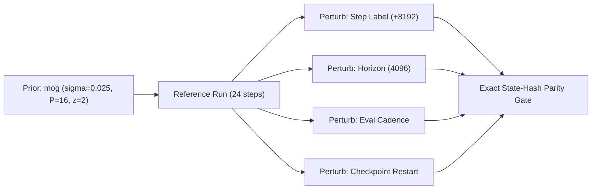

<!-- Generated Forge experiment page — do not edit manually; regenerate via `python -m experiments.forge.experiment_docs` -->

[← Leaderboard](../technique-inventory.md) · [Experiment Catalog](README.md) · [Explore by Laws](../LAWS_HUB.md) · [Research Portal](https://hypergan.github.io/ParticleGAN/)

# Clock-Free & Restart Invariance Measurement (`clockfree_audit_measurement_v1`)

| Field | Value |
| --- | --- |
| **Laws Tested** | [Law 4.4](../LAWS_HUB.md#law4_4) |
| **Edge Cases** | `clock-invariance` `restart-parity` `state-hygiene` |
| **Primary View (`discriminator_stability`)** | Tier 1 (diagnostic) |
| **Four Laws Adherence Role** | law4 (anchor) |
| **Fixed Full-Suite Denominator** | Yes (59-test active runnable denominator) |
| **Adapter / Domain** | `clockfree_audit` / `clockfree_parity` |
| **Prior** | `mog` (sigma=`0.025`, standardize=`False`) |
| **Update Budget** | `24` steps |

## What This Experiment Tests

Diagnostic measurement version of `clockfree_audit` that executes all four clock/restart parity perturbations even on explicitly scheduled recipes so hidden clock dependencies are transparently measured rather than refused.

> [!NOTE]
> **Protocol notes:** Tier-1 diagnostic and Four Laws Adherence Law 4 anchor; pins `clockfree_audit.json` verbatim.

## Laws & Edge Cases Targeted

- **[Law 4.4: Trajectory Scale vs. Settling](../LAWS_HUB.md#law4_4)** ([Law 4.4 theory](../../../docs/four-laws.md#law-4--functional-and-game-dynamics)) — Can the learning system realize useful functional changes and exhibit appropriate coupled learning dynamics?
- **Edge-case tags:** `clock-invariance`, `restart-parity`, `state-hygiene`

## Common Failure Mode

Scheduled baselines (e.g., cosine decay or lazy penalty intervals) diverge across horizon and step-label perturbations, exposing non-stationary clock dependence.

**Historical audit diagnosis** (`reports/forge/problem-definitions.json`): The recorded scheduled K3P, KA2, R1/R2 and GAN v3 recipes depend on step or horizon through annealing. Good numerical fits do not satisfy this separate invariance requirement.

- *Recommended research focus:* Use saved internal state rather than external labels for adaptation, or explicitly version the desired policy. Do not silently treat an annealed recipe as clock-free.

## Visual Schematic


*Target & Protocol Schematic · not training output — generated deterministically from the declared task contract.*

## Protocol & Architecture Diagram



## Task Contract & Numerical Gates

### Execution & Sampling Contract

| Contract Field | Declared Value |
| --- | --- |
| Initializer | `deterministic_orthogonal` |
| Prior | `mog` (sigma=`0.025`, standardize=`False`) |
| Update Budget | `24` steps |
| Batch Size | `8` |
| Particles / Latent Dim | `P=16` / `z_dim=2` |
| Sampling Law | `public_prior_without_output_noise` |
| Evaluation Output Noise | `clean` |
| Scoring Weights | `live` |
| Architecture | `fourier=2, hidden=16, layers=2` |
| Assigned Views | `clockfree_continuous` (T1 required), `discriminator_stability` (T1 diagnostic), `four-laws-adherence-v1` (T1 diagnostic), `four-laws-adherence-v2` (T1 diagnostic), `lazy_cadence_coverage` (T1 diagnostic), `prior-ablation-full-suite-v1` (T1 diagnostic), `t4-strange-architectures-v1` (T1 diagnostic) |

### Numerical Pass/Fail Thresholds

| Metric | Operator | Threshold |
| --- | :---: | ---: |
| `parity.step_label` | `==` | `exact state hash` |
| `parity.horizon` | `==` | `exact state hash` |
| `parity.evaluation_cadence` | `==` | `exact state hash` |
| `parity.restart` | `==` | `exact state hash` |

## Recorded Family Results

> [!IMPORTANT]
> Screening outcomes below come from recorded single-seed (`seed = 0`) Forge evidence. `NOT MEASURED`, `BLOCKED`, and `INCOMPATIBLE` are non-numerical states — not scientific failures — and confer no pass or qualification credit.

| Family | Selected Candidate | Outcome | Key Recorded Metrics | Family Report | Training Media |
| --- | --- | :---: | --- | --- | --- |
| **Atlas** | `atlas-particle-normal-v4` | **PASS** | declared state/horizon/cadence/restart comparisons agree; source audit bound | [Atlas](../families/atlas.md#cohort-cuda-daa283c8a640) | [HF GIF](https://huggingface.co/datasets/HyperGAN/particlegan-forge-evidence/resolve/main/media/forge/leaderboard/atlas/atlas-particle-normal-v4/clockfree_audit_measurement_v1.gif) |
| **Axiom** | `axiom-v5` | **PASS** | declared state/horizon/cadence/restart comparisons agree; source audit bound | [Axiom](../families/axiom.md#cohort-cuda-42a130a78fc3) | [HF GIF](https://huggingface.co/datasets/HyperGAN/particlegan-forge-evidence/resolve/main/media/forge/leaderboard/axiom/axiom-v4/clockfree_audit_measurement_v1.gif) |
| **BCAP** | `recipe-prior-refactor-bcap-pure-v1` | **PASS** | declared state/horizon/cadence/restart comparisons agree; source audit bound | [BCAP](../families/bcap-pure.md#cohort-cuda-1bf9d7d34422) | [HF GIF](https://huggingface.co/datasets/HyperGAN/particlegan-forge-evidence/resolve/main/media/forge/pure-bcap/media/023915c9fd7c/clockfree_audit_measurement_v1.gif) |
| **BISPF** | `bispf-optimized-quintic-v1` | **PASS** | declared state/horizon/cadence/restart comparisons agree; source audit bound | [BISPF](../families/bispf.md#cohort-cuda-1bf9d7d34422) | [HF GIF](https://huggingface.co/datasets/HyperGAN/particlegan-forge-evidence/resolve/main/media/forge/bispf-optimized/quality-media/clockfree_audit_measurement_v1.gif) |
| **EMPF** | `empf-v8` | **PASS** | declared state/horizon/cadence/restart comparisons agree; source audit bound | [EMPF](../families/empf.md#cohort-cuda-23a94f16ca88) | [HF GIF](https://huggingface.co/datasets/HyperGAN/particlegan-forge-evidence/resolve/main/media/forge/leaderboard/empf/empf-v8/clockfree_audit_measurement_v1.gif) |
| **RHBI** | `rhbi-v12` | **PASS** | declared state/horizon/cadence/restart comparisons agree; source audit bound | [RHBI](../families/rhbi.md#cohort-cuda-23a94f16ca88) | [HF GIF](https://huggingface.co/datasets/HyperGAN/particlegan-forge-evidence/resolve/main/media/forge/leaderboard/rhbi/rhbi-v12/clockfree_audit_measurement_v1.gif) |
| **Unified** | `unified-v15` | **PASS** | declared state/horizon/cadence/restart comparisons agree; source audit bound | [Unified](../families/unified.md#cohort-cuda-42a130a78fc3) | [HF GIF](https://huggingface.co/datasets/HyperGAN/particlegan-forge-evidence/resolve/main/media/forge/leaderboard/unified/unified-v11/clockfree_audit_measurement_v1.gif) |
| **E22** | `e22` | `BLOCKED` | Skipped incompatible test: clockfree_audit_measurement_v1: clean/live scoring has no decla | [E22](../families/e22.md#cohort-cuda-1bf9d7d34422) | — |
| **GAN v3 release 0.7** | `recipe-prior-refactor-release07-gan-v3-v1` | **FAIL** | step_label changed the update or common-prefix state | [GAN v3 release 0.7](../families/release07-gan-v3.md#cohort-cuda-daa283c8a640) | [HF GIF](https://huggingface.co/datasets/HyperGAN/particlegan-forge-evidence/resolve/main/media/forge/leaderboard/release07-gan-v3/recipe-prior-refactor-release07-gan-v3-v1/clockfree_audit_measurement_v1.gif) |
| **K3P** | `recipe-prior-refactor-k3p-v1` | **FAIL** | step_label changed the update or common-prefix state | [K3P](../families/k3p.md#cohort-cuda-daa283c8a640) | [HF GIF](https://huggingface.co/datasets/HyperGAN/particlegan-forge-evidence/resolve/main/media/forge/leaderboard/k3p/recipe-prior-refactor-k3p-v1/clockfree_audit_measurement_v1.gif) |
| **KA2** | `recipe-prior-refactor-ka2-v1` | **FAIL** | step_label changed the update or common-prefix state | [KA2](../families/ka2.md#cohort-cuda-daa283c8a640) | [HF GIF](https://huggingface.co/datasets/HyperGAN/particlegan-forge-evidence/resolve/main/media/forge/leaderboard/ka2/recipe-prior-refactor-ka2-v1/clockfree_audit_measurement_v1.gif) |
| **R1/R2** | `recipe-prior-refactor-r1r2-v1` | **FAIL** | step_label changed the update or common-prefix state | [R1/R2](../families/r1r2.md#cohort-cuda-daa283c8a640) | [HF GIF](https://huggingface.co/datasets/HyperGAN/particlegan-forge-evidence/resolve/main/media/forge/leaderboard/r1r2/recipe-prior-refactor-r1r2-v1/clockfree_audit_measurement_v1.gif) |

### Four Laws Adherence Diagnostic Receipts (Separate Cohort)

*Diagnostic readouts and Colab matched-GPU receipts for `four-laws-adherence-v1` (protocol seed `0`, unchanged recipes; research telemetry only — separate from ordinary selected-cohort qualification above and confers no qualification or default-adoption credit):*

| Candidate | Family | GPU | Outcome | `min_margin` | NVML Energy | Key Recorded Metrics | Receipt |
| --- | --- | --- | :---: | ---: | ---: | --- | --- |
| `atlas-particle-normal-v4` | `atlas` | NVIDIA L4 | **PASS** | — | 86 J | parity_comparisons=4 | [d3334937b6e843ba81beea44234c16e0.json](../technique-receipts/d3334937b6e843ba81beea44234c16e0.json) |
| `axiom-v4` | `axiom` | NVIDIA RTX A6000 | **PASS** | — | 342 J | parity_comparisons=4 | [readout-9066cb4353eb435be7819b0c.json](../records/readout-9066cb4353eb435be7819b0c.json) |
| `axiom-v5` | `axiom` | NVIDIA L4 | **PASS** | — | 96 J | parity_comparisons=4 | [4d9753e5f98247948dc89273a928373b.json](../technique-receipts/4d9753e5f98247948dc89273a928373b.json) |
| `axiom-v6` | `axiom` | NVIDIA RTX A6000 | **PASS** | — | 185 J | parity_comparisons=4 | [readout-69f7d043a14e2780fb2cdd4a.json](../records/readout-69f7d043a14e2780fb2cdd4a.json) |
| `bispf-optimized-quintic-v1` | `bispf` | NVIDIA L4 | **PASS** | — | 61 J | parity_comparisons=4 | [788efc59e03743b79c2adbb4d123539f.json](../technique-receipts/788efc59e03743b79c2adbb4d123539f.json) |
| `empf-v8` | `empf` | NVIDIA L4 | **PASS** | — | 61 J | parity_comparisons=4 | [eca7afc3fd684cf6bdf1c8ee0ea922c4.json](../technique-receipts/eca7afc3fd684cf6bdf1c8ee0ea922c4.json) |
| `law4-energy-v11` | `unified` | NVIDIA L4 | **PASS** | — | 76 J | parity_comparisons=4 | [764aa2f860084bb79dc376e84b46b560.json](../technique-receipts/764aa2f860084bb79dc376e84b46b560.json) |
| `minimal-v2` | `minimal` | NVIDIA L4 | **PASS** | — | 112 J | parity_comparisons=4 | [f93d7a2caf7b458b9a62d99f4b5bac66.json](../technique-receipts/f93d7a2caf7b458b9a62d99f4b5bac66.json) |
| `recipe-prior-refactor-bcap-pure-v1` | `bcap-dualnorm` | NVIDIA L4 | **PASS** | — | 48 J | parity_comparisons=4 | [f7301189384a46f6bce812a4b1252903.json](../technique-receipts/f7301189384a46f6bce812a4b1252903.json) |
| `unified-v11` | `unified` | NVIDIA L4 | **PASS** | — | 99 J | parity_comparisons=4 | [6465bbfccfb847b188ffe8d796b9f56d.json](../technique-receipts/6465bbfccfb847b188ffe8d796b9f56d.json) |
| `unified-v12` | `unified` | NVIDIA L4 | **PASS** | — | 88 J | parity_comparisons=4 | [df76048f9461415b85ea0d921e20f419.json](../technique-receipts/df76048f9461415b85ea0d921e20f419.json) |
| `unified-v15` | `unified` | NVIDIA L4 | **PASS** | — | 82 J | parity_comparisons=4 | [ba8a49489ca843a59874808a8c96d150.json](../technique-receipts/ba8a49489ca843a59874808a8c96d150.json) |
| `recipe-prior-refactor-k3p-v1` | `k3p` | NVIDIA L4 | **FAIL** | — | 52 J | — | [a78c0d4a97f04c479bd5ee10ed7a5816.json](../technique-receipts/a78c0d4a97f04c479bd5ee10ed7a5816.json) |
| `recipe-prior-refactor-ka2-v1` | `ka2` | NVIDIA L4 | **FAIL** | — | 52 J | — | [d1d114df069e498ea8226728aad1c7c7.json](../technique-receipts/d1d114df069e498ea8226728aad1c7c7.json) |
| `recipe-prior-refactor-r1r2-v1` | `r1r2` | NVIDIA L4 | **FAIL** | — | 45 J | — | [5f3bd9897e9343cea1a22a18352fb27b.json](../technique-receipts/5f3bd9897e9343cea1a22a18352fb27b.json) |
| `recipe-prior-refactor-release07-gan-v3-v1` | `release07-gan-v3` | NVIDIA L4 | **FAIL** | — | 48 J | — | [fe1fbd2f3b38436fab6f21cf52243ce3.json](../technique-receipts/fe1fbd2f3b38436fab6f21cf52243ce3.json) |

## Reproduce This Experiment

```bash
# Validate this task declaration and inspect planned dependencies
python -m experiments.forge validate
python -m experiments.forge plan --view discriminator_stability --candidate unified-v12 --tasks clockfree_audit_measurement_v1
```

**Declaration & Source Files:**

- Task contract: [configs/forge/tasks/clockfree_audit_measurement_v1.json](../../../configs/forge/tasks/clockfree_audit_measurement_v1.json)

## Annotation Provenance

This page was assembled read-only from the following versioned inputs without altering any task execution/evaluation fingerprint:

- **Task contract JSON:** [configs/forge/tasks/clockfree_audit_measurement_v1.json](../../../configs/forge/tasks/clockfree_audit_measurement_v1.json)
- **Editorial task documentation sidecar:** [configs/forge/task-documentation/clockfree_audit_measurement_v1.json](../../../configs/forge/task-documentation/clockfree_audit_measurement_v1.json)
