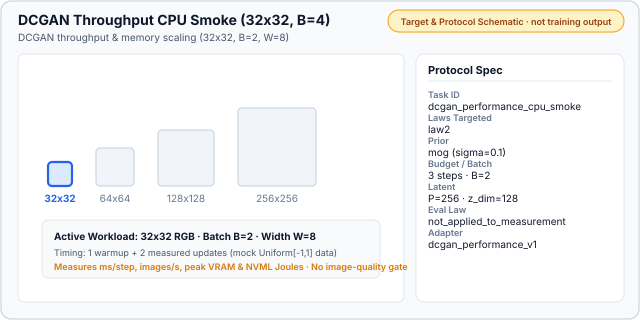
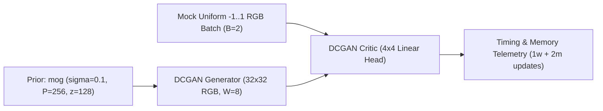

<!-- Generated Forge experiment page — do not edit manually; regenerate via `python -m experiments.forge.experiment_docs` -->

[← Leaderboard](../technique-inventory.md) · [Experiment Catalog](README.md) · [Explore by Laws](../LAWS_HUB.md) · [Research Portal](https://hypergan.github.io/ParticleGAN/)

# DCGAN Throughput CPU Smoke (32x32, B=4) (`dcgan_performance_cpu_smoke`)

| Field | Value |
| --- | --- |
| **Laws Tested** | [Law 2](../LAWS_HUB.md#law2) |
| **Edge Cases** | `throughput-scaling` `cpu-smoke` `mock-data-only` |
| **Primary View (`discriminator_stability`)** | Not in `discriminator_stability` |
| **Four Laws Adherence Role** | — |
| **Fixed Full-Suite Denominator** | No (diagnostic / auxiliary cohort) |
| **Adapter / Domain** | `dcgan_performance_v1` / `image_training_performance` |
| **Prior** | `mog` (sigma=`0.1`, standardize=`False`) |
| **Update Budget** | `3` steps |

## What This Experiment Tests

Lightweight CPU-runnable software smoke verification of the DCGAN performance adapter, confirming timing, guard capture, and receipt serialization without requiring a GPU.

> [!NOTE]
> **Protocol notes:** CPU software smoke diagnostic only; never comparable to GPU throughput rows.

## Laws & Edge Cases Targeted

- **[Law 2: Potential Geometry](../LAWS_HUB.md#law2)** ([Law 2 theory](../../../docs/four-laws.md#law-2--potential-geometry)) — Does the critic communicate useful learning forces with appropriate geometric control and computational efficiency?
- **Edge-case tags:** `throughput-scaling`, `cpu-smoke`, `mock-data-only`

## Common Failure Mode

Device-hardcoded CUDA assumptions or broken public-trainer hooks fail the CPU smoke check.

## Visual Schematic



*Target & Protocol Schematic · not training output — generated deterministically from the declared task contract.*

## Protocol & Architecture Diagram



## Task Contract & Numerical Gates

### Execution & Sampling Contract

| Contract Field | Declared Value |
| --- | --- |
| Initializer | `deterministic_orthogonal` |
| Prior | `mog` (sigma=`0.1`, standardize=`False`) |
| Update Budget | `3` steps |
| Batch Size | `2` |
| Particles / Latent Dim | `P=256` / `z_dim=128` |
| Sampling Law | `training_update_measurement` |
| Evaluation Output Noise | `not_applied_to_measurement` |
| Scoring Weights | `live` |
| Assigned Views | `dcgan_performance_cpu_smoke` (T1 diagnostic) |

### Numerical Pass/Fail Thresholds

| Metric | Operator | Threshold |
| --- | :---: | ---: |
| `execution` | `==` | `COMPLETE (timing/memory telemetry; no quality gate)` |

## Recorded Family Results

> [!IMPORTANT]
> Screening outcomes below come from recorded single-seed (`seed = 0`) Forge evidence. `NOT MEASURED`, `BLOCKED`, and `INCOMPATIBLE` are non-numerical states — not scientific failures — and confer no pass or qualification credit.

| Family | Selected Candidate | Outcome | Key Recorded Metrics | Family Report | Training Media |
| --- | --- | :---: | --- | --- | --- |
| **Atlas** | `atlas-particle-normal-v4` | `NOT MEASURED` | No recorded result for this selected configuration and source. | [Atlas](../families/atlas.md#cohort-cuda-bc3debd3fa5e) | — |
| **Axiom** | `axiom-v4` | `NOT MEASURED` | No recorded result for this selected configuration and source. | [Axiom](../families/axiom.md#cohort-cuda-daa283c8a640) | — |
| **BCAP** | `recipe-prior-refactor-bcap-pure-v1` | `NOT MEASURED` | No recorded result for this selected configuration and source. | [BCAP](../families/bcap-pure.md#cohort-cuda-1bf9d7d34422) | — |
| **BISPF** | `bispf-optimized-quintic-v1` | `NOT MEASURED` | No recorded result for this selected configuration and source. | [BISPF](../families/bispf.md#cohort-cuda-1bf9d7d34422) | — |
| **E22** | `e22` | `NOT MEASURED` | No recorded result for this selected configuration and source. | [E22](../families/e22.md#cohort-cuda-1bf9d7d34422) | — |
| **EMPF** | `empf-v8` | `NOT MEASURED` | No recorded result for this selected configuration and source. | [EMPF](../families/empf.md#cohort-cuda-23a94f16ca88) | — |
| **GAN v3 release 0.7** | `recipe-prior-refactor-release07-gan-v3-v1` | `NOT MEASURED` | No recorded result for this selected configuration and source. | [GAN v3 release 0.7](../families/release07-gan-v3.md#cohort-cuda-1bf9d7d34422) | — |
| **K3P** | `recipe-prior-refactor-k3p-v1` | `NOT MEASURED` | No recorded result for this selected configuration and source. | [K3P](../families/k3p.md#cohort-cuda-1bf9d7d34422) | — |
| **KA2** | `recipe-prior-refactor-ka2-v1` | `NOT MEASURED` | No recorded result for this selected configuration and source. | [KA2](../families/ka2.md#cohort-cuda-1bf9d7d34422) | — |
| **R1/R2** | `recipe-prior-refactor-r1r2-v1` | `NOT MEASURED` | No recorded result for this selected configuration and source. | [R1/R2](../families/r1r2.md#cohort-cuda-1bf9d7d34422) | — |
| **RHBI** | `rhbi-v12` | `NOT MEASURED` | No recorded result for this selected configuration and source. | [RHBI](../families/rhbi.md#cohort-cuda-23a94f16ca88) | — |
| **Unified** | `unified-v11` | `NOT MEASURED` | No recorded result for this selected configuration and source. | [Unified](../families/unified.md#cohort-cuda-42a130a78fc3) | — |

## Reproduce This Experiment

```bash
# Validate this task declaration and inspect planned dependencies
python -m experiments.forge validate
python -m experiments.forge plan --view dcgan_performance --candidate unified-v12 --tasks dcgan_performance_cpu_smoke
```

**Declaration & Source Files:**

- Task contract: [configs/forge/tasks/dcgan_performance_cpu_smoke.json](../../../configs/forge/tasks/dcgan_performance_cpu_smoke.json)

## Annotation Provenance

This page was assembled read-only from the following versioned inputs without altering any task execution/evaluation fingerprint:

- **Task contract JSON:** [configs/forge/tasks/dcgan_performance_cpu_smoke.json](../../../configs/forge/tasks/dcgan_performance_cpu_smoke.json)
- **Editorial task documentation sidecar:** [configs/forge/task-documentation/dcgan_performance_cpu_smoke.json](../../../configs/forge/task-documentation/dcgan_performance_cpu_smoke.json)
