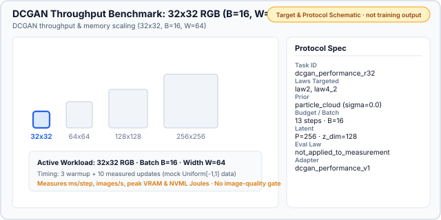
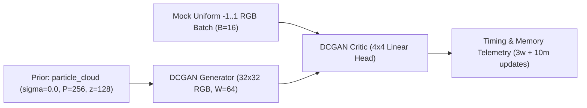

<!-- Generated Forge experiment page — do not edit manually; regenerate via `python -m experiments.forge.experiment_docs` -->

[← Leaderboard](../technique-inventory.md) · [Experiment Catalog](README.md) · [Explore by Laws](../LAWS_HUB.md) · [Research Portal](https://hypergan.github.io/ParticleGAN/)

# DCGAN Throughput Benchmark: 32x32 RGB (B=16, W=64) (`dcgan_performance_r32`)

| Field | Value |
| --- | --- |
| **Laws Tested** | [Law 2](../LAWS_HUB.md#law2) · [Law 4.2](../LAWS_HUB.md#law4_2) |
| **Edge Cases** | `throughput-scaling` `dcgan-conv2d` `mock-data-only` |
| **Primary View (`discriminator_stability`)** | Not in `discriminator_stability` |
| **Four Laws Adherence Role** | — |
| **Fixed Full-Suite Denominator** | No (diagnostic / auxiliary cohort) |
| **Adapter / Domain** | `dcgan_performance_v1` / `image_training_performance` |
| **Prior** | `particle_cloud` (sigma=`0.0`, standardize=`False`) |
| **Update Budget** | `13` steps |

## What This Experiment Tests

Measures synchronized per-update wall time (ms/step), throughput (images/s), and peak GPU memory for one complete public trainer step on 32x32 RGB DCGAN mock data (3 warmup + 10 measured updates).

> [!NOTE]
> **Protocol notes:** Separate research_diagnostic throughput workload on Uniform[-1,1] mock RGB data; confers zero image-quality or qualification credit.

## Laws & Edge Cases Targeted

- **[Law 2: Potential Geometry](../LAWS_HUB.md#law2)** ([Law 2 theory](../../../docs/four-laws.md#law-2--potential-geometry)) — Does the critic communicate useful learning forces with appropriate geometric control and computational efficiency?
- **[Law 4.2: Pathology-Driven Spectral Conditioning](../LAWS_HUB.md#law4_2)** ([Law 4.2 theory](../../../docs/four-laws.md#law-4--functional-and-game-dynamics)) — Can the learning system realize useful functional changes and exhibit appropriate coupled learning dynamics?
- **Edge-case tags:** `throughput-scaling`, `dcgan-conv2d`, `mock-data-only`

## Common Failure Mode

Excessive host-device synchronizations or per-step Python/SVD overhead inflate small-image latency well above the convolutional backbone baseline.

## Visual Schematic



*Target & Protocol Schematic · not training output — generated deterministically from the declared task contract.*

## Protocol & Architecture Diagram



## Task Contract & Numerical Gates

### Execution & Sampling Contract

| Contract Field | Declared Value |
| --- | --- |
| Initializer | `deterministic_orthogonal` |
| Prior | `particle_cloud` (sigma=`0.0`, standardize=`False`) |
| Update Budget | `13` steps |
| Batch Size | `16` |
| Particles / Latent Dim | `P=256` / `z_dim=128` |
| Sampling Law | `training_update_measurement` |
| Evaluation Output Noise | `not_applied_to_measurement` |
| Scoring Weights | `live` |
| Assigned Views | `dcgan_performance` (T1 diagnostic) |

### Numerical Pass/Fail Thresholds

| Metric | Operator | Threshold |
| --- | :---: | ---: |
| `execution` | `==` | `COMPLETE (timing/memory telemetry; no quality gate)` |

## Recorded Family Results

> [!IMPORTANT]
> Screening outcomes below come from recorded single-seed (`seed = 0`) Forge evidence. `NOT MEASURED`, `BLOCKED`, and `INCOMPATIBLE` are non-numerical states — not scientific failures — and confer no pass or qualification credit.

| Family | Candidate | Device | Status | Median ms/step | Images/s | Peak Allocated MiB | Family Report |
| --- | --- | --- | :---: | ---: | ---: | ---: | --- |
| **R1/R2** | `recipe-prior-refactor-r1r2-v1` | NVIDIA RTX A6000 | `COMPLETED` | 9.59 | 1668.2 | 88.0 | [R1/R2](../families/r1r2.md) |
| **GAN v3 release 0.7** | `recipe-prior-refactor-release07-gan-v3-v1` | NVIDIA RTX A6000 | `COMPLETED` | 9.90 | 1614.5 | 90.5 | [GAN v3 release 0.7](../families/release07-gan-v3.md) |
| **K3P** | `recipe-prior-refactor-k3p-v1` | NVIDIA RTX A6000 | `COMPLETED` | 11.88 | 1311.6 | 90.6 | [K3P](../families/k3p.md) |
| **KA2** | `recipe-prior-refactor-ka2-v1` | NVIDIA RTX A6000 | `COMPLETED` | 12.42 | 1281.5 | 90.6 | [KA2](../families/ka2.md) |
| **Axiom** | `axiom-v4` | NVIDIA RTX A6000 | **COMPLETE** | 16.21 | 982.6 | 62.1 | [Axiom](../families/axiom.md) |
| **Atlas** | `atlas-particle-normal-v4` | NVIDIA RTX A6000 | `COMPLETED` | 22.19 | 716.6 | 132.4 | [Atlas](../families/atlas.md) |
| **EMPF** | `empf-v8` | NVIDIA RTX A6000 | `COMPLETED` | 24.04 | 661.3 | 226.5 | [EMPF](../families/empf.md) |
| **E22** | `e22` | NVIDIA RTX A6000 | `COMPLETED` | 24.37 | 652.9 | 134.5 | [E22](../families/e22.md) |
| **Unified** | `unified-v11` | NVIDIA RTX A6000 | `COMPLETED` | 25.83 | 619.1 | 75.6 | [Unified](../families/unified.md) |
| **BISPF** | `bispf-optimized-quintic-v1` | NVIDIA RTX A6000 | `COMPLETED` | 28.73 | 557.5 | 213.1 | [BISPF](../families/bispf.md) |
| **RHBI** | `rhbi-v12` | NVIDIA RTX A6000 | `COMPLETED` | 48.27 | 330.6 | 93.2 | [RHBI](../families/rhbi.md) |
| **bcap-dualnorm** | `recipe-prior-refactor-bcap-pure-v1` | NVIDIA RTX A6000 | `COMPLETED` | 276.43 | 57.7 | 223.1 | [bcap-dualnorm](../families/bcap-dualnorm.md) |

## Reproduce This Experiment

```bash
# Validate this task declaration and inspect planned dependencies
python -m experiments.forge validate
python -m experiments.forge plan --view dcgan_performance --candidate unified-v12 --tasks dcgan_performance_r32
```

**Declaration & Source Files:**

- Task contract: [configs/forge/tasks/dcgan_performance_r32.json](../../../configs/forge/tasks/dcgan_performance_r32.json)

## Annotation Provenance

This page was assembled read-only from the following versioned inputs without altering any task execution/evaluation fingerprint:

- **Task contract JSON:** [configs/forge/tasks/dcgan_performance_r32.json](../../../configs/forge/tasks/dcgan_performance_r32.json)
- **Editorial task documentation sidecar:** [configs/forge/task-documentation/dcgan_performance_r32.json](../../../configs/forge/task-documentation/dcgan_performance_r32.json)
