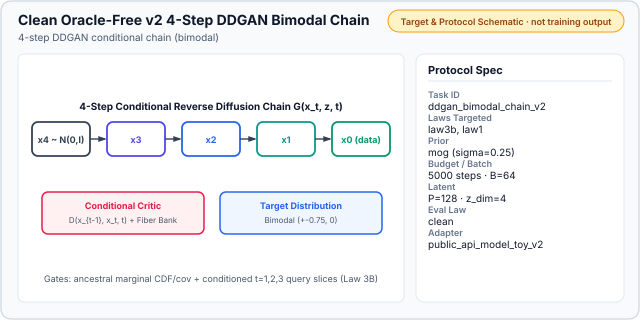
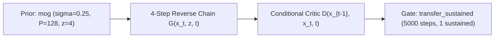

<!-- Generated Forge experiment page — do not edit manually; regenerate via `python -m experiments.forge.experiment_docs` -->

[← Leaderboard](../technique-inventory.md) · [Experiment Catalog](README.md) · [Explore by Laws](../LAWS_HUB.md) · [Research Portal](https://hypergan.github.io/ParticleGAN/)

# Clean Oracle-Free v2 4-Step DDGAN Bimodal Chain (`ddgan_bimodal_chain_v2`)

| Field | Value |
| --- | --- |
| **Laws Tested** | [Law 3B](../LAWS_HUB.md#law3b) · [Law 1](../LAWS_HUB.md#law1) |
| **Edge Cases** | `conditional-chain` `bimodal-posterior` `oracle-free` |
| **Primary View (`discriminator_stability`)** | Not in `discriminator_stability` |
| **Four Laws Adherence Role** | — |
| **Fixed Full-Suite Denominator** | No (diagnostic / auxiliary cohort) |
| **Adapter / Domain** | `public_api_model_toy_v2` / `transfer_sustained` |
| **Prior** | `mog` (sigma=`0.25`, standardize=`False`) |
| **Update Budget** | `5000` steps |

## What This Experiment Tests

Clean oracle-free v2 DDGAN bimodal chain testing whether public conditional DDGAN reverse transitions preserve both bimodal branches and final ancestral distribution with calibrated terminal_observations=1 and zero host-owned target-variance div_loss.

> [!NOTE]
> **Protocol notes:** Clean oracle-free v2 benchmark (5,000 updates, 600s timeout); preserves legacy model_ddgan_bimodal_chain untouched.

## Laws & Edge Cases Targeted

- **[Law 3B: Conditional Fiber & Stratum Identifiability (Unifies with Provisional Law 5)](../LAWS_HUB.md#law3b)** ([Law 3B theory](../../../docs/four-laws.md#law-3--transport-identifiability)) — Does the learning system possess enough information to determine appropriate transport?
- **[Law 1: Representational Geometry](../LAWS_HUB.md#law1)** ([Law 1 theory](../../../docs/four-laws.md#law-1--representational-geometry)) — Can the system represent the required probability measure efficiently and faithfully?
- **Edge-case tags:** `conditional-chain`, `bimodal-posterior`, `oracle-free`

## Common Failure Mode

Without host-side variance regularization, conditional reverse steps average across the two modes or lose conditioned branch fidelity.

## Visual Schematic



*Target & Protocol Schematic · not training output — generated deterministically from the declared task contract.*

## Protocol & Architecture Diagram



## Task Contract & Numerical Gates

### Execution & Sampling Contract

| Contract Field | Declared Value |
| --- | --- |
| Initializer | `deterministic_orthogonal` |
| Prior | `mog` (sigma=`0.25`, standardize=`False`) |
| Update Budget | `5000` steps |
| Batch Size | `64` |
| Particles / Latent Dim | `P=128` / `z_dim=4` |
| Sampling Law | `task_model_kernel_and_posterior_without_serving_noise` |
| Evaluation Output Noise | `clean` |
| Scoring Weights | `live` |
| Dependencies | [`ddgan_gaussian_chain_v2`](ddgan_gaussian_chain_v2.md) (`gate`) |
| Integrity Guards | `finite_state`, `rng_isolation`, `optimizer_roles`, `exact_optimizer_updates`, `mechanism_exercised` |

### Numerical Pass/Fail Thresholds

| Metric | Operator | Threshold |
| --- | :---: | ---: |
| `final_projection_cdf` | `<=` | `0.32` |
| `final_normalized_mean` | `<=` | `0.25` |
| `final_covariance_eigen_min` | `>=` | `0.3` |
| `final_covariance_eigen_max` | `<=` | `2.6` |
| `t1_q0_projection_cdf` | `<=` | `0.75` |
| `t1_q0_normalized_mean` | `<=` | `1.5` |
| `t1_q0_covariance_eigen_min` | `>=` | `0.4` |
| `t1_q0_covariance_eigen_max` | `<=` | `4.5` |
| `t1_q1_projection_cdf` | `<=` | `0.75` |
| `t1_q1_normalized_mean` | `<=` | `1.5` |
| `t1_q1_covariance_eigen_min` | `>=` | `0.4` |
| `t1_q1_covariance_eigen_max` | `<=` | `4.5` |
| `t2_q0_projection_cdf` | `<=` | `0.28` |
| `t2_q0_normalized_mean` | `<=` | `0.7` |
| `t2_q0_covariance_eigen_min` | `>=` | `0.6` |
| `t2_q0_covariance_eigen_max` | `<=` | `1.4` |
| `t2_q1_projection_cdf` | `<=` | `0.28` |
| `t2_q1_normalized_mean` | `<=` | `0.7` |
| `t2_q1_covariance_eigen_min` | `>=` | `0.6` |
| `t2_q1_covariance_eigen_max` | `<=` | `1.4` |
| `t3_q0_projection_cdf` | `<=` | `0.22` |
| `t3_q0_normalized_mean` | `<=` | `0.5` |
| `t3_q0_covariance_eigen_min` | `>=` | `0.65` |
| `t3_q0_covariance_eigen_max` | `<=` | `1.4` |
| `t3_q1_projection_cdf` | `<=` | `0.22` |
| `t3_q1_normalized_mean` | `<=` | `0.5` |
| `t3_q1_covariance_eigen_min` | `>=` | `0.65` |
| `t3_q1_covariance_eigen_max` | `<=` | `1.4` |
| `t4_q0_projection_cdf` | `<=` | `0.12` |
| `t4_q0_normalized_mean` | `<=` | `0.25` |
| `t4_q0_covariance_eigen_min` | `>=` | `0.65` |
| `t4_q0_covariance_eigen_max` | `<=` | `1.4` |
| `t4_q1_projection_cdf` | `<=` | `0.12` |
| `t4_q1_normalized_mean` | `<=` | `0.25` |
| `t4_q1_covariance_eigen_min` | `>=` | `0.65` |
| `t4_q1_covariance_eigen_max` | `<=` | `1.4` |
| `panel_count` | `==` | `8` |
| `samples_per_panel` | `>=` | `2048` |
| `final_hq` | `>=` | `0.9` |
| `final_mode_mass_tv` | `<=` | `0.1` |
| `final_local_mean_sigma` | `<=` | `1.5` |
| `final_local_covariance_min` | `>=` | `0.3` |
| `final_local_covariance_max` | `<=` | `2.05` |

## Recorded Family Results

> [!IMPORTANT]
> Screening outcomes below come from recorded single-seed (`seed = 0`) Forge evidence. `NOT MEASURED`, `BLOCKED`, and `INCOMPATIBLE` are non-numerical states — not scientific failures — and confer no pass or qualification credit.

No selected-family cohort cells are recorded for this task in the current `reports/forge/technique-inventory.json`.

## Reproduce This Experiment

```bash
# Validate this task declaration and inspect planned dependencies
python -m experiments.forge validate
python -m experiments.forge plan --view discriminator_stability --candidate unified-v12 --tasks ddgan_bimodal_chain_v2
```

**Declaration & Source Files:**

- Task contract: [configs/forge/tasks/ddgan_bimodal_chain_v2.json](../../../configs/forge/tasks/ddgan_bimodal_chain_v2.json)
- Source code: [benchmarks/toy_audit/api_model_ddgan_v2.py](../../../benchmarks/toy_audit/api_model_ddgan_v2.py)
- Source code: [benchmarks/toy_audit/api_contract.py](../../../benchmarks/toy_audit/api_contract.py)
- Source code: [benchmarks/toy_audit/api_model_ddgan.py](../../../benchmarks/toy_audit/api_model_ddgan.py)
- Source code: [benchmarks/toy_audit/api_run.py](../../../benchmarks/toy_audit/api_run.py)
- Source code: [benchmarks/toy_audit/reproducibility.py](../../../benchmarks/toy_audit/reproducibility.py)
- Source code: [experiments/forge/model_toy_v2_adapter.py](../../../experiments/forge/model_toy_v2_adapter.py)
- Source code: [particlegan/policy.py](../../../particlegan/policy.py)

## Annotation Provenance

This page was assembled read-only from the following versioned inputs without altering any task execution/evaluation fingerprint:

- **Task contract JSON:** [configs/forge/tasks/ddgan_bimodal_chain_v2.json](../../../configs/forge/tasks/ddgan_bimodal_chain_v2.json)
- **Editorial task documentation sidecar:** [configs/forge/task-documentation/ddgan_bimodal_chain_v2.json](../../../configs/forge/task-documentation/ddgan_bimodal_chain_v2.json)
- **Read-only Python AST source:** [benchmarks/toy_audit/api_model_ddgan_v2.py](../../../benchmarks/toy_audit/api_model_ddgan_v2.py) (AST symbols: `__doc__`)
- **Read-only Python AST source:** [benchmarks/toy_audit/api_contract.py](../../../benchmarks/toy_audit/api_contract.py) (AST symbols: `__doc__`)
- **Read-only Python AST source:** [benchmarks/toy_audit/api_model_ddgan.py](../../../benchmarks/toy_audit/api_model_ddgan.py) (AST symbols: `__doc__`)
- **Read-only Python AST source:** [benchmarks/toy_audit/api_run.py](../../../benchmarks/toy_audit/api_run.py) (AST symbols: `__doc__`)
- **Read-only Python AST source:** [benchmarks/toy_audit/reproducibility.py](../../../benchmarks/toy_audit/reproducibility.py) (AST symbols: `__doc__`)
- **Read-only Python AST source:** [experiments/forge/model_toy_v2_adapter.py](../../../experiments/forge/model_toy_v2_adapter.py) (AST symbols: `__doc__`)
- **Read-only Python AST source:** [particlegan/policy.py](../../../particlegan/policy.py) (AST symbols: `__doc__`)
