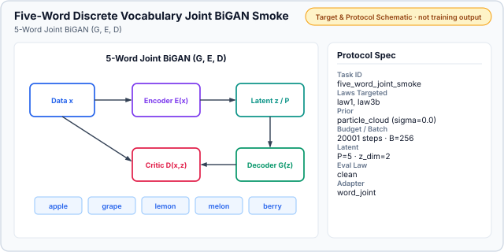
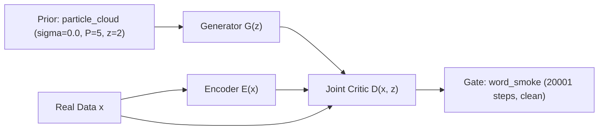

<!-- Generated Forge experiment page — do not edit manually; regenerate via `python -m experiments.forge.experiment_docs` -->

[← Leaderboard](../technique-inventory.md) · [Experiment Catalog](README.md) · [Explore by Laws](../LAWS_HUB.md) · [Research Portal](https://hypergan.github.io/ParticleGAN/)

# Five-Word Discrete Vocabulary Joint BiGAN Smoke (`five_word_joint_smoke`)

| Field | Value |
| --- | --- |
| **Laws Tested** | [Law 1](../LAWS_HUB.md#law1) · [Law 3B](../LAWS_HUB.md#law3b) |
| **Edge Cases** | `discrete-vocabulary` `bidirectional-encoder` `exact-capacity-prior` |
| **Primary View (`discriminator_stability`)** | Tier 1 (required) |
| **Four Laws Adherence Role** | — |
| **Fixed Full-Suite Denominator** | Yes (71-test fixed denominator) |
| **Adapter / Domain** | `word_joint` / `word_smoke` |
| **Prior** | `particle_cloud` (sigma=`0.0`, standardize=`False`) |
| **Update Budget** | `20001` steps |

## What This Experiment Tests

Trains a joint BiGAN (generator, encoder, joint critic) with exactly 5 learned 2D particles on a 5-word discrete vocabulary ('apple', 'grape', 'lemon', 'melon', 'berry'). Must generate all 5 words cleanly and reconstruct every word with >= 0.90 token confidence.

> [!NOTE]
> **Protocol notes:** Tier-1 required gate; produces the checkpoint continued by `five_word_joint_hold`.

## Laws & Edge Cases Targeted

- **[Law 1: Representational Geometry](../LAWS_HUB.md#law1)** ([Law 1 theory](../../../docs/four-laws.md#law-1--representational-geometry)) — Can the system represent the required probability measure efficiently and faithfully?
- **[Law 3B: Conditional Fiber & Stratum Identifiability](../LAWS_HUB.md#law3b)** ([Law 3B theory](../../../docs/four-laws.md#law-3--transport-identifiability)) — Does the learning system possess enough information to determine appropriate transport?
- **Edge-case tags:** `discrete-vocabulary`, `bidirectional-encoder`, `exact-capacity-prior`

## Common Failure Mode

Two words collide onto one particle or the encoder fails to invert the generator's discrete assignments, breaking exact reconstruction.

**Historical audit diagnosis** (`reports/forge/problem-definitions.json`): While selected `atlas-particle-normal-v4` passes `ae_gan_hold` and `unused_token_hold`, on the 20,001-step five-word joint BiGAN game its `particles` + `NormalNoiseManipulator(sigma=0.0065)` + `birth_death_cells=256` recipe fails to acquire discrete word modes (`modes = 0/5`, `quality_fraction = 0.0`, `reconstruction_exact = 0`, `reconstruction_nll = 22.46`).

- *Recommended research focus:* Diagnose how critic-space birth-death and `sigma=0.0065` latent perturbation interact with the joint `(x, z)` BiGAN encoder-generator coupling over 20k discrete-token updates without regressing continuous multimodal coverage.

## Visual Schematic



*Target & Protocol Schematic · not training output — generated deterministically from the declared task contract.*

## Protocol & Architecture Diagram



## Task Contract & Numerical Gates

### Execution & Sampling Contract

| Contract Field | Declared Value |
| --- | --- |
| Initializer | `deterministic_orthogonal` |
| Prior | `particle_cloud` (sigma=`0.0`, standardize=`False`) |
| Update Budget | `20001` steps |
| Batch Size | `256` |
| Particles / Latent Dim | `P=5` / `z_dim=2` |
| Sampling Law | `generated_and_paired_reconstructed_prior_without_output_noise` |
| Evaluation Output Noise | `clean` |
| Scoring Weights | `live` |
| Integrity Guards | `finite_state`, `optimizer_roles`, `mechanism_exercised`, `rng_isolation`, `exact_optimizer_updates` |
| Assigned Views | `bcap-projection-baseline-repair-diagnostic-v1` (T1 diagnostic), `discriminator_stability` (T1 required), `lazy_cadence_coverage` (T1 diagnostic), `prior-ablation-full-suite-v1` (T1 diagnostic), `r1r2-repair-word-retention-20261022` (T1 diagnostic), `r3-tier3-long-horizon-holdout-v1` (T1 diagnostic), `r4-occam-ablation-v1` (T1 diagnostic), `recipe-prior-refactor-k3p-diagnostic-v1` (T1 diagnostic) (+3 more) |

### Numerical Pass/Fail Thresholds

| Metric | Operator | Threshold |
| --- | :---: | ---: |
| `sample_count` | `>=` | `1024` |
| `quality_fraction` | `>=` | `0.95` |
| `modes` | `==` | `5` |
| `mass_tv` | `<=` | `0.1` |
| `reconstruction_exact` | `==` | `1` |
| `minimum_reconstruction_token_probability` | `>=` | `0.9` |

## Recorded Family Results

> [!IMPORTANT]
> Screening outcomes below come from recorded single-seed (`seed = 0`) Forge evidence. `NOT MEASURED`, `BLOCKED`, and `INCOMPATIBLE` are non-numerical states — not scientific failures — and confer no pass or qualification credit.

| Family | Selected Candidate | Outcome | Key Recorded Metrics | Family Report | Training Media |
| --- | --- | :---: | --- | --- | --- |
| **Atlas** | `atlas-particle-normal-v4` | **PASS** | any scheduled full joint pass plus independent same-state confirmation | [Atlas](../families/atlas.md#cohort-cuda-daa283c8a640) | — |
| **Axiom** | `axiom-v4` | **PASS** | any scheduled full joint pass plus independent same-state confirmation | [Axiom](../families/axiom.md#cohort-cuda-daa283c8a640) | — |
| **BCAP** | `recipe-prior-refactor-bcap-pure-v1` | **PASS** | any scheduled full joint pass plus independent same-state confirmation | [BCAP](../families/bcap-pure.md#cohort-cuda-1bf9d7d34422) | — |
| **BISPF** | `bispf-optimized-quintic-v1` | **PASS** | any scheduled full joint pass plus independent same-state confirmation | [BISPF](../families/bispf.md#cohort-cuda-1bf9d7d34422) | — |
| **EMPF** | `empf-v8` | **PASS** | any scheduled full joint pass plus independent same-state confirmation | [EMPF](../families/empf.md#cohort-cuda-23a94f16ca88) | — |
| **K3P** | `recipe-prior-refactor-k3p-v1` | **PASS** | any scheduled full joint pass plus independent same-state confirmation | [K3P](../families/k3p.md#cohort-cuda-daa283c8a640) | — |
| **KA2** | `recipe-prior-refactor-ka2-v1` | **PASS** | any scheduled full joint pass plus independent same-state confirmation | [KA2](../families/ka2.md#cohort-cuda-daa283c8a640) | — |
| **RHBI** | `rhbi-v12` | **PASS** | any scheduled full joint pass plus independent same-state confirmation | [RHBI](../families/rhbi.md#cohort-cuda-23a94f16ca88) | — |
| **Unified** | `unified-v11` | **PASS** | any scheduled full joint pass plus independent same-state confirmation | [Unified](../families/unified.md#cohort-cuda-42a130a78fc3) | — |
| **E22** | `e22` | `BLOCKED` | Skipped incompatible test: five_word_joint_smoke: clean/live scoring has no declared polic | [E22](../families/e22.md#cohort-cuda-1bf9d7d34422) | — |
| **GAN v3 release 0.7** | `recipe-prior-refactor-release07-gan-v3-v1` | **FAIL** | any scheduled full joint pass plus independent same-state confirmation | [GAN v3 release 0.7](../families/release07-gan-v3.md#cohort-cuda-daa283c8a640) | — |
| **R1/R2** | `recipe-prior-refactor-r1r2-v1` | **FAIL** | any scheduled full joint pass plus independent same-state confirmation | [R1/R2](../families/r1r2.md#cohort-cuda-daa283c8a640) | — |

## Reproduce This Experiment

```bash
# Validate this task declaration and inspect planned dependencies
python -m experiments.forge validate
python -m experiments.forge plan --view discriminator_stability --candidate unified-v12 --tasks five_word_joint_smoke
```

**Declaration & Source Files:**

- Task contract: [configs/forge/tasks/five_word_joint_smoke.json](../../../configs/forge/tasks/five_word_joint_smoke.json)
- Source code: [benchmarks/toy_audit/api_images.py](../../../benchmarks/toy_audit/api_images.py)
- Source code: [benchmarks/locked_shared/baseline.py](../../../benchmarks/locked_shared/baseline.py)
- Source code: [benchmarks/locked_shared/observation.py](../../../benchmarks/locked_shared/observation.py)
- Source code: [benchmarks/toy_audit/definition_quality.py](../../../benchmarks/toy_audit/definition_quality.py)
- Source code: [benchmarks/toy_audit/reproducibility.py](../../../benchmarks/toy_audit/reproducibility.py)
- Source code: [benchmarks/transfer_suite/protocol.py](../../../benchmarks/transfer_suite/protocol.py)
- Source code: [experiments/forge/behavior_adapters.py](../../../experiments/forge/behavior_adapters.py)
- Source code: [experiments/forge/word_adapter.py](../../../experiments/forge/word_adapter.py)
- Source code: [experiments/forge/word_tasks.py](../../../experiments/forge/word_tasks.py)
- Source code: [particlegan/conditional_transport.py](../../../particlegan/conditional_transport.py)
- Source code: [particlegan/kinetic_transport.py](../../../particlegan/kinetic_transport.py)
- Source code: [particlegan/policy.py](../../../particlegan/policy.py)

## Annotation Provenance

This page was assembled read-only from the following versioned inputs without altering any task execution/evaluation fingerprint:

- **Task contract JSON:** [configs/forge/tasks/five_word_joint_smoke.json](../../../configs/forge/tasks/five_word_joint_smoke.json)
- **Editorial task documentation sidecar:** [configs/forge/task-documentation/five_word_joint_smoke.json](../../../configs/forge/task-documentation/five_word_joint_smoke.json)
- **Read-only Python AST source:** [benchmarks/toy_audit/api_images.py](../../../benchmarks/toy_audit/api_images.py) (AST symbols: `__doc__`)
- **Read-only Python AST source:** [benchmarks/locked_shared/baseline.py](../../../benchmarks/locked_shared/baseline.py) (AST symbols: `__doc__`)
- **Read-only Python AST source:** [benchmarks/locked_shared/observation.py](../../../benchmarks/locked_shared/observation.py) (AST symbols: `__doc__`)
- **Read-only Python AST source:** [benchmarks/toy_audit/definition_quality.py](../../../benchmarks/toy_audit/definition_quality.py) (AST symbols: `__doc__`)
- **Read-only Python AST source:** [benchmarks/toy_audit/reproducibility.py](../../../benchmarks/toy_audit/reproducibility.py) (AST symbols: `__doc__`)
- **Read-only Python AST source:** [benchmarks/transfer_suite/protocol.py](../../../benchmarks/transfer_suite/protocol.py) (AST symbols: `__doc__`)
- **Read-only Python AST source:** [experiments/forge/behavior_adapters.py](../../../experiments/forge/behavior_adapters.py) (AST symbols: `__doc__`)
- **Read-only Python AST source:** [experiments/forge/word_adapter.py](../../../experiments/forge/word_adapter.py) (AST symbols: `__doc__`)
- **Read-only Python AST source:** [experiments/forge/word_tasks.py](../../../experiments/forge/word_tasks.py) (AST symbols: `__doc__`)
- **Read-only Python AST source:** [particlegan/conditional_transport.py](../../../particlegan/conditional_transport.py) (AST symbols: `__doc__`)
- **Read-only Python AST source:** [particlegan/kinetic_transport.py](../../../particlegan/kinetic_transport.py) (AST symbols: `__doc__`)
- **Read-only Python AST source:** [particlegan/policy.py](../../../particlegan/policy.py) (AST symbols: `__doc__`)
