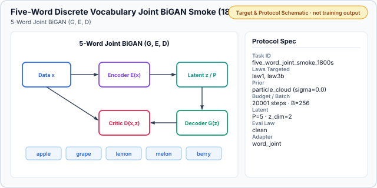
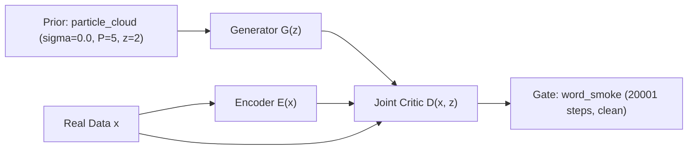

<!-- Generated Forge experiment page — do not edit manually; regenerate via `python -m experiments.forge.experiment_docs` -->

[← Leaderboard](../technique-inventory.md) · [Experiment Catalog](README.md) · [Explore by Laws](../LAWS_HUB.md) · [Research Portal](https://hypergan.github.io/ParticleGAN/)

# Five-Word Discrete Vocabulary Joint BiGAN Smoke (1800s Wall Cap) (`five_word_joint_smoke_1800s`)

| Field | Value |
| --- | --- |
| **Laws Tested** | [Law 1](../LAWS_HUB.md#law1) · [Law 3B](../LAWS_HUB.md#law3b) |
| **Edge Cases** | `discrete-vocabulary` `bidirectional-encoder` `exact-capacity-prior` |
| **Primary View (`discriminator_stability`)** | Not in `discriminator_stability` |
| **Four Laws Adherence Role** | — |
| **Fixed Full-Suite Denominator** | No (diagnostic / auxiliary cohort) |
| **Adapter / Domain** | `word_joint` / `word_smoke` |
| **Prior** | `particle_cloud` (sigma=`0.0`, standardize=`False`) |
| **Update Budget** | `20001` steps |

## What This Experiment Tests

Calibrated 1,800-second wall-cap variant of `five_word_joint_smoke` testing whether public joint BiGAN training with 5 learned 2D particles acquires all five words and reconstructs every paired input at one independently confirmed state over 20,001 updates.

> [!NOTE]
> **Protocol notes:** Calibrated 1800s timeout variant preserving legacy `five_word_joint_smoke` at 900s byte-identical.

## Laws & Edge Cases Targeted

- **[Law 1: Representational Geometry](../LAWS_HUB.md#law1)** ([Law 1 theory](../../../docs/four-laws.md#law-1--representational-geometry)) — Can the system represent the required probability measure efficiently and faithfully?
- **[Law 3B: Conditional Fiber & Stratum Identifiability (Unifies with Provisional Law 5)](../LAWS_HUB.md#law3b)** ([Law 3B theory](../../../docs/four-laws.md#law-3--transport-identifiability)) — Does the learning system possess enough information to determine appropriate transport?
- **Edge-case tags:** `discrete-vocabulary`, `bidirectional-encoder`, `exact-capacity-prior`

## Common Failure Mode

Two words collide onto one particle or encoder inversion drifts before all five discrete words settle cleanly; separates true numerical failures from 900s wall-time timeouts on slower GPUs.

## Visual Schematic



*Target & Protocol Schematic · not training output — generated deterministically from the declared task contract.*

## Protocol & Architecture Diagram



## Task Contract & Numerical Gates

### Execution & Sampling Contract

| Contract Field | Declared Value |
| --- | --- |
| Initializer | `deterministic_orthogonal` |
| Prior | `particle_cloud` (sigma=`0.0`, standardize=`False`) |
| Update Budget | `20001` steps |
| Batch Size | `256` |
| Particles / Latent Dim | `P=5` / `z_dim=2` |
| Sampling Law | `generated_and_paired_reconstructed_prior_without_output_noise` |
| Evaluation Output Noise | `clean` |
| Scoring Weights | `live` |
| Integrity Guards | `finite_state`, `optimizer_roles`, `mechanism_exercised`, `rng_isolation`, `exact_optimizer_updates` |

### Numerical Pass/Fail Thresholds

| Metric | Operator | Threshold |
| --- | :---: | ---: |
| `sample_count` | `>=` | `1024` |
| `quality_fraction` | `>=` | `0.95` |
| `modes` | `==` | `5` |
| `mass_tv` | `<=` | `0.1` |
| `reconstruction_exact` | `==` | `1` |
| `minimum_reconstruction_token_probability` | `>=` | `0.9` |

## Recorded Family Results

> [!IMPORTANT]
> Screening outcomes below come from recorded single-seed (`seed = 0`) Forge evidence. `NOT MEASURED`, `BLOCKED`, and `INCOMPATIBLE` are non-numerical states — not scientific failures — and confer no pass or qualification credit.

No selected-family cohort cells are recorded for this task in the current `reports/forge/technique-inventory.json`.

## Reproduce This Experiment

```bash
# Validate this task declaration and inspect planned dependencies
python -m experiments.forge validate
python -m experiments.forge plan --view discriminator_stability --candidate unified-v12 --tasks five_word_joint_smoke_1800s
```

**Declaration & Source Files:**

- Task contract: [configs/forge/tasks/five_word_joint_smoke_1800s.json](../../../configs/forge/tasks/five_word_joint_smoke_1800s.json)
- Source code: [benchmarks/toy_audit/api_images.py](../../../benchmarks/toy_audit/api_images.py)
- Source code: [benchmarks/locked_shared/baseline.py](../../../benchmarks/locked_shared/baseline.py)
- Source code: [benchmarks/locked_shared/observation.py](../../../benchmarks/locked_shared/observation.py)
- Source code: [benchmarks/toy_audit/definition_quality.py](../../../benchmarks/toy_audit/definition_quality.py)
- Source code: [benchmarks/toy_audit/reproducibility.py](../../../benchmarks/toy_audit/reproducibility.py)
- Source code: [benchmarks/transfer_suite/protocol.py](../../../benchmarks/transfer_suite/protocol.py)
- Source code: [experiments/forge/behavior_adapters.py](../../../experiments/forge/behavior_adapters.py)
- Source code: [experiments/forge/word_adapter.py](../../../experiments/forge/word_adapter.py)
- Source code: [experiments/forge/word_tasks.py](../../../experiments/forge/word_tasks.py)
- Source code: [particlegan/conditional_transport.py](../../../particlegan/conditional_transport.py)
- Source code: [particlegan/kinetic_transport.py](../../../particlegan/kinetic_transport.py)
- Source code: [particlegan/policy.py](../../../particlegan/policy.py)

## Annotation Provenance

This page was assembled read-only from the following versioned inputs without altering any task execution/evaluation fingerprint:

- **Task contract JSON:** [configs/forge/tasks/five_word_joint_smoke_1800s.json](../../../configs/forge/tasks/five_word_joint_smoke_1800s.json)
- **Editorial task documentation sidecar:** [configs/forge/task-documentation/five_word_joint_smoke_1800s.json](../../../configs/forge/task-documentation/five_word_joint_smoke_1800s.json)
- **Read-only Python AST source:** [benchmarks/toy_audit/api_images.py](../../../benchmarks/toy_audit/api_images.py) (AST symbols: `__doc__`)
- **Read-only Python AST source:** [benchmarks/locked_shared/baseline.py](../../../benchmarks/locked_shared/baseline.py) (AST symbols: `__doc__`)
- **Read-only Python AST source:** [benchmarks/locked_shared/observation.py](../../../benchmarks/locked_shared/observation.py) (AST symbols: `__doc__`)
- **Read-only Python AST source:** [benchmarks/toy_audit/definition_quality.py](../../../benchmarks/toy_audit/definition_quality.py) (AST symbols: `__doc__`)
- **Read-only Python AST source:** [benchmarks/toy_audit/reproducibility.py](../../../benchmarks/toy_audit/reproducibility.py) (AST symbols: `__doc__`)
- **Read-only Python AST source:** [benchmarks/transfer_suite/protocol.py](../../../benchmarks/transfer_suite/protocol.py) (AST symbols: `__doc__`)
- **Read-only Python AST source:** [experiments/forge/behavior_adapters.py](../../../experiments/forge/behavior_adapters.py) (AST symbols: `__doc__`)
- **Read-only Python AST source:** [experiments/forge/word_adapter.py](../../../experiments/forge/word_adapter.py) (AST symbols: `__doc__`)
- **Read-only Python AST source:** [experiments/forge/word_tasks.py](../../../experiments/forge/word_tasks.py) (AST symbols: `__doc__`)
- **Read-only Python AST source:** [particlegan/conditional_transport.py](../../../particlegan/conditional_transport.py) (AST symbols: `__doc__`)
- **Read-only Python AST source:** [particlegan/kinetic_transport.py](../../../particlegan/kinetic_transport.py) (AST symbols: `__doc__`)
- **Read-only Python AST source:** [particlegan/policy.py](../../../particlegan/policy.py) (AST symbols: `__doc__`)
