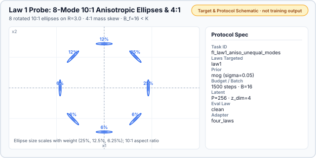
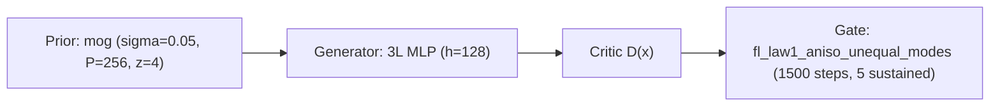

<!-- Generated Forge experiment page — do not edit manually; regenerate via `python -m experiments.forge.experiment_docs` -->

[← Leaderboard](../technique-inventory.md) · [Experiment Catalog](README.md) · [Explore by Laws](../LAWS_HUB.md) · [Research Portal](https://hypergan.github.io/ParticleGAN/)

# Law 1 Probe: 8-Mode 10:1 Anisotropic Ellipses & 4:1 Skew (B_f < K) (`fl_law1_aniso_unequal_modes`)

| Field | Value |
| --- | --- |
| **Laws Tested** | [Law 1](../LAWS_HUB.md#law1) |
| **Edge Cases** | `anisotropic-10to1` `small-batch-starvation` `unequal-mass` `disconnected-support` |
| **Primary View (`discriminator_stability`)** | Not in `discriminator_stability` |
| **Four Laws Adherence Role** | law1 (four_laws_probe) |
| **Fixed Full-Suite Denominator** | No (diagnostic / auxiliary cohort) |
| **Adapter / Domain** | `four_laws` / `fl_law1_aniso_unequal_modes` |
| **Prior** | `mog` (sigma=`0.05`, standardize=`False`) |
| **Update Budget** | `1500` steps |

## What This Experiment Tests

Falsification probe targeting Law 1 defects D-06 & D-07: places 8 rotated 10:1 anisotropic Gaussian ellipses (sigma_major=0.25, sigma_minor=0.025) with 4:1 weight skew on a ring under severe minibatch starvation (B=16 << P=256).

> [!NOTE]
> **Protocol notes:** Four Laws Adherence diagnostic probe (`four-laws-adherence-v1`, 1,500 updates, B=16, P=256).

## Laws & Edge Cases Targeted

- **[Law 1: Representational Geometry](../LAWS_HUB.md#law1)** ([Law 1 theory](../../../docs/four-laws.md#law-1--representational-geometry)) — Can the system represent the required probability measure efficiently and faithfully?
- **Edge-case tags:** `anisotropic-10to1`, `small-batch-starvation`, `unequal-mass`, `disconnected-support`

## Common Failure Mode

Scalar-trace isotropic covariance coalescence collapses 10:1 ellipses (incurring >62% Frobenius error and disconnecting above kappa* = 8.665), while B_f < K eviction starves low-weight modes.

## Visual Schematic



*Target & Protocol Schematic · not training output — generated deterministically from the declared task contract.*

## Protocol & Architecture Diagram



## Task Contract & Numerical Gates

### Execution & Sampling Contract

| Contract Field | Declared Value |
| --- | --- |
| Initializer | `deterministic_orthogonal` |
| Prior | `mog` (sigma=`0.05`, standardize=`False`) |
| Update Budget | `1500` steps |
| Batch Size | `16` |
| Particles / Latent Dim | `P=256` / `z_dim=4` |
| Sampling Law | `public_prior_without_output_noise` |
| Evaluation Output Noise | `clean` |
| Scoring Weights | `live` |
| Architecture | `family=simple_mlp, hidden=128, layers=3, out_dim=2, in_dim=2, fourier=2` |
| Integrity Guards | `finite_state`, `optimizer_roles`, `exact_optimizer_updates`, `mechanism_exercised`, `rng_isolation` |
| Assigned Views | `four-laws-adherence-v1` (T1 diagnostic), `four-laws-adherence-v2` (T1 diagnostic) |

### Numerical Pass/Fail Thresholds

| Metric | Operator | Threshold |
| --- | :---: | ---: |
| `finite_fraction` | `==` | `1.0` |
| `mode_recall` | `>=` | `1.0` |
| `precision` | `>=` | `0.85` |
| `mass_tv` | `<=` | `0.14` |
| `min_cov_eig_ratio` | `>=` | `0.35` |
| `max_cov_eig_ratio` | `<=` | `2.2` |

## Recorded Family Results

> [!IMPORTANT]
> Screening outcomes below come from recorded single-seed (`seed = 0`) Forge evidence. `NOT MEASURED`, `BLOCKED`, and `INCOMPATIBLE` are non-numerical states — not scientific failures — and confer no pass or qualification credit.

| Family | Selected Candidate | Outcome | Key Recorded Metrics | Family Report | Training Media |
| --- | --- | :---: | --- | --- | --- |
| **Atlas** | `atlas-particle-normal-v4` | `NOT MEASURED` | No recorded result for this selected configuration and source. | [Atlas](../families/atlas.md#cohort-cuda-daa283c8a640) | — |
| **Axiom** | `axiom-v4` | `NOT MEASURED` | No recorded result for this selected configuration and source. | [Axiom](../families/axiom.md#cohort-cuda-daa283c8a640) | — |
| **BCAP** | `recipe-prior-refactor-bcap-pure-v1` | `NOT MEASURED` | No recorded result for this selected configuration and source. | [BCAP](../families/bcap-pure.md#cohort-cuda-1bf9d7d34422) | — |
| **BISPF** | `bispf-optimized-quintic-v1` | `NOT MEASURED` | No recorded result for this selected configuration and source. | [BISPF](../families/bispf.md#cohort-cuda-1bf9d7d34422) | — |
| **E22** | `e22` | `NOT MEASURED` | No recorded result for this selected configuration and source. | [E22](../families/e22.md#cohort-cuda-1bf9d7d34422) | — |
| **EMPF** | `empf-v8` | `NOT MEASURED` | No recorded result for this selected configuration and source. | [EMPF](../families/empf.md#cohort-cuda-23a94f16ca88) | — |
| **GAN v3 release 0.7** | `recipe-prior-refactor-release07-gan-v3-v1` | `NOT MEASURED` | No recorded result for this selected configuration and source. | [GAN v3 release 0.7](../families/release07-gan-v3.md#cohort-cuda-daa283c8a640) | — |
| **K3P** | `recipe-prior-refactor-k3p-v1` | `NOT MEASURED` | No recorded result for this selected configuration and source. | [K3P](../families/k3p.md#cohort-cuda-daa283c8a640) | — |
| **KA2** | `recipe-prior-refactor-ka2-v1` | `NOT MEASURED` | No recorded result for this selected configuration and source. | [KA2](../families/ka2.md#cohort-cuda-daa283c8a640) | — |
| **R1/R2** | `recipe-prior-refactor-r1r2-v1` | `NOT MEASURED` | No recorded result for this selected configuration and source. | [R1/R2](../families/r1r2.md#cohort-cuda-daa283c8a640) | — |
| **RHBI** | `rhbi-v12` | `NOT MEASURED` | No recorded result for this selected configuration and source. | [RHBI](../families/rhbi.md#cohort-cuda-23a94f16ca88) | — |
| **Unified** | `unified-v11` | `NOT MEASURED` | No recorded result for this selected configuration and source. | [Unified](../families/unified.md#cohort-cuda-42a130a78fc3) | — |

### Four Laws Adherence Diagnostic Receipts (Separate Cohort)

*Diagnostic readouts and Colab matched-GPU receipts for `four-laws-adherence-v1` (protocol seed `0`, unchanged recipes; research telemetry only — separate from ordinary selected-cohort qualification above and confers no qualification or default-adoption credit):*

| Candidate | Family | GPU | Outcome | `min_margin` | NVML Energy | Key Recorded Metrics | Receipt |
| --- | --- | --- | :---: | ---: | ---: | --- | --- |
| `unified-v15` | `unified` | NVIDIA L4 | **PASS** | `+0.000` | 3.00 kJ (J-to-PASS) | finite_fraction=1, mass_tv=0.02271, max_cov_eig_ratio=1.076, mean_aspect_ratio=9.634 | [98b2e65b529942aaa968e23028618bc9.json](../technique-receipts/98b2e65b529942aaa968e23028618bc9.json) |
| `axiom-v4` | `axiom` | NVIDIA RTX A6000 | **FAIL** | `-0.750` | 11.91 kJ | finite_fraction=1, mass_tv=0.02393, max_cov_eig_ratio=3.851, mean_aspect_ratio=3.847 | [readout-9066cb4353eb435be7819b0c.json](../records/readout-9066cb4353eb435be7819b0c.json) |
| `recipe-prior-refactor-bcap-pure-v1` | `bcap-dualnorm` | NVIDIA L4 | **FAIL** | `-0.754` | 2.56 kJ | finite_fraction=1, mass_tv=0.08521, max_cov_eig_ratio=3.859, mean_aspect_ratio=5.002 | [12997ec0201a41d7a12cd94e464276b4.json](../technique-receipts/12997ec0201a41d7a12cd94e464276b4.json) |
| `empf-v8` | `empf` | NVIDIA L4 | **FAIL** | `-0.800` | 2.56 kJ | finite_fraction=1, mass_tv=0.04053, max_cov_eig_ratio=3.96, mean_aspect_ratio=4.788 | [9206ab3667a440aabf79f74eaf7f3e8f.json](../technique-receipts/9206ab3667a440aabf79f74eaf7f3e8f.json) |
| `bispf-optimized-quintic-v1` | `bispf` | NVIDIA L4 | **FAIL** | `-0.875` | 3.29 kJ | finite_fraction=1, mass_tv=0.07153, max_cov_eig_ratio=3.553, mean_aspect_ratio=5.198 | [43ed2dd4dd874effb0d35c90b95a4df0.json](../technique-receipts/43ed2dd4dd874effb0d35c90b95a4df0.json) |
| `unified-v11` | `unified` | NVIDIA L4 | **FAIL** | `-0.875` | 4.15 kJ | finite_fraction=1, mass_tv=0.03955, max_cov_eig_ratio=4.045, mean_aspect_ratio=4.746 | [99eed47fd53c47db8f6630763657e5a3.json](../technique-receipts/99eed47fd53c47db8f6630763657e5a3.json) |
| `unified-v12` | `unified` | NVIDIA L4 | **FAIL** | `-0.875` | 3.38 kJ | finite_fraction=1, mass_tv=0.01416, max_cov_eig_ratio=4.036, mean_aspect_ratio=3.92 | [c51f7185ccca483580addc10a2a90702.json](../technique-receipts/c51f7185ccca483580addc10a2a90702.json) |
| `unified-v13` | `unified` | NVIDIA L4 | **FAIL** | `-0.875` | 3.18 kJ | finite_fraction=1, mass_tv=0.01416, max_cov_eig_ratio=4.036, mean_aspect_ratio=3.92 | [4783bc7426fd430298314cc87599dd19.json](../technique-receipts/4783bc7426fd430298314cc87599dd19.json) |
| `unified-v14` | `unified` | NVIDIA L4 | **FAIL** | `-0.911` | 3.61 kJ | finite_fraction=1, mass_tv=0.01587, max_cov_eig_ratio=4.205, mean_aspect_ratio=4.13 | [f19cd9b6ee054250987b8568de8dcf7d.json](../technique-receipts/f19cd9b6ee054250987b8568de8dcf7d.json) |
| `recipe-prior-refactor-k3p-v1` | `k3p` | NVIDIA L4 | **FAIL** | `-0.942` | 1.38 kJ | finite_fraction=1, mass_tv=0.1343, max_cov_eig_ratio=4.272, mean_aspect_ratio=5.738 | [453fcbfece404f21a368c54fc333d505.json](../technique-receipts/453fcbfece404f21a368c54fc333d505.json) |
| `axiom-v4` | `axiom` | NVIDIA L4 | **FAIL** | `-1.081` | 3.41 kJ | finite_fraction=1, mass_tv=0.02222, max_cov_eig_ratio=4.579, mean_aspect_ratio=3.995 | [94dc61f0d20f413db2453d77424b2b36.json](../technique-receipts/94dc61f0d20f413db2453d77424b2b36.json) |
| `rhbi-v12` | `rhbi` | NVIDIA L4 | **FAIL** | `-1.625` | 3.09 kJ | finite_fraction=1, mass_tv=0.08667, max_cov_eig_ratio=5.775, mean_aspect_ratio=4.047 | [9921c3b4b8154285b5d6264429681b3b.json](../technique-receipts/9921c3b4b8154285b5d6264429681b3b.json) |
| `axiom-v5` | `axiom` | NVIDIA L4 | **FAIL** | `-44.000` | 3.48 kJ | finite_fraction=1, mass_tv=0.01636, max_cov_eig_ratio=99, mean_aspect_ratio=2.887 | [2d94e5f59c554ef1a2832fc9549434a2.json](../technique-receipts/2d94e5f59c554ef1a2832fc9549434a2.json) |
| `minimal-v2` | `minimal` | NVIDIA L4 | **FAIL** | `-44.000` | 3.91 kJ | finite_fraction=1, mass_tv=0.1079, max_cov_eig_ratio=99, mean_aspect_ratio=4.602 | [41be53f5344d41ea8d8965f8ab3d73f7.json](../technique-receipts/41be53f5344d41ea8d8965f8ab3d73f7.json) |
| `recipe-prior-refactor-ka2-v1` | `ka2` | NVIDIA L4 | **FAIL** | `-44.000` | 1.45 kJ | finite_fraction=1, mass_tv=0.1558, max_cov_eig_ratio=99, mean_aspect_ratio=5.837 | [1fb3e2f1981b45c9b87f0d66622a5c39.json](../technique-receipts/1fb3e2f1981b45c9b87f0d66622a5c39.json) |
| `recipe-prior-refactor-r1r2-v1` | `r1r2` | NVIDIA L4 | **FAIL** | `-44.000` | 1.14 kJ | finite_fraction=1, mass_tv=0.1492, max_cov_eig_ratio=99, mean_aspect_ratio=4.844 | [9f38c2a17d2345c49dc3e602931c745a.json](../technique-receipts/9f38c2a17d2345c49dc3e602931c745a.json) |
| `recipe-prior-refactor-release07-gan-v3-v1` | `release07-gan-v3` | NVIDIA L4 | **FAIL** | `-44.000` | 1.11 kJ | finite_fraction=1, mass_tv=0.1047, max_cov_eig_ratio=99, mean_aspect_ratio=4.496 | [c3f989c9c80d471f8b25c405df7786a3.json](../technique-receipts/c3f989c9c80d471f8b25c405df7786a3.json) |

## Reproduce This Experiment

```bash
# Validate this task declaration and inspect planned dependencies
python -m experiments.forge validate
python -m experiments.forge plan --view four-laws-adherence-v1 --candidate unified-v12 --tasks fl_law1_aniso_unequal_modes
```

**Declaration & Source Files:**

- Task contract: [configs/forge/tasks/fl_law1_aniso_unequal_modes.json](../../../configs/forge/tasks/fl_law1_aniso_unequal_modes.json)
- Source code: [benchmarks/toy_audit/api_four_laws_123.py](../../../benchmarks/toy_audit/api_four_laws_123.py)
- Source code: [experiments/forge/four_laws.py](../../../experiments/forge/four_laws.py)

## Annotation Provenance

This page was assembled read-only from the following versioned inputs without altering any task execution/evaluation fingerprint:

- **Task contract JSON:** [configs/forge/tasks/fl_law1_aniso_unequal_modes.json](../../../configs/forge/tasks/fl_law1_aniso_unequal_modes.json)
- **Editorial task documentation sidecar:** [configs/forge/task-documentation/fl_law1_aniso_unequal_modes.json](../../../configs/forge/task-documentation/fl_law1_aniso_unequal_modes.json)
- **Read-only Python AST source:** [benchmarks/toy_audit/api_four_laws_123.py](../../../benchmarks/toy_audit/api_four_laws_123.py) (AST symbols: `__doc__`, `THRESHOLDS`, `SPECS`)
- **Read-only Python AST source:** [experiments/forge/four_laws.py](../../../experiments/forge/four_laws.py) (AST symbols: `__doc__`)
