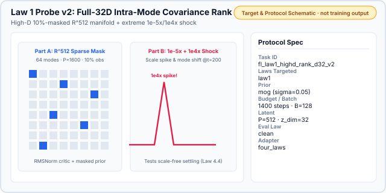
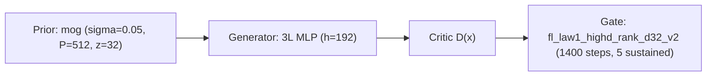

<!-- Generated Forge experiment page — do not edit manually; regenerate via `python -m experiments.forge.experiment_docs` -->

[← Leaderboard](../technique-inventory.md) · [Experiment Catalog](README.md) · [Explore by Laws](../LAWS_HUB.md) · [Research Portal](https://hypergan.github.io/ParticleGAN/)

# Law 1 Probe v2: Full-32D Intra-Mode Covariance Rank (P=512) (`fl_law1_highd_rank_d32_v2`)

| Field | Value |
| --- | --- |
| **Laws Tested** | [Law 1](../LAWS_HUB.md#law1) |
| **Edge Cases** | `high-dimensional` `intra-mode-rank` `multi-scale-width` |
| **Primary View (`discriminator_stability`)** | Not in `discriminator_stability` |
| **Four Laws Adherence Role** | — |
| **Fixed Full-Suite Denominator** | No (diagnostic / auxiliary cohort) |
| **Adapter / Domain** | `four_laws` / `fl_law1_highd_rank_d32_v2` |
| **Prior** | `mog` (sigma=`0.05`, standardize=`False`) |
| **Update Budget** | `1400` steps |

## What This Experiment Tests

Split out from v1's compound R^32 probe to isolate Law 1 full-32D covariance rank: requires core_eig_min >= 0.25 across all 5 Haar-rotated R^32 clusters with P=512 particles (>32 particles even on the 8% minority mode).

> [!NOTE]
> **Protocol notes:** Four Laws Adherence v2 diagnostic probe (1,400 updates, Haar-rotated R^32, P=512).

## Laws & Edge Cases Targeted

- **[Law 1: Representational Geometry](../LAWS_HUB.md#law1)** ([Law 1 theory](../../../docs/four-laws.md#law-1--representational-geometry)) — Can the system represent the required probability measure efficiently and faithfully?
- **Edge-case tags:** `high-dimensional`, `intra-mode-rank`, `multi-scale-width`

## Common Failure Mode

Low-rank projection sketches, Jensen covariance shrinkage, or particle under-allocation collapse intra-cluster covariance eigenvalues in R^32 even when cluster centers are found.

## Visual Schematic



*Target & Protocol Schematic · not training output — generated deterministically from the declared task contract.*

## Protocol & Architecture Diagram



## Task Contract & Numerical Gates

### Execution & Sampling Contract

| Contract Field | Declared Value |
| --- | --- |
| Initializer | `deterministic_orthogonal` |
| Prior | `mog` (sigma=`0.05`, standardize=`False`) |
| Update Budget | `1400` steps |
| Batch Size | `128` |
| Particles / Latent Dim | `P=512` / `z_dim=32` |
| Sampling Law | `public_prior_without_output_noise` |
| Evaluation Output Noise | `clean` |
| Scoring Weights | `live` |
| Architecture | `family=simple_mlp, hidden=192, layers=3, out_dim=32, in_dim=32, fourier=0` |
| Integrity Guards | `finite_state`, `optimizer_roles`, `exact_optimizer_updates`, `mechanism_exercised`, `rng_isolation` |
| Assigned Views | `four-laws-adherence-v2` (T1 diagnostic) |

### Numerical Pass/Fail Thresholds

| Metric | Operator | Threshold |
| --- | :---: | ---: |
| `finite_fraction` | `==` | `1.0` |
| `modes` | `==` | `5` |
| `core_eig_min` | `>=` | `0.25` |
| `precision` | `>=` | `0.85` |
| `mass_tv` | `<=` | `0.14` |

## Recorded Family Results

> [!IMPORTANT]
> Screening outcomes below come from recorded single-seed (`seed = 0`) Forge evidence. `NOT MEASURED`, `BLOCKED`, and `INCOMPATIBLE` are non-numerical states — not scientific failures — and confer no pass or qualification credit.

| Family | Selected Candidate | Outcome | Key Recorded Metrics | Family Report | Training Media |
| --- | --- | :---: | --- | --- | --- |
| **Atlas** | `atlas-particle-normal-v4` | `NOT MEASURED` | No recorded result for this selected configuration and source. | [Atlas](../families/atlas.md#cohort-cuda-daa283c8a640) | — |
| **Axiom** | `axiom-v5` | `DIAG_PASS` | No recorded result for this selected configuration and source. | [Axiom](../families/axiom.md#cohort-cuda-42a130a78fc3) | [HF GIF](https://huggingface.co/datasets/HyperGAN/particlegan-forge-evidence/resolve/main/media/forge/leaderboard/axiom/axiom-v4/fl_law1_highd_rank_d32_v2.gif) |
| **BCAP** | `recipe-prior-refactor-bcap-pure-v1` | `NOT MEASURED` | No recorded result for this selected configuration and source. | [BCAP](../families/bcap-pure.md#cohort-cuda-1bf9d7d34422) | [HF GIF](https://huggingface.co/datasets/HyperGAN/particlegan-forge-evidence/resolve/main/media/forge/leaderboard/bcap-pure/recipe-prior-refactor-bcap-pure-v1/fl_law1_highd_rank_d32_v2.gif) |
| **BISPF** | `bispf-optimized-quintic-v1` | `NOT MEASURED` | No recorded result for this selected configuration and source. | [BISPF](../families/bispf.md#cohort-cuda-1bf9d7d34422) | [HF GIF](https://huggingface.co/datasets/HyperGAN/particlegan-forge-evidence/resolve/main/media/forge/leaderboard/bispf/bispf-optimized-quintic-v1/fl_law1_highd_rank_d32_v2.gif) |
| **E22** | `e22` | `NOT MEASURED` | No recorded result for this selected configuration and source. | [E22](../families/e22.md#cohort-cuda-1bf9d7d34422) | — |
| **EMPF** | `empf-v8` | `NOT MEASURED` | No recorded result for this selected configuration and source. | [EMPF](../families/empf.md#cohort-cuda-23a94f16ca88) | [HF GIF](https://huggingface.co/datasets/HyperGAN/particlegan-forge-evidence/resolve/main/media/forge/leaderboard/empf/empf-v8/fl_law1_highd_rank_d32_v2.gif) |
| **GAN v3 release 0.7** | `recipe-prior-refactor-release07-gan-v3-v1` | `NOT MEASURED` | No recorded result for this selected configuration and source. | [GAN v3 release 0.7](../families/release07-gan-v3.md#cohort-cuda-daa283c8a640) | [HF GIF](https://huggingface.co/datasets/HyperGAN/particlegan-forge-evidence/resolve/main/media/forge/leaderboard/release07-gan-v3/recipe-prior-refactor-release07-gan-v3-v1/fl_law1_highd_rank_d32_v2.gif) |
| **K3P** | `recipe-prior-refactor-k3p-v1` | `NOT MEASURED` | No recorded result for this selected configuration and source. | [K3P](../families/k3p.md#cohort-cuda-daa283c8a640) | [HF GIF](https://huggingface.co/datasets/HyperGAN/particlegan-forge-evidence/resolve/main/media/forge/leaderboard/k3p/recipe-prior-refactor-k3p-v1/fl_law1_highd_rank_d32_v2.gif) |
| **KA2** | `recipe-prior-refactor-ka2-v1` | `NOT MEASURED` | No recorded result for this selected configuration and source. | [KA2](../families/ka2.md#cohort-cuda-daa283c8a640) | [HF GIF](https://huggingface.co/datasets/HyperGAN/particlegan-forge-evidence/resolve/main/media/forge/leaderboard/ka2/recipe-prior-refactor-ka2-v1/fl_law1_highd_rank_d32_v2.gif) |
| **R1/R2** | `recipe-prior-refactor-r1r2-v1` | `NOT MEASURED` | No recorded result for this selected configuration and source. | [R1/R2](../families/r1r2.md#cohort-cuda-daa283c8a640) | [HF GIF](https://huggingface.co/datasets/HyperGAN/particlegan-forge-evidence/resolve/main/media/forge/leaderboard/r1r2/recipe-prior-refactor-r1r2-v1/fl_law1_highd_rank_d32_v2.gif) |
| **RHBI** | `rhbi-v12` | `NOT MEASURED` | No recorded result for this selected configuration and source. | [RHBI](../families/rhbi.md#cohort-cuda-23a94f16ca88) | [HF GIF](https://huggingface.co/datasets/HyperGAN/particlegan-forge-evidence/resolve/main/media/forge/leaderboard/rhbi/rhbi-v12/fl_law1_highd_rank_d32_v2.gif) |
| **Unified** | `unified-v15` | `NOT MEASURED` | No recorded result for this selected configuration and source. | [Unified](../families/unified.md#cohort-cuda-42a130a78fc3) | [HF GIF](https://huggingface.co/datasets/HyperGAN/particlegan-forge-evidence/resolve/main/media/forge/leaderboard/unified/unified-v11/fl_law1_highd_rank_d32_v2.gif) |

### Four Laws Adherence Diagnostic Receipts (Separate Cohort)

*Diagnostic readouts and Colab matched-GPU receipts for `four-laws-adherence-v1` (protocol seed `0`, unchanged recipes; research telemetry only — separate from ordinary selected-cohort qualification above and confers no qualification or default-adoption credit):*

| Candidate | Family | GPU | Outcome | `min_margin` | NVML Energy | Key Recorded Metrics | Receipt |
| --- | --- | --- | :---: | ---: | ---: | --- | --- |
| `axiom-v4` | `axiom` | NVIDIA L4 | **PASS** | `+0.000` | 2.38 kJ (J-to-PASS) | canon_plane_eig_min=0.3776, core_eig_max=2.435, core_eig_min=0.2613, finite_fraction=1 | [1782f5e30eef45bb8e5d01c376caf1af.json](../technique-receipts/1782f5e30eef45bb8e5d01c376caf1af.json) |
| `axiom-v5` | `axiom` | NVIDIA L4 | **PASS** | `+0.000` | 2.40 kJ (J-to-PASS) | canon_plane_eig_min=0.3776, core_eig_max=2.435, core_eig_min=0.2613, finite_fraction=1 | [00c9bf47e43947e696e78e3ec4a7663b.json](../technique-receipts/00c9bf47e43947e696e78e3ec4a7663b.json) |
| `axiom-v6` | `axiom` | NVIDIA RTX A6000 | **PASS** | `+0.000` | 5.07 kJ (J-to-PASS) | canon_plane_eig_min=0.5876, core_eig_max=2.261, core_eig_min=0.4729, finite_fraction=1 | [readout-69f7d043a14e2780fb2cdd4a.json](../records/readout-69f7d043a14e2780fb2cdd4a.json) |
| `unified-v15` | `unified` | NVIDIA L4 | **FAIL** | `+0.000` | 5.98 kJ | canon_plane_eig_min=0.7838, core_eig_max=3.201, core_eig_min=0.2675, finite_fraction=1 | [1a70b6fccd7042e6917cfec57b601eba.json](../technique-receipts/1a70b6fccd7042e6917cfec57b601eba.json) |
| `unified-v14` | `unified` | NVIDIA L4 | **FAIL** | `-0.997` | 4.13 kJ | canon_plane_eig_min=0.2309, core_eig_max=6.34, core_eig_min=0.0008619, finite_fraction=1 | [6be9dfc73e88425987234a96176d6c2a.json](../technique-receipts/6be9dfc73e88425987234a96176d6c2a.json) |
| `unified-v11` | `unified` | NVIDIA L4 | **FAIL** | `-0.997` | 4.47 kJ | canon_plane_eig_min=0.2123, core_eig_max=6.695, core_eig_min=0.00071, finite_fraction=1 | [f83ecd4276c4415db2c5645221bf0e82.json](../technique-receipts/f83ecd4276c4415db2c5645221bf0e82.json) |
| `recipe-prior-refactor-bcap-pure-v1` | `bcap-dualnorm` | NVIDIA L4 | **FAIL** | `-0.999` | 3.49 kJ | canon_plane_eig_min=0.2366, core_eig_max=5.814, core_eig_min=0.0002548, finite_fraction=1 | [2bd13ace65544be298cf56471bbaec82.json](../technique-receipts/2bd13ace65544be298cf56471bbaec82.json) |
| `recipe-prior-refactor-release07-gan-v3-v1` | `release07-gan-v3` | NVIDIA L4 | **FAIL** | `-0.999` | 874 J | canon_plane_eig_min=0.2332, core_eig_max=6.861, core_eig_min=0.0001652, finite_fraction=1 | [fcd6608998d947819b3503aa9e215839.json](../technique-receipts/fcd6608998d947819b3503aa9e215839.json) |
| `recipe-prior-refactor-k3p-v1` | `k3p` | NVIDIA L4 | **FAIL** | `-1.139` | 1.01 kJ | canon_plane_eig_min=0, core_eig_max=99, core_eig_min=0, finite_fraction=1 | [3eefe600f4784e999e3872f1a089b7b4.json](../technique-receipts/3eefe600f4784e999e3872f1a089b7b4.json) |
| `recipe-prior-refactor-r1r2-v1` | `r1r2` | NVIDIA L4 | **FAIL** | `-1.207` | 819 J | canon_plane_eig_min=0, core_eig_max=99, core_eig_min=0, finite_fraction=1 | [f591e4e2fcb5419fbfe39f901b64ae89.json](../technique-receipts/f591e4e2fcb5419fbfe39f901b64ae89.json) |
| `recipe-prior-refactor-ka2-v1` | `ka2` | NVIDIA L4 | **FAIL** | `-1.350` | 1.11 kJ | canon_plane_eig_min=0, core_eig_max=99, core_eig_min=0, finite_fraction=1 | [e7cffd30a88945469c674bc591c3cfc1.json](../technique-receipts/e7cffd30a88945469c674bc591c3cfc1.json) |
| `empf-v8` | `empf` | NVIDIA L4 | **FAIL** | `-3.317` | 2.11 kJ | canon_plane_eig_min=0, core_eig_max=99, core_eig_min=0, finite_fraction=1 | [5f660685b96340e7bd7ec96b76e5a550.json](../technique-receipts/5f660685b96340e7bd7ec96b76e5a550.json) |
| `bispf-optimized-quintic-v1` | `bispf` | NVIDIA L4 | **FAIL** | `-3.448` | 4.24 kJ | canon_plane_eig_min=0, core_eig_max=99, core_eig_min=0, finite_fraction=1 | [c7d3d6abc4aa48ffa6e32eb6961232d6.json](../technique-receipts/c7d3d6abc4aa48ffa6e32eb6961232d6.json) |
| `rhbi-v12` | `rhbi` | NVIDIA L4 | **FAIL** | `-3.571` | 3.59 kJ | canon_plane_eig_min=0, core_eig_max=99, core_eig_min=0, finite_fraction=1 | [dc5a05b626cb4a53902f2b3331012b07.json](../technique-receipts/dc5a05b626cb4a53902f2b3331012b07.json) |

## Reproduce This Experiment

```bash
# Validate this task declaration and inspect planned dependencies
python -m experiments.forge validate
python -m experiments.forge plan --view four-laws-adherence-v2 --candidate unified-v12 --tasks fl_law1_highd_rank_d32_v2
```

**Declaration & Source Files:**

- Task contract: [configs/forge/tasks/fl_law1_highd_rank_d32_v2.json](../../../configs/forge/tasks/fl_law1_highd_rank_d32_v2.json)
- Source code: [benchmarks/toy_audit/api_four_laws_123.py](../../../benchmarks/toy_audit/api_four_laws_123.py)
- Source code: [experiments/forge/four_laws.py](../../../experiments/forge/four_laws.py)

## Annotation Provenance

This page was assembled read-only from the following versioned inputs without altering any task execution/evaluation fingerprint:

- **Task contract JSON:** [configs/forge/tasks/fl_law1_highd_rank_d32_v2.json](../../../configs/forge/tasks/fl_law1_highd_rank_d32_v2.json)
- **Editorial task documentation sidecar:** [configs/forge/task-documentation/fl_law1_highd_rank_d32_v2.json](../../../configs/forge/task-documentation/fl_law1_highd_rank_d32_v2.json)
- **Read-only Python AST source:** [benchmarks/toy_audit/api_four_laws_123.py](../../../benchmarks/toy_audit/api_four_laws_123.py) (AST symbols: `__doc__`, `THRESHOLDS`, `SPECS`)
- **Read-only Python AST source:** [experiments/forge/four_laws.py](../../../experiments/forge/four_laws.py) (AST symbols: `__doc__`)
