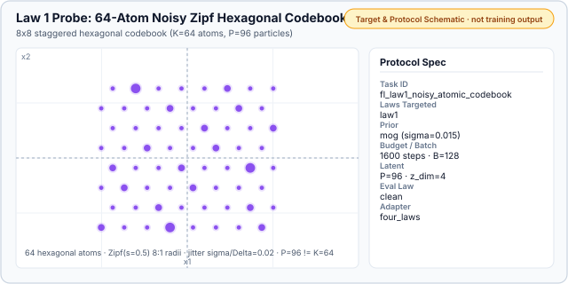
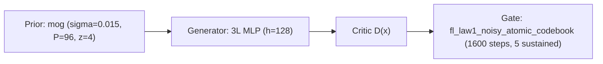

<!-- Generated Forge experiment page — do not edit manually; regenerate via `python -m experiments.forge.experiment_docs` -->

[← Leaderboard](../technique-inventory.md) · [Experiment Catalog](README.md) · [Explore by Laws](../LAWS_HUB.md) · [Research Portal](https://hypergan.github.io/ParticleGAN/)

# Law 1 Probe: 64-Atom Noisy Zipf Hexagonal Codebook (P=96 != K=64) (`fl_law1_noisy_atomic_codebook`)

| Field | Value |
| --- | --- |
| **Laws Tested** | [Law 1](../LAWS_HUB.md#law1) |
| **Edge Cases** | `noisy-atomic-codebook` `zipf-8to1-skew` `capacity-mismatch` `disconnected-support` |
| **Primary View (`discriminator_stability`)** | Not in `discriminator_stability` |
| **Four Laws Adherence Role** | law1 (four_laws_probe) |
| **Fixed Full-Suite Denominator** | No (diagnostic / auxiliary cohort) |
| **Adapter / Domain** | `four_laws` / `fl_law1_noisy_atomic_codebook` |
| **Prior** | `mog` (sigma=`0.015`, standardize=`False`) |
| **Update Budget** | `1600` steps |

## What This Experiment Tests

Falsification probe testing whether discrete-atomic mechanisms generalize beyond exact zero-noise hypercubes: 64 hexagonal atoms with sigma/Delta=0.02 Gaussian jitter, 8:1 Zipf weights, and mismatched P=96 particles.

> [!NOTE]
> **Protocol notes:** Four Laws Adherence diagnostic probe (1,600 updates, K=64 atoms, P=96 particles).

## Laws & Edge Cases Targeted

- **[Law 1: Representational Geometry](../LAWS_HUB.md#law1)** ([Law 1 theory](../../../docs/four-laws.md#law-1--representational-geometry)) — Can the system represent the required probability measure efficiently and faithfully?
- **Edge-case tags:** `noisy-atomic-codebook`, `zipf-8to1-skew`, `capacity-mismatch`, `disconnected-support`

## Common Failure Mode

Exact zero-radius duplicate detectors fail to fire under 2% Gaussian jitter, while rigid 1-to-1 bijection ledgers flatten the 8:1 Zipf weights or misallocate the 32 surplus particles.

## Visual Schematic



*Target & Protocol Schematic · not training output — generated deterministically from the declared task contract.*

## Protocol & Architecture Diagram



## Task Contract & Numerical Gates

### Execution & Sampling Contract

| Contract Field | Declared Value |
| --- | --- |
| Initializer | `deterministic_orthogonal` |
| Prior | `mog` (sigma=`0.015`, standardize=`False`) |
| Update Budget | `1600` steps |
| Batch Size | `128` |
| Particles / Latent Dim | `P=96` / `z_dim=4` |
| Sampling Law | `public_prior_without_output_noise` |
| Evaluation Output Noise | `clean` |
| Scoring Weights | `live` |
| Architecture | `family=simple_mlp, hidden=128, layers=3, out_dim=2, in_dim=2, fourier=3` |
| Integrity Guards | `finite_state`, `optimizer_roles`, `exact_optimizer_updates`, `mechanism_exercised`, `rng_isolation` |
| Assigned Views | `four-laws-adherence-v1` (T1 diagnostic) |

### Numerical Pass/Fail Thresholds

| Metric | Operator | Threshold |
| --- | :---: | ---: |
| `finite_fraction` | `==` | `1.0` |
| `atom_recall` | `>=` | `0.96` |
| `mass_tv` | `<=` | `0.12` |
| `rms_nearest_dist` | `<=` | `0.08` |
| `outlier_rate` | `<=` | `0.05` |

## Recorded Family Results

> [!IMPORTANT]
> Screening outcomes below come from recorded single-seed (`seed = 0`) Forge evidence. `NOT MEASURED`, `BLOCKED`, and `INCOMPATIBLE` are non-numerical states — not scientific failures — and confer no pass or qualification credit.

| Family | Selected Candidate | Outcome | Key Recorded Metrics | Family Report | Training Media |
| --- | --- | :---: | --- | --- | --- |
| **Atlas** | `atlas-particle-normal-v4` | `NOT MEASURED` | No recorded result for this selected configuration and source. | [Atlas](../families/atlas.md#cohort-cuda-bc3debd3fa5e) | — |
| **BCAP** | `recipe-prior-refactor-bcap-pure-v1` | `NOT MEASURED` | No recorded result for this selected configuration and source. | [BCAP](../families/bcap-pure.md#cohort-cuda-1bf9d7d34422) | — |
| **BISPF** | `bispf-optimized-quintic-v1` | `NOT MEASURED` | No recorded result for this selected configuration and source. | [BISPF](../families/bispf.md#cohort-cuda-1bf9d7d34422) | — |
| **E22** | `e22` | `NOT MEASURED` | No recorded result for this selected configuration and source. | [E22](../families/e22.md#cohort-cuda-1bf9d7d34422) | — |
| **EMPF** | `empf-v8` | `NOT MEASURED` | No recorded result for this selected configuration and source. | [EMPF](../families/empf.md#cohort-cuda-23a94f16ca88) | — |
| **GAN v3 release 0.7** | `recipe-prior-refactor-release07-gan-v3-v1` | `NOT MEASURED` | No recorded result for this selected configuration and source. | [GAN v3 release 0.7](../families/release07-gan-v3.md#cohort-cuda-1bf9d7d34422) | — |
| **K3P** | `recipe-prior-refactor-k3p-v1` | `NOT MEASURED` | No recorded result for this selected configuration and source. | [K3P](../families/k3p.md#cohort-cuda-1bf9d7d34422) | — |
| **KA2** | `recipe-prior-refactor-ka2-v1` | `NOT MEASURED` | No recorded result for this selected configuration and source. | [KA2](../families/ka2.md#cohort-cuda-1bf9d7d34422) | — |
| **R1/R2** | `recipe-prior-refactor-r1r2-v1` | `NOT MEASURED` | No recorded result for this selected configuration and source. | [R1/R2](../families/r1r2.md#cohort-cuda-1bf9d7d34422) | — |
| **RHBI** | `rhbi-v12` | `NOT MEASURED` | No recorded result for this selected configuration and source. | [RHBI](../families/rhbi.md#cohort-cuda-23a94f16ca88) | — |
| **Unified** | `unified-v11` | `NOT MEASURED` | No recorded result for this selected configuration and source. | [Unified](../families/unified.md#cohort-cuda-42a130a78fc3) | — |

### Four Laws Adherence Diagnostic Receipts (Separate Cohort)

*Diagnostic readouts and Colab matched-GPU receipts for `four-laws-adherence-v1` (protocol seed `0`, unchanged recipes; research telemetry only — separate from ordinary selected-cohort qualification above and confers no qualification or default-adoption credit):*

| Candidate | Family | GPU | Outcome | `min_margin` | NVML Energy | Key Recorded Metrics | Receipt |
| --- | --- | --- | :---: | ---: | ---: | --- | --- |
| `empf-v8` | `empf` | NVIDIA L4 | **FAIL** | `-2.755` | 2.77 kJ | atom_recall=0.9375, captured_atoms=60, finite_fraction=1, mass_tv=0.1012 | [df19165717cd40efac79a1e9c307cf6a.json](../technique-receipts/df19165717cd40efac79a1e9c307cf6a.json) |
| `recipe-prior-refactor-bcap-pure-v1` | `bcap-dualnorm` | NVIDIA L4 | **FAIL** | `-2.807` | 2.76 kJ | atom_recall=0.9375, captured_atoms=60, finite_fraction=1, mass_tv=0.1354 | [70e2f1dc5041452d9ba6852ebafe15d8.json](../technique-receipts/70e2f1dc5041452d9ba6852ebafe15d8.json) |
| `bispf-optimized-quintic-v1` | `bispf` | NVIDIA L4 | **FAIL** | `-3.486` | 3.48 kJ | atom_recall=0.9531, captured_atoms=61, finite_fraction=1, mass_tv=0.1066 | [7dfcc0eaae7e4defb48a7e74670b6b74.json](../technique-receipts/7dfcc0eaae7e4defb48a7e74670b6b74.json) |
| `recipe-prior-refactor-r1r2-v1` | `r1r2` | NVIDIA L4 | **FAIL** | `-4.142` | 1.12 kJ | atom_recall=0.7969, captured_atoms=51, finite_fraction=1, mass_tv=0.2011 | [66085784c72042fbb67311c90a3e8e11.json](../technique-receipts/66085784c72042fbb67311c90a3e8e11.json) |
| `rhbi-v12` | `rhbi` | NVIDIA L4 | **FAIL** | `-4.869` | 3.64 kJ | atom_recall=0.8906, captured_atoms=57, finite_fraction=1, mass_tv=0.1179 | [e63c8b9dc17a4f579a59549f294b4ce1.json](../technique-receipts/e63c8b9dc17a4f579a59549f294b4ce1.json) |
| `unified-v11` | `unified` | NVIDIA L4 | **FAIL** | `-8.131` | 4.97 kJ | atom_recall=0.6562, captured_atoms=42, finite_fraction=1, mass_tv=0.2403 | [34819d31465741138120b0bca5ce1e12.json](../technique-receipts/34819d31465741138120b0bca5ce1e12.json) |
| `unified-v14` | `unified` | NVIDIA L4 | **FAIL** | `-10.846` | 4.29 kJ | atom_recall=0.5, captured_atoms=32, finite_fraction=1, mass_tv=0.2512 | [8abf3b1670cd4a90966fbb483bf57b99.json](../technique-receipts/8abf3b1670cd4a90966fbb483bf57b99.json) |
| `recipe-prior-refactor-ka2-v1` | `ka2` | NVIDIA L4 | **FAIL** | `-12.013` | 1.48 kJ | atom_recall=0.375, captured_atoms=24, finite_fraction=1, mass_tv=0.3601 | [d1d1dec46661498e95425023158805ea.json](../technique-receipts/d1d1dec46661498e95425023158805ea.json) |
| `unified-v12` | `unified` | NVIDIA L4 | **FAIL** | `-12.257` | 4.01 kJ | atom_recall=0.5469, captured_atoms=35, finite_fraction=1, mass_tv=0.2795 | [868155f310fc4ba0be988f1f4c43cb61.json](../technique-receipts/868155f310fc4ba0be988f1f4c43cb61.json) |
| `unified-v13` | `unified` | NVIDIA L4 | **FAIL** | `-12.257` | 3.97 kJ | atom_recall=0.5469, captured_atoms=35, finite_fraction=1, mass_tv=0.2795 | [c256b3290a3f456bbf2c103c2e1df9e1.json](../technique-receipts/c256b3290a3f456bbf2c103c2e1df9e1.json) |
| `recipe-prior-refactor-k3p-v1` | `k3p` | NVIDIA L4 | **FAIL** | `-12.604` | 1.35 kJ | atom_recall=0.375, captured_atoms=24, finite_fraction=1, mass_tv=0.36 | [a59a58602796427a8cb5add8c39beb8a.json](../technique-receipts/a59a58602796427a8cb5add8c39beb8a.json) |
| `minimal-v2` | `minimal` | NVIDIA L4 | **FAIL** | `-12.618` | 4.50 kJ | atom_recall=0.4219, captured_atoms=27, finite_fraction=1, mass_tv=0.2246 | [d095b5919ca54918a052743102f1b848.json](../technique-receipts/d095b5919ca54918a052743102f1b848.json) |
| `recipe-prior-refactor-release07-gan-v3-v1` | `release07-gan-v3` | NVIDIA L4 | **FAIL** | `-13.634` | 1.13 kJ | atom_recall=0.2969, captured_atoms=19, finite_fraction=1, mass_tv=0.4433 | [3abf8d1033184945b8369f21b2e97cf1.json](../technique-receipts/3abf8d1033184945b8369f21b2e97cf1.json) |

## Reproduce This Experiment

```bash
# Validate this task declaration and inspect planned dependencies
python -m experiments.forge validate
python -m experiments.forge plan --view four-laws-adherence-v1 --candidate unified-v12 --tasks fl_law1_noisy_atomic_codebook
```

**Declaration & Source Files:**

- Task contract: [configs/forge/tasks/fl_law1_noisy_atomic_codebook.json](../../../configs/forge/tasks/fl_law1_noisy_atomic_codebook.json)
- Source code: [benchmarks/toy_audit/api_four_laws_123.py](../../../benchmarks/toy_audit/api_four_laws_123.py)
- Source code: [experiments/forge/four_laws.py](../../../experiments/forge/four_laws.py)

## Annotation Provenance

This page was assembled read-only from the following versioned inputs without altering any task execution/evaluation fingerprint:

- **Task contract JSON:** [configs/forge/tasks/fl_law1_noisy_atomic_codebook.json](../../../configs/forge/tasks/fl_law1_noisy_atomic_codebook.json)
- **Editorial task documentation sidecar:** [configs/forge/task-documentation/fl_law1_noisy_atomic_codebook.json](../../../configs/forge/task-documentation/fl_law1_noisy_atomic_codebook.json)
- **Read-only Python AST source:** [benchmarks/toy_audit/api_four_laws_123.py](../../../benchmarks/toy_audit/api_four_laws_123.py) (AST symbols: `__doc__`, `THRESHOLDS`, `SPECS`)
- **Read-only Python AST source:** [experiments/forge/four_laws.py](../../../experiments/forge/four_laws.py) (AST symbols: `__doc__`)
