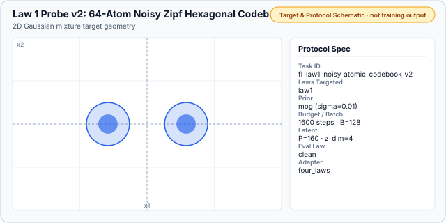
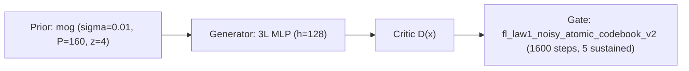

<!-- Generated Forge experiment page — do not edit manually; regenerate via `python -m experiments.forge.experiment_docs` -->

[← Leaderboard](../technique-inventory.md) · [Experiment Catalog](README.md) · [Explore by Laws](../LAWS_HUB.md) · [Research Portal](https://hypergan.github.io/ParticleGAN/)

# Law 1 Probe v2: 64-Atom Noisy Zipf Hexagonal Codebook (P=160, matched prior sigma) (`fl_law1_noisy_atomic_codebook_v2`)

| Field | Value |
| --- | --- |
| **Laws Tested** | [Law 1](../LAWS_HUB.md#law1) |
| **Edge Cases** | `noisy-atomic-codebook` `zipf-8to1-skew` `capacity-mismatch` `disconnected-support` |
| **Primary View (`discriminator_stability`)** | Not in `discriminator_stability` |
| **Four Laws Adherence Role** | — |
| **Fixed Full-Suite Denominator** | No (diagnostic / auxiliary cohort) |
| **Adapter / Domain** | `four_laws` / `fl_law1_noisy_atomic_codebook_v2` |
| **Prior** | `mog` (sigma=`0.01`, standardize=`False`) |
| **Update Budget** | `1600` steps |

## What This Experiment Tests

Calibrated v2 falsification probe for discrete-atomic support under sigma/Delta=0.02 Gaussian jitter and 8:1 Zipf weights, using P=160 particles and matched prior.sigma=0.010 <= target_sigma so well-behaved priors are geometrically feasible.

> [!NOTE]
> **Protocol notes:** Four Laws Adherence v2 diagnostic probe (1,600 updates, K=64 atoms, P=160, prior.sigma=0.010).

## Laws & Edge Cases Targeted

- **[Law 1: Representational Geometry](../LAWS_HUB.md#law1)** ([Law 1 theory](../../../docs/four-laws.md#law-1--representational-geometry)) — Can the system represent the required probability measure efficiently and faithfully?
- **Edge-case tags:** `noisy-atomic-codebook`, `zipf-8to1-skew`, `capacity-mismatch`, `disconnected-support`

## Common Failure Mode

Zero-radius atomic detectors miss 2%-jittered atoms while rigid 1-to-1 particle ledgers distort the 8:1 Zipf weights or leave high outlier rates.

## Visual Schematic



*Target & Protocol Schematic · not training output — generated deterministically from the declared task contract.*

## Protocol & Architecture Diagram



## Task Contract & Numerical Gates

### Execution & Sampling Contract

| Contract Field | Declared Value |
| --- | --- |
| Initializer | `deterministic_orthogonal` |
| Prior | `mog` (sigma=`0.01`, standardize=`False`) |
| Update Budget | `1600` steps |
| Batch Size | `128` |
| Particles / Latent Dim | `P=160` / `z_dim=4` |
| Sampling Law | `public_prior_without_output_noise` |
| Evaluation Output Noise | `clean` |
| Scoring Weights | `live` |
| Architecture | `family=simple_mlp, hidden=128, layers=3, out_dim=2, in_dim=2, fourier=3` |
| Integrity Guards | `finite_state`, `optimizer_roles`, `exact_optimizer_updates`, `mechanism_exercised`, `rng_isolation` |
| Assigned Views | `four-laws-adherence-v2` (T1 diagnostic) |

### Numerical Pass/Fail Thresholds

| Metric | Operator | Threshold |
| --- | :---: | ---: |
| `finite_fraction` | `==` | `1.0` |
| `atom_recall` | `>=` | `0.96` |
| `mass_tv` | `<=` | `0.15` |
| `rms_nearest_dist` | `<=` | `0.08` |
| `outlier_rate` | `<=` | `0.1` |

## Recorded Family Results

> [!IMPORTANT]
> Screening outcomes below come from recorded single-seed (`seed = 0`) Forge evidence. `NOT MEASURED`, `BLOCKED`, and `INCOMPATIBLE` are non-numerical states — not scientific failures — and confer no pass or qualification credit.

| Family | Selected Candidate | Outcome | Key Recorded Metrics | Family Report | Training Media |
| --- | --- | :---: | --- | --- | --- |
| **Atlas** | `atlas-particle-normal-v4` | `NOT MEASURED` | No recorded result for this selected configuration and source. | [Atlas](../families/atlas.md#cohort-cuda-daa283c8a640) | — |
| **Axiom** | `axiom-v4` | `NOT MEASURED` | No recorded result for this selected configuration and source. | [Axiom](../families/axiom.md#cohort-cuda-daa283c8a640) | [HF GIF](https://huggingface.co/datasets/HyperGAN/particlegan-forge-evidence/resolve/main/media/forge/leaderboard/axiom/axiom-v4/fl_law1_noisy_atomic_codebook_v2.gif) |
| **BCAP** | `recipe-prior-refactor-bcap-pure-v1` | `NOT MEASURED` | No recorded result for this selected configuration and source. | [BCAP](../families/bcap-pure.md#cohort-cuda-1bf9d7d34422) | [HF GIF](https://huggingface.co/datasets/HyperGAN/particlegan-forge-evidence/resolve/main/media/forge/leaderboard/bcap-pure/recipe-prior-refactor-bcap-pure-v1/fl_law1_noisy_atomic_codebook_v2.gif) |
| **BISPF** | `bispf-optimized-quintic-v1` | `NOT MEASURED` | No recorded result for this selected configuration and source. | [BISPF](../families/bispf.md#cohort-cuda-1bf9d7d34422) | [HF GIF](https://huggingface.co/datasets/HyperGAN/particlegan-forge-evidence/resolve/main/media/forge/leaderboard/bispf/bispf-optimized-quintic-v1/fl_law1_noisy_atomic_codebook_v2.gif) |
| **E22** | `e22` | `NOT MEASURED` | No recorded result for this selected configuration and source. | [E22](../families/e22.md#cohort-cuda-1bf9d7d34422) | — |
| **EMPF** | `empf-v8` | `NOT MEASURED` | No recorded result for this selected configuration and source. | [EMPF](../families/empf.md#cohort-cuda-23a94f16ca88) | [HF GIF](https://huggingface.co/datasets/HyperGAN/particlegan-forge-evidence/resolve/main/media/forge/leaderboard/empf/empf-v8/fl_law1_noisy_atomic_codebook_v2.gif) |
| **GAN v3 release 0.7** | `recipe-prior-refactor-release07-gan-v3-v1` | `NOT MEASURED` | No recorded result for this selected configuration and source. | [GAN v3 release 0.7](../families/release07-gan-v3.md#cohort-cuda-daa283c8a640) | [HF GIF](https://huggingface.co/datasets/HyperGAN/particlegan-forge-evidence/resolve/main/media/forge/leaderboard/release07-gan-v3/recipe-prior-refactor-release07-gan-v3-v1/fl_law1_noisy_atomic_codebook_v2.gif) |
| **K3P** | `recipe-prior-refactor-k3p-v1` | `NOT MEASURED` | No recorded result for this selected configuration and source. | [K3P](../families/k3p.md#cohort-cuda-daa283c8a640) | [HF GIF](https://huggingface.co/datasets/HyperGAN/particlegan-forge-evidence/resolve/main/media/forge/leaderboard/k3p/recipe-prior-refactor-k3p-v1/fl_law1_noisy_atomic_codebook_v2.gif) |
| **KA2** | `recipe-prior-refactor-ka2-v1` | `NOT MEASURED` | No recorded result for this selected configuration and source. | [KA2](../families/ka2.md#cohort-cuda-daa283c8a640) | [HF GIF](https://huggingface.co/datasets/HyperGAN/particlegan-forge-evidence/resolve/main/media/forge/leaderboard/ka2/recipe-prior-refactor-ka2-v1/fl_law1_noisy_atomic_codebook_v2.gif) |
| **R1/R2** | `recipe-prior-refactor-r1r2-v1` | `NOT MEASURED` | No recorded result for this selected configuration and source. | [R1/R2](../families/r1r2.md#cohort-cuda-daa283c8a640) | [HF GIF](https://huggingface.co/datasets/HyperGAN/particlegan-forge-evidence/resolve/main/media/forge/leaderboard/r1r2/recipe-prior-refactor-r1r2-v1/fl_law1_noisy_atomic_codebook_v2.gif) |
| **RHBI** | `rhbi-v12` | `NOT MEASURED` | No recorded result for this selected configuration and source. | [RHBI](../families/rhbi.md#cohort-cuda-23a94f16ca88) | [HF GIF](https://huggingface.co/datasets/HyperGAN/particlegan-forge-evidence/resolve/main/media/forge/leaderboard/rhbi/rhbi-v12/fl_law1_noisy_atomic_codebook_v2.gif) |
| **Unified** | `unified-v11` | `NOT MEASURED` | No recorded result for this selected configuration and source. | [Unified](../families/unified.md#cohort-cuda-42a130a78fc3) | [HF GIF](https://huggingface.co/datasets/HyperGAN/particlegan-forge-evidence/resolve/main/media/forge/leaderboard/unified/unified-v11/fl_law1_noisy_atomic_codebook_v2.gif) |

### Four Laws Adherence Diagnostic Receipts (Separate Cohort)

*Diagnostic readouts and Colab matched-GPU receipts for `four-laws-adherence-v1` (protocol seed `0`, unchanged recipes; research telemetry only — separate from ordinary selected-cohort qualification above and confers no qualification or default-adoption credit):*

| Candidate | Family | GPU | Outcome | `min_margin` | NVML Energy | Key Recorded Metrics | Receipt |
| --- | --- | --- | :---: | ---: | ---: | --- | --- |
| `unified-v15` | `unified` | NVIDIA L4 | **PASS** | `+0.000` | 2.67 kJ (J-to-PASS) | atom_recall=1, captured_atoms=64, finite_fraction=1, mass_tv=0.0809 | [1f3dd91b4115496299c7ea71693fae8f.json](../technique-receipts/1f3dd91b4115496299c7ea71693fae8f.json) |
| `recipe-prior-refactor-r1r2-v1` | `r1r2` | NVIDIA L4 | **FAIL** | `-0.572` | 1.06 kJ | atom_recall=0.9844, captured_atoms=63, finite_fraction=1, mass_tv=0.1026 | [9fd49244ef6440f9bb6d415ea99f0a74.json](../technique-receipts/9fd49244ef6440f9bb6d415ea99f0a74.json) |
| `empf-v8` | `empf` | NVIDIA L4 | **FAIL** | `-0.757` | 2.47 kJ | atom_recall=0.9688, captured_atoms=62, finite_fraction=1, mass_tv=0.104 | [e598a6bcd3b84ffa984e540802788f0d.json](../technique-receipts/e598a6bcd3b84ffa984e540802788f0d.json) |
| `axiom-v4` | `axiom` | NVIDIA L4 | **FAIL** | `-0.807` | 3.99 kJ | atom_recall=0.9688, captured_atoms=62, finite_fraction=1, mass_tv=0.1073 | [90594a1e6a474f368434e52bbd9f7b5d.json](../technique-receipts/90594a1e6a474f368434e52bbd9f7b5d.json) |
| `axiom-v5` | `axiom` | NVIDIA L4 | **FAIL** | `-0.807` | 3.95 kJ | atom_recall=0.9688, captured_atoms=62, finite_fraction=1, mass_tv=0.1073 | [41013f2c9e244fd58865dae4543f3405.json](../technique-receipts/41013f2c9e244fd58865dae4543f3405.json) |
| `rhbi-v12` | `rhbi` | NVIDIA L4 | **FAIL** | `-1.502` | 3.54 kJ | atom_recall=0.9688, captured_atoms=62, finite_fraction=1, mass_tv=0.1149 | [546a21cc519c439ca24b37c1c34bbe6f.json](../technique-receipts/546a21cc519c439ca24b37c1c34bbe6f.json) |
| `bispf-optimized-quintic-v1` | `bispf` | NVIDIA L4 | **FAIL** | `-2.314` | 3.50 kJ | atom_recall=1, captured_atoms=64, finite_fraction=1, mass_tv=0.1182 | [f42d7fd6ac5e48aaac06dbcb2abdf137.json](../technique-receipts/f42d7fd6ac5e48aaac06dbcb2abdf137.json) |
| `recipe-prior-refactor-bcap-pure-v1` | `bcap-dualnorm` | NVIDIA L4 | **FAIL** | `-3.901` | 2.58 kJ | atom_recall=0.9844, captured_atoms=63, finite_fraction=1, mass_tv=0.1038 | [d50be52b4bac46b8881fa34bcedb898a.json](../technique-receipts/d50be52b4bac46b8881fa34bcedb898a.json) |
| `unified-v14` | `unified` | NVIDIA L4 | **FAIL** | `-5.965` | 3.96 kJ | atom_recall=0.5312, captured_atoms=34, finite_fraction=1, mass_tv=0.2798 | [8c8803a5dde7415393277cf5bb2ea37f.json](../technique-receipts/8c8803a5dde7415393277cf5bb2ea37f.json) |
| `unified-v11` | `unified` | NVIDIA L4 | **FAIL** | `-6.305` | 4.99 kJ | atom_recall=0.4844, captured_atoms=31, finite_fraction=1, mass_tv=0.2489 | [a552fea40f284cbfba6dcad427ce65a4.json](../technique-receipts/a552fea40f284cbfba6dcad427ce65a4.json) |
| `recipe-prior-refactor-k3p-v1` | `k3p` | NVIDIA L4 | **FAIL** | `-6.937` | 1.24 kJ | atom_recall=0.3906, captured_atoms=25, finite_fraction=1, mass_tv=0.392 | [96bfe8eb2b334c74b02dd32a98a6aae9.json](../technique-receipts/96bfe8eb2b334c74b02dd32a98a6aae9.json) |
| `recipe-prior-refactor-ka2-v1` | `ka2` | NVIDIA L4 | **FAIL** | `-7.173` | 1.39 kJ | atom_recall=0.3906, captured_atoms=25, finite_fraction=1, mass_tv=0.3493 | [b3a7654c696a4ac083bdc5798aabe603.json](../technique-receipts/b3a7654c696a4ac083bdc5798aabe603.json) |
| `recipe-prior-refactor-release07-gan-v3-v1` | `release07-gan-v3` | NVIDIA L4 | **FAIL** | `-11.004` | 1.11 kJ | atom_recall=0.4375, captured_atoms=28, finite_fraction=1, mass_tv=0.4077 | [130469e1098f41ff912874b36c6af8bd.json](../technique-receipts/130469e1098f41ff912874b36c6af8bd.json) |

## Reproduce This Experiment

```bash
# Validate this task declaration and inspect planned dependencies
python -m experiments.forge validate
python -m experiments.forge plan --view four-laws-adherence-v2 --candidate unified-v12 --tasks fl_law1_noisy_atomic_codebook_v2
```

**Declaration & Source Files:**

- Task contract: [configs/forge/tasks/fl_law1_noisy_atomic_codebook_v2.json](../../../configs/forge/tasks/fl_law1_noisy_atomic_codebook_v2.json)
- Source code: [benchmarks/toy_audit/api_four_laws_123.py](../../../benchmarks/toy_audit/api_four_laws_123.py)
- Source code: [experiments/forge/four_laws.py](../../../experiments/forge/four_laws.py)

## Annotation Provenance

This page was assembled read-only from the following versioned inputs without altering any task execution/evaluation fingerprint:

- **Task contract JSON:** [configs/forge/tasks/fl_law1_noisy_atomic_codebook_v2.json](../../../configs/forge/tasks/fl_law1_noisy_atomic_codebook_v2.json)
- **Editorial task documentation sidecar:** [configs/forge/task-documentation/fl_law1_noisy_atomic_codebook_v2.json](../../../configs/forge/task-documentation/fl_law1_noisy_atomic_codebook_v2.json)
- **Read-only Python AST source:** [benchmarks/toy_audit/api_four_laws_123.py](../../../benchmarks/toy_audit/api_four_laws_123.py) (AST symbols: `__doc__`, `THRESHOLDS`, `SPECS`)
- **Read-only Python AST source:** [experiments/forge/four_laws.py](../../../experiments/forge/four_laws.py) (AST symbols: `__doc__`)
