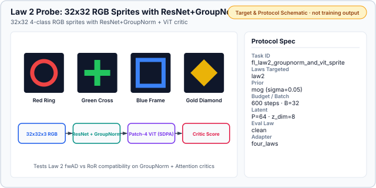
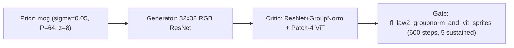

<!-- Generated Forge experiment page — do not edit manually; regenerate via `python -m experiments.forge.experiment_docs` -->

[← Leaderboard](../technique-inventory.md) · [Experiment Catalog](README.md) · [Explore by Laws](../LAWS_HUB.md) · [Research Portal](https://hypergan.github.io/ParticleGAN/)

# Law 2 Probe: 32x32 RGB Sprites with ResNet+GroupNorm + ViT Critic (`fl_law2_groupnorm_and_vit_sprites`)

| Field | Value |
| --- | --- |
| **Laws Tested** | [Law 2](../LAWS_HUB.md#law2) |
| **Edge Cases** | `groupnorm-vit-critic` `sdpa-fwad-compatibility` `rgb-sprites-32x32` |
| **Primary View (`discriminator_stability`)** | Not in `discriminator_stability` |
| **Four Laws Adherence Role** | law2 (four_laws_probe) |
| **Fixed Full-Suite Denominator** | No (diagnostic / auxiliary cohort) |
| **Adapter / Domain** | `four_laws` / `fl_law2_groupnorm_and_vit_sprites` |
| **Prior** | `mog` (sigma=`0.05`, standardize=`False`) |
| **Update Budget** | `600` steps |

## What This Experiment Tests

Tests Law 2 differentiation faithfulness and architectural generality on 32x32x3 4-class RGB geometric sprites (red ring, green cross, blue frame, gold diamond) scored by a ResNet+GroupNorm + Patch-4 multi-head attention (ViT) critic.

> [!NOTE]
> **Protocol notes:** Four Laws Adherence diagnostic probe (600 updates, 32x32x3 RGB sprites).

## Laws & Edge Cases Targeted

- **[Law 2: Potential Geometry](../LAWS_HUB.md#law2)** ([Law 2 theory](../../../docs/four-laws.md#law-2--potential-geometry)) — Does the critic communicate useful learning forces with appropriate geometric control and computational efficiency?
- **Edge-case tags:** `groupnorm-vit-critic`, `sdpa-fwad-compatibility`, `rgb-sprites-32x32`

## Common Failure Mode

Forward-mode `fwAD` crashes or loses fidelity on SDPA attention / GroupNorm critics where exact reverse-over-reverse (RoR) is required, or micro-secant finite differences collapse under high-dimensional RGB perturbations.

## Visual Schematic



*Target & Protocol Schematic · not training output — generated deterministically from the declared task contract.*

## Protocol & Architecture Diagram



## Task Contract & Numerical Gates

### Execution & Sampling Contract

| Contract Field | Declared Value |
| --- | --- |
| Initializer | `deterministic_orthogonal` |
| Prior | `mog` (sigma=`0.05`, standardize=`False`) |
| Update Budget | `600` steps |
| Batch Size | `32` |
| Particles / Latent Dim | `P=64` / `z_dim=8` |
| Sampling Law | `public_prior_without_output_noise` |
| Evaluation Output Noise | `clean` |
| Scoring Weights | `live` |
| Architecture | `family=resnet_gn_vit_sprites32, image_size=32, channels=3, gen_channels=32, critic_channels=16, vit_dim=32, vit_heads=4, patch_size=4` |
| Integrity Guards | `finite_state`, `optimizer_roles`, `exact_optimizer_updates`, `mechanism_exercised`, `rng_isolation` |
| Assigned Views | `four-laws-adherence-v1` (T1 diagnostic) |

### Numerical Pass/Fail Thresholds

| Metric | Operator | Threshold |
| --- | :---: | ---: |
| `finite_fraction` | `==` | `1.0` |
| `mode_coverage` | `>=` | `1.0` |
| `sprite_hq` | `>=` | `0.85` |
| `template_rmse` | `<=` | `0.12` |
| `mass_tv` | `<=` | `0.14` |

## Recorded Family Results

> [!IMPORTANT]
> Screening outcomes below come from recorded single-seed (`seed = 0`) Forge evidence. `NOT MEASURED`, `BLOCKED`, and `INCOMPATIBLE` are non-numerical states — not scientific failures — and confer no pass or qualification credit.

| Family | Selected Candidate | Outcome | Key Recorded Metrics | Family Report | Training Media |
| --- | --- | :---: | --- | --- | --- |
| **Atlas** | `atlas-particle-normal-v4` | `NOT MEASURED` | No recorded result for this selected configuration and source. | [Atlas](../families/atlas.md#cohort-cuda-bc3debd3fa5e) | — |
| **Axiom** | `axiom-v4` | `NOT MEASURED` | No recorded result for this selected configuration and source. | [Axiom](../families/axiom.md#cohort-cuda-daa283c8a640) | — |
| **BCAP** | `recipe-prior-refactor-bcap-pure-v1` | `NOT MEASURED` | No recorded result for this selected configuration and source. | [BCAP](../families/bcap-pure.md#cohort-cuda-1bf9d7d34422) | — |
| **BISPF** | `bispf-optimized-quintic-v1` | `NOT MEASURED` | No recorded result for this selected configuration and source. | [BISPF](../families/bispf.md#cohort-cuda-1bf9d7d34422) | — |
| **E22** | `e22` | `NOT MEASURED` | No recorded result for this selected configuration and source. | [E22](../families/e22.md#cohort-cuda-1bf9d7d34422) | — |
| **EMPF** | `empf-v8` | `NOT MEASURED` | No recorded result for this selected configuration and source. | [EMPF](../families/empf.md#cohort-cuda-23a94f16ca88) | — |
| **GAN v3 release 0.7** | `recipe-prior-refactor-release07-gan-v3-v1` | `NOT MEASURED` | No recorded result for this selected configuration and source. | [GAN v3 release 0.7](../families/release07-gan-v3.md#cohort-cuda-1bf9d7d34422) | — |
| **K3P** | `recipe-prior-refactor-k3p-v1` | `NOT MEASURED` | No recorded result for this selected configuration and source. | [K3P](../families/k3p.md#cohort-cuda-1bf9d7d34422) | — |
| **KA2** | `recipe-prior-refactor-ka2-v1` | `NOT MEASURED` | No recorded result for this selected configuration and source. | [KA2](../families/ka2.md#cohort-cuda-1bf9d7d34422) | — |
| **R1/R2** | `recipe-prior-refactor-r1r2-v1` | `NOT MEASURED` | No recorded result for this selected configuration and source. | [R1/R2](../families/r1r2.md#cohort-cuda-1bf9d7d34422) | — |
| **RHBI** | `rhbi-v12` | `NOT MEASURED` | No recorded result for this selected configuration and source. | [RHBI](../families/rhbi.md#cohort-cuda-23a94f16ca88) | — |
| **Unified** | `unified-v11` | `NOT MEASURED` | No recorded result for this selected configuration and source. | [Unified](../families/unified.md#cohort-cuda-42a130a78fc3) | — |

### Four Laws Adherence Diagnostic Receipts (Separate Cohort)

*Diagnostic readouts and Colab matched-GPU receipts for `four-laws-adherence-v1` (protocol seed `0`, unchanged recipes; research telemetry only — separate from ordinary selected-cohort qualification above and confers no qualification or default-adoption credit):*

| Candidate | Family | GPU | Outcome | `min_margin` | NVML Energy | Key Recorded Metrics | Receipt |
| --- | --- | --- | :---: | ---: | ---: | --- | --- |
| `minimal-v2` | `minimal` | NVIDIA L4 | **FAIL** | `-1.004` | 2.34 kJ | critic_grad_finite=1, critic_grad_max=0.02785, critic_grad_med=0.01387, finite_fraction=1 | [03a0103a002a4d49978942084364edc7.json](../technique-receipts/03a0103a002a4d49978942084364edc7.json) |
| `recipe-prior-refactor-r1r2-v1` | `r1r2` | NVIDIA L4 | **FAIL** | `-1.344` | 1.70 kJ | critic_grad_finite=1, critic_grad_max=1.56, critic_grad_med=0.9796, finite_fraction=1 | [ff37c788e70242ebb12b94a615a9f246.json](../technique-receipts/ff37c788e70242ebb12b94a615a9f246.json) |
| `unified-v12` | `unified` | NVIDIA L4 | **FAIL** | `-1.344` | 1.99 kJ | critic_grad_finite=1, critic_grad_max=0.6693, critic_grad_med=0.4481, finite_fraction=1 | [9fc02960556e4dcb82a36bd986a35aac.json](../technique-receipts/9fc02960556e4dcb82a36bd986a35aac.json) |
| `unified-v13` | `unified` | NVIDIA L4 | **FAIL** | `-1.344` | 2.04 kJ | critic_grad_finite=1, critic_grad_max=0.6693, critic_grad_med=0.4481, finite_fraction=1 | [d4ed08815a034f3fa908201956c27259.json](../technique-receipts/d4ed08815a034f3fa908201956c27259.json) |
| `empf-v8` | `empf` | NVIDIA L4 | **FAIL** | `-2.571` | 2.36 kJ | critic_grad_finite=1, critic_grad_max=1.044, critic_grad_med=0.6517, finite_fraction=1 | [4a4b3a8d89454780930e63baecc98b3d.json](../technique-receipts/4a4b3a8d89454780930e63baecc98b3d.json) |
| `recipe-prior-refactor-ka2-v1` | `ka2` | NVIDIA L4 | **FAIL** | `-2.571` | 2.07 kJ | critic_grad_finite=1, critic_grad_max=59.52, critic_grad_med=12.24, finite_fraction=1 | [24dc72aaac2444e9b6c85ea6f352ae1d.json](../technique-receipts/24dc72aaac2444e9b6c85ea6f352ae1d.json) |
| `rhbi-v12` | `rhbi` | NVIDIA L4 | **FAIL** | `-2.571` | 3.71 kJ | critic_grad_finite=1, critic_grad_max=0.9203, critic_grad_med=0.8716, finite_fraction=1 | [feb54a4e3b5c4bbfab0a17e54bd6047b.json](../technique-receipts/feb54a4e3b5c4bbfab0a17e54bd6047b.json) |
| `recipe-prior-refactor-bcap-pure-v1` | `bcap-dualnorm` | NVIDIA L4 | **FAIL** | `-3.046` | 3.40 kJ | critic_grad_finite=1, critic_grad_max=1.133, critic_grad_med=0.9139, finite_fraction=1 | [88942c7e2977421dab73ba37fc243049.json](../technique-receipts/88942c7e2977421dab73ba37fc243049.json) |
| `unified-v14` | `unified` | NVIDIA L4 | **FAIL** | `-4.022` | 2.09 kJ | critic_grad_finite=1, critic_grad_max=0.8591, critic_grad_med=0.2371, finite_fraction=1 | [eb8d5711e2044376870541ab9c22402d.json](../technique-receipts/eb8d5711e2044376870541ab9c22402d.json) |
| `recipe-prior-refactor-k3p-v1` | `k3p` | NVIDIA L4 | **FAIL** | `-4.343` | 2.02 kJ | critic_grad_finite=1, critic_grad_max=1.273, critic_grad_med=0.5328, finite_fraction=1 | [526d80e2b663444cb63998358c271377.json](../technique-receipts/526d80e2b663444cb63998358c271377.json) |
| `axiom-v4` | `axiom` | NVIDIA L4 | **FAIL** | `-4.357` | 2.11 kJ | critic_grad_finite=1, critic_grad_max=0.0513, critic_grad_med=0.01376, finite_fraction=1 | [98b045cfae9b4e8faf45d8818b6d3857.json](../technique-receipts/98b045cfae9b4e8faf45d8818b6d3857.json) |
| `axiom-v4` | `axiom` | NVIDIA RTX A6000 | **FAIL** | `-4.357` | 4.48 kJ | critic_grad_finite=1, critic_grad_max=1.92, critic_grad_med=1.361, finite_fraction=1 | [readout-9066cb4353eb435be7819b0c.json](../records/readout-9066cb4353eb435be7819b0c.json) |
| `bispf-optimized-quintic-v1` | `bispf` | NVIDIA L4 | **FAIL** | `-4.357` | 3.69 kJ | critic_grad_finite=1, critic_grad_max=0.009969, critic_grad_med=0.005651, finite_fraction=1 | [bdd31dd88c904ebcb1070451d960d25f.json](../technique-receipts/bdd31dd88c904ebcb1070451d960d25f.json) |
| `recipe-prior-refactor-release07-gan-v3-v1` | `release07-gan-v3` | NVIDIA L4 | **FAIL** | `-4.357` | 1.73 kJ | critic_grad_finite=1, critic_grad_max=0.08147, critic_grad_med=0.07395, finite_fraction=1 | [80a5f68992c949d6923d304b2cf7f4df.json](../technique-receipts/80a5f68992c949d6923d304b2cf7f4df.json) |
| `unified-v11` | `unified` | NVIDIA L4 | **FAIL** | `-4.357` | 3.26 kJ | critic_grad_finite=1, critic_grad_max=0.8267, critic_grad_med=0.6155, finite_fraction=1 | [af864e0737dc4fd1836b5b9b7c3e5dd1.json](../technique-receipts/af864e0737dc4fd1836b5b9b7c3e5dd1.json) |

## Reproduce This Experiment

```bash
# Validate this task declaration and inspect planned dependencies
python -m experiments.forge validate
python -m experiments.forge plan --view four-laws-adherence-v1 --candidate unified-v12 --tasks fl_law2_groupnorm_and_vit_sprites
```

**Declaration & Source Files:**

- Task contract: [configs/forge/tasks/fl_law2_groupnorm_and_vit_sprites.json](../../../configs/forge/tasks/fl_law2_groupnorm_and_vit_sprites.json)
- Source code: [benchmarks/toy_audit/api_four_laws_123.py](../../../benchmarks/toy_audit/api_four_laws_123.py)
- Source code: [experiments/forge/four_laws.py](../../../experiments/forge/four_laws.py)

## Annotation Provenance

This page was assembled read-only from the following versioned inputs without altering any task execution/evaluation fingerprint:

- **Task contract JSON:** [configs/forge/tasks/fl_law2_groupnorm_and_vit_sprites.json](../../../configs/forge/tasks/fl_law2_groupnorm_and_vit_sprites.json)
- **Editorial task documentation sidecar:** [configs/forge/task-documentation/fl_law2_groupnorm_and_vit_sprites.json](../../../configs/forge/task-documentation/fl_law2_groupnorm_and_vit_sprites.json)
- **Read-only Python AST source:** [benchmarks/toy_audit/api_four_laws_123.py](../../../benchmarks/toy_audit/api_four_laws_123.py) (AST symbols: `__doc__`, `THRESHOLDS`, `SPECS`)
- **Read-only Python AST source:** [experiments/forge/four_laws.py](../../../experiments/forge/four_laws.py) (AST symbols: `__doc__`)
