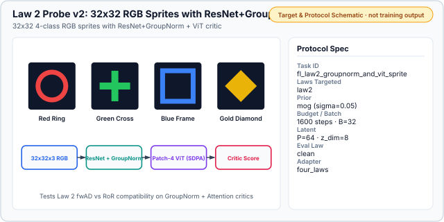
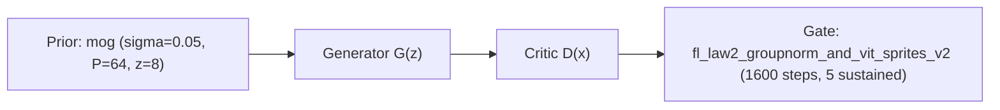

<!-- Generated Forge experiment page — do not edit manually; regenerate via `python -m experiments.forge.experiment_docs` -->

[← Leaderboard](../technique-inventory.md) · [Experiment Catalog](README.md) · [Explore by Laws](../LAWS_HUB.md) · [Research Portal](https://hypergan.github.io/ParticleGAN/)

# Law 2 Probe v2: 32x32 RGB Sprites with ResNet+GroupNorm + ViT Critic (1600 Steps) (`fl_law2_groupnorm_and_vit_sprites_v2`)

| Field | Value |
| --- | --- |
| **Laws Tested** | [Law 2](../LAWS_HUB.md#law2) |
| **Edge Cases** | `groupnorm-vit-critic` `sdpa-fwad-compatibility` `rgb-sprites-32x32` |
| **Primary View (`discriminator_stability`)** | Not in `discriminator_stability` |
| **Four Laws Adherence Role** | — |
| **Fixed Full-Suite Denominator** | No (diagnostic / auxiliary cohort) |
| **Adapter / Domain** | `four_laws` / `fl_law2_groupnorm_and_vit_sprites_v2` |
| **Prior** | `mog` (sigma=`0.05`, standardize=`False`) |
| **Update Budget** | `1600` steps |

## What This Experiment Tests

Calibrated 1,600-step v2 Law 2 probe testing differentiation faithfulness on 32x32x3 4-class RGB geometric sprites scored by a compact ResNet+GroupNorm + Patch-4 multi-head attention (ViT) critic.

> [!NOTE]
> **Protocol notes:** Four Laws Adherence v2 diagnostic probe (1,600 updates, 32x32x3 RGB sprites, 1500s timeout).

## Laws & Edge Cases Targeted

- **[Law 2: Potential Geometry](../LAWS_HUB.md#law2)** ([Law 2 theory](../../../docs/four-laws.md#law-2--potential-geometry)) — Does the critic communicate useful learning forces with appropriate geometric control and computational efficiency?
- **Edge-case tags:** `groupnorm-vit-critic`, `sdpa-fwad-compatibility`, `rgb-sprites-32x32`

## Common Failure Mode

Forward-mode fwAD breaks or loses gradient fidelity on SDPA attention / GroupNorm layers where exact reverse-over-reverse (RoR) is required, causing blurred sprites or mode imbalance.

## Visual Schematic



*Target & Protocol Schematic · not training output — generated deterministically from the declared task contract.*

## Protocol & Architecture Diagram



## Task Contract & Numerical Gates

### Execution & Sampling Contract

| Contract Field | Declared Value |
| --- | --- |
| Initializer | `deterministic_orthogonal` |
| Prior | `mog` (sigma=`0.05`, standardize=`False`) |
| Update Budget | `1600` steps |
| Batch Size | `32` |
| Particles / Latent Dim | `P=64` / `z_dim=8` |
| Sampling Law | `public_prior_without_output_noise` |
| Evaluation Output Noise | `clean` |
| Scoring Weights | `live` |
| Architecture | `family=resnet_gn_vit_sprites32, image_size=32, channels=3, gen_channels=32, critic_channels=16, vit_dim=32, vit_heads=4, patch_size=4` |
| Integrity Guards | `finite_state`, `optimizer_roles`, `exact_optimizer_updates`, `mechanism_exercised`, `rng_isolation` |
| Assigned Views | `four-laws-adherence-v2` (T1 diagnostic) |

### Numerical Pass/Fail Thresholds

| Metric | Operator | Threshold |
| --- | :---: | ---: |
| `finite_fraction` | `==` | `1.0` |
| `critic_grad_finite` | `==` | `1.0` |
| `mode_coverage` | `>=` | `1.0` |
| `sprite_hq` | `>=` | `0.85` |
| `template_rmse` | `<=` | `0.12` |
| `mass_tv` | `<=` | `0.14` |

## Recorded Family Results

> [!IMPORTANT]
> Screening outcomes below come from recorded single-seed (`seed = 0`) Forge evidence. `NOT MEASURED`, `BLOCKED`, and `INCOMPATIBLE` are non-numerical states — not scientific failures — and confer no pass or qualification credit.

| Family | Selected Candidate | Outcome | Key Recorded Metrics | Family Report | Training Media |
| --- | --- | :---: | --- | --- | --- |
| **Atlas** | `atlas-particle-normal-v4` | `NOT MEASURED` | No recorded result for this selected configuration and source. | [Atlas](../families/atlas.md#cohort-cuda-daa283c8a640) | — |
| **Axiom** | `axiom-v5` | `NOT MEASURED` | No recorded result for this selected configuration and source. | [Axiom](../families/axiom.md#cohort-cuda-42a130a78fc3) | [HF GIF](https://huggingface.co/datasets/HyperGAN/particlegan-forge-evidence/resolve/main/media/forge/leaderboard/axiom/axiom-v4/fl_law2_groupnorm_and_vit_sprites_v2.gif) |
| **BCAP** | `recipe-prior-refactor-bcap-pure-v1` | `NOT MEASURED` | No recorded result for this selected configuration and source. | [BCAP](../families/bcap-pure.md#cohort-cuda-1bf9d7d34422) | [HF GIF](https://huggingface.co/datasets/HyperGAN/particlegan-forge-evidence/resolve/main/media/forge/leaderboard/bcap-pure/recipe-prior-refactor-bcap-pure-v1/fl_law2_groupnorm_and_vit_sprites_v2.gif) |
| **BISPF** | `bispf-optimized-quintic-v1` | `NOT MEASURED` | No recorded result for this selected configuration and source. | [BISPF](../families/bispf.md#cohort-cuda-1bf9d7d34422) | [HF GIF](https://huggingface.co/datasets/HyperGAN/particlegan-forge-evidence/resolve/main/media/forge/leaderboard/bispf/bispf-optimized-quintic-v1/fl_law2_groupnorm_and_vit_sprites_v2.gif) |
| **E22** | `e22` | `NOT MEASURED` | No recorded result for this selected configuration and source. | [E22](../families/e22.md#cohort-cuda-1bf9d7d34422) | — |
| **EMPF** | `empf-v8` | `NOT MEASURED` | No recorded result for this selected configuration and source. | [EMPF](../families/empf.md#cohort-cuda-23a94f16ca88) | [HF GIF](https://huggingface.co/datasets/HyperGAN/particlegan-forge-evidence/resolve/main/media/forge/leaderboard/empf/empf-v8/fl_law2_groupnorm_and_vit_sprites_v2.gif) |
| **GAN v3 release 0.7** | `recipe-prior-refactor-release07-gan-v3-v1` | `NOT MEASURED` | No recorded result for this selected configuration and source. | [GAN v3 release 0.7](../families/release07-gan-v3.md#cohort-cuda-daa283c8a640) | [HF GIF](https://huggingface.co/datasets/HyperGAN/particlegan-forge-evidence/resolve/main/media/forge/leaderboard/release07-gan-v3/recipe-prior-refactor-release07-gan-v3-v1/fl_law2_groupnorm_and_vit_sprites_v2.gif) |
| **K3P** | `recipe-prior-refactor-k3p-v1` | `NOT MEASURED` | No recorded result for this selected configuration and source. | [K3P](../families/k3p.md#cohort-cuda-daa283c8a640) | [HF GIF](https://huggingface.co/datasets/HyperGAN/particlegan-forge-evidence/resolve/main/media/forge/leaderboard/k3p/recipe-prior-refactor-k3p-v1/fl_law2_groupnorm_and_vit_sprites_v2.gif) |
| **KA2** | `recipe-prior-refactor-ka2-v1` | `NOT MEASURED` | No recorded result for this selected configuration and source. | [KA2](../families/ka2.md#cohort-cuda-daa283c8a640) | [HF GIF](https://huggingface.co/datasets/HyperGAN/particlegan-forge-evidence/resolve/main/media/forge/leaderboard/ka2/recipe-prior-refactor-ka2-v1/fl_law2_groupnorm_and_vit_sprites_v2.gif) |
| **R1/R2** | `recipe-prior-refactor-r1r2-v1` | `NOT MEASURED` | No recorded result for this selected configuration and source. | [R1/R2](../families/r1r2.md#cohort-cuda-daa283c8a640) | [HF GIF](https://huggingface.co/datasets/HyperGAN/particlegan-forge-evidence/resolve/main/media/forge/leaderboard/r1r2/recipe-prior-refactor-r1r2-v1/fl_law2_groupnorm_and_vit_sprites_v2.gif) |
| **RHBI** | `rhbi-v12` | `NOT MEASURED` | No recorded result for this selected configuration and source. | [RHBI](../families/rhbi.md#cohort-cuda-23a94f16ca88) | [HF GIF](https://huggingface.co/datasets/HyperGAN/particlegan-forge-evidence/resolve/main/media/forge/leaderboard/rhbi/rhbi-v12/fl_law2_groupnorm_and_vit_sprites_v2.gif) |
| **Unified** | `unified-v15` | `DIAG_PASS` | No recorded result for this selected configuration and source. | [Unified](../families/unified.md#cohort-cuda-42a130a78fc3) | [HF GIF](https://huggingface.co/datasets/HyperGAN/particlegan-forge-evidence/resolve/main/media/forge/leaderboard/unified/unified-v11/fl_law2_groupnorm_and_vit_sprites_v2.gif) |

### Four Laws Adherence Diagnostic Receipts (Separate Cohort)

*Diagnostic readouts and Colab matched-GPU receipts for `four-laws-adherence-v1` (protocol seed `0`, unchanged recipes; research telemetry only — separate from ordinary selected-cohort qualification above and confers no qualification or default-adoption credit):*

| Candidate | Family | GPU | Outcome | `min_margin` | NVML Energy | Key Recorded Metrics | Receipt |
| --- | --- | --- | :---: | ---: | ---: | --- | --- |
| `axiom-v4` | `axiom` | NVIDIA L4 | **PASS** | `+0.000` | 4.16 kJ (J-to-PASS) | critic_grad_finite=1, critic_grad_max=0.07964, critic_grad_med=0.0748, finite_fraction=1 | [6322361c3df24c49891b7bd190724a7a.json](../technique-receipts/6322361c3df24c49891b7bd190724a7a.json) |
| `axiom-v5` | `axiom` | NVIDIA L4 | **PASS** | `+0.000` | 4.08 kJ (J-to-PASS) | critic_grad_finite=1, critic_grad_max=0.07964, critic_grad_med=0.0748, finite_fraction=1 | [dc6a4c59c26841bb9bb56f349dd67ab2.json](../technique-receipts/dc6a4c59c26841bb9bb56f349dd67ab2.json) |
| `unified-v15` | `unified` | NVIDIA L4 | **PASS** | `+0.000` | 1.98 kJ (J-to-PASS) | critic_grad_finite=1, critic_grad_max=1.227, critic_grad_med=0.9209, finite_fraction=1 | [70e4fa36d6344de8a51629c74c0f1b69.json](../technique-receipts/70e4fa36d6344de8a51629c74c0f1b69.json) |
| `empf-v8` | `empf` | NVIDIA L4 | **FAIL** | `-1.469` | 5.67 kJ | critic_grad_finite=1, critic_grad_max=0.8057, critic_grad_med=0.6687, finite_fraction=1 | [f7035514ba25444cb4d0c45a720c4e35.json](../technique-receipts/f7035514ba25444cb4d0c45a720c4e35.json) |
| `unified-v11` | `unified` | NVIDIA L4 | **FAIL** | `-1.846` | 8.73 kJ | critic_grad_finite=1, critic_grad_max=0.7752, critic_grad_med=0.3956, finite_fraction=1 | [cdf57108b01c4137970b9d8494e4aebd.json](../technique-receipts/cdf57108b01c4137970b9d8494e4aebd.json) |
| `recipe-prior-refactor-ka2-v1` | `ka2` | NVIDIA L4 | **FAIL** | `-2.571` | 5.18 kJ | critic_grad_finite=1, critic_grad_max=1.227, critic_grad_med=0.947, finite_fraction=1 | [dc93ecaa49e74deea0540de0a131f484.json](../technique-receipts/dc93ecaa49e74deea0540de0a131f484.json) |
| `recipe-prior-refactor-r1r2-v1` | `r1r2` | NVIDIA L4 | **FAIL** | `-2.571` | 4.05 kJ | critic_grad_finite=1, critic_grad_max=0.08782, critic_grad_med=0.04766, finite_fraction=1 | [734a0ccd05cf41bb8f8eb63119ca7a0a.json](../technique-receipts/734a0ccd05cf41bb8f8eb63119ca7a0a.json) |
| `rhbi-v12` | `rhbi` | NVIDIA L4 | **FAIL** | `-2.571` | 10.20 kJ | critic_grad_finite=1, critic_grad_max=0.9934, critic_grad_med=0.8876, finite_fraction=1 | [689c70a4976f4e58bdd2de7a7e0aecbf.json](../technique-receipts/689c70a4976f4e58bdd2de7a7e0aecbf.json) |
| `recipe-prior-refactor-release07-gan-v3-v1` | `release07-gan-v3` | NVIDIA L4 | **FAIL** | `-2.655` | 4.27 kJ | critic_grad_finite=1, critic_grad_max=0.0004097, critic_grad_med=0.0001973, finite_fraction=1 | [cb5d2b9eefad420da92812a4584083fe.json](../technique-receipts/cb5d2b9eefad420da92812a4584083fe.json) |
| `unified-v14` | `unified` | NVIDIA L4 | **FAIL** | `-3.116` | 5.21 kJ | critic_grad_finite=1, critic_grad_max=1.003, critic_grad_med=0.3989, finite_fraction=1 | [31ce6c41ed3a45dbb756a43c451f1401.json](../technique-receipts/31ce6c41ed3a45dbb756a43c451f1401.json) |
| `recipe-prior-refactor-bcap-pure-v1` | `bcap-dualnorm` | NVIDIA L4 | **FAIL** | `-3.171` | 8.56 kJ | critic_grad_finite=1, critic_grad_max=0.5894, critic_grad_med=0.21, finite_fraction=1 | [8a8f956e7fc443e3b2166592b620d15a.json](../technique-receipts/8a8f956e7fc443e3b2166592b620d15a.json) |
| `recipe-prior-refactor-k3p-v1` | `k3p` | NVIDIA L4 | **FAIL** | `-4.357` | 4.64 kJ | critic_grad_finite=1, critic_grad_max=1.126, critic_grad_med=0.8499, finite_fraction=1 | [d8508cbed0c74d8daa307e7e0f42fd2c.json](../technique-receipts/d8508cbed0c74d8daa307e7e0f42fd2c.json) |
| `bispf-optimized-quintic-v1` | `bispf` | NVIDIA L4 | **FAIL** | `-5.000` | 9.90 kJ | critic_grad_finite=1, critic_grad_max=0.001261, critic_grad_med=0.0003567, finite_fraction=1 | [d87302734f684b49b2f35549a6848838.json](../technique-receipts/d87302734f684b49b2f35549a6848838.json) |

## Reproduce This Experiment

```bash
# Validate this task declaration and inspect planned dependencies
python -m experiments.forge validate
python -m experiments.forge plan --view four-laws-adherence-v2 --candidate unified-v12 --tasks fl_law2_groupnorm_and_vit_sprites_v2
```

**Declaration & Source Files:**

- Task contract: [configs/forge/tasks/fl_law2_groupnorm_and_vit_sprites_v2.json](../../../configs/forge/tasks/fl_law2_groupnorm_and_vit_sprites_v2.json)
- Source code: [benchmarks/toy_audit/api_four_laws_123.py](../../../benchmarks/toy_audit/api_four_laws_123.py)
- Source code: [experiments/forge/four_laws.py](../../../experiments/forge/four_laws.py)

## Annotation Provenance

This page was assembled read-only from the following versioned inputs without altering any task execution/evaluation fingerprint:

- **Task contract JSON:** [configs/forge/tasks/fl_law2_groupnorm_and_vit_sprites_v2.json](../../../configs/forge/tasks/fl_law2_groupnorm_and_vit_sprites_v2.json)
- **Editorial task documentation sidecar:** [configs/forge/task-documentation/fl_law2_groupnorm_and_vit_sprites_v2.json](../../../configs/forge/task-documentation/fl_law2_groupnorm_and_vit_sprites_v2.json)
- **Read-only Python AST source:** [benchmarks/toy_audit/api_four_laws_123.py](../../../benchmarks/toy_audit/api_four_laws_123.py) (AST symbols: `__doc__`, `THRESHOLDS`, `SPECS`)
- **Read-only Python AST source:** [experiments/forge/four_laws.py](../../../experiments/forge/four_laws.py) (AST symbols: `__doc__`)
