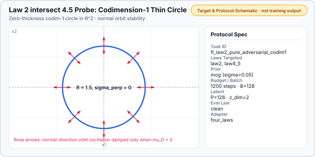
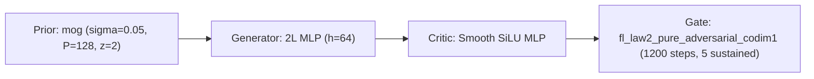

<!-- Generated Forge experiment page — do not edit manually; regenerate via `python -m experiments.forge.experiment_docs` -->

[← Leaderboard](../technique-inventory.md) · [Experiment Catalog](README.md) · [Explore by Laws](../LAWS_HUB.md) · [Research Portal](https://hypergan.github.io/ParticleGAN/)

# Law 2 intersect 4.5 Probe: Codimension-1 Thin Circle Normal Orbits (`fl_law2_pure_adversarial_codim1`)

| Field | Value |
| --- | --- |
| **Laws Tested** | [Law 2](../LAWS_HUB.md#law2) · [Law 4.5](../LAWS_HUB.md#law4_5) |
| **Edge Cases** | `codimension-1-manifold` `normal-orbit-cycles` `zero-thickness-support` |
| **Primary View (`discriminator_stability`)** | Not in `discriminator_stability` |
| **Four Laws Adherence Role** | law2 (four_laws_probe) |
| **Fixed Full-Suite Denominator** | No (diagnostic / auxiliary cohort) |
| **Adapter / Domain** | `four_laws` / `fl_law2_pure_adversarial_codim1` |
| **Prior** | `mog` (sigma=`0.05`, standardize=`False`) |
| **Update Budget** | `1200` steps |

## What This Experiment Tests

Directly falsifies pure upper-bound Lipschitz caps (mu_D = 0): trains a smooth SiLU generator and critic on a zero-thickness 1D circle (R=1.5, sigma_perp=0) in R^2, grading late-window normal-axis orbit oscillation (r_tail <= 0.06, ptp <= 0.12).

> [!NOTE]
> **Protocol notes:** Four Laws Adherence diagnostic probe (1,200 updates, smooth SiLU MLP generator & critic).

## Laws & Edge Cases Targeted

- **[Law 2: Potential Geometry](../LAWS_HUB.md#law2)** ([Law 2 theory](../../../docs/four-laws.md#law-2--potential-geometry)) — Does the critic communicate useful learning forces with appropriate geometric control and computational efficiency?
- **[Law 4.5: Coupled Minimax Contraction](../LAWS_HUB.md#law4_5)** ([Law 4.5 theory](../../../docs/four-laws.md#law-4--functional-and-game-dynamics)) — Can the learning system realize useful functional changes and exhibit appropriate coupled learning dynamics?
- **Edge-case tags:** `codimension-1-manifold`, `normal-orbit-cycles`, `zero-thickness-support`

## Common Failure Mode

A critic regularizer that only caps slopes above kappa provides zero normal-direction Hessian curvature (mu_D = 0) near equilibrium, causing permanent radial limit cycles around the thin circle.

## Visual Schematic



*Target & Protocol Schematic · not training output — generated deterministically from the declared task contract.*

## Protocol & Architecture Diagram



## Task Contract & Numerical Gates

### Execution & Sampling Contract

| Contract Field | Declared Value |
| --- | --- |
| Initializer | `deterministic_orthogonal` |
| Prior | `mog` (sigma=`0.05`, standardize=`False`) |
| Update Budget | `1200` steps |
| Batch Size | `128` |
| Particles / Latent Dim | `P=128` / `z_dim=2` |
| Sampling Law | `public_prior_without_output_noise` |
| Evaluation Output Noise | `clean` |
| Scoring Weights | `live` |
| Architecture | `family=smooth_silu_mlp, hidden=64, layers=2, out_dim=2, in_dim=2` |
| Integrity Guards | `finite_state`, `optimizer_roles`, `exact_optimizer_updates`, `mechanism_exercised`, `rng_isolation` |
| Assigned Views | `four-laws-adherence-v1` (T1 diagnostic), `four-laws-adherence-v2` (T1 diagnostic) |

### Numerical Pass/Fail Thresholds

| Metric | Operator | Threshold |
| --- | :---: | ---: |
| `finite_fraction` | `==` | `1.0` |
| `normal_orbit_r_tail` | `<=` | `0.06` |
| `normal_orbit_ptp` | `<=` | `0.12` |
| `manifold_mae` | `<=` | `0.06` |
| `manifold_coverage` | `>=` | `0.9375` |
| `angular_tv` | `<=` | `0.15` |

## Recorded Family Results

> [!IMPORTANT]
> Screening outcomes below come from recorded single-seed (`seed = 0`) Forge evidence. `NOT MEASURED`, `BLOCKED`, and `INCOMPATIBLE` are non-numerical states — not scientific failures — and confer no pass or qualification credit.

| Family | Selected Candidate | Outcome | Key Recorded Metrics | Family Report | Training Media |
| --- | --- | :---: | --- | --- | --- |
| **Atlas** | `atlas-particle-normal-v4` | `NOT MEASURED` | No recorded result for this selected configuration and source. | [Atlas](../families/atlas.md#cohort-cuda-daa283c8a640) | — |
| **Axiom** | `axiom-v5` | `NOT MEASURED` | No recorded result for this selected configuration and source. | [Axiom](../families/axiom.md#cohort-cuda-42a130a78fc3) | — |
| **BCAP** | `recipe-prior-refactor-bcap-pure-v1` | `NOT MEASURED` | No recorded result for this selected configuration and source. | [BCAP](../families/bcap-pure.md#cohort-cuda-1bf9d7d34422) | — |
| **BISPF** | `bispf-optimized-quintic-v1` | `NOT MEASURED` | No recorded result for this selected configuration and source. | [BISPF](../families/bispf.md#cohort-cuda-1bf9d7d34422) | — |
| **E22** | `e22` | `NOT MEASURED` | No recorded result for this selected configuration and source. | [E22](../families/e22.md#cohort-cuda-1bf9d7d34422) | — |
| **EMPF** | `empf-v8` | `NOT MEASURED` | No recorded result for this selected configuration and source. | [EMPF](../families/empf.md#cohort-cuda-23a94f16ca88) | — |
| **GAN v3 release 0.7** | `recipe-prior-refactor-release07-gan-v3-v1` | `NOT MEASURED` | No recorded result for this selected configuration and source. | [GAN v3 release 0.7](../families/release07-gan-v3.md#cohort-cuda-daa283c8a640) | — |
| **K3P** | `recipe-prior-refactor-k3p-v1` | `NOT MEASURED` | No recorded result for this selected configuration and source. | [K3P](../families/k3p.md#cohort-cuda-daa283c8a640) | — |
| **KA2** | `recipe-prior-refactor-ka2-v1` | `NOT MEASURED` | No recorded result for this selected configuration and source. | [KA2](../families/ka2.md#cohort-cuda-daa283c8a640) | — |
| **R1/R2** | `recipe-prior-refactor-r1r2-v1` | `NOT MEASURED` | No recorded result for this selected configuration and source. | [R1/R2](../families/r1r2.md#cohort-cuda-daa283c8a640) | — |
| **RHBI** | `rhbi-v12` | `NOT MEASURED` | No recorded result for this selected configuration and source. | [RHBI](../families/rhbi.md#cohort-cuda-23a94f16ca88) | — |
| **Unified** | `unified-v15` | `DIAG_PASS` | No recorded result for this selected configuration and source. | [Unified](../families/unified.md#cohort-cuda-42a130a78fc3) | — |

### Four Laws Adherence Diagnostic Receipts (Separate Cohort)

*Diagnostic readouts and Colab matched-GPU receipts for `four-laws-adherence-v1` (protocol seed `0`, unchanged recipes; research telemetry only — separate from ordinary selected-cohort qualification above and confers no qualification or default-adoption credit):*

| Candidate | Family | GPU | Outcome | `min_margin` | NVML Energy | Key Recorded Metrics | Receipt |
| --- | --- | --- | :---: | ---: | ---: | --- | --- |
| `axiom-v4` | `axiom` | NVIDIA L4 | **PASS** | `+0.000` | 744 J (J-to-PASS) | angular_tv=0.03955, finite_fraction=1, manifold_coverage=1, manifold_mae=0.01743 | [3a1353e0c0004d7ea79aec3afdc92f06.json](../technique-receipts/3a1353e0c0004d7ea79aec3afdc92f06.json) |
| `axiom-v4` | `axiom` | NVIDIA RTX A6000 | **PASS** | `+0.000` | 2.27 kJ (J-to-PASS) | angular_tv=0.05713, finite_fraction=1, manifold_coverage=1, manifold_mae=0.01801 | [readout-9066cb4353eb435be7819b0c.json](../records/readout-9066cb4353eb435be7819b0c.json) |
| `axiom-v6` | `axiom` | NVIDIA RTX A6000 | **PASS** | `+0.000` | 1.41 kJ (J-to-PASS) | angular_tv=0.06201, finite_fraction=1, manifold_coverage=1, manifold_mae=0.01606 | [readout-69f7d043a14e2780fb2cdd4a.json](../records/readout-69f7d043a14e2780fb2cdd4a.json) |
| `empf-v8` | `empf` | NVIDIA L4 | **PASS** | `+0.000` | 729 J (J-to-PASS) | angular_tv=0.07373, finite_fraction=1, manifold_coverage=1, manifold_mae=0.05833 | [534e9c67e2944fffb43f8b0a9ce60218.json](../technique-receipts/534e9c67e2944fffb43f8b0a9ce60218.json) |
| `minimal-v2` | `minimal` | NVIDIA L4 | **PASS** | `+0.000` | 889 J (J-to-PASS) | angular_tv=0.05225, finite_fraction=1, manifold_coverage=1, manifold_mae=0.01522 | [1ad660e5cfab4609bb8e23071474c32d.json](../technique-receipts/1ad660e5cfab4609bb8e23071474c32d.json) |
| `recipe-prior-refactor-r1r2-v1` | `r1r2` | NVIDIA L4 | **PASS** | `+0.000` | 825 J (J-to-PASS) | angular_tv=0.07666, finite_fraction=1, manifold_coverage=1, manifold_mae=0.01275 | [8160bf46c3bf47d796b3f7efbe4e2a5c.json](../technique-receipts/8160bf46c3bf47d796b3f7efbe4e2a5c.json) |
| `rhbi-v12` | `rhbi` | NVIDIA L4 | **PASS** | `+0.000` | 1.24 kJ (J-to-PASS) | angular_tv=0.04688, finite_fraction=1, manifold_coverage=1, manifold_mae=0.05397 | [0bb27c7514ff41fd8f5219047390be89.json](../technique-receipts/0bb27c7514ff41fd8f5219047390be89.json) |
| `unified-v11` | `unified` | NVIDIA L4 | **PASS** | `+0.000` | 761 J (J-to-PASS) | angular_tv=0.04443, finite_fraction=1, manifold_coverage=1, manifold_mae=0.01629 | [9fc0ed0115e7437d9762d2966fd0fdbf.json](../technique-receipts/9fc0ed0115e7437d9762d2966fd0fdbf.json) |
| `unified-v12` | `unified` | NVIDIA L4 | **PASS** | `+0.000` | 702 J (J-to-PASS) | angular_tv=0.05615, finite_fraction=1, manifold_coverage=1, manifold_mae=0.01655 | [d918c775914d44c5a78803e5d7e70699.json](../technique-receipts/d918c775914d44c5a78803e5d7e70699.json) |
| `unified-v13` | `unified` | NVIDIA L4 | **PASS** | `+0.000` | 687 J (J-to-PASS) | angular_tv=0.05615, finite_fraction=1, manifold_coverage=1, manifold_mae=0.01655 | [f3c9dc1f0c67489890140e7ce0d023b2.json](../technique-receipts/f3c9dc1f0c67489890140e7ce0d023b2.json) |
| `unified-v14` | `unified` | NVIDIA L4 | **PASS** | `+0.000` | 770 J (J-to-PASS) | angular_tv=0.06641, finite_fraction=1, manifold_coverage=1, manifold_mae=0.01696 | [099b3300f34548ac9bc7d673e6f03db0.json](../technique-receipts/099b3300f34548ac9bc7d673e6f03db0.json) |
| `unified-v15` | `unified` | NVIDIA L4 | **PASS** | `+0.000` | 829 J (J-to-PASS) | angular_tv=0.05566, finite_fraction=1, manifold_coverage=1, manifold_mae=0.01602 | [f66bda13a892499c9a090ec15f68b3a5.json](../technique-receipts/f66bda13a892499c9a090ec15f68b3a5.json) |
| `recipe-prior-refactor-bcap-pure-v1` | `bcap-dualnorm` | NVIDIA L4 | **FAIL** | `+0.000` | 1.28 kJ | angular_tv=0.08545, finite_fraction=1, manifold_coverage=1, manifold_mae=0.05939 | [6f7a968e1a494b2f9a7ca00e6826c21d.json](../technique-receipts/6f7a968e1a494b2f9a7ca00e6826c21d.json) |
| `recipe-prior-refactor-k3p-v1` | `k3p` | NVIDIA L4 | **FAIL** | `+0.000` | 999 J | angular_tv=0.08789, finite_fraction=1, manifold_coverage=1, manifold_mae=0.008778 | [4403242367ec46768f81e589fcfcd46a.json](../technique-receipts/4403242367ec46768f81e589fcfcd46a.json) |
| `recipe-prior-refactor-ka2-v1` | `ka2` | NVIDIA L4 | **FAIL** | `+0.000` | 1.00 kJ | angular_tv=0.08887, finite_fraction=1, manifold_coverage=1, manifold_mae=0.008963 | [4c8038a2b52e42489d01c34178c1d658.json](../technique-receipts/4c8038a2b52e42489d01c34178c1d658.json) |
| `recipe-prior-refactor-release07-gan-v3-v1` | `release07-gan-v3` | NVIDIA L4 | **FAIL** | `+0.000` | 817 J | angular_tv=0.05713, finite_fraction=1, manifold_coverage=1, manifold_mae=0.009438 | [2d66e725e23749bfadf4b3270d11dbbd.json](../technique-receipts/2d66e725e23749bfadf4b3270d11dbbd.json) |
| `bispf-optimized-quintic-v1` | `bispf` | NVIDIA L4 | **FAIL** | `-0.103` | 1.82 kJ | angular_tv=0.05566, finite_fraction=1, manifold_coverage=1, manifold_mae=0.0662 | [f6323abd2654432c92f11d3431470a27.json](../technique-receipts/f6323abd2654432c92f11d3431470a27.json) |
| `axiom-v5` | `axiom` | NVIDIA L4 | **FAIL** | `-0.426` | 2.87 kJ | angular_tv=0.05762, finite_fraction=1, manifold_coverage=1, manifold_mae=0.03664 | [182fd4ecac90466ebc25814c2b75bd04.json](../technique-receipts/182fd4ecac90466ebc25814c2b75bd04.json) |

## Reproduce This Experiment

```bash
# Validate this task declaration and inspect planned dependencies
python -m experiments.forge validate
python -m experiments.forge plan --view four-laws-adherence-v1 --candidate unified-v12 --tasks fl_law2_pure_adversarial_codim1
```

**Declaration & Source Files:**

- Task contract: [configs/forge/tasks/fl_law2_pure_adversarial_codim1.json](../../../configs/forge/tasks/fl_law2_pure_adversarial_codim1.json)
- Source code: [benchmarks/toy_audit/api_four_laws_123.py](../../../benchmarks/toy_audit/api_four_laws_123.py)
- Source code: [experiments/forge/four_laws.py](../../../experiments/forge/four_laws.py)

## Annotation Provenance

This page was assembled read-only from the following versioned inputs without altering any task execution/evaluation fingerprint:

- **Task contract JSON:** [configs/forge/tasks/fl_law2_pure_adversarial_codim1.json](../../../configs/forge/tasks/fl_law2_pure_adversarial_codim1.json)
- **Editorial task documentation sidecar:** [configs/forge/task-documentation/fl_law2_pure_adversarial_codim1.json](../../../configs/forge/task-documentation/fl_law2_pure_adversarial_codim1.json)
- **Read-only Python AST source:** [benchmarks/toy_audit/api_four_laws_123.py](../../../benchmarks/toy_audit/api_four_laws_123.py) (AST symbols: `__doc__`, `THRESHOLDS`, `SPECS`)
- **Read-only Python AST source:** [experiments/forge/four_laws.py](../../../experiments/forge/four_laws.py) (AST symbols: `__doc__`)
