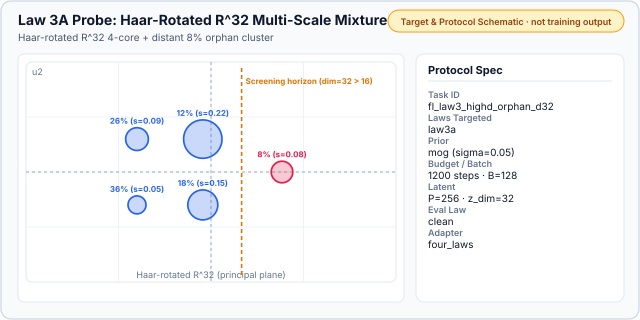
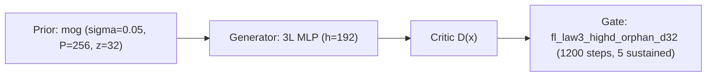

<!-- Generated Forge experiment page — do not edit manually; regenerate via `python -m experiments.forge.experiment_docs` -->

[← Leaderboard](../technique-inventory.md) · [Experiment Catalog](README.md) · [Explore by Laws](../LAWS_HUB.md) · [Research Portal](https://hypergan.github.io/ParticleGAN/)

# Law 3A Probe: Haar-Rotated R^32 Multi-Scale Mixture + 8% Orphan (`fl_law3_highd_orphan_d32`)

| Field | Value |
| --- | --- |
| **Laws Tested** | [Law 3A](../LAWS_HUB.md#law3a) |
| **Edge Cases** | `high-dimensional` `distant-orphan-mode` `screening-horizon` `multi-scale-width` |
| **Primary View (`discriminator_stability`)** | Not in `discriminator_stability` |
| **Four Laws Adherence Role** | law3 (four_laws_probe) |
| **Fixed Full-Suite Denominator** | No (diagnostic / auxiliary cohort) |
| **Adapter / Domain** | `four_laws` / `fl_law3_highd_orphan_d32` |
| **Prior** | `mog` (sigma=`0.05`, standardize=`False`) |
| **Update Budget** | `1200` steps |

## What This Experiment Tests

Exposes the dim <= 16 Law 3A ceiling and beyond-horizon screening dead zone: places 4 multi-scale core clusters plus a distant 8% orphan at (+7.5, 0) inside a Haar-rotated R^32 space (dim=32 > 16).

> [!NOTE]
> **Protocol notes:** Four Laws Adherence diagnostic probe (Haar-rotated R^32, 5 modes including distant 8% orphan).

## Laws & Edge Cases Targeted

- **[Law 3A: Unconditional W1 Ray-Length & Screening Identifiability](../LAWS_HUB.md#law3a)** ([Law 3A theory](../../../docs/four-laws.md#law-3--transport-identifiability)) — Does the learning system possess enough information to determine appropriate transport?
- **Edge-case tags:** `high-dimensional`, `distant-orphan-mode`, `screening-horizon`, `multi-scale-width`

## Common Failure Mode

Heuristics restricted to low ambient dimensions (dim <= 16) switch off silently in R^32, leaving the distant 8% orphan mode completely uncaptured (orphan_recall = 0) or collapsing core 32D covariances.

## Visual Schematic



*Target & Protocol Schematic · not training output — generated deterministically from the declared task contract.*

## Protocol & Architecture Diagram



## Task Contract & Numerical Gates

### Execution & Sampling Contract

| Contract Field | Declared Value |
| --- | --- |
| Initializer | `deterministic_orthogonal` |
| Prior | `mog` (sigma=`0.05`, standardize=`False`) |
| Update Budget | `1200` steps |
| Batch Size | `128` |
| Particles / Latent Dim | `P=256` / `z_dim=32` |
| Sampling Law | `public_prior_without_output_noise` |
| Evaluation Output Noise | `clean` |
| Scoring Weights | `live` |
| Architecture | `family=simple_mlp, hidden=192, layers=3, out_dim=32, in_dim=32, fourier=0` |
| Integrity Guards | `finite_state`, `optimizer_roles`, `exact_optimizer_updates`, `mechanism_exercised`, `rng_isolation` |
| Assigned Views | `four-laws-adherence-v1` (T1 diagnostic) |

### Numerical Pass/Fail Thresholds

| Metric | Operator | Threshold |
| --- | :---: | ---: |
| `finite_fraction` | `==` | `1.0` |
| `modes` | `==` | `5` |
| `core_eig_min` | `>=` | `0.25` |
| `orphan_recall` | `>=` | `0.5` |
| `precision` | `>=` | `0.85` |
| `mass_tv` | `<=` | `0.14` |

## Recorded Family Results

> [!IMPORTANT]
> Screening outcomes below come from recorded single-seed (`seed = 0`) Forge evidence. `NOT MEASURED`, `BLOCKED`, and `INCOMPATIBLE` are non-numerical states — not scientific failures — and confer no pass or qualification credit.

| Family | Selected Candidate | Outcome | Key Recorded Metrics | Family Report | Training Media |
| --- | --- | :---: | --- | --- | --- |
| **Atlas** | `atlas-particle-normal-v4` | `NOT MEASURED` | No recorded result for this selected configuration and source. | [Atlas](../families/atlas.md#cohort-cuda-bc3debd3fa5e) | — |
| **BCAP** | `recipe-prior-refactor-bcap-pure-v1` | `NOT MEASURED` | No recorded result for this selected configuration and source. | [BCAP](../families/bcap-pure.md#cohort-cuda-1bf9d7d34422) | — |
| **BISPF** | `bispf-optimized-quintic-v1` | `NOT MEASURED` | No recorded result for this selected configuration and source. | [BISPF](../families/bispf.md#cohort-cuda-1bf9d7d34422) | — |
| **E22** | `e22` | `NOT MEASURED` | No recorded result for this selected configuration and source. | [E22](../families/e22.md#cohort-cuda-1bf9d7d34422) | — |
| **EMPF** | `empf-v8` | `NOT MEASURED` | No recorded result for this selected configuration and source. | [EMPF](../families/empf.md#cohort-cuda-23a94f16ca88) | — |
| **GAN v3 release 0.7** | `recipe-prior-refactor-release07-gan-v3-v1` | `NOT MEASURED` | No recorded result for this selected configuration and source. | [GAN v3 release 0.7](../families/release07-gan-v3.md#cohort-cuda-1bf9d7d34422) | — |
| **K3P** | `recipe-prior-refactor-k3p-v1` | `NOT MEASURED` | No recorded result for this selected configuration and source. | [K3P](../families/k3p.md#cohort-cuda-1bf9d7d34422) | — |
| **KA2** | `recipe-prior-refactor-ka2-v1` | `NOT MEASURED` | No recorded result for this selected configuration and source. | [KA2](../families/ka2.md#cohort-cuda-1bf9d7d34422) | — |
| **R1/R2** | `recipe-prior-refactor-r1r2-v1` | `NOT MEASURED` | No recorded result for this selected configuration and source. | [R1/R2](../families/r1r2.md#cohort-cuda-1bf9d7d34422) | — |
| **RHBI** | `rhbi-v12` | `NOT MEASURED` | No recorded result for this selected configuration and source. | [RHBI](../families/rhbi.md#cohort-cuda-23a94f16ca88) | — |
| **Unified** | `unified-v11` | `NOT MEASURED` | No recorded result for this selected configuration and source. | [Unified](../families/unified.md#cohort-cuda-42a130a78fc3) | — |

### Four Laws Adherence Diagnostic Receipts (Separate Cohort)

*Diagnostic readouts and Colab matched-GPU receipts for `four-laws-adherence-v1` (protocol seed `0`, unchanged recipes; research telemetry only — separate from ordinary selected-cohort qualification above and confers no qualification or default-adoption credit):*

| Candidate | Family | GPU | Outcome | `min_margin` | NVML Energy | Key Recorded Metrics | Receipt |
| --- | --- | --- | :---: | ---: | ---: | --- | --- |
| `unified-v14` | `unified` | NVIDIA L4 | **FAIL** | `-0.999` | 3.69 kJ | core_eig_max=4.421, core_eig_min=0.0001454, finite_fraction=1, mass_tv=0.03767 | [f6aa09cb455647379f32b4a6bba72943.json](../technique-receipts/f6aa09cb455647379f32b4a6bba72943.json) |
| `unified-v12` | `unified` | NVIDIA L4 | **FAIL** | `-1.000` | 3.12 kJ | core_eig_max=3.558, core_eig_min=0.0001017, finite_fraction=1, mass_tv=0.05253 | [76624f207ca04f8cb0f104df96f68243.json](../technique-receipts/76624f207ca04f8cb0f104df96f68243.json) |
| `unified-v13` | `unified` | NVIDIA L4 | **FAIL** | `-1.000` | 3.36 kJ | core_eig_max=3.558, core_eig_min=0.0001017, finite_fraction=1, mass_tv=0.05253 | [e5fc05596e9b4fc7bc21cc506cbd7713.json](../technique-receipts/e5fc05596e9b4fc7bc21cc506cbd7713.json) |
| `unified-v11` | `unified` | NVIDIA L4 | **FAIL** | `-1.000` | 3.89 kJ | core_eig_max=4.059, core_eig_min=6.973e-05, finite_fraction=1, mass_tv=0.06969 | [01aea7a1f18143c88de9f83fb79bfdbe.json](../technique-receipts/01aea7a1f18143c88de9f83fb79bfdbe.json) |
| `minimal-v2` | `minimal` | NVIDIA L4 | **FAIL** | `-1.000` | 2.57 kJ | core_eig_max=5.419, core_eig_min=6.091e-05, finite_fraction=1, mass_tv=0.02089 | [44b20d653c7f40098e20f8caf383a416.json](../technique-receipts/44b20d653c7f40098e20f8caf383a416.json) |
| `recipe-prior-refactor-k3p-v1` | `k3p` | NVIDIA L4 | **FAIL** | `-1.000` | 996 J | core_eig_max=99, core_eig_min=0, finite_fraction=1, mass_tv=0.2618 | [27d319679737439ea28f575288726add.json](../technique-receipts/27d319679737439ea28f575288726add.json) |
| `recipe-prior-refactor-ka2-v1` | `ka2` | NVIDIA L4 | **FAIL** | `-1.000` | 1.07 kJ | core_eig_max=99, core_eig_min=0, finite_fraction=1, mass_tv=0.2618 | [4126187c8ce4446da6c991a65d3312c4.json](../technique-receipts/4126187c8ce4446da6c991a65d3312c4.json) |
| `recipe-prior-refactor-r1r2-v1` | `r1r2` | NVIDIA L4 | **FAIL** | `-1.000` | 790 J | core_eig_max=99, core_eig_min=0, finite_fraction=1, mass_tv=0.2211 | [9661bba918d94adc8482cdb796c7186e.json](../technique-receipts/9661bba918d94adc8482cdb796c7186e.json) |
| `recipe-prior-refactor-release07-gan-v3-v1` | `release07-gan-v3` | NVIDIA L4 | **FAIL** | `-1.140` | 813 J | core_eig_max=99, core_eig_min=0, finite_fraction=1, mass_tv=0.2997 | [ad605cce15dc4b43848947e579ee37ff.json](../technique-receipts/ad605cce15dc4b43848947e579ee37ff.json) |
| `recipe-prior-refactor-bcap-pure-v1` | `bcap-dualnorm` | NVIDIA L4 | **FAIL** | `-1.189` | 3.20 kJ | core_eig_max=99, core_eig_min=0, finite_fraction=1, mass_tv=0.3065 | [736638cb3a274648b65b261dead23dd3.json](../technique-receipts/736638cb3a274648b65b261dead23dd3.json) |
| `empf-v8` | `empf` | NVIDIA L4 | **FAIL** | `-2.754` | 2.01 kJ | core_eig_max=99, core_eig_min=0, finite_fraction=1, mass_tv=0.5256 | [5f301be96d15484d994d9edb4b248a94.json](../technique-receipts/5f301be96d15484d994d9edb4b248a94.json) |
| `bispf-optimized-quintic-v1` | `bispf` | NVIDIA L4 | **FAIL** | `-3.038` | 3.73 kJ | core_eig_max=99, core_eig_min=0, finite_fraction=1, mass_tv=0.5653 | [b2b18586015d4208b743ed2218c998cf.json](../technique-receipts/b2b18586015d4208b743ed2218c998cf.json) |
| `rhbi-v12` | `rhbi` | NVIDIA L4 | **FAIL** | `-3.542` | 3.03 kJ | core_eig_max=99, core_eig_min=0, finite_fraction=1, mass_tv=0.6359 | [51fa98e4220e4ea09ae4779df3c5e375.json](../technique-receipts/51fa98e4220e4ea09ae4779df3c5e375.json) |

## Reproduce This Experiment

```bash
# Validate this task declaration and inspect planned dependencies
python -m experiments.forge validate
python -m experiments.forge plan --view four-laws-adherence-v1 --candidate unified-v12 --tasks fl_law3_highd_orphan_d32
```

**Declaration & Source Files:**

- Task contract: [configs/forge/tasks/fl_law3_highd_orphan_d32.json](../../../configs/forge/tasks/fl_law3_highd_orphan_d32.json)
- Source code: [benchmarks/toy_audit/api_four_laws_123.py](../../../benchmarks/toy_audit/api_four_laws_123.py)
- Source code: [experiments/forge/four_laws.py](../../../experiments/forge/four_laws.py)

## Annotation Provenance

This page was assembled read-only from the following versioned inputs without altering any task execution/evaluation fingerprint:

- **Task contract JSON:** [configs/forge/tasks/fl_law3_highd_orphan_d32.json](../../../configs/forge/tasks/fl_law3_highd_orphan_d32.json)
- **Editorial task documentation sidecar:** [configs/forge/task-documentation/fl_law3_highd_orphan_d32.json](../../../configs/forge/task-documentation/fl_law3_highd_orphan_d32.json)
- **Read-only Python AST source:** [benchmarks/toy_audit/api_four_laws_123.py](../../../benchmarks/toy_audit/api_four_laws_123.py) (AST symbols: `__doc__`, `THRESHOLDS`, `SPECS`)
- **Read-only Python AST source:** [experiments/forge/four_laws.py](../../../experiments/forge/four_laws.py) (AST symbols: `__doc__`)
