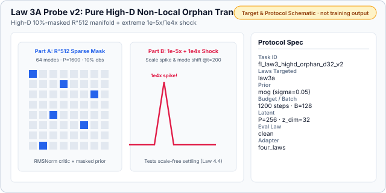
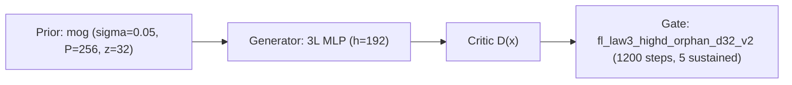

<!-- Generated Forge experiment page — do not edit manually; regenerate via `python -m experiments.forge.experiment_docs` -->

[← Leaderboard](../technique-inventory.md) · [Experiment Catalog](README.md) · [Explore by Laws](../LAWS_HUB.md) · [Research Portal](https://hypergan.github.io/ParticleGAN/)

# Law 3A Probe v2: Pure High-D Non-Local Orphan Transport in Haar-Rotated R^32 (`fl_law3_highd_orphan_d32_v2`)

| Field | Value |
| --- | --- |
| **Laws Tested** | [Law 3A](../LAWS_HUB.md#law3a) |
| **Edge Cases** | `high-dimensional` `distant-orphan-mode` `screening-horizon` `multi-scale-width` |
| **Primary View (`discriminator_stability`)** | Not in `discriminator_stability` |
| **Four Laws Adherence Role** | — |
| **Fixed Full-Suite Denominator** | No (diagnostic / auxiliary cohort) |
| **Adapter / Domain** | `four_laws` / `fl_law3_highd_orphan_d32_v2` |
| **Prior** | `mog` (sigma=`0.05`, standardize=`False`) |
| **Update Budget** | `1200` steps |

## What This Experiment Tests

Cleanly isolates Law 3A high-D non-local orphan transport in Haar-rotated R^32 (dim=32 > 16) by decoupling full-32D covariance rank into `fl_law1_highd_rank_d32_v2`: requires capturing all 5 clusters including the distant 8% orphan with accurate masses and precision >= 0.85.

> [!NOTE]
> **Protocol notes:** Four Laws Adherence v2 diagnostic probe (1,200 updates, Haar-rotated R^32, 5 modes + 8% distant orphan).

## Laws & Edge Cases Targeted

- **[Law 3A: Unconditional W1 Ray-Length & Feature-Space Screening Identifiability](../LAWS_HUB.md#law3a)** ([Law 3A theory](../../../docs/four-laws.md#law-3--transport-identifiability)) — Does the learning system possess enough information to determine appropriate transport?
- **Edge-case tags:** `high-dimensional`, `distant-orphan-mode`, `screening-horizon`, `multi-scale-width`

## Common Failure Mode

Transport heuristics capped at low ambient dimensions (dim <= 16) or tight screening horizons leave the distant 8% orphan mode uncaptured (orphan_recall = 0).

## Visual Schematic



*Target & Protocol Schematic · not training output — generated deterministically from the declared task contract.*

## Protocol & Architecture Diagram



## Task Contract & Numerical Gates

### Execution & Sampling Contract

| Contract Field | Declared Value |
| --- | --- |
| Initializer | `deterministic_orthogonal` |
| Prior | `mog` (sigma=`0.05`, standardize=`False`) |
| Update Budget | `1200` steps |
| Batch Size | `128` |
| Particles / Latent Dim | `P=256` / `z_dim=32` |
| Sampling Law | `public_prior_without_output_noise` |
| Evaluation Output Noise | `clean` |
| Scoring Weights | `live` |
| Architecture | `family=simple_mlp, hidden=192, layers=3, out_dim=32, in_dim=32, fourier=0` |
| Integrity Guards | `finite_state`, `optimizer_roles`, `exact_optimizer_updates`, `mechanism_exercised`, `rng_isolation` |
| Assigned Views | `four-laws-adherence-v2` (T1 diagnostic) |

### Numerical Pass/Fail Thresholds

| Metric | Operator | Threshold |
| --- | :---: | ---: |
| `finite_fraction` | `==` | `1.0` |
| `modes` | `==` | `5` |
| `orphan_recall` | `>=` | `0.5` |
| `precision` | `>=` | `0.85` |
| `mass_tv` | `<=` | `0.14` |
| `canon_plane_eig_min` | `>=` | `0.25` |

## Recorded Family Results

> [!IMPORTANT]
> Screening outcomes below come from recorded single-seed (`seed = 0`) Forge evidence. `NOT MEASURED`, `BLOCKED`, and `INCOMPATIBLE` are non-numerical states — not scientific failures — and confer no pass or qualification credit.

| Family | Selected Candidate | Outcome | Key Recorded Metrics | Family Report | Training Media |
| --- | --- | :---: | --- | --- | --- |
| **Atlas** | `atlas-particle-normal-v4` | `NOT MEASURED` | No recorded result for this selected configuration and source. | [Atlas](../families/atlas.md#cohort-cuda-daa283c8a640) | — |
| **Axiom** | `axiom-v5` | `NOT MEASURED` | No recorded result for this selected configuration and source. | [Axiom](../families/axiom.md#cohort-cuda-42a130a78fc3) | [HF GIF](https://huggingface.co/datasets/HyperGAN/particlegan-forge-evidence/resolve/main/media/forge/leaderboard/axiom/axiom-v4/fl_law3_highd_orphan_d32_v2.gif) |
| **BCAP** | `recipe-prior-refactor-bcap-pure-v1` | `NOT MEASURED` | No recorded result for this selected configuration and source. | [BCAP](../families/bcap-pure.md#cohort-cuda-1bf9d7d34422) | [HF GIF](https://huggingface.co/datasets/HyperGAN/particlegan-forge-evidence/resolve/main/media/forge/leaderboard/bcap-pure/recipe-prior-refactor-bcap-pure-v1/fl_law3_highd_orphan_d32_v2.gif) |
| **BISPF** | `bispf-optimized-quintic-v1` | `NOT MEASURED` | No recorded result for this selected configuration and source. | [BISPF](../families/bispf.md#cohort-cuda-1bf9d7d34422) | [HF GIF](https://huggingface.co/datasets/HyperGAN/particlegan-forge-evidence/resolve/main/media/forge/leaderboard/bispf/bispf-optimized-quintic-v1/fl_law3_highd_orphan_d32_v2.gif) |
| **E22** | `e22` | `NOT MEASURED` | No recorded result for this selected configuration and source. | [E22](../families/e22.md#cohort-cuda-1bf9d7d34422) | — |
| **EMPF** | `empf-v8` | `NOT MEASURED` | No recorded result for this selected configuration and source. | [EMPF](../families/empf.md#cohort-cuda-23a94f16ca88) | [HF GIF](https://huggingface.co/datasets/HyperGAN/particlegan-forge-evidence/resolve/main/media/forge/leaderboard/empf/empf-v8/fl_law3_highd_orphan_d32_v2.gif) |
| **GAN v3 release 0.7** | `recipe-prior-refactor-release07-gan-v3-v1` | `NOT MEASURED` | No recorded result for this selected configuration and source. | [GAN v3 release 0.7](../families/release07-gan-v3.md#cohort-cuda-daa283c8a640) | [HF GIF](https://huggingface.co/datasets/HyperGAN/particlegan-forge-evidence/resolve/main/media/forge/leaderboard/release07-gan-v3/recipe-prior-refactor-release07-gan-v3-v1/fl_law3_highd_orphan_d32_v2.gif) |
| **K3P** | `recipe-prior-refactor-k3p-v1` | `NOT MEASURED` | No recorded result for this selected configuration and source. | [K3P](../families/k3p.md#cohort-cuda-daa283c8a640) | [HF GIF](https://huggingface.co/datasets/HyperGAN/particlegan-forge-evidence/resolve/main/media/forge/leaderboard/k3p/recipe-prior-refactor-k3p-v1/fl_law3_highd_orphan_d32_v2.gif) |
| **KA2** | `recipe-prior-refactor-ka2-v1` | `NOT MEASURED` | No recorded result for this selected configuration and source. | [KA2](../families/ka2.md#cohort-cuda-daa283c8a640) | [HF GIF](https://huggingface.co/datasets/HyperGAN/particlegan-forge-evidence/resolve/main/media/forge/leaderboard/ka2/recipe-prior-refactor-ka2-v1/fl_law3_highd_orphan_d32_v2.gif) |
| **R1/R2** | `recipe-prior-refactor-r1r2-v1` | `NOT MEASURED` | No recorded result for this selected configuration and source. | [R1/R2](../families/r1r2.md#cohort-cuda-daa283c8a640) | [HF GIF](https://huggingface.co/datasets/HyperGAN/particlegan-forge-evidence/resolve/main/media/forge/leaderboard/r1r2/recipe-prior-refactor-r1r2-v1/fl_law3_highd_orphan_d32_v2.gif) |
| **RHBI** | `rhbi-v12` | `NOT MEASURED` | No recorded result for this selected configuration and source. | [RHBI](../families/rhbi.md#cohort-cuda-23a94f16ca88) | [HF GIF](https://huggingface.co/datasets/HyperGAN/particlegan-forge-evidence/resolve/main/media/forge/leaderboard/rhbi/rhbi-v12/fl_law3_highd_orphan_d32_v2.gif) |
| **Unified** | `unified-v15` | `DIAG_PASS` | No recorded result for this selected configuration and source. | [Unified](../families/unified.md#cohort-cuda-42a130a78fc3) | [HF GIF](https://huggingface.co/datasets/HyperGAN/particlegan-forge-evidence/resolve/main/media/forge/leaderboard/unified/unified-v11/fl_law3_highd_orphan_d32_v2.gif) |

### Four Laws Adherence Diagnostic Receipts (Separate Cohort)

*Diagnostic readouts and Colab matched-GPU receipts for `four-laws-adherence-v1` (protocol seed `0`, unchanged recipes; research telemetry only — separate from ordinary selected-cohort qualification above and confers no qualification or default-adoption credit):*

| Candidate | Family | GPU | Outcome | `min_margin` | NVML Energy | Key Recorded Metrics | Receipt |
| --- | --- | --- | :---: | ---: | ---: | --- | --- |
| `axiom-v4` | `axiom` | NVIDIA L4 | **PASS** | `+0.000` | 1.42 kJ (J-to-PASS) | canon_plane_eig_min=0.3755, core_eig_max=2.618, core_eig_min=0.1711, finite_fraction=1 | [8a5334a42f23463aa35f69e8d1ceaf13.json](../technique-receipts/8a5334a42f23463aa35f69e8d1ceaf13.json) |
| `axiom-v5` | `axiom` | NVIDIA L4 | **PASS** | `+0.000` | 1.40 kJ (J-to-PASS) | canon_plane_eig_min=0.3755, core_eig_max=2.618, core_eig_min=0.1711, finite_fraction=1 | [981106cc42b146298fefa53baf67064f.json](../technique-receipts/981106cc42b146298fefa53baf67064f.json) |
| `unified-v15` | `unified` | NVIDIA L4 | **PASS** | `+0.000` | 2.44 kJ (J-to-PASS) | canon_plane_eig_min=0.7627, core_eig_max=2.99, core_eig_min=0.286, finite_fraction=1 | [a4ef870763cc4ff5a5635b4e441c722d.json](../technique-receipts/a4ef870763cc4ff5a5635b4e441c722d.json) |
| `unified-v14` | `unified` | NVIDIA L4 | **FAIL** | `-0.133` | 3.71 kJ | canon_plane_eig_min=0.2167, core_eig_max=4.421, core_eig_min=0.0001454, finite_fraction=1 | [30918bbaa19940618cee157d7033ec32.json](../technique-receipts/30918bbaa19940618cee157d7033ec32.json) |
| `unified-v11` | `unified` | NVIDIA L4 | **FAIL** | `-0.400` | 4.15 kJ | canon_plane_eig_min=0.1501, core_eig_max=4.059, core_eig_min=6.973e-05, finite_fraction=1 | [b3dec6637e1c43aebe3f455c452c1e86.json](../technique-receipts/b3dec6637e1c43aebe3f455c452c1e86.json) |
| `recipe-prior-refactor-ka2-v1` | `ka2` | NVIDIA L4 | **FAIL** | `-0.894` | 1.00 kJ | canon_plane_eig_min=0.1297, core_eig_max=99, core_eig_min=0, finite_fraction=1 | [ca28c78db37a49199c92e2a27617118d.json](../technique-receipts/ca28c78db37a49199c92e2a27617118d.json) |
| `recipe-prior-refactor-k3p-v1` | `k3p` | NVIDIA L4 | **FAIL** | `-0.915` | 937 J | canon_plane_eig_min=0.1124, core_eig_max=99, core_eig_min=0, finite_fraction=1 | [b0197212eb3344a6a06e8b6f77f7fe1d.json](../technique-receipts/b0197212eb3344a6a06e8b6f77f7fe1d.json) |
| `recipe-prior-refactor-r1r2-v1` | `r1r2` | NVIDIA L4 | **FAIL** | `-1.000` | 784 J | canon_plane_eig_min=0, core_eig_max=99, core_eig_min=0, finite_fraction=1 | [ebd768d1b3b5466db37565867f3af9d8.json](../technique-receipts/ebd768d1b3b5466db37565867f3af9d8.json) |
| `recipe-prior-refactor-release07-gan-v3-v1` | `release07-gan-v3` | NVIDIA L4 | **FAIL** | `-1.140` | 825 J | canon_plane_eig_min=0, core_eig_max=99, core_eig_min=0, finite_fraction=1 | [4a1c6af5934b4e00a45cddaa6211ad57.json](../technique-receipts/4a1c6af5934b4e00a45cddaa6211ad57.json) |
| `recipe-prior-refactor-bcap-pure-v1` | `bcap-dualnorm` | NVIDIA L4 | **FAIL** | `-1.189` | 3.16 kJ | canon_plane_eig_min=0.3409, core_eig_max=99, core_eig_min=0, finite_fraction=1 | [da3e9d03dcf749fbb5661929db5a4663.json](../technique-receipts/da3e9d03dcf749fbb5661929db5a4663.json) |
| `empf-v8` | `empf` | NVIDIA L4 | **FAIL** | `-2.754` | 1.93 kJ | canon_plane_eig_min=0, core_eig_max=99, core_eig_min=0, finite_fraction=1 | [fe773db99f0b44e1a54b3043b0b7fe94.json](../technique-receipts/fe773db99f0b44e1a54b3043b0b7fe94.json) |
| `bispf-optimized-quintic-v1` | `bispf` | NVIDIA L4 | **FAIL** | `-3.038` | 3.76 kJ | canon_plane_eig_min=0, core_eig_max=99, core_eig_min=0, finite_fraction=1 | [c0847dc080214bc4bf8302c3026d2a76.json](../technique-receipts/c0847dc080214bc4bf8302c3026d2a76.json) |
| `rhbi-v12` | `rhbi` | NVIDIA L4 | **FAIL** | `-3.542` | 3.19 kJ | canon_plane_eig_min=0, core_eig_max=99, core_eig_min=0, finite_fraction=1 | [f97f91e851d54cce95fb7bf3b834dcb3.json](../technique-receipts/f97f91e851d54cce95fb7bf3b834dcb3.json) |

## Reproduce This Experiment

```bash
# Validate this task declaration and inspect planned dependencies
python -m experiments.forge validate
python -m experiments.forge plan --view four-laws-adherence-v2 --candidate unified-v12 --tasks fl_law3_highd_orphan_d32_v2
```

**Declaration & Source Files:**

- Task contract: [configs/forge/tasks/fl_law3_highd_orphan_d32_v2.json](../../../configs/forge/tasks/fl_law3_highd_orphan_d32_v2.json)
- Source code: [benchmarks/toy_audit/api_four_laws_123.py](../../../benchmarks/toy_audit/api_four_laws_123.py)
- Source code: [experiments/forge/four_laws.py](../../../experiments/forge/four_laws.py)

## Annotation Provenance

This page was assembled read-only from the following versioned inputs without altering any task execution/evaluation fingerprint:

- **Task contract JSON:** [configs/forge/tasks/fl_law3_highd_orphan_d32_v2.json](../../../configs/forge/tasks/fl_law3_highd_orphan_d32_v2.json)
- **Editorial task documentation sidecar:** [configs/forge/task-documentation/fl_law3_highd_orphan_d32_v2.json](../../../configs/forge/task-documentation/fl_law3_highd_orphan_d32_v2.json)
- **Read-only Python AST source:** [benchmarks/toy_audit/api_four_laws_123.py](../../../benchmarks/toy_audit/api_four_laws_123.py) (AST symbols: `__doc__`, `THRESHOLDS`, `SPECS`)
- **Read-only Python AST source:** [experiments/forge/four_laws.py](../../../experiments/forge/four_laws.py) (AST symbols: `__doc__`)
