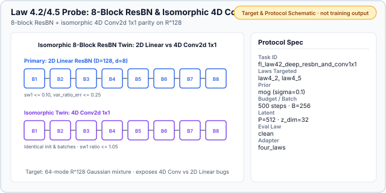
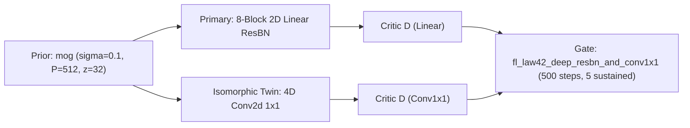

<!-- Generated Forge experiment page — do not edit manually; regenerate via `python -m experiments.forge.experiment_docs` -->

[← Leaderboard](../technique-inventory.md) · [Experiment Catalog](README.md) · [Explore by Laws](../LAWS_HUB.md) · [Research Portal](https://hypergan.github.io/ParticleGAN/)

# Law 4.2/4.5 Probe: 8-Block ResBN & Isomorphic 4D Conv2d 1x1 Twin (`fl_law42_deep_resbn_and_conv1x1`)

| Field | Value |
| --- | --- |
| **Laws Tested** | [Law 4.2](../LAWS_HUB.md#law4_2) · [Law 4.5](../LAWS_HUB.md#law4_5) |
| **Edge Cases** | `resbn-depth` `conv1x1-isomorphism` `high-dimensional` |
| **Primary View (`discriminator_stability`)** | Not in `discriminator_stability` |
| **Four Laws Adherence Role** | law4 (four_laws_probe) |
| **Fixed Full-Suite Denominator** | No (diagnostic / auxiliary cohort) |
| **Adapter / Domain** | `four_laws` / `fl_law42_deep_resbn_and_conv1x1` |
| **Prior** | `mog` (sigma=`0.1`, standardize=`False`) |
| **Update Budget** | `500` steps |

## What This Experiment Tests

Trains an 8-block branch-RMSNorm residual trunk (D=128, w=128) on a 64-mode R^128 mixture alongside its mathematically isomorphic 4D `Conv2d(1x1)` twin on identical initial weights and batches (conv1x1_sw1_ratio <= 1.05).

> [!NOTE]
> **Protocol notes:** Four Laws Adherence diagnostic probe (500 updates, R^128 64-mode mixture).

## Laws & Edge Cases Targeted

- **[Law 4.2: Pathology-Driven Spectral Conditioning](../LAWS_HUB.md#law4_2)** ([Law 4.2 theory](../../../docs/four-laws.md#law-4--functional-and-game-dynamics)) — Can the learning system realize useful functional changes and exhibit appropriate coupled learning dynamics?
- **[Law 4.5: Coupled Minimax Contraction](../LAWS_HUB.md#law4_5)** ([Law 4.5 theory](../../../docs/four-laws.md#law-4--functional-and-game-dynamics)) — Can the learning system realize useful functional changes and exhibit appropriate coupled learning dynamics?
- **Edge-case tags:** `resbn-depth`, `conv1x1-isomorphism`, `high-dimensional`

## Common Failure Mode

Optimizers that apply polar/spectral conditioning to 2D Linear matrices but skip or mishandle 4D Conv2d tensors diverge sharply between the two mathematically identical parameterizations.

## Visual Schematic



*Target & Protocol Schematic · not training output — generated deterministically from the declared task contract.*

## Protocol & Architecture Diagram



## Task Contract & Numerical Gates

### Execution & Sampling Contract

| Contract Field | Declared Value |
| --- | --- |
| Initializer | `deterministic_orthogonal` |
| Prior | `mog` (sigma=`0.1`, standardize=`False`) |
| Update Budget | `500` steps |
| Batch Size | `256` |
| Particles / Latent Dim | `P=512` / `z_dim=32` |
| Sampling Law | `public_prior_without_output_noise` |
| Evaluation Output Noise | `clean` |
| Scoring Weights | `live` |
| Architecture | `generator_family=resbn_linear_and_conv1x1_twin, discriminator_family=resbn_linear_and_conv1x1_twin, dim=128, width=128, depth=8` |
| Integrity Guards | `finite_state`, `optimizer_roles`, `exact_optimizer_updates`, `mechanism_exercised`, `rng_isolation` |
| Assigned Views | `four-laws-adherence-v1` (T1 diagnostic) |

### Numerical Pass/Fail Thresholds

| Metric | Operator | Threshold |
| --- | :---: | ---: |
| `finite_fraction` | `==` | `1.0` |
| `sw1` | `<=` | `0.1` |
| `var_ratio_err` | `<=` | `0.25` |
| `conv1x1_sw1` | `<=` | `0.1` |
| `conv1x1_sw1_ratio` | `<=` | `1.05` |

## Recorded Family Results

> [!IMPORTANT]
> Screening outcomes below come from recorded single-seed (`seed = 0`) Forge evidence. `NOT MEASURED`, `BLOCKED`, and `INCOMPATIBLE` are non-numerical states — not scientific failures — and confer no pass or qualification credit.

| Family | Selected Candidate | Outcome | Key Recorded Metrics | Family Report | Training Media |
| --- | --- | :---: | --- | --- | --- |
| **Atlas** | `atlas-particle-normal-v4` | `NOT MEASURED` | No recorded result for this selected configuration and source. | [Atlas](../families/atlas.md#cohort-cuda-bc3debd3fa5e) | — |
| **BCAP** | `recipe-prior-refactor-bcap-pure-v1` | `NOT MEASURED` | No recorded result for this selected configuration and source. | [BCAP](../families/bcap-pure.md#cohort-cuda-1bf9d7d34422) | — |
| **BISPF** | `bispf-optimized-quintic-v1` | `NOT MEASURED` | No recorded result for this selected configuration and source. | [BISPF](../families/bispf.md#cohort-cuda-1bf9d7d34422) | — |
| **E22** | `e22` | `NOT MEASURED` | No recorded result for this selected configuration and source. | [E22](../families/e22.md#cohort-cuda-1bf9d7d34422) | — |
| **EMPF** | `empf-v8` | `NOT MEASURED` | No recorded result for this selected configuration and source. | [EMPF](../families/empf.md#cohort-cuda-23a94f16ca88) | — |
| **GAN v3 release 0.7** | `recipe-prior-refactor-release07-gan-v3-v1` | `NOT MEASURED` | No recorded result for this selected configuration and source. | [GAN v3 release 0.7](../families/release07-gan-v3.md#cohort-cuda-1bf9d7d34422) | — |
| **K3P** | `recipe-prior-refactor-k3p-v1` | `NOT MEASURED` | No recorded result for this selected configuration and source. | [K3P](../families/k3p.md#cohort-cuda-1bf9d7d34422) | — |
| **KA2** | `recipe-prior-refactor-ka2-v1` | `NOT MEASURED` | No recorded result for this selected configuration and source. | [KA2](../families/ka2.md#cohort-cuda-1bf9d7d34422) | — |
| **R1/R2** | `recipe-prior-refactor-r1r2-v1` | `NOT MEASURED` | No recorded result for this selected configuration and source. | [R1/R2](../families/r1r2.md#cohort-cuda-1bf9d7d34422) | — |
| **RHBI** | `rhbi-v12` | `NOT MEASURED` | No recorded result for this selected configuration and source. | [RHBI](../families/rhbi.md#cohort-cuda-23a94f16ca88) | — |
| **Unified** | `unified-v11` | `NOT MEASURED` | No recorded result for this selected configuration and source. | [Unified](../families/unified.md#cohort-cuda-42a130a78fc3) | — |

### Four Laws Adherence Diagnostic Receipts (Separate Cohort)

*Diagnostic readouts and Colab matched-GPU receipts for `four-laws-adherence-v1` (protocol seed `0`, unchanged recipes; research telemetry only — separate from ordinary selected-cohort qualification above and confers no qualification or default-adoption credit):*

| Candidate | Family | GPU | Outcome | `min_margin` | NVML Energy | Key Recorded Metrics | Receipt |
| --- | --- | --- | :---: | ---: | ---: | --- | --- |
| `rhbi-v12` | `rhbi` | NVIDIA L4 | **FAIL** | `-0.036` | 7.50 kJ | conv1x1_sw1=0.02273, conv1x1_sw1_ratio=1.088, diag_d_max_s1=1.016, diag_s_therm=1 | [f5226f3cc935462a86b3c281ead4e3ae.json](../technique-receipts/f5226f3cc935462a86b3c281ead4e3ae.json) |
| `unified-v11` | `unified` | NVIDIA L4 | **FAIL** | `-0.047` | 8.18 kJ | conv1x1_sw1=0.02707, conv1x1_sw1_ratio=1.099, diag_d_max_s1=1.381, diag_s_therm=1e-06 | [b336fb5b67a24e9ca46b1b2df2ec4fb5.json](../technique-receipts/b336fb5b67a24e9ca46b1b2df2ec4fb5.json) |
| `recipe-prior-refactor-release07-gan-v3-v1` | `release07-gan-v3` | NVIDIA L4 | **FAIL** | `-0.399` | 3.26 kJ | conv1x1_sw1=0.06786, conv1x1_sw1_ratio=0.5963, diag_d_max_s1=5.088, diag_s_therm=1 | [6e9656735f994d499d3c2ffac6b187e7.json](../technique-receipts/6e9656735f994d499d3c2ffac6b187e7.json) |
| `recipe-prior-refactor-bcap-pure-v1` | `bcap-dualnorm` | NVIDIA L4 | **FAIL** | `-0.441` | 9.17 kJ | conv1x1_sw1=0.1441, conv1x1_sw1_ratio=1.166, diag_d_max_s1=1.565, diag_s_therm=1 | [f04d01b658e74e4c9395619d0ad13d41.json](../technique-receipts/f04d01b658e74e4c9395619d0ad13d41.json) |
| `recipe-prior-refactor-k3p-v1` | `k3p` | NVIDIA L4 | **FAIL** | `-0.550` | 3.86 kJ | conv1x1_sw1=0.155, conv1x1_sw1_ratio=1.353, diag_d_max_s1=9.301, diag_s_therm=1 | [baa62262c8f14277bc081fddc3ec3a6a.json](../technique-receipts/baa62262c8f14277bc081fddc3ec3a6a.json) |
| `recipe-prior-refactor-ka2-v1` | `ka2` | NVIDIA L4 | **FAIL** | `-1.021` | 3.82 kJ | conv1x1_sw1=0.2021, conv1x1_sw1_ratio=1.692, diag_d_max_s1=9.347, diag_s_therm=1 | [6bc8bf2f037c42ad8ca11600eff25f14.json](../technique-receipts/6bc8bf2f037c42ad8ca11600eff25f14.json) |
| `minimal-v2` | `minimal` | NVIDIA L4 | **FAIL** | `-2.066` | 6.82 kJ | conv1x1_sw1=0.3066, conv1x1_sw1_ratio=3.117, diag_d_max_s1=1.205, diag_s_therm=1 | [f69909f7eb5f461bb90a11ea3358a278.json](../technique-receipts/f69909f7eb5f461bb90a11ea3358a278.json) |
| `unified-v14` | `unified` | NVIDIA L4 | **FAIL** | `-2.196` | 6.62 kJ | conv1x1_sw1=0.09397, conv1x1_sw1_ratio=3.356, diag_d_max_s1=2.162, diag_s_therm=1e-06 | [61f1826ef6a944328f7e1efe36857e2e.json](../technique-receipts/61f1826ef6a944328f7e1efe36857e2e.json) |
| `bispf-optimized-quintic-v1` | `bispf` | NVIDIA L4 | **FAIL** | `-3.838` | 8.61 kJ | conv1x1_sw1=0.2109, conv1x1_sw1_ratio=0.5477, diag_d_max_s1=1.221, diag_s_therm=1 | [93b4050a652e4a94aab30b403c1e8a1b.json](../technique-receipts/93b4050a652e4a94aab30b403c1e8a1b.json) |
| `unified-v12` | `unified` | NVIDIA L4 | **FAIL** | `-15.545` | 6.50 kJ | conv1x1_sw1=0.4592, conv1x1_sw1_ratio=17.37, diag_d_max_s1=2.655, diag_s_therm=1e-06 | [67139353ee924257840827e8be7a2fa4.json](../technique-receipts/67139353ee924257840827e8be7a2fa4.json) |
| `unified-v13` | `unified` | NVIDIA L4 | **FAIL** | `-15.545` | 6.27 kJ | conv1x1_sw1=0.4592, conv1x1_sw1_ratio=17.37, diag_d_max_s1=2.655, diag_s_therm=1e-06 | [418a2d3efc934752b15801370625d925.json](../technique-receipts/418a2d3efc934752b15801370625d925.json) |
| `recipe-prior-refactor-r1r2-v1` | `r1r2` | NVIDIA L4 | **FAIL** | `-99.174` | 3.38 kJ | conv1x1_sw1=7.661, conv1x1_sw1_ratio=105.2, diag_d_max_s1=11.25, diag_s_therm=1 | [4d1eac0525f64e1699867bf56f3d38a8.json](../technique-receipts/4d1eac0525f64e1699867bf56f3d38a8.json) |
| `empf-v8` | `empf` | NVIDIA L4 | **FAIL** | `-316.245` | 6.45 kJ | conv1x1_sw1=0.1013, conv1x1_sw1_ratio=0.0562, diag_d_max_s1=1.282, diag_s_therm=1 | [491ca9505def437fb2a7276290793a9c.json](../technique-receipts/491ca9505def437fb2a7276290793a9c.json) |

## Reproduce This Experiment

```bash
# Validate this task declaration and inspect planned dependencies
python -m experiments.forge validate
python -m experiments.forge plan --view four-laws-adherence-v1 --candidate unified-v12 --tasks fl_law42_deep_resbn_and_conv1x1
```

**Declaration & Source Files:**

- Task contract: [configs/forge/tasks/fl_law42_deep_resbn_and_conv1x1.json](../../../configs/forge/tasks/fl_law42_deep_resbn_and_conv1x1.json)
- Source code: [benchmarks/toy_audit/api_four_laws_4.py](../../../benchmarks/toy_audit/api_four_laws_4.py)
- Source code: [experiments/forge/four_laws.py](../../../experiments/forge/four_laws.py)

## Annotation Provenance

This page was assembled read-only from the following versioned inputs without altering any task execution/evaluation fingerprint:

- **Task contract JSON:** [configs/forge/tasks/fl_law42_deep_resbn_and_conv1x1.json](../../../configs/forge/tasks/fl_law42_deep_resbn_and_conv1x1.json)
- **Editorial task documentation sidecar:** [configs/forge/task-documentation/fl_law42_deep_resbn_and_conv1x1.json](../../../configs/forge/task-documentation/fl_law42_deep_resbn_and_conv1x1.json)
- **Read-only Python AST source:** [benchmarks/toy_audit/api_four_laws_4.py](../../../benchmarks/toy_audit/api_four_laws_4.py) (AST symbols: `__doc__`, `THRESHOLDS`, `SPECS`)
- **Read-only Python AST source:** [experiments/forge/four_laws.py](../../../experiments/forge/four_laws.py) (AST symbols: `__doc__`)
