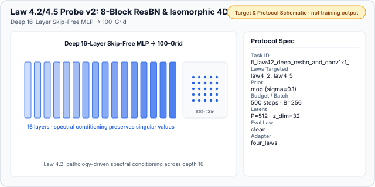
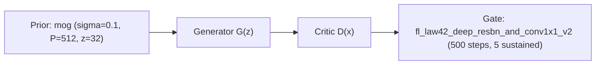

<!-- Generated Forge experiment page — do not edit manually; regenerate via `python -m experiments.forge.experiment_docs` -->

[← Leaderboard](../technique-inventory.md) · [Experiment Catalog](README.md) · [Explore by Laws](../LAWS_HUB.md) · [Research Portal](https://hypergan.github.io/ParticleGAN/)

# Law 4.2/4.5 Probe v2: 8-Block ResBN & Isomorphic 4D Conv2d 1x1 Twin (Absolute Parity) (`fl_law42_deep_resbn_and_conv1x1_v2`)

| Field | Value |
| --- | --- |
| **Laws Tested** | [Law 4.2](../LAWS_HUB.md#law4_2) · [Law 4.5](../LAWS_HUB.md#law4_5) |
| **Edge Cases** | `resbn-depth` `conv1x1-isomorphism` `high-dimensional` |
| **Primary View (`discriminator_stability`)** | Not in `discriminator_stability` |
| **Four Laws Adherence Role** | — |
| **Fixed Full-Suite Denominator** | No (diagnostic / auxiliary cohort) |
| **Adapter / Domain** | `four_laws` / `fl_law42_deep_resbn_and_conv1x1_v2` |
| **Prior** | `mog` (sigma=`0.1`, standardize=`False`) |
| **Update Budget** | `500` steps |

## What This Experiment Tests

Trains an 8-block ResBN trunk on a 64-mode R^128 Gaussian mixture alongside its mathematically isomorphic 4D `Conv2d(1x1)` twin, replacing v1's pathological inverse-quality ratio with floored absolute output parity `abs(conv1x1_sw1 - sw1) <= 0.015`.

> [!NOTE]
> **Protocol notes:** Four Laws Adherence v2 diagnostic probe (500 updates, R^128 64-mode mixture, sw1 <= 0.10 & abs diff <= 0.015).

## Laws & Edge Cases Targeted

- **[Law 4.2: Pathology-Driven Spectral Conditioning](../LAWS_HUB.md#law4_2)** ([Law 4.2 theory](../../../docs/four-laws.md#law-4--functional-and-game-dynamics)) — Can the learning system realize useful functional changes and exhibit appropriate coupled learning dynamics?
- **[Law 4.5: Coupled Minimax Contraction](../LAWS_HUB.md#law4_5)** ([Law 4.5 theory](../../../docs/four-laws.md#law-4--functional-and-game-dynamics)) — Can the learning system realize useful functional changes and exhibit appropriate coupled learning dynamics?
- **Edge-case tags:** `resbn-depth`, `conv1x1-isomorphism`, `high-dimensional`

## Common Failure Mode

Optimizers that spectrally condition 2D Linear weights but omit or mis-transpose 4D Conv2d(1x1) weights diverge in generated quality between mathematically identical architectures.

## Visual Schematic



*Target & Protocol Schematic · not training output — generated deterministically from the declared task contract.*

## Protocol & Architecture Diagram



## Task Contract & Numerical Gates

### Execution & Sampling Contract

| Contract Field | Declared Value |
| --- | --- |
| Initializer | `deterministic_orthogonal` |
| Prior | `mog` (sigma=`0.1`, standardize=`False`) |
| Update Budget | `500` steps |
| Batch Size | `256` |
| Particles / Latent Dim | `P=512` / `z_dim=32` |
| Sampling Law | `public_prior_without_output_noise` |
| Evaluation Output Noise | `clean` |
| Scoring Weights | `live` |
| Architecture | `generator_family=resbn_linear_and_conv1x1_twin, discriminator_family=resbn_linear_and_conv1x1_twin, dim=128, width=128, depth=8` |
| Integrity Guards | `finite_state`, `optimizer_roles`, `exact_optimizer_updates`, `mechanism_exercised`, `rng_isolation` |
| Assigned Views | `four-laws-adherence-v2` (T1 diagnostic) |

### Numerical Pass/Fail Thresholds

| Metric | Operator | Threshold |
| --- | :---: | ---: |
| `finite_fraction` | `==` | `1.0` |
| `sw1` | `<=` | `0.1` |
| `var_ratio_err` | `<=` | `0.25` |
| `conv1x1_sw1` | `<=` | `0.1` |
| `conv1x1_sw1_abs_diff` | `<=` | `0.015` |

## Recorded Family Results

> [!IMPORTANT]
> Screening outcomes below come from recorded single-seed (`seed = 0`) Forge evidence. `NOT MEASURED`, `BLOCKED`, and `INCOMPATIBLE` are non-numerical states — not scientific failures — and confer no pass or qualification credit.

| Family | Selected Candidate | Outcome | Key Recorded Metrics | Family Report | Training Media |
| --- | --- | :---: | --- | --- | --- |
| **Atlas** | `atlas-particle-normal-v4` | `NOT MEASURED` | No recorded result for this selected configuration and source. | [Atlas](../families/atlas.md#cohort-cuda-daa283c8a640) | — |
| **Axiom** | `axiom-v5` | `NOT MEASURED` | No recorded result for this selected configuration and source. | [Axiom](../families/axiom.md#cohort-cuda-42a130a78fc3) | [HF GIF](https://huggingface.co/datasets/HyperGAN/particlegan-forge-evidence/resolve/main/media/forge/leaderboard/axiom/axiom-v4/fl_law42_deep_resbn_and_conv1x1_v2.gif) |
| **BCAP** | `recipe-prior-refactor-bcap-pure-v1` | `NOT MEASURED` | No recorded result for this selected configuration and source. | [BCAP](../families/bcap-pure.md#cohort-cuda-1bf9d7d34422) | [HF GIF](https://huggingface.co/datasets/HyperGAN/particlegan-forge-evidence/resolve/main/media/forge/leaderboard/bcap-pure/recipe-prior-refactor-bcap-pure-v1/fl_law42_deep_resbn_and_conv1x1_v2.gif) |
| **BISPF** | `bispf-optimized-quintic-v1` | `NOT MEASURED` | No recorded result for this selected configuration and source. | [BISPF](../families/bispf.md#cohort-cuda-1bf9d7d34422) | [HF GIF](https://huggingface.co/datasets/HyperGAN/particlegan-forge-evidence/resolve/main/media/forge/leaderboard/bispf/bispf-optimized-quintic-v1/fl_law42_deep_resbn_and_conv1x1_v2.gif) |
| **E22** | `e22` | `NOT MEASURED` | No recorded result for this selected configuration and source. | [E22](../families/e22.md#cohort-cuda-1bf9d7d34422) | — |
| **EMPF** | `empf-v8` | `NOT MEASURED` | No recorded result for this selected configuration and source. | [EMPF](../families/empf.md#cohort-cuda-23a94f16ca88) | [HF GIF](https://huggingface.co/datasets/HyperGAN/particlegan-forge-evidence/resolve/main/media/forge/leaderboard/empf/empf-v8/fl_law42_deep_resbn_and_conv1x1_v2.gif) |
| **GAN v3 release 0.7** | `recipe-prior-refactor-release07-gan-v3-v1` | `NOT MEASURED` | No recorded result for this selected configuration and source. | [GAN v3 release 0.7](../families/release07-gan-v3.md#cohort-cuda-daa283c8a640) | [HF GIF](https://huggingface.co/datasets/HyperGAN/particlegan-forge-evidence/resolve/main/media/forge/leaderboard/release07-gan-v3/recipe-prior-refactor-release07-gan-v3-v1/fl_law42_deep_resbn_and_conv1x1_v2.gif) |
| **K3P** | `recipe-prior-refactor-k3p-v1` | `NOT MEASURED` | No recorded result for this selected configuration and source. | [K3P](../families/k3p.md#cohort-cuda-daa283c8a640) | [HF GIF](https://huggingface.co/datasets/HyperGAN/particlegan-forge-evidence/resolve/main/media/forge/leaderboard/k3p/recipe-prior-refactor-k3p-v1/fl_law42_deep_resbn_and_conv1x1_v2.gif) |
| **KA2** | `recipe-prior-refactor-ka2-v1` | `NOT MEASURED` | No recorded result for this selected configuration and source. | [KA2](../families/ka2.md#cohort-cuda-daa283c8a640) | [HF GIF](https://huggingface.co/datasets/HyperGAN/particlegan-forge-evidence/resolve/main/media/forge/leaderboard/ka2/recipe-prior-refactor-ka2-v1/fl_law42_deep_resbn_and_conv1x1_v2.gif) |
| **R1/R2** | `recipe-prior-refactor-r1r2-v1` | `NOT MEASURED` | No recorded result for this selected configuration and source. | [R1/R2](../families/r1r2.md#cohort-cuda-daa283c8a640) | [HF GIF](https://huggingface.co/datasets/HyperGAN/particlegan-forge-evidence/resolve/main/media/forge/leaderboard/r1r2/recipe-prior-refactor-r1r2-v1/fl_law42_deep_resbn_and_conv1x1_v2.gif) |
| **RHBI** | `rhbi-v12` | `NOT MEASURED` | No recorded result for this selected configuration and source. | [RHBI](../families/rhbi.md#cohort-cuda-23a94f16ca88) | [HF GIF](https://huggingface.co/datasets/HyperGAN/particlegan-forge-evidence/resolve/main/media/forge/leaderboard/rhbi/rhbi-v12/fl_law42_deep_resbn_and_conv1x1_v2.gif) |
| **Unified** | `unified-v15` | `DIAG_PASS` | No recorded result for this selected configuration and source. | [Unified](../families/unified.md#cohort-cuda-42a130a78fc3) | [HF GIF](https://huggingface.co/datasets/HyperGAN/particlegan-forge-evidence/resolve/main/media/forge/leaderboard/unified/unified-v11/fl_law42_deep_resbn_and_conv1x1_v2.gif) |

### Four Laws Adherence Diagnostic Receipts (Separate Cohort)

*Diagnostic readouts and Colab matched-GPU receipts for `four-laws-adherence-v1` (protocol seed `0`, unchanged recipes; research telemetry only — separate from ordinary selected-cohort qualification above and confers no qualification or default-adoption credit):*

| Candidate | Family | GPU | Outcome | `min_margin` | NVML Energy | Key Recorded Metrics | Receipt |
| --- | --- | --- | :---: | ---: | ---: | --- | --- |
| `axiom-v4` | `axiom` | NVIDIA L4 | **PASS** | `+0.000` | 2.79 kJ (J-to-PASS) | conv1x1_sw1=0.01962, conv1x1_sw1_abs_diff=0.0005384, conv1x1_sw1_ratio=0.9733, diag_d_max_s1=1.484 | [76a59e63aae842eab8400c46b90d563c.json](../technique-receipts/76a59e63aae842eab8400c46b90d563c.json) |
| `axiom-v5` | `axiom` | NVIDIA L4 | **PASS** | `+0.000` | 2.68 kJ (J-to-PASS) | conv1x1_sw1=0.01962, conv1x1_sw1_abs_diff=0.0005384, conv1x1_sw1_ratio=0.9733, diag_d_max_s1=1.484 | [bedabdfa25544ee3bf822d475dea4606.json](../technique-receipts/bedabdfa25544ee3bf822d475dea4606.json) |
| `axiom-v6` | `axiom` | NVIDIA RTX A6000 | **PASS** | `+0.000` | 8.66 kJ (J-to-PASS) | conv1x1_sw1=0.02246, conv1x1_sw1_abs_diff=0.004984, conv1x1_sw1_ratio=0.8184, diag_d_max_s1=1.265 | [readout-69f7d043a14e2780fb2cdd4a.json](../records/readout-69f7d043a14e2780fb2cdd4a.json) |
| `rhbi-v12` | `rhbi` | NVIDIA L4 | **PASS** | `+0.000` | 4.30 kJ (J-to-PASS) | conv1x1_sw1=0.02166, conv1x1_sw1_abs_diff=0.002328, conv1x1_sw1_ratio=1.12, diag_d_max_s1=1.016 | [aa54fe8138b94c3c9bb45510816133fa.json](../technique-receipts/aa54fe8138b94c3c9bb45510816133fa.json) |
| `unified-v11` | `unified` | NVIDIA L4 | **PASS** | `+0.000` | 5.56 kJ (J-to-PASS) | conv1x1_sw1=0.02807, conv1x1_sw1_abs_diff=0.003461, conv1x1_sw1_ratio=1.141, diag_d_max_s1=1.381 | [176b678708db47d69d8ed5224501ddb1.json](../technique-receipts/176b678708db47d69d8ed5224501ddb1.json) |
| `unified-v15` | `unified` | NVIDIA L4 | **PASS** | `+0.000` | 5.58 kJ (J-to-PASS) | conv1x1_sw1=0.04001, conv1x1_sw1_abs_diff=0.0005144, conv1x1_sw1_ratio=1.013, diag_d_max_s1=1.777 | [84c398d2b3cd4c8da135cc2fc531a5cd.json](../technique-receipts/84c398d2b3cd4c8da135cc2fc531a5cd.json) |
| `recipe-prior-refactor-bcap-pure-v1` | `bcap-dualnorm` | NVIDIA L4 | **FAIL** | `-0.452` | 8.73 kJ | conv1x1_sw1=0.1452, conv1x1_sw1_abs_diff=0.02084, conv1x1_sw1_ratio=1.168, diag_d_max_s1=1.565 | [f5c8df94cb9f455b8e59fa5f598caa19.json](../technique-receipts/f5c8df94cb9f455b8e59fa5f598caa19.json) |
| `recipe-prior-refactor-k3p-v1` | `k3p` | NVIDIA L4 | **FAIL** | `-1.763` | 3.57 kJ | conv1x1_sw1=0.155, conv1x1_sw1_abs_diff=0.04145, conv1x1_sw1_ratio=1.365, diag_d_max_s1=9.301 | [8bd04ae8d2b0412787af5156b2fb488b.json](../technique-receipts/8bd04ae8d2b0412787af5156b2fb488b.json) |
| `recipe-prior-refactor-release07-gan-v3-v1` | `release07-gan-v3` | NVIDIA L4 | **FAIL** | `-2.000` | 3.40 kJ | conv1x1_sw1=0.06785, conv1x1_sw1_abs_diff=0.045, conv1x1_sw1_ratio=0.6012, diag_d_max_s1=5.088 | [beb02769e16547778069e4a745f1e864.json](../technique-receipts/beb02769e16547778069e4a745f1e864.json) |
| `unified-v14` | `unified` | NVIDIA L4 | **FAIL** | `-3.501` | 6.36 kJ | conv1x1_sw1=0.09558, conv1x1_sw1_abs_diff=0.06752, conv1x1_sw1_ratio=3.407, diag_d_max_s1=2.162 | [f8d71757588643fba1396bac8284e682.json](../technique-receipts/f8d71757588643fba1396bac8284e682.json) |
| `recipe-prior-refactor-ka2-v1` | `ka2` | NVIDIA L4 | **FAIL** | `-4.556` | 3.74 kJ | conv1x1_sw1=0.2016, conv1x1_sw1_abs_diff=0.08334, conv1x1_sw1_ratio=1.705, diag_d_max_s1=9.347 | [2e3251b8aae14bea86e9b4c3865bed29.json](../technique-receipts/2e3251b8aae14bea86e9b4c3865bed29.json) |
| `bispf-optimized-quintic-v1` | `bispf` | NVIDIA L4 | **FAIL** | `-10.552` | 8.79 kJ | conv1x1_sw1=0.2104, conv1x1_sw1_abs_diff=0.1733, conv1x1_sw1_ratio=0.5483, diag_d_max_s1=1.221 | [2b72ba7670724a3c9e2bd56cebfde132.json](../technique-receipts/2b72ba7670724a3c9e2bd56cebfde132.json) |
| `empf-v8` | `empf` | NVIDIA L4 | **FAIL** | `-314.865` | 6.10 kJ | conv1x1_sw1=0.1014, conv1x1_sw1_abs_diff=1.7, conv1x1_sw1_ratio=0.05628, diag_d_max_s1=1.282 | [e5dadf25f63c46a6b8f528a3456fa6a5.json](../technique-receipts/e5dadf25f63c46a6b8f528a3456fa6a5.json) |
| `recipe-prior-refactor-r1r2-v1` | `r1r2` | NVIDIA L4 | **FAIL** | `-504.766` | 3.27 kJ | conv1x1_sw1=7.661, conv1x1_sw1_abs_diff=7.586, conv1x1_sw1_ratio=102.5, diag_d_max_s1=11.25 | [43525c4061f946bd85ce237649a0e4e0.json](../technique-receipts/43525c4061f946bd85ce237649a0e4e0.json) |

## Reproduce This Experiment

```bash
# Validate this task declaration and inspect planned dependencies
python -m experiments.forge validate
python -m experiments.forge plan --view four-laws-adherence-v2 --candidate unified-v12 --tasks fl_law42_deep_resbn_and_conv1x1_v2
```

**Declaration & Source Files:**

- Task contract: [configs/forge/tasks/fl_law42_deep_resbn_and_conv1x1_v2.json](../../../configs/forge/tasks/fl_law42_deep_resbn_and_conv1x1_v2.json)
- Source code: [benchmarks/toy_audit/api_four_laws_4.py](../../../benchmarks/toy_audit/api_four_laws_4.py)
- Source code: [experiments/forge/four_laws.py](../../../experiments/forge/four_laws.py)

## Annotation Provenance

This page was assembled read-only from the following versioned inputs without altering any task execution/evaluation fingerprint:

- **Task contract JSON:** [configs/forge/tasks/fl_law42_deep_resbn_and_conv1x1_v2.json](../../../configs/forge/tasks/fl_law42_deep_resbn_and_conv1x1_v2.json)
- **Editorial task documentation sidecar:** [configs/forge/task-documentation/fl_law42_deep_resbn_and_conv1x1_v2.json](../../../configs/forge/task-documentation/fl_law42_deep_resbn_and_conv1x1_v2.json)
- **Read-only Python AST source:** [benchmarks/toy_audit/api_four_laws_4.py](../../../benchmarks/toy_audit/api_four_laws_4.py) (AST symbols: `__doc__`, `THRESHOLDS`, `SPECS`)
- **Read-only Python AST source:** [experiments/forge/four_laws.py](../../../experiments/forge/four_laws.py) (AST symbols: `__doc__`)
