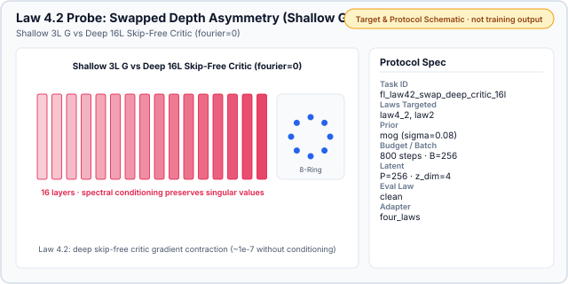
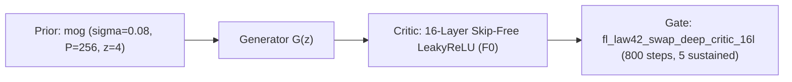

<!-- Generated Forge experiment page — do not edit manually; regenerate via `python -m experiments.forge.experiment_docs` -->

[← Leaderboard](../technique-inventory.md) · [Experiment Catalog](README.md) · [Explore by Laws](../LAWS_HUB.md) · [Research Portal](https://hypergan.github.io/ParticleGAN/)

# Law 4.2 Probe: Swapped Depth Asymmetry (Shallow G vs Deep 16L Critic) (`fl_law42_swap_deep_critic_16l`)

| Field | Value |
| --- | --- |
| **Laws Tested** | [Law 4.2](../LAWS_HUB.md#law4_2) · [Law 2](../LAWS_HUB.md#law2) |
| **Edge Cases** | `deep-critic-16l` `deep-spectral-contraction` `ring-mixture` |
| **Primary View (`discriminator_stability`)** | Not in `discriminator_stability` |
| **Four Laws Adherence Role** | law4 (four_laws_probe) |
| **Fixed Full-Suite Denominator** | No (diagnostic / auxiliary cohort) |
| **Adapter / Domain** | `four_laws` / `fl_law42_swap_deep_critic_16l` |
| **Prior** | `mog` (sigma=`0.08`, standardize=`False`) |
| **Update Budget** | `800` steps |

## What This Experiment Tests

Inverts depth asymmetry onto the critic: pairs a shallow 3-layer MLP generator with a deep 16-layer skip-free LeakyReLU critic (fourier=0) on an 8-mode 2D ring. Tests whether spectral conditioning rescues deep critics as well as deep generators.

> [!NOTE]
> **Protocol notes:** Four Laws Adherence diagnostic probe (800 updates, 8-mode ring R=2.5, valley_fraction <= 0.05).

## Laws & Edge Cases Targeted

- **[Law 4.2: Pathology-Driven Spectral Conditioning](../LAWS_HUB.md#law4_2)** ([Law 4.2 theory](../../../docs/four-laws.md#law-4--functional-and-game-dynamics)) — Can the learning system realize useful functional changes and exhibit appropriate coupled learning dynamics?
- **[Law 2: Potential Geometry](../LAWS_HUB.md#law2)** ([Law 2 theory](../../../docs/four-laws.md#law-2--potential-geometry)) — Does the critic communicate useful learning forces with appropriate geometric control and computational efficiency?
- **Edge-case tags:** `deep-critic-16l`, `deep-spectral-contraction`, `ring-mixture`

## Common Failure Mode

Without Law 4.2 spectral conditioning on D, the 16-layer critic's input Jacobian contracts to ~5e-7, leaving one-sided upper slope caps inactive and starving the generator of any useful force field.

## Visual Schematic



*Target & Protocol Schematic · not training output — generated deterministically from the declared task contract.*

## Protocol & Architecture Diagram



## Task Contract & Numerical Gates

### Execution & Sampling Contract

| Contract Field | Declared Value |
| --- | --- |
| Initializer | `deterministic_orthogonal` |
| Prior | `mog` (sigma=`0.08`, standardize=`False`) |
| Update Budget | `800` steps |
| Batch Size | `256` |
| Particles / Latent Dim | `P=256` / `z_dim=4` |
| Sampling Law | `public_prior_without_output_noise` |
| Evaluation Output Noise | `clean` |
| Scoring Weights | `live` |
| Architecture | `generator_family=simple_mlp, g_hidden=64, g_layers=3, out_dim=2, discriminator_family=deep_skipfree_mlp, d_hidden=64, d_layers=16, fourier=0` |
| Integrity Guards | `finite_state`, `optimizer_roles`, `exact_optimizer_updates`, `mechanism_exercised`, `rng_isolation` |
| Assigned Views | `four-laws-adherence-v1` (T1 diagnostic) |

### Numerical Pass/Fail Thresholds

| Metric | Operator | Threshold |
| --- | :---: | ---: |
| `finite_fraction` | `==` | `1.0` |
| `modes` | `==` | `8` |
| `hq` | `>=` | `0.85` |
| `mass_tv` | `<=` | `0.12` |
| `valley_fraction` | `<=` | `0.05` |

## Recorded Family Results

> [!IMPORTANT]
> Screening outcomes below come from recorded single-seed (`seed = 0`) Forge evidence. `NOT MEASURED`, `BLOCKED`, and `INCOMPATIBLE` are non-numerical states — not scientific failures — and confer no pass or qualification credit.

| Family | Selected Candidate | Outcome | Key Recorded Metrics | Family Report | Training Media |
| --- | --- | :---: | --- | --- | --- |
| **Atlas** | `atlas-particle-normal-v4` | `NOT MEASURED` | No recorded result for this selected configuration and source. | [Atlas](../families/atlas.md#cohort-cuda-bc3debd3fa5e) | — |
| **BCAP** | `recipe-prior-refactor-bcap-pure-v1` | `NOT MEASURED` | No recorded result for this selected configuration and source. | [BCAP](../families/bcap-pure.md#cohort-cuda-1bf9d7d34422) | — |
| **BISPF** | `bispf-optimized-quintic-v1` | `NOT MEASURED` | No recorded result for this selected configuration and source. | [BISPF](../families/bispf.md#cohort-cuda-1bf9d7d34422) | — |
| **E22** | `e22` | `NOT MEASURED` | No recorded result for this selected configuration and source. | [E22](../families/e22.md#cohort-cuda-1bf9d7d34422) | — |
| **EMPF** | `empf-v8` | `NOT MEASURED` | No recorded result for this selected configuration and source. | [EMPF](../families/empf.md#cohort-cuda-23a94f16ca88) | — |
| **GAN v3 release 0.7** | `recipe-prior-refactor-release07-gan-v3-v1` | `NOT MEASURED` | No recorded result for this selected configuration and source. | [GAN v3 release 0.7](../families/release07-gan-v3.md#cohort-cuda-1bf9d7d34422) | — |
| **K3P** | `recipe-prior-refactor-k3p-v1` | `NOT MEASURED` | No recorded result for this selected configuration and source. | [K3P](../families/k3p.md#cohort-cuda-1bf9d7d34422) | — |
| **KA2** | `recipe-prior-refactor-ka2-v1` | `NOT MEASURED` | No recorded result for this selected configuration and source. | [KA2](../families/ka2.md#cohort-cuda-1bf9d7d34422) | — |
| **R1/R2** | `recipe-prior-refactor-r1r2-v1` | `NOT MEASURED` | No recorded result for this selected configuration and source. | [R1/R2](../families/r1r2.md#cohort-cuda-1bf9d7d34422) | — |
| **RHBI** | `rhbi-v12` | `NOT MEASURED` | No recorded result for this selected configuration and source. | [RHBI](../families/rhbi.md#cohort-cuda-23a94f16ca88) | — |
| **Unified** | `unified-v11` | `NOT MEASURED` | No recorded result for this selected configuration and source. | [Unified](../families/unified.md#cohort-cuda-42a130a78fc3) | — |

## Reproduce This Experiment

```bash
# Validate this task declaration and inspect planned dependencies
python -m experiments.forge validate
python -m experiments.forge plan --view four-laws-adherence-v1 --candidate unified-v12 --tasks fl_law42_swap_deep_critic_16l
```

**Declaration & Source Files:**

- Task contract: [configs/forge/tasks/fl_law42_swap_deep_critic_16l.json](../../../configs/forge/tasks/fl_law42_swap_deep_critic_16l.json)
- Source code: [benchmarks/toy_audit/api_four_laws_4.py](../../../benchmarks/toy_audit/api_four_laws_4.py)
- Source code: [experiments/forge/four_laws.py](../../../experiments/forge/four_laws.py)

## Annotation Provenance

This page was assembled read-only from the following versioned inputs without altering any task execution/evaluation fingerprint:

- **Task contract JSON:** [configs/forge/tasks/fl_law42_swap_deep_critic_16l.json](../../../configs/forge/tasks/fl_law42_swap_deep_critic_16l.json)
- **Editorial task documentation sidecar:** [configs/forge/task-documentation/fl_law42_swap_deep_critic_16l.json](../../../configs/forge/task-documentation/fl_law42_swap_deep_critic_16l.json)
- **Read-only Python AST source:** [benchmarks/toy_audit/api_four_laws_4.py](../../../benchmarks/toy_audit/api_four_laws_4.py) (AST symbols: `__doc__`, `THRESHOLDS`, `SPECS`)
- **Read-only Python AST source:** [experiments/forge/four_laws.py](../../../experiments/forge/four_laws.py) (AST symbols: `__doc__`)
