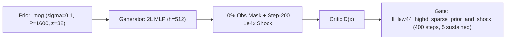

<!-- Generated Forge experiment page — do not edit manually; regenerate via `python -m experiments.forge.experiment_docs` -->

[← Leaderboard](../technique-inventory.md) · [Experiment Catalog](README.md) · [Explore by Laws](../LAWS_HUB.md) · [Research Portal](https://hypergan.github.io/ParticleGAN/)

# Law 4.4 Probe: R^512 Sparse-Mask Prior & 1e-5x / 1e4x Scale Shock (`fl_law44_highd_sparse_prior_and_shock`)

| Field | Value |
| --- | --- |
| **Laws Tested** | [Law 4.4](../LAWS_HUB.md#law4_4) · [Law 1](../LAWS_HUB.md#law1) |
| **Edge Cases** | `high-dimensional` `sparse-observation-mask` `scale-shock-1e4x` |
| **Primary View (`discriminator_stability`)** | Not in `discriminator_stability` |
| **Four Laws Adherence Role** | law4 (four_laws_probe) |
| **Fixed Full-Suite Denominator** | No (diagnostic / auxiliary cohort) |
| **Adapter / Domain** | `four_laws` / `fl_law44_highd_sparse_prior_and_shock` |
| **Prior** | `mog` (sigma=`0.1`, standardize=`False`) |
| **Update Budget** | `400` steps |

## What This Experiment Tests

Dual-part Law 4.4 probe combining (A) a 64-mode 10%-observed R^512 bounded manifold (P=1600, RMSNorm critic) and (B) an extreme 1e-5x-scaled 4-mode GAN hit by a transient 1e4x scale spike and mode shift at step 200.

> [!NOTE]
> **Protocol notes:** Four Laws Adherence diagnostic probe testing scale-free settling and shock recovery.

## Laws & Edge Cases Targeted

- **[Law 4.4: Trajectory Scale vs. Settling](../LAWS_HUB.md#law4_4)** ([Law 4.4 theory](../../../docs/four-laws.md#law-4--functional-and-game-dynamics)) — Can the learning system realize useful functional changes and exhibit appropriate coupled learning dynamics?
- **[Law 1: Representational Geometry](../LAWS_HUB.md#law1)** ([Law 1 theory](../../../docs/four-laws.md#law-1--representational-geometry)) — Can the system represent the required probability measure efficiently and faithfully?
- **Edge-case tags:** `high-dimensional`, `sparse-observation-mask`, `scale-shock-1e4x`

## Common Failure Mode

Scale-dependent step floors or non-resetting EMA denominators either freeze at 1e-5x data scale or lock up permanently after the step-200 1e4x shock spike; sparse 10% masks break dense prior updates.

## Visual Schematic


*Target & Protocol Schematic · not training output — generated deterministically from the declared task contract.*

## Protocol & Architecture Diagram



## Task Contract & Numerical Gates

### Execution & Sampling Contract

| Contract Field | Declared Value |
| --- | --- |
| Initializer | `deterministic_orthogonal` |
| Prior | `mog` (sigma=`0.1`, standardize=`False`) |
| Update Budget | `400` steps |
| Batch Size | `256` |
| Particles / Latent Dim | `P=1600` / `z_dim=32` |
| Sampling Law | `public_prior_without_output_noise` |
| Evaluation Output Noise | `clean` |
| Scoring Weights | `live` |
| Architecture | `generator_family=highd_sparse_tanh_mlp, discriminator_family=highd_rmsnorm_mlp, dim=512, hidden=512, obs_prob=0.1, shock_step=200, shock_base_scale=1e-05, shock_spike_scale=0.1` |
| Integrity Guards | `finite_state`, `optimizer_roles`, `exact_optimizer_updates`, `mechanism_exercised`, `rng_isolation` |
| Assigned Views | `four-laws-adherence-v1` (T1 diagnostic) |

### Numerical Pass/Fail Thresholds

| Metric | Operator | Threshold |
| --- | :---: | ---: |
| `finite_fraction` | `==` | `1.0` |
| `sw1` | `<=` | `0.14` |
| `mode_recall` | `>=` | `0.75` |
| `var_ratio_err` | `<=` | `0.25` |
| `shock_modes` | `==` | `4` |
| `shock_hq` | `>=` | `0.65` |
| `shock_sw1` | `<=` | `0.35` |

## Recorded Family Results

> [!IMPORTANT]
> Screening outcomes below come from recorded single-seed (`seed = 0`) Forge evidence. `NOT MEASURED`, `BLOCKED`, and `INCOMPATIBLE` are non-numerical states — not scientific failures — and confer no pass or qualification credit.

No selected-family cohort cells are recorded for this task in the current `reports/forge/technique-inventory.json`.

## Reproduce This Experiment

```bash
# Validate this task declaration and inspect planned dependencies
python -m experiments.forge validate
python -m experiments.forge plan --view four-laws-adherence-v1 --candidate unified-v12 --tasks fl_law44_highd_sparse_prior_and_shock
```

**Declaration & Source Files:**

- Task contract: [configs/forge/tasks/fl_law44_highd_sparse_prior_and_shock.json](../../../configs/forge/tasks/fl_law44_highd_sparse_prior_and_shock.json)
- Source code: [benchmarks/toy_audit/api_four_laws_4.py](../../../benchmarks/toy_audit/api_four_laws_4.py)
- Source code: [experiments/forge/four_laws.py](../../../experiments/forge/four_laws.py)

## Annotation Provenance

This page was assembled read-only from the following versioned inputs without altering any task execution/evaluation fingerprint:

- **Task contract JSON:** [configs/forge/tasks/fl_law44_highd_sparse_prior_and_shock.json](../../../configs/forge/tasks/fl_law44_highd_sparse_prior_and_shock.json)
- **Editorial task documentation sidecar:** [configs/forge/task-documentation/fl_law44_highd_sparse_prior_and_shock.json](../../../configs/forge/task-documentation/fl_law44_highd_sparse_prior_and_shock.json)
- **Read-only Python AST source:** [benchmarks/toy_audit/api_four_laws_4.py](../../../benchmarks/toy_audit/api_four_laws_4.py) (AST symbols: `__doc__`, `THRESHOLDS`, `SPECS`)
- **Read-only Python AST source:** [experiments/forge/four_laws.py](../../../experiments/forge/four_laws.py) (AST symbols: `__doc__`)
