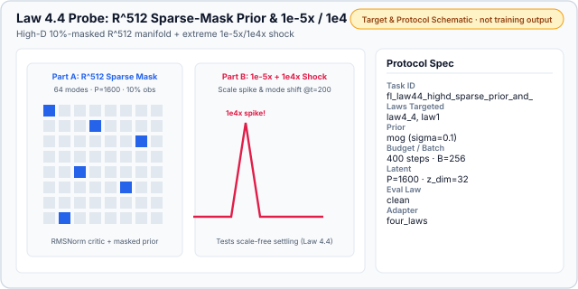
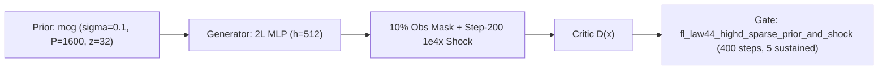

<!-- Generated Forge experiment page — do not edit manually; regenerate via `python -m experiments.forge.experiment_docs` -->

[← Leaderboard](../technique-inventory.md) · [Experiment Catalog](README.md) · [Explore by Laws](../LAWS_HUB.md) · [Research Portal](https://hypergan.github.io/ParticleGAN/)

# Law 4.4 Probe: R^512 Sparse-Mask Prior & 1e-5x / 1e4x Scale Shock (`fl_law44_highd_sparse_prior_and_shock`)

| Field | Value |
| --- | --- |
| **Laws Tested** | [Law 4.4](../LAWS_HUB.md#law4_4) · [Law 1](../LAWS_HUB.md#law1) |
| **Edge Cases** | `high-dimensional` `sparse-observation-mask` `scale-shock-1e4x` |
| **Primary View (`discriminator_stability`)** | Not in `discriminator_stability` |
| **Four Laws Adherence Role** | law4 (four_laws_probe) |
| **Fixed Full-Suite Denominator** | No (diagnostic / auxiliary cohort) |
| **Adapter / Domain** | `four_laws` / `fl_law44_highd_sparse_prior_and_shock` |
| **Prior** | `mog` (sigma=`0.1`, standardize=`False`) |
| **Update Budget** | `400` steps |

## What This Experiment Tests

Dual-part Law 4.4 probe combining (A) a 64-mode 10%-observed R^512 bounded manifold (P=1600, RMSNorm critic) and (B) an extreme 1e-5x-scaled 4-mode GAN hit by a transient 1e4x scale spike and mode shift at step 200.

> [!NOTE]
> **Protocol notes:** Four Laws Adherence diagnostic probe testing scale-free settling and shock recovery.

## Laws & Edge Cases Targeted

- **[Law 4.4: Trajectory Scale vs. Settling](../LAWS_HUB.md#law4_4)** ([Law 4.4 theory](../../../docs/four-laws.md#law-4--functional-and-game-dynamics)) — Can the learning system realize useful functional changes and exhibit appropriate coupled learning dynamics?
- **[Law 1: Representational Geometry](../LAWS_HUB.md#law1)** ([Law 1 theory](../../../docs/four-laws.md#law-1--representational-geometry)) — Can the system represent the required probability measure efficiently and faithfully?
- **Edge-case tags:** `high-dimensional`, `sparse-observation-mask`, `scale-shock-1e4x`

## Common Failure Mode

Scale-dependent step floors or non-resetting EMA denominators either freeze at 1e-5x data scale or lock up permanently after the step-200 1e4x shock spike; sparse 10% masks break dense prior updates.

## Visual Schematic



*Target & Protocol Schematic · not training output — generated deterministically from the declared task contract.*

## Protocol & Architecture Diagram



## Task Contract & Numerical Gates

### Execution & Sampling Contract

| Contract Field | Declared Value |
| --- | --- |
| Initializer | `deterministic_orthogonal` |
| Prior | `mog` (sigma=`0.1`, standardize=`False`) |
| Update Budget | `400` steps |
| Batch Size | `256` |
| Particles / Latent Dim | `P=1600` / `z_dim=32` |
| Sampling Law | `public_prior_without_output_noise` |
| Evaluation Output Noise | `clean` |
| Scoring Weights | `live` |
| Architecture | `generator_family=highd_sparse_tanh_mlp, discriminator_family=highd_rmsnorm_mlp, dim=512, hidden=512, obs_prob=0.1, shock_step=200, shock_base_scale=1e-05, shock_spike_scale=0.1` |
| Integrity Guards | `finite_state`, `optimizer_roles`, `exact_optimizer_updates`, `mechanism_exercised`, `rng_isolation` |
| Assigned Views | `four-laws-adherence-v1` (T1 diagnostic) |

### Numerical Pass/Fail Thresholds

| Metric | Operator | Threshold |
| --- | :---: | ---: |
| `finite_fraction` | `==` | `1.0` |
| `sw1` | `<=` | `0.14` |
| `mode_recall` | `>=` | `0.75` |
| `var_ratio_err` | `<=` | `0.25` |
| `shock_modes` | `==` | `4` |
| `shock_hq` | `>=` | `0.65` |
| `shock_sw1` | `<=` | `0.35` |

## Recorded Family Results

> [!IMPORTANT]
> Screening outcomes below come from recorded single-seed (`seed = 0`) Forge evidence. `NOT MEASURED`, `BLOCKED`, and `INCOMPATIBLE` are non-numerical states — not scientific failures — and confer no pass or qualification credit.

| Family | Selected Candidate | Outcome | Key Recorded Metrics | Family Report | Training Media |
| --- | --- | :---: | --- | --- | --- |
| **Atlas** | `atlas-particle-normal-v4` | `NOT MEASURED` | No recorded result for this selected configuration and source. | [Atlas](../families/atlas.md#cohort-cuda-daa283c8a640) | — |
| **Axiom** | `axiom-v4` | `NOT MEASURED` | No recorded result for this selected configuration and source. | [Axiom](../families/axiom.md#cohort-cuda-daa283c8a640) | — |
| **BCAP** | `recipe-prior-refactor-bcap-pure-v1` | `NOT MEASURED` | No recorded result for this selected configuration and source. | [BCAP](../families/bcap-pure.md#cohort-cuda-1bf9d7d34422) | — |
| **BISPF** | `bispf-optimized-quintic-v1` | `NOT MEASURED` | No recorded result for this selected configuration and source. | [BISPF](../families/bispf.md#cohort-cuda-1bf9d7d34422) | — |
| **E22** | `e22` | `NOT MEASURED` | No recorded result for this selected configuration and source. | [E22](../families/e22.md#cohort-cuda-1bf9d7d34422) | — |
| **EMPF** | `empf-v8` | `NOT MEASURED` | No recorded result for this selected configuration and source. | [EMPF](../families/empf.md#cohort-cuda-23a94f16ca88) | — |
| **GAN v3 release 0.7** | `recipe-prior-refactor-release07-gan-v3-v1` | `NOT MEASURED` | No recorded result for this selected configuration and source. | [GAN v3 release 0.7](../families/release07-gan-v3.md#cohort-cuda-daa283c8a640) | — |
| **K3P** | `recipe-prior-refactor-k3p-v1` | `NOT MEASURED` | No recorded result for this selected configuration and source. | [K3P](../families/k3p.md#cohort-cuda-daa283c8a640) | — |
| **KA2** | `recipe-prior-refactor-ka2-v1` | `NOT MEASURED` | No recorded result for this selected configuration and source. | [KA2](../families/ka2.md#cohort-cuda-daa283c8a640) | — |
| **R1/R2** | `recipe-prior-refactor-r1r2-v1` | `NOT MEASURED` | No recorded result for this selected configuration and source. | [R1/R2](../families/r1r2.md#cohort-cuda-daa283c8a640) | — |
| **RHBI** | `rhbi-v12` | `NOT MEASURED` | No recorded result for this selected configuration and source. | [RHBI](../families/rhbi.md#cohort-cuda-23a94f16ca88) | — |
| **Unified** | `unified-v11` | `NOT MEASURED` | No recorded result for this selected configuration and source. | [Unified](../families/unified.md#cohort-cuda-42a130a78fc3) | — |

### Four Laws Adherence Diagnostic Receipts (Separate Cohort)

*Diagnostic readouts and Colab matched-GPU receipts for `four-laws-adherence-v1` (protocol seed `0`, unchanged recipes; research telemetry only — separate from ordinary selected-cohort qualification above and confers no qualification or default-adoption credit):*

| Candidate | Family | GPU | Outcome | `min_margin` | NVML Energy | Key Recorded Metrics | Receipt |
| --- | --- | --- | :---: | ---: | ---: | --- | --- |
| `axiom-v4` | `axiom` | NVIDIA RTX A6000 | **FAIL** | `-1.583` | 4.93 kJ | diag_mean_dz=0.675, diag_prior_peak_rms=0, finite_fraction=1, min_margin=-1.583 | [readout-9066cb4353eb435be7819b0c.json](../records/readout-9066cb4353eb435be7819b0c.json) |
| `axiom-v4` | `axiom` | NVIDIA L4 | **FAIL** | `-1.663` | 2.51 kJ | diag_mean_dz=0.6748, diag_prior_peak_rms=0, finite_fraction=1, min_margin=-1.663 | [e0153cf7062d4061b1096374309138ed.json](../technique-receipts/e0153cf7062d4061b1096374309138ed.json) |
| `rhbi-v12` | `rhbi` | NVIDIA L4 | **FAIL** | `-2.472` | 3.31 kJ | diag_mean_dz=0.009527, diag_prior_peak_rms=0, finite_fraction=1, min_margin=-2.472 | [056207f4620b434ea5fe641467a93fc7.json](../technique-receipts/056207f4620b434ea5fe641467a93fc7.json) |
| `empf-v8` | `empf` | NVIDIA L4 | **FAIL** | `-2.903` | 1.96 kJ | diag_mean_dz=0.05395, diag_prior_peak_rms=0, finite_fraction=1, min_margin=-2.903 | [ce1c5ead6f404cea9a2a03b96d0cd3da.json](../technique-receipts/ce1c5ead6f404cea9a2a03b96d0cd3da.json) |
| `recipe-prior-refactor-bcap-pure-v1` | `bcap-dualnorm` | NVIDIA L4 | **FAIL** | `-2.903` | 2.51 kJ | diag_mean_dz=0.0536, diag_prior_peak_rms=0, finite_fraction=1, min_margin=-2.903 | [bc68dd3a6cc54a0286e2029074b169e7.json](../technique-receipts/bc68dd3a6cc54a0286e2029074b169e7.json) |
| `bispf-optimized-quintic-v1` | `bispf` | NVIDIA L4 | **FAIL** | `-2.904` | 2.80 kJ | diag_mean_dz=0.000436, diag_prior_peak_rms=0, finite_fraction=1, min_margin=-2.904 | [4441c690196d439686ba57bb916c6aa8.json](../technique-receipts/4441c690196d439686ba57bb916c6aa8.json) |
| `recipe-prior-refactor-k3p-v1` | `k3p` | NVIDIA L4 | **FAIL** | `-3.046` | 1.02 kJ | diag_mean_dz=0.5552, diag_prior_peak_rms=0, finite_fraction=1, min_margin=-3.046 | [7f4e1af394a0431ba2c5a38b5078b798.json](../technique-receipts/7f4e1af394a0431ba2c5a38b5078b798.json) |
| `recipe-prior-refactor-ka2-v1` | `ka2` | NVIDIA L4 | **FAIL** | `-3.173` | 1.01 kJ | diag_mean_dz=0.5531, diag_prior_peak_rms=0, finite_fraction=1, min_margin=-3.173 | [fa323e74cd19403bb2927e5ea4d70a37.json](../technique-receipts/fa323e74cd19403bb2927e5ea4d70a37.json) |
| `unified-v12` | `unified` | NVIDIA L4 | **FAIL** | `-5.860` | 3.37 kJ | diag_mean_dz=0.02775, diag_prior_peak_rms=0.000139, finite_fraction=1, min_margin=-5.86 | [d6ce778d99224c7b98ceec630776e45f.json](../technique-receipts/d6ce778d99224c7b98ceec630776e45f.json) |
| `unified-v13` | `unified` | NVIDIA L4 | **FAIL** | `-5.860` | 3.11 kJ | diag_mean_dz=0.02775, diag_prior_peak_rms=0.000139, finite_fraction=1, min_margin=-5.86 | [7855ce093f10474fb2b5374bf87b0cbc.json](../technique-receipts/7855ce093f10474fb2b5374bf87b0cbc.json) |
| `unified-v14` | `unified` | NVIDIA L4 | **FAIL** | `-5.860` | 3.66 kJ | diag_mean_dz=0.4096, diag_prior_peak_rms=0.0001134, finite_fraction=1, min_margin=-5.86 | [ecf5f7ad21dc451ea7adce33fe1c6a36.json](../technique-receipts/ecf5f7ad21dc451ea7adce33fe1c6a36.json) |
| `unified-v11` | `unified` | NVIDIA L4 | **FAIL** | `-6.252` | 3.76 kJ | diag_mean_dz=1.387, diag_prior_peak_rms=3.233e-05, finite_fraction=1, min_margin=-6.252 | [6db2d8b1a61f477f9cf7439f1a62569c.json](../technique-receipts/6db2d8b1a61f477f9cf7439f1a62569c.json) |
| `recipe-prior-refactor-r1r2-v1` | `r1r2` | NVIDIA L4 | **FAIL** | `-6.508` | 889 J | diag_mean_dz=0.6005, diag_prior_peak_rms=0, finite_fraction=1, min_margin=-6.508 | [7637bd44f1004f53969872e39d14449b.json](../technique-receipts/7637bd44f1004f53969872e39d14449b.json) |
| `recipe-prior-refactor-release07-gan-v3-v1` | `release07-gan-v3` | NVIDIA L4 | **FAIL** | `-83.782` | 890 J | diag_mean_dz=0.6316, diag_prior_peak_rms=0, finite_fraction=1, min_margin=-83.78 | [25efdd2244f04de1aa5a2de948a5351b.json](../technique-receipts/25efdd2244f04de1aa5a2de948a5351b.json) |
| `minimal-v2` | `minimal` | NVIDIA L4 | **FAIL** | `-6915.857` | 1.86 kJ | diag_mean_dz=0.4247, diag_prior_peak_rms=6.376e-06, finite_fraction=1, min_margin=-6916 | [d4191362760e47e19680b52c8ab7f1f3.json](../technique-receipts/d4191362760e47e19680b52c8ab7f1f3.json) |

## Reproduce This Experiment

```bash
# Validate this task declaration and inspect planned dependencies
python -m experiments.forge validate
python -m experiments.forge plan --view four-laws-adherence-v1 --candidate unified-v12 --tasks fl_law44_highd_sparse_prior_and_shock
```

**Declaration & Source Files:**

- Task contract: [configs/forge/tasks/fl_law44_highd_sparse_prior_and_shock.json](../../../configs/forge/tasks/fl_law44_highd_sparse_prior_and_shock.json)
- Source code: [benchmarks/toy_audit/api_four_laws_4.py](../../../benchmarks/toy_audit/api_four_laws_4.py)
- Source code: [experiments/forge/four_laws.py](../../../experiments/forge/four_laws.py)

## Annotation Provenance

This page was assembled read-only from the following versioned inputs without altering any task execution/evaluation fingerprint:

- **Task contract JSON:** [configs/forge/tasks/fl_law44_highd_sparse_prior_and_shock.json](../../../configs/forge/tasks/fl_law44_highd_sparse_prior_and_shock.json)
- **Editorial task documentation sidecar:** [configs/forge/task-documentation/fl_law44_highd_sparse_prior_and_shock.json](../../../configs/forge/task-documentation/fl_law44_highd_sparse_prior_and_shock.json)
- **Read-only Python AST source:** [benchmarks/toy_audit/api_four_laws_4.py](../../../benchmarks/toy_audit/api_four_laws_4.py) (AST symbols: `__doc__`, `THRESHOLDS`, `SPECS`)
- **Read-only Python AST source:** [experiments/forge/four_laws.py](../../../experiments/forge/four_laws.py) (AST symbols: `__doc__`)
