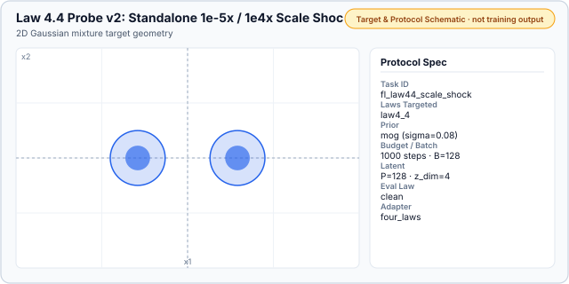
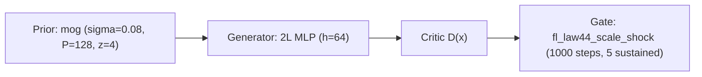

<!-- Generated Forge experiment page — do not edit manually; regenerate via `python -m experiments.forge.experiment_docs` -->

[← Leaderboard](../technique-inventory.md) · [Experiment Catalog](README.md) · [Explore by Laws](../LAWS_HUB.md) · [Research Portal](https://hypergan.github.io/ParticleGAN/)

# Law 4.4 Probe v2: Standalone 1e-5x / 1e4x Scale Shock & 45-Deg Rotation Recovery (`fl_law44_scale_shock`)

| Field | Value |
| --- | --- |
| **Laws Tested** | [Law 4.4](../LAWS_HUB.md#law4_4) |
| **Edge Cases** | `scale-shock-1e4x` `extreme-scale-1e-5x` `non-stationary-rotation` |
| **Primary View (`discriminator_stability`)** | Not in `discriminator_stability` |
| **Four Laws Adherence Role** | — |
| **Fixed Full-Suite Denominator** | No (diagnostic / auxiliary cohort) |
| **Adapter / Domain** | `four_laws` / `fl_law44_scale_shock` |
| **Prior** | `mog` (sigma=`0.08`, standardize=`False`) |
| **Update Budget** | `1000` steps |

## What This Experiment Tests

Standalone Law 4.4 scale-equivariance and shock-recovery probe (retiring v1's broken compound R^512 10%-masked probe): runs a 1e-5x-scaled 4-mode 2D GAN hit by a transient 1e4x scale spike and 45-degree rotation at step 300 with >= 500 recovery steps.

> [!NOTE]
> **Protocol notes:** Four Laws Adherence v2 diagnostic probe (1,000 updates, shock_step=300, >=500 post-shock recovery steps).

## Laws & Edge Cases Targeted

- **[Law 4.4: Trajectory Scale vs. Settling](../LAWS_HUB.md#law4_4)** ([Law 4.4 theory](../../../docs/four-laws.md#law-4--functional-and-game-dynamics)) — Can the learning system realize useful functional changes and exhibit appropriate coupled learning dynamics?
- **Edge-case tags:** `scale-shock-1e4x`, `extreme-scale-1e-5x`, `non-stationary-rotation`

## Common Failure Mode

Absolute step floors freeze at 1e-5x data scale, while slow-decaying EMA denominators lock up permanently after the step-300 1e4x transient spike.

## Visual Schematic



*Target & Protocol Schematic · not training output — generated deterministically from the declared task contract.*

## Protocol & Architecture Diagram



## Task Contract & Numerical Gates

### Execution & Sampling Contract

| Contract Field | Declared Value |
| --- | --- |
| Initializer | `deterministic_orthogonal` |
| Prior | `mog` (sigma=`0.08`, standardize=`False`) |
| Update Budget | `1000` steps |
| Batch Size | `128` |
| Particles / Latent Dim | `P=128` / `z_dim=4` |
| Sampling Law | `public_prior_without_output_noise` |
| Evaluation Output Noise | `clean` |
| Scoring Weights | `live` |
| Architecture | `generator_family=scaled_output_mlp, discriminator_family=simple_mlp, hidden=64, layers=2, out_dim=2, fourier=0, shock_step=300, shock_base_scale=1e-05` |
| Integrity Guards | `finite_state`, `optimizer_roles`, `exact_optimizer_updates`, `mechanism_exercised`, `rng_isolation` |
| Assigned Views | `four-laws-adherence-v2` (T1 diagnostic) |

### Numerical Pass/Fail Thresholds

| Metric | Operator | Threshold |
| --- | :---: | ---: |
| `finite_fraction` | `==` | `1.0` |
| `shock_modes` | `==` | `4` |
| `shock_hq` | `>=` | `0.65` |
| `shock_sw1` | `<=` | `0.35` |
| `shock_mass_tv` | `<=` | `0.15` |

## Recorded Family Results

> [!IMPORTANT]
> Screening outcomes below come from recorded single-seed (`seed = 0`) Forge evidence. `NOT MEASURED`, `BLOCKED`, and `INCOMPATIBLE` are non-numerical states — not scientific failures — and confer no pass or qualification credit.

| Family | Selected Candidate | Outcome | Key Recorded Metrics | Family Report | Training Media |
| --- | --- | :---: | --- | --- | --- |
| **Atlas** | `atlas-particle-normal-v4` | `NOT MEASURED` | No recorded result for this selected configuration and source. | [Atlas](../families/atlas.md#cohort-cuda-daa283c8a640) | — |
| **Axiom** | `axiom-v5` | `NOT MEASURED` | No recorded result for this selected configuration and source. | [Axiom](../families/axiom.md#cohort-cuda-42a130a78fc3) | [HF GIF](https://huggingface.co/datasets/HyperGAN/particlegan-forge-evidence/resolve/main/media/forge/leaderboard/axiom/axiom-v4/fl_law44_scale_shock.gif) |
| **BCAP** | `recipe-prior-refactor-bcap-pure-v1` | `NOT MEASURED` | No recorded result for this selected configuration and source. | [BCAP](../families/bcap-pure.md#cohort-cuda-1bf9d7d34422) | [HF GIF](https://huggingface.co/datasets/HyperGAN/particlegan-forge-evidence/resolve/main/media/forge/leaderboard/bcap-pure/recipe-prior-refactor-bcap-pure-v1/fl_law44_scale_shock.gif) |
| **BISPF** | `bispf-optimized-quintic-v1` | `NOT MEASURED` | No recorded result for this selected configuration and source. | [BISPF](../families/bispf.md#cohort-cuda-1bf9d7d34422) | [HF GIF](https://huggingface.co/datasets/HyperGAN/particlegan-forge-evidence/resolve/main/media/forge/leaderboard/bispf/bispf-optimized-quintic-v1/fl_law44_scale_shock.gif) |
| **E22** | `e22` | `NOT MEASURED` | No recorded result for this selected configuration and source. | [E22](../families/e22.md#cohort-cuda-1bf9d7d34422) | — |
| **EMPF** | `empf-v8` | `NOT MEASURED` | No recorded result for this selected configuration and source. | [EMPF](../families/empf.md#cohort-cuda-23a94f16ca88) | [HF GIF](https://huggingface.co/datasets/HyperGAN/particlegan-forge-evidence/resolve/main/media/forge/leaderboard/empf/empf-v8/fl_law44_scale_shock.gif) |
| **GAN v3 release 0.7** | `recipe-prior-refactor-release07-gan-v3-v1` | `NOT MEASURED` | No recorded result for this selected configuration and source. | [GAN v3 release 0.7](../families/release07-gan-v3.md#cohort-cuda-daa283c8a640) | [HF GIF](https://huggingface.co/datasets/HyperGAN/particlegan-forge-evidence/resolve/main/media/forge/leaderboard/release07-gan-v3/recipe-prior-refactor-release07-gan-v3-v1/fl_law44_scale_shock.gif) |
| **K3P** | `recipe-prior-refactor-k3p-v1` | `NOT MEASURED` | No recorded result for this selected configuration and source. | [K3P](../families/k3p.md#cohort-cuda-daa283c8a640) | [HF GIF](https://huggingface.co/datasets/HyperGAN/particlegan-forge-evidence/resolve/main/media/forge/leaderboard/k3p/recipe-prior-refactor-k3p-v1/fl_law44_scale_shock.gif) |
| **KA2** | `recipe-prior-refactor-ka2-v1` | `NOT MEASURED` | No recorded result for this selected configuration and source. | [KA2](../families/ka2.md#cohort-cuda-daa283c8a640) | [HF GIF](https://huggingface.co/datasets/HyperGAN/particlegan-forge-evidence/resolve/main/media/forge/leaderboard/ka2/recipe-prior-refactor-ka2-v1/fl_law44_scale_shock.gif) |
| **R1/R2** | `recipe-prior-refactor-r1r2-v1` | `NOT MEASURED` | No recorded result for this selected configuration and source. | [R1/R2](../families/r1r2.md#cohort-cuda-daa283c8a640) | [HF GIF](https://huggingface.co/datasets/HyperGAN/particlegan-forge-evidence/resolve/main/media/forge/leaderboard/r1r2/recipe-prior-refactor-r1r2-v1/fl_law44_scale_shock.gif) |
| **RHBI** | `rhbi-v12` | `NOT MEASURED` | No recorded result for this selected configuration and source. | [RHBI](../families/rhbi.md#cohort-cuda-23a94f16ca88) | [HF GIF](https://huggingface.co/datasets/HyperGAN/particlegan-forge-evidence/resolve/main/media/forge/leaderboard/rhbi/rhbi-v12/fl_law44_scale_shock.gif) |
| **Unified** | `unified-v15` | `DIAG_PASS` | No recorded result for this selected configuration and source. | [Unified](../families/unified.md#cohort-cuda-42a130a78fc3) | [HF GIF](https://huggingface.co/datasets/HyperGAN/particlegan-forge-evidence/resolve/main/media/forge/leaderboard/unified/unified-v11/fl_law44_scale_shock.gif) |

### Four Laws Adherence Diagnostic Receipts (Separate Cohort)

*Diagnostic readouts and Colab matched-GPU receipts for `four-laws-adherence-v1` (protocol seed `0`, unchanged recipes; research telemetry only — separate from ordinary selected-cohort qualification above and confers no qualification or default-adoption credit):*

| Candidate | Family | GPU | Outcome | `min_margin` | NVML Energy | Key Recorded Metrics | Receipt |
| --- | --- | --- | :---: | ---: | ---: | --- | --- |
| `axiom-v4` | `axiom` | NVIDIA L4 | **PASS** | `+0.000` | 681 J (J-to-PASS) | finite_fraction=1, min_margin=0, shock_hq=1, shock_mass_tv=0.06104 | [b6b694d6612e48a5a5af5669aaf1f89d.json](../technique-receipts/b6b694d6612e48a5a5af5669aaf1f89d.json) |
| `axiom-v5` | `axiom` | NVIDIA L4 | **PASS** | `+0.000` | 663 J (J-to-PASS) | finite_fraction=1, min_margin=0, shock_hq=1, shock_mass_tv=0.06104 | [c68cc6d754ed49a5b6995ee669556f70.json](../technique-receipts/c68cc6d754ed49a5b6995ee669556f70.json) |
| `axiom-v6` | `axiom` | NVIDIA RTX A6000 | **PASS** | `+0.000` | 888 J (J-to-PASS) | finite_fraction=1, min_margin=0, shock_hq=0.9976, shock_mass_tv=0.01465 | [readout-69f7d043a14e2780fb2cdd4a.json](../records/readout-69f7d043a14e2780fb2cdd4a.json) |
| `unified-v15` | `unified` | NVIDIA L4 | **PASS** | `+0.000` | 554 J (J-to-PASS) | finite_fraction=1, min_margin=0, shock_hq=0.9956, shock_mass_tv=0.01318 | [8331f210417a4d05b721ef6ae98087b0.json](../technique-receipts/8331f210417a4d05b721ef6ae98087b0.json) |
| `recipe-prior-refactor-bcap-pure-v1` | `bcap-dualnorm` | NVIDIA L4 | **FAIL** | `-2.498` | 966 J | finite_fraction=1, min_margin=-2.498, shock_hq=0, shock_mass_tv=0.5195 | [6811538bfe1249f4839bf9b9ac0408c4.json](../technique-receipts/6811538bfe1249f4839bf9b9ac0408c4.json) |
| `rhbi-v12` | `rhbi` | NVIDIA L4 | **FAIL** | `-2.499` | 1.70 kJ | finite_fraction=1, min_margin=-2.499, shock_hq=0, shock_mass_tv=0.2104 | [605bfc25e4de4a878ca94003d199aa9c.json](../technique-receipts/605bfc25e4de4a878ca94003d199aa9c.json) |
| `bispf-optimized-quintic-v1` | `bispf` | NVIDIA L4 | **FAIL** | `-2.659` | 1.35 kJ | finite_fraction=1, min_margin=-2.659, shock_hq=0, shock_mass_tv=0.5488 | [9a3ecad494a245eca641954e7b08aed3.json](../technique-receipts/9a3ecad494a245eca641954e7b08aed3.json) |
| `recipe-prior-refactor-k3p-v1` | `k3p` | NVIDIA L4 | **FAIL** | `-3.642` | 715 J | finite_fraction=1, min_margin=-3.642, shock_hq=0, shock_mass_tv=0.6963 | [e1437ef1d2c24e9e9f678bc0748671ee.json](../technique-receipts/e1437ef1d2c24e9e9f678bc0748671ee.json) |
| `recipe-prior-refactor-r1r2-v1` | `r1r2` | NVIDIA L4 | **FAIL** | `-3.704` | 635 J | finite_fraction=1, min_margin=-3.704, shock_hq=0, shock_mass_tv=0.7056 | [c980bc0656b847b2bdc638f63525057a.json](../technique-receipts/c980bc0656b847b2bdc638f63525057a.json) |
| `empf-v8` | `empf` | NVIDIA L4 | **FAIL** | `-3.837` | 1.33 kJ | finite_fraction=1, min_margin=-3.837, shock_hq=0, shock_mass_tv=0.7256 | [47688ebd96ba4aa79d26ea9cfdcc6d75.json](../technique-receipts/47688ebd96ba4aa79d26ea9cfdcc6d75.json) |
| `recipe-prior-refactor-ka2-v1` | `ka2` | NVIDIA L4 | **FAIL** | `-4.000` | 755 J | finite_fraction=1, min_margin=-4, shock_hq=0, shock_mass_tv=0.75 | [c6dca3a685084aaeb4e8a402cf5e41fd.json](../technique-receipts/c6dca3a685084aaeb4e8a402cf5e41fd.json) |
| `unified-v11` | `unified` | NVIDIA L4 | **FAIL** | `-4.208` | 2.95 kJ | finite_fraction=1, min_margin=-4.208, shock_hq=0.02148, shock_mass_tv=0.2393 | [42b9cfaeb0d74426978807d74f0182ad.json](../technique-receipts/42b9cfaeb0d74426978807d74f0182ad.json) |
| `unified-v14` | `unified` | NVIDIA L4 | **FAIL** | `-4.330` | 2.29 kJ | finite_fraction=1, min_margin=-4.33, shock_hq=0.01367, shock_mass_tv=0.2305 | [d1e9f30fac354199bdf6cff3d2845834.json](../technique-receipts/d1e9f30fac354199bdf6cff3d2845834.json) |
| `recipe-prior-refactor-release07-gan-v3-v1` | `release07-gan-v3` | NVIDIA L4 | **FAIL** | `-10.156` | 640 J | finite_fraction=1, min_margin=-10.16, shock_hq=0, shock_mass_tv=0.7451 | [ad1ff7eacc7a486dbaa3a61ec67280c8.json](../technique-receipts/ad1ff7eacc7a486dbaa3a61ec67280c8.json) |

## Reproduce This Experiment

```bash
# Validate this task declaration and inspect planned dependencies
python -m experiments.forge validate
python -m experiments.forge plan --view four-laws-adherence-v2 --candidate unified-v12 --tasks fl_law44_scale_shock
```

**Declaration & Source Files:**

- Task contract: [configs/forge/tasks/fl_law44_scale_shock.json](../../../configs/forge/tasks/fl_law44_scale_shock.json)
- Source code: [benchmarks/toy_audit/api_four_laws_4.py](../../../benchmarks/toy_audit/api_four_laws_4.py)
- Source code: [experiments/forge/four_laws.py](../../../experiments/forge/four_laws.py)

## Annotation Provenance

This page was assembled read-only from the following versioned inputs without altering any task execution/evaluation fingerprint:

- **Task contract JSON:** [configs/forge/tasks/fl_law44_scale_shock.json](../../../configs/forge/tasks/fl_law44_scale_shock.json)
- **Editorial task documentation sidecar:** [configs/forge/task-documentation/fl_law44_scale_shock.json](../../../configs/forge/task-documentation/fl_law44_scale_shock.json)
- **Read-only Python AST source:** [benchmarks/toy_audit/api_four_laws_4.py](../../../benchmarks/toy_audit/api_four_laws_4.py) (AST symbols: `__doc__`, `THRESHOLDS`, `SPECS`)
- **Read-only Python AST source:** [experiments/forge/four_laws.py](../../../experiments/forge/four_laws.py) (AST symbols: `__doc__`)
