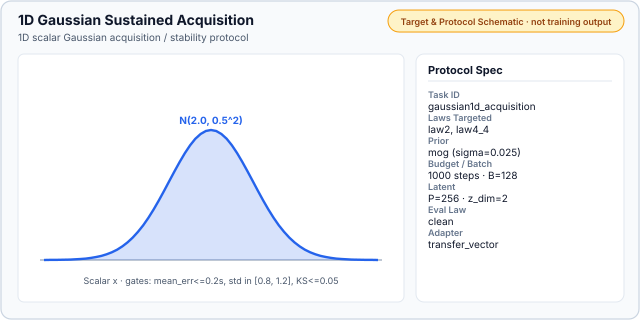
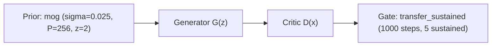

<!-- Generated Forge experiment page — do not edit manually; regenerate via `python -m experiments.forge.experiment_docs` -->

[← Leaderboard](../technique-inventory.md) · [Experiment Catalog](README.md) · [Explore by Laws](../LAWS_HUB.md) · [Research Portal](https://hypergan.github.io/ParticleGAN/)

# 1D Gaussian Sustained Acquisition (`gaussian1d_acquisition`)

| Field | Value |
| --- | --- |
| **Laws Tested** | [Law 2](../LAWS_HUB.md#law2) · [Law 4.4](../LAWS_HUB.md#law4_4) |
| **Edge Cases** | `scalar-1d` `sustained-suffix` |
| **Primary View (`discriminator_stability`)** | Not in `discriminator_stability` |
| **Four Laws Adherence Role** | — |
| **Fixed Full-Suite Denominator** | No (diagnostic / auxiliary cohort) |
| **Adapter / Domain** | `transfer_vector` / `transfer_sustained` |
| **Prior** | `mog` (sigma=`0.025`, standardize=`False`) |
| **Update Budget** | `1000` steps |

## What This Experiment Tests

Measures sustained acquisition of N(2, 0.5^2) over 1,000 updates requiring 5 consecutive terminal passing checks on mean error, standard-deviation ratio, and Kolmogorov-Smirnov CDF distance.

> [!NOTE]
> **Protocol notes:** Predecessor/companion sustained gate to `gaussian1d_smoke`.

## Laws & Edge Cases Targeted

- **[Law 2: Potential Geometry](../LAWS_HUB.md#law2)** ([Law 2 theory](../../../docs/four-laws.md#law-2--potential-geometry)) — Does the critic communicate useful learning forces with appropriate geometric control and computational efficiency?
- **[Law 4.4: Trajectory Scale vs. Settling](../LAWS_HUB.md#law4_4)** ([Law 4.4 theory](../../../docs/four-laws.md#law-4--functional-and-game-dynamics)) — Can the learning system realize useful functional changes and exhibit appropriate coupled learning dynamics?
- **Edge-case tags:** `scalar-1d`, `sustained-suffix`

## Common Failure Mode

A transient pass followed by late-window width oscillation fails the 5-check sustained suffix gate.

## Visual Schematic



*Target & Protocol Schematic · not training output — generated deterministically from the declared task contract.*

## Protocol & Architecture Diagram



## Task Contract & Numerical Gates

### Execution & Sampling Contract

| Contract Field | Declared Value |
| --- | --- |
| Initializer | `deterministic_orthogonal` |
| Prior | `mog` (sigma=`0.025`, standardize=`False`) |
| Update Budget | `1000` steps |
| Batch Size | `128` |
| Particles / Latent Dim | `P=256` / `z_dim=2` |
| Sampling Law | `public_prior_without_output_noise` |
| Evaluation Output Noise | `clean` |
| Scoring Weights | `live` |

### Numerical Pass/Fail Thresholds

| Metric | Operator | Threshold |
| --- | :---: | ---: |
| `sample_count` | `>=` | `4096` |
| `finite_fraction` | `==` | `1.0` |
| `mean_error_sigma` | `<=` | `0.2` |
| `std_ratio` | `>=` | `0.8` |
| `std_ratio` | `<=` | `1.2` |
| `cdf_ks` | `<=` | `0.05` |

## Recorded Family Results

> [!IMPORTANT]
> Screening outcomes below come from recorded single-seed (`seed = 0`) Forge evidence. `NOT MEASURED`, `BLOCKED`, and `INCOMPATIBLE` are non-numerical states — not scientific failures — and confer no pass or qualification credit.

No selected-family cohort cells are recorded for this task in the current `reports/forge/technique-inventory.json`.

## Reproduce This Experiment

```bash
# Validate this task declaration and inspect planned dependencies
python -m experiments.forge validate
python -m experiments.forge plan --view discriminator_stability --candidate unified-v12 --tasks gaussian1d_acquisition
```

**Declaration & Source Files:**

- Task contract: [configs/forge/tasks/gaussian1d_acquisition.json](../../../configs/forge/tasks/gaussian1d_acquisition.json)
- Source code: [benchmarks/toy_audit/gaussian1d_quality.py](../../../benchmarks/toy_audit/gaussian1d_quality.py)
- Source code: [benchmarks/locked_shared/observation.py](../../../benchmarks/locked_shared/observation.py)
- Source code: [benchmarks/transfer_suite/protocol.py](../../../benchmarks/transfer_suite/protocol.py)
- Source code: [benchmarks/transfer_suite/vector_tasks.py](../../../benchmarks/transfer_suite/vector_tasks.py)

## Annotation Provenance

This page was assembled read-only from the following versioned inputs without altering any task execution/evaluation fingerprint:

- **Task contract JSON:** [configs/forge/tasks/gaussian1d_acquisition.json](../../../configs/forge/tasks/gaussian1d_acquisition.json)
- **Editorial task documentation sidecar:** [configs/forge/task-documentation/gaussian1d_acquisition.json](../../../configs/forge/task-documentation/gaussian1d_acquisition.json)
- **Read-only Python AST source:** [benchmarks/toy_audit/gaussian1d_quality.py](../../../benchmarks/toy_audit/gaussian1d_quality.py) (AST symbols: `__doc__`)
- **Read-only Python AST source:** [benchmarks/locked_shared/observation.py](../../../benchmarks/locked_shared/observation.py) (AST symbols: `__doc__`)
- **Read-only Python AST source:** [benchmarks/transfer_suite/protocol.py](../../../benchmarks/transfer_suite/protocol.py) (AST symbols: `__doc__`)
- **Read-only Python AST source:** [benchmarks/transfer_suite/vector_tasks.py](../../../benchmarks/transfer_suite/vector_tasks.py) (AST symbols: `__doc__`)
