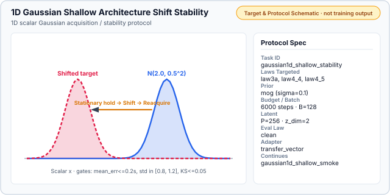
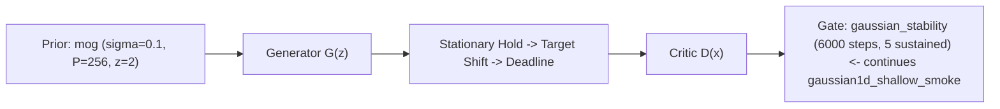

<!-- Generated Forge experiment page — do not edit manually; regenerate via `python -m experiments.forge.experiment_docs` -->

[← Leaderboard](../technique-inventory.md) · [Experiment Catalog](README.md) · [Explore by Laws](../LAWS_HUB.md) · [Research Portal](https://hypergan.github.io/ParticleGAN/)

# 1D Gaussian Shallow Architecture Shift Stability (`gaussian1d_shallow_stability`)

| Field | Value |
| --- | --- |
| **Laws Tested** | [Law 3A](../LAWS_HUB.md#law3a) · [Law 4.4](../LAWS_HUB.md#law4_4) · [Law 4.5](../LAWS_HUB.md#law4_5) |
| **Edge Cases** | `scalar-1d` `shallow-mlp` `non-stationary-shift` |
| **Primary View (`discriminator_stability`)** | Not in `discriminator_stability` |
| **Four Laws Adherence Role** | — |
| **Fixed Full-Suite Denominator** | No (diagnostic / auxiliary cohort) |
| **Adapter / Domain** | `transfer_vector` / `gaussian_stability` |
| **Prior** | `mog` (sigma=`0.1`, standardize=`False`) |
| **Update Budget** | `6000` steps |

## What This Experiment Tests

Continues `gaussian1d_shallow_smoke` to test stationary hold and post-shift deadline recovery on a single-hidden-layer architecture.

> [!NOTE]
> **Protocol notes:** Checkpoint continuation of `gaussian1d_shallow_smoke`.

## Laws & Edge Cases Targeted

- **[Law 3A: Unconditional W1 Ray-Length & Feature-Space Screening Identifiability](../LAWS_HUB.md#law3a)** ([Law 3A theory](../../../docs/four-laws.md#law-3--transport-identifiability)) — Does the learning system possess enough information to determine appropriate transport?
- **[Law 4.4: Trajectory Scale vs. Settling](../LAWS_HUB.md#law4_4)** ([Law 4.4 theory](../../../docs/four-laws.md#law-4--functional-and-game-dynamics)) — Can the learning system realize useful functional changes and exhibit appropriate coupled learning dynamics?
- **[Law 4.5: Coupled Minimax Contraction](../LAWS_HUB.md#law4_5)** ([Law 4.5 theory](../../../docs/four-laws.md#law-4--functional-and-game-dynamics)) — Can the learning system realize useful functional changes and exhibit appropriate coupled learning dynamics?
- **Edge-case tags:** `scalar-1d`, `shallow-mlp`, `non-stationary-shift`

## Common Failure Mode

Oscillation during stationary hold or slow recovery after the target shift on reduced-depth networks.

## Visual Schematic



*Target & Protocol Schematic · not training output — generated deterministically from the declared task contract.*

## Protocol & Architecture Diagram



## Task Contract & Numerical Gates

### Execution & Sampling Contract

| Contract Field | Declared Value |
| --- | --- |
| Initializer | `deterministic_orthogonal` |
| Prior | `mog` (sigma=`0.1`, standardize=`False`) |
| Update Budget | `6000` steps |
| Batch Size | `128` |
| Particles / Latent Dim | `P=256` / `z_dim=2` |
| Sampling Law | `public_prior_without_output_noise` |
| Evaluation Output Noise | `clean` |
| Scoring Weights | `live` |
| Continuation Parent | [`gaussian1d_shallow_smoke`](gaussian1d_shallow_smoke.md) |
| Dependencies | [`gaussian1d_shallow_smoke`](gaussian1d_shallow_smoke.md) (`checkpoint`) |
| Integrity Guards | `finite_state`, `rng_isolation`, `mechanism_exercised`, `optimizer_roles` |

### Numerical Pass/Fail Thresholds

| Metric | Operator | Threshold |
| --- | :---: | ---: |
| `sample_count` | `>=` | `4096` |
| `finite_fraction` | `==` | `1.0` |
| `mean_error_sigma` | `<=` | `0.2` |
| `std_ratio` | `>=` | `0.8` |
| `std_ratio` | `<=` | `1.2` |
| `cdf_ks` | `<=` | `0.05` |

## Recorded Family Results

> [!IMPORTANT]
> Screening outcomes below come from recorded single-seed (`seed = 0`) Forge evidence. `NOT MEASURED`, `BLOCKED`, and `INCOMPATIBLE` are non-numerical states — not scientific failures — and confer no pass or qualification credit.

No selected-family cohort cells are recorded for this task in the current `reports/forge/technique-inventory.json`.

## Reproduce This Experiment

```bash
# Validate this task declaration and inspect planned dependencies
python -m experiments.forge validate
python -m experiments.forge plan --view discriminator_stability --candidate unified-v12 --tasks gaussian1d_shallow_stability
```

**Declaration & Source Files:**

- Task contract: [configs/forge/tasks/gaussian1d_shallow_stability.json](../../../configs/forge/tasks/gaussian1d_shallow_stability.json)
- Source code: [benchmarks/toy_audit/gaussian1d_quality.py](../../../benchmarks/toy_audit/gaussian1d_quality.py)
- Source code: [experiments/forge/gaussian_tasks.py](../../../experiments/forge/gaussian_tasks.py)

## Annotation Provenance

This page was assembled read-only from the following versioned inputs without altering any task execution/evaluation fingerprint:

- **Task contract JSON:** [configs/forge/tasks/gaussian1d_shallow_stability.json](../../../configs/forge/tasks/gaussian1d_shallow_stability.json)
- **Editorial task documentation sidecar:** [configs/forge/task-documentation/gaussian1d_shallow_stability.json](../../../configs/forge/task-documentation/gaussian1d_shallow_stability.json)
- **Read-only Python AST source:** [benchmarks/toy_audit/gaussian1d_quality.py](../../../benchmarks/toy_audit/gaussian1d_quality.py) (AST symbols: `__doc__`)
- **Read-only Python AST source:** [experiments/forge/gaussian_tasks.py](../../../experiments/forge/gaussian_tasks.py) (AST symbols: `__doc__`)
