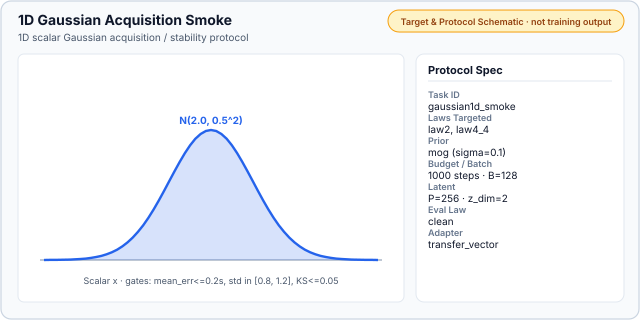
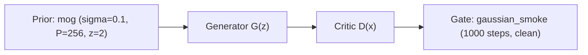

<!-- Generated Forge experiment page — do not edit manually; regenerate via `python -m experiments.forge.experiment_docs` -->

[← Leaderboard](../technique-inventory.md) · [Experiment Catalog](README.md) · [Explore by Laws](../LAWS_HUB.md) · [Research Portal](https://hypergan.github.io/ParticleGAN/)

# 1D Gaussian Acquisition Smoke (`gaussian1d_smoke`)

| Field | Value |
| --- | --- |
| **Laws Tested** | [Law 2](../LAWS_HUB.md#law2) · [Law 4.4](../LAWS_HUB.md#law4_4) |
| **Edge Cases** | `scalar-1d` `acquisition-smoke` `checkpoint-producer` |
| **Primary View (`discriminator_stability`)** | Tier 1 (required) |
| **Four Laws Adherence Role** | prerequisite (prerequisite) |
| **Fixed Full-Suite Denominator** | Yes (71-test fixed denominator) |
| **Adapter / Domain** | `transfer_vector` / `gaussian_smoke` |
| **Prior** | `mog` (sigma=`0.1`, standardize=`False`) |
| **Update Budget** | `1000` steps |

## What This Experiment Tests

Minimal sanity gate asking whether public training acquires a single scalar Gaussian N(2, 0.5^2) from random initialization within 1,000 updates, matching its mean, standard deviation, and full CDF (KS <= 0.05).

> [!NOTE]
> **Protocol notes:** Produces the saved checkpoint consumed by `gaussian1d_stability`; requires independent same-state confirmation.

## Laws & Edge Cases Targeted

- **[Law 2: Potential Geometry](../LAWS_HUB.md#law2)** ([Law 2 theory](../../../docs/four-laws.md#law-2--potential-geometry)) — Does the critic communicate useful learning forces with appropriate geometric control and computational efficiency?
- **[Law 4.4: Trajectory Scale vs. Settling](../LAWS_HUB.md#law4_4)** ([Law 4.4 theory](../../../docs/four-laws.md#law-4--functional-and-game-dynamics)) — Can the learning system realize useful functional changes and exhibit appropriate coupled learning dynamics?
- **Edge-case tags:** `scalar-1d`, `acquisition-smoke`, `checkpoint-producer`

## Common Failure Mode

Broken critic scaling, NaN divergence, or collapsed variance prevents even a unimodal 1D Gaussian from converging within bounds.

## Visual Schematic



*Target & Protocol Schematic · not training output — generated deterministically from the declared task contract.*

## Protocol & Architecture Diagram



## Task Contract & Numerical Gates

### Execution & Sampling Contract

| Contract Field | Declared Value |
| --- | --- |
| Initializer | `deterministic_orthogonal` |
| Prior | `mog` (sigma=`0.1`, standardize=`False`) |
| Update Budget | `1000` steps |
| Batch Size | `128` |
| Particles / Latent Dim | `P=256` / `z_dim=2` |
| Sampling Law | `public_prior_without_output_noise` |
| Evaluation Output Noise | `clean` |
| Scoring Weights | `live` |
| Integrity Guards | `finite_state`, `rng_isolation`, `mechanism_exercised`, `optimizer_roles` |
| Assigned Views | `bcap-develop-integration-deeper-diagnostic-v1` (T1 diagnostic), `bcap-projection-baseline-repair-diagnostic-v1` (T1 diagnostic), `discriminator_stability` (T1 required), `four-laws-adherence-v1` (T1 diagnostic), `lazy_cadence_coverage` (T1 diagnostic), `prior-ablation-full-suite-v1` (T1 diagnostic), `r4-occam-ablation-v1` (T1 diagnostic), `recipe-prior-refactor-k3p-diagnostic-v1` (T1 diagnostic) (+3 more) |

### Numerical Pass/Fail Thresholds

| Metric | Operator | Threshold |
| --- | :---: | ---: |
| `sample_count` | `>=` | `4096` |
| `finite_fraction` | `==` | `1.0` |
| `mean_error_sigma` | `<=` | `0.2` |
| `std_ratio` | `>=` | `0.8` |
| `std_ratio` | `<=` | `1.2` |
| `cdf_ks` | `<=` | `0.05` |

## Recorded Family Results

> [!IMPORTANT]
> Screening outcomes below come from recorded single-seed (`seed = 0`) Forge evidence. `NOT MEASURED`, `BLOCKED`, and `INCOMPATIBLE` are non-numerical states — not scientific failures — and confer no pass or qualification credit.

| Family | Selected Candidate | Outcome | Key Recorded Metrics | Family Report | Training Media |
| --- | --- | :---: | --- | --- | --- |
| **Atlas** | `atlas-particle-normal-v4` | **PASS** | any scheduled full pass with independent same-state confirmation | [Atlas](../families/atlas.md#cohort-cuda-bc3debd3fa5e) | — |
| **BCAP** | `recipe-prior-refactor-bcap-pure-v1` | **PASS** | any scheduled full pass with independent same-state confirmation | [BCAP](../families/bcap-pure.md#cohort-cuda-1bf9d7d34422) | — |
| **BISPF** | `bispf-optimized-quintic-v1` | **PASS** | any scheduled full pass with independent same-state confirmation | [BISPF](../families/bispf.md#cohort-cuda-1bf9d7d34422) | — |
| **EMPF** | `empf-v8` | **PASS** | any scheduled full pass with independent same-state confirmation | [EMPF](../families/empf.md#cohort-cuda-23a94f16ca88) | — |
| **GAN v3 release 0.7** | `recipe-prior-refactor-release07-gan-v3-v1` | **PASS** | any scheduled full pass with independent same-state confirmation | [GAN v3 release 0.7](../families/release07-gan-v3.md#cohort-cuda-1bf9d7d34422) | — |
| **K3P** | `recipe-prior-refactor-k3p-v1` | **PASS** | any scheduled full pass with independent same-state confirmation | [K3P](../families/k3p.md#cohort-cuda-1bf9d7d34422) | — |
| **KA2** | `recipe-prior-refactor-ka2-v1` | **PASS** | any scheduled full pass with independent same-state confirmation | [KA2](../families/ka2.md#cohort-cuda-1bf9d7d34422) | — |
| **R1/R2** | `recipe-prior-refactor-r1r2-v1` | **PASS** | any scheduled full pass with independent same-state confirmation | [R1/R2](../families/r1r2.md#cohort-cuda-1bf9d7d34422) | — |
| **RHBI** | `rhbi-v12` | **PASS** | any scheduled full pass with independent same-state confirmation | [RHBI](../families/rhbi.md#cohort-cuda-23a94f16ca88) | — |
| **Unified** | `unified-v11` | **PASS** | any scheduled full pass with independent same-state confirmation | [Unified](../families/unified.md#cohort-cuda-42a130a78fc3) | — |
| **E22** | `e22` | `BLOCKED` | Skipped incompatible test: gaussian1d_smoke: clean/live scoring has no declared policy-con | [E22](../families/e22.md#cohort-cuda-1bf9d7d34422) | — |

## Reproduce This Experiment

```bash
# Validate this task declaration and inspect planned dependencies
python -m experiments.forge validate
python -m experiments.forge plan --view discriminator_stability --candidate unified-v12 --tasks gaussian1d_smoke
```

**Declaration & Source Files:**

- Task contract: [configs/forge/tasks/gaussian1d_smoke.json](../../../configs/forge/tasks/gaussian1d_smoke.json)
- Source code: [benchmarks/toy_audit/gaussian1d_quality.py](../../../benchmarks/toy_audit/gaussian1d_quality.py)
- Source code: [experiments/forge/gaussian_tasks.py](../../../experiments/forge/gaussian_tasks.py)

## Annotation Provenance

This page was assembled read-only from the following versioned inputs without altering any task execution/evaluation fingerprint:

- **Task contract JSON:** [configs/forge/tasks/gaussian1d_smoke.json](../../../configs/forge/tasks/gaussian1d_smoke.json)
- **Editorial task documentation sidecar:** [configs/forge/task-documentation/gaussian1d_smoke.json](../../../configs/forge/task-documentation/gaussian1d_smoke.json)
- **Read-only Python AST source:** [benchmarks/toy_audit/gaussian1d_quality.py](../../../benchmarks/toy_audit/gaussian1d_quality.py) (AST symbols: `__doc__`)
- **Read-only Python AST source:** [experiments/forge/gaussian_tasks.py](../../../experiments/forge/gaussian_tasks.py) (AST symbols: `__doc__`)
