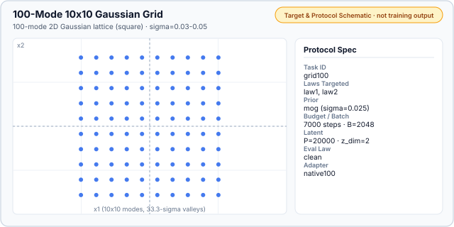
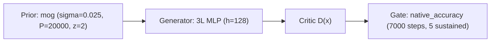

<!-- Generated Forge experiment page — do not edit manually; regenerate via `python -m experiments.forge.experiment_docs` -->

[← Leaderboard](../technique-inventory.md) · [Experiment Catalog](README.md) · [Explore by Laws](../LAWS_HUB.md) · [Research Portal](https://hypergan.github.io/ParticleGAN/)

# 100-Mode 10x10 Gaussian Grid (`grid100`)

| Field | Value |
| --- | --- |
| **Laws Tested** | [Law 1](../LAWS_HUB.md#law1) · [Law 2](../LAWS_HUB.md#law2) |
| **Edge Cases** | `disconnected-support` `100-modes` `borell-tis-cliff` |
| **Primary View (`discriminator_stability`)** | Tier 2 (required) |
| **Four Laws Adherence Role** | law1 (anchor) |
| **Fixed Full-Suite Denominator** | Yes (71-test fixed denominator) |
| **Adapter / Domain** | `native100` / `native_accuracy` |
| **Prior** | `mog` (sigma=`0.025`, standardize=`False`) |
| **Update Budget** | `7000` steps |

## What This Experiment Tests

Iconic Law 1 representational-geometry benchmark: learn all 100 tightly separated 2D Gaussian clusters (10x10 grid, 33.3-sigma valleys) scored on clean live outputs with strict precision (>= 0.97-0.99), balanced mass, and accurate per-mode covariance on an untouched holdout.

> [!NOTE]
> **Protocol notes:** Tier-2 required benchmark and Law 1 anchor (7,000 updates, clean live weights, untouched holdout gate).

## Laws & Edge Cases Targeted

- **[Law 1: Representational Geometry](../LAWS_HUB.md#law1)** ([Law 1 theory](../../../docs/four-laws.md#law-1--representational-geometry)) — Can the system represent the required probability measure efficiently and faithfully?
- **[Law 2: Potential Geometry](../LAWS_HUB.md#law2)** ([Law 2 theory](../../../docs/four-laws.md#law-2--potential-geometry)) — Does the critic communicate useful learning forces with appropriate geometric control and computational efficiency?
- **Edge-case tags:** `disconnected-support`, `100-modes`, `borell-tis-cliff`

## Common Failure Mode

Unimodal continuous priors hit the super-exponential Borell-TIS Lipschitz cliff, producing heavy valley bridge mass (24%-54% precision vs >= 97% required) and thin or empty clusters.

**Historical audit diagnosis** (`reports/forge/problem-definitions.json`): BCAP/BISPF put only 24–37% of samples on target, against 97% required. Some blobs are thin or nearly empty; the best audited 7,000-update result reaches 54%, still below the gate.

- *Recommended research focus:* Improve both precise placement and within-cluster shape, then meet the sustained checks and independent holdout. Longer training alone has not solved it.

## Visual Schematic



*Target & Protocol Schematic · not training output — generated deterministically from the declared task contract.*

## Protocol & Architecture Diagram



## Task Contract & Numerical Gates

### Execution & Sampling Contract

| Contract Field | Declared Value |
| --- | --- |
| Initializer | `deterministic_orthogonal` |
| Prior | `mog` (sigma=`0.025`, standardize=`False`) |
| Update Budget | `7000` steps |
| Batch Size | `2048` |
| Particles / Latent Dim | `P=20000` / `z_dim=2` |
| Sampling Law | `public_prior_without_output_noise` |
| Evaluation Output Noise | `clean` |
| Scoring Weights | `live` |
| Architecture | `hidden=128, layers=3, fourier=2` |
| Assigned Views | `adaptation` (T2 required), `bcap-develop-integration-deeper-diagnostic-v1` (T1 diagnostic), `bcap-projection-baseline-repair-diagnostic-v1` (T1 diagnostic), `clockfree_continuous` (T2 required), `discriminator_stability` (T2 required), `formulation_comparison` (T2 required), `four-laws-adherence-v1` (T1 diagnostic), `host_profile_transfer` (T2 required) (+11 more) |

### Numerical Pass/Fail Thresholds

| Metric | Operator | Threshold |
| --- | :---: | ---: |
| `min_samples` | `>=` | `20000` |
| `min_modes` | `>=` | `100` |
| `min_hq_mode_mass` | `>=` | `0.005` |
| `min_precision` | `>=` | `0.75` |
| `max_mass_tv` | `<=` | `0.1` |
| `max_mode_mass` | `<=` | `0.02` |
| `min_cov_eig_ratio` | `>=` | `0.4` |
| `max_cov_eig_ratio` | `<=` | `1.7` |
| `min_radial_median_ratio` | `>=` | `0.65` |
| `max_radial_median_ratio` | `<=` | `1.4` |
| `all_finite` | `==` | `True` |
| `accuracy.mass_tv` | `<=` | `0.06` |
| `accuracy.center_rms_sigma` | `<=` | `0.2` |
| `accuracy.abs_cov_trace_bias` | `<=` | `0.1` |
| `accuracy.radial_ks` | `<=` | `0.04` |

## Recorded Family Results

> [!IMPORTANT]
> Screening outcomes below come from recorded single-seed (`seed = 0`) Forge evidence. `NOT MEASURED`, `BLOCKED`, and `INCOMPATIBLE` are non-numerical states — not scientific failures — and confer no pass or qualification credit.

| Family | Selected Candidate | Outcome | Key Recorded Metrics | Family Report | Training Media |
| --- | --- | :---: | --- | --- | --- |
| **Unified** | `unified-v11` | **PASS** | sustained live accuracy and independent holdout pass | [Unified](../families/unified.md#cohort-cuda-42a130a78fc3) | — |
| **Atlas** | `atlas-particle-normal-v4` | **FAIL** | no compatible result | [Atlas](../families/atlas.md#cohort-cuda-bc3debd3fa5e) | — |
| **BCAP** | `recipe-prior-refactor-bcap-pure-v1` | **FAIL** | coverage, sustained live accuracy, or independent holdout failed | [BCAP](../families/bcap-pure.md#cohort-cuda-1bf9d7d34422) | — |
| **BISPF** | `bispf-optimized-quintic-v1` | **FAIL** | coverage, sustained live accuracy, or independent holdout failed | [BISPF](../families/bispf.md#cohort-cuda-1bf9d7d34422) | — |
| **E22** | `e22` | `BLOCKED` | Skipped incompatible test: grid100: clean/live scoring has no declared policy-control evid | [E22](../families/e22.md#cohort-cuda-1bf9d7d34422) | — |
| **EMPF** | `empf-v8` | **FAIL** | coverage, sustained live accuracy, or independent holdout failed | [EMPF](../families/empf.md#cohort-cuda-23a94f16ca88) | — |
| **GAN v3 release 0.7** | `recipe-prior-refactor-release07-gan-v3-v1` | **FAIL** | no compatible result | [GAN v3 release 0.7](../families/release07-gan-v3.md#cohort-cuda-1bf9d7d34422) | — |
| **K3P** | `recipe-prior-refactor-k3p-v1` | **FAIL** | no compatible result | [K3P](../families/k3p.md#cohort-cuda-1bf9d7d34422) | — |
| **KA2** | `recipe-prior-refactor-ka2-v1` | **FAIL** | no compatible result | [KA2](../families/ka2.md#cohort-cuda-1bf9d7d34422) | — |
| **R1/R2** | `recipe-prior-refactor-r1r2-v1` | **FAIL** | no compatible result | [R1/R2](../families/r1r2.md#cohort-cuda-1bf9d7d34422) | — |
| **RHBI** | `rhbi-v12` | **FAIL** | coverage, sustained live accuracy, or independent holdout failed | [RHBI](../families/rhbi.md#cohort-cuda-23a94f16ca88) | — |

### Four Laws Adherence Diagnostic Receipts (Separate Cohort)

*Diagnostic readouts and Colab matched-GPU receipts for `four-laws-adherence-v1` (protocol seed `0`, unchanged recipes; research telemetry only — separate from ordinary selected-cohort qualification above and confers no qualification or default-adoption credit):*

| Candidate | Family | GPU | Outcome | `min_margin` | NVML Energy | Key Recorded Metrics | Receipt |
| --- | --- | --- | :---: | ---: | ---: | --- | --- |
| `axiom-v4` | `axiom` | NVIDIA RTX A6000 | **PASS** | — | 46.01 kJ | abs_cov_trace_bias=0.0649, accuracy_score=0.5342, center_max_sigma=0.1834, center_rms_sigma=0.08341 | [readout-9066cb4353eb435be7819b0c.json](../records/readout-9066cb4353eb435be7819b0c.json) |
| `law4-energy-v11` | `unified` | NVIDIA L4 | **PASS** | — | 15.58 kJ | abs_cov_trace_bias=0.06785, accuracy_score=0.6053, center_max_sigma=0.212, center_rms_sigma=0.08669 | [c2f715fec46b4a61b0dd84e45be2e0ce.json](../technique-receipts/c2f715fec46b4a61b0dd84e45be2e0ce.json) |
| `minimal-v2` | `minimal` | NVIDIA L4 | **PASS** | — | 24.98 kJ | abs_cov_trace_bias=0.001079, accuracy_score=0.2688, center_max_sigma=0.3161, center_rms_sigma=0.07026 | [be55e8f7b4c24af5a20a3e5cd5554dd1.json](../technique-receipts/be55e8f7b4c24af5a20a3e5cd5554dd1.json) |
| `unified-v11` | `unified` | NVIDIA L4 | **PASS** | — | 19.59 kJ | abs_cov_trace_bias=0.0622, accuracy_score=0.5955, center_max_sigma=0.1916, center_rms_sigma=0.09625 | [faeb8f38abad4a83ad59a171ebdf14b8.json](../technique-receipts/faeb8f38abad4a83ad59a171ebdf14b8.json) |
| `unified-v12` | `unified` | NVIDIA L4 | **PASS** | — | 17.56 kJ | abs_cov_trace_bias=0.0655, accuracy_score=0.6008, center_max_sigma=0.2283, center_rms_sigma=0.09387 | [f03e3fc9be744d96b4d194df085eb101.json](../technique-receipts/f03e3fc9be744d96b4d194df085eb101.json) |
| `atlas-particle-normal-v4` | `atlas` | NVIDIA L4 | **FAIL** | — | 49.47 kJ | abs_cov_trace_bias=0.2564, accuracy_score=1.894, center_max_sigma=0.6865, center_rms_sigma=0.163 | [b240c6764e034c62b0ddd97cf2462c42.json](../technique-receipts/b240c6764e034c62b0ddd97cf2462c42.json) |
| `bispf-optimized-quintic-v1` | `bispf` | NVIDIA L4 | **FAIL** | — | 16.93 kJ | mass_tv=0.104, n=100000, precision=0.05858, precision_gap=0.9303 | [fa16c6de2ec348939c983a4dc26c9459.json](../technique-receipts/fa16c6de2ec348939c983a4dc26c9459.json) |
| `empf-v8` | `empf` | NVIDIA L4 | **FAIL** | — | 13.13 kJ | abs_cov_trace_bias=0.655, accuracy_score=6.178, center_max_sigma=1.739, center_rms_sigma=1.049 | [e253de0209c54cdeab258229abe925f8.json](../technique-receipts/e253de0209c54cdeab258229abe925f8.json) |
| `recipe-prior-refactor-bcap-pure-v1` | `bcap-dualnorm` | NVIDIA L4 | **FAIL** | — | 10.71 kJ | mass_tv=0.1752, n=100000, precision=0.2788, precision_gap=0.7101 | [e240c3876547465f8b40c5bc095baac5.json](../technique-receipts/e240c3876547465f8b40c5bc095baac5.json) |
| `recipe-prior-refactor-k3p-v1` | `k3p` | NVIDIA L4 | **FAIL** | — | 5.54 kJ | abs_cov_trace_bias=0.7764, accuracy_score=4.929, center_max_sigma=1.309, center_rms_sigma=0.398 | [ed8258adf9bc4acaa14f923c96da4e97.json](../technique-receipts/ed8258adf9bc4acaa14f923c96da4e97.json) |
| `recipe-prior-refactor-ka2-v1` | `ka2` | NVIDIA L4 | **FAIL** | — | 6.27 kJ | abs_cov_trace_bias=0.8318, accuracy_score=4.908, center_max_sigma=0.8046, center_rms_sigma=0.2933 | [f2c40e3040404a7692991cbf204fcec1.json](../technique-receipts/f2c40e3040404a7692991cbf204fcec1.json) |
| `recipe-prior-refactor-r1r2-v1` | `r1r2` | NVIDIA L4 | **FAIL** | — | 4.52 kJ | abs_cov_trace_bias=0.6266, accuracy_score=5.211, center_max_sigma=2.836, center_rms_sigma=0.8239 | [a30ca57055074ffc8d43d98b5e528f2b.json](../technique-receipts/a30ca57055074ffc8d43d98b5e528f2b.json) |
| `recipe-prior-refactor-release07-gan-v3-v1` | `release07-gan-v3` | NVIDIA L4 | **FAIL** | — | 5.27 kJ | mass_tv=0.2767, n=100000, precision=0.476, precision_gap=0.5129 | [d9a3185bbba84e87a12a5468262093b6.json](../technique-receipts/d9a3185bbba84e87a12a5468262093b6.json) |
| `rhbi-v12` | `rhbi` | NVIDIA L4 | **FAIL** | — | 37.02 kJ | mass_tv=0.1392, n=100000, precision=0.2215, precision_gap=0.7674 | [df84b12042584b518a3a30ece71e47f7.json](../technique-receipts/df84b12042584b518a3a30ece71e47f7.json) |

## Reproduce This Experiment

```bash
# Validate this task declaration and inspect planned dependencies
python -m experiments.forge validate
python -m experiments.forge plan --view discriminator_stability --candidate unified-v12 --tasks grid100
```

**Declaration & Source Files:**

- Task contract: [configs/forge/tasks/grid100.json](../../../configs/forge/tasks/grid100.json)
- Source code: [benchmarks/toy100/__main__.py](../../../benchmarks/toy100/__main__.py)
- Source code: [benchmarks/toy100/accuracy.py](../../../benchmarks/toy100/accuracy.py)
- Source code: [benchmarks/toy100/accuracy_gate.py](../../../benchmarks/toy100/accuracy_gate.py)
- Source code: [benchmarks/toy100/affine_replay.py](../../../benchmarks/toy100/affine_replay.py)
- Source code: [benchmarks/toy100/device.py](../../../benchmarks/toy100/device.py)
- Source code: [benchmarks/toy100/gate.py](../../../benchmarks/toy100/gate.py)
- Source code: [benchmarks/toy100/metrics.py](../../../benchmarks/toy100/metrics.py)
- Source code: [benchmarks/toy100/train.py](../../../benchmarks/toy100/train.py)
- Source code: [benchmarks/toy_suite.py](../../../benchmarks/toy_suite.py)

## Annotation Provenance

This page was assembled read-only from the following versioned inputs without altering any task execution/evaluation fingerprint:

- **Task contract JSON:** [configs/forge/tasks/grid100.json](../../../configs/forge/tasks/grid100.json)
- **Editorial task documentation sidecar:** [configs/forge/task-documentation/grid100.json](../../../configs/forge/task-documentation/grid100.json)
- **Read-only Python AST source:** [benchmarks/toy100/__main__.py](../../../benchmarks/toy100/__main__.py) (AST symbols: `__doc__`)
- **Read-only Python AST source:** [benchmarks/toy100/accuracy.py](../../../benchmarks/toy100/accuracy.py) (AST symbols: `__doc__`)
- **Read-only Python AST source:** [benchmarks/toy100/accuracy_gate.py](../../../benchmarks/toy100/accuracy_gate.py) (AST symbols: `__doc__`)
- **Read-only Python AST source:** [benchmarks/toy100/affine_replay.py](../../../benchmarks/toy100/affine_replay.py) (AST symbols: `__doc__`)
- **Read-only Python AST source:** [benchmarks/toy100/device.py](../../../benchmarks/toy100/device.py) (AST symbols: `__doc__`)
- **Read-only Python AST source:** [benchmarks/toy100/gate.py](../../../benchmarks/toy100/gate.py) (AST symbols: `__doc__`)
- **Read-only Python AST source:** [benchmarks/toy100/metrics.py](../../../benchmarks/toy100/metrics.py) (AST symbols: `__doc__`)
- **Read-only Python AST source:** [benchmarks/toy100/train.py](../../../benchmarks/toy100/train.py) (AST symbols: `__doc__`)
- **Read-only Python AST source:** [benchmarks/toy_suite.py](../../../benchmarks/toy_suite.py) (AST symbols: `__doc__`)
