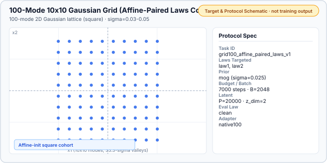
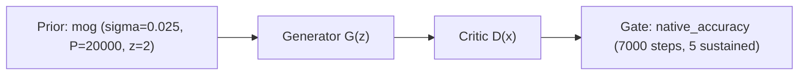

<!-- Generated Forge experiment page — do not edit manually; regenerate via `python -m experiments.forge.experiment_docs` -->

[← Leaderboard](../technique-inventory.md) · [Experiment Catalog](README.md) · [Explore by Laws](../LAWS_HUB.md) · [Research Portal](https://hypergan.github.io/ParticleGAN/)

# 100-Mode 10x10 Gaussian Grid (Affine-Paired Laws Cohort) (`grid100_affine_paired_laws_v1`)

| Field | Value |
| --- | --- |
| **Laws Tested** | [Law 1](../LAWS_HUB.md#law1) · [Law 2](../LAWS_HUB.md#law2) |
| **Edge Cases** | `disconnected-support` `100-modes` `borell-tis-cliff` `affine-init-cohort` |
| **Primary View (`discriminator_stability`)** | Not in `discriminator_stability` |
| **Four Laws Adherence Role** | — |
| **Fixed Full-Suite Denominator** | No (diagnostic / auxiliary cohort) |
| **Adapter / Domain** | `native100` / `native_accuracy` |
| **Prior** | `mog` (sigma=`0.025`, standardize=`False`) |
| **Update Budget** | `7000` steps |

## What This Experiment Tests

Explicitly scoped affine-paired laws cohort variant of `grid100`. Iconic Law 1 representational-geometry benchmark: learn all 100 tightly separated 2D Gaussian clusters (10x10 grid, 33.3-sigma valleys) scored on clean live outputs with strict precision (>= 0.97-0.99), balanced mass, and accurate per-mode covariance on an untouched holdout.

> [!NOTE]
> **Protocol notes:** Explicit affine-initialized paired-laws diagnostic cohort for controlled Law 1-4 comparison.

## Laws & Edge Cases Targeted

- **[Law 1: Representational Geometry](../LAWS_HUB.md#law1)** ([Law 1 theory](../../../docs/four-laws.md#law-1--representational-geometry)) — Can the system represent the required probability measure efficiently and faithfully?
- **[Law 2: Potential Geometry](../LAWS_HUB.md#law2)** ([Law 2 theory](../../../docs/four-laws.md#law-2--potential-geometry)) — Does the critic communicate useful learning forces with appropriate geometric control and computational efficiency?
- **Edge-case tags:** `disconnected-support`, `100-modes`, `borell-tis-cliff`, `affine-init-cohort`

## Common Failure Mode

Unimodal continuous priors hit the super-exponential Borell-TIS Lipschitz cliff, producing heavy valley bridge mass (24%-54% precision vs >= 97% required) and thin or empty clusters.

## Visual Schematic



*Target & Protocol Schematic · not training output — generated deterministically from the declared task contract.*

## Protocol & Architecture Diagram



## Task Contract & Numerical Gates

### Execution & Sampling Contract

| Contract Field | Declared Value |
| --- | --- |
| Initializer | `deterministic_orthogonal` |
| Prior | `mog` (sigma=`0.025`, standardize=`False`) |
| Update Budget | `7000` steps |
| Batch Size | `2048` |
| Particles / Latent Dim | `P=20000` / `z_dim=2` |
| Sampling Law | `public_prior_without_output_noise` |
| Evaluation Output Noise | `clean` |
| Scoring Weights | `live` |
| Assigned Views | `formulation_comparison` (T2 diagnostic) |

### Numerical Pass/Fail Thresholds

| Metric | Operator | Threshold |
| --- | :---: | ---: |
| `min_samples` | `>=` | `20000` |
| `min_modes` | `>=` | `100` |
| `min_hq_mode_mass` | `>=` | `0.005` |
| `min_precision` | `>=` | `0.75` |
| `max_mass_tv` | `<=` | `0.1` |
| `max_mode_mass` | `<=` | `0.02` |
| `min_cov_eig_ratio` | `>=` | `0.4` |
| `max_cov_eig_ratio` | `<=` | `1.7` |
| `min_radial_median_ratio` | `>=` | `0.65` |
| `max_radial_median_ratio` | `<=` | `1.4` |
| `all_finite` | `==` | `True` |
| `accuracy.mass_tv` | `<=` | `0.06` |
| `accuracy.center_rms_sigma` | `<=` | `0.2` |
| `accuracy.abs_cov_trace_bias` | `<=` | `0.1` |
| `accuracy.radial_ks` | `<=` | `0.04` |

## Recorded Family Results

> [!IMPORTANT]
> Screening outcomes below come from recorded single-seed (`seed = 0`) Forge evidence. `NOT MEASURED`, `BLOCKED`, and `INCOMPATIBLE` are non-numerical states — not scientific failures — and confer no pass or qualification credit.

| Family | Selected Candidate | Outcome | Key Recorded Metrics | Family Report | Training Media |
| --- | --- | :---: | --- | --- | --- |
| **Atlas** | `atlas-particle-normal-v4` | `NOT MEASURED` | No recorded result for this selected configuration and source. | [Atlas](../families/atlas.md#cohort-cuda-daa283c8a640) | — |
| **Axiom** | `axiom-v5` | `NOT MEASURED` | No recorded result for this selected configuration and source. | [Axiom](../families/axiom.md#cohort-cuda-42a130a78fc3) | — |
| **BCAP** | `recipe-prior-refactor-bcap-pure-v1` | `NOT MEASURED` | No recorded result for this selected configuration and source. | [BCAP](../families/bcap-pure.md#cohort-cuda-1bf9d7d34422) | — |
| **BISPF** | `bispf-optimized-quintic-v1` | `NOT MEASURED` | No recorded result for this selected configuration and source. | [BISPF](../families/bispf.md#cohort-cuda-1bf9d7d34422) | — |
| **E22** | `e22` | `NOT MEASURED` | No recorded result for this selected configuration and source. | [E22](../families/e22.md#cohort-cuda-1bf9d7d34422) | — |
| **EMPF** | `empf-v8` | `NOT MEASURED` | No recorded result for this selected configuration and source. | [EMPF](../families/empf.md#cohort-cuda-23a94f16ca88) | — |
| **GAN v3 release 0.7** | `recipe-prior-refactor-release07-gan-v3-v1` | `NOT MEASURED` | No recorded result for this selected configuration and source. | [GAN v3 release 0.7](../families/release07-gan-v3.md#cohort-cuda-daa283c8a640) | — |
| **K3P** | `recipe-prior-refactor-k3p-v1` | `NOT MEASURED` | No recorded result for this selected configuration and source. | [K3P](../families/k3p.md#cohort-cuda-daa283c8a640) | — |
| **KA2** | `recipe-prior-refactor-ka2-v1` | `NOT MEASURED` | No recorded result for this selected configuration and source. | [KA2](../families/ka2.md#cohort-cuda-daa283c8a640) | — |
| **R1/R2** | `recipe-prior-refactor-r1r2-v1` | `NOT MEASURED` | No recorded result for this selected configuration and source. | [R1/R2](../families/r1r2.md#cohort-cuda-daa283c8a640) | — |
| **RHBI** | `rhbi-v12` | `NOT MEASURED` | No recorded result for this selected configuration and source. | [RHBI](../families/rhbi.md#cohort-cuda-23a94f16ca88) | — |
| **Unified** | `unified-v15` | `NOT MEASURED` | No recorded result for this selected configuration and source. | [Unified](../families/unified.md#cohort-cuda-42a130a78fc3) | — |

## Reproduce This Experiment

```bash
# Validate this task declaration and inspect planned dependencies
python -m experiments.forge validate
python -m experiments.forge plan --view formulation_comparison --candidate unified-v12 --tasks grid100_affine_paired_laws_v1
```

**Declaration & Source Files:**

- Task contract: [configs/forge/tasks/grid100_affine_paired_laws_v1.json](../../../configs/forge/tasks/grid100_affine_paired_laws_v1.json)
- Source code: [benchmarks/toy100/__main__.py](../../../benchmarks/toy100/__main__.py)
- Source code: [benchmarks/toy100/accuracy.py](../../../benchmarks/toy100/accuracy.py)
- Source code: [benchmarks/toy100/accuracy_gate.py](../../../benchmarks/toy100/accuracy_gate.py)
- Source code: [benchmarks/toy100/affine_replay.py](../../../benchmarks/toy100/affine_replay.py)
- Source code: [benchmarks/toy100/device.py](../../../benchmarks/toy100/device.py)
- Source code: [benchmarks/toy100/gate.py](../../../benchmarks/toy100/gate.py)
- Source code: [benchmarks/toy100/metrics.py](../../../benchmarks/toy100/metrics.py)
- Source code: [benchmarks/toy100/train.py](../../../benchmarks/toy100/train.py)
- Source code: [benchmarks/toy_suite.py](../../../benchmarks/toy_suite.py)

## Annotation Provenance

This page was assembled read-only from the following versioned inputs without altering any task execution/evaluation fingerprint:

- **Task contract JSON:** [configs/forge/tasks/grid100_affine_paired_laws_v1.json](../../../configs/forge/tasks/grid100_affine_paired_laws_v1.json)
- **Editorial task documentation sidecar:** [configs/forge/task-documentation/grid100_affine_paired_laws_v1.json](../../../configs/forge/task-documentation/grid100_affine_paired_laws_v1.json)
- **Read-only Python AST source:** [benchmarks/toy100/__main__.py](../../../benchmarks/toy100/__main__.py) (AST symbols: `__doc__`)
- **Read-only Python AST source:** [benchmarks/toy100/accuracy.py](../../../benchmarks/toy100/accuracy.py) (AST symbols: `__doc__`)
- **Read-only Python AST source:** [benchmarks/toy100/accuracy_gate.py](../../../benchmarks/toy100/accuracy_gate.py) (AST symbols: `__doc__`)
- **Read-only Python AST source:** [benchmarks/toy100/affine_replay.py](../../../benchmarks/toy100/affine_replay.py) (AST symbols: `__doc__`)
- **Read-only Python AST source:** [benchmarks/toy100/device.py](../../../benchmarks/toy100/device.py) (AST symbols: `__doc__`)
- **Read-only Python AST source:** [benchmarks/toy100/gate.py](../../../benchmarks/toy100/gate.py) (AST symbols: `__doc__`)
- **Read-only Python AST source:** [benchmarks/toy100/metrics.py](../../../benchmarks/toy100/metrics.py) (AST symbols: `__doc__`)
- **Read-only Python AST source:** [benchmarks/toy100/train.py](../../../benchmarks/toy100/train.py) (AST symbols: `__doc__`)
- **Read-only Python AST source:** [benchmarks/toy_suite.py](../../../benchmarks/toy_suite.py) (AST symbols: `__doc__`)
