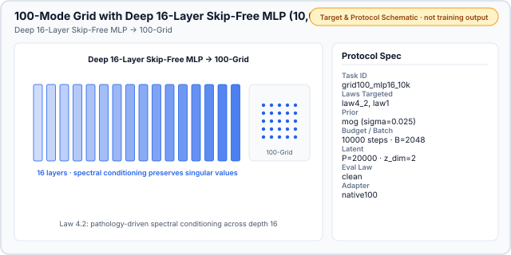
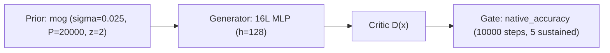

<!-- Generated Forge experiment page — do not edit manually; regenerate via `python -m experiments.forge.experiment_docs` -->

[← Leaderboard](../technique-inventory.md) · [Experiment Catalog](README.md) · [Explore by Laws](../LAWS_HUB.md) · [Research Portal](https://hypergan.github.io/ParticleGAN/)

# 100-Mode Grid with Deep 16-Layer Skip-Free MLP (10,000-Step Steady-State Budget) (`grid100_mlp16_10k`)

| Field | Value |
| --- | --- |
| **Laws Tested** | [Law 4.2](../LAWS_HUB.md#law4_2) · [Law 1](../LAWS_HUB.md#law1) |
| **Edge Cases** | `deep-spectral-contraction` `16-layer-mlp` `100-modes` |
| **Primary View (`discriminator_stability`)** | Not in `discriminator_stability` |
| **Four Laws Adherence Role** | — |
| **Fixed Full-Suite Denominator** | No (diagnostic / auxiliary cohort) |
| **Adapter / Domain** | `native100` / `native_accuracy` |
| **Prior** | `mog` (sigma=`0.025`, standardize=`False`) |
| **Update Budget** | `10000` steps |

## What This Experiment Tests

Calibrated 10,000-step accuracy budget for the 16-layer skip-free MLP `grid100` benchmark, separating steady-state Law 4.2 deep spectral conditioning from the tighter 7,000-step speed diagnostic (`grid100_mlp16`).

> [!NOTE]
> **Protocol notes:** Four Laws Adherence v2 Law 4 anchor (10,000 updates, 5400s timeout); preserves legacy `grid100_mlp16` at 7,000 steps.

## Laws & Edge Cases Targeted

- **[Law 4.2: Pathology-Driven Spectral Conditioning](../LAWS_HUB.md#law4_2)** ([Law 4.2 theory](../../../docs/four-laws.md#law-4--functional-and-game-dynamics)) — Can the learning system realize useful functional changes and exhibit appropriate coupled learning dynamics?
- **[Law 1: Representational Geometry](../LAWS_HUB.md#law1)** ([Law 1 theory](../../../docs/four-laws.md#law-1--representational-geometry)) — Can the system represent the required probability measure efficiently and faithfully?
- **Edge-case tags:** `deep-spectral-contraction`, `16-layer-mlp`, `100-modes`

## Common Failure Mode

Without pathology-driven spectral equilibration, singular-value contraction across 16 skip-free linear layers prevents full 100-mode acquisition even over 10,000 updates.

## Visual Schematic



*Target & Protocol Schematic · not training output — generated deterministically from the declared task contract.*

## Protocol & Architecture Diagram



## Task Contract & Numerical Gates

### Execution & Sampling Contract

| Contract Field | Declared Value |
| --- | --- |
| Initializer | `deterministic_orthogonal` |
| Prior | `mog` (sigma=`0.025`, standardize=`False`) |
| Update Budget | `10000` steps |
| Batch Size | `2048` |
| Particles / Latent Dim | `P=20000` / `z_dim=2` |
| Sampling Law | `public_prior_without_output_noise` |
| Evaluation Output Noise | `clean` |
| Scoring Weights | `live` |
| Architecture | `hidden=128, layers=16, fourier=2` |
| Dependencies | [`grid100`](grid100.md) (`gate`) |
| Assigned Views | `four-laws-adherence-v2` (T1 diagnostic) |

### Numerical Pass/Fail Thresholds

| Metric | Operator | Threshold |
| --- | :---: | ---: |
| `min_samples` | `>=` | `20000` |
| `min_modes` | `>=` | `100` |
| `min_hq_mode_mass` | `>=` | `0.005` |
| `min_precision` | `>=` | `0.75` |
| `max_mass_tv` | `<=` | `0.1` |
| `max_mode_mass` | `<=` | `0.02` |
| `min_cov_eig_ratio` | `>=` | `0.4` |
| `max_cov_eig_ratio` | `<=` | `1.7` |
| `min_radial_median_ratio` | `>=` | `0.65` |
| `max_radial_median_ratio` | `<=` | `1.4` |
| `all_finite` | `==` | `True` |
| `accuracy.mass_tv` | `<=` | `0.06` |
| `accuracy.center_rms_sigma` | `<=` | `0.2` |
| `accuracy.abs_cov_trace_bias` | `<=` | `0.1` |
| `accuracy.radial_ks` | `<=` | `0.04` |

## Recorded Family Results

> [!IMPORTANT]
> Screening outcomes below come from recorded single-seed (`seed = 0`) Forge evidence. `NOT MEASURED`, `BLOCKED`, and `INCOMPATIBLE` are non-numerical states — not scientific failures — and confer no pass or qualification credit.

| Family | Selected Candidate | Outcome | Key Recorded Metrics | Family Report | Training Media |
| --- | --- | :---: | --- | --- | --- |
| **Atlas** | `atlas-particle-normal-v4` | `NOT MEASURED` | No recorded result for this selected configuration and source. | [Atlas](../families/atlas.md#cohort-cuda-daa283c8a640) | — |
| **Axiom** | `axiom-v5` | `NOT MEASURED` | No recorded result for this selected configuration and source. | [Axiom](../families/axiom.md#cohort-cuda-42a130a78fc3) | — |
| **BCAP** | `recipe-prior-refactor-bcap-pure-v1` | `NOT MEASURED` | No recorded result for this selected configuration and source. | [BCAP](../families/bcap-pure.md#cohort-cuda-1bf9d7d34422) | — |
| **BISPF** | `bispf-optimized-quintic-v1` | `NOT MEASURED` | No recorded result for this selected configuration and source. | [BISPF](../families/bispf.md#cohort-cuda-1bf9d7d34422) | — |
| **E22** | `e22` | `NOT MEASURED` | No recorded result for this selected configuration and source. | [E22](../families/e22.md#cohort-cuda-1bf9d7d34422) | — |
| **EMPF** | `empf-v8` | `NOT MEASURED` | No recorded result for this selected configuration and source. | [EMPF](../families/empf.md#cohort-cuda-23a94f16ca88) | — |
| **GAN v3 release 0.7** | `recipe-prior-refactor-release07-gan-v3-v1` | `NOT MEASURED` | No recorded result for this selected configuration and source. | [GAN v3 release 0.7](../families/release07-gan-v3.md#cohort-cuda-daa283c8a640) | — |
| **K3P** | `recipe-prior-refactor-k3p-v1` | `NOT MEASURED` | No recorded result for this selected configuration and source. | [K3P](../families/k3p.md#cohort-cuda-daa283c8a640) | — |
| **KA2** | `recipe-prior-refactor-ka2-v1` | `NOT MEASURED` | No recorded result for this selected configuration and source. | [KA2](../families/ka2.md#cohort-cuda-daa283c8a640) | — |
| **R1/R2** | `recipe-prior-refactor-r1r2-v1` | `NOT MEASURED` | No recorded result for this selected configuration and source. | [R1/R2](../families/r1r2.md#cohort-cuda-daa283c8a640) | — |
| **RHBI** | `rhbi-v12` | `NOT MEASURED` | No recorded result for this selected configuration and source. | [RHBI](../families/rhbi.md#cohort-cuda-23a94f16ca88) | — |
| **Unified** | `unified-v15` | `DIAG_PASS` | No recorded result for this selected configuration and source. | [Unified](../families/unified.md#cohort-cuda-42a130a78fc3) | — |

### Four Laws Adherence Diagnostic Receipts (Separate Cohort)

*Diagnostic readouts and Colab matched-GPU receipts for `four-laws-adherence-v1` (protocol seed `0`, unchanged recipes; research telemetry only — separate from ordinary selected-cohort qualification above and confers no qualification or default-adoption credit):*

| Candidate | Family | GPU | Outcome | `min_margin` | NVML Energy | Key Recorded Metrics | Receipt |
| --- | --- | --- | :---: | ---: | ---: | --- | --- |
| `axiom-v4` | `axiom` | NVIDIA L4 | **PASS** | — | 6.54 kJ (J-to-PASS) | abs_cov_trace_bias=0.04376, accuracy_score=0.4111, center_max_sigma=0.1602, center_rms_sigma=0.07295 | [ec92bcf7a8584e8983953d67611f533d.json](../technique-receipts/ec92bcf7a8584e8983953d67611f533d.json) |
| `axiom-v5` | `axiom` | NVIDIA L4 | **PASS** | — | 7.25 kJ (J-to-PASS) | abs_cov_trace_bias=0.04376, accuracy_score=0.4111, center_max_sigma=0.1602, center_rms_sigma=0.07295 | [0790ee1abe9e4942989572738191bd31.json](../technique-receipts/0790ee1abe9e4942989572738191bd31.json) |
| `unified-v15` | `unified` | NVIDIA L4 | **PASS** | — | 65.68 kJ (J-to-PASS) | abs_cov_trace_bias=0.06504, accuracy_score=0.6079, center_max_sigma=0.2751, center_rms_sigma=0.09611 | [2796ebb8a90449c9b86c6877319fe602.json](../technique-receipts/2796ebb8a90449c9b86c6877319fe602.json) |
| `axiom-v6` | `axiom` | NVIDIA RTX A6000 | **FAIL** | — | 98.63 kJ | mass_tv=0.1227, n=100000, precision=0.8631, precision_gap=0.1258 | [readout-69f7d043a14e2780fb2cdd4a.json](../records/readout-69f7d043a14e2780fb2cdd4a.json) |
| `unified-v11` | `unified` | NVIDIA L4 | **FAIL** | — | 57.18 kJ | abs_cov_trace_bias=0.08587, accuracy_score=0.6673, center_max_sigma=0.1359, center_rms_sigma=0.06022 | [2cb8fa00299a4723abd6fc4e6b5d950f.json](../technique-receipts/2cb8fa00299a4723abd6fc4e6b5d950f.json) |

## Reproduce This Experiment

```bash
# Validate this task declaration and inspect planned dependencies
python -m experiments.forge validate
python -m experiments.forge plan --view four-laws-adherence-v2 --candidate unified-v12 --tasks grid100_mlp16_10k
```

**Declaration & Source Files:**

- Task contract: [configs/forge/tasks/grid100_mlp16_10k.json](../../../configs/forge/tasks/grid100_mlp16_10k.json)

## Annotation Provenance

This page was assembled read-only from the following versioned inputs without altering any task execution/evaluation fingerprint:

- **Task contract JSON:** [configs/forge/tasks/grid100_mlp16_10k.json](../../../configs/forge/tasks/grid100_mlp16_10k.json)
- **Editorial task documentation sidecar:** [configs/forge/task-documentation/grid100_mlp16_10k.json](../../../configs/forge/task-documentation/grid100_mlp16_10k.json)
