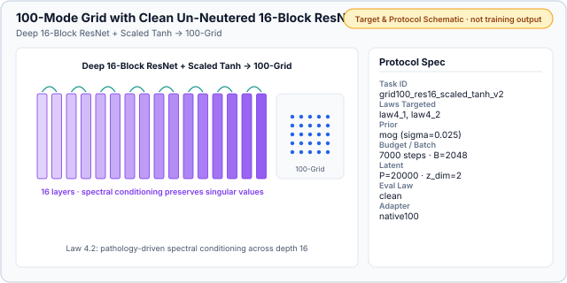

<!-- Generated Forge experiment page — do not edit manually; regenerate via `python -m experiments.forge.experiment_docs` -->

[← Leaderboard](../technique-inventory.md) · [Experiment Catalog](README.md) · [Explore by Laws](../LAWS_HUB.md) · [Research Portal](https://hypergan.github.io/ParticleGAN/)

# 100-Mode Grid with Clean Un-Neutered 16-Block ResNet + Scaled Tanh (v2) (`grid100_res16_scaled_tanh_v2`)

| Field | Value |
| --- | --- |
| **Laws Tested** | [Law 4.1](../LAWS_HUB.md#law4_1) · [Law 4.2](../LAWS_HUB.md#law4_2) |
| **Edge Cases** | `deep-spectral-contraction` `tanh-saturation` `100-modes` |
| **Primary View (`discriminator_stability`)** | Not in `discriminator_stability` |
| **Four Laws Adherence Role** | — |
| **Fixed Full-Suite Denominator** | No (diagnostic / auxiliary cohort) |
| **Adapter / Domain** | `native100` / `native_accuracy` |
| **Prior** | `mog` (sigma=`0.025`, standardize=`False`) |
| **Update Budget** | `7000` steps |

## What This Experiment Tests

Clean v2 cohort of `grid100_res16_scaled_tanh` with `preserve_latent_norm=false`, removing the legacy `atanh(tanh)` and `LayerNorm` algebraic identity lock so the 16-block residual tanh generator must genuinely learn the 100-mode map.

> [!NOTE]
> **Protocol notes:** Clean un-neutered Tier-4 stretch cohort with `max_saturated_fraction` gate; separate cohort from archived `grid100_res16_scaled_tanh`.

## Laws & Edge Cases Targeted

- **[Law 4.1: Functional Realization](../LAWS_HUB.md#law4_1)** ([Law 4.1 theory](../../../docs/four-laws.md#law-4--functional-and-game-dynamics)) — Can the learning system realize useful functional changes and exhibit appropriate coupled learning dynamics?
- **[Law 4.2: Pathology-Driven Spectral Conditioning](../LAWS_HUB.md#law4_2)** ([Law 4.2 theory](../../../docs/four-laws.md#law-4--functional-and-game-dynamics)) — Can the learning system realize useful functional changes and exhibit appropriate coupled learning dynamics?
- **Edge-case tags:** `deep-spectral-contraction`, `tanh-saturation`, `100-modes`

## Common Failure Mode

Residual branch drift saturates internal or output tanh layers when step scaling is uncalibrated for depth.

## Visual Schematic



*Target & Protocol Schematic · not training output — generated deterministically from the declared task contract.*

## Protocol & Architecture Diagram


## Task Contract & Numerical Gates

### Execution & Sampling Contract

| Contract Field | Declared Value |
| --- | --- |
| Initializer | `deterministic_orthogonal` |
| Prior | `mog` (sigma=`0.025`, standardize=`False`) |
| Update Budget | `7000` steps |
| Batch Size | `2048` |
| Particles / Latent Dim | `P=20000` / `z_dim=2` |
| Sampling Law | `public_prior_without_output_noise` |
| Evaluation Output Noise | `clean` |
| Scoring Weights | `live` |
| Architecture | `hidden=128, layers=16, architecture=scaled_residual_mlp, output_activation=tanh_rail_guard, tanh_scale=5.25, rail_guard=0.0001, fourier=3, preserve_latent_norm=False` |
| Dependencies | [`grid100`](grid100.md) (`gate`) |

### Numerical Pass/Fail Thresholds

| Metric | Operator | Threshold |
| --- | :---: | ---: |
| `min_samples` | `>=` | `20000` |
| `min_modes` | `>=` | `100` |
| `min_hq_mode_mass` | `>=` | `0.005` |
| `min_precision` | `>=` | `0.75` |
| `max_mass_tv` | `<=` | `0.1` |
| `max_mode_mass` | `<=` | `0.02` |
| `min_cov_eig_ratio` | `>=` | `0.4` |
| `max_cov_eig_ratio` | `<=` | `1.7` |
| `min_radial_median_ratio` | `>=` | `0.65` |
| `max_radial_median_ratio` | `<=` | `1.4` |
| `all_finite` | `==` | `True` |
| `accuracy.mass_tv` | `<=` | `0.06` |
| `accuracy.center_rms_sigma` | `<=` | `0.2` |
| `accuracy.abs_cov_trace_bias` | `<=` | `0.1` |
| `accuracy.radial_ks` | `<=` | `0.04` |
| `saturated_fraction` | `<=` | `0.001` |

## Recorded Family Results

> [!IMPORTANT]
> Screening outcomes below come from recorded single-seed (`seed = 0`) Forge evidence. `NOT MEASURED`, `BLOCKED`, and `INCOMPATIBLE` are non-numerical states — not scientific failures — and confer no pass or qualification credit.

No selected-family cohort cells are recorded for this task in the current `reports/forge/technique-inventory.json`.

## Reproduce This Experiment

```bash
# Validate this task declaration and inspect planned dependencies
python -m experiments.forge validate
python -m experiments.forge plan --view discriminator_stability --candidate unified-v12 --tasks grid100_res16_scaled_tanh_v2
```

**Declaration & Source Files:**

- Task contract: [configs/forge/tasks/grid100_res16_scaled_tanh_v2.json](../../../configs/forge/tasks/grid100_res16_scaled_tanh_v2.json)

## Annotation Provenance

This page was assembled read-only from the following versioned inputs without altering any task execution/evaluation fingerprint:

- **Task contract JSON:** [configs/forge/tasks/grid100_res16_scaled_tanh_v2.json](../../../configs/forge/tasks/grid100_res16_scaled_tanh_v2.json)
- **Editorial task documentation sidecar:** [configs/forge/task-documentation/grid100_res16_scaled_tanh_v2.json](../../../configs/forge/task-documentation/grid100_res16_scaled_tanh_v2.json)
