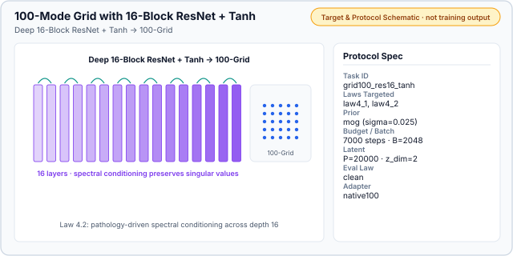

<!-- Generated Forge experiment page — do not edit manually; regenerate via `python -m experiments.forge.experiment_docs` -->

[← Leaderboard](../technique-inventory.md) · [Experiment Catalog](README.md) · [Explore by Laws](../LAWS_HUB.md) · [Research Portal](https://hypergan.github.io/ParticleGAN/)

# 100-Mode Grid with 16-Block ResNet + Tanh (`grid100_res16_tanh`)

| Field | Value |
| --- | --- |
| **Laws Tested** | [Law 4.1](../LAWS_HUB.md#law4_1) · [Law 4.2](../LAWS_HUB.md#law4_2) |
| **Edge Cases** | `deep-spectral-contraction` `tanh-saturation` `100-modes` |
| **Primary View (`discriminator_stability`)** | Tier 4 (held) |
| **Four Laws Adherence Role** | law4 (anchor) |
| **Fixed Full-Suite Denominator** | Yes (71-test fixed denominator) |
| **Adapter / Domain** | `native100` / `native_accuracy` |
| **Prior** | `mog` (sigma=`0.025`, standardize=`False`) |
| **Update Budget** | `7000` steps |

## What This Experiment Tests

Combines a 16-block residual generator with saturating `tanh` activations on `grid100`, testing whether deep residual spectral conditioning also prevents tanh rail saturation (max_saturated_fraction gate).

> [!NOTE]
> **Protocol notes:** Tier-4 held benchmark and Four Laws Adherence Law 4 anchor with explicit `max_saturated_fraction` gate.

## Laws & Edge Cases Targeted

- **[Law 4.1: Functional Realization](../LAWS_HUB.md#law4_1)** ([Law 4.1 theory](../../../docs/four-laws.md#law-4--functional-and-game-dynamics)) — Can the learning system realize useful functional changes and exhibit appropriate coupled learning dynamics?
- **[Law 4.2: Pathology-Driven Spectral Conditioning](../LAWS_HUB.md#law4_2)** ([Law 4.2 theory](../../../docs/four-laws.md#law-4--functional-and-game-dynamics)) — Can the learning system realize useful functional changes and exhibit appropriate coupled learning dynamics?
- **Edge-case tags:** `deep-spectral-contraction`, `tanh-saturation`, `100-modes`

## Common Failure Mode

Aggressive spectral step sizes push residual branches into tanh saturation, clipping outer modes of the 100-mode grid and failing the saturation fraction check.

**Historical audit diagnosis** (`reports/forge/problem-definitions.json`): Identity skip connections prevent the 16-layer vanishing-gradient collapse of `grid100_mlp16`, but under unscaled critic updates (`k3p` at seed 0) 96.4% of generated samples are pushed into the `tanh` saturation rails (`saturated_fraction = 0.9639` vs. `<= 0.001` bound, `modes = 0/100`).

- *Recommended research focus:* Keep `grid100_mlp16` and `grid100_res16_tanh` as unnormalized trainer stress tests alongside the paired `grid100_res16_scaled_tanh` control, and control pre-tanh logit growth on unnormalized backbones via bounded step norms.

## Visual Schematic



*Target & Protocol Schematic · not training output — generated deterministically from the declared task contract.*

## Protocol & Architecture Diagram


## Task Contract & Numerical Gates

### Execution & Sampling Contract

| Contract Field | Declared Value |
| --- | --- |
| Initializer | `deterministic_orthogonal` |
| Prior | `mog` (sigma=`0.025`, standardize=`False`) |
| Update Budget | `7000` steps |
| Batch Size | `2048` |
| Particles / Latent Dim | `P=20000` / `z_dim=2` |
| Sampling Law | `public_prior_without_output_noise` |
| Evaluation Output Noise | `clean` |
| Scoring Weights | `live` |
| Architecture | `hidden=128, layers=16, architecture=residual_mlp, output_activation=tanh, tanh_scale=5.25, fourier=2` |
| Dependencies | [`grid100`](grid100.md) (`gate`) |
| Assigned Views | `discriminator_stability` (T4 held), `four-laws-adherence-v1` (T1 diagnostic), `r3-tier4-frontier-holdout-v1` (T1 diagnostic), `t4-strange-architectures-v1` (T1 diagnostic) |

### Numerical Pass/Fail Thresholds

| Metric | Operator | Threshold |
| --- | :---: | ---: |
| `min_samples` | `>=` | `20000` |
| `min_modes` | `>=` | `100` |
| `min_hq_mode_mass` | `>=` | `0.005` |
| `min_precision` | `>=` | `0.75` |
| `max_mass_tv` | `<=` | `0.1` |
| `max_mode_mass` | `<=` | `0.02` |
| `min_cov_eig_ratio` | `>=` | `0.4` |
| `max_cov_eig_ratio` | `<=` | `1.7` |
| `min_radial_median_ratio` | `>=` | `0.65` |
| `max_radial_median_ratio` | `<=` | `1.4` |
| `all_finite` | `==` | `True` |
| `accuracy.mass_tv` | `<=` | `0.06` |
| `accuracy.center_rms_sigma` | `<=` | `0.2` |
| `accuracy.abs_cov_trace_bias` | `<=` | `0.1` |
| `accuracy.radial_ks` | `<=` | `0.04` |
| `saturated_fraction` | `<=` | `0.001` |

## Recorded Family Results

> [!IMPORTANT]
> Screening outcomes below come from recorded single-seed (`seed = 0`) Forge evidence. `NOT MEASURED`, `BLOCKED`, and `INCOMPATIBLE` are non-numerical states — not scientific failures — and confer no pass or qualification credit.

| Family | Selected Candidate | Outcome | Key Recorded Metrics | Family Report | Training Media |
| --- | --- | :---: | --- | --- | --- |
| **Atlas** | `atlas-particle-normal-v4` | `NOT MEASURED` | no compatible result | [Atlas](../families/atlas.md#cohort-cuda-daa283c8a640) | — |
| **Axiom** | `axiom-v4` | `NOT MEASURED` | no compatible result | [Axiom](../families/axiom.md#cohort-cuda-daa283c8a640) | — |
| **BCAP** | `recipe-prior-refactor-bcap-pure-v1` | `NOT MEASURED` | No recorded result for this selected configuration and source. | [BCAP](../families/bcap-pure.md#cohort-cuda-1bf9d7d34422) | — |
| **BISPF** | `bispf-optimized-quintic-v1` | `NOT MEASURED` | No recorded result for this selected configuration and source. | [BISPF](../families/bispf.md#cohort-cuda-1bf9d7d34422) | — |
| **E22** | `e22` | `NOT MEASURED` | No recorded result for this selected configuration and source. | [E22](../families/e22.md#cohort-cuda-1bf9d7d34422) | — |
| **EMPF** | `empf-v8` | `BLOCKED` | native model variants require an explicit profile; grid100_res16_tanh: native model varian | [EMPF](../families/empf.md#cohort-cuda-23a94f16ca88) | — |
| **GAN v3 release 0.7** | `recipe-prior-refactor-release07-gan-v3-v1` | `NOT MEASURED` | no compatible result | [GAN v3 release 0.7](../families/release07-gan-v3.md#cohort-cuda-daa283c8a640) | — |
| **K3P** | `recipe-prior-refactor-k3p-v1` | `NOT MEASURED` | no compatible result | [K3P](../families/k3p.md#cohort-cuda-daa283c8a640) | — |
| **KA2** | `recipe-prior-refactor-ka2-v1` | `NOT MEASURED` | no compatible result | [KA2](../families/ka2.md#cohort-cuda-daa283c8a640) | — |
| **R1/R2** | `recipe-prior-refactor-r1r2-v1` | `NOT MEASURED` | no compatible result | [R1/R2](../families/r1r2.md#cohort-cuda-daa283c8a640) | — |
| **RHBI** | `rhbi-v12` | `BLOCKED` | native model variants require an explicit profile; grid100_res16_tanh: native model varian | [RHBI](../families/rhbi.md#cohort-cuda-23a94f16ca88) | — |
| **Unified** | `unified-v11` | `NOT MEASURED` | no compatible result | [Unified](../families/unified.md#cohort-cuda-42a130a78fc3) | — |

### Four Laws Adherence Diagnostic Receipts (Separate Cohort)

*Diagnostic readouts and Colab matched-GPU receipts for `four-laws-adherence-v1` (protocol seed `0`, unchanged recipes; research telemetry only — separate from ordinary selected-cohort qualification above and confers no qualification or default-adoption credit):*

| Candidate | Family | GPU | Outcome | `min_margin` | NVML Energy | Key Recorded Metrics | Receipt |
| --- | --- | --- | :---: | ---: | ---: | --- | --- |
| `axiom-v4` | `axiom` | NVIDIA RTX A6000 | **FAIL** | — | 82.38 kJ | abs_cov_trace_bias=0.1184, accuracy_score=0.8709, center_max_sigma=0.263, center_rms_sigma=0.1043 | [readout-9066cb4353eb435be7819b0c.json](../records/readout-9066cb4353eb435be7819b0c.json) |
| `law4-energy-v11` | `unified` | NVIDIA L4 | **FAIL** | — | 32.75 kJ | abs_cov_trace_bias=0.0256, accuracy_score=3.013, center_max_sigma=2.128, center_rms_sigma=1.149 | [eac1b8d0434748a6b498adef6b650cf1.json](../technique-receipts/eac1b8d0434748a6b498adef6b650cf1.json) |
| `minimal-v2` | `minimal` | NVIDIA L4 | **FAIL** | — | 39.56 kJ | abs_cov_trace_bias=0.2068, accuracy_score=1.56, center_max_sigma=0.3382, center_rms_sigma=0.07136 | [4a556b59196f4df5870dbd0adc2355bb.json](../technique-receipts/4a556b59196f4df5870dbd0adc2355bb.json) |
| `unified-v11` | `unified` | NVIDIA L4 | **FAIL** | — | 32.02 kJ | abs_cov_trace_bias=0.005972, accuracy_score=2.421, center_max_sigma=1.593, center_rms_sigma=0.9632 | [a5e3ef619a3a46969a795e603a1a3a55.json](../technique-receipts/a5e3ef619a3a46969a795e603a1a3a55.json) |
| `unified-v12` | `unified` | NVIDIA L4 | **FAIL** | — | 40.68 kJ | abs_cov_trace_bias=0.0745, accuracy_score=0.6582, center_max_sigma=0.3321, center_rms_sigma=0.1214 | [dadc826a15284be4a0f740290c4ca79b.json](../technique-receipts/dadc826a15284be4a0f740290c4ca79b.json) |

## Reproduce This Experiment

```bash
# Validate this task declaration and inspect planned dependencies
python -m experiments.forge validate
python -m experiments.forge plan --view discriminator_stability --candidate unified-v12 --tasks grid100_res16_tanh
```

**Declaration & Source Files:**

- Task contract: [configs/forge/tasks/grid100_res16_tanh.json](../../../configs/forge/tasks/grid100_res16_tanh.json)

## Annotation Provenance

This page was assembled read-only from the following versioned inputs without altering any task execution/evaluation fingerprint:

- **Task contract JSON:** [configs/forge/tasks/grid100_res16_tanh.json](../../../configs/forge/tasks/grid100_res16_tanh.json)
- **Editorial task documentation sidecar:** [configs/forge/task-documentation/grid100_res16_tanh.json](../../../configs/forge/task-documentation/grid100_res16_tanh.json)
