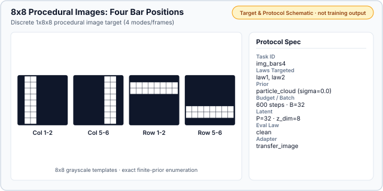
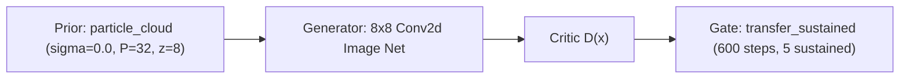

<!-- Generated Forge experiment page — do not edit manually; regenerate via `python -m experiments.forge.experiment_docs` -->

[← Leaderboard](../technique-inventory.md) · [Experiment Catalog](README.md) · [Explore by Laws](../LAWS_HUB.md) · [Research Portal](https://hypergan.github.io/ParticleGAN/)

# 8x8 Procedural Images: Four Bar Positions (`img_bars4`)

| Field | Value |
| --- | --- |
| **Laws Tested** | [Law 1](../LAWS_HUB.md#law1) · [Law 2](../LAWS_HUB.md#law2) |
| **Edge Cases** | `discrete-images-8x8` `conv2d-critic` `cross-valley-averaging` |
| **Primary View (`discriminator_stability`)** | Tier 2 (held) |
| **Four Laws Adherence Role** | law2 (anchor) |
| **Fixed Full-Suite Denominator** | Yes (59-test active runnable denominator) |
| **Adapter / Domain** | `transfer_image` / `transfer_sustained` |
| **Prior** | `particle_cloud` (sigma=`0.0`, standardize=`False`) |
| **Update Budget** | `600` steps |

## What This Experiment Tests

Four discrete spatial bar locations (two vertical, two horizontal) on 8x8 grayscale images. Exposes cross-valley barycentric mode collapse on convolutional generators when batch/particle coupling is soft.

> [!NOTE]
> **Protocol notes:** Tier-2 held image task and Four Laws Adherence Law 2 anchor (600 updates).

## Laws & Edge Cases Targeted

- **[Law 1: Representational Geometry](../LAWS_HUB.md#law1)** ([Law 1 theory](../../../docs/four-laws.md#law-1--representational-geometry)) — Can the system represent the required probability measure efficiently and faithfully?
- **[Law 2: Potential Geometry](../LAWS_HUB.md#law2)** ([Law 2 theory](../../../docs/four-laws.md#law-2--potential-geometry)) — Does the critic communicate useful learning forces with appropriate geometric control and computational efficiency?
- **Edge-case tags:** `discrete-images-8x8`, `conv2d-critic`, `cross-valley-averaging`

## Common Failure Mode

Historically a major discriminator: BCAP, BISPF, EMPF-v8, and RHBI-v12 collapsed to 2/4 bars or blurry superpositions.

**Historical audit diagnosis** (`reports/forge/problem-definitions.json`): BCAP and BISPF produce clean pictures but only 2 of 4 bars. Some transport recipes reach more bars but produce too many blurry pictures.

- *Recommended research focus:* Preserve all four clean bar modes while passing stripes and the acquisition tests with the same recipe.

## Visual Schematic



*Target & Protocol Schematic · not training output — generated deterministically from the declared task contract.*

## Protocol & Architecture Diagram



## Task Contract & Numerical Gates

### Execution & Sampling Contract

| Contract Field | Declared Value |
| --- | --- |
| Initializer | `deterministic_orthogonal` |
| Prior | `particle_cloud` (sigma=`0.0`, standardize=`False`) |
| Update Budget | `600` steps |
| Batch Size | `32` |
| Particles / Latent Dim | `P=32` / `z_dim=8` |
| Sampling Law | `enumerated_prior_without_output_noise` |
| Evaluation Output Noise | `clean` |
| Scoring Weights | `live` |
| Assigned Views | `adaptation` (T2 held), `bcap-develop-integration-deeper-diagnostic-v1` (T1 diagnostic), `bcap_convolution_images` (T1 diagnostic), `bispf_throughput_small` (T1 diagnostic), `clockfree_continuous` (T2 held), `discriminator_stability` (T2 held), `formulation_comparison` (T2 held), `four-laws-adherence-v1` (T1 diagnostic) (+10 more) |

### Numerical Pass/Fail Thresholds

| Metric | Operator | Threshold |
| --- | :---: | ---: |
| `modes` | `>=` | `4` |
| `hq` | `>=` | `0.9` |

## Recorded Family Results

> [!IMPORTANT]
> Screening outcomes below come from recorded single-seed (`seed = 0`) Forge evidence. `NOT MEASURED`, `BLOCKED`, and `INCOMPATIBLE` are non-numerical states — not scientific failures — and confer no pass or qualification credit.

| Family | Selected Candidate | Outcome | Key Recorded Metrics | Family Report | Training Media |
| --- | --- | :---: | --- | --- | --- |
| **Axiom** | `axiom-v5` | **PASS** | recomputed complete live curve and terminal suffix | [Axiom](../families/axiom.md#cohort-cuda-42a130a78fc3) | [HF GIF](https://huggingface.co/datasets/HyperGAN/particlegan-forge-evidence/resolve/main/media/forge/leaderboard/axiom/axiom-v4/img_bars4.gif) |
| **Unified** | `unified-v15` | **PASS** | recomputed complete live curve and terminal suffix | [Unified](../families/unified.md#cohort-cuda-42a130a78fc3) | [HF GIF](https://huggingface.co/datasets/HyperGAN/particlegan-forge-evidence/resolve/main/media/forge/leaderboard/unified/unified-v11/img_bars4.gif) |
| **Atlas** | `atlas-particle-normal-v4` | `NOT MEASURED` | no compatible result | [Atlas](../families/atlas.md#cohort-cuda-daa283c8a640) | — |
| **BCAP** | `recipe-prior-refactor-bcap-pure-v1` | **FAIL** | recomputed complete live curve and terminal suffix | [BCAP](../families/bcap-pure.md#cohort-cuda-1bf9d7d34422) | [HF GIF](https://huggingface.co/datasets/HyperGAN/particlegan-forge-evidence/resolve/main/media/forge/recipe-prior-refactor/publication/media/bcap-pure-ordinary-img_bars4.gif) |
| **BISPF** | `bispf-optimized-quintic-v1` | **FAIL** | recomputed complete live curve and terminal suffix | [BISPF](../families/bispf.md#cohort-cuda-1bf9d7d34422) | [HF GIF](https://huggingface.co/datasets/HyperGAN/particlegan-forge-evidence/resolve/main/media/forge/bispf-optimized/quality-media/img_bars4.gif) |
| **E22** | `e22` | `BLOCKED` | Skipped incompatible test: img_bars4: clean/live scoring has no declared policy-control ev | [E22](../families/e22.md#cohort-cuda-1bf9d7d34422) | — |
| **EMPF** | `empf-v8` | **FAIL** | recomputed complete live curve and terminal suffix | [EMPF](../families/empf.md#cohort-cuda-23a94f16ca88) | [HF GIF](https://huggingface.co/datasets/HyperGAN/particlegan-forge-evidence/resolve/main/media/forge/leaderboard/empf/empf-v8/img_bars4.gif) |
| **GAN v3 release 0.7** | `recipe-prior-refactor-release07-gan-v3-v1` | `NOT MEASURED` | no compatible result | [GAN v3 release 0.7](../families/release07-gan-v3.md#cohort-cuda-daa283c8a640) | — |
| **K3P** | `recipe-prior-refactor-k3p-v1` | `NOT MEASURED` | no compatible result | [K3P](../families/k3p.md#cohort-cuda-daa283c8a640) | — |
| **KA2** | `recipe-prior-refactor-ka2-v1` | `NOT MEASURED` | no compatible result | [KA2](../families/ka2.md#cohort-cuda-daa283c8a640) | — |
| **R1/R2** | `recipe-prior-refactor-r1r2-v1` | `NOT MEASURED` | no compatible result | [R1/R2](../families/r1r2.md#cohort-cuda-daa283c8a640) | — |
| **RHBI** | `rhbi-v12` | **FAIL** | recomputed complete live curve and terminal suffix | [RHBI](../families/rhbi.md#cohort-cuda-23a94f16ca88) | [HF GIF](https://huggingface.co/datasets/HyperGAN/particlegan-forge-evidence/resolve/main/media/forge/leaderboard/rhbi/rhbi-v12/img_bars4.gif) |

### Four Laws Adherence Diagnostic Receipts (Separate Cohort)

*Diagnostic readouts and Colab matched-GPU receipts for `four-laws-adherence-v1` (protocol seed `0`, unchanged recipes; research telemetry only — separate from ordinary selected-cohort qualification above and confers no qualification or default-adoption credit):*

| Candidate | Family | GPU | Outcome | `min_margin` | NVML Energy | Key Recorded Metrics | Receipt |
| --- | --- | --- | :---: | ---: | ---: | --- | --- |
| `axiom-v4` | `axiom` | NVIDIA L4 | **PASS** | — | 1.26 kJ (J-to-PASS) | distribution_tv=0.03125, hq=0.9688, mean_rmse=0.01549, modes=4 | [5fb511514d7e4d2289be390c19e98ca0.json](../technique-receipts/5fb511514d7e4d2289be390c19e98ca0.json) |
| `axiom-v4` | `axiom` | NVIDIA RTX A6000 | **PASS** | — | 4.23 kJ (J-to-PASS) | distribution_tv=0.03125, hq=1, mean_rmse=0.00432, modes=4 | [readout-9066cb4353eb435be7819b0c.json](../records/readout-9066cb4353eb435be7819b0c.json) |
| `axiom-v5` | `axiom` | NVIDIA L4 | **PASS** | — | 1.03 kJ (J-to-PASS) | distribution_tv=0.03125, hq=1, mean_rmse=0.002752, modes=4 | [0de3c7ca57da412694bc55150f0aa998.json](../technique-receipts/0de3c7ca57da412694bc55150f0aa998.json) |
| `law4-energy-v11` | `unified` | NVIDIA L4 | **PASS** | — | 782 J (J-to-PASS) | distribution_tv=0.03125, hq=0.9688, mean_rmse=0.01112, modes=4 | [ea84abbf24794d968f6d15ceef17fa69.json](../technique-receipts/ea84abbf24794d968f6d15ceef17fa69.json) |
| `recipe-prior-refactor-r1r2-v1` | `r1r2` | NVIDIA L4 | **PASS** | — | 153 J (J-to-PASS) | distribution_tv=0, hq=0.9062, mean_rmse=0.01914, modes=4 | [7c6b007c4b904b009c74527d92e1bee6.json](../technique-receipts/7c6b007c4b904b009c74527d92e1bee6.json) |
| `unified-v11` | `unified` | NVIDIA L4 | **PASS** | — | 1.38 kJ (J-to-PASS) | distribution_tv=0.03125, hq=1, mean_rmse=0.006786, modes=4 | [b029bf2f44fc4dffa79c74713727f8a5.json](../technique-receipts/b029bf2f44fc4dffa79c74713727f8a5.json) |
| `unified-v12` | `unified` | NVIDIA L4 | **PASS** | — | 830 J (J-to-PASS) | distribution_tv=0.03125, hq=0.9688, mean_rmse=0.01112, modes=4 | [3159b1fdb28f441db591fdc7084f6610.json](../technique-receipts/3159b1fdb28f441db591fdc7084f6610.json) |
| `unified-v15` | `unified` | NVIDIA L4 | **PASS** | — | 1.37 kJ (J-to-PASS) | distribution_tv=0.2188, hq=1, mean_rmse=0.002001, modes=4 | [2e0a02f3c05e4af59753d96f7949fd65.json](../technique-receipts/2e0a02f3c05e4af59753d96f7949fd65.json) |
| `atlas-particle-normal-v4` | `atlas` | NVIDIA L4 | **FAIL** | — | 644 J | distribution_tv=0.75, hq=0, mean_rmse=0.4841, modes=0 | [23761ed65f8b4774aa97f15c8285f486.json](../technique-receipts/23761ed65f8b4774aa97f15c8285f486.json) |
| `bispf-optimized-quintic-v1` | `bispf` | NVIDIA L4 | **FAIL** | — | 1.24 kJ | distribution_tv=0.4375, hq=0.8438, mean_rmse=0.0726, modes=2 | [9cd7baafba8c439b98a629ae74166e96.json](../technique-receipts/9cd7baafba8c439b98a629ae74166e96.json) |
| `empf-v8` | `empf` | NVIDIA L4 | **FAIL** | — | 661 J | distribution_tv=0.4062, hq=0.9688, mean_rmse=0.01029, modes=2 | [07c455bfb9ef412baa2251823829cdd2.json](../technique-receipts/07c455bfb9ef412baa2251823829cdd2.json) |
| `minimal-v2` | `minimal` | NVIDIA L4 | **FAIL** | — | 1.04 kJ | distribution_tv=0.4688, hq=0.875, mean_rmse=0.06801, modes=2 | [1d8bb9de782d4665a7277804f56f3d90.json](../technique-receipts/1d8bb9de782d4665a7277804f56f3d90.json) |
| `recipe-prior-refactor-bcap-pure-v1` | `bcap-dualnorm` | NVIDIA L4 | **FAIL** | — | 1.13 kJ | distribution_tv=0.4062, hq=0.9062, mean_rmse=0.02218, modes=2 | [672d5d2d6cfb4cda8323b6221c675ad9.json](../technique-receipts/672d5d2d6cfb4cda8323b6221c675ad9.json) |
| `recipe-prior-refactor-k3p-v1` | `k3p` | NVIDIA L4 | **FAIL** | — | 367 J | distribution_tv=0.5, hq=1, mean_rmse=0.001174, modes=2 | [c27226ba3ad0494da7cf61ac2e0ff2ca.json](../technique-receipts/c27226ba3ad0494da7cf61ac2e0ff2ca.json) |
| `recipe-prior-refactor-ka2-v1` | `ka2` | NVIDIA L4 | **FAIL** | — | 370 J | distribution_tv=0.5, hq=1, mean_rmse=0.001106, modes=2 | [ff181e052487477090d5b68f058ad376.json](../technique-receipts/ff181e052487477090d5b68f058ad376.json) |
| `recipe-prior-refactor-release07-gan-v3-v1` | `release07-gan-v3` | NVIDIA L4 | **FAIL** | — | 285 J | distribution_tv=0.3125, hq=0.9688, mean_rmse=0.02076, modes=3 | [221a41a60cd54edfb47a2009ce72b5dd.json](../technique-receipts/221a41a60cd54edfb47a2009ce72b5dd.json) |

## Reproduce This Experiment

```bash
# Validate this task declaration and inspect planned dependencies
python -m experiments.forge validate
python -m experiments.forge plan --view discriminator_stability --candidate unified-v12 --tasks img_bars4
```

**Declaration & Source Files:**

- Task contract: [configs/forge/tasks/img_bars4.json](../../../configs/forge/tasks/img_bars4.json)
- Source code: [benchmarks/transfer_suite/image_tasks.py](../../../benchmarks/transfer_suite/image_tasks.py)
- Source code: [benchmarks/locked_shared/observation.py](../../../benchmarks/locked_shared/observation.py)
- Source code: [benchmarks/transfer_suite/protocol.py](../../../benchmarks/transfer_suite/protocol.py)

## Annotation Provenance

This page was assembled read-only from the following versioned inputs without altering any task execution/evaluation fingerprint:

- **Task contract JSON:** [configs/forge/tasks/img_bars4.json](../../../configs/forge/tasks/img_bars4.json)
- **Editorial task documentation sidecar:** [configs/forge/task-documentation/img_bars4.json](../../../configs/forge/task-documentation/img_bars4.json)
- **Read-only Python AST source:** [benchmarks/transfer_suite/image_tasks.py](../../../benchmarks/transfer_suite/image_tasks.py) (AST symbols: `__doc__`)
- **Read-only Python AST source:** [benchmarks/locked_shared/observation.py](../../../benchmarks/locked_shared/observation.py) (AST symbols: `__doc__`)
- **Read-only Python AST source:** [benchmarks/transfer_suite/protocol.py](../../../benchmarks/transfer_suite/protocol.py) (AST symbols: `__doc__`)
