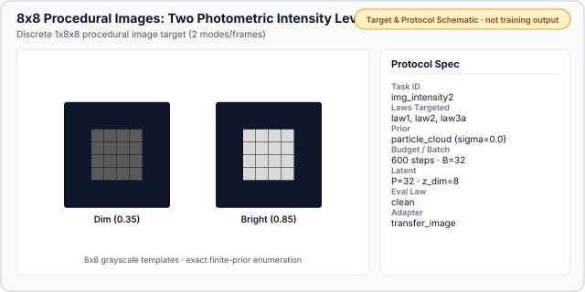
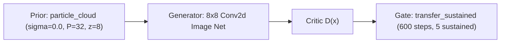

<!-- Generated Forge experiment page — do not edit manually; regenerate via `python -m experiments.forge.experiment_docs` -->

[← Leaderboard](../technique-inventory.md) · [Experiment Catalog](README.md) · [Explore by Laws](../LAWS_HUB.md) · [Research Portal](https://hypergan.github.io/ParticleGAN/)

# 8x8 Procedural Images: Two Photometric Intensity Levels (`img_intensity2`)

| Field | Value |
| --- | --- |
| **Laws Tested** | [Law 1](../LAWS_HUB.md#law1) · [Law 2](../LAWS_HUB.md#law2) · [Law 3A](../LAWS_HUB.md#law3a) |
| **Edge Cases** | `discrete-images-8x8` `photometric-intensity` `tight-rmse` |
| **Primary View (`discriminator_stability`)** | Tier 2 (held) |
| **Four Laws Adherence Role** | — |
| **Fixed Full-Suite Denominator** | Yes (71-test fixed denominator) |
| **Adapter / Domain** | `transfer_image` / `transfer_sustained` |
| **Prior** | `particle_cloud` (sigma=`0.0`, standardize=`False`) |
| **Update Budget** | `600` steps |

## What This Experiment Tests

Tests photometric amplitude fidelity rather than spatial position: a centered 4x4 square must be generated at both target brightnesses (0.35 and 0.85) with tight template RMSE (<= 0.06).

> [!NOTE]
> **Protocol notes:** Tier-2 held image task (600 updates, tighter quality_rmse <= 0.06).

## Laws & Edge Cases Targeted

- **[Law 1: Representational Geometry](../LAWS_HUB.md#law1)** ([Law 1 theory](../../../docs/four-laws.md#law-1--representational-geometry)) — Can the system represent the required probability measure efficiently and faithfully?
- **[Law 2: Potential Geometry](../LAWS_HUB.md#law2)** ([Law 2 theory](../../../docs/four-laws.md#law-2--potential-geometry)) — Does the critic communicate useful learning forces with appropriate geometric control and computational efficiency?
- **[Law 3A: Unconditional W1 Ray-Length & Screening Identifiability](../LAWS_HUB.md#law3a)** ([Law 3A theory](../../../docs/four-laws.md#law-3--transport-identifiability)) — Does the learning system possess enough information to determine appropriate transport?
- **Edge-case tags:** `discrete-images-8x8`, `photometric-intensity`, `tight-rmse`

## Common Failure Mode

Trainers collapse to a single intermediate gray level (~0.60) or drop the dimmer/brighter mode entirely.

**Historical audit diagnosis** (`reports/forge/problem-definitions.json`): BISPF collapses to one brightness level. BCAP produces both but 10/32 pictures have inaccurate brightness.

- *Recommended research focus:* Learn accurate, balanced brightness modes while retaining the other image and acquisition passes.

## Visual Schematic



*Target & Protocol Schematic · not training output — generated deterministically from the declared task contract.*

## Protocol & Architecture Diagram



## Task Contract & Numerical Gates

### Execution & Sampling Contract

| Contract Field | Declared Value |
| --- | --- |
| Initializer | `deterministic_orthogonal` |
| Prior | `particle_cloud` (sigma=`0.0`, standardize=`False`) |
| Update Budget | `600` steps |
| Batch Size | `32` |
| Particles / Latent Dim | `P=32` / `z_dim=8` |
| Sampling Law | `enumerated_prior_without_output_noise` |
| Evaluation Output Noise | `clean` |
| Scoring Weights | `live` |
| Assigned Views | `adaptation` (T2 held), `bcap-develop-integration-deeper-diagnostic-v1` (T1 diagnostic), `bcap_convolution_images` (T1 diagnostic), `clockfree_continuous` (T2 held), `discriminator_stability` (T2 held), `formulation_comparison` (T2 held), `host_profile_transfer` (T2 held), `lazy_cadence_coverage` (T1 diagnostic) (+6 more) |

### Numerical Pass/Fail Thresholds

| Metric | Operator | Threshold |
| --- | :---: | ---: |
| `modes` | `>=` | `2` |
| `hq` | `>=` | `0.9` |

## Recorded Family Results

> [!IMPORTANT]
> Screening outcomes below come from recorded single-seed (`seed = 0`) Forge evidence. `NOT MEASURED`, `BLOCKED`, and `INCOMPATIBLE` are non-numerical states — not scientific failures — and confer no pass or qualification credit.

| Family | Selected Candidate | Outcome | Key Recorded Metrics | Family Report | Training Media |
| --- | --- | :---: | --- | --- | --- |
| **Axiom** | `axiom-v4` | **PASS** | recomputed complete live curve and terminal suffix | [Axiom](../families/axiom.md#cohort-cuda-daa283c8a640) | — |
| **RHBI** | `rhbi-v12` | **PASS** | recomputed complete live curve and terminal suffix | [RHBI](../families/rhbi.md#cohort-cuda-23a94f16ca88) | — |
| **Unified** | `unified-v11` | **PASS** | recomputed complete live curve and terminal suffix | [Unified](../families/unified.md#cohort-cuda-42a130a78fc3) | — |
| **Atlas** | `atlas-particle-normal-v4` | `NOT MEASURED` | no compatible result | [Atlas](../families/atlas.md#cohort-cuda-daa283c8a640) | — |
| **BCAP** | `recipe-prior-refactor-bcap-pure-v1` | **FAIL** | recomputed complete live curve and terminal suffix | [BCAP](../families/bcap-pure.md#cohort-cuda-1bf9d7d34422) | — |
| **BISPF** | `bispf-optimized-quintic-v1` | **FAIL** | recomputed complete live curve and terminal suffix | [BISPF](../families/bispf.md#cohort-cuda-1bf9d7d34422) | — |
| **E22** | `e22` | `BLOCKED` | Skipped incompatible test: img_intensity2: clean/live scoring has no declared policy-contr | [E22](../families/e22.md#cohort-cuda-1bf9d7d34422) | — |
| **EMPF** | `empf-v8` | **FAIL** | recomputed complete live curve and terminal suffix | [EMPF](../families/empf.md#cohort-cuda-23a94f16ca88) | — |
| **GAN v3 release 0.7** | `recipe-prior-refactor-release07-gan-v3-v1` | `NOT MEASURED` | no compatible result | [GAN v3 release 0.7](../families/release07-gan-v3.md#cohort-cuda-daa283c8a640) | — |
| **K3P** | `recipe-prior-refactor-k3p-v1` | `NOT MEASURED` | no compatible result | [K3P](../families/k3p.md#cohort-cuda-daa283c8a640) | — |
| **KA2** | `recipe-prior-refactor-ka2-v1` | `NOT MEASURED` | no compatible result | [KA2](../families/ka2.md#cohort-cuda-daa283c8a640) | — |
| **R1/R2** | `recipe-prior-refactor-r1r2-v1` | `NOT MEASURED` | no compatible result | [R1/R2](../families/r1r2.md#cohort-cuda-daa283c8a640) | — |

## Reproduce This Experiment

```bash
# Validate this task declaration and inspect planned dependencies
python -m experiments.forge validate
python -m experiments.forge plan --view discriminator_stability --candidate unified-v12 --tasks img_intensity2
```

**Declaration & Source Files:**

- Task contract: [configs/forge/tasks/img_intensity2.json](../../../configs/forge/tasks/img_intensity2.json)
- Source code: [benchmarks/transfer_suite/image_tasks.py](../../../benchmarks/transfer_suite/image_tasks.py)
- Source code: [benchmarks/locked_shared/observation.py](../../../benchmarks/locked_shared/observation.py)
- Source code: [benchmarks/transfer_suite/protocol.py](../../../benchmarks/transfer_suite/protocol.py)

## Annotation Provenance

This page was assembled read-only from the following versioned inputs without altering any task execution/evaluation fingerprint:

- **Task contract JSON:** [configs/forge/tasks/img_intensity2.json](../../../configs/forge/tasks/img_intensity2.json)
- **Editorial task documentation sidecar:** [configs/forge/task-documentation/img_intensity2.json](../../../configs/forge/task-documentation/img_intensity2.json)
- **Read-only Python AST source:** [benchmarks/transfer_suite/image_tasks.py](../../../benchmarks/transfer_suite/image_tasks.py) (AST symbols: `__doc__`)
- **Read-only Python AST source:** [benchmarks/locked_shared/observation.py](../../../benchmarks/locked_shared/observation.py) (AST symbols: `__doc__`)
- **Read-only Python AST source:** [benchmarks/transfer_suite/protocol.py](../../../benchmarks/transfer_suite/protocol.py) (AST symbols: `__doc__`)
