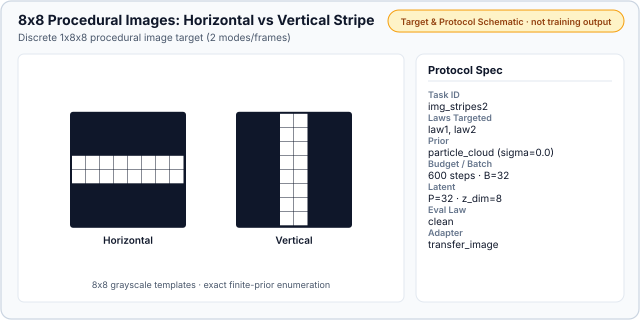
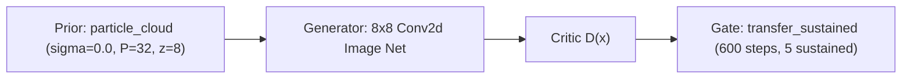

<!-- Generated Forge experiment page — do not edit manually; regenerate via `python -m experiments.forge.experiment_docs` -->

[← Leaderboard](../technique-inventory.md) · [Experiment Catalog](README.md) · [Explore by Laws](../LAWS_HUB.md) · [Research Portal](https://hypergan.github.io/ParticleGAN/)

# 8x8 Procedural Images: Horizontal vs Vertical Stripes (`img_stripes2`)

| Field | Value |
| --- | --- |
| **Laws Tested** | [Law 1](../LAWS_HUB.md#law1) · [Law 2](../LAWS_HUB.md#law2) |
| **Edge Cases** | `discrete-images-8x8` `conv2d-critic` `finite-prior-enumeration` |
| **Primary View (`discriminator_stability`)** | Tier 2 (required) |
| **Four Laws Adherence Role** | law2 (anchor) |
| **Fixed Full-Suite Denominator** | Yes (59-test active runnable denominator) |
| **Adapter / Domain** | `transfer_image` / `transfer_sustained` |
| **Prior** | `particle_cloud` (sigma=`0.0`, standardize=`False`) |
| **Update Budget** | `600` steps |

## What This Experiment Tests

Smallest convolutional image transfer test: learn both 8x8 stripe orientations (horizontal and vertical) using a 32-particle prior with exact finite-prior enumeration (2/2 modes, hq >= 0.90).

> [!NOTE]
> **Protocol notes:** Tier-2 required image task and Four Laws Adherence Law 2 anchor (600 updates).

## Laws & Edge Cases Targeted

- **[Law 1: Representational Geometry](../LAWS_HUB.md#law1)** ([Law 1 theory](../../../docs/four-laws.md#law-1--representational-geometry)) — Can the system represent the required probability measure efficiently and faithfully?
- **[Law 2: Potential Geometry](../LAWS_HUB.md#law2)** ([Law 2 theory](../../../docs/four-laws.md#law-2--potential-geometry)) — Does the critic communicate useful learning forces with appropriate geometric control and computational efficiency?
- **Edge-case tags:** `discrete-images-8x8`, `conv2d-critic`, `finite-prior-enumeration`

## Common Failure Mode

Unregularized Conv2d critics or cross-valley barycentric averaging produce blurry '+' cross hybrids instead of crisp stripes.

## Visual Schematic



*Target & Protocol Schematic · not training output — generated deterministically from the declared task contract.*

## Protocol & Architecture Diagram



## Task Contract & Numerical Gates

### Execution & Sampling Contract

| Contract Field | Declared Value |
| --- | --- |
| Initializer | `deterministic_orthogonal` |
| Prior | `particle_cloud` (sigma=`0.0`, standardize=`False`) |
| Update Budget | `600` steps |
| Batch Size | `32` |
| Particles / Latent Dim | `P=32` / `z_dim=8` |
| Sampling Law | `enumerated_prior_without_output_noise` |
| Evaluation Output Noise | `clean` |
| Scoring Weights | `live` |
| Assigned Views | `adaptation` (T2 required), `bcap-develop-integration-deeper-diagnostic-v1` (T1 diagnostic), `bcap_convolution_images` (T1 diagnostic), `bispf_throughput_small` (T1 diagnostic), `clockfree_continuous` (T2 required), `discriminator_stability` (T2 required), `formulation_comparison` (T2 required), `four-laws-adherence-v1` (T1 diagnostic) (+8 more) |

### Numerical Pass/Fail Thresholds

| Metric | Operator | Threshold |
| --- | :---: | ---: |
| `modes` | `>=` | `2` |
| `hq` | `>=` | `0.9` |

## Recorded Family Results

> [!IMPORTANT]
> Screening outcomes below come from recorded single-seed (`seed = 0`) Forge evidence. `NOT MEASURED`, `BLOCKED`, and `INCOMPATIBLE` are non-numerical states — not scientific failures — and confer no pass or qualification credit.

| Family | Selected Candidate | Outcome | Key Recorded Metrics | Family Report | Training Media |
| --- | --- | :---: | --- | --- | --- |
| **Axiom** | `axiom-v5` | **PASS** | recomputed complete live curve and terminal suffix | [Axiom](../families/axiom.md#cohort-cuda-42a130a78fc3) | [HF GIF](https://huggingface.co/datasets/HyperGAN/particlegan-forge-evidence/resolve/main/media/forge/leaderboard/axiom/axiom-v4/img_stripes2.gif) |
| **BCAP** | `recipe-prior-refactor-bcap-pure-v1` | **PASS** | recomputed complete live curve and terminal suffix | [BCAP](../families/bcap-pure.md#cohort-cuda-1bf9d7d34422) | [HF GIF](https://huggingface.co/datasets/HyperGAN/particlegan-forge-evidence/resolve/main/media/forge/recipe-prior-refactor/publication/media/bcap-pure-ordinary-img_stripes2.gif) |
| **BISPF** | `bispf-optimized-quintic-v1` | **PASS** | recomputed complete live curve and terminal suffix | [BISPF](../families/bispf.md#cohort-cuda-1bf9d7d34422) | [HF GIF](https://huggingface.co/datasets/HyperGAN/particlegan-forge-evidence/resolve/main/media/forge/bispf-optimized/quality-media/img_stripes2.gif) |
| **EMPF** | `empf-v8` | **PASS** | recomputed complete live curve and terminal suffix | [EMPF](../families/empf.md#cohort-cuda-23a94f16ca88) | [HF GIF](https://huggingface.co/datasets/HyperGAN/particlegan-forge-evidence/resolve/main/media/forge/leaderboard/empf/empf-v8/img_stripes2.gif) |
| **RHBI** | `rhbi-v12` | **PASS** | recomputed complete live curve and terminal suffix | [RHBI](../families/rhbi.md#cohort-cuda-23a94f16ca88) | [HF GIF](https://huggingface.co/datasets/HyperGAN/particlegan-forge-evidence/resolve/main/media/forge/leaderboard/rhbi/rhbi-v12/img_stripes2.gif) |
| **Unified** | `unified-v15` | **PASS** | recomputed complete live curve and terminal suffix | [Unified](../families/unified.md#cohort-cuda-42a130a78fc3) | [HF GIF](https://huggingface.co/datasets/HyperGAN/particlegan-forge-evidence/resolve/main/media/forge/leaderboard/unified/unified-v11/img_stripes2.gif) |
| **Atlas** | `atlas-particle-normal-v4` | `NOT MEASURED` | no compatible result | [Atlas](../families/atlas.md#cohort-cuda-daa283c8a640) | — |
| **E22** | `e22` | `BLOCKED` | Skipped incompatible test: img_stripes2: clean/live scoring has no declared policy-control | [E22](../families/e22.md#cohort-cuda-1bf9d7d34422) | — |
| **GAN v3 release 0.7** | `recipe-prior-refactor-release07-gan-v3-v1` | `NOT MEASURED` | no compatible result | [GAN v3 release 0.7](../families/release07-gan-v3.md#cohort-cuda-daa283c8a640) | — |
| **K3P** | `recipe-prior-refactor-k3p-v1` | `NOT MEASURED` | no compatible result | [K3P](../families/k3p.md#cohort-cuda-daa283c8a640) | — |
| **KA2** | `recipe-prior-refactor-ka2-v1` | `NOT MEASURED` | no compatible result | [KA2](../families/ka2.md#cohort-cuda-daa283c8a640) | — |
| **R1/R2** | `recipe-prior-refactor-r1r2-v1` | `NOT MEASURED` | no compatible result | [R1/R2](../families/r1r2.md#cohort-cuda-daa283c8a640) | — |

### Four Laws Adherence Diagnostic Receipts (Separate Cohort)

*Diagnostic readouts and Colab matched-GPU receipts for `four-laws-adherence-v1` (protocol seed `0`, unchanged recipes; research telemetry only — separate from ordinary selected-cohort qualification above and confers no qualification or default-adoption credit):*

| Candidate | Family | GPU | Outcome | `min_margin` | NVML Energy | Key Recorded Metrics | Receipt |
| --- | --- | --- | :---: | ---: | ---: | --- | --- |
| `atlas-particle-normal-v4` | `atlas` | NVIDIA L4 | **PASS** | — | 346 J (J-to-PASS) | distribution_tv=0, hq=1, mean_rmse=0.006249, modes=2 | [de8b74acbde3425b8a853204114e088b.json](../technique-receipts/de8b74acbde3425b8a853204114e088b.json) |
| `axiom-v4` | `axiom` | NVIDIA RTX A6000 | **PASS** | — | 2.92 kJ (J-to-PASS) | distribution_tv=0.2188, hq=1, mean_rmse=0.002747, modes=2 | [readout-9066cb4353eb435be7819b0c.json](../records/readout-9066cb4353eb435be7819b0c.json) |
| `axiom-v5` | `axiom` | NVIDIA L4 | **PASS** | — | 912 J (J-to-PASS) | distribution_tv=0.0625, hq=1, mean_rmse=0.002981, modes=2 | [cc74d354ce3349aebc6fb40ccee3bca7.json](../technique-receipts/cc74d354ce3349aebc6fb40ccee3bca7.json) |
| `axiom-v6` | `axiom` | NVIDIA RTX A6000 | **PASS** | — | 2.21 kJ (J-to-PASS) | distribution_tv=0, hq=1, mean_rmse=0.0028, modes=2 | [readout-69f7d043a14e2780fb2cdd4a.json](../records/readout-69f7d043a14e2780fb2cdd4a.json) |
| `bispf-optimized-quintic-v1` | `bispf` | NVIDIA L4 | **PASS** | — | 1.20 kJ (J-to-PASS) | distribution_tv=0.1875, hq=1, mean_rmse=0.001734, modes=2 | [54e4b034bc304af88c72ef9b1e20af3d.json](../technique-receipts/54e4b034bc304af88c72ef9b1e20af3d.json) |
| `empf-v8` | `empf` | NVIDIA L4 | **PASS** | — | 506 J (J-to-PASS) | distribution_tv=0.09375, hq=1, mean_rmse=4.219e-05, modes=2 | [73c50630a673449f8cb683907ac54ebd.json](../technique-receipts/73c50630a673449f8cb683907ac54ebd.json) |
| `law4-energy-v11` | `unified` | NVIDIA L4 | **PASS** | — | 887 J (J-to-PASS) | distribution_tv=0.0625, hq=1, mean_rmse=0.002811, modes=2 | [8668022fbc2f471aaa84a1bf07c3fcb0.json](../technique-receipts/8668022fbc2f471aaa84a1bf07c3fcb0.json) |
| `minimal-v2` | `minimal` | NVIDIA L4 | **PASS** | — | 300 J (J-to-PASS) | distribution_tv=0.1875, hq=1, mean_rmse=0.003463, modes=2 | [263b448be20548c995cd09374d46653a.json](../technique-receipts/263b448be20548c995cd09374d46653a.json) |
| `recipe-prior-refactor-bcap-pure-v1` | `bcap-dualnorm` | NVIDIA L4 | **PASS** | — | 791 J (J-to-PASS) | distribution_tv=0.09375, hq=1, mean_rmse=1.634e-09, modes=2 | [74d482d11003419fb546b3c1a94d0e1b.json](../technique-receipts/74d482d11003419fb546b3c1a94d0e1b.json) |
| `recipe-prior-refactor-k3p-v1` | `k3p` | NVIDIA L4 | **PASS** | — | 106 J (J-to-PASS) | distribution_tv=0.03125, hq=1, mean_rmse=0.007621, modes=2 | [1ce89d9a4cfb49cc947f4990fcda2b41.json](../technique-receipts/1ce89d9a4cfb49cc947f4990fcda2b41.json) |
| `recipe-prior-refactor-ka2-v1` | `ka2` | NVIDIA L4 | **PASS** | — | 104 J (J-to-PASS) | distribution_tv=0.03125, hq=1, mean_rmse=0.007845, modes=2 | [9fae680909b647d6bf3488b9ba0247d4.json](../technique-receipts/9fae680909b647d6bf3488b9ba0247d4.json) |
| `recipe-prior-refactor-r1r2-v1` | `r1r2` | NVIDIA L4 | **PASS** | — | 58 J (J-to-PASS) | distribution_tv=0, hq=1, mean_rmse=0.008166, modes=2 | [5f43b49f5fcf43cea9d5422eea729957.json](../technique-receipts/5f43b49f5fcf43cea9d5422eea729957.json) |
| `unified-v11` | `unified` | NVIDIA L4 | **PASS** | — | 900 J (J-to-PASS) | distribution_tv=0.0625, hq=1, mean_rmse=0.003021, modes=2 | [951ad5bac7244767b77c8afd76cbe41e.json](../technique-receipts/951ad5bac7244767b77c8afd76cbe41e.json) |
| `unified-v12` | `unified` | NVIDIA L4 | **PASS** | — | 846 J (J-to-PASS) | distribution_tv=0.0625, hq=1, mean_rmse=0.002811, modes=2 | [858fda28326f41548a096797ef608359.json](../technique-receipts/858fda28326f41548a096797ef608359.json) |
| `unified-v15` | `unified` | NVIDIA L4 | **PASS** | — | 832 J (J-to-PASS) | distribution_tv=0.0625, hq=1, mean_rmse=0.002066, modes=2 | [315b1038c2ab49d0be3d3eead9fbf6d5.json](../technique-receipts/315b1038c2ab49d0be3d3eead9fbf6d5.json) |
| `recipe-prior-refactor-release07-gan-v3-v1` | `release07-gan-v3` | NVIDIA L4 | **FAIL** | — | 285 J | distribution_tv=0.03125, hq=0.9688, mean_rmse=0.008511, modes=2 | [78b2eab24ab240d5a5b8a6a8d6c66ddd.json](../technique-receipts/78b2eab24ab240d5a5b8a6a8d6c66ddd.json) |

## Reproduce This Experiment

```bash
# Validate this task declaration and inspect planned dependencies
python -m experiments.forge validate
python -m experiments.forge plan --view discriminator_stability --candidate unified-v12 --tasks img_stripes2
```

**Declaration & Source Files:**

- Task contract: [configs/forge/tasks/img_stripes2.json](../../../configs/forge/tasks/img_stripes2.json)
- Source code: [benchmarks/transfer_suite/image_tasks.py](../../../benchmarks/transfer_suite/image_tasks.py)
- Source code: [benchmarks/locked_shared/observation.py](../../../benchmarks/locked_shared/observation.py)
- Source code: [benchmarks/transfer_suite/protocol.py](../../../benchmarks/transfer_suite/protocol.py)

## Annotation Provenance

This page was assembled read-only from the following versioned inputs without altering any task execution/evaluation fingerprint:

- **Task contract JSON:** [configs/forge/tasks/img_stripes2.json](../../../configs/forge/tasks/img_stripes2.json)
- **Editorial task documentation sidecar:** [configs/forge/task-documentation/img_stripes2.json](../../../configs/forge/task-documentation/img_stripes2.json)
- **Read-only Python AST source:** [benchmarks/transfer_suite/image_tasks.py](../../../benchmarks/transfer_suite/image_tasks.py) (AST symbols: `__doc__`)
- **Read-only Python AST source:** [benchmarks/locked_shared/observation.py](../../../benchmarks/locked_shared/observation.py) (AST symbols: `__doc__`)
- **Read-only Python AST source:** [benchmarks/transfer_suite/protocol.py](../../../benchmarks/transfer_suite/protocol.py) (AST symbols: `__doc__`)
