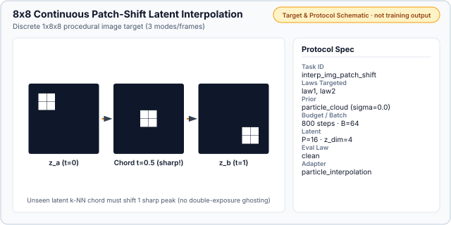
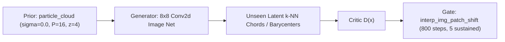

<!-- Generated Forge experiment page — do not edit manually; regenerate via `python -m experiments.forge.experiment_docs` -->

[← Leaderboard](../technique-inventory.md) · [Experiment Catalog](README.md) · [Explore by Laws](../LAWS_HUB.md) · [Research Portal](https://hypergan.github.io/ParticleGAN/)

# 8x8 Continuous Patch-Shift Latent Interpolation (`interp_img_patch_shift`)

| Field | Value |
| --- | --- |
| **Laws Tested** | [Law 1](../LAWS_HUB.md#law1) · [Law 2](../LAWS_HUB.md#law2) |
| **Edge Cases** | `latent-interpolation` `discrete-images-8x8` `double-exposure-ghosting` |
| **Primary View (`discriminator_stability`)** | Tier 2 (stretch) |
| **Four Laws Adherence Role** | — |
| **Fixed Full-Suite Denominator** | Yes (59-test active runnable denominator) |
| **Adapter / Domain** | `particle_interpolation` / `interp_img_patch_shift` |
| **Prior** | `particle_cloud` (sigma=`0.0`, standardize=`False`) |
| **Update Budget** | `800` steps |

## What This Experiment Tests

Learns 16 zero-sigma particles on continuously translated 2x2 unit-peak patches across an 8x8 image canvas and probes unseen latent k-NN midpoints. True manifold interpolation translates a single sharp peak (interp_peak >= 0.78).

> [!NOTE]
> **Protocol notes:** Tier-2 stretch task using 16 zero-sigma particles and residual-upsample image generator.

## Laws & Edge Cases Targeted

- **[Law 1: Representational Geometry](../LAWS_HUB.md#law1)** ([Law 1 theory](../../../docs/four-laws.md#law-1--representational-geometry)) — Can the system represent the required probability measure efficiently and faithfully?
- **[Law 2: Potential Geometry](../LAWS_HUB.md#law2)** ([Law 2 theory](../../../docs/four-laws.md#law-2--potential-geometry)) — Does the critic communicate useful learning forces with appropriate geometric control and computational efficiency?
- **Edge-case tags:** `latent-interpolation`, `discrete-images-8x8`, `double-exposure-ghosting`

## Common Failure Mode

Pixel-space linear blending / double-exposure ghosting produces two half-height (~0.50) patches at latent midpoints instead of one shifted unit-height patch (a verified open failure on `unified-v11`/`v12`).

**Historical audit diagnosis** (`reports/forge/problem-definitions.json`): Archived ordinary family cohorts predate this task (`UNKNOWN`), and `e22` is preflight `BLOCKED` on clean/live scoring (`live_sampling`). In the matched CUDA stretch campaign (`particle-interp-stretch-v1`), `empf-v7` collapses to zero output (`interp_peak = 0.0`), `bispf-optimized-quintic-v1` dims chord midpoints (`interp_peak = 0.6189 < 0.78`), and `recipe-prior-refactor-bcap-pure-v1` underfits (`interp_peak = 0.3015`), whereas all five remaining families pass 5/5 terminal checks.

- *Recommended research focus:* Diagnose DualNorm (`empf-v7`) zero-output collapse and `bispf` midpoint peak attenuation on 16-particle zero-sigma convolutional image generation while retaining counted discrete-word and ring passes.

## Visual Schematic



*Target & Protocol Schematic · not training output — generated deterministically from the declared task contract.*

## Protocol & Architecture Diagram



## Task Contract & Numerical Gates

### Execution & Sampling Contract

| Contract Field | Declared Value |
| --- | --- |
| Initializer | `deterministic_orthogonal` |
| Prior | `particle_cloud` (sigma=`0.0`, standardize=`False`) |
| Update Budget | `800` steps |
| Batch Size | `64` |
| Particles / Latent Dim | `P=16` / `z_dim=4` |
| Sampling Law | `enumerated_prior_without_output_noise` |
| Evaluation Output Noise | `clean` |
| Scoring Weights | `live` |
| Architecture | `family=image_conv_residual_upsample, architecture=residual_upsample, width=16` |
| Integrity Guards | `finite_state`, `optimizer_roles`, `exact_optimizer_updates`, `mechanism_exercised`, `rng_isolation` |
| Assigned Views | `discriminator_stability` (T2 stretch), `particle_interpolation_stretch` (T1 diagnostic) |

### Numerical Pass/Fail Thresholds

| Metric | Operator | Threshold |
| --- | :---: | ---: |
| `finite_fraction` | `==` | `1.0` |
| `endpoint_rmse` | `<=` | `0.09` |
| `interp_rmse` | `<=` | `0.1` |
| `interp_peak` | `>=` | `0.78` |
| `quadrant_coverage` | `==` | `4` |
| `midpoint_novelty` | `>=` | `0.18` |

## Recorded Family Results

> [!IMPORTANT]
> Screening outcomes below come from recorded single-seed (`seed = 0`) Forge evidence. `NOT MEASURED`, `BLOCKED`, and `INCOMPATIBLE` are non-numerical states — not scientific failures — and confer no pass or qualification credit.

| Family | Selected Candidate | Outcome | Key Recorded Metrics | Family Report | Training Media |
| --- | --- | :---: | --- | --- | --- |
| **Axiom** | `axiom-v5` | **PASS** | recomputed interp_img_patch_shift gates (5/5 terminal checks passed) | [Axiom](../families/axiom.md#cohort-cuda-42a130a78fc3) | [HF GIF](https://huggingface.co/datasets/HyperGAN/particlegan-forge-evidence/resolve/main/media/forge/leaderboard/axiom/axiom-v4/interp_img_patch_shift.gif) |
| **RHBI** | `rhbi-v12` | **PASS** | recomputed interp_img_patch_shift gates (5/5 terminal checks passed) | [RHBI](../families/rhbi.md#cohort-cuda-23a94f16ca88) | — |
| **Atlas** | `atlas-particle-normal-v4` | `DIAG_PASS` | no compatible result | [Atlas](../families/atlas.md#cohort-cuda-daa283c8a640) | — |
| **BCAP** | `recipe-prior-refactor-bcap-pure-v1` | `NOT MEASURED` | No recorded result for this selected configuration and source. | [BCAP](../families/bcap-pure.md#cohort-cuda-1bf9d7d34422) | — |
| **BISPF** | `bispf-optimized-quintic-v1` | `NOT MEASURED` | No recorded result for this selected configuration and source. | [BISPF](../families/bispf.md#cohort-cuda-1bf9d7d34422) | — |
| **E22** | `e22` | `NOT MEASURED` | No recorded result for this selected configuration and source. | [E22](../families/e22.md#cohort-cuda-1bf9d7d34422) | — |
| **EMPF** | `empf-v8` | **FAIL** | failed interp_img_patch_shift thresholds: endpoint_rmse <= 0.09, interp_rmse <= 0.1, inter | [EMPF](../families/empf.md#cohort-cuda-23a94f16ca88) | [HF GIF](https://huggingface.co/datasets/HyperGAN/particlegan-forge-evidence/resolve/main/media/forge/leaderboard/empf/empf-v8/interp_img_patch_shift.gif) |
| **GAN v3 release 0.7** | `recipe-prior-refactor-release07-gan-v3-v1` | `DIAG_PASS` | no compatible result | [GAN v3 release 0.7](../families/release07-gan-v3.md#cohort-cuda-daa283c8a640) | — |
| **K3P** | `recipe-prior-refactor-k3p-v1` | `DIAG_PASS` | no compatible result | [K3P](../families/k3p.md#cohort-cuda-daa283c8a640) | — |
| **KA2** | `recipe-prior-refactor-ka2-v1` | `DIAG_PASS` | no compatible result | [KA2](../families/ka2.md#cohort-cuda-daa283c8a640) | — |
| **R1/R2** | `recipe-prior-refactor-r1r2-v1` | `DIAG_PASS` | no compatible result | [R1/R2](../families/r1r2.md#cohort-cuda-daa283c8a640) | — |
| **Unified** | `unified-v15` | **FAIL** | failed interp_img_patch_shift thresholds: endpoint_rmse <= 0.09, interp_rmse <= 0.1, inter | [Unified](../families/unified.md#cohort-cuda-42a130a78fc3) | — |

## Reproduce This Experiment

```bash
# Validate this task declaration and inspect planned dependencies
python -m experiments.forge validate
python -m experiments.forge plan --view discriminator_stability --candidate unified-v12 --tasks interp_img_patch_shift
```

**Declaration & Source Files:**

- Task contract: [configs/forge/tasks/interp_img_patch_shift.json](../../../configs/forge/tasks/interp_img_patch_shift.json)
- Source code: [benchmarks/toy_audit/api_interpolation.py](../../../benchmarks/toy_audit/api_interpolation.py)
- Source code: [experiments/forge/interpolation.py](../../../experiments/forge/interpolation.py)

## Annotation Provenance

This page was assembled read-only from the following versioned inputs without altering any task execution/evaluation fingerprint:

- **Task contract JSON:** [configs/forge/tasks/interp_img_patch_shift.json](../../../configs/forge/tasks/interp_img_patch_shift.json)
- **Editorial task documentation sidecar:** [configs/forge/task-documentation/interp_img_patch_shift.json](../../../configs/forge/task-documentation/interp_img_patch_shift.json)
- **Read-only Python AST source:** [benchmarks/toy_audit/api_interpolation.py](../../../benchmarks/toy_audit/api_interpolation.py) (AST symbols: `__doc__`, `THRESHOLDS`, `HOST_DEFINITIONS`)
- **Read-only Python AST source:** [experiments/forge/interpolation.py](../../../experiments/forge/interpolation.py) (AST symbols: `__doc__`)
