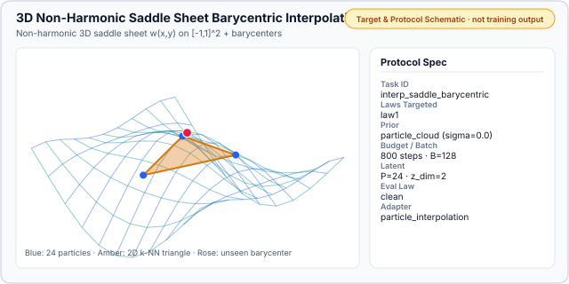

<!-- Generated Forge experiment page — do not edit manually; regenerate via `python -m experiments.forge.experiment_docs` -->

[← Leaderboard](../technique-inventory.md) · [Experiment Catalog](README.md) · [Explore by Laws](../LAWS_HUB.md) · [Research Portal](https://hypergan.github.io/ParticleGAN/)

# 3D Non-Harmonic Saddle Sheet Barycentric Interpolation (`interp_saddle_barycentric`)

| Field | Value |
| --- | --- |
| **Laws Tested** | [Law 1](../LAWS_HUB.md#law1) |
| **Edge Cases** | `latent-interpolation` `3d-curved-surface` `zero-sigma-prior` |
| **Primary View (`discriminator_stability`)** | Tier 2 (stretch) |
| **Four Laws Adherence Role** | law1 (anchor) |
| **Fixed Full-Suite Denominator** | Yes (59-test active runnable denominator) |
| **Adapter / Domain** | `particle_interpolation` / `interp_saddle_barycentric` |
| **Prior** | `particle_cloud` (sigma=`0.0`, standardize=`False`) |
| **Update Budget** | `1000` steps |

## What This Experiment Tests

Tests 2D simplex interpolation: learns 24 zero-sigma particles on a curved 3D saddle surface w = 0.8(x^2 - y^2) + 0.9 cos(0.75 pi x) cos(0.75 pi y) and scores unseen k-NN triangle barycenters on surface MAE and novelty.

> [!NOTE]
> **Protocol notes:** Tier-2 stretch task and Four Laws Adherence Law 1 anchor (24 zero-sigma particles).

## Laws & Edge Cases Targeted

- **[Law 1: Representational Geometry](../LAWS_HUB.md#law1)** ([Law 1 theory](../../../docs/four-laws.md#law-1--representational-geometry)) — Can the system represent the required probability measure efficiently and faithfully?
- **Edge-case tags:** `latent-interpolation`, `3d-curved-surface`, `zero-sigma-prior`

## Common Failure Mode

Discrete-atlas granularity pulls triangle barycenters off the curved saddle sheet (a documented Law 1 trade-off where smooth continuous transport outperforms discrete prototype charts).

**Historical audit diagnosis** (`reports/forge/problem-definitions.json`): No selected recipe sustains all five final live checks (`0/8` runnable, `e22` preflight `BLOCKED`). `atlas-particle-normal-v4` passes `3/5` final checks and all step-800 bounds (`barycenter_surface_mae = 0.0552`, `barycenter_hq = 0.8701`, `16/16` xy bins), `release07-gan-v3` passes the final `2/5` checks (`barycenter_surface_mae = 0.0587`, `barycenter_hq = 0.8056`), and `ka2` (`barycenter_hq = 0.7639`), `bispf` (`0.7286`), and `k3p` (`0.6974`) satisfy `barycenter_surface_mae <= 0.09` while falling just short on `barycenter_hq >= 0.78`.

- *Recommended research focus:* Stabilize late-step live-iterate fluctuations and test recipe-owned 2D simplex interior supervision so `atlas` and `release07-gan-v3` hold `barycenter_hq >= 0.78` across all five terminal checks.

## Visual Schematic



*Target & Protocol Schematic · not training output — generated deterministically from the declared task contract.*

## Protocol & Architecture Diagram


## Task Contract & Numerical Gates

### Execution & Sampling Contract

| Contract Field | Declared Value |
| --- | --- |
| Initializer | `deterministic_orthogonal` |
| Prior | `particle_cloud` (sigma=`0.0`, standardize=`False`) |
| Update Budget | `1000` steps |
| Batch Size | `128` |
| Particles / Latent Dim | `P=32` / `z_dim=2` |
| Sampling Law | `enumerated_prior_without_output_noise` |
| Evaluation Output Noise | `clean` |
| Scoring Weights | `live` |
| Architecture | `family=simple_mlp, hidden=64, layers=2, out_dim=3, fourier=2` |
| Integrity Guards | `finite_state`, `optimizer_roles`, `exact_optimizer_updates`, `mechanism_exercised`, `rng_isolation` |
| Assigned Views | `discriminator_stability` (T2 stretch), `four-laws-adherence-v1` (T1 diagnostic), `four-laws-adherence-v2` (T1 diagnostic), `particle_interpolation_stretch` (T1 diagnostic) |

### Numerical Pass/Fail Thresholds

| Metric | Operator | Threshold |
| --- | :---: | ---: |
| `finite_fraction` | `==` | `1.0` |
| `endpoint_surface_mae` | `<=` | `0.08` |
| `barycenter_surface_mae` | `<=` | `0.09` |
| `barycenter_hq` | `>=` | `0.72` |
| `xy_bins_covered` | `>=` | `12` |
| `barycenter_novelty` | `>=` | `0.18` |

## Recorded Family Results

> [!IMPORTANT]
> Screening outcomes below come from recorded single-seed (`seed = 0`) Forge evidence. `NOT MEASURED`, `BLOCKED`, and `INCOMPATIBLE` are non-numerical states — not scientific failures — and confer no pass or qualification credit.

| Family | Selected Candidate | Outcome | Key Recorded Metrics | Family Report | Training Media |
| --- | --- | :---: | --- | --- | --- |
| **Axiom** | `axiom-v5` | **PASS** | recomputed interp_saddle_barycentric gates (5/5 terminal checks passed) | [Axiom](../families/axiom.md#cohort-cuda-42a130a78fc3) | [HF GIF](https://huggingface.co/datasets/HyperGAN/particlegan-forge-evidence/resolve/main/media/forge/leaderboard/axiom/axiom-v4/interp_saddle_barycentric.gif) |
| **RHBI** | `rhbi-v12` | **PASS** | recomputed interp_saddle_barycentric gates (5/5 terminal checks passed) | [RHBI](../families/rhbi.md#cohort-cuda-23a94f16ca88) | — |
| **Atlas** | `atlas-particle-normal-v4` | `NOT MEASURED` | no compatible result | [Atlas](../families/atlas.md#cohort-cuda-daa283c8a640) | — |
| **BCAP** | `recipe-prior-refactor-bcap-pure-v1` | `NOT MEASURED` | No recorded result for this selected configuration and source. | [BCAP](../families/bcap-pure.md#cohort-cuda-1bf9d7d34422) | — |
| **BISPF** | `bispf-optimized-quintic-v1` | `NOT MEASURED` | No recorded result for this selected configuration and source. | [BISPF](../families/bispf.md#cohort-cuda-1bf9d7d34422) | — |
| **E22** | `e22` | `NOT MEASURED` | No recorded result for this selected configuration and source. | [E22](../families/e22.md#cohort-cuda-1bf9d7d34422) | — |
| **EMPF** | `empf-v8` | **FAIL** | failed interp_saddle_barycentric thresholds: endpoint_surface_mae <= 0.08, barycenter_surf | [EMPF](../families/empf.md#cohort-cuda-23a94f16ca88) | [HF GIF](https://huggingface.co/datasets/HyperGAN/particlegan-forge-evidence/resolve/main/media/forge/leaderboard/empf/empf-v8/interp_saddle_barycentric.gif) |
| **GAN v3 release 0.7** | `recipe-prior-refactor-release07-gan-v3-v1` | `NOT MEASURED` | no compatible result | [GAN v3 release 0.7](../families/release07-gan-v3.md#cohort-cuda-daa283c8a640) | — |
| **K3P** | `recipe-prior-refactor-k3p-v1` | `NOT MEASURED` | no compatible result | [K3P](../families/k3p.md#cohort-cuda-daa283c8a640) | — |
| **KA2** | `recipe-prior-refactor-ka2-v1` | `NOT MEASURED` | no compatible result | [KA2](../families/ka2.md#cohort-cuda-daa283c8a640) | — |
| **R1/R2** | `recipe-prior-refactor-r1r2-v1` | `NOT MEASURED` | no compatible result | [R1/R2](../families/r1r2.md#cohort-cuda-daa283c8a640) | — |
| **Unified** | `unified-v15` | **FAIL** | failed interp_saddle_barycentric thresholds: barycenter_hq >= 0.72 | [Unified](../families/unified.md#cohort-cuda-42a130a78fc3) | — |

### Four Laws Adherence Diagnostic Receipts (Separate Cohort)

*Diagnostic readouts and Colab matched-GPU receipts for `four-laws-adherence-v1` (protocol seed `0`, unchanged recipes; research telemetry only — separate from ordinary selected-cohort qualification above and confers no qualification or default-adoption credit):*

| Candidate | Family | GPU | Outcome | `min_margin` | NVML Energy | Key Recorded Metrics | Receipt |
| --- | --- | --- | :---: | ---: | ---: | --- | --- |
| `atlas-particle-normal-v4` | `atlas` | NVIDIA L4 | **FAIL** | — | 1.15 kJ | barycenter_hq=0.7895, barycenter_novelty=0.7338, barycenter_surface_mae=0.06404, edge_midpoint_surface_mae=0.06272 | [6da9bb6f437642fcb42206a97b2f4e02.json](../technique-receipts/6da9bb6f437642fcb42206a97b2f4e02.json) |
| `axiom-v4` | `axiom` | NVIDIA RTX A6000 | **FAIL** | — | 18.63 kJ | barycenter_hq=0.7639, barycenter_novelty=0.5804, barycenter_surface_mae=0.0694, edge_midpoint_surface_mae=0.06456 | [readout-9066cb4353eb435be7819b0c.json](../records/readout-9066cb4353eb435be7819b0c.json) |
| `axiom-v5` | `axiom` | NVIDIA L4 | **FAIL** | — | 4.08 kJ | barycenter_hq=0.7111, barycenter_novelty=0.5699, barycenter_surface_mae=0.07459, edge_midpoint_surface_mae=0.06055 | [5446268ec1434fcb937d6209e15a3f02.json](../technique-receipts/5446268ec1434fcb937d6209e15a3f02.json) |
| `bispf-optimized-quintic-v1` | `bispf` | NVIDIA L4 | **FAIL** | — | 1.20 kJ | barycenter_hq=0.5775, barycenter_novelty=0.5692, barycenter_surface_mae=0.1031, edge_midpoint_surface_mae=0.1089 | [9ba17f8e6dc34f348ca76510297ebb4f.json](../technique-receipts/9ba17f8e6dc34f348ca76510297ebb4f.json) |
| `empf-v8` | `empf` | NVIDIA L4 | **FAIL** | — | 1.26 kJ | barycenter_hq=0, barycenter_novelty=0, barycenter_surface_mae=9.9, edge_midpoint_surface_mae=9.9 | [8cbeb2ee3f6e4089a6cacd670750e767.json](../technique-receipts/8cbeb2ee3f6e4089a6cacd670750e767.json) |
| `law4-energy-v11` | `unified` | NVIDIA L4 | **FAIL** | — | 2.23 kJ | barycenter_hq=0.6522, barycenter_novelty=0.6344, barycenter_surface_mae=0.082, edge_midpoint_surface_mae=0.07357 | [dccbfd61d443451ca06efb1811dd1a3d.json](../technique-receipts/dccbfd61d443451ca06efb1811dd1a3d.json) |
| `minimal-v2` | `minimal` | NVIDIA L4 | **FAIL** | — | 2.09 kJ | barycenter_hq=0.5342, barycenter_novelty=0.4962, barycenter_surface_mae=0.09831, edge_midpoint_surface_mae=0.07997 | [1984d5e0c189497e84715b7ff5c865b9.json](../technique-receipts/1984d5e0c189497e84715b7ff5c865b9.json) |
| `recipe-prior-refactor-bcap-pure-v1` | `bcap-dualnorm` | NVIDIA L4 | **FAIL** | — | 957 J | barycenter_hq=0.2941, barycenter_novelty=1.117, barycenter_surface_mae=0.2184, edge_midpoint_surface_mae=0.2118 | [180de1dfd43a4d9bacfb8340f94da373.json](../technique-receipts/180de1dfd43a4d9bacfb8340f94da373.json) |
| `recipe-prior-refactor-k3p-v1` | `k3p` | NVIDIA L4 | **FAIL** | — | 675 J | barycenter_hq=0.7123, barycenter_novelty=0.5401, barycenter_surface_mae=0.07251, edge_midpoint_surface_mae=0.06569 | [fc2e42a8862343ec9c51dd0117f72732.json](../technique-receipts/fc2e42a8862343ec9c51dd0117f72732.json) |
| `recipe-prior-refactor-ka2-v1` | `ka2` | NVIDIA L4 | **FAIL** | — | 704 J | barycenter_hq=0.7639, barycenter_novelty=0.5237, barycenter_surface_mae=0.07339, edge_midpoint_surface_mae=0.06604 | [1a4235c698a2485883481b3d78e25a69.json](../technique-receipts/1a4235c698a2485883481b3d78e25a69.json) |
| `recipe-prior-refactor-r1r2-v1` | `r1r2` | NVIDIA L4 | **FAIL** | — | 577 J | barycenter_hq=0.6111, barycenter_novelty=0.555, barycenter_surface_mae=0.1063, edge_midpoint_surface_mae=0.1187 | [6b8c440d9f2c4ecebd93a60eb1ed86de.json](../technique-receipts/6b8c440d9f2c4ecebd93a60eb1ed86de.json) |
| `recipe-prior-refactor-release07-gan-v3-v1` | `release07-gan-v3` | NVIDIA L4 | **FAIL** | — | 605 J | barycenter_hq=0.6883, barycenter_novelty=0.6907, barycenter_surface_mae=0.08551, edge_midpoint_surface_mae=0.06503 | [76f4ad54b69747709efe1442fbc1a288.json](../technique-receipts/76f4ad54b69747709efe1442fbc1a288.json) |
| `unified-v11` | `unified` | NVIDIA L4 | **FAIL** | — | 3.03 kJ | barycenter_hq=0.7237, barycenter_novelty=0.5686, barycenter_surface_mae=0.07482, edge_midpoint_surface_mae=0.0725 | [df76a146afb140048baccfbc3ac4eb0d.json](../technique-receipts/df76a146afb140048baccfbc3ac4eb0d.json) |
| `unified-v12` | `unified` | NVIDIA L4 | **FAIL** | — | 2.53 kJ | barycenter_hq=0.6522, barycenter_novelty=0.6344, barycenter_surface_mae=0.082, edge_midpoint_surface_mae=0.07357 | [3ed326624a084e8cb932acfb464aa37a.json](../technique-receipts/3ed326624a084e8cb932acfb464aa37a.json) |
| `unified-v15` | `unified` | NVIDIA L4 | **FAIL** | — | 3.90 kJ | barycenter_hq=0.7065, barycenter_novelty=0.5555, barycenter_surface_mae=0.07386, edge_midpoint_surface_mae=0.07005 | [65eb6d091d384a668cae8af9c3d2c3d2.json](../technique-receipts/65eb6d091d384a668cae8af9c3d2c3d2.json) |

## Reproduce This Experiment

```bash
# Validate this task declaration and inspect planned dependencies
python -m experiments.forge validate
python -m experiments.forge plan --view discriminator_stability --candidate unified-v12 --tasks interp_saddle_barycentric
```

**Declaration & Source Files:**

- Task contract: [configs/forge/tasks/interp_saddle_barycentric.json](../../../configs/forge/tasks/interp_saddle_barycentric.json)
- Source code: [benchmarks/toy_audit/api_interpolation.py](../../../benchmarks/toy_audit/api_interpolation.py)
- Source code: [experiments/forge/interpolation.py](../../../experiments/forge/interpolation.py)

## Annotation Provenance

This page was assembled read-only from the following versioned inputs without altering any task execution/evaluation fingerprint:

- **Task contract JSON:** [configs/forge/tasks/interp_saddle_barycentric.json](../../../configs/forge/tasks/interp_saddle_barycentric.json)
- **Editorial task documentation sidecar:** [configs/forge/task-documentation/interp_saddle_barycentric.json](../../../configs/forge/task-documentation/interp_saddle_barycentric.json)
- **Read-only Python AST source:** [benchmarks/toy_audit/api_interpolation.py](../../../benchmarks/toy_audit/api_interpolation.py) (AST symbols: `__doc__`, `THRESHOLDS`, `HOST_DEFINITIONS`)
- **Read-only Python AST source:** [experiments/forge/interpolation.py](../../../experiments/forge/interpolation.py) (AST symbols: `__doc__`)
