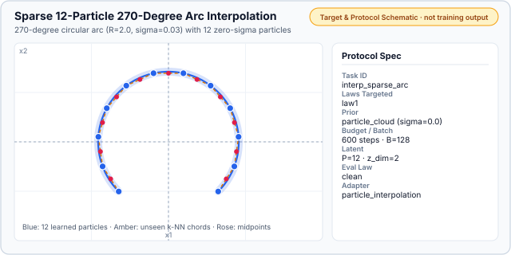
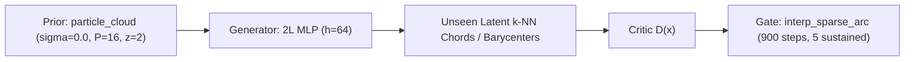

<!-- Generated Forge experiment page — do not edit manually; regenerate via `python -m experiments.forge.experiment_docs` -->

[← Leaderboard](../technique-inventory.md) · [Experiment Catalog](README.md) · [Explore by Laws](../LAWS_HUB.md) · [Research Portal](https://hypergan.github.io/ParticleGAN/)

# Sparse 12-Particle 270-Degree Arc Interpolation (`interp_sparse_arc`)

| Field | Value |
| --- | --- |
| **Laws Tested** | [Law 1](../LAWS_HUB.md#law1) |
| **Edge Cases** | `latent-interpolation` `zero-sigma-prior` `continuous-manifold` |
| **Primary View (`discriminator_stability`)** | Tier 1 (stretch) |
| **Four Laws Adherence Role** | law1 (anchor) |
| **Fixed Full-Suite Denominator** | Yes (59-test active runnable denominator) |
| **Adapter / Domain** | `particle_interpolation` / `interp_sparse_arc` |
| **Prior** | `particle_cloud` (sigma=`0.0`, standardize=`False`) |
| **Update Budget** | `900` steps |

## What This Experiment Tests

Tests whether a generator paired with just 12 zero-sigma discrete particles on a 270-degree circular arc (R=2.0) maps unseen latent k-NN chords (t = 0.25, 0.5, 0.75) smoothly along the curved arc (>= 22/32 arc bins, interp_hq >= 0.80, midpoint_novelty >= 0.20) instead of snapping to endpoints or cutting chords across dead space.

> [!NOTE]
> **Protocol notes:** Tier-1 stretch task and Four Laws Adherence Law 1 anchor; zero-sigma ParticlePrior exception.

## Laws & Edge Cases Targeted

- **[Law 1: Representational Geometry](../LAWS_HUB.md#law1)** ([Law 1 theory](../../../docs/four-laws.md#law-1--representational-geometry)) — Can the system represent the required probability measure efficiently and faithfully?
- **Edge-case tags:** `latent-interpolation`, `zero-sigma-prior`, `continuous-manifold`

## Common Failure Mode

Discrete prototype atlases often act like piecewise-constant lookup tables (Voronoi snapping -> low novelty) or interpolate linearly across empty interior space (low interp_hq).

**Historical audit diagnosis** (`reports/forge/problem-definitions.json`): No selected recipe sustains all five final live checks (`0/8` runnable, `e22` preflight `BLOCKED` by `live_sampling`). Selected `atlas-particle-normal-v4` meets every bound at step 600 (`endpoint_hq = 1.000`, `interp_hq = 0.9365`, `output_knn_interp_hq = 1.000`, `30/32` bins, `midpoint_novelty = 0.576`) and passes `3/5` terminal checks via its recipe-owned `normal_noise` (`0.0065`) prior manipulator, while `empf-v7` bends interior chords (`interp_hq = 0.8254`) with off-arc endpoints (`endpoint_hq = 0.6667 < 0.85`) and classical Adam families (`release07-gan-v3`, `r1r2`, `k3p`, `ka2`) place endpoints on the arc (`0.83-1.00`) but cut straight Euclidean secants across unseen chords (`interp_hq = 0.52-0.65`).

- *Recommended research focus:* Add a recipe-owned latent chord perturbation or local Jacobian smoothness regularizer and damp live-iterate oscillation on zero-sigma `ParticlePrior` without sacrificing counted Tier 1-3 passes.

## Visual Schematic



*Target & Protocol Schematic · not training output — generated deterministically from the declared task contract.*

## Protocol & Architecture Diagram



## Task Contract & Numerical Gates

### Execution & Sampling Contract

| Contract Field | Declared Value |
| --- | --- |
| Initializer | `deterministic_orthogonal` |
| Prior | `particle_cloud` (sigma=`0.0`, standardize=`False`) |
| Update Budget | `900` steps |
| Batch Size | `128` |
| Particles / Latent Dim | `P=16` / `z_dim=2` |
| Sampling Law | `enumerated_prior_without_output_noise` |
| Evaluation Output Noise | `clean` |
| Scoring Weights | `live` |
| Architecture | `family=simple_mlp, hidden=64, layers=2, out_dim=2, fourier=2` |
| Integrity Guards | `finite_state`, `optimizer_roles`, `exact_optimizer_updates`, `mechanism_exercised`, `rng_isolation` |
| Assigned Views | `discriminator_stability` (T1 stretch), `four-laws-adherence-v1` (T1 diagnostic), `four-laws-adherence-v2` (T1 diagnostic), `particle_interpolation_stretch` (T1 diagnostic) |

### Numerical Pass/Fail Thresholds

| Metric | Operator | Threshold |
| --- | :---: | ---: |
| `finite_fraction` | `==` | `1.0` |
| `endpoint_hq` | `>=` | `0.85` |
| `interp_hq` | `>=` | `0.8` |
| `interp_arc_bins` | `>=` | `22` |
| `midpoint_novelty` | `>=` | `0.2` |

## Recorded Family Results

> [!IMPORTANT]
> Screening outcomes below come from recorded single-seed (`seed = 0`) Forge evidence. `NOT MEASURED`, `BLOCKED`, and `INCOMPATIBLE` are non-numerical states — not scientific failures — and confer no pass or qualification credit.

| Family | Selected Candidate | Outcome | Key Recorded Metrics | Family Report | Training Media |
| --- | --- | :---: | --- | --- | --- |
| **Axiom** | `axiom-v5` | **PASS** | recomputed interp_sparse_arc gates (5/5 terminal checks passed) | [Axiom](../families/axiom.md#cohort-cuda-42a130a78fc3) | [HF GIF](https://huggingface.co/datasets/HyperGAN/particlegan-forge-evidence/resolve/main/media/forge/leaderboard/axiom/axiom-v4/interp_sparse_arc.gif) |
| **RHBI** | `rhbi-v12` | **PASS** | recomputed interp_sparse_arc gates (5/5 terminal checks passed) | [RHBI](../families/rhbi.md#cohort-cuda-23a94f16ca88) | — |
| **Unified** | `unified-v15` | **PASS** | recomputed interp_sparse_arc gates (5/5 terminal checks passed) | [Unified](../families/unified.md#cohort-cuda-42a130a78fc3) | — |
| **Atlas** | `atlas-particle-normal-v4` | **FAIL** | failed interp_sparse_arc thresholds: endpoint_hq >= 0.85, interp_hq >= 0.8 | [Atlas](../families/atlas.md#cohort-cuda-daa283c8a640) | [HF GIF](https://huggingface.co/datasets/HyperGAN/particlegan-forge-evidence/resolve/main/media/forge/leaderboard/atlas/atlas-particle-normal-v4/interp_sparse_arc.gif) |
| **BCAP** | `recipe-prior-refactor-bcap-pure-v1` | `NOT MEASURED` | No recorded result for this selected configuration and source. | [BCAP](../families/bcap-pure.md#cohort-cuda-1bf9d7d34422) | — |
| **BISPF** | `bispf-optimized-quintic-v1` | `NOT MEASURED` | No recorded result for this selected configuration and source. | [BISPF](../families/bispf.md#cohort-cuda-1bf9d7d34422) | — |
| **E22** | `e22` | `NOT MEASURED` | No recorded result for this selected configuration and source. | [E22](../families/e22.md#cohort-cuda-1bf9d7d34422) | — |
| **EMPF** | `empf-v8` | **FAIL** | failed interp_sparse_arc thresholds: endpoint_hq >= 0.85, interp_hq >= 0.8, interp_arc_bin | [EMPF](../families/empf.md#cohort-cuda-23a94f16ca88) | [HF GIF](https://huggingface.co/datasets/HyperGAN/particlegan-forge-evidence/resolve/main/media/forge/leaderboard/empf/empf-v8/interp_sparse_arc.gif) |
| **GAN v3 release 0.7** | `recipe-prior-refactor-release07-gan-v3-v1` | **FAIL** | failed interp_sparse_arc thresholds: interp_hq >= 0.8 | [GAN v3 release 0.7](../families/release07-gan-v3.md#cohort-cuda-daa283c8a640) | [HF GIF](https://huggingface.co/datasets/HyperGAN/particlegan-forge-evidence/resolve/main/media/forge/leaderboard/release07-gan-v3/recipe-prior-refactor-release07-gan-v3-v1/interp_sparse_arc.gif) |
| **K3P** | `recipe-prior-refactor-k3p-v1` | **FAIL** | failed interp_sparse_arc thresholds: interp_hq >= 0.8, endpoint_hq >= 0.85 | [K3P](../families/k3p.md#cohort-cuda-daa283c8a640) | [HF GIF](https://huggingface.co/datasets/HyperGAN/particlegan-forge-evidence/resolve/main/media/forge/leaderboard/k3p/recipe-prior-refactor-k3p-v1/interp_sparse_arc.gif) |
| **KA2** | `recipe-prior-refactor-ka2-v1` | **FAIL** | failed interp_sparse_arc thresholds: interp_hq >= 0.8, endpoint_hq >= 0.85 | [KA2](../families/ka2.md#cohort-cuda-daa283c8a640) | [HF GIF](https://huggingface.co/datasets/HyperGAN/particlegan-forge-evidence/resolve/main/media/forge/leaderboard/ka2/recipe-prior-refactor-ka2-v1/interp_sparse_arc.gif) |
| **R1/R2** | `recipe-prior-refactor-r1r2-v1` | **FAIL** | failed interp_sparse_arc thresholds: endpoint_hq >= 0.85, interp_hq >= 0.8 | [R1/R2](../families/r1r2.md#cohort-cuda-daa283c8a640) | [HF GIF](https://huggingface.co/datasets/HyperGAN/particlegan-forge-evidence/resolve/main/media/forge/leaderboard/r1r2/recipe-prior-refactor-r1r2-v1/interp_sparse_arc.gif) |

### Four Laws Adherence Diagnostic Receipts (Separate Cohort)

*Diagnostic readouts and Colab matched-GPU receipts for `four-laws-adherence-v1` (protocol seed `0`, unchanged recipes; research telemetry only — separate from ordinary selected-cohort qualification above and confers no qualification or default-adoption credit):*

| Candidate | Family | GPU | Outcome | `min_margin` | NVML Energy | Key Recorded Metrics | Receipt |
| --- | --- | --- | :---: | ---: | ---: | --- | --- |
| `axiom-v5` | `axiom` | NVIDIA L4 | **PASS** | — | 732 J (J-to-PASS) | all_pairs_interp_hq=0.2667, edge_count=30, endpoint_arc_bins=16, endpoint_hq=1 | [50a3e670e25f43f3a5f71ad76d31b48f.json](../technique-receipts/50a3e670e25f43f3a5f71ad76d31b48f.json) |
| `axiom-v6` | `axiom` | NVIDIA RTX A6000 | **PASS** | — | 1.60 kJ (J-to-PASS) | all_pairs_interp_hq=0.275, edge_count=28, endpoint_arc_bins=15, endpoint_hq=0.9375 | [readout-69f7d043a14e2780fb2cdd4a.json](../records/readout-69f7d043a14e2780fb2cdd4a.json) |
| `law4-energy-v11` | `unified` | NVIDIA L4 | **PASS** | — | 699 J (J-to-PASS) | all_pairs_interp_hq=0.2727, edge_count=23, endpoint_arc_bins=12, endpoint_hq=1 | [9d153996853845f6857a612a78c068e8.json](../technique-receipts/9d153996853845f6857a612a78c068e8.json) |
| `unified-v12` | `unified` | NVIDIA L4 | **PASS** | — | 791 J (J-to-PASS) | all_pairs_interp_hq=0.2727, edge_count=23, endpoint_arc_bins=12, endpoint_hq=1 | [2cf9fb2d4e58433d9716dc985644f28a.json](../technique-receipts/2cf9fb2d4e58433d9716dc985644f28a.json) |
| `unified-v15` | `unified` | NVIDIA L4 | **PASS** | — | 986 J (J-to-PASS) | all_pairs_interp_hq=0.2333, edge_count=28, endpoint_arc_bins=16, endpoint_hq=1 | [a13af02ab1a1411d8b02b923b7f91f38.json](../technique-receipts/a13af02ab1a1411d8b02b923b7f91f38.json) |
| `atlas-particle-normal-v4` | `atlas` | NVIDIA L4 | **FAIL** | — | 923 J | all_pairs_interp_hq=0.5758, edge_count=23, endpoint_arc_bins=12, endpoint_hq=1 | [aee31683ae6443c1803367aacafcea07.json](../technique-receipts/aee31683ae6443c1803367aacafcea07.json) |
| `axiom-v4` | `axiom` | NVIDIA RTX A6000 | **FAIL** | — | 6.87 kJ | all_pairs_interp_hq=0.2879, edge_count=24, endpoint_arc_bins=12, endpoint_hq=1 | [readout-9066cb4353eb435be7819b0c.json](../records/readout-9066cb4353eb435be7819b0c.json) |
| `bispf-optimized-quintic-v1` | `bispf` | NVIDIA L4 | **FAIL** | — | 899 J | all_pairs_interp_hq=0.3636, edge_count=22, endpoint_arc_bins=9, endpoint_hq=0.75 | [aa9a2c0837b54d1fb17f4756fb46bd5f.json](../technique-receipts/aa9a2c0837b54d1fb17f4756fb46bd5f.json) |
| `empf-v8` | `empf` | NVIDIA L4 | **FAIL** | — | 938 J | all_pairs_interp_hq=0.2727, edge_count=19, endpoint_arc_bins=8, endpoint_hq=0.6667 | [f70b17e9dbad4dc180b43d310009ee6a.json](../technique-receipts/f70b17e9dbad4dc180b43d310009ee6a.json) |
| `minimal-v2` | `minimal` | NVIDIA L4 | **FAIL** | — | 1.73 kJ | all_pairs_interp_hq=0.1818, edge_count=22, endpoint_arc_bins=11, endpoint_hq=0.9167 | [5efe6f93cccd4ed085293595e1874a2e.json](../technique-receipts/5efe6f93cccd4ed085293595e1874a2e.json) |
| `recipe-prior-refactor-bcap-pure-v1` | `bcap-dualnorm` | NVIDIA L4 | **FAIL** | — | 734 J | all_pairs_interp_hq=0.3333, edge_count=22, endpoint_arc_bins=12, endpoint_hq=1 | [9e669b1f508d4f6d83e08936a8b8751a.json](../technique-receipts/9e669b1f508d4f6d83e08936a8b8751a.json) |
| `recipe-prior-refactor-k3p-v1` | `k3p` | NVIDIA L4 | **FAIL** | — | 570 J | all_pairs_interp_hq=0.2727, edge_count=23, endpoint_arc_bins=10, endpoint_hq=0.8333 | [6a79231dd5054cefbcda6064db8405f2.json](../technique-receipts/6a79231dd5054cefbcda6064db8405f2.json) |
| `recipe-prior-refactor-ka2-v1` | `ka2` | NVIDIA L4 | **FAIL** | — | 592 J | all_pairs_interp_hq=0.2121, edge_count=23, endpoint_arc_bins=10, endpoint_hq=0.8333 | [2f3334e4ab094d02abfac1c649a963ce.json](../technique-receipts/2f3334e4ab094d02abfac1c649a963ce.json) |
| `recipe-prior-refactor-r1r2-v1` | `r1r2` | NVIDIA L4 | **FAIL** | — | 505 J | all_pairs_interp_hq=0.4394, edge_count=24, endpoint_arc_bins=11, endpoint_hq=0.9167 | [569e90d477b44315a16cc77c12408da8.json](../technique-receipts/569e90d477b44315a16cc77c12408da8.json) |
| `recipe-prior-refactor-release07-gan-v3-v1` | `release07-gan-v3` | NVIDIA L4 | **FAIL** | — | 520 J | all_pairs_interp_hq=0.4848, edge_count=22, endpoint_arc_bins=11, endpoint_hq=0.9167 | [2ae753489b084e6ba3de684524a99af7.json](../technique-receipts/2ae753489b084e6ba3de684524a99af7.json) |
| `unified-v11` | `unified` | NVIDIA L4 | **FAIL** | — | 2.16 kJ | all_pairs_interp_hq=0.2576, edge_count=23, endpoint_arc_bins=12, endpoint_hq=1 | [033fd349a73b4602b87b1769db193fb5.json](../technique-receipts/033fd349a73b4602b87b1769db193fb5.json) |

## Reproduce This Experiment

```bash
# Validate this task declaration and inspect planned dependencies
python -m experiments.forge validate
python -m experiments.forge plan --view discriminator_stability --candidate unified-v12 --tasks interp_sparse_arc
```

**Declaration & Source Files:**

- Task contract: [configs/forge/tasks/interp_sparse_arc.json](../../../configs/forge/tasks/interp_sparse_arc.json)
- Source code: [benchmarks/toy_audit/api_interpolation.py](../../../benchmarks/toy_audit/api_interpolation.py)
- Source code: [experiments/forge/interpolation.py](../../../experiments/forge/interpolation.py)

## Annotation Provenance

This page was assembled read-only from the following versioned inputs without altering any task execution/evaluation fingerprint:

- **Task contract JSON:** [configs/forge/tasks/interp_sparse_arc.json](../../../configs/forge/tasks/interp_sparse_arc.json)
- **Editorial task documentation sidecar:** [configs/forge/task-documentation/interp_sparse_arc.json](../../../configs/forge/task-documentation/interp_sparse_arc.json)
- **Read-only Python AST source:** [benchmarks/toy_audit/api_interpolation.py](../../../benchmarks/toy_audit/api_interpolation.py) (AST symbols: `__doc__`, `THRESHOLDS`, `HOST_DEFINITIONS`)
- **Read-only Python AST source:** [experiments/forge/interpolation.py](../../../experiments/forge/interpolation.py) (AST symbols: `__doc__`)
