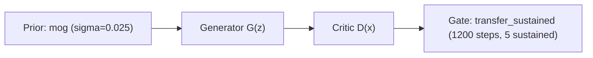

<!-- Generated Forge experiment page — do not edit manually; regenerate via `python -m experiments.forge.experiment_docs` -->

[← Leaderboard](../technique-inventory.md) · [Experiment Catalog](README.md) · [Explore by Laws](../LAWS_HUB.md) · [Research Portal](https://hypergan.github.io/ParticleGAN/)

# 8-Mode Ring Sustained Mode Hold (`mode_hold`)

| Field | Value |
| --- | --- |
| **Laws Tested** | [Law 1](../LAWS_HUB.md#law1) · [Law 4.5](../LAWS_HUB.md#law4_5) |
| **Edge Cases** | `mode-retention` `long-horizon-stability` `ring-mixture` |
| **Primary View (`discriminator_stability`)** | Tier 2 (required) |
| **Four Laws Adherence Role** | prerequisite (prerequisite) |
| **Fixed Full-Suite Denominator** | Yes (71-test fixed denominator) |
| **Adapter / Domain** | `transfer_behavior` / `transfer_sustained` |
| **Prior** | `mog` (sigma=`0.025`, standardize=`False`) |
| **Update Budget** | `1200` steps |

## What This Experiment Tests

Tests whether a trainer can acquire and continuously hold all 8 modes of a 2D Gaussian ring at high sample quality (hq >= 0.90) across 1,200 updates without late-stage mode dropout or oscillation.

> [!NOTE]
> **Protocol notes:** Required in Tier 2 and serves as a prerequisite sanity check for Four Laws Adherence.

## Laws & Edge Cases Targeted

- **[Law 1: Representational Geometry](../LAWS_HUB.md#law1)** ([Law 1 theory](../../../docs/four-laws.md#law-1--representational-geometry)) — Can the system represent the required probability measure efficiently and faithfully?
- **[Law 4.5: Coupled Minimax Contraction](../LAWS_HUB.md#law4_5)** ([Law 4.5 theory](../../../docs/four-laws.md#law-4--functional-and-game-dynamics)) — Can the learning system realize useful functional changes and exhibit appropriate coupled learning dynamics?
- **Edge-case tags:** `mode-retention`, `long-horizon-stability`, `ring-mixture`

## Common Failure Mode

Recipes that pass early acquisition often oscillate or shed modes over sustained updates when critic damping or minimax contraction (Law 4.5) is missing.

**Historical audit diagnosis** (`reports/forge/problem-definitions.json`): BCAP falls one sustained window short in the reviewed run (3 terminal passing checks; 5 required). This single test accounts for BISPF's six-point lead when repeated across six views.

- *Recommended research focus:* Preserve the BISPF pass on current source and combine it with repairs to Gaussian, vector and image failures.

## Visual Schematic


*Target & Protocol Schematic · not training output — generated deterministically from the declared task contract.*

## Protocol & Architecture Diagram



## Task Contract & Numerical Gates

### Execution & Sampling Contract

| Contract Field | Declared Value |
| --- | --- |
| Initializer | `deterministic_orthogonal` |
| Prior | `mog` (sigma=`0.025`, standardize=`False`) |
| Update Budget | `1200` steps |
| Batch Size | `host-declared` |
| Particles / Latent Dim | `P=host` / `z_dim=host` |
| Sampling Law | `public_prior_without_output_noise` |
| Evaluation Output Noise | `clean` |
| Scoring Weights | `live` |
| Assigned Views | `adaptation` (T2 required), `bcap-develop-integration-deeper-diagnostic-v1` (T1 diagnostic), `bispf_throughput_endurance` (T1 diagnostic), `clockfree_continuous` (T2 required), `discriminator_stability` (T2 required), `formulation_comparison` (T2 required), `four-laws-adherence-v1` (T1 diagnostic), `host_profile_transfer` (T2 required) (+9 more) |

### Numerical Pass/Fail Thresholds

| Metric | Operator | Threshold |
| --- | :---: | ---: |
| `modes` | `>=` | `8` |
| `hq` | `>=` | `0.9` |

## Recorded Family Results

> [!IMPORTANT]
> Screening outcomes below come from recorded single-seed (`seed = 0`) Forge evidence. `NOT MEASURED`, `BLOCKED`, and `INCOMPATIBLE` are non-numerical states — not scientific failures — and confer no pass or qualification credit.

| Family | Selected Candidate | Outcome | Key Recorded Metrics | Family Report | Training Media |
| --- | --- | :---: | --- | --- | --- |
| **Atlas** | `atlas-particle-normal-v4` | **PASS** | no compatible result | [Atlas](../families/atlas.md#cohort-cuda-bc3debd3fa5e) | — |
| **BISPF** | `bispf-optimized-quintic-v1` | **PASS** | recomputed complete live curve and terminal suffix | [BISPF](../families/bispf.md#cohort-cuda-1bf9d7d34422) | — |
| **EMPF** | `empf-v8` | **PASS** | recomputed complete live curve and terminal suffix | [EMPF](../families/empf.md#cohort-cuda-23a94f16ca88) | — |
| **RHBI** | `rhbi-v12` | **PASS** | recomputed complete live curve and terminal suffix | [RHBI](../families/rhbi.md#cohort-cuda-23a94f16ca88) | — |
| **Unified** | `unified-v11` | **PASS** | recomputed complete live curve and terminal suffix | [Unified](../families/unified.md#cohort-cuda-42a130a78fc3) | — |
| **BCAP** | `recipe-prior-refactor-bcap-pure-v1` | **FAIL** | recomputed complete live curve and terminal suffix | [BCAP](../families/bcap-pure.md#cohort-cuda-1bf9d7d34422) | — |
| **E22** | `e22` | `BLOCKED` | Skipped incompatible test: mode_hold: public components has no declared policy-control evi | [E22](../families/e22.md#cohort-cuda-1bf9d7d34422) | — |
| **GAN v3 release 0.7** | `recipe-prior-refactor-release07-gan-v3-v1` | **FAIL** | no compatible result | [GAN v3 release 0.7](../families/release07-gan-v3.md#cohort-cuda-1bf9d7d34422) | — |
| **K3P** | `recipe-prior-refactor-k3p-v1` | **FAIL** | no compatible result | [K3P](../families/k3p.md#cohort-cuda-1bf9d7d34422) | — |
| **KA2** | `recipe-prior-refactor-ka2-v1` | **FAIL** | no compatible result | [KA2](../families/ka2.md#cohort-cuda-1bf9d7d34422) | — |
| **R1/R2** | `recipe-prior-refactor-r1r2-v1` | **FAIL** | no compatible result | [R1/R2](../families/r1r2.md#cohort-cuda-1bf9d7d34422) | — |

## Reproduce This Experiment

```bash
# Validate this task declaration and inspect planned dependencies
python -m experiments.forge validate
python -m experiments.forge plan --view discriminator_stability --candidate unified-v12 --tasks mode_hold
```

**Declaration & Source Files:**

- Task contract: [configs/forge/tasks/mode_hold.json](../../../configs/forge/tasks/mode_hold.json)
- Source code: [benchmarks/locked_shared/baseline.py](../../../benchmarks/locked_shared/baseline.py)
- Source code: [benchmarks/locked_shared/observation.py](../../../benchmarks/locked_shared/observation.py)
- Source code: [benchmarks/transfer_suite/protocol.py](../../../benchmarks/transfer_suite/protocol.py)

## Annotation Provenance

This page was assembled read-only from the following versioned inputs without altering any task execution/evaluation fingerprint:

- **Task contract JSON:** [configs/forge/tasks/mode_hold.json](../../../configs/forge/tasks/mode_hold.json)
- **Editorial task documentation sidecar:** [configs/forge/task-documentation/mode_hold.json](../../../configs/forge/task-documentation/mode_hold.json)
- **Read-only Python AST source:** [benchmarks/locked_shared/baseline.py](../../../benchmarks/locked_shared/baseline.py) (AST symbols: `__doc__`)
- **Read-only Python AST source:** [benchmarks/locked_shared/observation.py](../../../benchmarks/locked_shared/observation.py) (AST symbols: `__doc__`)
- **Read-only Python AST source:** [benchmarks/transfer_suite/protocol.py](../../../benchmarks/transfer_suite/protocol.py) (AST symbols: `__doc__`)
