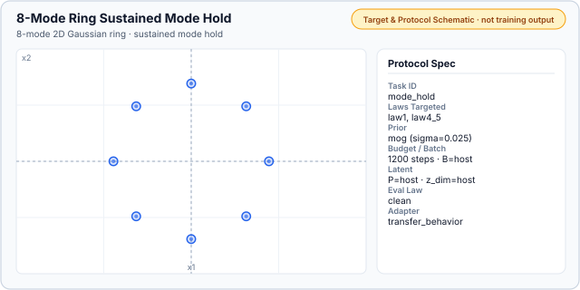
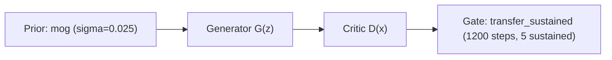

<!-- Generated Forge experiment page — do not edit manually; regenerate via `python -m experiments.forge.experiment_docs` -->

[← Leaderboard](../technique-inventory.md) · [Experiment Catalog](README.md) · [Explore by Laws](../LAWS_HUB.md) · [Research Portal](https://hypergan.github.io/ParticleGAN/)

# 8-Mode Ring Sustained Mode Hold (`mode_hold`)

| Field | Value |
| --- | --- |
| **Laws Tested** | [Law 1](../LAWS_HUB.md#law1) · [Law 4.5](../LAWS_HUB.md#law4_5) |
| **Edge Cases** | `mode-retention` `long-horizon-stability` `ring-mixture` |
| **Primary View (`discriminator_stability`)** | Tier 2 (required) |
| **Four Laws Adherence Role** | prerequisite (prerequisite) |
| **Fixed Full-Suite Denominator** | Yes (59-test active runnable denominator) |
| **Adapter / Domain** | `transfer_behavior` / `transfer_sustained` |
| **Prior** | `mog` (sigma=`0.025`, standardize=`False`) |
| **Update Budget** | `1200` steps |

## What This Experiment Tests

Tests whether a trainer can acquire and continuously hold all 8 modes of a 2D Gaussian ring at high sample quality (hq >= 0.90) across 1,200 updates without late-stage mode dropout or oscillation.

> [!NOTE]
> **Protocol notes:** Required in Tier 2 and serves as a prerequisite sanity check for Four Laws Adherence.

## Laws & Edge Cases Targeted

- **[Law 1: Representational Geometry](../LAWS_HUB.md#law1)** ([Law 1 theory](../../../docs/four-laws.md#law-1--representational-geometry)) — Can the system represent the required probability measure efficiently and faithfully?
- **[Law 4.5: Coupled Minimax Contraction](../LAWS_HUB.md#law4_5)** ([Law 4.5 theory](../../../docs/four-laws.md#law-4--functional-and-game-dynamics)) — Can the learning system realize useful functional changes and exhibit appropriate coupled learning dynamics?
- **Edge-case tags:** `mode-retention`, `long-horizon-stability`, `ring-mixture`

## Common Failure Mode

Recipes that pass early acquisition often oscillate or shed modes over sustained updates when critic damping or minimax contraction (Law 4.5) is missing.

**Historical audit diagnosis** (`reports/forge/problem-definitions.json`): BCAP falls one sustained window short in the reviewed run (3 terminal passing checks; 5 required). This single test accounts for BISPF's six-point lead when repeated across six views.

- *Recommended research focus:* Preserve the BISPF pass on current source and combine it with repairs to Gaussian, vector and image failures.

## Visual Schematic



*Target & Protocol Schematic · not training output — generated deterministically from the declared task contract.*

## Protocol & Architecture Diagram



## Task Contract & Numerical Gates

### Execution & Sampling Contract

| Contract Field | Declared Value |
| --- | --- |
| Initializer | `deterministic_orthogonal` |
| Prior | `mog` (sigma=`0.025`, standardize=`False`) |
| Update Budget | `1200` steps |
| Batch Size | `host-declared` |
| Particles / Latent Dim | `P=host` / `z_dim=host` |
| Sampling Law | `public_prior_without_output_noise` |
| Evaluation Output Noise | `clean` |
| Scoring Weights | `live` |
| Assigned Views | `adaptation` (T2 required), `bcap-develop-integration-deeper-diagnostic-v1` (T1 diagnostic), `bispf_throughput_endurance` (T1 diagnostic), `clockfree_continuous` (T2 required), `discriminator_stability` (T2 required), `formulation_comparison` (T2 required), `four-laws-adherence-v1` (T1 diagnostic), `four-laws-adherence-v2` (T1 diagnostic) (+10 more) |

### Numerical Pass/Fail Thresholds

| Metric | Operator | Threshold |
| --- | :---: | ---: |
| `modes` | `>=` | `8` |
| `hq` | `>=` | `0.9` |

## Recorded Family Results

> [!IMPORTANT]
> Screening outcomes below come from recorded single-seed (`seed = 0`) Forge evidence. `NOT MEASURED`, `BLOCKED`, and `INCOMPATIBLE` are non-numerical states — not scientific failures — and confer no pass or qualification credit.

| Family | Selected Candidate | Outcome | Key Recorded Metrics | Family Report | Training Media |
| --- | --- | :---: | --- | --- | --- |
| **Axiom** | `axiom-v5` | **PASS** | recomputed complete live curve and terminal suffix | [Axiom](../families/axiom.md#cohort-cuda-42a130a78fc3) | [HF GIF](https://huggingface.co/datasets/HyperGAN/particlegan-forge-evidence/resolve/main/media/forge/leaderboard/axiom/axiom-v4/mode_hold.gif) |
| **BISPF** | `bispf-optimized-quintic-v1` | **PASS** | recomputed complete live curve and terminal suffix | [BISPF](../families/bispf.md#cohort-cuda-1bf9d7d34422) | [HF GIF](https://huggingface.co/datasets/HyperGAN/particlegan-forge-evidence/resolve/main/media/forge/bispf-optimized/quality-media/mode_hold.gif) |
| **EMPF** | `empf-v8` | **PASS** | recomputed complete live curve and terminal suffix | [EMPF](../families/empf.md#cohort-cuda-23a94f16ca88) | [HF GIF](https://huggingface.co/datasets/HyperGAN/particlegan-forge-evidence/resolve/main/media/forge/leaderboard/empf/empf-v8/mode_hold.gif) |
| **RHBI** | `rhbi-v12` | **PASS** | recomputed complete live curve and terminal suffix | [RHBI](../families/rhbi.md#cohort-cuda-23a94f16ca88) | [HF GIF](https://huggingface.co/datasets/HyperGAN/particlegan-forge-evidence/resolve/main/media/forge/leaderboard/rhbi/rhbi-v12/mode_hold.gif) |
| **Unified** | `unified-v15` | **PASS** | recomputed complete live curve and terminal suffix | [Unified](../families/unified.md#cohort-cuda-42a130a78fc3) | [HF GIF](https://huggingface.co/datasets/HyperGAN/particlegan-forge-evidence/resolve/main/media/forge/leaderboard/unified/unified-v11/mode_hold.gif) |
| **Atlas** | `atlas-particle-normal-v4` | `DIAG_PASS` | no compatible result | [Atlas](../families/atlas.md#cohort-cuda-daa283c8a640) | — |
| **BCAP** | `recipe-prior-refactor-bcap-pure-v1` | **FAIL** | recomputed complete live curve and terminal suffix | [BCAP](../families/bcap-pure.md#cohort-cuda-1bf9d7d34422) | [HF GIF](https://huggingface.co/datasets/HyperGAN/particlegan-forge-evidence/resolve/main/media/forge/recipe-prior-refactor/publication/media/bcap-pure-ordinary-mode_hold.gif) |
| **E22** | `e22` | `BLOCKED` | Skipped incompatible test: mode_hold: public components has no declared policy-control evi | [E22](../families/e22.md#cohort-cuda-1bf9d7d34422) | — |
| **GAN v3 release 0.7** | `recipe-prior-refactor-release07-gan-v3-v1` | `NOT MEASURED` | no compatible result | [GAN v3 release 0.7](../families/release07-gan-v3.md#cohort-cuda-daa283c8a640) | — |
| **K3P** | `recipe-prior-refactor-k3p-v1` | `NOT MEASURED` | no compatible result | [K3P](../families/k3p.md#cohort-cuda-daa283c8a640) | — |
| **KA2** | `recipe-prior-refactor-ka2-v1` | `NOT MEASURED` | no compatible result | [KA2](../families/ka2.md#cohort-cuda-daa283c8a640) | — |
| **R1/R2** | `recipe-prior-refactor-r1r2-v1` | `NOT MEASURED` | no compatible result | [R1/R2](../families/r1r2.md#cohort-cuda-daa283c8a640) | — |

### Four Laws Adherence Diagnostic Receipts (Separate Cohort)

*Diagnostic readouts and Colab matched-GPU receipts for `four-laws-adherence-v1` (protocol seed `0`, unchanged recipes; research telemetry only — separate from ordinary selected-cohort qualification above and confers no qualification or default-adoption credit):*

| Candidate | Family | GPU | Outcome | `min_margin` | NVML Energy | Key Recorded Metrics | Receipt |
| --- | --- | --- | :---: | ---: | ---: | --- | --- |
| `axiom-v4` | `axiom` | NVIDIA RTX A6000 | **PASS** | — | 1.52 kJ (J-to-PASS) | cover=1, effective_modes=7.551, hq=0.9951, modes=8 | [readout-9066cb4353eb435be7819b0c.json](../records/readout-9066cb4353eb435be7819b0c.json) |
| `axiom-v5` | `axiom` | NVIDIA L4 | **PASS** | — | 1.88 kJ (J-to-PASS) | cover=1, effective_modes=7.491, hq=0.9167, modes=8 | [5ee918d831364b9fabac9eb86b322528.json](../technique-receipts/5ee918d831364b9fabac9eb86b322528.json) |
| `axiom-v6` | `axiom` | NVIDIA RTX A6000 | **PASS** | — | 1.29 kJ (J-to-PASS) | cover=1, effective_modes=7.536, hq=0.99, modes=8 | [readout-69f7d043a14e2780fb2cdd4a.json](../records/readout-69f7d043a14e2780fb2cdd4a.json) |
| `empf-v8` | `empf` | NVIDIA L4 | **PASS** | — | 1.18 kJ (J-to-PASS) | cover=1, effective_modes=7.503, hq=1, modes=8 | [8f7d4d0011864248ba512ac81c859b4c.json](../technique-receipts/8f7d4d0011864248ba512ac81c859b4c.json) |
| `law4-energy-v11` | `unified` | NVIDIA L4 | **PASS** | — | 576 J (J-to-PASS) | cover=1, effective_modes=7.505, hq=1, modes=8 | [e5e670cb499241d59e54c6ffa4395b45.json](../technique-receipts/e5e670cb499241d59e54c6ffa4395b45.json) |
| `minimal-v2` | `minimal` | NVIDIA L4 | **PASS** | — | 1.10 kJ (J-to-PASS) | cover=1, effective_modes=7.534, hq=1, modes=8 | [7dcb980ce6a442a6b275dcbc4ae7cbc9.json](../technique-receipts/7dcb980ce6a442a6b275dcbc4ae7cbc9.json) |
| `unified-v11` | `unified` | NVIDIA L4 | **PASS** | — | 704 J (J-to-PASS) | cover=1, effective_modes=7.512, hq=1, modes=8 | [d597ab07e7b746d3a31a4037a32683a1.json](../technique-receipts/d597ab07e7b746d3a31a4037a32683a1.json) |
| `unified-v12` | `unified` | NVIDIA L4 | **PASS** | — | 623 J (J-to-PASS) | cover=1, effective_modes=7.505, hq=1, modes=8 | [f66f9ddc1d184df28889747f7a6ee0f1.json](../technique-receipts/f66f9ddc1d184df28889747f7a6ee0f1.json) |
| `unified-v14` | `unified` | NVIDIA L4 | **PASS** | — | 562 J (J-to-PASS) | cover=1, effective_modes=7.505, hq=1, modes=8 | [dcd5de2600114588a414fdca43e23ce6.json](../technique-receipts/dcd5de2600114588a414fdca43e23ce6.json) |
| `unified-v15` | `unified` | NVIDIA L4 | **PASS** | — | 665 J (J-to-PASS) | cover=1, effective_modes=7.48, hq=0.9846, modes=8 | [4ad90f279cfe490b994e15c8f0235304.json](../technique-receipts/4ad90f279cfe490b994e15c8f0235304.json) |
| `atlas-particle-normal-v4` | `atlas` | NVIDIA L4 | **FAIL** | — | 1.45 kJ | cover=0.5, effective_modes=3.457, hq=0.9231, modes=4 | [7a823a0a86cc40f283ac2951064d707f.json](../technique-receipts/7a823a0a86cc40f283ac2951064d707f.json) |
| `bispf-optimized-quintic-v1` | `bispf` | NVIDIA L4 | **FAIL** | — | 1.91 kJ | cover=1, effective_modes=7.578, hq=0.9509, modes=8 | [2b590e96333143cd910ea4f40e6e6ced.json](../technique-receipts/2b590e96333143cd910ea4f40e6e6ced.json) |
| `recipe-prior-refactor-bcap-pure-v1` | `bcap-dualnorm` | NVIDIA L4 | **FAIL** | — | 1.56 kJ | cover=0.875, effective_modes=6.488, hq=0.9653, modes=7 | [e41af40801ec4256ac8cd56d46af286a.json](../technique-receipts/e41af40801ec4256ac8cd56d46af286a.json) |
| `recipe-prior-refactor-k3p-v1` | `k3p` | NVIDIA L4 | **FAIL** | — | 818 J | cover=0.625, effective_modes=4.717, hq=0.9966, modes=5 | [d09f1feb138f48f9ae5b051cbdea0062.json](../technique-receipts/d09f1feb138f48f9ae5b051cbdea0062.json) |
| `recipe-prior-refactor-ka2-v1` | `ka2` | NVIDIA L4 | **FAIL** | — | 825 J | cover=0.625, effective_modes=4.733, hq=0.9802, modes=5 | [c75eb93ae2474272b4934292150fad59.json](../technique-receipts/c75eb93ae2474272b4934292150fad59.json) |
| `recipe-prior-refactor-r1r2-v1` | `r1r2` | NVIDIA L4 | **FAIL** | — | 582 J | cover=0.625, effective_modes=4.589, hq=0.9272, modes=5 | [ffd06d5db5a04f3cbb2178aba25bdeb2.json](../technique-receipts/ffd06d5db5a04f3cbb2178aba25bdeb2.json) |
| `recipe-prior-refactor-release07-gan-v3-v1` | `release07-gan-v3` | NVIDIA L4 | **FAIL** | — | 671 J | cover=0.875, effective_modes=6.741, hq=0.999, modes=7 | [e76fa86d8968430ba32095625e5c58d1.json](../technique-receipts/e76fa86d8968430ba32095625e5c58d1.json) |

## Reproduce This Experiment

```bash
# Validate this task declaration and inspect planned dependencies
python -m experiments.forge validate
python -m experiments.forge plan --view discriminator_stability --candidate unified-v12 --tasks mode_hold
```

**Declaration & Source Files:**

- Task contract: [configs/forge/tasks/mode_hold.json](../../../configs/forge/tasks/mode_hold.json)
- Source code: [benchmarks/locked_shared/baseline.py](../../../benchmarks/locked_shared/baseline.py)
- Source code: [benchmarks/locked_shared/observation.py](../../../benchmarks/locked_shared/observation.py)
- Source code: [benchmarks/transfer_suite/protocol.py](../../../benchmarks/transfer_suite/protocol.py)

## Annotation Provenance

This page was assembled read-only from the following versioned inputs without altering any task execution/evaluation fingerprint:

- **Task contract JSON:** [configs/forge/tasks/mode_hold.json](../../../configs/forge/tasks/mode_hold.json)
- **Editorial task documentation sidecar:** [configs/forge/task-documentation/mode_hold.json](../../../configs/forge/task-documentation/mode_hold.json)
- **Read-only Python AST source:** [benchmarks/locked_shared/baseline.py](../../../benchmarks/locked_shared/baseline.py) (AST symbols: `__doc__`)
- **Read-only Python AST source:** [benchmarks/locked_shared/observation.py](../../../benchmarks/locked_shared/observation.py) (AST symbols: `__doc__`)
- **Read-only Python AST source:** [benchmarks/transfer_suite/protocol.py](../../../benchmarks/transfer_suite/protocol.py) (AST symbols: `__doc__`)
