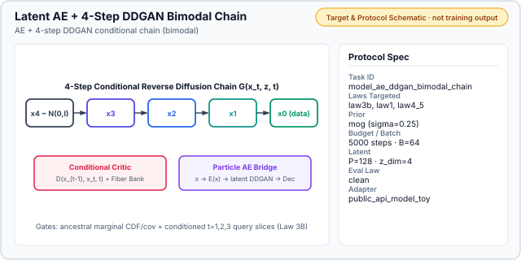
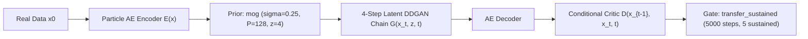

<!-- Generated Forge experiment page — do not edit manually; regenerate via `python -m experiments.forge.experiment_docs` -->

[← Leaderboard](../technique-inventory.md) · [Experiment Catalog](README.md) · [Explore by Laws](../LAWS_HUB.md) · [Research Portal](https://hypergan.github.io/ParticleGAN/)

# Latent AE + 4-Step DDGAN Bimodal Chain (`model_ae_ddgan_bimodal_chain`)

| Field | Value |
| --- | --- |
| **Laws Tested** | [Law 3B](../LAWS_HUB.md#law3b) · [Law 1](../LAWS_HUB.md#law1) · [Law 4.5](../LAWS_HUB.md#law4_5) |
| **Edge Cases** | `conditional-chain` `latent-diffusion` `multimodal-posterior` |
| **Primary View (`discriminator_stability`)** | Tier 2 (required) |
| **Four Laws Adherence Role** | — |
| **Fixed Full-Suite Denominator** | Yes (71-test fixed denominator) |
| **Adapter / Domain** | `public_api_model_toy` / `transfer_sustained` |
| **Prior** | `mog` (sigma=`0.25`, standardize=`False`) |
| **Update Budget** | `5000` steps |

## What This Experiment Tests

Full latent-diffusion stress test coupling a particle AE with a 4-step bimodal DDGAN reverse chain, requiring accurate reconstruction alongside multimodal conditional reverse transitions.

> [!NOTE]
> **Protocol notes:** Tier-2 required public-API model task.

## Laws & Edge Cases Targeted

- **[Law 3B: Conditional Fiber & Stratum Identifiability](../LAWS_HUB.md#law3b)** ([Law 3B theory](../../../docs/four-laws.md#law-3--transport-identifiability)) — Does the learning system possess enough information to determine appropriate transport?
- **[Law 1: Representational Geometry](../LAWS_HUB.md#law1)** ([Law 1 theory](../../../docs/four-laws.md#law-1--representational-geometry)) — Can the system represent the required probability measure efficiently and faithfully?
- **[Law 4.5: Coupled Minimax Contraction](../LAWS_HUB.md#law4_5)** ([Law 4.5 theory](../../../docs/four-laws.md#law-4--functional-and-game-dynamics)) — Can the learning system realize useful functional changes and exhibit appropriate coupled learning dynamics?
- **Edge-case tags:** `conditional-chain`, `latent-diffusion`, `multimodal-posterior`

## Common Failure Mode

Simultaneous latent drift and multimodal branch averaging cause collapsed or biased conditional slices.

## Visual Schematic



*Target & Protocol Schematic · not training output — generated deterministically from the declared task contract.*

## Protocol & Architecture Diagram



## Task Contract & Numerical Gates

### Execution & Sampling Contract

| Contract Field | Declared Value |
| --- | --- |
| Initializer | `deterministic_orthogonal` |
| Prior | `mog` (sigma=`0.25`, standardize=`False`) |
| Update Budget | `5000` steps |
| Batch Size | `64` |
| Particles / Latent Dim | `P=128` / `z_dim=4` |
| Sampling Law | `task_model_kernel_and_posterior_without_serving_noise` |
| Evaluation Output Noise | `clean` |
| Scoring Weights | `live` |
| Dependencies | [`model_ae_ddgan_gaussian_chain`](model_ae_ddgan_gaussian_chain.md) (`gate`) |
| Integrity Guards | `finite_state`, `rng_isolation`, `optimizer_roles`, `exact_optimizer_updates`, `mechanism_exercised` |
| Assigned Views | `discriminator_stability` (T2 required), `prior-ablation-full-suite-v1` (T1 diagnostic) |

### Numerical Pass/Fail Thresholds

| Metric | Operator | Threshold |
| --- | :---: | ---: |
| `final_projection_cdf` | `<=` | `0.32` |
| `final_normalized_mean` | `<=` | `0.25` |
| `final_covariance_eigen_min` | `>=` | `0.3` |
| `final_covariance_eigen_max` | `<=` | `2.6` |
| `t1_q0_projection_cdf` | `<=` | `0.75` |
| `t1_q0_normalized_mean` | `<=` | `1.5` |
| `t1_q0_covariance_eigen_min` | `>=` | `0.4` |
| `t1_q0_covariance_eigen_max` | `<=` | `4.5` |
| `t1_q1_projection_cdf` | `<=` | `0.75` |
| `t1_q1_normalized_mean` | `<=` | `1.5` |
| `t1_q1_covariance_eigen_min` | `>=` | `0.4` |
| `t1_q1_covariance_eigen_max` | `<=` | `4.5` |
| `t2_q0_projection_cdf` | `<=` | `0.28` |
| `t2_q0_normalized_mean` | `<=` | `0.7` |
| `t2_q0_covariance_eigen_min` | `>=` | `0.6` |
| `t2_q0_covariance_eigen_max` | `<=` | `1.4` |
| `t2_q1_projection_cdf` | `<=` | `0.28` |
| `t2_q1_normalized_mean` | `<=` | `0.7` |
| `t2_q1_covariance_eigen_min` | `>=` | `0.6` |
| `t2_q1_covariance_eigen_max` | `<=` | `1.4` |
| `t3_q0_projection_cdf` | `<=` | `0.22` |
| `t3_q0_normalized_mean` | `<=` | `0.5` |
| `t3_q0_covariance_eigen_min` | `>=` | `0.65` |
| `t3_q0_covariance_eigen_max` | `<=` | `1.4` |
| `t3_q1_projection_cdf` | `<=` | `0.22` |
| `t3_q1_normalized_mean` | `<=` | `0.5` |
| `t3_q1_covariance_eigen_min` | `>=` | `0.65` |
| `t3_q1_covariance_eigen_max` | `<=` | `1.4` |
| `t4_q0_projection_cdf` | `<=` | `0.12` |
| `t4_q0_normalized_mean` | `<=` | `0.25` |
| `t4_q0_covariance_eigen_min` | `>=` | `0.65` |
| `t4_q0_covariance_eigen_max` | `<=` | `1.4` |
| `t4_q1_projection_cdf` | `<=` | `0.12` |
| `t4_q1_normalized_mean` | `<=` | `0.25` |
| `t4_q1_covariance_eigen_min` | `>=` | `0.65` |
| `t4_q1_covariance_eigen_max` | `<=` | `1.4` |
| `panel_count` | `==` | `8` |
| `samples_per_panel` | `>=` | `2048` |
| `final_hq` | `>=` | `0.9` |
| `final_mode_mass_tv` | `<=` | `0.1` |
| `final_local_mean_sigma` | `<=` | `1.5` |
| `final_local_covariance_min` | `>=` | `0.3` |
| `final_local_covariance_max` | `<=` | `2.05` |
| `paired_nmse` | `<=` | `0.1` |
| `paired_worst_axis_nrmse` | `<=` | `0.25` |
| `paired_shuffled_gain` | `>=` | `3.0` |
| `paired_reverse_steps` | `==` | `4` |

## Recorded Family Results

> [!IMPORTANT]
> Screening outcomes below come from recorded single-seed (`seed = 0`) Forge evidence. `NOT MEASURED`, `BLOCKED`, and `INCOMPATIBLE` are non-numerical states — not scientific failures — and confer no pass or qualification credit.

| Family | Selected Candidate | Outcome | Key Recorded Metrics | Family Report | Training Media |
| --- | --- | :---: | --- | --- | --- |
| **EMPF** | `empf-v8` | **PASS** | no compatible result | [EMPF](../families/empf.md#cohort-cuda-23a94f16ca88) | — |
| **Atlas** | `atlas-particle-normal-v4` | `NOT MEASURED` | no compatible result | [Atlas](../families/atlas.md#cohort-cuda-daa283c8a640) | — |
| **Axiom** | `axiom-v4` | `NOT MEASURED` | no compatible result | [Axiom](../families/axiom.md#cohort-cuda-daa283c8a640) | — |
| **BCAP** | `recipe-prior-refactor-bcap-pure-v1` | `NOT MEASURED` | No recorded result for this selected configuration and source. | [BCAP](../families/bcap-pure.md#cohort-cuda-1bf9d7d34422) | — |
| **BISPF** | `bispf-optimized-quintic-v1` | `NOT MEASURED` | No recorded result for this selected configuration and source. | [BISPF](../families/bispf.md#cohort-cuda-1bf9d7d34422) | — |
| **E22** | `e22` | `NOT MEASURED` | No recorded result for this selected configuration and source. | [E22](../families/e22.md#cohort-cuda-1bf9d7d34422) | — |
| **GAN v3 release 0.7** | `recipe-prior-refactor-release07-gan-v3-v1` | `NOT MEASURED` | no compatible result | [GAN v3 release 0.7](../families/release07-gan-v3.md#cohort-cuda-daa283c8a640) | — |
| **K3P** | `recipe-prior-refactor-k3p-v1` | `BLOCKED` | DDGAN caller-owned transition host does not bind adaptive row/serving/noise/transport/stri | [K3P](../families/k3p.md#cohort-cuda-daa283c8a640) | — |
| **KA2** | `recipe-prior-refactor-ka2-v1` | `BLOCKED` | DDGAN caller-owned transition host does not bind adaptive row/serving/noise/transport/stri | [KA2](../families/ka2.md#cohort-cuda-daa283c8a640) | — |
| **R1/R2** | `recipe-prior-refactor-r1r2-v1` | `NOT MEASURED` | no compatible result | [R1/R2](../families/r1r2.md#cohort-cuda-daa283c8a640) | — |
| **RHBI** | `rhbi-v12` | `NOT MEASURED` | no compatible result | [RHBI](../families/rhbi.md#cohort-cuda-23a94f16ca88) | — |
| **Unified** | `unified-v11` | `NOT MEASURED` | no compatible result | [Unified](../families/unified.md#cohort-cuda-42a130a78fc3) | — |

## Reproduce This Experiment

```bash
# Validate this task declaration and inspect planned dependencies
python -m experiments.forge validate
python -m experiments.forge plan --view discriminator_stability --candidate unified-v12 --tasks model_ae_ddgan_bimodal_chain
```

**Declaration & Source Files:**

- Task contract: [configs/forge/tasks/model_ae_ddgan_bimodal_chain.json](../../../configs/forge/tasks/model_ae_ddgan_bimodal_chain.json)
- Source code: [benchmarks/toy_audit/api_model_ae_ddgan.py](../../../benchmarks/toy_audit/api_model_ae_ddgan.py)
- Source code: [benchmarks/toy_audit/api_contract.py](../../../benchmarks/toy_audit/api_contract.py)
- Source code: [benchmarks/toy_audit/api_model_ddgan.py](../../../benchmarks/toy_audit/api_model_ddgan.py)
- Source code: [benchmarks/toy_audit/api_run.py](../../../benchmarks/toy_audit/api_run.py)
- Source code: [benchmarks/toy_audit/reproducibility.py](../../../benchmarks/toy_audit/reproducibility.py)
- Source code: [experiments/forge/model_toy_adapter.py](../../../experiments/forge/model_toy_adapter.py)
- Source code: [particlegan/policy.py](../../../particlegan/policy.py)

## Annotation Provenance

This page was assembled read-only from the following versioned inputs without altering any task execution/evaluation fingerprint:

- **Task contract JSON:** [configs/forge/tasks/model_ae_ddgan_bimodal_chain.json](../../../configs/forge/tasks/model_ae_ddgan_bimodal_chain.json)
- **Editorial task documentation sidecar:** [configs/forge/task-documentation/model_ae_ddgan_bimodal_chain.json](../../../configs/forge/task-documentation/model_ae_ddgan_bimodal_chain.json)
- **Read-only Python AST source:** [benchmarks/toy_audit/api_model_ae_ddgan.py](../../../benchmarks/toy_audit/api_model_ae_ddgan.py) (AST symbols: `__doc__`)
- **Read-only Python AST source:** [benchmarks/toy_audit/api_contract.py](../../../benchmarks/toy_audit/api_contract.py) (AST symbols: `__doc__`)
- **Read-only Python AST source:** [benchmarks/toy_audit/api_model_ddgan.py](../../../benchmarks/toy_audit/api_model_ddgan.py) (AST symbols: `__doc__`)
- **Read-only Python AST source:** [benchmarks/toy_audit/api_run.py](../../../benchmarks/toy_audit/api_run.py) (AST symbols: `__doc__`)
- **Read-only Python AST source:** [benchmarks/toy_audit/reproducibility.py](../../../benchmarks/toy_audit/reproducibility.py) (AST symbols: `__doc__`)
- **Read-only Python AST source:** [experiments/forge/model_toy_adapter.py](../../../experiments/forge/model_toy_adapter.py) (AST symbols: `__doc__`)
- **Read-only Python AST source:** [particlegan/policy.py](../../../particlegan/policy.py) (AST symbols: `__doc__`)
